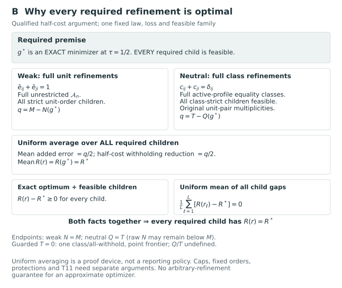

# Proof guide {#sec-proofs}

Proofs appear with the definitions and results in the main chapters. We first review their dependencies and principal assumptions, then give the full proofs for profile decisions. To apply a result to another grading procedure, its conditions on the loss, probability law and feasible family must also hold.

The arguments begin with the distinction between the latent target, reported action and evaluation law in @sec-targets-actions-laws. A reported tie withholds a comparison, whereas latent equality enters the weak directional-error event. The definitions also distinguish criterion weights from cardinal composite coefficients, and pair counts from fractions whose denominators may be zero. The results then proceed as follows.

1. **Representing reports and counting actions.** @prp-grade-representation-counts identifies common grades with ordered partitions and gives their disclosed-pair counts. @prp-contiguous-grade-counts counts the actions after an order is fixed. Fixing an order restricts the feasible family, while the number of grade labels and the number of disclosed pairs measure different features of a report. @sec-posterior-risk-laws supplies the separate selection and evaluation laws used later.

2. **Scalar loss and its source correspondence.** @prp-krw-pair-risk derives scalar pair risk; @prp-scalar-krw-affine states the matched affine correspondence with the report-card objective, including its equality qualification. The block-exchange argument in @sec-krw-dominance uses the feasible exchanges stated there. @sec-rank-score-distance-bridge derives the expected-rank identity and the signed-distance relation. Equivalence with a ranking-score objective depends on its constants and tie convention; applying dominance to a restricted family also requires the relevant exchanges to be feasible.

3. **Weighted directional risk and criterion mixtures.** @prp-weighted-directional-risk derives the additive objective from normalized nonnegative criterion weights under a fixed supplied law. Independence across criteria is unnecessary for linearity. A general composite target, however, is not determined by marginal directional probabilities. @prp-criterion-mixture uses one conditionally independent criterion selector for the whole vector and the same report and action domain. Its correspondence retains the equality correction unless the stated tie-free condition removes it.

4. **Distinct estimands, conflict, and withholding.** @sec-two-estimands gives the agreement and truth-level bounds for weighted criterion error and composite-score error. @sec-conflict-withholding connects pairwise bounds with coherent grade actions under the stated conditions on all-tie feasibility, available cuts, and grade caps. A collection of individually preferred pair actions need not be jointly realizable. The invariance and dominance conclusions in @sec-invariance-dominance depend on the specified transformations and feasible domain; they do not identify a universally Pareto-optimal report.

5. **Protections and preference robustness.** @prp-criterion-protections expresses criterion-specific protections as homogeneous count inequalities. Fraction interpretations require positive disclosure; at zero disclosure the count inequalities and undefined ratios must remain distinct. @prp-minimax-withholding concerns the maximum of expected criterion losses, with an all-tie action available and one fixed included criterion supplying the sufficient condition across pairs. Maximization remains outside the expectation, and the worst criterion is not chosen separately for each comparison.

6. **Optimization over a declared family.** @prp-total-preorder-formulation proves the binary-relation representation using the complete set of required transitivity constraints. @prp-fixed-order-dynamic-program derives additive segmentation over all adjacent cuts of a fixed order, with the stated exact or capped grade count. Protection constraints require an algorithm or certificate valid for the constrained problem. @prp-action-space-and-bounds then separates family inclusion, feasible candidate values, and bounds on the optimum over the whole stated family. A candidate path supplies a feasible value; certifying its gap to the optimum requires an accompanying bound.

7. **Numerical approximation under a fixed law.** @sec-coefficient-error derives risk, regret, and protection transfer from declared coefficient-error radii, including the unclipped thresholds defining the inner and outer protected families. @prp-iid-coefficient-envelope supplies a fixed-sample envelope for independent whole-state draws and the stated ordered coordinates. Uniform control covers optimization after coefficient estimation, but requires further arguments for optional stopping. The dependent-chain specialization in @sec-dependent-monte-carlo has its own source assumptions. The asymptotic diagnostics in @sec-mcmc-output-analysis do not replace a finite-sample coefficient certificate.

8. **Conditional optimality and disclosure frontiers.** @prp-conditional-bayes-dominance compares an optimizer with feasible competitors under the same conditional risk and family. @prp-matched-disclosure-frontier constructs the finite-family frontier, while @sec-matched-disclosure-frontier derives the balanced disclosure endpoint and the unrestricted half-cost refinement result. Complementary weighted errors and availability of every strict refinement are essential to the latter. The conclusions under caps, fixed orders, latent equality and approximate optimization depend on the qualifications given there. Matching grade counts does not establish matching disclosure.

9. **Evaluation and model discrepancy.** @sec-disclosed-error-estimands distinguishes pooled error rates from averages of report-specific fractions. @prp-rao-blackwell-evaluation retains the actual chosen action and uses the correct conditional evaluation law, with the stated integrability and replication conditions. @prp-model-error-regret then bounds comparison under different laws using an explicit discrepancy and optimization gap for a common target and family. Empirical calibration of a fitted producer remains to be assessed beyond conditional optimality and the discrepancy bound.

10. **Allocation and descriptive accounting.** @prp-additive-selection-benchmarks derives exact-budget additive-utility rules; the target membership event and its tie handling are part of the problem. These results do not establish that a grade-to-budget conversion inherits a source selection guarantee. @sec-descriptive-decomposition derives the marginal-contribution allocation and its efficiency identity for complete finite procedure cells. Its pooled-ratio simplification requires the stated common disclosure denominator. This is descriptive accounting, without a causal interpretation or an invocation of source axiomatic uniqueness.

The proofs establish general conclusions under the stated target, probability law, action family, equality convention and approximation conditions. The finite examples illustrate these arguments without replacing their proofs, while the software correspondence in @sec-package-correspondence concerns the identified source version and execution.

## Proof route for the equality-neutral extension {#sec-tie-aware-proof-guide}

The preceding results use the weak-error convention. For the equality-neutral extension, @prp-tie-aware-risk defines the state loss and derives its pair representation, baseline and exact difference from weak-error risk. The whole-column mixture and statewise payoff arguments for this loss are given in @sec-tie-aware-loss. These are local derivations; the scalar source is not credited with a theorem for structural equality.

Existence of a guarded minimizer is proved in @prp-tie-aware-guard for the full weighted at-most-grade family without additional constraints, retaining the original units and pair multiplicities. The composite and criterion-weighted withholding terms need not cancel, as shown in @prp-tie-aware-estimands. Correspondingly, @sec-tie-aware-protections gives different prospective constraints for ordinary and distinct-denominator protections.

For computation and uncertainty, @sec-tie-aware-computation identifies the changed coefficients, offset and guard-compatible fixed-order cuts. @prp-tie-aware-perturbation gives the two-component risk bound and common-family regret inequality; the cross-law interpretation is stated separately in @sec-tie-aware-model-error. These mathematical results do not by themselves establish additional software capabilities.

The finite distinct-mass hull and its monotonicity comparison under exact or approximate optimization are established in @prp-tie-aware-frontier. @prp-tie-aware-half-cost requires all class-strict refinements to be feasible; its endpoint is total distinct mass, not necessarily disclosure of every original pair. The exact four-unit example shows why raw disclosure has no general monotonicity inheritance. The checks linked in @sec-tie-aware-reproduction verify selected finite identities and examples, whereas the proofs establish the general results under their stated conditions.

@fig-vis-fa selects the principal proof routes and then expands the half-cost refinement argument. The diagram carries the extra assumptions needed for each branch.

::: {#fig-vis-fa .reader-figure .reader-has-narrow style="--reader-figure-width:700px;"}
<picture>
<source media="(max-width: 720px)" srcset="../assets/figures/reader-fa-routes-narrow.svg">

</picture>

<details class="figure-secondary-panel">
<summary>View the complete half-cost refinement argument (panel B)</summary>

<picture>
<source media="(max-width: 720px)" srcset="../assets/figures/reader-fa-refinement-narrow.svg">

</picture>

</details>

Separate proof routes and half-cost refinements for the weak-error and equality-neutral branches. The separate half-cost mechanism uses one fixed law, loss and feasible family. Complementary weak errors with all unit refinements give average added error $(M-N)/2$; the neutral identity $c_{ij}+c_{ji}=\delta_{ij}$ with all class-strict refinements gives $(T-Q)/2$ while retaining original unit-pair multiplicities. At $\tau=1/2$ the average risk of those children equals the parent risk. If the parent is an exact optimum and every required child is feasible, each child is bounded below by that minimum; equality of their uniform mean forces every child to attain it. The weak endpoint is $N=M$; the neutral endpoint is $Q=T$ and may retain raw ties. Restrictions, approximate optimization and the capped T11 example require their own arguments.
:::

[Reading-size PDF](../assets/figures/reader-fa-routes-normal.pdf) · [Refinement panel PDF](../assets/figures/reader-fa-refinement-normal.pdf).


## Proofs for profile decisions {#sec-p2-a-proofs}

These arguments use a fixed observed data set, a supplied probability law for the targets, and a declared family of reports. The definitions of [profile actions](../chapters/14-profile-actions.qmd) and [joint protection](../chapters/15-joint-protection.qmd) specify which comparisons are issued, how withholding enters the loss, and which events are protected.

### Which assumptions does the argument use? {#sec-p2-proof-guide .unnumbered}

- **The report family.** Existence requires a finite family containing the all-withheld report. Domainwise minimization requires the actual feasible family to factor. Representation comparisons require nested families under the same loss and protections. See [existence](#thm-T01a), [factorization](#thm-p2-t02-decomposition), and [representation cost](#thm-T07a).
- **Information and protection.** Additive risks, individual tail probabilities, and joint events require different information. The arguments distinguish fixed marginal laws from their coupling and distinguish feasible-set enlargement from strict improvement in minimum risk. See [the coupling example](#prp-p2-t03-finite-counterexample), [the strict-gain criterion](#thm-t08-optimality), and [the cross-pair boundary](#prp-t11-cross-pair-boundary).
- **Changes of representation.** Transformations transport the law, actions and metadata together. Equality quotients retain original-pair multiplicities and denominators. Scenario aggregation retains every feature needed by the fixed candidate family. See [target transformations](#thm-T04a), [equality and scopes](#prp-t10-scopes), and [scenario aggregation](#thm-t12-preservation).
- **Computed decisions.** Scenario formulations describe the supplied finite law. Uniform and held-out bounds require their stated iid sampling and selection conditions. The scientific risk budget remains distinct from the probability of an erroneous numerical certificate. See [the scenario formulation](#prp-c01-exact-encoding), [the uniform bound](#thm-n01-uniform-joint), and [held-out certification](#cor-n02-selection).

The arguments below apply established finite-decision, probability and optimization methods to the profile reporting problem. T01–T12 give elementary derivations, adaptations and counterexamples; N01 and N02 apply existing concentration and binomial results; C01 reformulates a finite-scenario problem. We make no claim of priority for these results or of a new general principle. Specific antecedents are identified where they are used.

The companion programs check the arithmetic and constructions of the stated finite examples; the proofs establish the general results. These computations neither fit empirical posteriors nor establish production-solver performance, repeated-sampling calibration or the accuracy of an approximate law. Sampling guarantees require the assumptions stated in N01 and N02. Recorded runs refer to the source versions on which they were performed; later computations and reviews have separate records.

### Statements and proofs {#sec-p2-proof-contents .unnumbered}

The following fifteen groups contain forty statements, with their hypotheses, proofs, counterexamples and qualifications. The linked specifications, finite examples and checking programs are preserved source files; a link to a text source opens the complete file.

| Proof group | Statements and proofs |
|:---|:---|
| [T01. Existence and matched reductions](#sec-p2-proof-packet-t01) | [T01a](#thm-T01a), [T01b](#thm-T01b), [T01c](#thm-T01c) |
| [T02. Domainwise decomposition and pairwise information](#sec-p2-proof-packet-t02) | [T02.1](#thm-p2-t02-decomposition), [T02.2](#prp-p2-t02-pair-sufficiency), [T02.3](#cor-p2-t02-mean-factorization) |
| [T03. Identical domain marginals can yield different optimal profile reports](#sec-p2-proof-packet-t03) | [T03.1](#prp-p2-t03-finite-counterexample), [T03.2](#prp-p2-t03-continuous-counterexample) |
| [T04. Conditional invariance and its boundaries](#sec-p2-proof-packet-t04) | [T04a](#thm-T04a), [T04b](#prp-T04b), [T04c](#prp-T04c) |
| [T05. Mean, tail and Bonferroni risk relations](#sec-p2-proof-packet-t05) | [T05.1](#prp-t05-tail-mean), [T05.2](#prp-t05-mean-tail), [T05.3](#prp-t05-bonferroni-inclusion) |
| [T06. Budget monotonicity and coarsening boundaries](#sec-p2-proof-packet-t06) | [T06.1](#prp-t06-budget-nesting), [T06.2](#prp-t06-zero-tail-deletion), [T06.3](#exm-t06-positive-tail), [T06.4](#exm-t06-selected-grades) |
| [T07. Matched reporting families and representation cost](#sec-p2-proof-packet-t07) | [T07a](#thm-T07a), [T07b](#prp-T07b), [T07c](#thm-T07c) |
| [T08. When direct joint protection improves optimal risk](#sec-p2-proof-packet-t08) | [T08.1](#prp-t08-overlap), [T08.2](#thm-t08-optimality), [T08.3](#thm-t08-exact-gain) |
| [T09. Protected scopes, aggregation and integer resolution](#sec-p2-proof-packet-t09) | [T09.1](#prp-t09-catalog), [T09.2](#prp-t09-aggregation), [T09.3](#prp-t09-resolution) |
| [T10. Domain-specific equality quotients with retained multiplicities](#sec-p2-proof-packet-t10) | [T10.1](#thm-t10-quotient), [T10.2](#prp-t10-scopes) |
| [T11. Pair-bundle information and the cross-pair boundary](#sec-p2-proof-packet-t11) | [T11.1](#prp-t11-bundle-sufficiency), [T11.2](#prp-t11-cross-pair-boundary) |
| [T12. Lossless scenario aggregation for a fixed decision family](#sec-p2-proof-packet-t12) | [T12.1](#thm-t12-preservation), [T12.2](#prp-t12-count-signature) |
| [N01. A finite-family iid Monte Carlo bound for joint protection](#sec-p2-proof-packet-n01) | [N01.1](#lem-n01-bernoulli-mgf), [N01.2](#thm-n01-uniform-joint), [N01.3](#cor-n01-selected-safe) |
| [N02. One-sided binomial certification after independent selection](#sec-p2-proof-packet-n02) | [N02.1](#thm-n02-cp-bound), [N02.2](#cor-n02-selection) |
| [C01. Shared-scenario formulations over ordered-column banks](#sec-p2-proof-packet-c01) | [C01.1](#prp-c01-exact-encoding), [C01.2](#prp-c01-count-encoding) |

## T01. Existence and matched reductions {#sec-p2-proof-packet-t01}

### Assumptions and source correspondence {#sec-T01-scope}

We use the fixed specification in [decision contract v1](../assets/support/profile-proofs/contracts/decision-contract-v1.qmd.txt), identified by its [manifest](../assets/support/profile-proofs/registry/decision-contract-v1-manifest.json). T01a establishes existence for this finite decision problem, and T01b–T01c relate its loss to the common-grade and scalar losses. The [common-grade source correspondence](../assets/support/profile-proofs/evidence/p2-v1/p1-correspondence.qmd.txt) and [KRW source audit](../assets/support/profile-proofs/evidence/p2-v1/sources/krw-ranking.qmd.txt) explain the difference between the weak-error loss used here and KRW's strict-discordance loss under its no-latent-tie assumption.

The specific antecedents in the common-grade source monograph are Chapter 11, `prp-weighted-directional-risk`, for T01b, and Chapter 10, `prp-scalar-krw-affine`, for T01c. The strict-count source is KRW equation (1), printed p. 2479, interpreted with the no-tie condition on p. 2478. The proofs below reconstruct the algebra using the frozen profile convention.

Fix $y$, finite $n\ge2,D\ge1$, the proper supplied law, orientations, scientifically supported equality guards, allowed family $\mathcal G$ containing all-withheld, and all decision metadata. In particular $w_d\ge0$, $\sum_dw_d=1$, $0<\tau_d\le1/2$, finite scope families and $t,q,\alpha\in[0,1]$. The disclosure utility uses fixed finite nonnegative weights. All integrations below keep the action and metadata fixed. No independence, density, or finite moment of target magnitudes is assumed.

::: {#thm-T01a name="T01a: Finite feasible family and attainment"}
Under these assumptions, the core loss is measurable and bounded by zero and one. Every action has a well-defined finite risk and measurable joint-tail event. The core feasible family $\mathcal F$ is finite and nonempty. Both primary risk minimizers and auxiliary disclosure maximizers over $\mathcal F$ exist. Their sets need not coincide or be singletons.
:::

::: {#proof-T01a}
**Proof of T01a.** Every canonical grade column is a vector in $\{1,\ldots,n\}^n$, so $|\mathcal A_n|\le n^n$ and $|\mathcal G|\le n^{nD}<\infty$. A fixed direction's failure set $\{\theta_{id}\le\theta_{jd}\}$ is Borel. Finite sums give measurable $F_d,F_{dh}$ and loss; strict exceedances and their finite union are measurable. Each pair costs either zero, one, or $\tau_d$, hence each normalized domain loss lies in $[0,1]$. The convex weighted average does too, so its expectation exists without target-moment assumptions.

For the all-withheld matrix, every $N_d,F_d,N_{dh},F_{dh}$ is zero. Every mean constraint is $0\le0$ and every strict exceedance is $0>0$, which is false. Thus $J=0\le\alpha$, even at zero budgets. The matrix respects all domain equality guards and belongs to $\mathcal G$ by assumption. Its risk is $\sum_dw_d\tau_d$ and its disclosure utility is zero. It therefore belongs to $\mathcal F$. A real-valued function on a finite nonempty set attains its minimum and maximum; the utility is finite because its weights and index set are finite. This proves both existence claims. It gives no uniqueness, positive-disclosure requirement, or equality of the two solution sets. $\square$
:::

The result concerns the core constraints. An added positive-disclosure requirement or an additional risk cap excluding all-withheld needs a separate nonemptiness argument. Zero loss weights neither remove guards/protections nor establish uniqueness. Numerical threshold estimates do not establish membership in the exact $\mathcal F$.

::: {#thm-T01b name="T01b: Scalar and common-grade loss reductions"}
For $D=1$, the profile loss equals the scalar weak-error loss at the same $\tau_1$. On a common column $G=(g,\ldots,g)$, put $\bar\tau=\sum_dw_d\tau_d$. Then
$$
L_{\mathrm{sep}}(G,\Theta)
=\frac{\sum_dw_dF_d(g,\Theta)+\bar\tau\{M-N(g)\}}M.
$$
This equals the audited weighted common-grade loss when its withholding parameter is $\bar\tau$; in particular it equals that loss at $\tau$ when all $\tau_d=\tau$. The equality holds statewise, including at latent equality, and consequently for risks under the same supplied law.
:::

::: {#proof-T01b}
**Proof of T01b.** With $D=1$, normalization of weights forces $w_1=1$, giving $\{F_1+\tau_1(M-N_1)\}/M$ directly. On the diagonal, all $x_{ij}^d$ equal $\mathbf1\{g_i<g_j\}$ and $N_d=N(g)$. Substitute into the core loss and collect the common withholding count:
$$
\frac1M\sum_dw_d\{F_d+\tau_d(M-N)\}
=\frac{\sum_dw_dF_d+(\sum_dw_d\tau_d)(M-N)}M.
$$
The common-grade expression uses these same weak errors, normalized weights and all-pair denominator. Finite linearity of expectation gives the risk identity, without independence across domains. Also $0<\bar\tau\le1/2$, so it is an admissible common-grade withholding cost. $\square$
:::

This reduction requires identical targets, unit population, orientation, law, weak-equality convention and $M$. Comparing to a fixed common-grade parameter different from $\bar\tau$ changes the objective. Matching full optimization problems further requires the same feasible actions and protections under the identification $g\leftrightarrow(g,\ldots,g)$. The profile diagonal is intersected with all restrictions in $\mathcal G$; guards from different domains can restrict its common column. Adding joint-tail protection to a common-grade objective generally changes its feasible problem. Neither the scalar reduction nor the loss identity removes that change.

::: {#thm-T01c name="T01c: Qualified scalar KRW affine bridge"}
For the scalar setting, align the grade convention so both losses issue the same directions. Write $C_{\mathrm K},F_{\mathrm K},T_{\mathrm K}$ for the numbers of issued directions that are respectively strictly correct, strictly reversed, and at latent equality. Define the source strict-count expression
$$
L_{\mathrm K,\lambda}=(F_{\mathrm K}-\lambda C_{\mathrm K})/M,
\qquad \lambda=\frac{\tau}{1-\tau},\quad
\tau=\frac{\lambda}{1+\lambda}.
$$
For $0<\tau\le1/2$, the corresponding range is $0<\lambda\le1$. At every state,
$$
L_\tau
=\tau+(1-\tau)L_{\mathrm K,\lambda}
+\frac{(1-\tau)T_{\mathrm K}}M.
$$
If each pair has zero equality probability under the common law, the last term vanishes almost surely for all actions. The risks then satisfy the positive affine identity, and their full minimizing sets coincide on any identical nonempty feasible family.
:::

::: {#proof-T01c}
**Proof of T01c.** The disclosed counts partition as $N=C_{\mathrm K}+F_{\mathrm K}+T_{\mathrm K}$, while weak error is $F=F_{\mathrm K}+T_{\mathrm K}$. Hence
$$
\begin{aligned}
L_\tau
&=\frac{F_{\mathrm K}+T_{\mathrm K}+\tau(M-C_{\mathrm K}-F_{\mathrm K}-T_{\mathrm K})}{M}\\
&=\tau+\frac{(1-\tau)F_{\mathrm K}-\tau C_{\mathrm K}+(1-\tau)T_{\mathrm K}}M.
\end{aligned}
$$
Substitution of $(1-\tau)\lambda=\tau$ yields the stated identity. A finite union of pair-equality null events is null, providing one full-probability set on which every action has $T_{\mathrm K}=0$. Taking expectations is justified by boundedness. Risk differences are then multiplied by $1-\tau>0$, preserving strict order, weak order and ties, and therefore the full argmin sets on the same family. $\square$
:::

The source uses the opposite numerical grade orientation, which can be reversed without changing the issued assertions. Continuous marginal distributions alone do not imply the pairwise no-equality condition. A weaker sufficient condition on a restricted family is zero expected $T_{\mathrm K}$ for every permitted action; guards can make this hold. The source endpoint $\lambda=0$ corresponds to $\tau=0$, outside the positive-cost v1 baseline. None of these objective identities transfers an unshared constraint, a source unrestricted optimum, or a calibration guarantee.

With positive equality mass, the strict-count expression extends the algebra beyond KRW's no-tie setting, and the correction generally depends on the action. The following example shows why this correction is needed. It leaves KRW's result under the stated no-tie condition unaffected.

### Exact examples {#sec-T01-fixtures}

[The example file](../assets/support/profile-proofs/fixtures/p2-v1/reduction-cases.json) contains rational states, hand-derived expectations and an embedded standard-library Python checker, separate from the later reference evaluator.

- **Scalar and constraint separation:** $n=2$, probabilities $3/4$ and $1/4$ on $(2,1)$ and $(1,2)$, $\tau=1/3$, $\lambda=1/2$. Forward/withheld/reverse weak risks are $1/4,1/3,3/4$; strict-source risks are $-1/8,0,5/8$. The affine identity holds. A zero-threshold full-pair budget $\alpha=1/8$ nevertheless leaves only withholding feasible.
- **Common grades:** $n=3,D=2$, rows $(3,2),(2,1),(1,3)$, $g=(1,2,2)$, weights $(1/3,2/3)$. Both domains disclose two pairs, with error counts $(0,1)$. Common $\tau=1/4$ gives risk $11/36$. Costs $(1/4,1/2)$ give $\bar\tau=5/12$ and risk $13/36$, which differs from using an unmatched common-grade cost $1/4$.
- **Latent equality:** put mass $1/2$ each on $(2,1)$ and $(1,1)$, with identity-only structural guards. At $\tau=1/3$, weak risks are $1/2,1/3,1$, whereas strict-source risks are $-1/4,0,1/2$. The weak loss selects withholding; the strict extension selects forward disclosure. The equality correction restores the exact formula.
- **Zero-weight protection:** two certainly ordered domains, weights $(1,0)$, zero-threshold full-domain protection and $\alpha=0$ yield two risk minimizers: the first domain discloses correctly while the zero-weight domain either withholds or discloses correctly. Its wrong direction remains infeasible. Existence does not imply uniqueness or removal of its protection.

## T02. Domainwise decomposition and pairwise information {#sec-p2-proof-packet-t02}

### Domain risks and feasible actions {#sec-p2-t02-status}

The additive loss suggests optimizing one domain at a time. We determine when this is valid using finite separable optimization and linearity of expectation. We retain [decision contract v1](../assets/support/profile-proofs/contracts/decision-contract-v1.qmd.txt), [canonical action space](../assets/support/profile-proofs/proofs/definitions/action-space.qmd.txt), [elementary loss](../assets/support/profile-proofs/proofs/definitions/elementary-loss.qmd.txt), [scope protection](../assets/support/profile-proofs/contracts/profile-risk-spec.qmd.txt), and [input provenance](../assets/support/profile-proofs/contracts/input-provenance.qmd.txt). The risks here are exact mathematical quantities; estimates used after numerical selection require a separate argument.

<!-- Historical development identifier: This packet implements Step 4.2. -->

Fix $y$, $n\ge2$, $D\ge1$, and a proper supplied law $\Pi_s(\cdot\mid y)$ on the target array. Hold targets, orientations, unit identities, masks, equality guards, action restrictions and costs fixed. Let $\Pi_{s,d}$ denote the marginal law of the **complete unit vector** $\Theta_{\cdot d}$. Domain marginals are not collections of independent unit marginals. No independence among domains or units is assumed. Keep $M=\binom n2$, $w_d\ge0$, $\sum_dw_d=1$ and $0<\tau_d\le1/2$.

For a domain column $g$, write

$$
\rho_d(g)=\int
\frac{F_d(g,z)+\tau_d\{M-N_d(g)\}}{M}\,\Pi_{s,d}(dz\mid y).
$$

This is well-defined because the integrand is bounded. Here $F_d(g,z)$ uses only the oriented domain target vector $z$ and the strict disclosures from $g$.

### T02.1: decomposition on the actual feasible family {#sec-p2-t02-decomposition}

::: {#thm-p2-t02-decomposition name="Exact argmin factorization with zero weights"}
Suppose the **actual feasible family**, after all restrictions and protections have been imposed, equals

$$
\mathcal F=\prod_{d=1}^{D}\mathcal F_d,
\qquad \varnothing\ne\mathcal F_d\subseteq\mathcal A_n.
$$

Define $m_d=\min_{g\in\mathcal F_d}\rho_d(g)$ and

$$
\mathcal M_d=
\begin{cases}
\operatorname*{arg\,min}_{g\in\mathcal F_d}\rho_d(g),&w_d>0,\\
\mathcal F_d,&w_d=0.
\end{cases}
$$

Then

$$
R_{\mathrm{sep}}(G)=\sum_dw_d\rho_d(g^{(d)}),\qquad
\min_{G\in\mathcal F}R_{\mathrm{sep}}(G)=\sum_dw_dm_d,
\qquad
\operatorname*{arg\,min}_{G\in\mathcal F}R_{\mathrm{sep}}(G)
=\prod_d\mathcal M_d.
$$

The statement requires product feasibility, not a factorized posterior.
:::

:::: {#proof-p2-t02-decomposition}
::: {.proof}
By finite linearity of expectation, the integral of the additive state loss equals the sum of its weighted domain integrals. Each domain integrand depends only on $\Theta_{\cdot d}$, so its joint-law integral is the displayed marginal-law integral. This proves the risk identity without any independence assumption.

Each factor is finite and nonempty, hence every $m_d$ is attained and every $\mathcal M_d$ is nonempty. For any $G\in\mathcal F$,

$$
R_{\mathrm{sep}}(G)-\sum_dw_dm_d
=\sum_dw_d\{\rho_d(g^{(d)})-m_d\}\ge0.
$$

Choose a minimizer in each positive-weight factor and any member of each zero-weight factor. Product feasibility makes their combined matrix admissible and feasible, and its gap is zero. Thus the lower bound is attained. Finally, the finite sum of nonnegative terms is zero exactly when every positive-weight term is zero. This is equivalent to $g^{(d)}\in\mathcal M_d$ for every domain. A zero-weight domain imposes no further objective condition, while its full feasibility restriction remains active. This proves both the minimum value and the equality of argmin sets.
:::
::::

The factorization concerns the **set of minimizers**. A tie-breaking rule may still couple the choice among optimal matrices, so the theorem neither selects a unique grade vector nor maximizes disclosure. When $w_d=0$, the guards and protected scopes in domain $d$ remain in force.

### T02.2: pairwise coefficients identify additive risk and mean counts {#sec-p2-t02-sufficiency}

::: {#prp-p2-t02-pair-sufficiency name="Weak-error coefficient sufficiency"}
For every ordered pair $i\ne j$, define

$$
e_{ij}^{d}=\Pi_s(\theta_{id}\le\theta_{jd}\mid y).
$$

For every fixed candidate $G$ and fixed scope mask,

$$
R_{\mathrm{sep}}(G)=\frac1M\sum_dw_d
\left[\sum_{i\ne j}x_{ij}^{d}(G)e_{ij}^{d}
+\tau_d\{M-N_d(G)\}\right],
$$

$$
E_{\Pi_s}[F_{dh}(G,\Theta)\mid y]
=\sum_{i\ne j}a_{ij}^{h}x_{ij}^{d}(G)e_{ij}^{d}.
$$

Consequently, two proper supplied laws with the same $e_{ij}^{d}$ values give the same additive risk and every such expected count for all candidates with the same decision metadata. They also give the same optional expected-error feasibility inequalities. On an identical fixed family with only these mean protections, they have identical argmin sets.
:::

:::: {#proof-p2-t02-pair-sufficiency}
::: {.proof}
In the scoped error count, $a_{ij}^{h}$ and $x_{ij}^{d}(G)$ are fixed coefficients. Integrating each indicator in its finite sum gives $e_{ij}^{d}$, proving the second identity. With the full-pair mask this gives $E F_d$. The withholding count $M-N_d(G)$ is fixed, so substituting $E F_d$ into the core risk gives the first identity.

Both right sides involve the law only through the displayed coefficient array. The values $N_{dh}(G)$ also depend only on the action and mask. Therefore each inequality $E F_{dh}\le q_{dh}N_{dh}$ has the same truth value under the two laws. When $N_{dh}>0$, the expected FDP follows by dividing the expected count by that deterministic denominator; when $N_{dh}=0$, the computational zero extension is the same under both laws. Thus the mean-feasible families and objective values coincide, proving equality of their argmin sets.
:::
::::

Here sufficiency refers to the **decision functionals**, rather than statistical sufficiency for the underlying model. The origin of the coefficients as probabilities under a proper law must be established: checking their numerical range or pairwise reciprocity alone does not show that a target law can realize them jointly. With equality mass, $e_{ij}^{d}+e_{ji}^{d}$ need not equal one; the specified weak-error convention still applies.

### T02.3: an explicit factorizing constraint regime {#sec-p2-t02-mean-factorization}

::: {#cor-p2-t02-mean-factorization name="Domainwise mean protection preserves a product family"}
Suppose the allowed action family is $\mathcal G=\prod_d\mathcal B_d$, with finite nonempty factors containing their all-withheld columns. Suppose joint protection is disabled or is redundant on every action satisfying the mean constraints. Keep only the domain–scope mean constraints of contract v1, with fixed masks and budgets. Define

$$
\mathcal F_d=\left\{g\in\mathcal B_d:
\sum_{i\ne j}a_{ij}^{h}x_{ij}^{d}(g)e_{ij}^{d}
\le q_{dh}N_{dh}(g)
\text{ for every }h\text{ with }(d,h)\in\mathcal P\right\}.
$$

Then the actual feasible set is $\prod_d\mathcal F_d$, all its factors are nonempty, and T02.1 applies.
:::

:::: {#proof-p2-t02-mean-factorization}
::: {.proof}
Each displayed inequality involves only column $g^{(d)}$ once its coefficients and metadata are fixed. Membership in all inequalities is therefore equivalent to membership in $\mathcal F_d$ for every $d$, together with membership in the product allowed family. Disabled or redundant joint protection removes no further matrix. This proves the product equality. Every all-withheld column has both counts zero, so it belongs to its factor; hence all factors are nonempty. Apply T02.1.
:::
::::

Domain-specific equality guards, fixed domain grade caps, and fixed domain order restrictions can be included in the factors. A common-grade diagonal, a cross-domain resource budget, or a candidate bank that couples columns need not factorize. Separable objective terms alone never justify optimizing those families domain by domain.

### Coupling, fitting, and the boundary of the result {#sec-p2-t02-boundaries}

A direct constraint $J(G)\le\alpha$ generally combines decisions across domains. Even if their target vectors are independent, let $p_d(g^{(d)})$ be the probability of the union of protected exceedances within domain $d$. Then the cross-domain union probability is $1-\prod_d(1-p_d)$; imposing one bound on that expression generally couples the columns. Independence is therefore neither required for T02.1's objective identity nor sufficient for its feasible-set assumption. Special cases can remain product-shaped; the actual family must be checked.

A tail event, conjunction or arbitrary pair-bundle functional also depends on how error indicators occur together, so the pairwise identities do not generally identify these quantities. Full domain-vector marginals contain more information than individual pair coefficients, and cross-domain joint events can require more still. The proofs and calculations for these information requirements are given separately.

Finally, holding fitted marginal laws fixed is different from fitting domains separately. A joint statistical model can change each marginal through shared parameters, data, or shrinkage. Such changes can alter $e_{ij}^{d}$ and hence the additive optimum, entirely consistently with T02. The invariance statement compares laws **after fitting**, with matching coefficients and identical decision metadata; it imposes no restriction on how a model is fitted. Even under that invariance, a joint constraint may change feasibility when the coupling changes. With matching objective coefficients and an unchanged feasible family, resolving ties by the same fixed ordering of actions yields the same selected representative. Without a matched tie-break, equality of argmin sets alone does not identify the issued matrix.

## T03. Identical domain marginals can yield different optimal profile reports {#sec-p2-proof-packet-t03}

### Comparing laws with the same marginals {#sec-p2-t03-status}

The following coherent counterexamples show the information boundary of [T02](#sec-p2-proof-packet-t02). They use the [closed decision contract](../assets/support/profile-proofs/contracts/decision-contract-v1.qmd.txt), [strict reporting semantics](../assets/support/profile-proofs/contracts/reporting-semantics.qmd.txt), and [joint exceedance specification](../assets/support/profile-proofs/contracts/profile-risk-spec.qmd.txt). Both examples solve **primary problem A**, which minimizes expected error–withholding loss; the law labels do not refer to auxiliary problem B.

<!-- Historical development identifier: Step 4.3. -->

There are two units and two domains, with larger targets meaning higher priority. The action family is the full $\mathcal A_2^2$, containing nine matrices. No between-unit structural equality is declared, and no expected-error safeguard is imposed: $\mathcal P=\varnothing$. In both laws use

$$
M=1,\qquad w_1=w_2=\frac12,\qquad
\tau_1=\tau_2=\frac14,\qquad
t_{1,\mathrm{full}}=t_{2,\mathrm{full}}=0,\qquad
\alpha=\frac3{20}.
$$

The protected set contains both full-domain scopes. Therefore $J(G)$ is the probability of at least one false issued direction. Every decision input other than the supplied joint law is identical.

### T03.1: finite laws with equal complete domain marginals {#sec-p2-t03-finite}

For $a,b\in\{-1,+1\}$, let

$$
T_{ab}=\begin{pmatrix}a&b\\0&0\end{pmatrix},
\qquad
\Pi^{\mathrm{co}}=\frac9{10}\delta_{T_{++}}+\frac1{10}\delta_{T_{--}},
$$

$$
\Pi^{\mathrm{dis}}=\frac45\delta_{T_{++}}+
\frac1{10}\delta_{T_{-+}}+\frac1{10}\delta_{T_{+-}}.
$$

These are proper finite laws on actual target matrices. Under either law and in either domain, the complete unit-vector marginal is

$$
\mathcal L(\Theta_{\cdot d})
=\frac9{10}\delta_{(1,0)}+\frac1{10}\delta_{(-1,0)}.
$$

Thus equality holds for the **full domain marginals**, not merely for individual target marginals or pairwise sign probabilities. All within-domain target differences are nonzero.

::: {#prp-p2-t03-finite-counterexample name="Joint risk and optimal actions are not identified by domain marginals"}
Under the preceding common specification, the matrix with both columns $(1,2)$ has risk $1/10$ under both laws, but its joint violation probabilities are $1/10$ and $1/5$, respectively. The unique minimizer under $\Pi^{\mathrm{co}}$ discloses unit 1 above unit 2 in both domains. Under $\Pi^{\mathrm{dis}}$, the complete argmin set consists of the two matrices disclosing that direction in exactly one domain and withholding the other. Their risk is $7/40$.
:::

:::: {#proof-p2-t03-finite-counterexample}
::: {.proof}
There are exactly three canonical columns for two labelled units:

$$
W=(1,1),\qquad +=(1,2),\qquad -=(2,1).
$$

They mean withholding, asserting unit 1 higher, and asserting unit 2 higher. A column $+$ is wrong with probability $1/10$ in each domain; a column $-$ is wrong with probability $9/10$; $W$ has constant loss $1/4$. These facts give the common additive risks in the exhaustive table below. For each disclosed direction, its error is a subset of the listed finite support states. Taking the union of those subsets gives the joint probabilities. The columns in each action are ordered by domain.

| Action | $R_{\mathrm{sep}}$ under either law | $J_{\mathrm{co}}$ | $J_{\mathrm{dis}}$ | Feasible under co / dis |
|---|---:|---:|---:|---|
| $(W,W)$ | $1/4$ | $0$ | $0$ | yes / yes |
| $(W,+)$ | $7/40$ | $1/10$ | $1/10$ | yes / yes |
| $(W,-)$ | $23/40$ | $9/10$ | $9/10$ | no / no |
| $(+,W)$ | $7/40$ | $1/10$ | $1/10$ | yes / yes |
| $(+,+)$ | $1/10$ | $1/10$ | $1/5$ | yes / no |
| $(+,-)$ | $1/2$ | $1$ | $9/10$ | no / no |
| $(-,W)$ | $23/40$ | $9/10$ | $9/10$ | no / no |
| $(-,+)$ | $1/2$ | $1$ | $9/10$ | no / no |
| $(-,-)$ | $9/10$ | $9/10$ | $1$ | no / no |

For $(+,+)$ specifically, both errors occur together at $T_{--}$ under $\Pi^{\mathrm{co}}$. Under $\Pi^{\mathrm{dis}}$, the first-domain error occurs at $T_{-+}$ and the second-domain error at $T_{+-}$; these states are disjoint. The resulting union probabilities straddle $\alpha=3/20$. Comparison of all feasible table entries proves the stated minimum risks and exact argmin sets. No larger action family or unexamined candidate remains in this two-unit problem.
:::
::::

The optimal grade counts are $(2,2)$ under the first law and either $(1,2)$ or $(2,1)$ under the second. Disclosed pair-domain statements decrease from two to one. The number of occupied profile cells remains two in both cases; these resolution summaries are not interchangeable.

The argmin sets are disjoint despite identical complete domain marginals. Consequently, those marginals cannot generally identify an optimal report for this joint-constrained problem: a deterministic procedure receiving only the shared marginals and common decision metadata would receive identical inputs under both laws. It could not return an optimal matrix for both. This is an information statement, not a restriction on fitting multidomain models.

### T03.2: absolutely continuous companions {#sec-p2-t03-continuous}

::: {#prp-p2-t03-continuous-counterexample name="The counterexample persists under full-dimensional densities"}
Fix $0<\varepsilon<1/2$. Independently of the finite mixture label, add independent $\mathrm{Uniform}(-\varepsilon,\varepsilon)$ noise to each of the four target coordinates. Apply the same noise distribution to both finite laws. The resulting laws $\Pi^{\mathrm{co}}_\varepsilon$ and $\Pi^{\mathrm{dis}}_\varepsilon$ are absolutely continuous with respect to four-dimensional Lebesgue measure, have identical complete domain marginals to one another, and preserve every risk, joint probability, feasible action and argmin set in the table.
:::

:::: {#proof-p2-t03-continuous-counterexample}
::: {.proof}
For either finite law, let its support matrices be $T_k$ with masses $p_k$. The perturbed matrix has density

$$
f_\varepsilon(\theta)=
\sum_k\frac{p_k}{(2\varepsilon)^4}
\mathbf1\{\|\theta-T_k\|_\infty<\varepsilon\}.
$$

Each component integrates to $p_k$; the density is nonnegative, integrates to one, and is bounded by $(2\varepsilon)^{-4}$. Its components occupy boxes with nonempty interior in $\mathbb R^4$. The construction therefore has no restriction to a lower-dimensional surface. It does not assert positive density everywhere: the support is bounded.

In a domain whose finite-state sign is $a\in\{-1,+1\}$, the perturbed target difference is $a+U_{1d}-U_{2d}$. Its deviation from $a$ has absolute value less than $2\varepsilon<1$, so its sign remains $a$. Hence every issued direction has exactly the same truth value throughout a component box as at its center. All disclosure counts are action-determined. It follows that the state loss and joint-error indicator are constant within each box, with the same values as at $T_k$. Integrating against the unchanged mixture masses preserves all table entries and thus their feasible sets and minimizers.

For a fixed domain, either original law has mixture weights $9/10$ and $1/10$ on the vectors $(1,0)$ and $(-1,0)$. The two perturbed marginals apply the same independent two-coordinate uniform noise to this same mixture. They are therefore equal as complete unit-vector laws. These shared **smoothed** marginals differ from the original discrete marginals; equality is asserted between the two companion laws, not between a discrete law and its smoothing.
:::
::::

### Interpretation and exact verification {#sec-p2-t03-verification}

The [coupling example file](../assets/support/profile-proofs/fixtures/p2-v1/coupling-laws.json) contains the exact support, rational masses, all nine canonical actions, expected table entries and complete minimizer sets. An embedded Python program checks all 18 action–law combinations directly from the target values, using rational arithmetic and the specified strict exceedance rule. It also checks the sign bounds for the continuous construction at $\varepsilon=1/4$. The preceding proof establishes continuity and equality of the marginals; these properties do not depend on Monte Carlo simulation. The program verifies this finite example separately from the later reference engine.

The example isolates the effect of joint dependence by holding costs, budgets, allowed grades and every domain marginal fixed. Marginal signal-to-noise ratios therefore cannot explain the difference. The specified budget and objective expose information that marginal-only evaluation cannot recover, although a different specification could give the same decision under both laws. The constructed comparison establishes neither a general monotonic effect of correlation nor a universal advantage from dependence-aware protection.

## T04. Conditional invariance and its boundaries {#sec-p2-proof-packet-t04}

### Standing contract and meaning of invariance {#sec-T04-scope}

We retain [decision contract v1](../assets/support/profile-proofs/contracts/decision-contract-v1.qmd.txt), the [report semantics](../assets/support/profile-proofs/contracts/reporting-semantics.qmd.txt), and the assumptions of [T01](#thm-T01a). Everything is conditional on the same observed information $y$. The transformations are fixed measurable maps, and we obtain each transformed law by pushing forward the existing complete joint law, with its state probabilities unchanged. The invariances follow from the ordering loss and events under this transformation; refitting the posterior or changing the model is a different operation.

An invariant fixed-action value, an equivariant optimizer set and an invariant numerical algorithm are distinct claims. The last needs its own candidate-generation, approximation and tie-breaking conditions.

::: {#thm-T04a name="T04a: Domainwise strictly increasing target transformations"}
For each domain $d$, let $f_d:\mathbb R\to\mathbb R$ be measurable and strictly increasing. Apply the **same** $f_d$ to every unit in that domain:
$$
T(\Theta)_{id}=f_d(\theta_{id}),\qquad
\Pi'_s=T_\#\Pi_s.
$$
Keep the canonical action family, masks, domain costs/weights, budgets, utility weights and structural guards unchanged. Then, for every admissible $G$, all disclosed counts, statewise weak-error counts, loss, expected-error constraints and joint-tail risk agree under the correspondence $\Theta\mapsto T(\Theta)$. Consequently the feasible family, primary argmin set and auxiliary argmax set are identical. All grade and occupied-cell counts are unchanged.
:::

::: {#proof-T04a}
**Proof of T04a.** Strict monotonicity gives, for every pair of real numbers,
$$
a>b\iff f_d(a)>f_d(b),\quad
a=b\iff f_d(a)=f_d(b),\quad
a\le b\iff f_d(a)\le f_d(b).
$$
Thus each issued strict assertion and its weak-error indicator retain their truth value. The action is unchanged, so all $x_{ij}^d,N_d,N_{dh},K_d,C(G)$ are unchanged. The finite sums defining $F_d,F_{dh}$ and $L_{\mathrm{sep}}$ are identical at corresponding states. This also preserves strict reversal and distinctness indicators when those separately specified branches are considered. Structural identities remain identities, and injectivity creates no new equalities between unequal values.

With unchanged thresholds, every event indicator $\mathbf1\{F_{dh}>t_{dh}N_{dh}\}$ and their union indicator agree. For any bounded measurable integrand $b$,
$$
\int b(\Theta')\,\Pi'_s(d\Theta'\mid y)
=\int b(T(\Theta))\,\Pi_s(d\Theta\mid y).
$$
Apply this identity to loss, error counts and the union indicator. Risks and both kinds of protection therefore agree. The same family has the same feasible members; equal objective values give equal minimizing/maximizing sets. Utility depends on the unchanged report and weights. $\square$
:::

No common cardinal scale, domain independence or finite posterior mean is required. An increasing transformation does not change the interpretation of higher priority **within** a domain. It does not create a ranking across domains. The result applies to exact laws and to a fixed empirical law separately; applying it to stored states does not certify their accuracy for the intended law.

### Grade labels, unit names and domain names {#sec-T04-relabeling}

::: {#prp-T04b name="T04b: Order-preserving grade labels and transported identifiers"}
Replacing occupied raw grade labels by any strictly increasing labels and then canonicalizing their order returns the same canonical column. Unit or domain permutations give an isomorphic decision problem if the complete law and **all** indexed metadata, actions and restrictions are transported with them.
:::

::: {#proof-T04b}
**Proof of T04b.** An increasing raw-label map preserves exactly the equality blocks and their order. Canonicalization assigns those blocks $1,\ldots,K_d$ again, so the original column is recovered.

For identifier changes, let $u$ and $r$ be permutations of units and domains. Define
$$
\theta'_{u(i),r(d)}=\theta_{id},\qquad
(\eta G)_{u(i),r(d)}=g_{id},\qquad
\mathcal G'=\eta(\mathcal G).
$$
Push the joint law forward by this coordinate permutation. Transport $w_d,\tau_d$, utility weights, $E_d$, masks, protected domain–scope index sets, thresholds and budgets. For example, a scope renamed $h'$ has $(a')_{u(i)u(j)}^{h'}=a_{ij}^{h}$ and $t'_{r(d)h'}=t_{dh}$. Each original unordered pair corresponds to exactly one new unordered pair. The same comparisons, errors and withholding contributions appear with renamed indices; their sums and union events therefore agree. The pushforward integral identity proves equality of risks and constraints. The action map $\eta$ is a bijection, so
$$
\mathcal F'=\eta(\mathcal F),\qquad
\operatorname*{argmin}_{\mathcal F'}R'_{\mathrm{sep}}
=\eta\!\left(\operatorname*{argmin}_{\mathcal F}R_{\mathrm{sep}}\right),
$$
with the analogous auxiliary argmax identity. Profile memberships are renamed and domain coordinates permuted; occupied-cell counts are preserved. $\square$
:::

For a single selected optimizer to correspond, the tie-break must also be transported: if $b$ selects from an optimum set $A$, require $b'(\eta(A))=\eta(b(A))$. A newly applied lexicographic rule based on renamed IDs need not satisfy this equation. The theorem guarantees optimizer **sets**, not arbitrary software tie-breaks. Permuting grade labels out of their order is different: with targets $(2,1)$, changing $g=(1,2)$ to $(2,1)$ turns a correct direction into an error.

### Orientation coding and actual order reversal {#sec-T04-orientation}

Changing raw coding while compensating its orientation can leave the oriented target exactly unchanged. For example, if $\theta_{id}=s_d z_{id}$ with $s_d\in\{-1,+1\}$, recoding $z'_{id}=-z_{id}$ and $s'_d=-s_d$ gives $s'_dz'_{id}=\theta_{id}$. The report and scientific priority then remain unchanged. The corresponding raw-law transformation must still be recorded.

::: {#prp-T04c name="T04c: Decreasing targets with reversed grade columns"}
For selected domains, instead apply the same strictly decreasing measurable target map across units and reverse each affected grade column by
$$
g'_{id}=K_d(G)+1-g_{id}.
$$
Keep other domains unchanged. Push forward the joint law and transport the action family to its image under these reversals, retaining the matched unordered-pair masks, costs, budgets and guards. Then loss, protection and objective sets correspond under this action bijection. This is a mathematical isomorphism; it does not assert unchanged substantive priority when the oriented target itself has been reversed.
:::

::: {#proof-T04c}
**Proof of T04c.** Grade reversal is canonical, preserves withheld pairs and is its own inverse. If $g_i<g_j$ originally, the transformed report issues $j$ above $i$. Its weak-error event is $f(\theta_j)\le f(\theta_i)$, equivalent under strict decrease to $\theta_j\ge\theta_i$, exactly the original error event. Equalities are preserved. Thus each unordered pair has the same disclosure and error status. Symmetric masks give equal scoped counts; matched costs and budgets give identical loss and event indicators. Matched disclosure utility is unchanged because the same unordered pairs are disclosed. The pushforward identity and the bijection of allowed actions prove the risk, feasible-set and optimizer correspondences. $\square$
:::

Keeping the old grade vector while decreasing the oriented target does not satisfy this result. Targets $(2,1)$ become $(-2,-1)$ under negation: $g=(1,2)$ is now wrong, whereas the reversed column $(2,1)$ is correct. The new preference orders the original quantities oppositely. Compensated raw coding and a reversed scientific priority must not share an “unchanged report” claim.

### Necessary boundaries and minimal counterexamples {#sec-T04-boundaries}

**Non-strict target maps.** The nondecreasing map $f(a)=\min(a,1)$ takes $(2,1)$ to $(1,1)$. A forward disclosure changes from correct to false under weak error. A collapsed target definition can also change the appropriate structural-identity specification. T04a requires strict increase.

**Unit-specific maps.** Each of $f_1(a)=a$ and $f_2(a)=a+2$ is strictly increasing, but together they take $(2,1)$ to $(2,3)$ and reverse the comparison. The common-within-domain map condition is essential. Arbitrary unit-specific centering or scaling is not covered.

**Regenerated candidate families.** In one domain with identity-only guards, let unit 1 be constantly 2 and unit 2 equal 0 with probability $4/5$ and 4 with probability $1/5$. Their means are 2 and $4/5$, but after the strictly increasing map $f(a)=a^3$ their means are 8 and $64/5$. A candidate bank consisting of all-withheld plus the strict posterior-mean ordering changes its available direction. At $\tau=1/4$, $\alpha=1$, and no optional mean constraints, the original bank selects the forward report with risk $1/5$; the regenerated bank offers the reverse direction with risk $4/5$ and selects withholding with risk $1/4$. Every fixed report still has the same risk before and after the pushforward. The failure is family regeneration, not T04a. Data-dependent restrictions require unchanged or explicitly image-matched families, even when their construction appears innocuous.

**Practical margins.** The baseline asserts strict superiority with zero margin. An extension asserting $\theta_i-\theta_j>\delta$, $\delta>0$, has different invariance conditions. With $\delta=1$ and targets $(3/5,-3/5)$, the difference $6/5$ exceeds the margin, but cubing gives difference $54/125<1$. A fixed margin is therefore not preserved by arbitrary increasing maps. For a positive affine change $f(a)=a_0+b a$, $b>0$, the differences multiply by $b$; choosing $\delta'=b\delta$ preserves the assertion and its error complement. This rescaling concerns a separately declared margin extension, not a change to the v1 zero-margin event.

**Refitting or changing other settings.** Fitting a model in transformed coordinates need not produce the pushforward of the original posterior. Reweighting states, replacing priors, changing masks/costs/budgets, dropping guards, or generating a new candidate bank breaks the matching assumptions unless separately justified. These theorems supply no invariance claim for such changes, floating-point rounding, or the numerical behavior of a solver. No numerical experiment is needed for the displayed exact counterexamples.

## T05. Mean, tail and Bonferroni risk relations {#sec-p2-proof-packet-t05}

### Probability law and fixed objects {#sec-t05-status}

The following inequalities adapt Markov's inequality and the union bound to [decision contract v1](../assets/support/profile-proofs/contracts/decision-contract-v1.qmd.txt), [scope protection](../assets/support/profile-proofs/contracts/profile-risk-spec.qmd.txt) and [input provenance](../assets/support/profile-proofs/contracts/input-provenance.qmd.txt). We give the arguments in full, retaining the [core loss](../assets/support/profile-proofs/contracts/loss-core.qmd.txt).

Fix $y$, the proper supplied law $\Pi_s(\cdot\mid y)$, the action $G$, masks and budgets. Write $P$ and $E$ for probability and expectation under that law, suppressing the conditioning. For one protected domain–scope pair, abbreviate $N=N_{dh}(G)$, $F=F_{dh}(G,\Theta)$ and

$$
Z=\begin{cases}F/N,&N>0,\\0,&N=0,\end{cases}
\qquad \mu=E Z,\qquad p=P(F>tN),\quad 0\le t\le1.
$$

Thus $N$ is fixed, $F\in\{0,\ldots,N\}$ and $Z$ is the computational zero extension of FDP. An empty report still displays no disclosure, not perfect accuracy. All results concern one fixed report under the supplied posterior law. They are not frequentist or Monte Carlo guarantees, or simultaneous statements about all reports selected by an empirical search.

### Tail bounds imply mean bounds {#sec-t05-tail-to-mean}

::: {#prp-t05-tail-mean name="T05.1: bounded and integer-grid tail-to-mean bounds"}
For any $Z\in[0,1]$, writing $p=P(Z>t)$,

$$
E Z\le t+(1-t)p.
$$

For the scoped count with $N>0$ and $t<1$, put $a=\lfloor tN\rfloor/N$. The sharper bound is

$$
\mu\le a+(1-a)p.
$$

Consequently, if this scope is included in a joint event with $J(G)\le\alpha$, then

$$
\mu\le a+(1-a)\alpha\le t+(1-t)\alpha.
$$
:::

**Proof.** On $\{Z\le t\}$, $Z\le t$, and elsewhere $Z\le1$. Taking expectations proves the first inequality. For integer $F$, nonexceedance means $F\le\lfloor tN\rfloor$, hence $Z\le a$; the same argument proves the sharper inequality. A protected scope event is contained in the joint union, so $p\le J(G)\le\alpha$. Both substitutions preserve order because $a\le t\le1$ and $1-\alpha\ge0$. $\square$

For $t<1$, equality in the bounded inequality requires $Z=t$ almost surely on nonexceedance and $Z=1$ almost surely on exceedance; statements on probability-zero sets are vacuous. For the grid bound replace $t$ by $a$. Equality after substituting $\alpha$ additionally requires $p=\alpha$. Equality between the grid and bounded expressions occurs when $a=t$ or $\alpha=1$.

These bounds are sharp over the corresponding unrestricted classes of bounded/grid variables: assign masses $1-p,p$ to $t,1$ or $a,1$. Such abstract distributions need not be attainable by a specified grade action under its target model, guards and posterior support. No sharpness or attainment is asserted for every restricted profile family.

### Mean bounds imply tail bounds {#sec-t05-mean-to-tail}

::: {#prp-t05-mean-tail name="T05.2: Markov and discrete-cutoff bounds"}
For a nonnegative $Z$ and $t>0$, $P(Z>t)\le\min\{1,E Z/t\}$. For the scoped count with $N>0$ and $t<1$, set $k=\lfloor tN\rfloor+1$, so $1\le k\le N$. Then

$$
p=P(F\ge k)\le\min\left\{1,\frac{E F}{k}\right\}
=\min\left\{1,\frac{N\mu}{k}\right\}.
$$

If the corresponding expected-error constraint is $E F\le qN$, it follows that $p\le\min\{1,Nq/k\}$.
:::

**Proof.** The pointwise inequality $Z\ge t\mathbf1\{Z>t\}$ gives the generic Markov bound by expectation and division; probabilities also cannot exceed one. In the integer case $F\ge k\mathbf1\{F\ge k\}$, giving the displayed sharper bound. Substituting the expected-count constraint completes the proof. No independence is used. $\square$

Before clipping at one, the discrete inequality is an equality precisely when $F=0$ almost surely off the event and $F=k$ almost surely on it. At a fixed $\mu\le k/N$, the grid distribution with masses $1-N\mu/k,N\mu/k$ at $0,k/N$ attains the bound for $Z$. If $\mu\ge k/N$, a grid mixture on $k/N$ and $1$ has that mean and attains the clipped bound one. Again, these are generic grid-variable attainments, not claims about every admissible report/model. Because the generic event is strict, $p>0$ and $t>0$ imply $E Z>tp$; one must not claim equality in the untruncated generic Markov bound in that case.

The boundary cases are explicit:

| Condition | Consequence |
|---|---|
| $N=0$ | $F=Z=\mu=p=0$; do not divide by $N$. |
| $N>0,t=0$ | $a=0,k=1$; $\mu\le p\le\min\{1,N\mu\}$. |
| $t=1$ | $p=0$ identically; the tail constraint supplies no mean restriction beyond $\mu\le1$. |
| $q=0$ | In the constrained scope, $F=0$ almost surely, so $P(F>tN)=0$ for every $t\in[0,1]$. Other scopes can still exceed their thresholds. |
| $\alpha=0$ | A protected scope has no exceedance; for $N>0,t<1$, $\mu\le\lfloor tN\rfloor/N$, which can be positive. |

The symbols are not interchangeable. A joint budget $\alpha$ bounds event probability; $t$ sets the realized fraction considered excessive; $q$ bounds its mean. Only scopes carrying the relevant constraint receive these implications. For example, bounds on all individual scope means yield a sufficient joint bound by summing their valid discrete tail bounds; they do not automatically give a joint bound at the same numerical value of $q$.

### Matched Bonferroni comparator families {#sec-t05-bonferroni}

Index the identical finite protected family by $\ell\in\mathcal H$, with $m=|\mathcal H|$, $E_\ell=E_{dh}(G)$ and $p_\ell(G)=P(E_\ell)$. Let $\mathcal B$ contain exactly those $G\in\mathcal G$ satisfying the optional expected-error constraints. All targets, masks, thresholds, guards, costs and action restrictions are held fixed across comparisons.

::: {#prp-t05-bonferroni-inclusion name="T05.3: equal, optimized and direct-joint inclusion"}
For $m>0$, define

$$
\begin{aligned}
\mathcal F_{\rm equal}&=\{G\in\mathcal B:p_\ell(G)\le\alpha/m\ \forall\ell\},\\
\mathcal F_{\rm alloc}&=\{G\in\mathcal B:\exists(\alpha_\ell)_{\ell\in\mathcal H},\quad
\alpha_\ell\ge0,\ p_\ell(G)\le\alpha_\ell\ (\forall\ell),\ \sum_\ell\alpha_\ell\le\alpha\},\\
\mathcal F_{\rm joint}&=\{G\in\mathcal B:P(\bigcup_\ell E_\ell(G))\le\alpha\}.
\end{aligned}
$$

Then

$$
\mathcal F_{\rm equal}\subseteq\mathcal F_{\rm alloc}
=\{G\in\mathcal B:\sum_\ell p_\ell(G)\le\alpha\}
\subseteq\mathcal F_{\rm joint}.
$$

For $m=0$, define all three families to equal $\mathcal B$: no allocation or division by $m$ occurs, and joint protection is disabled.
:::

**Proof.** Equal allocation $\alpha_\ell=\alpha/m$ witnesses the first inclusion. Any feasible allocation has $\sum p_\ell\le\sum\alpha_\ell\le\alpha$. Conversely, if $\sum p_\ell\le\alpha$, choosing $\alpha_\ell=p_\ell$ witnesses allocation feasibility. Finally, the indicator inequality $\mathbf1_{\cup E_\ell}\le\sum_\ell\mathbf1_{E_\ell}$ and expectation give the union bound. For an empty family all sums/unions are empty and the conventions follow. $\square$

“Optimized allocation” here means existence of an allocation for each candidate $G$; it is not a claim that a restricted numerical allocation grid finds one. Independence is unnecessary. With identical objective and exact optimization, inclusion gives $\min_{\mathcal F_{\rm joint}}R_{\rm sep}\le\min_{\mathcal F_{\rm alloc}}R_{\rm sep}\le\min_{\mathcal F_{\rm equal}}R_{\rm sep}$. All-withheld ensures these sets are nonempty. No strict improvement, disclosure increase or solver certificate follows merely from inclusion.

For a fixed action, union-bound equality holds exactly when at most one scope event occurs almost surely: the nonnegative gap $\sum_\ell\mathbf1_{E_\ell}-\mathbf1_{\cup E_\ell}$ has zero expectation precisely under that condition. Thus almost-sure disjointness removes this source of conservatism. A single protected scope makes all three families identical; so does $\alpha=0$. Positive overlap can make the second inclusion strict, while uneven event probabilities can make the first strict. Neither is necessarily strict in a particular restricted action family.

Individual caps $p_\ell\le\alpha$ do not imply $J\le\alpha$. Two disjoint events of probability $\alpha$ have union probability $2\alpha$ when $0<\alpha\le1/2$. The correct union calculation, rather than marginal caps alone, determines the joint assurance.

### Unknown coupling and explicit grouping {#sec-t05-unknown-coupling}

Suppose the cross-domain coupling is unknown. Let $\mathfrak C$ be the declared nonempty class of compatible joint laws. If valid bounds $u_\ell(G)$ satisfy $P_Q(E_\ell(G))\le u_\ell(G)$ for **every** $Q\in\mathfrak C$, the union bound proves

$$
\sup_{Q\in\mathfrak C}P_Q(\bigcup_\ell E_\ell(G))
\le\min\{1,\sum_\ell u_\ell(G)\}.
$$

This is a conservative coupling-robust sufficient condition, not an identified direct-joint probability. Known full unit-vector domain laws determine individual domain-scope events without cross-domain coupling. Pairwise direction probabilities alone generally do not determine even a within-domain tail: dependence among errors matters. They may support conservative bounds through the expected count and T05.2, provided they are valid marginals of the declared law; this additional argument must be named.

One can instead partition $\mathcal H$ into declared groups, such as all scopes in each domain, compute each within-group union probability, and apply Bonferroni across groups. This is a **separately declared grouped alternative**. Its allocation index and probabilities differ from T05.3; do not silently relabel it the same comparator. Computing within-group unions requires their relevant dependence.

To use estimated event probabilities as upper bounds, we still need assumptions on sampling and simultaneous coverage over the candidates searched. The numerical certification results developed later address these requirements. Monte Carlo frequencies, unpaired marginal draws and an assumed effective sample size do not by themselves certify a posterior constraint.

<!-- Historical development reference: Phase 7 obligations. -->

## T06. Budget monotonicity and coarsening boundaries {#sec-p2-proof-packet-t06}

### Fixed specification {#sec-t06-status}

We now vary the budgets under [decision contract v1](../assets/support/profile-proofs/contracts/decision-contract-v1.qmd.txt), holding the supplied law, target orientation, masks, guards, finite action family, loss weights, withholding costs and optional disclosure utility fixed. Probabilities and expectations refer to this law conditional on the observed information. We first establish feasible-set monotonicity, then examine why coarsening and selected grade counts can behave differently.

Write $\mathcal F(\alpha,t,q)$ for the feasible set in the [risk contract](../assets/support/profile-proofs/contracts/profile-risk-spec.qmd.txt), with fixed protected index sets $\mathcal H$ and $\mathcal P$. The tail vector $t$ is indexed by $\mathcal H$ and the mean vector $q$ by $\mathcal P$. Their roles remain distinct as in [T05](#sec-p2-proof-packet-t05).

### Feasible sets and optimal objective values {#sec-t06-budget-nesting}

::: {#prp-t06-budget-nesting name="T06.1: monotone budget relaxation"}
If $\alpha'\ge\alpha$, $t'_{dh}\ge t_{dh}$ on $\mathcal H$ and $q'_{dh}\ge q_{dh}$ on $\mathcal P$, then

$$
\mathcal F(\alpha,t,q)\subseteq\mathcal F(\alpha',t',q').
$$

Consequently the minimum of the unchanged $R_{\mathrm{sep}}$ is nonincreasing, and the maximum of the unchanged $I_v$ is nondecreasing, under these relaxations.
:::

**Proof.** Fix an action in the first set. Its counts and denominators are unchanged. Since $N_{dh}\ge0$, increasing $t_{dh}$ gives

$$
\{F_{dh}>t'_{dh}N_{dh}\}\subseteq\{F_{dh}>t_{dh}N_{dh}\}.
$$

Taking unions and probabilities shows that its new joint risk is at most its old risk, hence at most $\alpha\le\alpha'$. Similarly, $E F_{dh}\le q_{dh}N_{dh}\le q'_{dh}N_{dh}$. All other restrictions are identical. The action remains feasible. The objective statements follow by minimizing or maximizing the same function over a containing set. These finite sets contain all-withheld, so the extrema exist. Empty scopes, empty protected families and zero denominators satisfy the same argument without division. $\square$

This does not order the selected matrices, their componentwise grade counts, or their profile partitions. It does not even assert that the disclosure utility of an **A-risk minimizer** is nondecreasing: the utility conclusion concerns the optimized B objective. Changing costs, masks, posterior inputs or candidate families is outside this comparative statement. Holding the objective fixed is essential.

### Coarsening is deletion of issued directions {#sec-t06-coarsening}

A pure coarsening replaces each column by $g'_{id}=\phi_d(g_{id})$, where $\phi_d$ is a nondecreasing surjection from the old occupied grade labels onto the new ones. This merges adjacent ordered blocks and preserves the order of the remaining blocks. Arbitrary regrouping or relabeling that reverses or adds directions is not such a coarsening.

::: {#prp-t06-zero-tail-deletion name="T06.2: deletion counts and zero-threshold joint risk"}
For a pure coarsening $G'$ of $G$, every ordered disclosure indicator satisfies $x_{ij}^d(G')\le x_{ij}^d(G)$. For every fixed scope and every state,

$$
N_{dh}(G')\le N_{dh}(G),\qquad
F_{dh}(G',\Theta)\le F_{dh}(G,\Theta).
$$

If **all** thresholds in the protected union equal zero, then $J(G')\le J(G)$.
:::

**Proof.** If $\phi_d(g_{id})<\phi_d(g_{jd})$, monotonicity of $\phi_d$ implies $g_{id}<g_{jd}$. Thus every retained assertion was already issued in the same direction. Multiplication by a fixed nonnegative scope mask and, for $F$, its unchanged weak-error indicator preserves this ordering; summing gives the count inequalities. At threshold zero, $F_{dh}(G',\Theta)>0$ implies $F_{dh}(G,\Theta)>0$. Union containment over the same protected family and probability prove the final claim. Empty unions and scopes obey the same containment. $\square$

This proves preservation of the **zero-threshold joint constraint only**. Complete feasibility additionally requires $G'\in\mathcal G$ and every optional expected constraint. A candidate bank need not contain a report's coarsenings. Equality guards are preserved by pure merging, but that fact does not establish closure under every other action restriction. Expected fraction constraints can fail because both their numerators and denominators shrink. For a mixed threshold family, the argument covers only its zero-threshold subfamily.

Nor is core loss monotone under coarsening. Subtracting the two core losses gives the statewise identity

$$
L_{\mathrm{sep}}(G',\Theta)-L_{\mathrm{sep}}(G,\Theta)
=\frac1M\sum_dw_d\sum_{i\ne j}
\{x_{ij}^d(G)-x_{ij}^d(G')\}
\left[\tau_d-\mathbf1\{\theta_{id}\le\theta_{jd}\}\right].
$$

A deleted correct assertion increases cost by $\tau_d$, while a deleted false assertion decreases it by $1-\tau_d$, before weighting and normalization. The expected version replaces the indicator by its posterior probability. No uniform sign follows.

### Positive-threshold and mean-constraint counterexample {#sec-t06-positive-tail-example}

::: {#exm-t06-positive-tail name="T06.3: coarsening can increase FDP risk"}
Take one domain, three units, the exact one-state law $\theta=(3,1,2)$, and $g=(1,2,3)$. Merge the first two blocks to obtain $g'=(1,1,2)$. Use the full-pair scope, $t=q=2/5$, and $\tau=1/4$.

| Quantity | $g$ | $g'$ |
|---|---:|---:|
| Disclosed pairs $N$ | 3 | 2 |
| Weak errors $F$ | 1 | 1 |
| Disclosed error fraction | $1/3$ | $1/2$ |
| $P(F>tN)$ | 0 | 1 |
| $E F\le qN$ | true | false |
| Core risk | $1/3$ | $5/12$ |
:::

**Verification.** The original assertions $1>2$ and $1>3$ are correct; $2>3$ is false. Coarsening deletes the correct $1>2$ assertion only. The retained false count is one, but its denominator falls from three to two, proving every entry. For any $0\le\alpha<1$, the joint constraint changes from satisfied to violated. With threshold zero instead, both joint risks equal one: the zero-tail result is respected. Taking $\alpha=1$ then leaves that joint constraint satisfied while the optional $q=2/5$ constraint still fails. A restricted family containing only $g$ and all-withheld would also exclude this intermediate coarsening. $\square$

### Optimal grade counts can move in opposite directions {#sec-t06-selected-grades}

::: {#exm-t06-selected-grades name="T06.4: a grade count decreases after budget relaxation"}
Take $n=D=2$, the full product of canonical grade columns, no nontrivial equality guards, full-domain scopes and $t_1=t_2=0$. Disable optional expected constraints. Put $w=(1/4,3/4)$ and $\tau_1=\tau_2=1/4$. Unit 2 has target $(0,0)$ in every state; unit 1 has

$$
(+1,+1)\text{ with mass }17/20,\quad
(-1,+1)\text{ with mass }1/20,\quad
(+1,-1)\text{ with mass }1/10.
$$

Let $W=(1,1)$ withhold, $P=(1,2)$ report unit 1 higher, and $R=(2,1)$ report unit 2 higher. There are exactly nine product actions. Compare $\alpha_L=3/40$ with $\alpha_H=1/8$:

| Columns | $R_{\mathrm{sep}}$ | $J$ | Feasible at $\alpha_L$ | Feasible at $\alpha_H$ |
|---|---:|---:|:---:|:---:|
| $WW$ | $1/4$ | 0 | yes | yes |
| $PW$ | $1/5$ | $1/20$ | yes | yes |
| $WP$ | $11/80$ | $1/10$ | no | yes |
| $PP$ | $7/80$ | $3/20$ | no | no |
| $RW$ | $17/40$ | $19/20$ | no | no |
| $WR$ | $59/80$ | $9/10$ | no | no |
| $PR$ | $11/16$ | $9/10$ | no | no |
| $RP$ | $5/16$ | $19/20$ | no | no |
| $RR$ | $73/80$ | 1 | no | no |
:::

**Verification.** Each domain has one possible pair. Positive reporting has error probabilities $1/20$ and $1/10$; reverse reporting has $19/20$ and $9/10$. Withholding costs $1/4$. Weighted sums give the risk column. The two positive-direction errors occur in disjoint states, giving $J(PP)=3/20$; evaluating each other union gives the table. These exhaust all canonical actions, so $PW$ is the unique low-budget minimizer and $WP$ the unique high-budget minimizer.

The optimal risk decreases from $1/5$ to $11/80$, consistently with T06.1. Nevertheless, the grade vector changes from $(K_1,K_2)=(2,1)$ to $(1,2)$: $K_1$ decreases. Neither selected report is a pure coarsening of the other. This cannot be explained by a tie-break. Both disclose exactly one pair-domain statement and have two occupied profiles, so the example makes no claim that total disclosure or occupied-cell count decreases. $\square$

### Checking the coarsening examples {#sec-t06-replay}

[The companion fixtures](../assets/support/profile-proofs/fixtures/p2-v1/coarsening-cases.json) record both exact laws, hand-auditable values and an embedded rational-arithmetic replay. It checks deletion, the changing denominator, all nine actions and both unique optimizer sets. Feasible-set monotonicity holds under the fixed-specification assumptions; the counterexamples show why it does not extend to selected grade counts or to FDP under positive-threshold coarsening.

## T07. Matched reporting families and representation cost {#sec-p2-proof-packet-t07}

### The matched decision problem {#sec-T07-status}

We compare nested reporting families under [decision contract v1](../assets/support/profile-proofs/contracts/decision-contract-v1.qmd.txt), deriving inclusion bounds and constructing examples that show when they are sharp. We use [T01](#sec-p2-proof-packet-t01), [T02's risk identity](#sec-p2-t02-sufficiency), and the distinctions between events and feasibility in [T05](#sec-p2-proof-packet-t05) and [T06](#sec-p2-proof-packet-t06). Throughout, we minimize primary expected loss exactly as the reporting restrictions are relaxed. Auxiliary disclosure maximization and approximate search are separate problems.

<!-- Historical development identifier: Step 5.1. -->

Hold fixed the unit/domain targets, supplied joint law, $M=\binom n2$, weak-equality convention, domain weights and withholding costs, equality guards, masks, protected scope sets, thresholds, budgets and optional expected-error constraints. All families contain the all-withheld action. Changing any of these inputs while comparing minima is a different comparison.

### Free statements, partial orders and grade reports {#sec-T07-families}

A free action specifies $x_{ij}^d\in\{0,1\}$ with $x_{ij}^d+x_{ji}^d\le1$ for every unordered pair and domain. The three possibilities are either strict direction or withholding. Set $x_{ii}^d=0$. To transport the equality guards without weakening their reporting consequences, require, whenever $iE_dj$,
$$
x_{ik}^d=x_{jk}^d,\qquad x_{ki}^d=x_{kj}^d\qquad\text{for every }k.
$$
This preserves identical incident assertions and, taking $k=i$ or $j$, within-class withholding. On grade-induced actions it is equivalent to the original equal-grade guard. Merely withholding the within-class pair while allowing inconsistent incident disclosures is a different relaxation.

Extend $N_d,F_d,N_{dh},F_{dh},R_{\mathrm{sep}}$ and $J$ by their **same** count formulas with these indicators. The denominator remains the original $M$ per domain. Withholding still costs $\tau_d$ for every unreported pair, including structurally guarded pairs.

Let $\mathcal X_{\mathrm F}$ be all such guarded ternary actions. Within it, $\mathcal X_{\mathrm O}$ requires each domain's disclosed relation to be a strict partial order, hence irreflexive and transitive. This means the relation contains its transitive implications; a merely acyclic list of generating edges need not belong to this class. Within that class, $\mathcal X_{\mathrm P}$ consists of relations induced by all canonical product grade actions satisfying the same guards. Finally, $\mathcal X_{\mathrm C}$ consists of their common-column diagonal.

Grade relations are strict partial orders, but impose more structure: withholding is an equivalence relation on units, and its blocks are totally ordered. Thus
$$
\mathcal X_{\mathrm C}\subseteq\mathcal X_{\mathrm P}
\subseteq\mathcal X_{\mathrm O}\subseteq\mathcal X_{\mathrm F}.
$$
For example, withholding $1$ versus $2$ and $2$ versus $3$, while disclosing $1>3$, is a partial order but cannot be represented by grades: the two required grade equalities imply $g_1=g_3$. A free action can even be cyclic. No automatic closure, projection or extra disclosure is applied to a free action; such a change creates a different action requiring fresh evaluation.

The inclusion results also apply after an identical relation-level filter containing all-withheld, or to other explicitly nested families. Arbitrary separately generated candidate banks need not be nested. Grade caps and computational restrictions can add costs beyond grade coherence; they must be named, not attributed solely to the representation. The examples below use the full guarded families without additional restrictions.

::: {#thm-T07a name="T07a: Matched risk ordering and universal gap bounds"}
For $A\in\{\mathrm C,\mathrm P,\mathrm O,\mathrm F\}$, let $\mathcal F_A$ be the members of $\mathcal X_A$ satisfying the identical protection constraints, and let $r_A=\min_{x\in\mathcal F_A}R_{\mathrm{sep}}(x)$. Put $r_0=\sum_dw_d\tau_d$. Then all minima exist, and
$$
0\le r_{\mathrm F}\le r_{\mathrm O}\le r_{\mathrm P}\le r_{\mathrm C}\le r_0.
$$
In particular each nonnegative adjacent representation gap is at most $r_0$, and
$$
(r_{\mathrm C}-r_{\mathrm P})+(r_{\mathrm P}-r_{\mathrm F})
=r_{\mathrm C}-r_{\mathrm F}\le r_0.
$$
:::

:::: {#proof-T07a}
::: {.proof}
The free family has at most $3^{DM}$ elements; the other families are finite subsets. The same statewise loss lies in $[0,1]$, since it still prices exactly one of three actions per pair. The all-withheld action has no errors or disclosures, satisfies every stated count/tail constraint, and has risk $r_0$. The existence argument of T01 therefore applies to every family. Applying the same feasibility predicate to nested sets preserves inclusion. Minimization over a larger set cannot increase the minimum. Nonnegativity and the common all-withheld competitor give the endpoint bounds; subtraction and telescoping give the gaps. $\square$
:::
::::

These are conditional costs of restrictions under one decision specification. They do not assert more disclosure, better policy welfare, or that an incoherent free optimizer is an acceptable issued report. The diagonal profile objective matches the common-grade objective only under T01's target/law/cost qualifications; a different common-grade feasible problem is not the comparator here.

::: {#prp-T07b name="T07b: The common-to-product bound can be attained"}
Take $n=2,D=2$, the deterministic target rows $(1,-1)$ and $(0,0)$, weights $(1/2,1/2)$ and common $0<\tau\le1/2$. Use identity-only guards, full-domain scopes, zero thresholds, $\alpha=0$, and no optional mean constraints. Then
$$
r_{\mathrm C}=\tau=r_0,\qquad r_{\mathrm P}=r_{\mathrm O}=r_{\mathrm F}=0.
$$
:::

:::: {#proof-T07b}
::: {.proof}
Any strict common column issues the same direction in both domains. The target directions cross, so one issued assertion is false with probability one; the common column is infeasible. Only withholding remains, at risk $\tau$. Product columns $(1,2)$ and $(2,1)$ disclose the two correct directions, giving $J=0$ and risk zero. Nonnegativity proves optimality, and larger families contain this report. Thus $r_{\mathrm C}-r_{\mathrm P}=r_0$ exactly in this finite example. $\square$
:::
::::

::: {#thm-T07c name="T07c: Product-to-free cost approaching the universal bound"}
Fix $0<\tau\le1/2$. For each integer $n\ge3$, use one domain and the uniform law on $n$ strict target vectors: the base vector $(n,n-1,\ldots,1)$ and the $n-1$ vectors obtained by swapping each one adjacent pair of its entries. Use identity-only guards, full-pair protection with $t=0$, no mean constraint, and $0\le\alpha<1/n$. Then
$$
r_{\mathrm C}=r_{\mathrm P}=\tau,\qquad
r_{\mathrm O}=r_{\mathrm F}=\frac{2\tau}{n},\qquad
r_{\mathrm P}-r_{\mathrm F}=\tau\left(1-\frac2n\right).
$$
The free optimum is already a strict partial order. At fixed $\alpha=0$, these gaps tend to $\tau=r_0$ as $n\to\infty$, establishing the sharp uniform supremum of the product-to-free bound over this class. The displayed gap is strictly below $\tau$ for every finite $n$.
:::

:::: {#proof-T07c}
::: {.proof}
The $n$ support vectors are distinct permutations of distinct real values, each with probability $1/n$. For every adjacent index pair $(i,i+1)$, the forward assertion $i>i+1$ fails exactly in its own swapped state; the reverse assertion fails in the other $n-1$ states. For every nonadjacent $i<j$ with $j\ge i+2$, $i>j$ holds in every state, and its reverse always fails.

At $t=0$ the protected event is any issued error. Its probability is at least the error probability of any issued assertion. Thus $\alpha<1/n$ forbids both directions of every adjacent pair and every nonadjacent reverse direction. A feasible grade column must therefore have $g_i=g_{i+1}$ for all $i$, forcing all units into one grade. This proves the unique product action is all-withheld and its risk is $\tau$.

For a free action, the only permissible disclosures are the certain forward nonadjacent pairs. Any subset of them has zero error risk. Since $\tau>0$, adding a remaining certain assertion strictly reduces the loss by $\tau/M$ without affecting feasibility. The unique free optimum therefore reports all $M-(n-1)$ such pairs and withholds precisely the $n-1$ adjacent pairs. Its risk is
$$
\tau\frac{n-1}{\binom n2}=\frac{2\tau}{n}.
$$
Its relation is transitive: $j\ge i+2$ and $k\ge j+2$ imply $k\ge i+2$, so every required composite edge is included. It is irreflexive, hence a strict partial order. Therefore the partial-order minimum equals the free minimum. It is not grade-representable, by the chain of required adjacent grade ties already shown. For one domain the common and product families coincide. Subtraction proves the gap, and its limit at fixed zero budget proves the supremum claim together with T07a. $\square$
:::
::::

The $\alpha<1/n$ restriction matters. At a fixed **positive** budget, it eventually fails as $n$ increases. A two-block grade cut between $k$ and $k+1$ then has an error only in that adjacent-swap state, giving $J=1/n$; it becomes feasible when $1/n\le\alpha$. The proof therefore does not supply the same limiting gap at fixed positive $\alpha$. Nor does the sequence establish attainment of its limiting gap by a finite member. Allowing positive FDP thresholds, changing the denominator or adding other action restrictions defines a different example.

### Exact bounded enumeration and interpretation {#sec-T07-fixtures}

[The fixture file](../assets/support/profile-proofs/fixtures/p2-v1/representation-gap.json) records coherent target states, exact rational masses and costs, all action codes evaluated in the bounded runs, and embedded Python replay code. The crossing example enumerates all nine free/product two-domain actions and the three common actions. The scalar examples at $n=3,4$ enumerate every ternary relation, classify its partial-order and grade representation, and optimize each family. They also replay the small positive budgets $\alpha=1/(2n)$, which satisfy the theorem's condition; this is not fixed-positive-budget asymptotics.

All reported losses retain the original all-pair normalization. The gap can arise even when the free optimum is transitive: the additional restriction is that grade ties must form ordered blocks. This identifies a representation cost without recommending that an arbitrary free relation replace a profile report.

## T08. When direct joint protection improves optimal risk {#sec-p2-proof-packet-t08}

### The matched comparison {#sec-t08-status}

When does the larger joint-protection family give a strictly smaller minimum risk? We extend [T05](#sec-p2-proof-packet-t05) with a characterization and an exact example based on a coherent target law. All probabilities refer to the fixed proper supplied law $\Pi_s(\cdot\mid y)$. We retain the [v1 contract](../assets/support/profile-proofs/contracts/decision-contract-v1.qmd.txt), [additive loss](../assets/support/profile-proofs/proofs/definitions/elementary-loss.qmd.txt) and [scope events](../assets/support/profile-proofs/contracts/profile-risk-spec.qmd.txt), and compare primary expected-risk minima. Disclosure maximization is a different comparison.

Let $\mathcal B$ be the same finite allowed family after every guard and optional expected-error constraint, containing all-withheld. Hold targets, loss weights, costs, masks, protected index set $\mathcal H$, thresholds and budget $\alpha$ fixed. Write

$$
p_\ell(G)=P(E_\ell(G)),\qquad
J(G)=P\!\left(\bigcup_{\ell\in\mathcal H}E_\ell(G)\right),
$$

$$
\mathcal F_{\rm alloc}=\{G\in\mathcal B:\sum_\ell p_\ell(G)\le\alpha\},
\qquad
\mathcal F_{\rm joint}=\{G\in\mathcal B:J(G)\le\alpha\}.
$$

T05 identifies the first set with **existence of a feasible Bonferroni allocation for each candidate**, not a fixed equal allocation or a numerical allocation grid. Both sets are nonempty, and $\mathcal F_{\rm alloc}\subseteq\mathcal F_{\rm joint}$. Empty sums/unions retain the v1 convention.

### Overlap, feasibility and optimality {#sec-t08-overlap-optimality}

::: {#prp-t08-overlap name="T08.1: overlap slack and exact feasibility difference"}
Define the number of occurring scope violations and the union-bound slack by
$$
V_G(\Theta)=\sum_{\ell\in\mathcal H}\mathbf1\{\Theta\in E_\ell(G)\},
\qquad
\Delta(G)=\sum_\ell p_\ell(G)-J(G).
$$
Then
$$
\Delta(G)=E[(V_G-1)_+]\ge0.
$$
For a joint-feasible $G$,
$$
G\in\mathcal F_{\rm alloc}
\quad\Longleftrightarrow\quad
\Delta(G)\le\alpha-J(G).
$$
Consequently $\Delta(G)>0$ alone does not imply a feasibility difference. If the scope events are almost surely disjoint for every joint-feasible action, the two feasible sets coincide.
:::

:::: {#proof-t08-overlap}
::: {.proof}
Pointwise, $V_G-\mathbf1\{V_G\ge1\}=(V_G-1)_+$. Taking expectations gives the identity. Substitution in $\sum p_\ell\le\alpha$ proves the equivalence. The nonnegative integer variable $(V_G-1)_+$ has expectation zero exactly when $V_G\le1$ almost surely. For a finite event family this is equivalent to every pair of distinct scope events having null intersection. Under the stated disjointness condition each joint-feasible action is allocation-feasible; the reverse inclusion already holds. $\square$
:::
::::

::: {#thm-t08-optimality name="T08.2: necessary and sufficient condition for strict optimal-risk gain"}
Let
$$
r_{\rm joint}=\min_{\mathcal F_{\rm joint}}R_{\rm sep},\qquad
r_{\rm alloc}=\min_{\mathcal F_{\rm alloc}}R_{\rm sep},\qquad
\mathcal M_{\rm joint}=\operatorname*{arg\,min}_{\mathcal F_{\rm joint}}R_{\rm sep}.
$$
Then $r_{\rm joint}\le r_{\rm alloc}$, and
$$
r_{\rm joint}=r_{\rm alloc}
\quad\Longleftrightarrow\quad
\mathcal M_{\rm joint}\cap\mathcal F_{\rm alloc}\ne\varnothing.
$$
Equivalently, strict improvement holds exactly when **every** joint-risk minimizer satisfies
$$
\Delta(G)>\alpha-J(G).
$$
:::

:::: {#proof-t08-optimality}
::: {.proof}
Finiteness and nonemptiness give both minima. Inclusion gives the inequality. If a joint minimizer is allocation-feasible, its risk bounds the allocation minimum above by $r_{\rm joint}$, proving equality. Conversely, if the minima are equal, any allocation minimizer is joint-feasible and attains $r_{\rm joint}$, so the intersection is nonempty. Negating this equivalence and applying T08.1 to every member of $\mathcal M_{\rm joint}$ proves the strict case. $\square$
:::
::::

Thus overlap must exclude all joint minimizers to improve the optimal objective. Excluding an inferior action is insufficient; excluding only some tied minimizers is also insufficient. Disjoint events for every relevant action are sufficient for zero gain, but are not necessary. For example, $\alpha=0$ gives identical feasible sets even when other actions have overlapping events. These are statements about sets of exact optimizers; a chosen tie-break or approximate solver may behave differently.

### A coherent family with an exact positive gain {#sec-t08-coherent-family}

Take $n=2$, any finite integer $D\ge2$, the full $3^D$ canonical product family $\mathcal A_2^D$, no structural equality between units, and $\mathcal P=\varnothing$. Every full-domain scope is protected with threshold zero. Set $w_d=1/D$, $\tau_d=\tau$, and
$$
0<p<\tau\le\tfrac12,\qquad 0\le\alpha\le1.
$$
The proper joint law has exactly two target states:
$$
\Theta^+=\begin{pmatrix}1&\cdots&1\\0&\cdots&0\end{pmatrix},
\qquad
\Theta^-=\begin{pmatrix}-1&\cdots&-1\\0&\cdots&0\end{pmatrix},
\qquad
\Pi_s=(1-p)\delta_{\Theta^+}+p\delta_{\Theta^-}.
$$
Both units differ in every domain under either state. The three columns are $W=(1,1)$, $+=(1,2)$ and $-=(2,1)$. Thus $+$ issues the strict assertion that unit 1's target is larger. All $+$ errors occur together, precisely at $\Theta^-$.

::: {#thm-t08-exact-gain name="T08.3: exact optimized-allocation risk gap"}
Put $k_\alpha=\min\{D,\lfloor\alpha/p\rfloor\}$. If $\alpha\ge p$, then
$$
r_{\rm joint}=p,\qquad
r_{\rm alloc}=\frac{k_\alpha}{D}p+
\left(1-\frac{k_\alpha}{D}\right)\tau,
$$
$$
r_{\rm alloc}-r_{\rm joint}
=\left(1-\frac{k_\alpha}{D}\right)(\tau-p).
$$
The unique joint minimizer has $+$ in every domain. The allocation minimizers are exactly the $\binom D{k_\alpha}$ actions with $k_\alpha$ positive columns and all remaining columns withheld. If $\alpha<p$, both problems have the unique all-withheld minimizer and minimum risk $\tau$.
:::

:::: {#proof-t08-exact-gain}
::: {.proof}
An action with $k$ positive and $b$ reverse columns has
$$
R_{\rm sep}=\frac{kp+b(1-p)+(D-k-b)\tau}{D},
\qquad \sum_d p_d=kp+b(1-p).
$$
Its joint probability is zero if $k=b=0$, $p$ if $k>0,b=0$, $1-p$ if $k=0,b>0$, and one if both are positive. These expressions follow directly from the two states: each nonwithheld column has $N_d=1$, and its zero-threshold event is its error event.

Replacing a reverse column by $W$ deletes its event and reduces its marginal event probability to zero. Hence both feasibility conditions are preserved. The risk strictly decreases because $1-p>\tau$. No optimizer therefore has a reverse column. Among the remaining actions, each additional positive column decreases risk by $(\tau-p)/D>0$.

When $\alpha\ge p$, every action having only positive or withheld columns is joint-feasible, so the unique joint optimum has $k=D$. Allocation feasibility is exactly $kp\le\alpha$, whose largest integer solution in $\{0,\ldots,D\}$ is $k_\alpha$. Strict decrease in $k$ proves the complete allocation argmin set and both risk formulas. When $\alpha<p$, a positive column alone already violates either constraint, and a reverse column has probability $1-p>p>\alpha$. Only all-withheld is feasible. $\square$
:::
::::

For any positive-only action, $\Delta=(k-1)p$ when $k\ge1$. In particular at $\alpha=p$, the full positive report has $J=p$, $\Delta=(D-1)p$, and the gain is $(1-1/D)(\tau-p)>0$. All constraints are inclusive: for integer $1\le k\le D$ with $kp\le1$, reports with $k$ positive columns first become allocation-feasible at $\alpha=kp$. For this family strict gain occurs exactly when $p\le\alpha<Dp$ within the allowed budget range. Once $\alpha\ge Dp$, both select full disclosure. At $\alpha=1$, the comparator still means the declared allocation condition $\sum p_d\le1$; automatically accepting every report would define a different comparator.

The gap is a normalized risk difference, bounded above by $\tau-p$. At fixed $p,\tau,\alpha\ge p$, increasing $D$ makes this family's gap tend to $\tau-p$; it does not diverge. At fixed finite $D$ and fixed $\alpha>0$, letting $p$ decrease to zero eventually makes $Dp\le\alpha$, so the gap vanishes. These are limits of the stated family, not general claims about estimated correlations or signal-to-noise ratios.

### Positive overlap can yield zero optimal gain {#sec-t08-no-gain}

Keep the same law and reporting family, but take $0<\tau\le p\le1/2$. Every positive column has expected loss $p\ge\tau$, and every reverse column has loss $1-p\ge1/2\ge\tau$. Therefore every action has risk at least $\tau$. All-withheld is feasible for both methods and has that risk, proving $r_{\rm joint}=r_{\rm alloc}=\tau$ for every budget. Uniqueness is not asserted at equality boundaries.

This example can have a strict feasibility difference and zero optimal gain simultaneously. With $D=3$, $p=2/5$, $\tau=1/4$, and $\alpha=p$, the full positive card is joint-feasible and allocation-infeasible, with $\Delta=4/5>0$, but all-withheld minimizes both risks. Hence neither overlap nor strict feasible-set inclusion alone proves a decision benefit.

### Exact calculation and interpretation {#sec-t08-verification}

The [exact fixture](../assets/support/profile-proofs/fixtures/p2-v1/dependence-gain.json) contains the target states, parameters, full checker source and observed output. Standard-library rational arithmetic evaluates all $3^D$ actions in 36 parameter settings with $D=2,3$, including budgets immediately below, at and above integer cutoffs; $\alpha=0,1$; and $\tau<p$, $\tau=p$, and $p=\tau=1/2$. It verifies the overlap identity, feasibility inclusion, exact argmin characterization, and the risk formulas against direct target-based evaluation. All 756 action–parameter evaluations and 1,512 finite-state evaluations passed. The fixture retains every optimizer set and all 27 action metrics for the $D=3,p=1/10,\tau=1/4,\alpha=1/10$ witness, whose joint/allocation risks are $1/10$ and $1/5$.

Replay from the original profile source-project root:

```python
import json
from pathlib import Path
fixture = json.loads(Path("fixtures/p2-v1/dependence-gain.json").read_text())
namespace = {"__name__": "fixture_replay"}
exec(fixture["validation_code"]["source"], namespace)
assert namespace["run"]() == fixture["observed_results"]
print(fixture["observed_results"]["summary"])
```

The symbolic proofs cover all stated finite $D$ and parameter values, while the program evaluates the finite examples separately from the later reference engine. Direct evaluation presupposes the declared joint law. Our comparator is the **ungrouped** optimized-allocation family of T05. Combining all domain scopes into one joint union would remove the allocation gap in this example, but would define a different comparator that uses within-group dependence. This construction establishes neither a general ordering by a correlation coefficient nor a universal performance gain.

## T09. Protected scopes, aggregation and integer resolution {#sec-p2-proof-packet-t09}

### Fixed law, masks and events {#sec-t09-status}

We examine how protected scopes can be combined under the [risk contract](../assets/support/profile-proofs/contracts/profile-risk-spec.qmd.txt), using binary symmetric masks, weak-error counts and the posterior law for a fixed action. All statements are conditional on the analyzed information. We retain the budget meanings and strict integer cutoff in [T05](#sec-p2-proof-packet-t05) and the treatment of changing denominators in [T06](#sec-p2-proof-packet-t06).

Unless indicated otherwise, fix $G$ and one domain, suppress its index, and write $N_h,F_h$ for the scoped counts and $E_h=\{F_h>t_hN_h\}$. Counts refer to disclosed unordered pairs once. Empty disclosure gives $F_h=N_h=0$ and an empty event, while the displayed FDP is unavailable. Neither masks nor aggregation weights depend on the latent integration state.

### Adding protected events is different from enlarging a mask {#sec-t09-event-catalog}

::: {#prp-t09-catalog name="T09.1: monotonicity in the protected event catalog"}
Within a fixed finite catalog of domain–scope events, let $\mathcal H\subseteq\mathcal H'$, preserving each existing event's mask and threshold. Then

$$
J_{\mathcal H}(G)\le J_{\mathcal H'}(G).
$$

At the same $\alpha$ and with all other restrictions unchanged, the feasible family using $\mathcal H'$ is contained in that using $\mathcal H$.
:::

**Proof.** The union indexed by $\mathcal H$ is a subset of the union indexed by $\mathcal H'$. Apply probability and the definition of feasibility. This includes empty catalogs and requires no independence. $\square$

In contrast, $a_{ij}^{h}\le a_{ij}^{h'}$ implies $F_h\le F_{h'}$ and $N_h\le N_{h'}$, but generally orders neither $F_h/N_h$ nor their positive-threshold exceedance events. Enlarging a mask replaces one event; it is not necessarily adding that event to the protected union. At a common zero threshold, count inclusion does give $\{F_h>0\}\subseteq\{F_{h'}>0\}$.

### Valid aggregation of counts {#sec-t09-aggregation}

::: {#prp-t09-aggregation name="T09.2: sufficient fine-to-aggregate protection"}
For fixed nonnegative finite weights $\lambda_h$, suppose a binary aggregate mask $a^0$ satisfies the pairwise identity

$$
a^0_{ij}=\sum_h\lambda_h a^h_{ij}.
$$

Then, for every action and state,

$$
N_0=\sum_h\lambda_hN_h,\qquad F_0=\sum_h\lambda_hF_h.
$$

For thresholds $t_h,t_0\in[0,1]$, if

$$
\sum_h\lambda_ht_hN_h\le t_0N_0,
$$

then $E_0\subseteq\bigcup_{h:\lambda_h>0}E_h$. A common threshold always satisfies this condition with equality.
:::

**Proof.** Insert the mask identity into the finite sums defining both counts and interchange the finite sums. If no positive-weight fine event occurs, $F_h\le t_hN_h$ for each contributing scope. Multiplying by $\lambda_h$ and summing gives $F_0\le\sum_h\lambda_ht_hN_h\le t_0N_0$, so the aggregate event does not occur. Taking the contrapositive proves inclusion. If $N_0=0$, nonnegativity and $F_0\le N_0$ give $F_0=0$, so the conclusion still holds without a ratio. $\square$

The weighted-threshold condition must hold for the evaluated action; to assert it throughout an action family it must hold for every member. The stronger condition $t_h\le t_0$ for all positive-weight scopes suffices uniformly. Overlapping masks cannot simply be added as if disjoint: the multiplicity identity must be verified. More generally the same proof applies whenever the two count identities are established directly; it does not create a new binary mask from arbitrary weights.

A joint bound on the **union of fine events** therefore bounds the aggregate event at the same probability budget. Separate marginal bounds at that budget do not establish the same union bound; T05's multiplicity argument still applies. This result concerns one aggregate event versus a union of protected events, not equality of those events or their probabilities.

### Full-domain and site-incident scopes {#sec-t09-sites}

For every unit $u$, let its site mask contain all pairs incident to $u$. Each unordered pair belongs to exactly two such masks. With a full-domain mask denoted by “all,” T09.2 applies with $\lambda_u=1/2$, and

$$
\sum_uF_u=2F_{\rm all},\qquad
\sum_uN_u=2N_{\rm all}.
$$

If $N_{\rm all}>0$, this gives the pointwise identity

$$
\frac{F_{\rm all}}{N_{\rm all}}
=\sum_{u:N_u>0}\frac{N_u}{2N_{\rm all}}\frac{F_u}{N_u}.
$$

The weights are nonnegative, sum to one and depend on the report through its disclosure counts. Sites with $N_u=0$ contribute no weight; they are not assigned an accuracy claim. If $N_{\rm all}=0$, all counts are zero and no displayed fraction exists.

At a common threshold, the global exceedance event is contained in the union of site events. Thus simultaneously protecting all site events protects the full-domain aggregate event. The converse fails: a small global fraction can conceal a high incident-site fraction. Unweighted averaging of site fractions is not the general identity.

A separate diagnostic can pool domains using declared fixed $b_d\ge0$:

$$
F_{\rm pool}=\sum_db_dF_d,\quad N_{\rm pool}=\sum_db_dN_d,
\qquad
\frac{F_{\rm pool}}{N_{\rm pool}}
=\sum_{d:N_d>0}\frac{b_dN_d}{N_{\rm pool}}\frac{F_d}{N_d}
$$

when $N_{\rm pool}>0$. The same common-threshold implication follows. This is a declared pooled diagnostic, **not** the canonical union of domain exceedances. Pooling can conceal a domain violation; $b_d$ need not equal the loss weights $w_d$, and the effective averaging weights are $b_dN_d/N_{\rm pool}$. This pools error counts, not target magnitudes. Noninteger weighted counts do not inherit the binary-count integer cutoff below without a separate argument.

### Exact coherent scope counterexample {#sec-t09-scope-example}

Take $g=(1,2,3)$ and a two-state exact law: $\theta^A=(3,1,2)$ and $\theta^B=(1,3,2)$, each with mass $1/2$. Let the smaller mask contain only pair $\{2,3\}$, the larger mask contain every pair, and use $t=2/5$.

| State | Small $(F,N)$ | Global $(F,N)$ | Small exceeds | Global exceeds | Site fractions |
|---|---|---|:---:|:---:|---|
| A | $(1,1)$ | $(1,3)$ | yes | no | $0,1/2,1/2$ |
| B | $(0,1)$ | $(2,3)$ | no | yes | $1,1/2,1/2$ |

**Verification.** In state A only the issued $2>3$ assertion is false. In state B the issued $1>2$ and $1>3$ assertions are false. This proves the table from coherent scalar targets. The nested-mask events have disjoint supports, so neither event contains the other. Each has probability $1/2$, but protecting their combined catalog has violation probability one. The global event has probability $1/2$ while the union of site events has probability one, demonstrating the failed converse of site aggregation. The site count multiplicities are exactly two in both states.

### Integer resolution and whole-card correctness {#sec-t09-integer-resolution}

::: {#prp-t09-resolution name="T09.3: strict integer cutoffs and sufficient whole-card coverage"}
For every scope with integer $0\le F_h\le N_h$,

$$
E_h=\{F_h\ge k_h\},\qquad k_h=\lfloor t_hN_h\rfloor+1.
$$

For $N_h>0$, the event is constant on each threshold interval $[r/N_h,(r+1)/N_h)$, $r=0,\ldots,N_h-1$, where it is $\{F_h\ge r+1\}$. At $t_h=1$ it is empty. For $N_h=0$ it is empty at every threshold.

If the scopes with cutoff one cover every issued pair-domain assertion, their joint union is exactly the complement of $\mathsf{True}(G)$. Other protected scopes may also be present.
:::

**Proof.** For integer $F_h$, strict exceedance of the real number $t_hN_h$ is equivalent to reaching the next integer. The interval statements follow by taking its floor; endpoint one demands the impossible $F_h\ge N_h+1$. At zero disclosure, $F_h=0$ and the cutoff is one.

Any scope exceedance implies at least one issued assertion is false. Conversely, a false issued assertion lies in a covering cutoff-one scope, making that scope's error count at least one. These two implications prove equality with the whole-card error event. All-withheld has neither false assertions nor exceedances, so both events are empty. $\square$

A convenient sufficient condition is coverage of all issued assertions together with $t_hN_h<1$ for every nonempty protected scope. Positive thresholds can therefore provide any-error protection. This is a sufficient condition, not a claim that no other scope structure could identify the same event. Incomplete coverage alone cannot certify whole-card correctness without another argument.

The largest integer count permitted by the nonexceedance inequality is $\lfloor t_hN_h\rfloor$; this does not claim that every permitted count is attainable under a particular action and target law. For example, in state A above, $t=2/5$ and $g=(1,2,3)$ give $(F,N,k)=(1,3,2)$; the adjacent coarsening $g'=(1,1,2)$ gives $(1,2,1)$. The same nominal threshold now triggers on any error, as in T06. A positive $t<1/N$ does not permit a positive number of errors on the nonviolation event. Report the effective count cutoff instead of implying a continuously adjustable small-sample tolerance; $\alpha$ still controls the posterior probability of violation.

These intervals are action-specific because $N_h(G)$ changes with $G$. For a fixed finite candidate family, the union of its count-grid breakpoints yields a common refinement for each threshold coordinate. With several thresholds, use Cartesian cells of these refinements. All corresponding event probabilities are constant within each such cell; some intervals can remain flat even across breakpoints if the law has no relevant count mass. This observation does not authorize keeping one candidate's cutoff when evaluating another or changing masks during posterior integration.

### Checking the finite examples {#sec-t09-replay}

The following exact-rational Python program checks the two-state scope example and the action-specific resolution example, including zero counts and threshold endpoints. The recorded output follows.

```python
from fractions import Fraction as Q
from itertools import combinations
checks=[]
def check(test,label):
    assert test,label
    checks.append(label)
def counts(g,theta,mask):
    N=F=0
    for i,j in mask:
        if g[i]==g[j]:continue
        N+=1
        a,b=(i,j) if g[i]<g[j] else (j,i)
        F+=int(theta[a]<=theta[b])
    return F,N
n=3
g=[1,2,3]
full=set(combinations(range(n),2))
small={(1,2)}  # The pair of units 2 and 3, using zero-based indices.
sites=[{pair for pair in full if i in pair} for i in range(n)]
states=[(Q(1,2),[3,1,2]),(Q(1,2),[1,3,2])]
t=Q(2,5)
small_events=[]
full_events=[]
site_union_events=[]
for r,(mass,theta) in enumerate(states):
    F,N=counts(g,theta,full)
    Fs,Ns=counts(g,theta,small)
    by_site=[counts(g,theta,mask) for mask in sites]
    check((F,N)==[(1,3),(2,3)][r], 'global counts '+str(r))
    check((Fs,Ns)==[(1,1),(0,1)][r], 'nested mask counts '+str(r))
    check(sum(x[0] for x in by_site)==2*F, 'site error multiplicity '+str(r))
    check(sum(x[1] for x in by_site)==2*N, 'site denominator multiplicity '+str(r))
    average=sum(Q(Ni,2*N)*Q(Fi,Ni) for Fi,Ni in by_site if Ni)
    check(average==Q(F,N), 'site weighted average '+str(r))
    small_events.append(Fs>t*Ns)
    full_events.append(F>t*N)
    site_union_events.append(any(Fi>t*Ni for Fi,Ni in by_site))
check(small_events==[True,False], 'small-scope event support')
check(full_events==[False,True], 'global event support')
check(site_union_events==[True,True], 'site union support')
p_small=sum(p for (p,_),e in zip(states,small_events) if e)
p_global=sum(p for (p,_),e in zip(states,full_events) if e)
p_both=sum(p for (p,_),a,b in zip(states,small_events,full_events) if a or b)
p_sites=sum(p for (p,_),e in zip(states,site_union_events) if e)
check((p_small,p_global,p_both,p_sites)==(Q(1,2),Q(1,2),Q(1),Q(1)), 'exact event probabilities')
# Integer resolution: same t but different reports and denominator.
theta=states[0][1]
old=counts([1,2,3],theta,full)
new=counts([1,1,2],theta,full)
check(old==(1,3) and new==(1,2), 'action-specific denominators')
cutoffs=[(t*N).numerator//(t*N).denominator+1 for F,N in [old,new]]
check(cutoffs==[2,1], 'cutoff change at fixed nominal threshold')
for N in range(0,6):
    for threshold in [Q(0),Q(1,5),Q(2,5),Q(1)]:
        k=(threshold*N).numerator//(threshold*N).denominator+1
        for F in range(N+1):
            check((F>threshold*N)==(F>=k),'integer event '+str((N,threshold,F)))
print('checks_passed='+str(len(checks)))
print('nested_mask_events='+str(small_events)+'; global_events='+str(full_events))
print('probabilities: small='+str(p_small)+', global='+str(p_global)+', added_union='+str(p_both)+', site_union='+str(p_sites))
print('fixed_t=2/5: (F,N,cutoff)=(1,3,2) then (1,2,1)')
```

```text
checks_passed=100
nested_mask_events=[True, False]; global_events=[False, True]
probabilities: small=1/2, global=1/2, added_union=1, site_union=1
fixed_t=2/5: (F,N,cutoff)=(1,3,2) then (1,2,1)
```

## T10. Domain-specific equality quotients with retained multiplicities {#sec-p2-proof-packet-t10}

### Setting {#sec-t10-setting}

Use scientifically declared structural identities $E_d$, their compatible supplied joint law, and the hard grade guards in the [equality policy](../assets/support/profile-proofs/contracts/equality-policy.qmd.txt). Compression here represents the already guarded problem. It does not prove that imposing a guard preserves the solution of an unguarded problem.

In domain $d$, let the identity classes be $B_{d1},\ldots,B_{dr_d}$, with class map $c_d(i)$, sizes $m_{dc}$, and one representative target $\zeta_{dc}$. Compatibility makes $\theta_{id}=\zeta_{d,c_d(i)}$ simultaneously almost surely. Retain the joint pushforward law of the entire array of class targets, including dependence across domains. Each domain may have a different number and membership of classes.

The finite-sum identities below retain the original unit population and $M=\binom n2>0$. They describe the guarded problem; replacing classes by unweighted units can change its pair multiplicities.

### Action correspondence and loss {#sec-t10-action-loss}

::: {#thm-t10-quotient name="T10.1: Guarded action and weighted quotient equivalence"}
For each domain, canonical grade columns on its $r_d$ classes correspond bijectively to guarded canonical columns on the original $n$ units through $g_{id}=\gamma_{d,c_d(i)}$. Transport any additional action restrictions to their exact image. Define
$$
V_d=\sum_c\binom{m_{dc}}2,\qquad b_{ce}^d=m_{dc}m_{de}\quad(c\ne e).
$$
Then, almost surely, original full-domain counts equal
$$
N_d=\sum_{c\ne e}b_{ce}^d\,\mathbf1\{\gamma_{dc}<\gamma_{de}\},\qquad
F_d=\sum_{c\ne e}b_{ce}^d\,\mathbf1\{\gamma_{dc}<\gamma_{de}\}
\mathbf1\{\zeta_{dc}\leq\zeta_{de}\}.
$$
The original domain loss is exactly
$$
\frac1M\left[
\tau_d V_d+
\sum_{c<e}b_{ce}^d\left(
\mathbf1\{\gamma_{dc}<\gamma_{de}\}\mathbf1\{\zeta_{dc}\leq\zeta_{de}\}
+\mathbf1\{\gamma_{de}<\gamma_{dc}\}\mathbf1\{\zeta_{de}\leq\zeta_{dc}\}
+\tau_d\mathbf1\{\gamma_{dc}=\gamma_{de}\}
\right)\right].
$$
:::

::: {#proof-t10-quotient}
A guarded column is constant on every identity class, so restriction to one representative is well defined. Surjectivity of its grade labels is unchanged because each class is nonempty. Conversely, expanding a canonical class column supplies a guarded column with the same grade labels. These maps are inverses, and remain inverses on a restricted family and its exact image.

Every within-class pair is withheld. There are $V_d$ such pairs. Each distinct-class pair $c,e$ represents exactly $m_{dc}m_{de}$ original unordered pairs. Their grade direction and target comparison agree almost surely by structural identity, so grouping the original sums gives the two count identities and displayed loss. Finally $M=V_d+\sum_{c<e}m_{dc}m_{de}$, explaining both the retained normalization and the constant term. No equality assumption is made between distinct classes; any additional posterior equality mass still incurs weak error on an issued strict assertion.
:::

When $r_d=1$, the cross-class sums vanish, $V_d=M$ and the loss is $\tau_d$. Replacing $M$ by $\binom{r_d}2$ would both change the problem and divide by zero in this case. A zero loss weight multiplies that domain's loss but does not remove its action guard or protection.

### Arbitrary fixed scopes {#sec-t10-scopes}

::: {#prp-t10-scopes name="T10.2: Scope multiplicities preserve joint protection"}
For each original binary symmetric mask $a^h$, retain
$$
A_{ce}^{dh}=\sum_{i\in B_{dc}}\sum_{j\in B_{de}}a_{ij}^h,\qquad c\ne e.
$$
These are symmetric nonnegative integer multiplicities, not generally binary masks. Replace $b_{ce}^d$ by $A_{ce}^{dh}$ in the two count formulas of T10.1. The resulting $N_{dh}$ and $F_{dh}$ equal the original scoped counts almost surely. Under the joint class-target pushforward law, every original mean constraint and the whole union event are preserved. Thus the guarded A/B problems, their optimal values and complete optimizer sets correspond exactly.
:::

::: {#proof-t10-scopes}
Within-class pairs are unissued irrespective of the mask. On each distinct-class block, the grade and target indicators are constant, so they factor out of the masked sum; its remaining coefficient is precisely $A_{ce}^{dh}$. This equality holds for all finitely many domains, scopes and candidate actions on a common probability-one identity event. Hence all count comparisons, their intersections/unions and expectations agree. Use the action bijection and pointwise loss identity to obtain decision equivalence. Original candidate utility and tie-break identifiers must be transported if a specific B utility or selected representative is required.
:::

No new weighted-scope estimand is being introduced: integer multiplicities are an internal representation of the original binary-mask counts. Original denominators remain deterministic for a fixed action. This argument also covers empty scopes, zero disclosures, overlapping scopes, arbitrary incident-to-unit masks and unequal class sizes. It does not authorize replacing a scope with a class-level union mask.

### A concrete failure of unweighted deduplication {#sec-t10-dedup-example}

Take $n=4,D=1$, classes $\{1,2\},\{3\},\{4\}$, the deterministic target $(3,3,1,2)$, and guarded grade $(1,1,2,3)$. Cross-class multiplicities are $2,2,1$ and $V=1$. The original full-scope counts are $N=5,F=1$, so FDP is $1/5$. At $t=1/4$, there is no exceedance. Unweighted three-class counting gives $N=3,F=1$, FDP $1/3$, and an exceedance. With $\tau=1/4$, original loss is $5/24$, whereas the ordinary unweighted three-unit loss is $1/3$.

Both calculations are mathematically defined, but they answer different questions. Equal weight per original institution and equal weight per distinct community are different normative choices. Shared community targets do not make duplicated institutions erroneous data. Choosing a community population requires a new declared decision problem and protection interpretation.

### Multiple domains and reconstruction {#sec-t10-multidomain}

Keep $c_d$ separately for each domain and reconstruct each original profile as
$$
(g_{i1},\ldots,g_{iD})=(\gamma_{1,c_1(i)},\ldots,\gamma_{D,c_D(i)}).
$$
Crossing identities can therefore produce more occupied profile cells than either domain has identity classes. A single global equality relation cannot replace the complete set of domain guards. A common refinement can be used as a storage representation only if all domain guards, multiplicities and reconstruction maps are retained; this is not ordinary deduplication. A common-grade comparator must satisfy every domain guard on its shared column, which can force additional ties through their union's transitive closure.

The pushforward must be computed on joint states or a supplied coherent joint law. Independently aligning compressed domain draws does not preserve the original joint protection. Pair-bundle counts cannot generally be reconstructed by summing domain class totals: bundle evaluation still needs the original pair-to-domain-class maps, or an additional valid joint signature.

The [aggregation contract](../assets/support/profile-proofs/contracts/equality-aggregation.qmd.txt) specifies these retained objects. The [exact checker](../assets/support/profile-proofs/scripts/p2_check_equality_quotient.py) and [observed output](../assets/support/profile-proofs/results/p2-v1/proofs/T10-equality-quotient.json) test unequal class sizes, crossing identities, empty scopes and all-withheld domains. These finite checks supplement the grouping proof and do not establish an unguarded no-loss theorem.

## T11. Pair-bundle information and the cross-pair boundary {#sec-p2-proof-packet-t11}

### Scope and probability law {#sec-t11-status}

We next examine the information needed for the separately specified [pair-bundle branch](../assets/support/profile-proofs/contracts/profile-risk-spec.qmd.txt), retaining the additive core objective as a distinct choice. Fix $y$, a proper supplied joint law, an admissible $G$, unit/domain identities, and $0<\tau_{\mathrm{bun}}\le1/2$. Expectations and probabilities are conditional on this fixed information.

For each unordered pair $i<j$, the following results use the marginal law of its **complete across-domain sign vector**, including equality. This describes a level of mathematical information; it does not add an input mode to the fixed implementation specification. The sign-vector distributions must still come from a compatible proper target law.

### Joint sign laws and partial report truth {#sec-t11-sign-law}

Define

$$
S_{ij}=\left(\operatorname{sign}(\theta_{id}-\theta_{jd})\right)_{d=1}^D
\in\{-1,0,1\}^D,\qquad
\nu_{ij}(s)=\Pi_s(S_{ij}=s\mid y).
$$

Here the argument $s$ is a sign-vector value, not a posterior draw index. For the [reported partial signature](../assets/support/profile-proofs/contracts/reporting-semantics.qmd.txt) $\sigma_{ij}(G)$, let

$$
T_{\sigma}(s)=\mathbf1\{\sigma_d s_d=1
\text{ for every }d\text{ with }\sigma_d\ne0\},\qquad
\pi_{ij}(G)=\sum_{s\in\{-1,0,1\}^D}\nu_{ij}(s)T_{\sigma_{ij}(G)}(s).
$$

Then $\pi_{ij}(G)$ is the posterior probability that every **issued** direction for that pair is true. A zero coordinate in the report places no condition on the latent sign; it is not an assertion of latent equality. For example, reported $(+,0)$ is true at latent $(+,-)$, while it is false at $(0,+)$ because its issued strict direction fails at equality. Therefore partial-signature truth is generally not the mass of one complete sign vector, $\nu_{ij}(\sigma_{ij})$.

For the all-zero signature, $T_\sigma=1$ by empty conjunction. That report has no comparison content and must not display 100% accuracy. If every domain is issued, the conjunction instead specifies the complete strict sign vector.

### Expected bundle functionals {#sec-t11-sufficiency}

::: {#prp-t11-bundle-sufficiency name="T11.1: per-pair joint signs suffice for expected bundle loss"}
Let $b_{ij}=\mathbf1\{\sigma_{ij}(G)\ne0\}$, $N_{\mathrm{bun}}=\sum_{i<j}b_{ij}$, and $M=\binom n2$. Under the weak-error convention,

$$
E[u_{ij}(G,\Theta)\mid y]=b_{ij}\{1-\pi_{ij}(G)\},
$$

$$
E[F_{\mathrm{bun}}\mid y]=\sum_{i<j}b_{ij}\{1-\pi_{ij}(G)\},
$$

$$
E[L_{\mathrm{bun}}\mid y]=\frac{\sum_{i<j}b_{ij}\{1-\pi_{ij}(G)\}
+\tau_{\mathrm{bun}}(M-N_{\mathrm{bun}})}{M}.
$$

For $N_{\mathrm{bun}}>0$, the expected bundle fraction is the displayed expected count divided by $N_{\mathrm{bun}}$. Hence the collection $(\nu_{ij})_{i<j}$ determines these expected functionals and each partial signature's truth probability, without assuming independence across pairs.
:::

**Proof.** At each target state,

$$
u_{ij}(G,\Theta)=b_{ij}\{1-T_{\sigma_{ij}(G)}(S_{ij})\}.
$$

An active bundle fails exactly when at least one issued strict direction fails; equality in an issued coordinate is a failure. Integrating this bounded function of $S_{ij}$ proves the first formula by its marginal law. Finite linearity of expectation proves the count formula. Withholding and $N_{\mathrm{bun}}$ are action-determined, so substitution proves the loss and fraction formulas. No factorization across pairs is used. $\square$

At $N_{\mathrm{bun}}=0$, all $b_{ij}$ and error counts vanish. The loss is $\tau_{\mathrm{bun}}$, and a computationally zero-extended fraction has expectation zero; the displayed fraction remains unavailable. Two compatible supplied laws sharing every $\nu_{ij}$ give identical values for all these functionals for any fixed report with matched metadata. This is functional sufficiency, not statistical sufficiency for the posterior model or a search-time numerical certificate.

### Scalar sign marginals are a weaker input {#sec-t11-within-pair-boundary}

The finite example in [T03](#sec-p2-t03-finite) already separates scalar domain probabilities from a pair's joint sign law. For its single unit pair, one law puts masses $9/10,1/10$ on $(+,+),(-,-)$; the other puts $4/5,1/10,1/10$ on $(+,+),(-,+),(+,-)$. Both domains individually favor unit 1 with probability $9/10$ under either law. Yet a report issuing both positive directions has bundle-error probability $1/10$ versus $1/5$.

Thus individual pair-domain error probabilities do not generally determine expected bundle loss. Scientifically justified within-pair domain independence would permit a product sign law, but cannot be inferred from unrelated marginal draw rows. The sign-vector law retains the dependence **within a pair**; it still discards dependence **between pairs**.

### Coherent cross-pair counterexample {#sec-t11-cross-pair-example}

::: {#prp-t11-cross-pair-boundary name="T11.2: identical per-pair joint signs need not identify a whole-card tail"}
Let $n=3,D=2$, $g=(1,2,3)$ and $G=(g,g)$. For a three-vector $v$, write $\Theta(v)=(v,v)$ for the target matrix with duplicated domain columns. Consider the exact laws

$$
Q_A=\tfrac12\delta_{\Theta(3,2,1)}+\tfrac12\delta_{\Theta(1,2,3)},\qquad
Q_B=\tfrac12\delta_{\Theta(3,1,2)}+\tfrac12\delta_{\Theta(1,3,2)}.
$$

For every unordered pair, both laws give exactly the same complete joint sign distribution:

$$
\nu_{ij}(+,+)=\nu_{ij}(-,-)=1/2,
$$

with all other sign vectors having probability zero. Nevertheless,

$$
Q_A(F_{\mathrm{bun}}>0)=1/2,\qquad Q_B(F_{\mathrm{bun}}>0)=1.
$$
:::

**Proof.** Abbreviate the duplicated signs $(+,+)$ and $(-,-)$ by $+$ and $-$. Every pair is issued in both domains, so $N_{\mathrm{bun}}=M=3$ and each pair has reported signature $(+,+)$. Direct target comparison gives:

| Law and state | Signs for pairs $(12,13,23)$ | $F_{\mathrm{bun}}$ |
|---|---|---:|
| $Q_A$, $(3,2,1)$ | $(+,+,+)$ | 0 |
| $Q_A$, $(1,2,3)$ | $(-,-,-)$ | 3 |
| $Q_B$, $(3,1,2)$ | $(+,+,-)$ | 1 |
| $Q_B$, $(1,3,2)$ | $(-,-,+)$ | 2 |

Each pair has each sign with probability one half under both laws, proving the joint-sign marginal identity. The table then gives the two distinct count distributions and zero-threshold tail probabilities. Each state's targets are real and distinct within each domain, so the construction respects transitive scalar rankings and declares no between-unit structural equality. Duplicating domains is permitted by the supplied-law contract; independence is not required. $\square$

Both laws have $E F_{\mathrm{bun}}=3/2$, expected bundle fraction $1/2$ and expected bundle loss $1/2$ for any allowed $\tau_{\mathrm{bun}}$, consistently with T11.1. The whole-card truth probabilities are instead $1/2$ and zero. Full-domain zero-threshold protection has the same differing union probabilities, because the two domain error counts coincide statewise in this example.

More generally, $F_{\mathrm{bun}}>0$ is precisely the event that at least one issued assertion anywhere in the card is false. Its probability and the distribution of $F_{\mathrm{bun}}$ involve the joint dependence of the pair failures. The example proves these are not generally identified by per-pair joint sign summaries. It does not claim that every nonzero threshold distinguishes the two laws, or that dependence changes every report's decision.

### Compatibility and assurance boundary {#sec-t11-compatibility}

Arbitrary per-pair sign tables need not arise from any common target array. For instance, probability-one assertions $\theta_1>\theta_2$, $\theta_2>\theta_3$ and $\theta_3>\theta_1$ cannot coexist under a proper scalar target law. A product over separately specified pair laws can likewise put mass on impossible order cycles. Pair independence is therefore not an automatic reconstruction rule; any such factorization needs a coherent model justification.

The examples specify complete target matrices, which establish their compatibility directly. Equal sign summaries need not imply identical target magnitudes or complete domain-vector laws. Those additional quantities are unnecessary for the expected bundle summaries, whereas the discarded cross-pair dependence can be essential for whole-card events. We evaluate fixed reports here; finding an optimal report is a separate problem.

### Exact calculation for the examples {#sec-t11-replay}

The following Python program enumerates every unordered pair and finite support state, checking the joint sign laws, direct and marginal-formula expectations, empty and partial signatures, and both tail probabilities. This program is separate from the reference evaluator; its recorded output follows.

```python
from fractions import Fraction as Q
from itertools import combinations
from collections import defaultdict
checks=[]
def check(test,label):
    assert test,label
    checks.append(label)
def sign(x):return (x>0)-(x<0)
def signature_true(signature, signs):
    return all(a*b==1 for a,b in zip(signature,signs) if a!=0)
def pair_law(law,i,j):
    out=defaultdict(Q)
    for mass,T in law:
        out[tuple(sign(a-b) for a,b in zip(T[i],T[j]))]+=mass
    return dict(out)
def evaluate(law,G,tau=Q(1,4)):
    pairs=list(combinations(range(len(G)),2))
    signatures={p:tuple(sign(b-a) for a,b in zip(G[p[0]],G[p[1]])) for p in pairs}
    N=sum(any(s) for s in signatures.values())
    distribution=defaultdict(Q)
    domain_zero_tail=Q(0)
    for mass,T in law:
        F=0
        any_domain_error=False
        for i,j in pairs:
            s=tuple(sign(a-b) for a,b in zip(T[i],T[j]))
            F+=int(any(signatures[(i,j)]) and not signature_true(signatures[(i,j)],s))
            any_domain_error |= any(a!=0 and a*b!=1 for a,b in zip(signatures[(i,j)],s))
        distribution[F]+=mass
        if any_domain_error:domain_zero_tail+=mass
    EF=sum(F*mass for F,mass in distribution.items())
    risk=(EF+tau*(len(pairs)-N))/len(pairs)
    tail=sum(mass for F,mass in distribution.items() if F>0)
    predicted=sum(1-sum(mass for s,mass in pair_law(law,i,j).items() if signature_true(signatures[(i,j)],s)) for i,j in pairs if any(signatures[(i,j)]))
    check(predicted==EF,'pairwise formula equals direct expected bundle count')
    return dict(N=N,distribution=dict(distribution),EF=EF,mean_fraction=EF/N if N else Q(0),risk=risk,tail=tail,domain_zero_tail=domain_zero_tail)
def duplicate(v):return [[x,x] for x in v]
laws={
 'A':[(Q(1,2),duplicate([3,2,1])),(Q(1,2),duplicate([1,2,3]))],
 'B':[(Q(1,2),duplicate([3,1,2])),(Q(1,2),duplicate([1,3,2]))]}
G=[[1,1],[2,2],[3,3]]
expected_signs={(1,1):Q(1,2),(-1,-1):Q(1,2)}
for i,j in combinations(range(3),2):
    for label,law in laws.items():check(pair_law(law,i,j)==expected_signs,'complete pair sign law '+label+str((i,j)))
for label,law in laws.items():
    check(sum(p for p,T in law)==1,'normalized exact law '+label)
    for mass,T in law:
        check(all(T[i][d]!=T[j][d] for i,j in combinations(range(3),2) for d in range(2)),'no within-domain equalities '+label)
results={label:evaluate(law,G) for label,law in laws.items()}
for label,r in results.items():
    check(r['N']==3 and r['EF']==Q(3,2),'counts '+label)
    check(r['mean_fraction']==Q(1,2) and r['risk']==Q(1,2),'means and bundle risk '+label)
    check(r['tail']==r['domain_zero_tail'],'bundle/card/domain zero-tail equality '+label)
check(results['A']['distribution']=={0:Q(1,2),3:Q(1,2)},'A bundle count distribution')
check(results['B']['distribution']=={1:Q(1,2),2:Q(1,2)},'B bundle count distribution')
check((results['A']['tail'],results['B']['tail'])==(Q(1,2),Q(1)),'different whole-card probabilities')
for label,law in laws.items():
    evaluate(law,[[1,1],[2,1],[3,1]])
    empty=evaluate(law,[[1,1],[1,1],[1,1]])
    check(empty['N']==0 and empty['EF']==0 and empty['tail']==0 and empty['risk']==Q(1,4),'all-withheld convention '+label)
check(signature_true((1,0),(1,-1)),'unissued coordinate places no sign restriction')
check(not signature_true((1,0),(0,1)),'issued strict assertion fails at equality')
check(signature_true((0,0),(-1,0)),'empty signature is vacuously true')
# T03's within-pair domain-dependence contrast.
co={(1,1):Q(9,10),(-1,-1):Q(1,10)}
dis={(1,1):Q(4,5),(-1,1):Q(1,10),(1,-1):Q(1,10)}
for d in range(2):
    check(sum(p for s,p in co.items() if s[d]==1)==sum(p for s,p in dis.items() if s[d]==1)==Q(9,10),'T03 scalar sign marginals '+str(d))
error_co=1-sum(p for s,p in co.items() if signature_true((1,1),s))
error_dis=1-sum(p for s,p in dis.items() if signature_true((1,1),s))
check((error_co,error_dis)==(Q(1,10),Q(1,5)),'T03 expected bundle error differs')
print('checks_passed='+str(len(checks)))
print('all_three_pair_joint_sign_laws: {(1,1):1/2,(-1,-1):1/2} under both A and B')
print('expected_bundle_count=3/2; expected_bundle_fraction=1/2; expected_bundle_loss=1/2 under both laws')
print('bundle_zero_tail_A='+str(results['A']['tail'])+'; bundle_zero_tail_B='+str(results['B']['tail']))
print('T03_within_pair_bundle_errors='+str(error_co)+','+str(error_dis))
```

```text
checks_passed=35
all_three_pair_joint_sign_laws: {(1,1):1/2,(-1,-1):1/2} under both A and B
expected_bundle_count=3/2; expected_bundle_fraction=1/2; expected_bundle_loss=1/2 under both laws
bundle_zero_tail_A=1/2; bundle_zero_tail_B=1
T03_within_pair_bundle_errors=1/10,1/5
```

## T12. Lossless scenario aggregation for a fixed decision family {#sec-p2-proof-packet-t12}

### Setting {#sec-t12-setting}

Use the [v1 contract](../assets/support/profile-proofs/contracts/decision-contract-v1.qmd.txt). Let $\mathcal B\subseteq\mathcal G$ be a fixed finite candidate family containing all-withheld; guards, masks and other inputs remain fixed. Suppose the supplied law has finite support $\theta^{(s)}$ and masses $p_s\geq0$, $\sum_{s=1}^S p_s=1$. Zero-mass states may be omitted. We aggregate states by their contribution to the decision, retaining every functional that it uses.

For each $G\in\mathcal B$, write $\ell_G(s)=L_{\rm sep}(G,\theta^{(s)})$, $v_G(s)=\mathbf1\{\exists(d,h)\in\mathcal H:F_{dh}(G,\theta^{(s)})>t_{dh}N_{dh}(G)\}$, and $c_{G,dh}(s)=F_{dh}(G,\theta^{(s)})$ for $(d,h)\in\mathcal P$. Form the concatenated signature
$$
z(s)=\big(\ell_G(s),v_G(s),(c_{G,dh}(s))_{(d,h)\in\mathcal P}\big)_{G\in\mathcal B}.
$$
Its finite coordinate order is recorded; an empty protected family contributes no coordinates. Counts $N$ and the disclosure objective $I_v$ depend only on $G$ and remain candidate metadata. The signature is sufficient for primary A and auxiliary B under the present specification; it is not claimed to be a minimal statistical sufficient statistic.

### Exact preservation {#sec-t12-exact}

::: {#thm-t12-preservation name="T12.1: Fixed-family aggregation preserves the decision"}
Partition support indices into blocks $A_1,\ldots,A_B$ such that $z(s)$ is constant on each block. Give block $b$ mass $P_b=\sum_{s\in A_b}p_s$ and its common signature. Then every candidate's $R_{\rm sep}$, $J$ and optional expected scoped counts are exactly preserved. Hence feasibility, the optimal values and complete optimizer sets of A and B over $\mathcal B$ are unchanged. A fixed deterministic tie-break applied to the same candidate identifiers also selects the same report.
:::

::: {#proof-t12-preservation}
For any retained coordinate $f$, constancy gives
$$
\sum_s p_s f(s)=\sum_b\sum_{s\in A_b}p_s f_b
=\sum_b P_bf_b.
$$
Apply this identity separately to loss, union indicator and each expected-count coordinate. Candidate denominators, guards and action restrictions are unchanged, including $N=0$ cases. Thus all inequalities defining feasibility agree candidate by candidate. Objectives agree on that identical finite set, which proves both optimal values and optimizer sets. A matched selector is a function of these unchanged objects. The conclusion does not assert the same result for a regenerated family or a different selector.
:::

The same pushforward argument applies to a general supplied law through the law of its signature. For this fixed finite family, the signature is finite-valued even under a continuous target law: every coordinate is a function of finitely many pair-domain comparison indicators. Exact aggregated masses still require posterior integration; the identity supplies no integration algorithm.

### A stronger signature for varying budgets and costs {#sec-t12-count-signature}

::: {#prp-t12-count-signature name="T12.2: Count signatures support specified changes"}
For a fixed candidate family and fixed finite mask catalog, retain, for every candidate, all full-domain $F_d$ and scoped $F_{dh}$ counts required by any contemplated protection, together with fixed $N_d,N_{dh},M$. Their joint statewise vector preserves A and B for any admissible changes of $w,\tau,q,t,\alpha$ using only those counts and the same candidate family. It also preserves each individual scope event probability and its Bonferroni sum.
:::

::: {#proof-t12-count-signature}
Loss is a deterministic function of full-domain counts and fixed candidate counts. Each changed event is the deterministic comparison $F_{dh}>t_{dh}N_{dh}$; its union is another deterministic function of the jointly retained vector. Expected-count and individual-event functionals are likewise determined. Constancy of this stronger vector on each block implies constancy of every newly required function. Apply T12.1. Joint retention matters: separately aggregated distributions of each count do not in general determine the union probability.
:::

This is a sufficient condition, not a necessity claim. A union indicator alone need not preserve its component probabilities, so a direct-joint signature cannot automatically serve a Bonferroni comparator. New scopes, candidate actions, bundle losses, equality-neutral denominators or whole-card truth require their own determined features. For example, knowing $F_d$ separately for each domain need not determine which pairs share errors and thus does not generally determine $F_{\rm bun}$.

### Why previously safe aggregation can become invalid {#sec-t12-invalidations}

**Adding a candidate.** For $n=3,D=1$, place mass $1/2$ on $(3,2,1)$ and $1/2$ on $(1,2,3)$. A bank containing only all-withheld has the same signature on both states, so they can be merged. If $g=(1,2,3)$ is later added, its state counts are $F=0$ and $F=3$. At $t=0$, its true $J$ is $1/2$ and its expected loss is $1/2$. Treating the old representative $(3,2,1)$ as the whole law gives zero for both. The old compressed record cannot reconstruct the missing information.

**Changing thresholds.** Let $n=3,D=2$, $w=(1/2,1/2)$, $\mathcal P=\varnothing$, and consider the all-withheld action plus $G$ whose two columns are $(1,2,3)$. Give equal mass to
$$
\theta^{(A)}=\begin{pmatrix}3&3\\2&1\\1&2\end{pmatrix},
\qquad
\theta^{(B)}=\begin{pmatrix}3&3\\1&2\\2&1\end{pmatrix}.
$$
For $G$, $N=(3,3)$ and $F$ equals $(0,1)$ or $(1,0)$. Both losses are $1/6$; both union indicators at $t=(1/2,1/2)$ are zero. Their minimal signatures, including all-withheld, agree. At $t'=(0,1/2)$, the union indicators become zero and one. A retained representative of A would incorrectly give $J=0$ instead of $1/2$. The stronger joint count signature separates these states and remains valid.

These examples use coherent target arrays, no latent ties and no numerical rounding. They demonstrate loss of identification after a change, not a failure of T12.1's fixed-specification statement. The [exact check](../assets/support/profile-proofs/scripts/p2_check_scenario_aggregation.py) and [observed result](../assets/support/profile-proofs/results/p2-v1/proofs/T12-scenario-aggregation.json) verify their arithmetic.

### Finite computation versus sampling assurance {#sec-t12-sampling}

Applying the identity to stored iid or MCMC draws preserves their empirical weighted evaluation exactly in mathematical arithmetic; it does not turn that empirical law into the intended posterior. Counts and total original sample size must be retained: a block representing 100 draws is not one new independent draw. Grouping never creates independence. An iid certificate may still use the original sample size and sufficient success counts when its theorem's original selection and sampling assumptions hold. The compressed-block count must not replace that sample size.

MCMC diagnostics that use order, chain identity or lag cannot in general be reconstructed from unordered block masses. Retain original chain/iteration metadata and access to the original sequence. Aggregation does not remove sample-adaptive selection or candidate-generation dependence. Floating-point summation, approximate signature matching and mass normalization require separate numerical error controls; an exact-equality theorem does not justify clustering nearby signatures. The [aggregation contract](../assets/support/profile-proofs/contracts/scenario-aggregation.qmd.txt) records the implementation boundary.

## N01. A finite-family iid Monte Carlo bound for joint protection {#sec-p2-proof-packet-n01}

### Probability spaces and fixed objects {#sec-n01-setting}

We apply the Hoeffding concentration inequality [@hoeffding1963bounded] and a finite union bound to numerical approximation of [the fixed-report joint event](../assets/support/profile-proofs/contracts/profile-risk-spec.qmd.txt), under [the input provenance requirements](../assets/support/profile-proofs/contracts/input-provenance.qmd.txt). We give the Bernoulli argument explicitly. The event, loss and posterior budgets remain unchanged.

Fix observed information $y$ and a proper supplied law $\Pi_s(\cdot\mid y)$. Write $\mathbb P_{\rm MC,y}=\Pi_s(\cdot\mid y)^{\otimes S}$ for the probability law of a batch of **genuinely independent, identically distributed complete target states** $\Theta^{(1)},\ldots,\Theta^{(S)}$, with predetermined integer $S\ge1$. Independence is across sampled states; units, domains, scope errors and candidate statistics within a state may be dependent.

Let $\mathcal U_y$ be a nonempty finite universe of evaluation specifications, fixed conditional on $y$. A member $a$ specifies a canonical report $G_a$ and every component of its event: target interpretation, masks, protected indices and thresholds. In the common case all these components except $G$ are shared, so $\mathcal U_y$ is just the declared report family. Fix a finite integer bound $K\ge|\mathcal U_y|\ge1$ before using this Monte Carlo batch. Define the measurable indicator

$$
Z_a(\theta)=\mathbf1\!\left\{\exists(d,h)\in\mathcal H_a:
F^a_{dh}(G_a,\theta)>t^a_{dh}N^a_{dh}(G_a)\right\},
$$

$$
J_a=\int Z_a(\theta)\Pi_s(d\theta\mid y),\qquad
\widehat J_a=\frac1S\sum_{s=1}^S Z_a(\Theta^{(s)}).
$$

The supplied law and state generator are common and fixed; indexing alternative event specifications does not authorize changing that law after inspecting this batch. The strict count comparison and its integer cutoff remain exactly the scientific event. Finite $n,D$, fixed binary masks and real target comparisons make each indicator measurable. Empty protected families or analytically impossible exceedances give $Z_a\equiv0$, with their original reporting labels retained. Fix posterior budget $\alpha\in[0,1]$ and numerical failure budget $0<\beta<1$; the latter is distinct from $\alpha$, mean budget $q$, and realized-FDP threshold $t$.

### One-sided uniform concentration {#sec-n01-uniform-bound}

::: {#lem-n01-bernoulli-mgf name="N01.1: centered Bernoulli exponential bound"}
If $X$ is Bernoulli with mean $p$, then for every $\lambda\ge0$,
$$
E\exp\{\lambda(p-X)\}\le\exp(\lambda^2/8).
$$
:::

:::: {#proof-n01-bernoulli-mgf}
::: {.proof}
Put $h(\lambda)=\log E\exp\{\lambda(p-X)\}$. The finite two-point sum is positive and differentiable for every real $\lambda$. Exponential tilting gives $h''(\lambda)=\operatorname{Var}_{\lambda}(p-X)$, a Bernoulli variance and hence at most $1/4$. Also $h(0)=h'(0)=0$. Twice integrating on $[0,\lambda]$ yields
$$
h(\lambda)=\int_0^\lambda(\lambda-u)h''(u)\,du
\le\lambda^2/8.
$$
Exponentiation proves the result. At $p=0$ or one the centered variable is identically zero and the argument still applies. $\square$
:::
::::

::: {#thm-n01-uniform-joint name="N01.2: finite-family upper error bound"}
Under the stated conditional iid assumptions, for every $\varepsilon>0$,
$$
\mathbb P_{\rm MC,y}\!\left\{\max_{a\in\mathcal U_y}
(J_a-\widehat J_a)>\varepsilon\right\}
\le\min\{1,K\exp(-2S\varepsilon^2)\}.
$$
In particular, for
$$
\varepsilon_{S,K,\beta}=\sqrt{\frac{\log(K/\beta)}{2S}},
$$
the event
$$
\mathcal E=\{J_a\le\widehat J_a+\varepsilon_{S,K,\beta}
\text{ for every }a\in\mathcal U_y\}
$$
has $\mathbb P_{\rm MC,y}(\mathcal E)\ge1-\beta$.
:::

:::: {#proof-n01-uniform-joint}
::: {.proof}
Fix $a$. Its $S$ indicators are iid Bernoulli with mean $J_a$. For any $\lambda>0$, the exponential Markov inequality and N01.1 give
$$
\mathbb P_{\rm MC,y}(J_a-\widehat J_a>\varepsilon)
\le e^{-\lambda S\varepsilon}
\prod_{s=1}^S E_{\rm MC,y}e^{\lambda(J_a-Z_a(\Theta^{(s)}))}
\le e^{-\lambda S\varepsilon+S\lambda^2/8}.
$$
Choosing $\lambda=4\varepsilon$ gives $e^{-2S\varepsilon^2}$. The union bound over at most $K$ specifications proves the first display; a probability is also at most one. Independence between specifications is neither assumed nor used. Substituting the positive displayed margin makes the untruncated bound $\beta$, proving the simultaneous event. $\square$
:::
::::

The bound is one-sided because underestimated violation probability is the safety concern. It is not a two-sided uniform loss approximation, and its factor is $K$, not $2K$. No extra union factor over scopes is needed: each $Z_a$ already represents the complete within-report union. If component probabilities are also to receive simultaneous numerical bounds, those are additional functionals and require their own declared coverage calculation.

### Selection after evaluating the batch {#sec-n01-selection}

::: {#cor-n01-selected-safe name="N01.3: valid selection within the covered universe"}
Define
$$
U_a=\min\{1,\widehat J_a+\varepsilon_{S,K,\beta}\}.
$$
Any selection procedure may use the batch to choose $\widehat a\in\mathcal U_y$, or decline to certify. If it certifies only when $U_{\widehat a}\le\alpha$, then
$$
\mathbb P_{\rm MC,y}\{\text{certify and }J_{\widehat a}>\alpha\}\le\beta.
$$
The stronger untruncated rule $\widehat J_{\widehat a}+\varepsilon_{S,K,\beta}\le\alpha$ has the same implication. No correctness or global optimality requirement on the search algorithm is needed for this safety statement.
:::

:::: {#proof-n01-selected-safe}
::: {.proof}
On $\mathcal E$, every covered $J_a$ is bounded by both one and $\widehat J_a+\varepsilon$, and therefore by $U_a$. This remains true for whichever index the batch-dependent selection procedure chooses, including a randomized choice. On that event, certification implies $J_{\widehat a}\le U_{\widehat a}\le\alpha$. Thus erroneous certification is contained in $\mathcal E^c$, which has probability at most $\beta$. The untruncated criterion implies the clipped criterion. $\square$
:::
::::

This is an unconditional-in-the-batch error bound conditional on observed $y$. It does **not** say $\mathbb P_{\rm MC,y}(J_{\widehat a}\le\alpha\mid\text{certify})\ge1-\beta$: conditioning on the certification event is a different statement. Nor does it convert a posterior protection target into a repeated-data calibration claim. The algorithm may optimize an empirical objective, but N01 supplies no posterior-risk optimality or regret bound. Optional mean constraints need exact evaluation or separate valid numerical bounds before complete primary-problem feasibility can be certified.

### Boundaries, counting and adaptive configurations {#sec-n01-boundaries}

When $\varepsilon\ge1$, the underestimation event in N01.2 is empty because $J_a-\widehat J_a\le1$. The clipped upper bound is then one for every candidate: valid but uninformative for $\alpha<1$. At $\alpha=1$, $U_a\le\alpha$ merely uses the trivial probability bound. For $\alpha<1$, clipped and untruncated acceptance are equivalent. Clipping the upper bound at one must not be replaced by clipping a positive margin down to $\alpha$.

For finite $S$, $K\ge1$ and $0<\beta<1$, the margin is positive. At $\alpha=0$, even zero observed violations cannot satisfy this stochastic-margin rule. A separately established analytic identity $Z_a\equiv0$ can certify zero risk directly; it does not need a Monte Carlo argument. In particular all-withheld remains analytically feasible even if the margin-based acceptance set is empty. Nonacceptance by this bound means insufficient assurance, not proof of infeasibility.

With fixed event metadata, $K$ counts distinct canonical **reports**, or a valid upper bound on their number. It is not a domain grade count $K_d$, occupied profile-cell count $C(G)$, number of sampled states, or number of candidates left after seeing the batch. If thresholds, masks or other event-defining settings are selected adaptively, the fixed universe must also cover all resulting evaluation specifications. Duplicate configurations may be counted repeatedly conservatively; reducing the count by event equivalence requires a justified equivalence argument.

A family depending on observed data $y$ is permitted because the theorem is conditional on $y$. A family constructed from this Monte Carlo batch is generally **not** fixed under $\mathbb P_{\rm MC,y}$. It may be searched safely when it is contained in a genuinely batch-independent finite universe covering every adaptive event-defining component, with a declared bound on that universe's size. Counting only the realized bank or calling the final action “fixed” does not meet this condition. Choices that only change how already-covered reports are ranked do not create new event functions, but their selection provenance still belongs in the decision record.

The batch size and numerical budget are fixed for this bound. Repeated looks, stopping when the test passes, or trying unaccounted configurations require a separate simultaneous or sequential argument. Replacing $S$ with estimated effective sample size does not prove the iid assumptions. Thinning or pooling MCMC chains supplies no such finite-sample certificate.

### Pointwise versus independent validation {#sec-n01-pointwise-validation}

For a specification fixed before the assurance batch, set $K=1$. That pointwise statement does not automatically protect a specification chosen using the same batch. By contrast, if an exploratory procedure freezes one specification before a genuinely independent validation batch, condition additionally on the exploration history. If the validation states remain iid from $\Pi_s(\cdot\mid y)$ under that conditioning, N01 applies with $K=1$. Searching or retuning on the validation batch destroys that particular frozen-specification argument unless separately covered. The later held-out procedure may use a sharper binomial upper bound; no such implementation is supplied here.

### Bounded numerical illustration {#sec-n01-illustration}

At fixed $\beta=0.05$, the sample size needed for a given margin grows logarithmically in $K$, but the resulting margin can still exceed a small posterior budget. The [formula check](../assets/support/profile-proofs/scripts/p2_check_iid_bound.py) records high-precision decimal evaluations in [its fixture](../assets/support/profile-proofs/fixtures/p2-v1/iid-uniform-bound-check.json), without simulating posterior draws. For $S=1000$:

| Universe bound $K$ | Margin, approximately | Sufficient $S$ for margin at most $0.02$ |
|---:|---:|---:|
| 1 | 0.038702 | 3745 |
| 9 | 0.050956 | 6492 |
| 1000 | 0.070369 | 12380 |
| 1000000 | 0.091682 | 21015 |

The sufficient sample-size formula is
$$
S\ge\left\lceil\frac{\log(K/\beta)}{2\eta^2}\right\rceil
\quad\Longrightarrow\quad\varepsilon_{S,K,\beta}\le\eta,
\qquad\eta>0.
$$
For $K=9$, $S=1000$ and $\alpha=0.05$, zero observed errors still do not pass the margin rule. These are numerical illustrations of an analytical formula, not realized study results, a sampling validation experiment, or certified outward-rounded implementations. The [selection contract](../assets/support/profile-proofs/contracts/mc-selection.qmd.txt) states the operational record and limits.

## N02. One-sided binomial certification after independent selection {#sec-p2-proof-packet-n02}

### Conditioning and event {#sec-n02-setup}

We now use classical binomial confidence-bound inversion. The original source constructs the confidence boundaries and discusses their conservative coverage [@ClopperPearson1934]; the [source notes](../assets/support/profile-proofs/evidence/p2-v1/sources/numerical-assurance-foundations.qmd.txt) identify the passages examined. We adapt this result to the selection conditioning, exact arithmetic and profile event specified below.

Fix observed data $y$ and a proper supplied law $\Pi_s(\cdot\mid y)$. Let $\mathcal E$ contain all exploration information, including randomized selection. Conditional on $(y,\mathcal E)$, freeze the report, equality interpretation, scopes, protected domain/scope rows, strict thresholds, scientific cap $\alpha\in[0,1]$, numerical budget $\beta\in(0,1)$, and integer validation size $S\ge1$. Write $a$ for this complete event specification. The validation target states must remain independent and identically distributed from $\Pi_s$ conditional on $(y,\mathcal E)$. This is stronger than disjoint state labels and is not established by splitting a dependent chain.

For the existing joint event, define
$$
Z_a(\Theta)=\mathbf1\{\exists(d,h)\in\mathcal H_a:
 F_{dh}(G;\Theta)>t_{dh}N_{dh}(G)\},\quad
p=J(a)=\mathbb E_{\Pi_s} Z_a(\Theta).
$$
On the independent validation rows, $V=\sum_{s=1}^{S}Z_a(\Theta^{(s)})$ has a conditional $\operatorname{Bin}(S,p)$ law. Its indicators need not be independent across domains or scopes within a row: each is already the entire union. A single active domain can use its own complete unit-vector iid law; several active domains require the supplied joint law supported by the reference evaluator.

### The exact upper confidence bound {#thm-n02-cp-bound}

**Theorem N02.1 (one-sided binomial upper bound).** For $v<S$, let $U_\beta(v)$ be the unique solution in $(0,1)$ of
$$
 B_{S,v}(u)=\sum_{k=0}^{v}\binom Sk u^k(1-u)^{S-k}=\beta.
$$
Set $U_\beta(S)=1$. Then, for every $p\in[0,1]$,
$$
\Pr_p\{p>U_\beta(V)\}\le\beta.
$$
For $v<S$ and $0<\alpha<1$,
$$
 U_\beta(v)\le\alpha
 \quad\Longleftrightarrow\quad B_{S,v}(\alpha)\le\beta.
$$
Equality is accepted on both sides of this equivalence. The coverage failure event uses the strict inequality $p>U_\beta(V)$.

#### Proof of N02.1 {#proof-n02-cp-bound}

For $v<S$, $B_{S,v}(0)=1$, $B_{S,v}(1)=0$, and differentiation with cancellation of adjacent binomial terms gives
$$
 B'_{S,v}(u)=-S\binom{S-1}{v}u^v(1-u)^{S-v-1}<0,
 \qquad 0<u<1.
$$
Continuity and strict decrease give the unique root and the claimed inversion equivalence. Moreover $B_{S,v+1}(u)>B_{S,v}(u)$ for interior $u$, so $U_\beta(v)$ increases with $v$ until its final value one.

For an interior true $p$, the counts satisfying $U_\beta(v)<p$ form either the empty set or an initial segment $\{0,\ldots,k\}$, where necessarily $k<S$. In the nonempty case, strict decrease gives $B_{S,k}(p)<\beta$, and hence
$$
\Pr_p\{U_\beta(V)<p\}=\Pr_p(V\le k)=B_{S,k}(p)<\beta.
$$
The empty case has probability zero. At $p=0$ the failure event is impossible. At $p=1$, $V=S$ almost surely and $U_\beta(V)=1$, again giving probability zero. This proves the stated weak coverage bound. The discrete count distribution generally prevents exact nominal failure probability; the construction is conservative. $\square$

The useful endpoints are
$$
U_\beta(0)=1-\beta^{1/S}>0,\qquad U_\beta(S)=1.
$$
The reference display computes the first as `-expm1(log(beta)/S)`. An interior display can use the beta-distribution quantile $\operatorname{qbeta}(1-\beta;v+1,S-v)$. Both displayed numbers are floating approximations and have no authority over acceptance at a boundary.

### Independent selection and certification {#cor-n02-selection}

**Corollary N02.2 (conditional selected-report assurance).** Under the frozen-specification and conditional iid assumptions above, certify only when $U_\beta(V)\le\alpha$. Then
$$
\Pr_{\mathrm{MC}}\{\text{certificate issued and }J(a)>\alpha\mid y,\mathcal E\}
\le\beta.
$$
The same bound holds conditional on $y$ after averaging over exploration when the declared budget is the same fixed $\beta$; more generally the resulting bound is the corresponding expectation of a prespecified exploration-dependent budget.

#### Proof of N02.2 {#proof-n02-selection}

Conditional on $(y,\mathcal E)$ the selected specification and its violation probability are fixed. If certification occurs despite $J(a)>\alpha$, then $U_\beta(V)\le\alpha<J(a)$. This is a subset of the failure event in N02.1. Apply its conditional bound and, when required, the law of total expectation. $\square$

This does not assert coverage conditional on certification itself, posterior probability $1-\beta$ for the report, or repeated-data calibration. It concerns only the supplied-law joint event. Empirical mean constraints, objective risk, optimality and model adequacy require their own arguments. Exploration may select from an arbitrarily large family because validation is fresh after selection; returning to select another report using these validation outcomes invalidates this particular fixed-event argument. Repeated testing, optional stopping, altered thresholds and dependent validation rows need separate valid coverage procedures. N01's [fixed-universe alternative](#sec-p2-proof-packet-n01) addresses a different selection arrangement.

### Exact acceptance and boundary treatment {#sec-n02-exact-rule}

The implementation in [validate-iid.R](../assets/support/profile-proofs/R/profile/validate-iid.R) accepts rational text and exact stored-binary numeric parameters. For $\alpha=a/b\in(0,1)$ in lowest terms, the binomial tail is exactly
$$
 B_{S,v}(a/b)=\frac{\sum_{k=0}^{v}\binom Sk a^k(b-a)^{S-k}}{b^S}.
$$
Integer arithmetic starts with $T_0=(b-a)^S$ and uses
$$
 T_{k+1}=T_k\frac{(S-k)a}{(k+1)(b-a)}.
$$
Each resulting term is an integer by its binomial expression; the code checks exact divisibility before integer division. The rational total is compared exactly with the declared $\beta$. Explicit sample-size, integer-size and work limits reject oversized requests before computing these powers. Rejection is a computational limitation, not scientific infeasibility, and there is no automatic floating fallback.

At $\alpha=0$, no finite count result can certify because $U_\beta(v)>0$ for all counts. An event known analytically to be identically zero, for example all-withheld scoped comparisons, instead has a separate exact justification and can satisfy a zero cap. At $\alpha=1$, every event probability satisfies the cap trivially, including $v=S$. An empty configured protection table retains a disabled status; it is not relabeled a scientific correctness certificate.

The [implementation contract](../assets/support/profile-proofs/contracts/reference-iid-api.qmd.txt) binds the frozen report, scientific decision and target law independently of the validation row values. It preserves the actual relevant state history and the declarations supporting independence. These declarations cannot be verified from the array itself. Tests use designed fixtures to check the implementation and never present those deterministic fixture rows as a real iid experiment.

### Checks of the reference calculation {#sec-n02-checks}

The tests include exact equality $S=3,v=0,\alpha=1/2,\beta=1/8$, nearby rational caps, $v=S$, zero/one caps, the hand tail $B_{4,1}(1/3)=16/27$, and finite binomial coverage sums for $S=1,\ldots,5$ and $p=1/5,\ldots,4/5$. They check frozen-record mismatches, workload rejection, repeated target values, source-history retention, and a single active criterionwise validation basis. These are finite arithmetic and interface checks supporting the derivation; they are not a coverage simulation or a proof that a supplied sampler is iid. Actual test counts and source hashes are retained in the [focused receipt](../assets/support/profile-proofs/results/p2-v1/tests/reference-tests-iid-validation.json).

## C01. Shared-scenario formulations over ordered-column banks {#sec-p2-proof-packet-c01}

### Fixed scenario law {#sec-c01-status}

We express the [declared candidate family](../assets/support/profile-proofs/contracts/candidate-family.qmd.txt), [core loss](../assets/support/profile-proofs/contracts/loss-core.qmd.txt), and [joint protection](../assets/support/profile-proofs/contracts/profile-risk-spec.qmd.txt) as a finite-scenario optimization problem. The formulation is equivalent to the specified bank problem. Its computational size and its relation to an intended posterior require separate consideration.

Fix observed data, target definitions, oriented domains, identity guards, masks, costs and budgets. Let $\Theta^{(s)}$, $s=1,\ldots,S$, be common $n\times D$ scenario matrices with masses $a_s\ge0$, $\sum_s a_s=1$. The represented law is $\widehat\Pi=\sum_s a_s\delta_{\Theta^{(s)}}$. These must be actual shared states of the required joint law. Unrelated marginal rows cannot become scenarios merely by receiving matching row numbers.

For a complete finite law, exact rational masses give its exact optimization problem. For stored iid or MCMC vectors, $a_s=1/S$ defines the empirical problem, often called a sample-average approximation (SAA). Equality of an empirical formulation with its enumerated solution proves nothing about intended-posterior feasibility, independence, mixing, or post-selection numerical error. Algebraic equivalence also holds conditional on a realized sample-adaptive bank; it does not make that bank fixed before sampling.

### Validated ordered partitions as selectable columns {#sec-c01-columns}

For domain $d$, let $\mathcal B_d$ be a nonempty finite bank. Column $b$ contains canonical grades $g^{db}_i\in\{1,\ldots,K_{db}\}$ with all occupied labels consecutive, $K_{db}$ within its declared cap, and equal grades within each declared domain identity class. Smaller grades report higher priority. Equal grades withhold a comparison without asserting latent equality. All-withheld is retained.

Introduce binary variables $y_{db}$ with

$$
\sum_{b\in\mathcal B_d}y_{db}=1\qquad(d=1,\ldots,D).
\tag{C01.1}
$$

Then $g_{id}=\sum_b g_i^{db}y_{db}$ selects an entire validated ordered partition in every domain. This formulation cannot mix the pairwise comparisons of different columns: the same binary choice governs the complete column. Consequently transitivity, ties, identity guards and grade caps are enforced by the column representation; no unlinked pair indicators or omitted transitivity conditions are being used. The represented action family is exactly $\prod_d\mathcal B_d$. Enumerating **all** admissible ordered columns gives the full product family as a formal finite formulation, but may be prohibitively large. A common-column family would require additional cross-domain selection restrictions and is not silently imposed here.

For each column, scenario and scope, precompute integer disclosed and weak-error counts

$$
N_{dhb},\qquad F_{sdhb}\in\{0,\ldots,N_{dhb}\}.
$$

A disclosed assertion $\theta_{id}>\theta_{jd}$ fails when $\theta_{id}^{(s)}\le\theta_{jd}^{(s)}$, including latent equality. Every unordered pair is counted once. Write $N_{db}$ and $F_{sdb}$ for full-domain counts, and $M=\binom n2$ for the unchanged loss normalizer.

### One common scenario violation variable {#sec-c01-shared-indicator}

For each configured protected $(d,h)\in\mathcal H$, precompute using the exact threshold

$$
k_{dhb}=\lfloor t_{dh}N_{dhb}\rfloor+1,
\qquad e_{sdhb}=\mathbf1\{F_{sdhb}\ge k_{dhb}\}.
$$

The dependence of the cutoff on the **selected column's** denominator is included before optimization. At $N_{dhb}=0$ or $t_{dh}=1$, $e_{sdhb}=0$. No arbitrary numerical $\varepsilon$ substitutes for the strict event $F>tN$.

Introduce a single binary $z_s$ for each shared scenario, and impose

$$
z_s\ge\sum_{b\in\mathcal B_d}e_{sdhb}y_{db}
\quad(s=1,\ldots,S;\ (d,h)\in\mathcal H),
\qquad
\sum_{s=1}^S a_sz_s\le\alpha.
\tag{C01.2}
$$

::: {#prp-c01-exact-encoding name="C01.1: existential shared-variable equivalence"}
A selected bank product admits binary $z$ satisfying (C01.2) if and only if its represented joint violation probability is at most $\alpha$.
:::

**Proof.** For fixed one-hot $y$, define $u_s$ to be the OR of all selected $e_{sdhb}$. Each right-hand side in (C01.2) is that selected column's binary event, so its inequalities hold exactly when $z_s\ge u_s$ for every $s$. Necessity follows from nonnegative masses:
$\widehat J(G)=\sum_s a_su_s\le\sum_s a_sz_s\le\alpha$.
Conversely set $z_s=u_s$ whenever $\widehat J(G)\le\alpha$. This is binary and satisfies every inequality and the budget. Thus $z$ need not be constrained to its minimum; an oversized $z$ can consume slack but cannot admit an infeasible report. Zero-mass states cause no difficulty. $\square$

At $\mathcal H=\varnothing$, take $u_s=z_s=0$: protection is disabled. Separate domain-specific budgets would describe a different problem. The common $z_s$ makes coincident failures consume scenario mass once and disjoint failures consume distinct masses, retaining cross-domain and overlapping-scope dependence.

### Equivalent count formulations and safe big-M constants {#sec-c01-big-m}

For a selected column define the linear expressions

$$
F_{sdh}(y)=\sum_bF_{sdhb}y_{db},\qquad
N_{dh}(y)=\sum_bN_{dhb}y_{db}.
$$

Choose $B_{dh}\ge0$ satisfying

$$
B_{dh}\ge\max_{s,b}(F_{sdhb}-t_{dh}N_{dhb})_+.
$$

A simple safe choice using actual bank count ranges is
$B_{dh}=(1-t_{dh})N^{\max}_{dh}$ with
$N^{\max}_{dh}=\max_bN_{dhb}$. The original pair count $M$ is also safe, since $0\le F\le N\le M$ and $0\le t\le1$. The tighter scenario-aware maximum above can be computed when useful; these bounds need not be attainable.

::: {#prp-c01-count-encoding name="C01.2: exact count and integer-floor alternatives"}
Replacing each scenario-event inequality in (C01.2) by

$$
F_{sdh}(y)-t_{dh}N_{dh}(y)\le B_{dh}z_s
\tag{C01.3}
$$

preserves its feasible binary $(y,z)$ pairs for any such safe $B_{dh}$. An alternative with integer coefficients is

$$
\sum_b\{F_{sdhb}-\lfloor t_{dh}N_{dhb}\rfloor\}y_{db}
\le B^{\mathrm{int}}_{dh}z_s,
\tag{C01.4}
$$

where $B^{\mathrm{int}}_{dh}=\max_b\{N_{dhb}-\lfloor t_{dh}N_{dhb}\rfloor\}$ is safe.
:::

**Proof.** If $z_s=0$, (C01.3) requires exactly $F\le tN$, the complement of strict exceedance. For integer $F$ this is equivalent to $F\le\lfloor tN\rfloor$, which is (C01.4) because exactly one column is selected. If $z_s=1$, the stated bounds dominate every possible selected left-hand side, so either constraint is inactive. This is precisely the same two-case condition as $z_s\ge e$ in (C01.2). The bounds remain valid at $N=0$ and $t=1$, including zero constants. $\square$

We precompute the floor for each column, rather than apply it to a varying linear relaxation. The equivalences concern binary feasible points; their continuous relaxations can differ. A numerical MIP solver would still need explicit feasibility and arithmetic checks, since floating tolerances can misclassify an exact rational boundary. No MIP solver is used in this derivation.

### Objectives and optional expected constraints {#sec-c01-objectives}

Precompute each domain-column risk contribution

$$
c_{db}=\frac{w_d}{M}
\left\{\sum_sa_sF_{sdb}+\tau_d(M-N_{db})\right\}.
$$

**Objective A** minimizes $\sum_{d,b}c_{db}y_{db}$ under (C01.1)–(C01.2). Additivity of the loss and finite expectation proves this equals the original represented error–withholding risk. It uses no independence assumption. In particular, zero objective weights do not remove any protected event or guard.

For optional mean constraint $(d,h,q_{dh})$, add the linear inequality

$$
\sum_b\left\{\sum_sa_sF_{sdhb}-q_{dh}N_{dhb}\right\}y_{db}\le0.
\tag{C01.5}
$$

At zero disclosure both terms vanish. This remains distinct from the probability budget $\alpha$ and realized-fraction threshold $t$.

**Objective B** instead maximizes $\sum_{d,b}v_{db}y_{db}$, where $v_{db}$ is the sum of separately declared nonnegative pair-domain utility weights on disclosed comparisons. The same constraints remain. This is a distinct auxiliary decision problem, not a reexpression of Objective A; neither occupied cell counts nor the numbers of grades substitute for these objectives. With exact coefficients, the reformulation preserves the complete optimizer set of the represented bank problem, without selecting a new secondary objective.

### Bounded exhaustive replay and limits {#sec-c01-checks}

[The scenario fixture](../assets/support/profile-proofs/fixtures/p2-v1/saa-oracle-check.json) and [replay script](../assets/support/profile-proofs/scripts/p2_check_saa.R) preserve literal states, exact masses and thresholds, every product's risk/probability/feasibility, and source hashes. Run from the original profile source-project root:

```sh
Rscript scripts/p2_check_saa.R
```

The actual run checks **10 cases, 258 bank products, 1,070 product–$z$ assignments, and 2,636 assertions**, all passing. Every binary $z$ pattern is tested directly, using independently looped target comparisons and count constraints. Indicator, rational big-M and integer-floor constraints agree pointwise. Every product's risk, joint probability and feasibility, plus the complete A/B optimizer sets, agree with both [candidate search](../assets/support/profile-proofs/contracts/reference-candidate-solver-api.qmd.txt) and the [small full oracle](../assets/support/profile-proofs/contracts/reference-oracle-api.qmd.txt).

Cases cover coincident versus disjoint failures; positive thresholds with changing denominators; threshold one; crossed domains; overlapping masks, latent ties and zero loss weight; iid and MCMC empirical representations; disabled protection; and zero-mass states. All-withheld products test zero denominators throughout. In the positive-threshold case, $G=(1,2,3)$ and $(1,1,2)$ both have $F=1$ at $\theta=(3,1,2)$, but $N$ changes from 3 to 2: with $t=2/5$, the event changes from false to true. Bank-dependent cutoffs are therefore essential.

The enumeration covers $n\le3$, $D\le2$, $S\le3$. It uses shared validated input parsing and ordered-column enumeration, while computing counts and scenario constraints independently. Thus the comparison checks the formulations without independently auditing every prerequisite module. It invokes no MIP solver, measures no solver performance and certifies no empirical posterior.