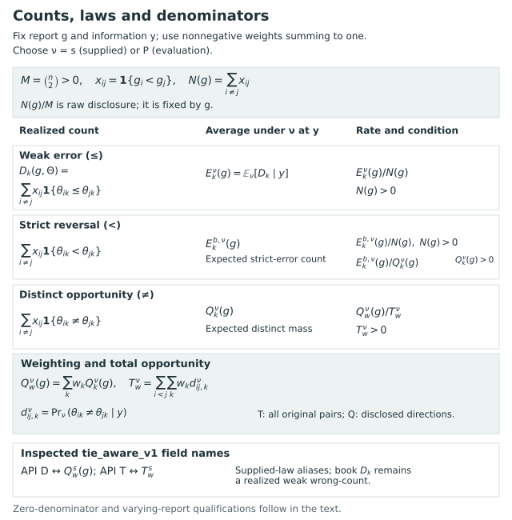

# Notation and glossary {#sec-notation}

```{=html}
<span id="sec-p2-b-contracts" class="legacy-anchor" aria-hidden="true"></span>
```

The notation used in the main chapters is collected below. The linked definitions, propositions and examples specify the target, action family, equality convention and probability law, together with any further assumptions. Calibration of the supplied probabilities requires a separate assessment.

## Targets, information, and reports {#sec-notation-targets-actions}

```{=html}
<span id="reading-a-decision-specification" class="legacy-anchor" aria-hidden="true"></span>
```

Target values are oriented so that larger values indicate greater reporting priority. This may represent performance, need or another quantity, depending on the purpose of the report, without necessarily indicating greater intervention benefit. Targets are defined in @sec-target-definitions, and reports and their counts in @sec-grade-actions.

| Notation | Meaning and qualification |
|---|---|
| $n$, $K$; $i,j$, $k$ | Numbers of units and criteria, with $n\ge2$ and $K\ge1$; unit and criterion indices. |
| $\Theta=(\theta_{ik})$, $Y$ | Latent target array and information available to the rule. Declared precision, design variables, and covariates belong to the information set when used. |
| $a_k$, $c_i(\Theta)$ | Cardinal composite coefficients and target $c_i=\sum_k a_k\theta_{ik}$. Scales and coefficient meanings must be specified. |
| $w_k$ | Directional-error weights: $w_k\ge0$ and $\sum_k w_k=1$. They value criterion-specific mistakes and need not define the composite. |
| $g$, $G(g)$ | Canonical grade vector and number of nonempty ordered grades. Labels are consecutive, every label is used, and grade 1 is highest priority. |
| $x_{ij}(g)$ | Strict disclosure indicator $\mathbf1\{g_i<g_j\}$. A shared grade gives neither strict direction. |
| $z_{ij}(g)$ | Weak reporting relation $\mathbf1\{g_i\le g_j\}$. A report tie has $z_{ij}=z_{ji}=1$; for distinct units, $x_{ij}=1-z_{ji}$. |
| $M$, $N(g)$, $s(g)$ | Total unordered pairs $M=\binom n2$, disclosed pairs $N=\sum_{i\ne j}x_{ij}$, and disclosure fraction $s=N/M$. Each cross-grade unordered pair is counted once. |
| $\mathcal A$, $\mathcal F(y)$ | Declared feasible report families; the latter notation makes observed-information dependence explicit. Nonemptiness and restrictions are part of each optimization claim. |
| $\mathcal A_{\le G_{\max}}$, $\mathcal A_{=G_0}$, $\mathcal A_\rho$ | At-most-grade, exact-grade, and contiguous fixed-order families. They are different action domains; exact counts above one exclude all-tie. |

The weak relation $z$ describes the report rather than an inequality among latent targets; its use in computation is developed in @sec-ordered-partition-formulation. Disclosure $N$ depends on grade sizes as well as the number of grades.

The profile chapters replace one common vector by a matrix whose columns are separately coherent reports (@sec-profile-report-action). The following notation is local to that formulation.

| Notation | Profile meaning and qualification |
|---|---|
| $D$, $d$, $G=(g_{id})$ | Number of domains, domain index, and $n\times D$ grade matrix. Each column uses consecutive occupied labels, with grade 1 highest. Here $D$ is a domain count, not a realized wrong-count. |
| $K_d$, $x^d_{ij}(G)$ | Number of occupied grades in domain $d$ and indicator $\mathbf1\{g_{id}<g_{jd}\}$. Identical grades withhold that domain's direction. |
| $\Delta(g)$ | Diagonal embedding $(g,\ldots,g)$ of a common report. A reduction to common-grade optimization requires the same law, targets, loss settings, identity guards and actual feasible family. |
| $a^h_{ij}$ | Fixed symmetric binary scope mask with zero diagonal. It selects pairs for an assessment; it does not remove other assertions or their loss. |
| $N_{dh}(G)$, $F_{dh}(G,\Theta)$ | Scoped disclosed count and realized weak wrong-count. The former is fixed once the report is fixed; the latter uses $\theta_{id}\le\theta_{jd}$ for an issued direction. Full-domain versions are $N_d,F_d$. |

Structural identity is declared separately in each domain with its substantive basis and almost-sure meaning. It constrains that domain's grades even when its objective weight is zero. It is distinct from a reported tie or numerical coincidence across finitely many draws. Original units and their pair multiplicities are retained. The full active-profile identity used by the equality-neutral common-report branch below is a different guard.


## Loss, risk, and probability laws {#sec-notation-loss-laws}

```{=html}
<span id="which-data-suffice" class="legacy-anchor" aria-hidden="true"></span>
```

Following @sec-posterior-risk-laws, we use loss for realized consequences and risk for their expectation under a specified law. That law is identified by a superscript unless it has been fixed by a local convention.

| Notation | Meaning and qualification |
|---|---|
| $\Pi_s(\cdot\mid Y)$ | Supplied selection belief used to choose a report. Its production and adequacy are separate questions. |
| $P$, $P(\cdot\mid Y)$ | Declared joint evaluation law and its conditional target law, when such a model is specified. Calling it true refers to that model, not to an observed empirical truth. |
| $D_k(g,\Theta)$ | Realized criterion wrong-count $\sum_{i\ne j}x_{ij}\mathbf1\{\theta_{ik}\le\theta_{jk}\}$. Latent equality counts as a wrong strict disclosure. |
| $e^s_{ij,k}$, $e^P_{ij,k}$ | Probabilities of the weak-error event under the selection and conditional evaluation laws. Reverse errors need not be complementary when latent equality has positive probability. |
| $E^s_k(g)$, $\bar e^s_{ij}$ | Expected criterion wrong-count $\sum_{i\ne j}x_{ij}e^s_{ij,k}$ and weighted pair error $\sum_k w_ke^s_{ij,k}$. Superscript $P$ changes the averaging law. |
| $\tau$ | Cost of withholding a pair relative to directional error; the baseline range is $0<\tau\le1/2$. It is not a per-pair error-probability ceiling. |
| $L_{w,\tau}$, $R^s_{w,\tau}$, $R^P_{w,\tau}$ | Realized weighted directional loss and its selection/evaluation conditional expectations, with the same declared target and action when compared. |
| $L^{(a)}$, $R^{(a)}$ | Composite-target loss and risk. Use the composite comparison event and identify the risk law separately. |
| $L_Y$, $L_y$ | Data-dependent loss and its version after conditioning on $Y=y$. Estimated scales or preferences are recomputed across datasets when they belong to the rule. |

The normalized directional loss is
$$
L_{w,\tau}(g,\Theta)=\frac{\sum_k w_kD_k(g,\Theta)+\tau\{M-N(g)\}}{M}.
$$
The withholding cost is charged once for each withheld pair, irrespective of the number of criteria. Risk is the expectation of loss under the stated law. It differs both from the realized mistake count and from the probability that every published direction is correct (@sec-weighted-directional-risk).

For a profile, each domain can withhold a different set of pairs. With $w_d\ge0$, $\sum_dw_d=1$ and $0<\tau_d\le1/2$, the primary loss is
$$
L_{\rm sep}(G,\Theta)=\frac1M\sum_{d=1}^{D}w_d\{F_d(G,\Theta)+\tau_d[M-N_d(G)]\},
\qquad R_{\rm sep}=E_{\Pi_s}L_{\rm sep}.
$$
This additive expectation does not assume independent domains. Its denominator is the original $M$ pairs in each domain, not the number of issued assertions. It also differs from the optional pair-bundle loss, which counts each pair once when any domain issues a direction (@sec-profile-protected-choice).

Pairwise weak-error probabilities suffice for this additive risk and the expected scoped counts. Separate full unit-vector laws additionally determine within-domain tails. A direct union across domains requires their joint law: each state must specify the relevant units and domains together. Coincident and disjoint errors can have the same marginal probabilities and different unions. Row numbers assigned to separately generated arrays do not establish a coupling. Record the proper-law provenance, target transformations, conditioning information, producer and payload identities, and any chain/iteration structure (@sec-profile-reproduction).


## Denominators and randomized reports {#sec-notation-counts-randomization}

The averaging operations are defined in @sec-disclosed-error-estimands. Once the data have been observed and a report selected, its denominator is fixed. Across randomized reports or datasets, however, that denominator may vary.

| Notation | Meaning and qualification |
|---|---|
| $A(g,\Theta)$, $A^\nu(g\mid y)$ | Realized weighted wrong-count $A=\sum_kw_kD_k$ and its conditional expectation under $\nu\in\{s,P\}$. Weighted counts can be fractional. |
| $A/N$, $A^s/N$ | Realized disclosed-error fraction and selection-posterior self-report. Both require positive disclosure; the second uses one fixed selected report. |
| $\mathrm{ERR}$ | Repeated-design ratio $\mathbb E_P[A]/\mathbb E_P[N]$, requiring finite expectations and $\mathbb E_P[N]>0$. It generally differs from $\mathbb E_P[A/N\mid N>0]$. |
| $g=\delta(Y,U)$, $\mathsf K(du\mid Y)$ | Randomized decision rule and auxiliary kernel. The stated construction makes $U$ conditionally independent of the target given $Y$ and samples complete feasible reports. |
| $\psi$, $H(m)$ | Whole-report mixing weight and lower count-hull boundary at mean disclosure $m$. Not every hull point is a deterministic report. |

At $N=0$, wrong-counts are zero and may enter pooled sums, but disclosed-error fractions are undefined. These should be recorded as **NA: no disclosure**, with disclosure shown separately. Randomization is over coherent reports, since independent decisions for individual pairs may fail to form a grade system. Even under a single probability law, the average of report-specific fractions can differ from the ratio of expected counts.

## Protections and numerical accuracy {#sec-notation-protection-numerics}

For a fixed report with positive disclosure, the count protection $E^s_k(g)\le q_kN(g)$ has the stated posterior expected-fraction interpretation. The count form also covers zero disclosure without dividing by zero. Its institutional and feasibility limits appear in @sec-criterion-protections.

| Notation | Meaning and qualification |
|---|---|
| $q_k$, $\mathcal P$, $\mathcal A_q$ | Criterion error budget, protected criterion set, and protected report family. A protected criterion can have zero objective weight. The protected family can be empty. |
| $\mathcal K_+$, $R^s_{\max}$ | Declared nonempty included criterion set and maximum of its expected report losses. This is not an expectation of a realized maximum. |
| $\varepsilon_k$, $\delta_w$ | Simultaneous coefficient-error radii and weighted radius $\delta_w=\sum_kw_k\varepsilon_k$. They describe numerical accuracy under a fixed supplied law, not posterior spread. |
| $\widehat R$, $\widehat E_k$ | Risk proxy and count computed from approximate coefficients. Arbitrary finite proxy entries need not be probabilities from a joint law. |
| $\eta$ | Absolute approximate-objective suboptimality over the entire stated common family, in normalized risk units. A relative or restricted solver gap is not interchangeable with it. |
| $\mathcal A_{\rm in}$, $\mathcal A_{\rm out}$, $L_{\rm out}$ | Inner/outer protection families and a valid lower bound on the entire outer approximate problem. Thresholds use $q_k\mp\varepsilon_k$ without clipping. |
| $S$, $\Pr_{\rm MC}(\cdot\mid y)$, $\alpha$ | Number of numerical draws, their probability law at fixed data, and a numerical failure allocation. $\alpha$ differs from the criterion protection budget $q_k$. |
| $Z$, $L_R$, $U_R$ | Unnormalized pair-cost objective and valid normalized-risk bounds. For the weighted additive objective, $R=\tau+Z/M$; absolute gaps in $Z$ are divided by $M$, while relative gaps are not translation-invariant. |

The assumptions for numerical envelopes and solver bounds are given in @sec-coefficient-error and @sec-monte-carlo-coefficients. A bound for a fixed number of independent draws, a result under specified dependence conditions and an asymptotic output diagnostic each require their own assumptions. Substitution of an effective sample size for the independent sample size in a finite-sample bound therefore needs further justification.

For profile protection (@sec-profile-scope-protection), $\mathcal P$ lists mean constraints $E_{\Pi_s}F_{dh}\le q_{dh}N_{dh}$. A separate list $\mathcal H$ defines
$$
J(G)=\Pi_s\!\left(\bigcup_{(d,h)\in\mathcal H}\{F_{dh}>t_{dh}N_{dh}\}\right)\le\alpha.
$$
The exceedance is strict and the probability cap inclusive. The integer failure cutoff is $\lfloor t_{dh}N_{dh}\rfloor+1$. At $N_{dh}=0$, the count condition holds and that event is false, while its displayed error fraction remains undefined. An empty $\mathcal H$ disables joint protection; an enabled list whose events are all inactive is a different specification. Zero objective weight does not disable a configured guard or protection.

The profile chapters use $\alpha$ for this posterior probability budget and $\beta$ for numerical failure under an explicitly stated certification procedure. Some earlier common-report numerical results use $\alpha$ locally for numerical failure instead. Neither notation makes numerical uncertainty equivalent to posterior uncertainty. Exact arithmetic on a stored chain's empirical law does not establish independent posterior sampling. The uniform-universe and fresh-validation routes in @sec-numerical-uncertainty have distinct conditioning and report-selection assumptions; their guarantees do not automatically cover mean constraints or optimality.


## Scalar correspondence and locally reused notation {#sec-notation-local-reuse}

| Notation | Meaning and local distinction |
|---|---|
| $B$, $\pi_{ij}$ | Scalar joint belief and strict probability $B(\theta_i>\theta_j)$ in the KRW foundation. |
| $\lambda$, $\phi$ | KRW exchange parameter and audience-information fraction. The relation $\lambda=\tau/(1-\tau)$ belongs to the stated scalar correspondence, including its equality and domain qualifications. |
| $D_{<}$, $C$, $T_{=}$ | Strict scalar discordance, concordance, and disclosed latent-equality counts. The weak-error count is $D=D_{<}+T_{=}$. |
| $\rho$, $\psi$, $b$ | Respectively a permutation, mixing weight, and selection budget in their main contexts; locally, $\rho$ is Markov correlation, $\psi$ a vector observable, and $b$ a block boundary or draw index. |
| $\eta_{st}$, $W(a,b)$ | Fixed-order pair coefficient and signed saving over positions $(a,b]$. The indexed coefficient is distinct from the optimizer tolerance $\eta$; its $s,t$ are positions. |
| $K$, $\mathcal K$, $\mathsf K$ | Criterion count, scalar signed-order distance, and auxiliary randomization kernel. Font and local definition matter. |
| $H$, $H(m)$, $\mathcal H$ | Dynamic-program layer cap, disclosure-frontier function, and retained evaluation information. These are different objects. |

Scalar scores, covariance matrices and symbols used only in particular examples are defined where they occur. The same letter may consequently have a different meaning in another chapter.

## Short glossary {#sec-glossary}

**Estimand.** The target being assessed. Composite-direction accuracy and weighted criterion-direction accuracy are co-primary targets here, so disagreement between them need not represent statistical error.

**Withholding.** A decision to make no strict comparison within a grade. It differs from latent equality, practical equivalence, structural incomparability, and a lottery allocating a resource.

**Coherence.** The requirement that a report form an ordered partition, which restricts the collections of disclosed and withheld directions that can coexist.

**Profile.** One coherent ordered partition per domain. Crossings between columns are permitted; the profile does not itself define an overall ranking or a resource-allocation rule.

**Joint protection.** A probability bound for the union of the declared scoped failures in one joint state. Mean error bounds, marginal tail bounds and a direct union bound answer different questions.

**Feasible family.** The reports allowed by the declared constraints. Exact optimization is always relative to this family; a fixed-order optimum need not be unrestricted.

**Calibration.** Agreement assessed under a specified evaluation law and averaging scheme. Self-consistency under selection beliefs does not automatically establish external calibration.

**Certificate.** A justified numerical bound with an identified objective, domain, and input error scope. It does not validate the substantive target or posterior producer.

**Allocation.** A further action assigning places, resources, or interventions. Grade accuracy alone establishes neither allocation optimality nor a causal benefit.

## Equality-neutral extension {#sec-tie-aware-notation}

The equality-neutral loss defined in @sec-tie-aware-loss requires the following additional notation. The earlier symbols $D_k$, $E_k$ and $R_{w,\tau}$ continue to use the weak-error convention. Superscripts identify the probability law, while settings omitted from the notation are held fixed locally.

| Notation | Meaning and qualification |
|---|---|
| $b^s_{ij,k}$, $t^s_{ij,k}$, $d^s_{ij,k}$ | Strict-reversal, equality and distinct-event probabilities. $b^s_{ij,k}+b^s_{ji,k}=d^s_{ij,k}=1-t^s_{ij,k}$. |
| $c^s_{ij}$, $\delta^s_{ij}$ | Weighted strict-error and distinct coefficients. The pair coefficient $c^s_{ij}$ is different from the composite target $c_i$. |
| $E^{b,s}_k(g)$, $A^s_{\rm TA}(g)$ | Expected criterion strict-error count and its weighted sum. They are not the earlier weak-error counts. |
| $Q^s_k(g)$, $Q^s_w(g)$ | Criterion and weighted expected distinct mass disclosed by one report. The package field `D` corresponds to $Q^s_w$, not to $D_k(g,\Theta)$. |
| $T^s_k$, $T^s_w$ | Criterion and weighted distinct mass over all unordered pairs; $T^s_k=\sum_{i<j}d^s_{ij,k}$. The package field `T` corresponds to $T^s_w$. |
| $R^s_{\rm TA}$, $R^s_0$ | Equality-neutral risk and its all-withhold baseline $R^s_0=\tau T^s_w/M$. Unlike $N$, the baseline and distinct masses depend on the law. |
| $i\sim j$, $I_w$ | Almost-sure identity of the whole profile on the positive-weight support $I_w=\{k:w_k>0\}$. The guard imposes $g_i=g_j$ for such pairs. |
| $Z_{\rm TA}$ | Unnormalized sparse objective $\sum_{i\ne j}x_{ij}(c^s_{ij}-\tau\delta^s_{ij})$, with $R^s_{\rm TA}=R^s_0+Z_{\rm TA}/M$. |
| $\Delta_b$, $\Delta_d$, $\zeta$ | Weighted strict/distinct coefficient-error radii and uniform risk radius $\zeta=\max(\Delta_b,\tau\Delta_d)$. Their numerical and cross-law interpretations are separate. |

Raw disclosure $N/M$, distinct-mass disclosure $Q_w^s/T_w^s$, and strict-error ratios $E^{b,s}_k/N$ and $E^{b,s}_k/Q_k^s$ answer different questions. Each fraction requires its own positive denominator. A ratio of expected distinct counts is not generally the expectation of a realized random ratio.

@fig-vis-fb relates the events to their expectations under a specified law and to ratios defined when the corresponding denominators are positive. The package aliases are listed separately.

::: {#fig-vis-fb .reader-figure .reader-has-narrow style="--reader-figure-width:640px;"}
<picture>
<source media="(max-width: 720px)" srcset="../assets/figures/reader-fb-counts-laws-mobile.svg">

</picture>

Counts, expectations and rates, with their defining events, averaging laws and denominators. For a fixed report, the realized weak wrong-count $D_k$ becomes $E_k^\nu$ after averaging under the named law $\nu$; strict reversal and distinct opportunity use different indicators and expectations. Raw $N$ counts issued comparisons, while $Q_k^\nu$ and $Q_w^\nu$ measure expected distinct opportunity. In the inspected tie-aware API, the field `D` names supplied-law $Q_w^s$, and field `T` names $T_w^s$; neither renames the book's realized wrong-count. Each rate label identifies its denominator as $N$, $Q_k$ or $T_w$. Zero denominators remain undefined. Changing the averaging law or randomizing the report changes the question. A ratio of expected counts therefore cannot in general be replaced by an expected ratio.
:::

[Reading-size PDF](../assets/figures/reader-fb-counts-laws.pdf).

For a fixed report, zero denominators remain undefined. If $N=0$, all disclosed counts are zero, rates with denominator $N$ are undefined, and raw disclosure is $N/M=0$; $Q_w^\nu/T_w^\nu=0$ only when $T_w^\nu>0$. If $Q_k^\nu=0$, the ratio $E_k^{b,\nu}/Q_k^\nu$ is undefined and no conditional-distinct accuracy is assigned. If $T_w^\nu=0$, the ratio $Q_w^\nu/T_w^\nu$ is undefined, while equality-neutral risk and $R_0^\nu$ are zero. Raw $N$ can nevertheless be positive outside a guarded family.

When reports or datasets vary, let $A=\sum_k w_kD_k$. The summaries $\mathbb{E}[A]/\mathbb{E}[N]$ and $\mathbb{E}[A/N\mid N>0]$ generally differ. Their interpretation requires the averaging law and a positive denominator to be named. Quantities of different types can have equal numerical values.

