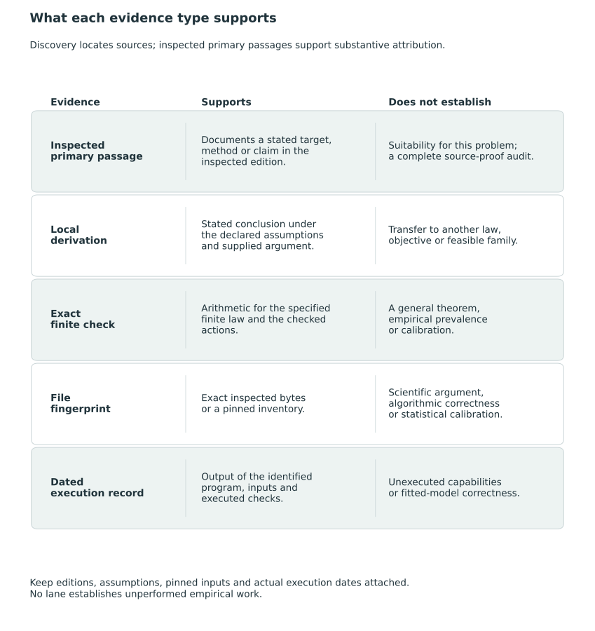

# Sources and scholarly provenance {#sec-source-provenance}

We develop the reporting problem and its relation to earlier work from selected primary sources, which also inform our interpretation of the illustrations. The review is selective across the fields concerned with ranking, multicriteria decisions and uncertainty. The bibliography lists the cited works; the text identifies the passages, results and implementations examined.

## Support for individual claims {#what-a-citation-supports}

We use source passages to identify a method's target, action, loss, assumptions and results, or to describe an institutional procedure. Applying a method to the present problem also requires comparison of the decision, available information and interpretation of the output. For example, rank intervals, selected subsets, predefined classes and common ordered grades are different reports even though all may be discussed in terms of ranking.

We used search records, bibliographic databases, citation links and summaries to locate works and alternative formulations, while substantive attribution rests on the primary passages examined in the specified editions. The examination covers selected sections and theorem statements without verifying every source proof. Identifying a document alone cannot validate a scientific argument. Each comparison retains the qualifications needed to distinguish guarantees stated in a source from those adopted here.

## Editions and dated institutional descriptions

The cited version matters when pagination, assumptions, or claims differ. The preference discussion uses the 1993 Cambridge print edition of Keeney and Raiffa. Its publication history identifies the earlier 1976 Wiley edition; we have not compared the two editions line by line [@keeney_raiffa_1993]. The measurement discussion uses the inspected reproduction of Messick's 1994 research report, rather than a later journal version [@messick_validity_report_1994]. Likewise, the Bayesian multiple-comparison discussion uses the July 2006 working paper by Müller, Parmigiani, and Rice [@MullerParmigianiRice2006]. The concepts and page locators used here refer to these texts; broader questions of interpretation remain open.

Source versions also matter for mathematical attribution. The selected Markov-chain concentration statement in @sec-dependent-monte-carlo uses Paulin's corrected 2018 arXiv version 5, including the qualifications attached to its stationary reversible-chain result [@paulin_concentration_2018v5, Theorem 3.9]. For multivariate output analysis, we use the asymptotic conditions stated in the published 2019 article; we do not certify its supplementary proofs or treat its stopping result as a finite-sample coordinate guarantee [@vats_multivariate_2019, pp. 325–328]. The descriptive allocation in @sec-descriptive-decomposition cites Shapley's dated 1952 RAND report. We give the permutation argument explicitly without applying the source's axiomatic uniqueness result or claiming a separate examination of the 1953 chapter [@shapley1952value, pp. 3, 7, 13].

Institutional descriptions refer to the dated materials cited. Hospital stars refer to the specified 2026 methodology, including the distinction between its scoring rules and policy restrictions [@CMSHospitalStars2026]. For Head Start, we use the inspected regulatory snapshot for its stated date, without assuming continuing currency, and distinguish it from earlier final-rule material and a later proposal. We treat the proposal separately from adopted rules [@hhsHeadStartEligibilitySelection2026; @acfHeadStartFinalRule2024; @acfHeadStartProposedRule2026]. These documents describe the procedures but do not establish their effects. A comparator based on them may reproduce only part of the operational system.

## Inherited ideas and local arguments {#inherited-ideas-and-arguments-supplied-here}

We draw on established posterior expected-loss decision making and scalar coherent report cards. We derive the weighted-risk and criterion-mixture identities for the targets, common-grade family, directional-error convention, weights and withholding cost considered here. They are developments within existing Bayesian postprocessing and multicriteria decision analysis. Their correspondence with scalar grading holds when the probability law, equality convention and feasible domain match as specified in @sec-scalar-reduction.

The arguments and their assumptions are collected in @sec-proofs. We distinguish derived identities and sufficient conditions from chosen reporting objectives and numerical illustrations. For example, equal numerical coefficients do not make the co-primary composite and criterion-direction targets identical, and conditional optimality under one loss and evaluation law does not establish superiority under another. Their relation to earlier work is discussed in @sec-synthesis-inheritance, where questions of priority remain open.

## Empirical and software boundaries

The KRW account uses selected passages of the published 2024 paper and the identified online appendix for the study frame, targets, producer, and source-specific numerical discussion [@kline_discrimination_2024]. In the historical reassessment we evaluate two reconstructed actions under identified coefficient conventions. We have not reproduced the original estimation procedure, established complete identity with its original-run inputs or added an empirical fit. These limitations are described in @sec-krw-reuse-interpretation.

The software correspondence in @sec-package-correspondence is based on a frozen 79-file inventory and one small evaluation. Later files carrying the same package version label lie outside that inventory. File fingerprints establish byte identity, distinguishing the inspected source from later changes without assessing statistical calibration or algorithms that have not been examined. The exact synthetic checks, historical reuse and portable example archive are described separately in @sec-reproduction. Conclusions from each exercise are confined to the evidence it supplies, even when a citation, calculation or software return value is available.

The uses and limits of these forms of evidence are summarized in @fig-vis-fc.

::: {#fig-vis-fc}
<picture>
<source media="(max-width: 720px)" srcset="../assets/figures/fc-what-each-evidence-type-supports-mobile.svg">

</picture>

Evidence types and the scope of the claims they support. Primary passages support edition-specific attribution; local derivations support conclusions under their stated assumptions; exact finite checks address their declared laws and actions; fingerprints identify bytes; and dated execution records identify what was run. Each form of evidence also has its own limits. File identity does not establish scientific correctness, and finite calculations or successful runs do not prove a general theorem or model calibration. No row supplies evidence of unperformed empirical work.
:::

## Provenance of the equality-neutral extension {#sec-tie-aware-provenance}

We developed the equality-neutral branch from the project's structural-tie decision specification and compared it with the separate tie-aware software domain. Its statewise loss identities, guarded-minimizer proof, estimand comparison, finite-family frontier and perturbation arguments are given explicitly in the main text. The results follow from these derivations under their stated conditions, rather than from software tests or source theorems that have not been examined. The scalar ranking antecedent remains credited with its original assumptions in @sec-krw-scalar-core and @sec-tie-aware-loss.

The extension is supported by general proofs, finite arithmetic checks and dated software records, each serving a different purpose. The public finite-check program in @sec-tie-aware-reproduction uses specified laws and enumerated actions, independently of the package evaluator. The software table in @sec-package-tie-aware reflects selected source/help inspection, while the dated installation results in @sec-package-tie-aware-evidence are earlier execution records. Assessing the prevalence of structural ties in institutional data, the calibration of a fitted posterior and the consequences of a funding rule requires evidence beyond these checks.
