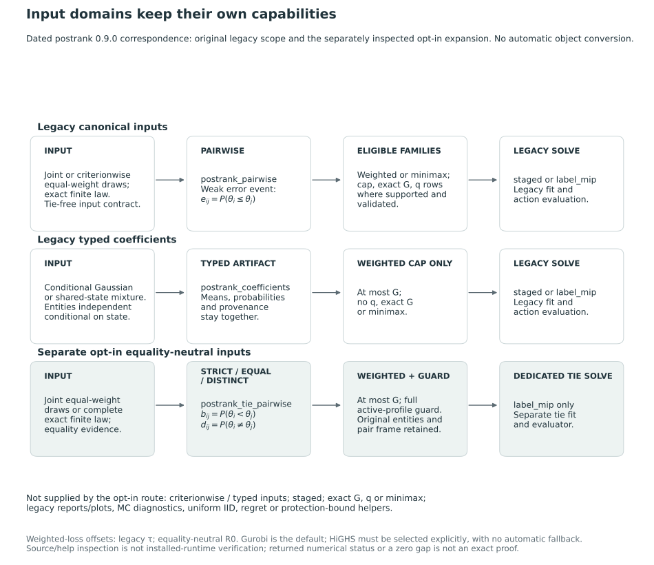

# Software correspondence {#sec-package-correspondence}

We relate the mathematical results to postrank 0.9.0 through the 79-file source inventory inspected on 26 October 2026 and a small executed example. A [source fingerprint manifest](../assets/provenance/postrank-0.9.0-source-snapshot.json) lists hashes for the package description, exports and R source files; the inspected directory had no Git commit identity. The [package repository](https://github.com/joonho112/postrank) provides the software's broader development context. Files and exports subsequently added to the live directory retained the same version label but fall outside this comparison. The source inspection and executed example examine part of the implementation without providing a complete audit or comparison of performance.

A source-only recheck on 27 October 2026 found [89 files in a second fingerprint inventory](../assets/provenance/postrank-2026-10-27-readback.json) covering the same description, export and R-source scope: the 78 earlier files other than `NAMESPACE` remained unchanged, while `NAMESPACE` and ten added R files matched the previously recorded expansion. No package code was executed in this recheck. The separate `postrank_tie_*` family uses an equality-neutral loss: for each criterion, a direction costs $P(\theta_i<\theta_j)$ and withholding costs $\tau P(\theta_i\ne\theta_j)$. This differs from the book's weak-error loss when equality has positive probability. The historical correspondence and earlier executed example in the legacy sections below remain tied to the original 79-file snapshot.

## Supplied uncertainty representations

The package accepts supplied posterior information. Model fitting and scientific identification remain the responsibility of the analysis providing it. For canonical draw and exact-law inputs, the caller must specify the oriented targets, common entity frame, conditioning information and provenance. Typed coefficient constructors instead require named moments, an explicit declaration of conditional independence and provenance. Validation checks these representations and declarations; establishing scientific identification, correct joint generation and convergence requires additional evidence.

The inspected input routes produce two principal classes of object. Canonical draw and exact-law inputs become `postrank_draws` objects, then `postrank_pairwise` objects. The latter contain an $n\times n\times K$ error array with diagonal `NA` sentinels. Conditional Gaussian and mixture constructors instead return the distinct typed class `postrank_coefficients`. This class combines means and probabilities with source information, capabilities and content identities, so an arbitrary bare probability array cannot be substituted for it.

| Input route | Representation and construction | Scope that must accompany the result |
|---|---|---|
| Joint equal-weight draws | `as_postrank_draws()` accepts the canonical payload; `postrank_draws_from_array()` builds it from a named $S\times n\times K$ array. | Each draw is declared to contain the whole joint state. IID or MCMC provenance is explicit; importance-weighted target draws are outside this route. |
| Criterionwise equal-weight draws | One $S_k\times n$ block per criterion, with common entity order. | Pair expectations are calculated separately. The input does not supply an arbitrary cross-criterion joint distribution. |
| Exact finite law | Positive safe-integer masses, a common denominator, and named integer-valued joint target states, passed through the canonical constructor. | The law is explicitly stipulated as nonempirical. Rational probabilities are retained using `gmp`; downstream numerical arrays are double projections. |
| Conditional Gaussian coefficients | `postrank_gaussian_coefficients()` receives means and positive-definite within-entity conditional covariance matrices. | The caller explicitly declares independence of entities conditional on the shared state. Arbitrary between-entity dependence is not represented by these inputs. |
| Shared-state Gaussian mixture | `postrank_mixture_coefficients()` averages Gaussian conditional coefficients over supplied states and weights. | One hyperstate is shared across entities. A finite mixture and retained hyperparameter MCMC states have distinct metadata requirements. |

Mixture-state weights specify the probability representation, whereas the decision weights $w$ express the reporting objective. A finite mixture of continuous Gaussian laws should also be distinguished from an exact finite law of target states. The constructors calculate the corresponding quantities from the supplied parameters; estimation and external calibration remain part of the analysis that produces those parameters.

In the inspected snapshot, canonical draw and finite-law inputs must be pairwise tie-free. This restriction is stronger than the assumptions of the general theory in the book. Observed ties between entities within a criterion are rejected without adding jitter. The Gaussian constructors' positive conditional variances and declared independence imply tie-free pair differences under their mathematical laws. Although coefficient calculations use the weak event $\theta_{ik}\le\theta_{jk}$, these routes still exclude inputs with positive latent ties. The absence of ties in finitely many draws cannot establish tie freedom in the population. For an explicitly enumerated finite law, however, the property can be established by checking all positive-mass states.

## Decisions, domains and computation

The package constructs a decision problem with `postrank_problem()` and attempts a numerical solution with `postrank_solve()`. `postrank_evaluate()` scores a supplied named grade vector and returns disclosure counts, criterion errors and risks. This evaluation neither optimizes the report nor establishes its membership in a capped, exact-grade or protected action family. As in the book, smaller grade integers indicate higher priority and equal grades withhold the comparison.

| Object or route | Inspected snapshot behavior | Corresponding mathematical qualification |
|---|---|---|
| Draw/exact-law pairwise problem | The builder accepts weighted and expected-criterion minimax objectives, a grade cap, and separately validated exact-grade and protection settings. | Input eligibility and valid combinations precede any optimization claim. These modes were traced in source, not all exercised in the small example. |
| Typed Gaussian/mixture problem | Weighted expected risk with an at-most-$G$ cap; `q`, `exact_G` and minimax settings are rejected. | The general theory does not imply that every input class exposes every decision mode. |
| One-order scalar DP | A private routine computes a best contiguous partition for a supplied order and linear cost, using an exact count or a cap. | It returns one minimizing partition. It is exact within that order and scalar subproblem, not over all orders. |
| Staged strategy | DP and local-search candidates, an LP bound, and conditionally a strengthened integer-label MIP. | Protected and minimax candidate generation uses reweighted or surrogate linear costs, followed by evaluation in the actual problem. Scalar DP exactness does not transfer to the whole procedure. |
| Backend choice | Gurobi is the default after explicit-argument and session-option precedence; HiGHS is an explicit alternative. There is no automatic fallback. | The staged strategy also requires its selected backend. Backend availability and operation were not tested here. |
| Solver normalization | Incumbents are checked, action risks recomputed, and reported bounds converted into risk units. | Validation uses numerical tolerances. A solver status or a displayed zero gap is not an exact arithmetic certificate. |

The binary-relation formulation used in the book and the integer grade labels and pair indicators used by the inspected MIP represent equivalent action spaces. The MIP includes additional structures for the modes it supports. Likewise, the solve API exposes `staged` and `label_mip` strategies; the private DP is not a separately advertised public solver strategy in this snapshot.

For the ordinary weighted problem, the raw pair-cost objective is

$$
Z(g)=\sum_{i\ne j}x_{ij}(g)\left(\sum_kw_ke_{ij,k}-\tau\right),
\qquad R(g)=\tau+\frac{Z(g)}M.
$$

The corresponding offset and scale are stored with the problem. Minimax uses a risk-scale epigraph. The normalizer distinguishes the validated grade's actual primary risk from a potentially slack epigraph value, and stores an absolute risk gap separately from the backend's relative gap. A small reported lower-bound inversion can be clamped within the objective tolerance, with warnings and `numerical_certification = FALSE`. This adjustment allows for numerical tolerances; the assumptions for exact bounds in @sec-solver-qualifications still require justification.

## Numerical helpers and their conditions {#conditional-numerical-helpers}

Several numerical helpers calculate quantities related to the arguments in @sec-numerical-uncertainty under the assumptions and capability flags described below. `postrank_iid_bounds()` requires equal-weight IID declarations for each criterion, prespecified failure allocations and sample sizes, and no adaptive stopping. It rejects exact finite laws and typed Gaussian/mixture artifacts. Its criterionwise reference radius is

$$
\varepsilon_k=\min\left\{1,\sqrt{\frac{\log(2M/\alpha_k)}{2S_k}}\right\}.
$$

The factor $2M$ uses the package's declared tie-free setting: reverse directions are complementary, so one unordered pair's empirical error controls both directions. The book's equality-permitting argument instead retains all ordered directions and uses $\log(4M/\alpha_k)$. The factors differ because the counting assumptions differ. The broader theorem permitting equality is not implemented by this runtime. Capping a probability-error radius at one uses the probability range; it does not justify clipping a negative protection threshold to zero.

`postrank_regret_bound()` requires matching input identities, weighted risk, an acceptable normalized whole-problem gap, and no empirical protection rows for that common-domain calculation. It computes the reference expression $2\delta_w+\eta$ when its conditions are met. `postrank_protection_envelopes()` separately constructs signed, **unclipped** $q_k-\varepsilon_k$ and $q_k+\varepsilon_k$ count rows. The protection analysis combines an inner action with a lower bound for the whole outer problem. A bound for the inner problem cannot be substituted for that outer bound.

The labels `not_established`, `diagnostic_only` and `conditional_bound` distinguish the interpretations available for these computed reference quantities. Their certificate-issuance and numerical-verification flags remain false: the inspected capability declarations do not support formal numerical certification, a general MCMC finite-sample certificate, optional-stopping certification or ESS substitution. The propositions supply a conditional interpretation only when their corresponding premises have been justified.

## Diagnostic quantities {#diagnostics-identify-particular-quantities}

`postrank_diagnose()` can summarize supplied target draws and a fixed report. Pair-indicator traces are calculated only when explicitly requested, so a diagnostic object need not cover every pair. A total-loss trace requires both a fixed report and suitable joint input. Reasons and warnings are retained for unavailable or nonfinite metrics, which are not replaced by zero. A constant sampled indicator leaves unresolved whether a comparison with posterior probability zero or one has been adequately explored.

For eligible scalar MCMC traces, the implementation delegates to `posterior::rhat`, `posterior::ess_bulk`, `posterior::ess_tail`, `posterior::ess_mean` and `posterior::mcse_mean`. These trace diagnostics differ from the multivariate determinant ESS in @sec-mcmc-output-analysis and do not provide the spectral-gap bound in @sec-dependent-monte-carlo. Their exploration thresholds can guide interpretation but cannot establish convergence.

Typed mixture diagnostics summarize conditional expected report risk across hyperstates, integrating out the within-state Gaussian target uncertainty. The resulting traces concern conditional risk rather than realized target loss. The dedicated `postrank_coefficient_diagnose()` function requires explicit retained-chain history for its hyperparameter-MCMC metrics, with minimum chain/iteration, equal-length and spacing checks. Its generic wrapper does not supply that history, so the corresponding MCSE can remain unavailable. Variation in state-specific conditional risks of a fixed finite mixture involves no Monte Carlo sampling experiment.

Stability requests and `postrank_crossfit()` require additional optimization: the former trigger further solves and the latter solves on two subsets. We did not execute either operation in the present comparison; an empirical comparison of their results would not by itself verify the supplied sampler or provide an exact coefficient certificate.

## Solver-free evaluation example {#a-small-executed-correspondence-check}

For a check requiring no solver, we used the constructed law from @sec-coefficient-error-example at $t=1/5$. The two joint states have $\theta_B=0$, with $\theta_A=-1$ carrying mass $3/10$ and $\theta_A=1$ carrying mass $7/10$. A canonical exact-law payload declares the synthetic targets, provenance, integer masses and tie-free state values. The actual call sequence was

```r
input <- as_postrank_draws(payload)
pairwise <- postrank_pairwise(input)
postrank_evaluate(grade, pairwise, weights = c(priority = 1), tau = .25)
```

We applied the final call to each of the three prespecified actions after loading the source with `pkgload` under R 4.6.0. Compilation and test helpers were disabled; no optimizer was called.

| Supplied action | $G$ | $N$ | Evaluated risk |
|---|---:|---:|---:|
| Withhold | $1$ | $0$ | $0.25$ |
| $A>B$ | $2$ | $1$ | $0.30$ |
| $B>A$ | $2$ | $1$ | $0.70$ |

The package retained exact coefficient strings `3/10` and `7/10`, while the risk evaluation used their double projections. Those risks agreed with the analytical values within the declared check tolerance of $10^{-14}$. Withholding returned `NA` for the disclosed-error fraction and risk $\tau$. The exact-law artifact still reported `numerical_certification = FALSE`; exact probability metadata does not certify every later floating calculation. The example checks input construction, pair coefficients and evaluation under this one law, leaving runtime, solver performance and empirical convergence for the other routes unassessed.


## Equality-neutral implementation and capability limits {#sec-package-tie-aware}

The equality-neutral decision in @sec-tie-aware-loss is implemented in the opt-in `tie_aware_v1` domain, with separate input, pairwise, problem and fit classes. Existing `postrank_draws` objects and the default weak-error route retain their original interpretation. The earlier software comparison therefore does not validate all functions added for this domain. The package version remains `0.9.0`; this implementation is a development addition, not an identified external release. The dated [89-file fingerprint inventory](../assets/provenance/postrank-2026-10-27-readback.json) distinguishes its description, exports and R source from the original 79-file inventory.

The new domain changes both the accepted inputs and the decision loss. A direction uses the strict-reversal coefficient $b_{ij,k}$, and withholding uses $\tau d_{ij,k}$. The all-withhold offset is $R_0$, not generally $\tau$. The evaluator reports raw disclosure $N/M$, distinct-mass disclosure $D/T$, and criterion-specific strict-error ratios with their different denominators. A zero denominator returns `NA`. These summaries refer to the supplied law and do not estimate external accuracy or policy benefit. When the active criteria have zero pairwise equality probability, the losses agree mathematically with the original route on the same action domain. Mathematical agreement need not produce bitwise agreement in floating-point calculations.

::: {.tie-aware-capability-table}

| Component | Explicit interface and initial capability | Boundary |
|---|---|---|
| Canonical input | `as_postrank_tie_draws()` and `validate_postrank_tie_draws()` use schema `tie-aware-input-0.1`; joint equal-weight IID/MCMC draws or complete exact finite laws are supported. | Criterionwise expected-only inputs, weighted approximate inputs and typed Gaussian/mixture coefficients are outside this mode. Acceptance of MCMC input is not a convergence guarantee. |
| Input serialization | `read_postrank_tie_draws()` and `write_postrank_tie_draws()` handle the dedicated canonical input format. | An old payload is not silently upgraded to the new equality declaration or loss. |
| Pair coefficients | `postrank_tie_pairwise()` and `validate_postrank_tie_pairwise()` retain strict-reversal, equality and distinct-event coefficients and their provenance. | Opposite strict-reversal probabilities sum to distinct-event probability; complementarity to one cannot be assumed at positive equality mass. |
| Problem and action evaluation | `postrank_tie_problem()` constructs a weighted at-most-$G$ problem. `postrank_tie_evaluate()` evaluates a supplied action and reports whether it satisfies the equality guard. | Evaluation can score an action violating the guard for descriptive comparison. It does not optimize or establish membership in a grade-capped family. |
| Numerical solution | `postrank_tie_solve()` uses `label_mip`; `validate_postrank_tie_solution()` checks the supplied solution against the new problem. | Staged solving, exact-$G$, criterion protection through `q`, and minimax are not implemented in this initial domain. |
| Capability declaration | `postrank_tie_capabilities()` records the supported boundary. | Legacy baselines, reports, plots, Monte Carlo diagnostics, uniform IID bounds, regret bounds and protection envelopes are not supplied for this mode. A mathematical result in the book does not automatically become an implemented helper. |

:::

The input domains and capabilities found in the inspected source are summarized in @fig-vis-fd, subject to the source and execution limits described here.

::: {#fig-vis-fd}
<picture>
<source media="(max-width: 720px)" srcset="../assets/figures/fd-software-domains-and-actual-capabilities-mobile.svg">

</picture>

Input classes, loss domains and capabilities in the inspected postrank source. Legacy draw/exact-law pairwise inputs and typed Gaussian/mixture coefficients have different decision capabilities; the typed route supports weighted at-most-G problems only. The separate equality-neutral opt-in route uses strict-reversal, equality and distinct-event coefficients, a full active-profile guard and `label_mip` solving for weighted at-most-G reports. It does not inherit legacy staged solving, exact grades, protection, minimax, plots or numerical-diagnostic/bound helpers. Its all-withhold offset is $R_0$ rather than generally $\tau$. The diagram describes the dated source correspondence, not a new package execution, external release or mathematical certificate.
:::

The equality guard is constructed from evidence supplied before optimization. For draw inputs, the caller must justify a structural equality partition for each criterion; the constructor then checks that declared class members are equal in every retained draw. Coincidence in finitely many draws alone cannot establish almost-sure equality. For a complete exact finite law, the partition is derived from all positive-mass states. The contract uses exact numerical equality, so rounded continuous output should be recovered at its original precision before assessing whether an atom is present. The constructor adds no jitter and does not establish scientific identification, jointness or convergence.

The problem constructor intersects these partitions over positive-weight criteria and assigns the same grade to each full active-profile class. It retains every original entity and pair multiplicity. Equality on one contextual criterion alone does not force equal grades when another active criterion differs. @prp-tie-aware-guard states the mathematical conditions under which imposing the guard preserves an optimum. Extending the implementation to exact-grade requirements, protection constraints or minimax would require further arguments; the result implies neither unchanged downstream funding nor uniqueness of the optimal report.

The numerical route preserves explicit backend selection: a function argument takes precedence over the session option, with Gurobi as the remaining default and no automatic fallback. HiGHS must be selected explicitly when it is intended. Reported bounds are converted using the problem's $R_0$ offset and $1/M$ scale. Feasibility and loss checks remain subject to numerical tolerances; a solver status or zero reported gap is not an exact arithmetic certificate. The returned object is a distinct fit whose grade, evaluation and objective records are available directly. Compatibility with legacy accessors and reporting methods requires separate support.

### Source identity and recorded execution {#sec-package-tie-aware-evidence}

The recorded source comparison found no byte changes in the 89 listed files relative to the dated inventory. It establishes identity for `DESCRIPTION`, `NAMESPACE` and R files, with the complete package, installed library and runtime outside its scope. The new API descriptions above were checked against selected source passages and generated help files. Evidence about execution comes from the later installation record, whereas no package was loaded, installed or solved during this book update.

A separately retained installation record dated 27 October 2026 identifies a tested `postrank_0.9.0.tar.gz` with SHA-256

```text
8adb80d01139022c88967edd8c242b2d2524072329ddbd9af9c56a8b7741acbd
```

That record reports installation under R 4.6.0 and checks in two fresh processes, one with ordinary startup and one with `--vanilla`. Each process passed 26 recorded checks, including two actual HiGHS solves of a synthetic two-state law and comparisons of thirteen no-tie actions. These results are taken from the earlier execution record; the runtime and present installed library have not been independently rechecked for the monograph. The recorded checks do not demonstrate Gurobi execution or establish performance for the empirical application, convergence of a posterior producer or correctness for arbitrary inputs. The earlier solver-free example provides separate evidence under the numerical qualifications stated above.
