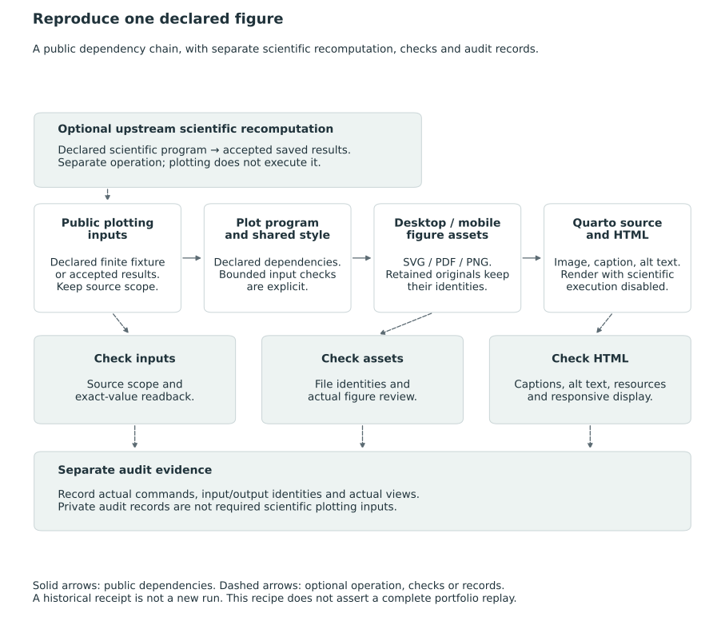

# Reproducing the illustrations {#sec-reproduction}

```{=html}
<span id="sec-p2-c-reproduction" class="legacy-anchor" aria-hidden="true"></span>
```

We explain how to use the supplied materials to recompute finite examples, plot saved results, check software evaluations and reassess historical actions under specified coefficients. The portable example bundle and the historical and software exercises have different input requirements and purposes. None by itself reproduces a fitted posterior or validates an institutional reporting rule.

The inputs, exported graphics and final display needed to reproduce a figure are shown in @fig-vis-fe.

::: {#fig-vis-fe .reader-figure .reader-has-narrow style="--reader-figure-width:700px;"}
<picture>
<source media="(max-width: 720px)" srcset="../assets/figures/fe-reproduce-one-figure-mobile.svg">

</picture>

Public dependencies for reproducing a declared figure: a scoped fixture or accepted saved results, the plotting program and shared style, exported desktop/mobile assets, and their Quarto/HTML binding. Upstream scientific recomputation has its own program and acceptance checks; plotting saved values does not execute that program. The corresponding checks concern input scope and values, output identities and actual figures, and the final caption, alt text and responsive display. Audit records document actual commands and views without supplying private scientific plotting inputs. The diagram describes a reproduction workflow and makes no claim of a completed replay of the entire figure portfolio.
:::

## Figure plotting sources {#sec-figure-plot-sources}

The [figure and command guide](../assets/reproduction/figures/README.html) maps all 40 numbered figures to their plotting sources and export exceptions. The [portable plotting source bundle](../assets/reproduction/figure-sources-2026-10-27.zip) contains 39 selective Python entry points, their public small inputs and shared drawing modules, an environment record and an identity manifest. The bundle requires its `assets/reproduction/figures` directory structure to remain intact. The three retained original SVGs are supplied as inputs and are not regenerated by Python.

Independent runs of all 39 entry points in the recorded graphics environment reproduced the bundle's 228 generated exports byte for byte; the three retained original identities were checked separately. The comparison establishes plotting reproducibility on that environment. It did not rerun the scientific archive, fit an empirical model or execute a package optimizer. The guide gives separate directions for optional upstream computation and final HTML display.

The additional static figures use stored aggregate case summaries, stipulated finite examples and retained figure coordinates. The figures and their scientific qualifications appear in the corresponding chapters.

The later reading-size layouts have their own [source bundle](../assets/reproduction/figures/reader-figures.zip), [instructions](../assets/reproduction/figures/reader-README.txt) and [file manifest](../assets/reproduction/figures/reader-figures-manifest.json). Eight plotting entry points produce compact derivatives from retained values, coordinates or symbolic conditions. Original assets remain available. The instructions require a fresh extracted directory because plotting writes exports and generated receipts. The archive includes the public dependencies and selected display widths. A subsequent check ran all eight commands in a fresh extracted directory on the recorded host with its existing dependencies; all 34 SVG and 34 PDF exports matched the supplied files byte for byte. This checks plotting from the archived inputs, not a clean software installation or a new scientific analysis. Normal and narrow exports were inspected as static images, while actual browser and whole-book print review remain separate.

## Portable archive and exact examples in Chapter 25 {#sec-portable-example-bundle}

[Download the small-example archive](../assets/reproduction/p1-small-examples.zip) and consult its [archive fingerprint](../assets/reproduction/manifest.json). Extract the archive and work inside `p1-small-examples/`. It contains ten scientific files—four Python checks, two R plot scripts and four JSON inputs or results—plus six supporting files. The README describes the included exercises, with environment information and a checksum verifier. No historical empirical inputs or source PDFs are included.

For the two examples in @sec-worked-examples, the laws are finite and their probabilities rational. The Python scripts enumerate canonical ordered partitions using standard-library rational arithmetic, comparing direct statewise losses with pair-coefficient calculations. These calculations require no numerical optimizer, fitted producer, posterior simulation or `postrank` package.

| Example | Archive-relative inputs and script | Expected scope and saved output |
|---|---|---|
| Four units, two criteria, two states | `examples/exact-common-grade.py` reads `examples/fixed-order-dp-results.json`. | All 75 canonical reports; separate criterion-weighted and composite losses; `fixtures/exact-example.json`. |
| Three units, two coincident criteria, two states | `examples/objective-contrast.py` defines the law in its source. | All 13 canonical reports and the four contiguous reports along the declared mean order; `fixtures/objective-contrast.json`. |

In the first fixture, the criterion weights are $(3/5,2/5)$, the composite coefficients are $(3/4,1/4)$, and $\tau=1/5$. The weighted-risk optimum is the grade vector $(1,2,2,3)$ with risk $17/120$; the composite-risk optimum is $(1,1,2,3)$ with risk $1/30$. Each discloses five of the six pairs. Both optima are calculated under the same law but for different objectives. All actions, statewise counts, coefficient calculations and complete minimizer sets are retained in the saved fixture.

In the second fixture, $\tau=1/4$. The unrestricted optimum is $(2,1,2)$ with risk $11/60$; the fixed mean-order optimum is the all-tie report with risk $1/4$. The same fixture records the different expected-value and top-membership allocation benchmarks and the explicitly added grade-boundary lottery. Heterogeneous conditional uncertainty is specified directly in this example, without a standard-error experiment. Since the criteria are identical, the comparison involves no criterion conflict.

From the extracted archive root, verify the supplied file identities and run the four read-only checks:

```sh
python3 verify.py
python3 examples/fixed-order-dp.py --check
python3 examples/exact-common-grade.py --check
python3 examples/objective-contrast.py --check
python3 examples/matched-disclosure.py --check
```

Each check recomputes its result and compares the complete JSON object with the saved version, leaving that version intact. The fixed-order and matched-disclosure checks provide the segmentation and frontier calculations used in the worked examples. The four-unit result also records the identity of its fixed-order input, whose original bytes are therefore required. Running these scripts without `--check` deliberately writes their outputs. The checksum verifier tests file identity, not scientific validity.

The profile examples have separate materials. The [postrank example bundle](../assets/reproduction/software/software-examples.zip) and [instructions](../assets/reproduction/software/README.txt) contain complete declarations and eight short execution scripts for the common, equality-neutral and multidomain interfaces. These include an exact finite-law evaluation, a frozen-report iid illustration, a fictional dependent-chain diagnostic and finite-bank optimization. They require the specified package and dependencies; they are not part of the solver-free Python archive above. The supplied helpers and computing materials contain the complete input preparation; the theory chapters develop the examples without this setup code.

```{=html}
<span id="run-the-checks-in-a-separate-directory" class="legacy-anchor" aria-hidden="true"></span>
<span id="compare-with-the-archived-quantities" class="legacy-anchor" aria-hidden="true"></span>
<span id="rebuild-the-public-report-from-the-saved-posterior" class="legacy-anchor" aria-hidden="true"></span>
<span id="repeat-the-exact-law-checks" class="legacy-anchor" aria-hidden="true"></span>
```

Earlier profile checks included exact-law examples, a five-unit candidate bank and a stored-input replay of the fictional sites. These checks used separate source-project programs and inputs. They are distinct from the portable examples supplied here.

## Figure rendering and earlier mathematical checks {#figures-and-earlier-mathematical-checks}

The script `examples/plot-objective-contrast.R` draws the Chapter 25 figure from the saved three-unit fixture; `examples/plot-matched-disclosure.R` draws the Chapter 22 frontier from its saved result. The scripts use R with `jsonlite`, `ggplot2`, `grid`, and `svglite`, and write SVG and PNG files in the figures directory. They convert saved rational values for display without repeating the enumeration. Their labels, scales, report families and whole-report mixture segments can be checked against the saved values, although agreement at this stage does not verify the underlying computation.

From the extracted archive root, prepare the output directory before rendering the saved-result figures:

```sh
mkdir -p assets/figures
Rscript --vanilla examples/plot-objective-contrast.R
Rscript --vanilla examples/plot-matched-disclosure.R
```

The archive retains the original scientific scripts unchanged. Its small `_quarto.yml` is an existence marker required by the frontier plotting script; it is not a Quarto book configuration. Selected grade representations, scalar normalizations, coefficient perturbations, selection rules and dependence examples were also checked during development. Some of those scripts are outside this download. The four supplied checks reproduce the selected examples but do not constitute a replay of all development calculations or a simulation campaign. The general results rest on their proofs.

## The two reconstructed KRW actions

The historical exercise in @sec-krw-reuse-interpretation reconstructed two recorded grade-size patterns along an identified coefficient-based order. We checked the selected input identities and alignment, evaluated the resulting fixed actions and compared their summaries with the inherited table. This assessed the reconstructed actions without recovering archived full grade vectors or rerunning the dynamic program or empirical Bayes fit, so it did not establish unrestricted optimality.

The historical input files are outside the portable public bundle. The completed evaluator, which refuses to overwrite its receipt, is not intended as a general rerun command for readers. Repeating the historical estimation procedure would additionally require its original data, producer code, parameters, environment, and contemporaneous input identities; agreement with two printed rows cannot replace these records. The raw strict-probability arrays and historical complement convention also do not constitute a certified exact weak-event law. Evaluation of a new joint composite or transformed target would require information beyond the marginal arrays.

## Software requirements and release availability {#software-and-release-availability}

The retained historical solver-free package check in @sec-package-historical-record evaluated three supplied actions under one two-state law. It used R 4.6.0 and the inspected source loaded through `pkgload`, with compilation and test helpers disabled. It retained exact coefficient strings and evaluated risk using their floating projections. No optimizer, MCMC run, model fit, or other input route was exercised. The linked fingerprint manifest describes the 79 inspected files, with no Git commit identity; the same version label subsequently covered additional live source. A further package check would require the actual source and dependencies to establish compatibility; the version label alone is insufficient.

The current postrank 1.2.0 checks in @sec-package-current-reproduction use a separately selected library and the bundle linked above. The common and equality-neutral examples use an explicitly identified HiGHS backend; the multidomain examples evaluate and search declared finite banks. The iid illustration fixes its report and validation design before its stated independent batch. The Markov illustration supplies dependent-chain diagnostics. Version, namespace and input records identify these executions without certifying every possible use of the package.

The fictional 40-site application has a larger stored-input replay outside the small download. Its selection and diagnostic blocks, report freezes, candidate tables and comparison records have distinct roles. The current replay recovered the declared candidate decisions and frozen-report scientific quantities; differing serialized R object bytes were assessed separately from those numerical comparisons. The case chapter supplies readable [selection summaries](../assets/cases/synthetic40/data/main-summary.csv) and [diagnostic summaries](../assets/cases/synthetic40/data/diagnostic-summary.csv). Reproducing the full analysis requires its separately archived histories and bank construction, and does not convert MCMC states into iid draws.

Rendering the book and running the supplied archive require different tools. Rendering the text and existing figures uses Quarto 1.9.37 and Python for the small post-render hook; scientific code execution during rendering is disabled. Running the finite checks uses Python's standard library. Recreating the two saved-result figures in the small-example archive additionally needs the R packages listed there. The relocated-copy checks used CPython 3.13.2 and R 4.6.0, with `jsonlite` 2.0.0, `ggplot2` 4.0.3 and `svglite` 2.2.2. The environment record also identifies the graphics dependencies. All four finite checks passed, and the two plot commands reproduced the four canonical SVG/PNG files byte for byte on that recorded host. These checks used a fresh file tree on the existing host while retaining its operating-system image and installed dependencies. Graphic bytes may differ with other fonts or platforms.

The archive fingerprint records the checks made on the separately extracted archive. Restricted originals, private working receipts and unapproved historical inputs are outside the download; no license or public availability for the KRW inputs is asserted. The Python checks, earlier package execution and dated source-only recheck in @sec-package-correspondence each retain their own records and scope.

## Reproduction of the equality-neutral extension {#sec-tie-aware-reproduction}

For the equality-neutral extension in @sec-tie-aware-loss, the finite checks compare direct statewise loss with pair-coefficient risk and examine the equality guard and distinct-mass objective under specified laws. Exact rational arithmetic permits these checks without loading `postrank` or invoking an optimizer. The corresponding artifact identifies the inputs, action family and scope. Some calculations lie outside the earlier four-check archive; all concern stipulated examples, with no fitted posterior or policy allocation reproduced.

@sec-package-tie-aware-evidence describes a separate recorded package installation. Its tarball fingerprint and dated receipts identify a previously executed software check under R 4.6.0, including explicit HiGHS solves on synthetic inputs. Those receipts refer to the earlier execution, while the R-source comparison establishes source identity without verifying the current installed library. To reproduce the software check, the artifact, loaded namespace, dependencies and requested backend must be identified, using the equality-neutral schema and supported capabilities described in @sec-package-tie-aware. The source comparison accompanying that earlier extension did not rerun installation or the solver check and performed no empirical analysis. The later current-interface examples above are separate executions and retain their own input, backend and output records.

The standalone [exact-check program](../assets/reproduction/tie-aware-checks.py) and [saved results](../assets/reproduction/tie-aware-checks-results.json) document these finite checks. The program uses only Python's standard library and exact `fractions.Fraction` arithmetic. Download the program and run it with a new output filename:

```bash
python3 tie-aware-checks.py --output tie-aware-checks-local.json
```

The program refuses to overwrite an existing result. It enumerates the three two-unit, thirteen three-unit and seventy-five four-unit canonical actions used in its examples. The checks compare raw-state and coefficient risk and examine weak/neutral and payoff identities, no-tie reduction, guarded minima, distinct-mass monotonicity and selected estimand/error counterexamples. One execution under CPython 3.13.2 passed 5,977 assertions. The downloaded source is byte-identical to that checked program; the saved execution record retains its original working filename. Comparing the deterministic `exact_results_sha256` field permits a reproduced result to be distinguished from differing runtime metadata.

The 5,977 assertions check the specified finite examples. The main text proves the general results, including the separately reviewed class-strict half-cost endpoint. These extension checks are supplied separately from the unchanged earlier four-check ZIP; they involve no simulated observations.

The optional learning exhibits present specified examples and saved results alongside the static chapter summaries. Concept displays perform their stated small calculations, while the four application viewers read fixed summaries without rerunning fitted models. Checking the source and numerical values addresses a different question from observing browser behavior, keyboard controls, responsive layouts and print output. Successful rendering and static image inspection alone do not establish these interaction properties.

<!-- BEGIN EXPLORER LEARNING ROUTE -->
## Studying with postrank Explorer {#sec-explorer-learning-route}

The Explorer Boxes pair a saved view of a published application with a short question to investigate in the full application. Start with @box-explorer-equality and @box-explorer-targets to distinguish the loss from the reporting target; continue with @box-explorer-budgets and @box-explorer-overlap to compare expected-error budgets with joint protection; then use @box-explorer-approximation and @box-explorer-averaging to examine numerical uncertainty and the choice of denominator. Read the stated law and report family before changing a control, and return to the chapter to identify which assumptions support the observed comparison.

The following six applications extend this route. Each supplies its own teaching example; its displayed values need not reproduce the chapter's example. The book links to the full application pages, where the presets, scope and further explanations remain available.

| Book discussion | Published application | What to investigate |
|---|---|---|
| [Chapter 5](../chapters/05-bayesian-ranking.qmd#what-this-lineage-establishes-for-common-grades) | [Alternative rankings from a posterior distribution](https://joonho112.github.io/postrank-explorer/pages/uncertainty/which-ranking.html) | Compare posterior-mean, expected-rank and top-group-probability orderings under the same supplied distribution, then change the scale to see which summaries depend on magnitudes. |
| [Chapter 10](../chapters/10-krw-foundation.qmd#sec-scalar-reduction) | [KRW’s reward and postrank’s withholding cost](https://joonho112.github.io/postrank-explorer/pages/cases/lambda-tau.html) | Vary KRW’s reward and the withholding cost to inspect their affine correspondence on a matched, tie-free scalar reporting problem. |
| [Chapter 18](../chapters/18-representation-resolution.qmd#sec-resolution-frontiers) | [Budget and grades](https://joonho112.github.io/postrank-explorer/pages/profiles/profile-resolution.html) | Hold the fictional law fixed and relax the joint budget to see why lower minimum risk need not mean more grades in every domain. |
| [Chapter 22](../chapters/22-evaluation-frontiers.qmd#sec-matched-disclosure-frontier) | [The error–disclosure frontier](https://joonho112.github.io/postrank-explorer/pages/grades/frontier.html) | Change the withholding cost and grade cap to distinguish an attainable single report from a mixture on the error–disclosure frontier. |
| [Chapter 23](../chapters/23-rules-objectives.qmd#sec-selection-benchmarks) | [Reporting, allocation and classification](https://joonho112.github.io/postrank-explorer/pages/rules/one-place.html) | Compare pairwise reporting, allocation and threshold classification under one supplied posterior, making the added selection rule and decision costs explicit. |
| [Chapter 24](../chapters/24-misspecification-calibration.qmd#sec-model-error-bound) | [Evaluation under an alternative posterior law](https://joonho112.github.io/postrank-explorer/pages/grades/another-law.html) | Keep a selected report fixed while changing the evaluation law, then compare its risk and regret within the same eligible report family. |

Screenshots record selected states of postrank Explorer 3.5, captured on November 9, 2026. They remain readable without opening an external application; changing the controls requires access to the linked site. Some Explorer pages refer to chapter numbers from an earlier book edition, so use the current book links above to locate the discussion. Exact finite-law demonstrations, deterministic coefficient perturbations and Monte Carlo illustrations have different guarantees; consult each application's scope rather than interpreting every displayed value as an exact result or a confidence statement. The book's existing concept exhibits and four saved-result case viewers remain available for their distinct examples and learning tasks.
<!-- END EXPLORER LEARNING ROUTE -->


<!-- BEGIN EXPLORER EXPANSION INDEX -->
## An Explorer companion for every stage of the book {#sec-explorer-all-apps}

The 84 applications below offer optional routes from the book into a related concept, example or reporting tool. Each application has one primary Box containing a saved screen, a short exploration prompt and a link to the full application. A Box may extend the chapter with a different dataset or a simpler teaching law; it need not reproduce the chapter's numerical example.

Begin with the early uncertainty applications to compare estimates, intervals and posterior orderings. Continue through common grades and domain profiles to study what a report states, withholds and protects. The later routes examine computation, evaluation, applications and communication. After exploring an app, return to the Box and identify which law, loss and eligible report family were held fixed.

### Part 1 — Public decisions and measurement

| Application | Primary book location | Explore |
|---|---|---|
| [Ranking noisy estimates](https://joonho112.github.io/postrank-explorer/pages/uncertainty/noisy-league.html) | Chapter 1 · @box-explorer-noisy-league | Precision can reshape the extremes |
| [Expected errors in a strict ranking](https://joonho112.github.io/postrank-explorer/pages/uncertainty/ranking-claims.html) | Chapter 1 · @box-explorer-ranking-claims | A strict list makes a claim about every pair |
| [Estimates and sampling error](https://joonho112.github.io/postrank-explorer/pages/uncertainty/noisy-estimate.html) | Chapter 2 · @box-explorer-noisy-estimate | Sampling error moves an estimate |
| [Pairwise posterior direction probabilities](https://joonho112.github.io/postrank-explorer/pages/uncertainty/two-units.html) | Chapter 2 · @box-explorer-two-units | A comparison needs uncertainty about the difference |
| [Grades based on standardized evidence](https://joonho112.github.io/postrank-explorer/pages/rules/evidence-flags.html) | Chapter 2 · @box-explorer-evidence-flags | Evidence against a benchmark does not settle a pair |
| [League tables and report cards](https://joonho112.github.io/postrank-explorer/pages/uncertainty/case-zero.html) | Chapter 3 · @box-explorer-case-zero | Ranks and grades make different comparisons |
| [Fixed quantile tiers](https://joonho112.github.io/postrank-explorer/pages/rules/fixed-tiers.html) | Chapter 3 · @box-explorer-fixed-tiers | Quantile tiers choose comparisons by position |
| [Alternative rankings from a posterior distribution](https://joonho112.github.io/postrank-explorer/pages/uncertainty/which-ranking.html) | Chapter 4 · @box-explorer-which-ranking | Changing scale can change a mean-based ranking |
| [Posterior profiles on multiple criteria](https://joonho112.github.io/postrank-explorer/pages/criteria/several-criteria.html) | Chapter 4 · @box-explorer-several-criteria | Define priority before comparing criteria |

### Part 2 — Intellectual foundations

| Application | Primary book location | Explore |
|---|---|---|
| [Normal–normal posterior shrinkage](https://joonho112.github.io/postrank-explorer/pages/uncertainty/shrinkage.html) | Chapter 5 · @box-explorer-shrinkage | Improving estimates need not preserve their order |
| [Marginal interval overlap and direction probabilities](https://joonho112.github.io/postrank-explorer/pages/uncertainty/interval-overlap.html) | Chapter 6 · @box-explorer-interval-overlap | Overlapping intervals can support a direction |
| [Interval overlap across 435 pairs](https://joonho112.github.io/postrank-explorer/pages/uncertainty/overlap-in-the-league.html) | Chapter 6 · @box-explorer-overlap-in-the-league | A league contains many different comparison uncertainties |
| [Coherence of pairwise threshold decisions](https://joonho112.github.io/postrank-explorer/pages/rules/naive-thresholding.html) | Chapter 6 · @box-explorer-naive-thresholding | Locally plausible comparisons may not form a grade |
| [A random-criterion representation of weighted risk](https://joonho112.github.io/postrank-explorer/pages/criteria/criterion-mixture.html) | Chapter 7 · @box-explorer-criterion-mixture | Average over one whole criterion |
| [Reporting, allocation and classification](https://joonho112.github.io/postrank-explorer/pages/rules/one-place.html) | Chapter 8 · @box-explorer-one-place | A report does not determine an allocation |

### Part 3 — Shared definitions and common grades

| Application | Primary book location | Explore |
|---|---|---|
| [From data to posterior decisions](https://joonho112.github.io/postrank-explorer/pages/uncertainty/posterior-pipeline.html) | Chapter 9 · @box-explorer-posterior-pipeline | A supplied posterior is not the reporting decision |
| [Marginal summaries and joint direction probabilities](https://joonho112.github.io/postrank-explorer/pages/uncertainty/beyond-normal.html) | Chapter 9 · @box-explorer-beyond-normal | Marginals leave the coupling unresolved |
| [Grade reports as pairwise decisions](https://joonho112.github.io/postrank-explorer/pages/grades/report-builder.html) | Chapter 9 · @box-explorer-report-builder | Grades determine which comparisons are stated |
| [The number of ordered grade reports](https://joonho112.github.io/postrank-explorer/pages/grades/how-many-reports.html) | Chapter 9 · @box-explorer-how-many-reports | A smaller family changes the search |
| [Mixtures of frontier reports](https://joonho112.github.io/postrank-explorer/pages/grades/frontier-mixtures.html) | Chapter 9 · @box-explorer-frontier-mixtures | Randomize whole reports, not individual pairs |
| [Majority comparisons and expected ranks](https://joonho112.github.io/postrank-explorer/pages/uncertainty/majority-wins.html) | Chapter 10 · @box-explorer-majority-wins | Counting wins discards their strength |
| [The decision for an isolated pair](https://joonho112.github.io/postrank-explorer/pages/grades/one-pair.html) | Chapter 10 · @box-explorer-one-pair | Three choices for one pair |
| [Reporting risk and withholding cost](https://joonho112.github.io/postrank-explorer/pages/grades/price-of-silence.html) | Chapter 10 · @box-explorer-price-of-silence | Price errors and withholding together |
| [Coherence in a finite three-unit example](https://joonho112.github.io/postrank-explorer/pages/grades/coherence-finite.html) | Chapter 10 · @box-explorer-coherence-finite | Compare every coherent report |
| [KRW’s reward and postrank’s withholding cost](https://joonho112.github.io/postrank-explorer/pages/cases/lambda-tau.html) | Chapter 10 · @box-explorer-lambda-tau | Translate reward into withholding cost |
| [Equivalent reporting-loss scales](https://joonho112.github.io/postrank-explorer/pages/cases/krw-axes.html) | Chapter 10 · @box-explorer-krw-axes | The same reports on two loss scales |
| [KRW’s archived reward path](https://joonho112.github.io/postrank-explorer/pages/cases/krw-lambda.html) | Chapter 10 · @box-explorer-krw-lambda | An archived reward path and its limits |
| [The matrix of pairwise posterior probabilities](https://joonho112.github.io/postrank-explorer/pages/uncertainty/pairwise-matrix.html) | Chapter 11 · @box-explorer-pairwise-matrix | Reordering a matrix does not change its probabilities |
| [Posterior equality and withholding](https://joonho112.github.io/postrank-explorer/pages/grades/ties-and-withholding.html) | Chapter 11 · @box-explorer-equality | What changes when equality has zero cost? |
| [A common grade report for two scores](https://joonho112.github.io/postrank-explorer/pages/criteria/two-scores.html) | Chapter 11 · @box-explorer-two-scores | One report, two error profiles |
| [Criterion-specific excess risk of a common report](https://joonho112.github.io/postrank-explorer/pages/criteria/common-grade-cost.html) | Chapter 11 · @box-explorer-common-grade-cost | What does a common report cost each criterion? |
| [Opposing criterion directions](https://joonho112.github.io/postrank-explorer/pages/criteria/conflict-pairs.html) | Chapter 12 · @box-explorer-conflict-pairs | Separate opposition from uncertainty |
| [Composite targets and criterion directions](https://joonho112.github.io/postrank-explorer/pages/criteria/composite-or-criterion.html) | Chapter 12 · @box-explorer-targets | Two reporting targets, opposite directions |
| [Signed and absolute gender-gap targets](https://joonho112.github.io/postrank-explorer/pages/cases/signed-or-absolute.html) | Chapter 12 · @box-explorer-signed-or-absolute | Changing the target changes the comparisons |
| [Optimal reports along the criterion-weight path](https://joonho112.github.io/postrank-explorer/pages/criteria/weight-path.html) | Chapter 13 · @box-explorer-weight-path | Weights can change the report at a boundary |
| [Criterion-specific expected-error budgets](https://joonho112.github.io/postrank-explorer/pages/criteria/error-budgets.html) | Chapter 13 · @box-explorer-budgets | An error budget changes the feasible reports |
| [Minimizing the largest criterion risk](https://joonho112.github.io/postrank-explorer/pages/criteria/worst-criterion.html) | Chapter 13 · @box-explorer-worst-criterion | Choose which risk is worst |

### Part 4 — Domain profiles

| Application | Primary book location | Explore |
|---|---|---|
| [Common or profile?](https://joonho112.github.io/postrank-explorer/pages/profiles/profile-common-vs-domain.html) | Chapter 14 · @box-explorer-profile-common-vs-domain | A profile can state crossing priorities |
| [Separate or joint?](https://joonho112.github.io/postrank-explorer/pages/profiles/profile-separability.html) | Chapter 14 · @box-explorer-profile-separability | Separate choices require compatible combinations |
| [Quantities not identified by pairwise probabilities](https://joonho112.github.io/postrank-explorer/pages/criteria/pairs-leave-open.html) | Chapter 16 · @box-explorer-pairs-leave-open | What pair probabilities leave open |
| [Error overlap](https://joonho112.github.io/postrank-explorer/pages/profiles/profile-dependence.html) | Chapter 16 · @box-explorer-overlap | Same marginal errors, different joint protection |
| [Disclosure determined by tier sizes](https://joonho112.github.io/postrank-explorer/pages/rules/tier-sizes.html) | Chapter 18 · @box-explorer-tier-sizes | The same number of grades can disclose different amounts |
| [Budget and grades](https://joonho112.github.io/postrank-explorer/pages/profiles/profile-resolution.html) | Chapter 18 · @box-explorer-profile-resolution | A larger budget can move detail between domains |

### Part 5 — Computation and uncertainty

| Application | Primary book location | Explore |
|---|---|---|
| [Coherence constraints on pairwise decisions](https://joonho112.github.io/postrank-explorer/pages/grades/coherence.html) | Chapter 19 · @box-explorer-coherence | Individually cheapest comparisons can conflict |
| [Restrictions on the report family](https://joonho112.github.io/postrank-explorer/pages/grades/families.html) | Chapter 19 · @box-explorer-families | The optimum belongs to its family |
| [Computation of optimal grade reports](https://joonho112.github.io/postrank-explorer/pages/grades/computing-grades.html) | Chapter 19 · @box-explorer-computing-grades | Distinguish a search from its guarantee |
| [Tiers and optimized cuts of posterior rankings](https://joonho112.github.io/postrank-explorer/pages/rules/posterior-tiers.html) | Chapter 19 · @box-explorer-posterior-tiers | Optimizing boundaries does not optimize the order |
| [Pairwise errors from joint posterior draws](https://joonho112.github.io/postrank-explorer/pages/criteria/draws-to-errors.html) | Chapter 20 · @box-explorer-draws-to-errors | A draw row is one joint state |
| [Reports from supplied posterior summaries](https://joonho112.github.io/postrank-explorer/pages/tools/your-data.html) | Chapter 20 · @box-explorer-your-data | Inspect assumptions in a browser-built common report |
| [Monte Carlo error in pairwise probabilities](https://joonho112.github.io/postrank-explorer/pages/uncertainty/mc-error.html) | Chapter 21 · @box-explorer-mc-error | A fragile pair need not change the whole report |
| [Monte Carlo error with dependent draws](https://joonho112.github.io/postrank-explorer/pages/uncertainty/chain-draws.html) | Chapter 21 · @box-explorer-chain-draws | A stationary chain can still give a misleading estimate |
| [Selection and evaluation using posterior draws](https://joonho112.github.io/postrank-explorer/pages/grades/chosen-and-judged.html) | Chapter 21 · @box-explorer-chosen-and-judged | Selection draws can score a report either way |
| [Error budgets under estimated pairwise probabilities](https://joonho112.github.io/postrank-explorer/pages/criteria/estimated-budgets.html) | Chapter 21 · @box-explorer-approximation | Keep the inner threshold signed |

### Part 6 — Evaluation and comparison

| Application | Primary book location | Explore |
|---|---|---|
| [Optimal reports along the withholding-cost path](https://joonho112.github.io/postrank-explorer/pages/grades/tau-path.html) | Chapter 22 · @box-explorer-tau-path | A cost path can have several minimizers |
| [The error–disclosure frontier](https://joonho112.github.io/postrank-explorer/pages/grades/frontier.html) | Chapter 22 · @box-explorer-frontier | Read the error–disclosure boundary |
| [Averaging error shares across reports](https://joonho112.github.io/postrank-explorer/pages/grades/averaging-errors.html) | Chapter 22 · @box-explorer-averaging | Which average answers the reporting question? |
| [Comparison at matched disclosure](https://joonho112.github.io/postrank-explorer/pages/rules/rule-comparison.html) | Chapter 22 · @box-explorer-rule-comparison | Compare errors at the same expected disclosure |
| [Common withholding cost and matched disclosure](https://joonho112.github.io/postrank-explorer/pages/rules/same-tau-or-same-n.html) | Chapter 22 · @box-explorer-same-tau-or-same-n | A common price and a common disclosure answer different questions |
| [Expected and state-specific reporting loss](https://joonho112.github.io/postrank-explorer/pages/rules/better-on-average.html) | Chapter 22 · @box-explorer-better-on-average | A lower expected loss can lose in many states |
| [School reports at matched disclosure](https://joonho112.github.io/postrank-explorer/pages/cases/cde-one-disclosure.html) | Chapter 22 · @box-explorer-cde-one-disclosure | Compare complete reports at matched disclosure |
| [School-report changes along the withholding-cost path](https://joonho112.github.io/postrank-explorer/pages/cases/cde-tau-path.html) | Chapter 22 · @box-explorer-cde-tau-path | More disclosure need not retain every comparison |
| [Selection bias at the extremes of a ranking](https://joonho112.github.io/postrank-explorer/pages/uncertainty/winners-curse.html) | Chapter 23 · @box-explorer-winners-curse | Selection changes the error being averaged |
| [Sensitivity to corrections and unit removal](https://joonho112.github.io/postrank-explorer/pages/grades/one-correction.html) | Chapter 23 · @box-explorer-one-correction | One correction can change other comparisons |
| [Standardized-evidence flags in a league](https://joonho112.github.io/postrank-explorer/pages/rules/flags-in-the-league.html) | Chapter 23 · @box-explorer-flags-in-the-league | The rule and its evaluation law are separate choices |
| [Report stability under repeated measurement](https://joonho112.github.io/postrank-explorer/pages/rules/stability.html) | Chapter 23 · @box-explorer-stability | Stable reports still need accuracy and disclosure |
| [Sensitivity to the prior standard deviation](https://joonho112.github.io/postrank-explorer/pages/uncertainty/shrinkage-price.html) | Chapter 24 · @box-explorer-shrinkage-price | Prior sensitivity changes more than a point estimate |
| [Posterior dependence and pairwise comparisons](https://joonho112.github.io/postrank-explorer/pages/uncertainty/correlated-units.html) | Chapter 24 · @box-explorer-correlated-units | Shared uncertainty can change a comparison |
| [Reported error and reference-law evaluation](https://joonho112.github.io/postrank-explorer/pages/grades/reported-and-realized.html) | Chapter 24 · @box-explorer-reported-and-realized | Three error quantities for the same report |
| [Evaluation under an alternative posterior law](https://joonho112.github.io/postrank-explorer/pages/grades/another-law.html) | Chapter 24 · @box-explorer-another-law | Freeze the report, change the law |

### Part 7 — Worked examples and applications

| Application | Primary book location | Explore |
|---|---|---|
| [Expected and realized errors among stated directions](https://joonho112.github.io/postrank-explorer/pages/grades/disclosed-errors.html) | Chapter 25 · @box-explorer-disclosed-errors | Average errors and all-correct probability differ |
| [Restrictions imposed by a fixed order](https://joonho112.github.io/postrank-explorer/pages/rules/order-misses.html) | Chapter 25 · @box-explorer-order-misses | A fixed order can exclude the preferred report |
| [Posterior summaries in a grade report](https://joonho112.github.io/postrank-explorer/pages/grades/report-card.html) | Chapter 26 · @box-explorer-report-card | Read the intervals and the grade comparisons |
| [Error rates under two denominators](https://joonho112.github.io/postrank-explorer/pages/grades/two-denominators.html) | Chapter 26 · @box-explorer-two-denominators | One error count, two denominators |
| [Deciles and quartiles of posterior means](https://joonho112.github.io/postrank-explorer/pages/rules/deciles-quartiles.html) | Chapter 26 · @box-explorer-deciles-quartiles | Archived cards and fixed posterior tiers |
| [KRW’s race and gender report cards](https://joonho112.github.io/postrank-explorer/pages/cases/krw-card.html) | Chapter 26 · @box-explorer-krw-card | Read directions in a historical firm card |
| [Firm-pair probabilities and report-card blocks](https://joonho112.github.io/postrank-explorer/pages/cases/krw-heatmap.html) | Chapter 26 · @box-explorer-krw-heatmap | Compare pair probabilities with a coherent card |
| [A common report for race and gender gaps](https://joonho112.github.io/postrank-explorer/pages/cases/krw-two.html) | Chapter 26 · @box-explorer-krw-two | Evaluate common and separate historical cards |
| [A common report for Alabama county outcomes](https://joonho112.github.io/postrank-explorer/pages/cases/alabama-map.html) | Chapter 28 · @box-explorer-alabama-map | Declare the population and direction before mapping grades |
| [School tertiles and minimum-risk grades](https://joonho112.github.io/postrank-explorer/pages/cases/cde-cuts.html) | Chapter 30 · @box-explorer-cde-cuts | Try school cut points in a teaching subset |
| [A high-probability school comparison withheld](https://joonho112.github.io/postrank-explorer/pages/cases/cde-pair.html) | Chapter 30 · @box-explorer-cde-pair | A highly supported direction can remain withheld |
| [Site profiles](https://joonho112.github.io/postrank-explorer/pages/profiles/fictional-site-profiles.html) | Chapter 31 · @box-explorer-fictional-site-profiles | Read the same sites through two domain priorities |

### Part 8 — Interpretation and synthesis

| Application | Primary book location | Explore |
|---|---|---|
| [Sensitivity to costs, weights and grade restrictions](https://joonho112.github.io/postrank-explorer/pages/criteria/choosing-settings.html) | Chapter 32 · @box-explorer-choosing-settings | Document which setting changed |
| [Reasons for a withheld comparison](https://joonho112.github.io/postrank-explorer/pages/criteria/why-withheld.html) | Chapter 32 · @box-explorer-why-withheld | Ask what forcing a direction changes |

### Computing appendix

| Application | Primary book location | Explore |
|---|---|---|
| [Case-report specification and export](https://joonho112.github.io/postrank-explorer/pages/tools/report-designer.html) | Appendix D · @box-explorer-report-designer | Export a report with its computation scope |

These screenshots preserve selected application states. Open the app to change a setting, inspect another pair or read its full methodological scope. A small expected error share, a joint protection probability, a numerical approximation and a realized error are different quantities; the app's stated interpretation remains part of the exercise.
<!-- END EXPLORER EXPANSION INDEX -->
