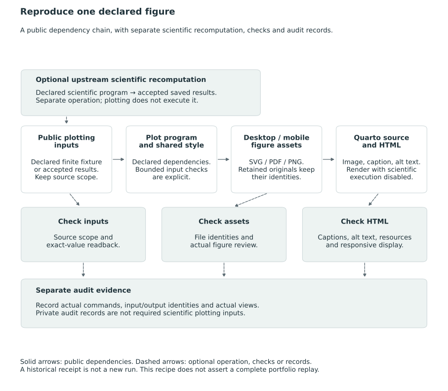

# Reproducing the illustrations {#sec-reproduction}

We explain how to use the supplied materials to recompute finite examples, plot saved results, check software evaluations and reassess historical actions under specified coefficients. The portable example bundle and the historical and software exercises have different input requirements and purposes. None by itself reproduces a fitted posterior or validates an institutional reporting rule.

The inputs, exported graphics and final display needed to reproduce a figure are shown in @fig-vis-fe.

::: {#fig-vis-fe}
<picture>
<source media="(max-width: 720px)" srcset="../assets/figures/fe-reproduce-one-figure-mobile.svg">

</picture>

Public dependencies for reproducing a declared figure: a scoped fixture or accepted saved results, the plotting program and shared style, exported desktop/mobile assets, and their Quarto/HTML binding. Upstream scientific recomputation has its own program and acceptance checks; plotting saved values does not execute that program. The corresponding checks concern input scope and values, output identities and actual figures, and the final caption, alt text and responsive display. Audit records document actual commands and views without supplying private scientific plotting inputs. The diagram describes a reproduction workflow and makes no claim of a completed replay of the entire figure portfolio.
:::

## Figure plotting sources {#sec-figure-plot-sources}

The [figure and command guide](../assets/reproduction/figures/README.html) maps all 40 numbered figures to their plotting sources and export exceptions. The [portable plotting source bundle](../assets/reproduction/figure-sources-2026-10-27.zip) contains 39 selective Python entry points, their public small inputs and shared drawing modules, an environment record and an identity manifest. The bundle requires its `assets/reproduction/figures` directory structure to remain intact. The three retained original SVGs are supplied as inputs and are not regenerated by Python.

Independent runs of all 39 entry points in the recorded graphics environment reproduced the bundle's 228 generated exports byte for byte, with the three retained original identities checked separately. These runs reproduced the plots without rerunning the scientific archive, fitting an empirical model or executing a package optimizer. The byte comparisons establish output identity; scientific correctness requires separate verification. The guide distinguishes plotting, optional upstream computation and final HTML display.

## Portable archive and exact examples in Chapter 19 {#sec-portable-example-bundle}

[Download the small-example archive](../assets/reproduction/p1-small-examples.zip) and consult its [archive fingerprint](../assets/reproduction/manifest.json). Extract the archive and work inside `p1-small-examples/`. It contains ten scientific files—four Python checks, two R plot scripts and four JSON inputs or results—plus six supporting files. The README describes the included exercises, with environment information and a checksum verifier. This is a local author-review candidate; publication and the project license remain pending. No historical empirical inputs or source PDFs are included.

For the two examples in @sec-worked-examples, the laws are finite and their probabilities rational. The Python scripts enumerate canonical ordered partitions using standard-library rational arithmetic, comparing direct statewise losses with pair-coefficient calculations. These calculations require no numerical optimizer, fitted producer, posterior simulation or `postrank` package.

| Example | Archive-relative inputs and script | Expected scope and saved output |
|---|---|---|
| Four units, two criteria, two states | `examples/exact-common-grade.py` reads `examples/fixed-order-dp-results.json`. | All 75 canonical reports; separate criterion-weighted and composite losses; `fixtures/exact-example.json`. |
| Three units, two coincident criteria, two states | `examples/objective-contrast.py` defines the law in its source. | All 13 canonical reports and the four contiguous reports along the declared mean order; `fixtures/objective-contrast.json`. |

In the first fixture, the criterion weights are $(3/5,2/5)$, the composite coefficients are $(3/4,1/4)$, and $\tau=1/5$. The weighted-risk optimum is the grade vector $(1,2,2,3)$ with risk $17/120$; the composite-risk optimum is $(1,1,2,3)$ with risk $1/30$. Each discloses five of the six pairs. Both optima are calculated under the same law but for different objectives. All actions, statewise counts, coefficient calculations and complete minimizer sets are retained in the saved fixture.

In the second fixture, $\tau=1/4$. The unrestricted optimum is $(2,1,2)$ with risk $11/60$; the fixed mean-order optimum is the all-tie report with risk $1/4$. The same fixture records the different expected-value and top-membership allocation benchmarks and the explicitly added grade-boundary lottery. Heterogeneous conditional uncertainty is specified directly in this example, without a standard-error experiment. Since the criteria are identical, the comparison involves no criterion conflict.

From the extracted archive root, verify the supplied file identities and run the four read-only checks:

```sh
python3 verify.py
python3 examples/fixed-order-dp.py --check
python3 examples/exact-common-grade.py --check
python3 examples/objective-contrast.py --check
python3 examples/matched-disclosure.py --check
```

Each check recomputes its result and compares the complete JSON object with the saved version, leaving that version intact. The fixed-order and matched-disclosure checks provide the segmentation and frontier calculations used in the worked examples. The four-unit result also records the identity of its fixed-order input, whose original bytes are therefore required. Running these scripts without `--check` deliberately writes their outputs. The checksum verifier tests file identity, not scientific validity.

## Figure rendering and earlier mathematical checks {#figures-and-earlier-mathematical-checks}

The script `examples/plot-objective-contrast.R` draws the Chapter 19 figure from the saved three-unit fixture; `examples/plot-matched-disclosure.R` draws the Chapter 16 frontier from its saved result. The scripts use R with `jsonlite`, `ggplot2`, `grid`, and `svglite`, and write SVG and PNG files in the figures directory. They convert saved rational values for display without repeating the enumeration. Their labels, scales, report families and whole-report mixture segments can be checked against the saved values, although agreement at this stage does not verify the underlying computation.

From the extracted archive root, prepare the output directory before rendering the saved-result figures:

```sh
mkdir -p assets/figures
Rscript --vanilla examples/plot-objective-contrast.R
Rscript --vanilla examples/plot-matched-disclosure.R
```

The archive retains the original scientific scripts unchanged. Its small `_quarto.yml` is an existence marker required by the frontier plotting script; it is not a Quarto book configuration. Selected grade representations, scalar normalizations, coefficient perturbations, selection rules and dependence examples were also checked during development. Some of those scripts are outside this download. The four supplied checks reproduce the selected examples but do not constitute a replay of all development calculations or a simulation campaign. The general results rest on their proofs.

## The two reconstructed KRW actions

The historical exercise in @sec-krw-reuse-interpretation reconstructed two recorded grade-size patterns along an identified coefficient-based order. We checked the selected input identities and alignment, evaluated the resulting fixed actions and compared their summaries with the inherited table. This assessed the reconstructed actions without recovering archived full grade vectors or rerunning the dynamic program or empirical Bayes fit, so it did not establish unrestricted optimality.

The historical input files are outside the portable public bundle. The completed evaluator, which refuses to overwrite its receipt, is not intended as a general rerun command for readers. Repeating the historical estimation procedure would additionally require its original data, producer code, parameters, environment, and contemporaneous input identities; agreement with two printed rows cannot replace these records. The raw strict-probability arrays and historical complement convention also do not constitute a certified exact weak-event law. Evaluation of a new joint composite or transformed target would require information beyond the marginal arrays.

## Software requirements and release availability {#software-and-release-availability}

The solver-free package check in @sec-package-correspondence evaluated three supplied actions under one two-state law. It used R 4.6.0 and the inspected source loaded through `pkgload`, with compilation and test helpers disabled. It retained exact coefficient strings and evaluated risk using their floating projections. No optimizer, MCMC run, model fit, or other input route was exercised. The linked fingerprint manifest describes the 79 inspected files, with no Git commit identity; the same version label subsequently covered additional live source. A further package check would require the actual source and dependencies to establish compatibility; the version label alone is insufficient.

Rendering the book and running the supplied archive require different tools. Rendering the text and existing figures uses Quarto 1.9.37 and Python for the small post-render hook; scientific code execution during rendering is disabled. Running the finite checks uses Python's standard library. Recreating the figures additionally needs the R packages listed in the archive. The relocated-copy checks used CPython 3.13.2 and R 4.6.0, with `jsonlite` 2.0.0, `ggplot2` 4.0.3 and `svglite` 2.2.2. The environment record also identifies the graphics dependencies. All four finite checks passed, and the two plot commands reproduced the four canonical SVG/PNG files byte for byte on that recorded host. These checks used a fresh file tree on the existing host while retaining its operating-system image and installed dependencies. Graphic bytes may differ with other fonts or platforms.

The archive fingerprint records the verification status of the separately extracted archive. Restricted originals, private working receipts and unapproved historical inputs are outside the download. No license or public availability for the KRW inputs is asserted. These Python checks, the earlier executed package example and the dated source-only package recheck in @sec-package-correspondence are distinct exercises. The evidence establishes reproduction for the exercises described here; broader scientific studies and live software use require further evidence.

## Reproduction of the equality-neutral extension {#sec-tie-aware-reproduction}

For the equality-neutral extension in @sec-tie-aware-loss, the finite checks compare direct statewise loss with pair-coefficient risk and examine the equality guard and distinct-mass objective under specified laws. Exact rational arithmetic permits these checks without loading `postrank` or invoking an optimizer. Their inputs, action family and scope are identified in the corresponding artifact. They do not reproduce a fitted posterior, an installed package or a policy allocation, and some calculations for this extension lie outside the earlier four-check archive.

@sec-package-tie-aware-evidence describes a separate recorded package installation. Its tarball fingerprint and dated receipts identify a previously executed software check under R 4.6.0, including explicit HiGHS solves on synthetic inputs. Those receipts refer to the earlier execution, while the R-source comparison establishes source identity without verifying the current installed library. To reproduce the software check, the artifact, loaded namespace, dependencies and requested backend must be identified, using the equality-neutral schema and supported capabilities described in @sec-package-tie-aware. The present extension involved no reinstallation, solver run or empirical analysis.

The standalone [exact-check program](../assets/reproduction/tie-aware-checks.py) and [saved results](../assets/reproduction/tie-aware-checks-results.json) document these finite checks. The program uses only Python's standard library and exact `fractions.Fraction` arithmetic. Download the program and run it with a new output filename:

```bash
python3 tie-aware-checks.py --output tie-aware-checks-local.json
```

The program refuses to overwrite an existing result. It enumerates the three two-unit, thirteen three-unit and seventy-five four-unit canonical actions used in its examples. The checks compare raw-state and coefficient risk and examine weak/neutral and payoff identities, no-tie reduction, guarded minima, distinct-mass monotonicity and selected estimand/error counterexamples. One execution under CPython 3.13.2 passed 5,977 assertions. The downloaded source is byte-identical to that checked program; the saved execution record retains its original working filename. Comparing the deterministic `exact_results_sha256` field permits a reproduced result to be distinguished from differing runtime metadata.

The 5,977 assertions concern the specified finite examples; the general results, including the separately reviewed class-strict half-cost endpoint, are proved in the main text. The program performs these checks without loading a package, fitting a posterior, simulating observations or calling a solver. The extension checks are supplied separately from the unchanged earlier four-check ZIP, which retains its original scope.
