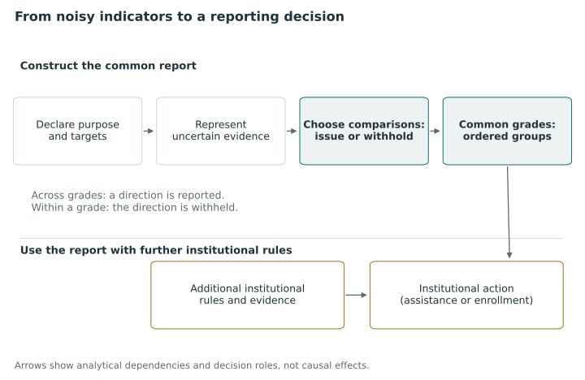

# Public decisions from noisy indicators {#sec-public-decisions}

Public reports are used to identify districts for assistance, assign stars to hospitals, select neighborhoods for investment and place employers in publicly named groups. Even where extensive evidence is available, the comparisons underlying these decisions can remain uncertain [@goldstein_league_1996, pp. 386, 389–390]. Observations may cover different populations and periods, estimates differ in precision, and indicators may give conflicting orderings. The consequences of these difficulties depend on how the institution uses the report. We consider how a report can communicate coherent comparisons when several criteria are relevant and the evidence is uncertain.

A finely divided report may communicate many directions for which the evidence is weak, whereas a coarse report may withhold useful distinctions. Combining criteria can also produce an apparently decisive ordering whose interpretation depends on the values used in the combination. We therefore specify the comparisons that a report asserts or withholds and the loss attached to errors. This formulation addresses the reporting part of public decision making; the choice of policy requires further justification.

The next two chapters describe historical and contemporary official procedures, empirical comparisons of reporting specifications and methodological proposals. They show how institutions use multidimensional information and provide the setting for our formulation. Whether the posterior grades developed here improve these procedures remains an empirical question.

@fig-vis-f01 distinguishes the reporting choice from the institutional action that may follow it.

::: {#fig-vis-f01}
<picture>
<source media="(max-width: 720px)" srcset="../assets/figures/f01-from-noisy-indicators-to-a-reporting-decision-mobile.svg">

</picture>

Selection of coherent comparisons for a common report from uncertain and potentially conflicting evidence. The report communicates directions across ordered groups and withholds them within groups. Using the report for assistance, enrollment or another institutional response requires additional rules and evidence. Arrows identify analytical dependencies and decision roles, not causal effects.
:::

## Measurement, reporting and institutional action {#begin-with-the-decision-not-the-indicator}

Measurement defines and estimates quantities or policy statuses, reporting determines which information to communicate, and institutional action specifies a response such as assistance, enrollment, investigation or investment. These stages can use the same data but have different objectives. An estimator that is optimal for a given quantity need not give an optimal report, and an optimal report need not identify the best intervention.

California's historical 2023 differentiated-assistance rules illustrate these stages. Eligibility depended on specified patterns across priority areas and student groups. Two red academic indicators could satisfy one priority area without satisfying the requirement across two areas. Ordering districts and identifying a bottom group would therefore answer a different question from applying the eligibility rule [@cde2023lcff, pp. 3–7]. We examine the historical rule in @sec-california-case and consider the 2026 reporting architecture separately.

For Head Start, eligibility precedes selection among eligible children. Selection follows program criteria informed by community assessment and constrained by enrollment requirements. A ranked waiting list has an operational role when places are limited. Giving two children the same reporting grade leaves the allocation of a single place unresolved; giving them different grades still leaves the eligibility and enrollment conditions in force [@hhsHeadStartEligibilitySelection2026, §§ 1302.12–1302.15].

The unit of analysis can also change between stages. Community conditions inform an early childhood program, while individual eligibility also depends on family-level information. An area index summarizes neighborhoods rather than every resident, and an employer report summarizes experimental contact disparities rather than adjudicating individual complaints [@noble2025imdresearch, §3.2.8; @kline_discrimination_2024, pp. 2475–2477]. Consequently, an analysis can answer a well-defined statistical question while missing the institution's question if it uses an inappropriate unit. The link between evidence and action must be specified before estimation.

## Uncertainty in comparative reporting {#why-uncertainty-changes-the-reporting-problem}

The historical Tennessee example separates an estimated effect from evidence about its direction. A growth index divides an estimated teacher contribution by its standard error, so the category depends on magnitude and precision together. A larger estimate can consequently receive a smaller standardized index. The category describes evidence relative to a benchmark; establishing the direction of a difference between two teachers requires a further comparison [@sas2019tvaas, pp. 34–39]. Benchmark reporting is thus interpreted in relation to the question it addresses.

Uncertainty about ranks can remain substantial after the estimates have been improved. Lockwood, Louis, and McCaffrey distinguish loss for estimating effects from loss for estimating ranks. Under their equal-variance model, shrinkage can leave the ordering of direct estimates unchanged while considerable uncertainty about percentile position remains. These simulation results concern the stated model and loss, rather than observed error rates in an arbitrary accountability program [@lockwood2002uncertainty, pp. 257–268]. Estimation and the selection of comparisons for publication are therefore separate tasks.

Existing institutions already incorporate safeguards against instability. California's 2026 reporting guide specifies minimum denominators and a modified Change-category table for selected small-denominator indicators. England's 2025 deprivation methodology applies empirical Bayes shrinkage to many component indicators, with documented exceptions [@cde2026dashboardintro, three-by-five and reporting-count sections; @mclennan2025imdtechnical, §3.4 and appendix C]. Comparisons with prevailing practice need to incorporate these features, since a procedure that simply publishes raw point estimates would misrepresent what those agencies do.

Count thresholds, shrinkage estimators and sensitivity analyses address particular sources of instability. Their use before categorization does not, however, give a general guarantee for the directions conveyed between categories. We evaluate these directions directly under a specified uncertainty model.

## Sources of disagreement among criteria {#several-criteria-can-mean-several-things}

Indicators can disagree because of noise, differences in measurement, distinct substantive attributes or different values placed on the same attributes. Papay's empirical teacher study found substantial sensitivity of estimated rankings to the reading assessment used, even after shrinkage in the main estimates. He investigates measurement and timing explanations cautiously, leaving open their relative contributions and the extent to which disagreement reflects underlying teacher quality [@papay2011different, pp. 172–188].

Substantive criteria can conflict even when measured precisely. A hospital may perform better in one domain and worse in another. CMS's 2026 overall rating combines group scores but limits the highest star assignment for hospitals meeting a low-safety condition. This restriction gives safety a role beyond its contribution to an unconstrained average [@CMSHospitalStars2026, pp. 17–24]. An alternative procedure can preserve or revise that preference; the comparison depends on which choice is made.

Clinical benefit–risk analysis illustrates how values enter a comparison. Li and colleagues combine predicted treatment outcomes through additive utility, using weights tied to specified swings on the outcome scales. The displayed patient preferences come from clinician proxies or simulations rather than observations of all trial participants [@li_bayesian_2019, pp. 3042–3048]. A distribution over weights consequently represents assumptions about values rather than additional clinical evidence. The accompanying regulatory framework provides context for the illustration, but the framework does not document regulatory adoption of this particular algorithm [@fda2023benefitrisk, pp. 19–20].

We use two co-primary evaluation targets. A scalar composite combines magnitudes on specified scales according to stated trade-offs. Criterion-specific comparison losses value directional errors separately on each criterion. Consequently, an accurate ordering of the composite need not minimize weighted criterion-specific errors. Weights can sum to one in either formulation; this normalization does not justify the choice of target.

## Common grades and disclosed comparisons {#common-grades-as-a-choice-about-comparisons}

We represent a common report as an ordered partition: units are assigned to groups, and the groups are ordered [@fagin2006partial, pp. 630–631; @kline_discrimination_2024, pp. 2477–2480]. Units in different groups receive a direction of priority; a grade withholds that direction between units in the same group. The specified target determines the meaning of *priority*. Greater need for review and stronger performance, for instance, can require different orientations.

Requiring the reported comparisons to form common ordered groups restricts the available reports. A single grouping may be unable to express all criterion-specific comparisons of interest, particularly when criteria conflict or evidence is uncertain. We choose the grouping by a reporting objective that also accounts for the comparisons withheld.

A shared grade withholds a direction between two units. Latent equality, practical equivalence, equal eligibility and equal entitlement to a scarce resource require separate statements. Kline, Rose, and Walters provide an empirical example of coarse comparative reporting, presenting employer grades alongside estimates and uncertainty. Their separate racial and gender reports supply a foundation for the proposed common-grade extension, rather than an already validated common multicriteria grade [@kline_discrimination_2024, Figs. 7–8 and 14–15]. We study that extension as a prospective decision problem; it is not an adopted regulatory practice.

Withholding a comparison avoids a possible error but also removes information. At one extreme, an all-tie report gives no incorrect directions through its grades and supplies none of the directions a reader may need. At the other, a fully ordered list makes every pairwise distinction, some of which may have little support. A withholding cost in the loss function represents this trade-off. It specifies a reporting preference without itself imposing an upper bound on the error probability for each published pair.

## Institutional procedures and their consequences {#what-the-institutional-comparison-establishes}

@tbl-practice-comparison summarizes the immediate decisions reconstructed in the next two chapters. For each case, we identify the output and action, the relevant dates, original-source locators and limits of the available evidence.

| Setting and documented version | Immediate output or action | Distinction a common-grade analysis must preserve |
|---|---|---|
| California, 2023 eligibility; 2026 reporting comparison | Assistance eligibility and indicator categories | Priority-area/subgroup rules versus comprehensive ordering |
| Tennessee, 2017–18 evaluation composites | Standardized growth categories within evaluation | Benchmark evidence versus effect magnitude and pairwise direction |
| Head Start, October 2026 regulatory snapshot | Eligibility, selection criteria, and waiting-list priority | Admissibility and constrained allocation versus reporting |
| CMS hospitals, April 2026 methodology | Peer-specific stars with a safety cap | Composite categorization, comparison population, and protection |
| Creatine trial and 2019 benefit–risk illustration | Trial stopping; proposed patient-specific analytical support | Observed evidence, modeled outcomes, and proxy preferences |
| England IMD25 and March 2026 funding rule | Area ranks/deciles and geographically constrained selection | Measurement/reporting versus investment objectives |
| Employer report cards, 2024 publication | Public research disclosure of separate comparisons | Reporting versus investigation allocation or legal judgment |

: Institutional procedures and their immediate outputs or actions. This is a synthesis of the documented cases in @sec-education-access and @sec-institutional-practice, not a claim that the proposed grades have been adopted in these settings. {#tbl-practice-comparison}

California and CMS receive the most detailed treatment. California's eligibility patterns show why counting unfavorable indicators or placing every agency on one scale can misrepresent an assistance rule. CMS shows how an ordered star display combines report eligibility, a composite score, peer-group boundaries and a substantive cap. The remaining cases examine individual access, patient values, geographic targeting and public experimental evidence.

These cases document particular consequences of reporting choices. Gettel and colleagues show that changing CMS peer grouping changed star assignments for a fixed historical dataset; their study leaves unresolved which version better represents true quality or improves patient outcomes [@GettelEtAl2024, Results and Limitations]. The Pride in Place note documents a selection procedure and announced funding, while realized expenditure and neighborhood improvement require further evidence [@mhclg2026prideexpansion, steps 1–5].

## Research questions {#the-research-questions-that-follow}

We first ask which uncertain quantity or collection of quantities a common report should compare. The target may be a scalar composite, criterion-specific directions, a benchmark status or another quantity, depending on indicator orientation, transformations, outcome scales and population definitions. Different choices can give substantively different comparisons from the same posterior draws.

We then ask which coherent comparisons to communicate and what losses to assign to erroneous directions and withheld distinctions. A common ordered partition, separate criterion reports and a capacity-constrained selected set communicate different information. A report that is optimal within one of these families need not be optimal within another.

Evaluation also depends on the probability law and outcome of interest. A procedure selected using a posterior distribution can be assessed under that distribution, a different data-generating law or observable downstream outcomes, with potentially different conclusions. A Bayes action minimizes the specified expected loss over feasible actions. This property leaves the empirical adequacy of the posterior model and the social desirability of the loss to be justified.

Finally, comparisons with alternative procedures must account for the number of statements made. We propose to match disclosure while accounting for differences in information and constraints, since equal numbers of grades can yield different numbers of cross-grade pairs. Later chapters construct and evaluate disclosure frontiers. Specifying this comparison does not predetermine which procedure will perform better.

## Statistical reporting and institutional decisions {#a-theory-base-with-institutional-limits}

The literature on ranking, decision theory, aggregation and multicriteria methods provides the basis for the mathematical formulation, computation, evaluation and worked examples that follow. The institutional cases motivate the problem and identify distinctions needed in the formal analysis. We assess the theoretical contribution by comparing it with these predecessors in their original sources.

A report of common grades should state its target, values, uncertainty and communicated comparisons so readers can distinguish consequences of the statistical model from evidence about the institution using the report. More accurate comparisons could support consequential decisions, although their effects on public outcomes remain to be investigated. Our analysis specifies the information supplied by the report and the decisions that remain for the institution.

