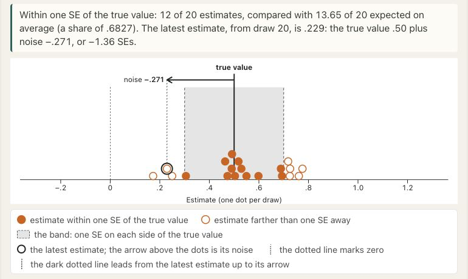
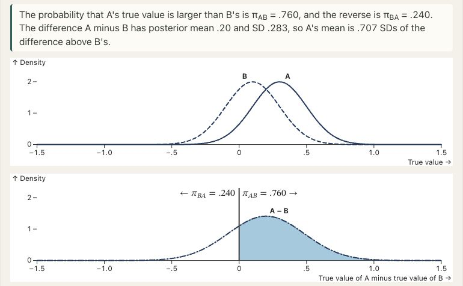
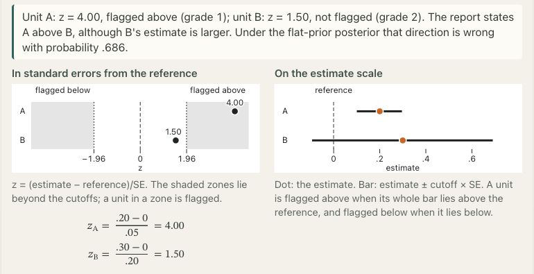

# Education, early childhood, and access {#sec-education-access}

Priority has different meanings in educational reporting and access decisions. An accountability system may identify agencies for assistance from patterns of student-group performance, a teacher evaluation may categorize standardized evidence of growth relative to a benchmark, and an early childhood program may rank eligible applicants for limited places. We examine these settings to show how the reporting problem depends on the unit assessed and the institutional consequence.

The procedures described here are tied to their documented dates: a historical California eligibility rule alongside a separate 2026 account of indicator reporting, the Tennessee procedure in the 2019 technical manual, and the Head Start operating rule distinguished from its proposed replacement. These dates identify the procedure against which a statistical alternative would be compared.

Whether common posterior grades address the institution's problem depends on the quantity or status assessed, the comparisons communicated and the action that follows. These distinctions also determine which institutional decisions grading would leave unresolved.

@fig-vis-f02 summarizes the three institutional procedures examined below.

::: {#fig-vis-f02 .reader-figure .reader-has-narrow style="--reader-figure-width:700px;"}
<picture>
<source media="(max-width: 720px)" srcset="../assets/figures/f02-three-institutional-decision-pipelines-mobile.svg">

</picture>

Reconstruction of three distinct institutional decisions: California’s 2023 LCFF assistance eligibility, Tennessee’s 2017–18 growth categories described in the 2019 manual, and Head Start eligibility and selection under the regulatory snapshot through 22 October 2026. Each lane preserves its own unit and operational rules. A common posterior grade would be an additional reporting decision. [@cde2023lcff; @sas2019tvaas; @hhsHeadStartEligibilitySelection2026]
:::

## California: indicator colors and eligibility for assistance {#sec-california-case}

In California, an indicator's reported performance category and an agency's eligibility for assistance are determined at different stages. We describe the 2023 differentiated-assistance determination under the Local Control Funding Formula (LCFF) using the California Department of Education's December 2023 technical mini-guide. The October 2026 Dashboard introduction provides a separate account of more recent indicator reporting, including the treatment of small denominators and different kinds of evidence. Thus the 2023 eligibility account is historical, while the introduction describes the contemporary reporting architecture [@cde2023lcff; @cde2026dashboardintro].

### Historical assistance eligibility and reporting units {#the-historical-decision-and-its-unit}

The 2023 mini-guide distinguished general assistance, differentiated assistance, and intensive intervention. Its immediate decision was eligibility for differentiated assistance at the level of a school district, county office of education (COE), or charter school. The inputs included state indicators, locally reported indicators, student-group results, and the grouping of those indicators into LCFF priority areas. For districts and COEs, the guide specified three routes: qualifying student-group performance in at least two priority areas; qualifying local indicators in at least two priority areas; or a combination of a student-group state-indicator result in one priority area and a local-indicator result in a different area. The state-indicator route was assessed for student groups, rather than only for the agency's aggregate performance [@cde2023lcff].

The 2023 criteria defined specific combinations of indicators. Pupil achievement could be triggered by red performance on both English language arts and mathematics, red on one and orange on the other, or red on English learner progress. Pupil engagement and school climate had their own criteria. Consequently, two adverse subject indicators within one priority area did not necessarily establish adverse performance across two areas. Unlike a weighted average, these combinations did not permit an arbitrary gain on one dimension to offset a deficit on another [@cde2023lcff].

The guide illustrates the rule with a constructed Dalia Elementary School District. Its Hispanic student group has red English language arts and mathematics results, yellow chronic absenteeism and orange suspension. The two red academic indicators satisfy the pupil-achievement criterion, whereas eligibility through the state-indicator route requires qualifying performance across two priority areas. The local indicators satisfy neither alternative route. Counting red indicators would therefore give a misleading account of eligibility. Dalia is a constructed illustration, so no district outcomes or service receipt were studied [@cde2023lcff].

The timing of the decision also differed by agency type. District and COE determinations were annual, with eligibility beginning in 2023 initiating a two-year support cycle. Charter schools were evaluated across two Dashboard years and had a one-year support cycle. A description such as “the bottom-performing schools receive assistance” would omit the unit, qualifying pattern and duration of support. The guide establishes the administrative designation and prescribed cycle; the effects of designation on improvement, stigma or resource displacement were not assessed [@cde2023lcff].

### Indicator categories and small-denominator safeguards {#reporting-uncertainty-without-a-common-posterior-order}

The October 2026 introduction describes how the state indicators using performance colors combine Status and Change. Each is categorized separately, and indicator-specific tables approved by the State Board of Education map the combinations to reported colors. Five Status categories and five Change categories give 25 possible cells, which map to **five** displayed colors rather than 25 public grades. Red and blue mark the lowest and highest reported performance levels, respectively [@cde2026dashboardintro].

Small denominators receive special treatment. The introduction traces the three-by-five method to decisions beginning in 2017, with later extensions to additional indicators. For the relevant graduation, suspension, chronic-absence, and college/career indicators, a current-year denominator below 150 activates a table that omits the two extreme Change categories. It retains all five possible performance colors. The denominator is indicator-specific; it is not necessarily a school's total enrollment. An agency and one of its student groups can therefore use different tables for the same indicator [@cde2026dashboardintro].

The department describes this approach as a response to extreme color assignments among small-denominator entities and year-to-year movements attributable to relatively few students. The guide explains the state's adaptation to instability, although the size of any reduction in false comparisons requires an independent assessment. Comparisons with a proposed posterior reporting procedure should include this existing safeguard [@cde2026dashboardintro].

Reporting also depends on minimum counts. The 2026 introduction generally requires at least 30 eligible students in both current and prior indicator denominators for school-level colors, including school student groups. At the district/COE level, the guide specifies a threshold of 15 for homeless, foster-youth, and long-term English-learner groups, while other groups and the all-students category use 30. Its example with 32 students in the current denominator and 27 in the prior denominator displays Status and Change for information but no color. These are reporting rules, not evidence that an uncolored entity has no educational need [@cde2026dashboardintro].

Other indicators use a different reporting structure. The 2026 guide describes English language arts and mathematics Growth indicators with five performance categories based on current average growth, without Change levels or performance colors. The displayed Growth categories have a separate count threshold of 11. These outputs consequently cannot all be treated as observations on one common ordinal scale [@cde2026dashboardintro].

### Common grades alongside assistance eligibility {#what-a-common-grade-wouldand-would-notdecide}

An ordered partition would place agencies into common groups and communicate pairwise priority statements between groups. The California documents specify indicator-level reports and an eligibility rule with student-group, priority-area and temporal structure. An agency may qualify because of a particular subgroup even when some nonqualifying agencies perform worse in other respects. Agencies sharing an eligibility status may also have very different patterns of need. Neither shared nor different statuses therefore determine a comprehensive pairwise ordering or establish latent equality.

If the institution also needs a common comparative report, its construction requires a target and an account of values and uncertainty. For example, the target could be expected support need rather than academic performance alone, with explicit treatment of subgroup disparities, missing colors and conflicting indicators. These choices must be made before using a posterior distribution to select comparisons. The resulting report could inform review or planning alongside eligibility requirements, legally defined entitlements and decisions about intervention.

A count-based absence of a Dashboard color is an administrative reporting outcome, whereas a posterior grade tie withholds comparisons under a specified loss. Neither establishes institutional equivalence. We therefore compare the claims communicated, including retained threshold-based claims, rather than simply counting displayed categories. This is the basis for the later comparison at matched disclosure; the merits of the statutory policy require a separate evaluation.

A profile report could instead retain separate domain-specific comparisons of agencies, provided each column has a declared target and interpretation. Such a report would still be additional to the documented eligibility rule. Permitting its grade columns to differ does not turn subgroup eligibility conditions into pairwise priority statements or remove the need to justify an institutional response.

## Teacher growth categories: evidence, precision, and the choice of assessment {#sec-educational-performance}

Educational performance reports may compare progress with a benchmark, locate a teacher among colleagues or summarize evidence of departure from average performance. Tennessee's Value-Added Assessment System (TVAAS) illustrates benchmark-based reporting. For teacher evaluation in 2017–18, the state-hosted 2019 technical manual describes composite growth indices, five effectiveness levels and selection of the available composite producing the highest overall evaluation when combined with other components. This procedure contributed to evaluation rather than specifying a complete personnel decision [@sas2019tvaas]. We consider that historical version, rather than Tennessee policy in 2026.

The calculation begins with subject, grade, and year measures. Their growth indices divide estimated value added by its standard error. The five levels use boundaries at $-2,-1,1,2$, with an exact boundary assigned upward. The manual also specifies a final two-decimal rounding/truncation convention that favors the higher index. Teacher estimates use empirical Bayes shrinkage; within-year composites combine indices using full-time-equivalent student weights and then normalize the result. Multiple-year alternatives use additional year weights [@sas2019tvaas]. The [official technical manual](https://www.tn.gov/content/dam/tn/education/data/tvaas/Statistical_Models_and_Business_Rules.pdf) documents this implemented procedure. Its use does not imply that every educational comparison should follow it.

The ratio $z_i=\widehat v_i/s_i$ makes the growth index depend on both the estimated difference and its precision. Equal positive estimates can give different indices when their standard errors differ, and a larger positive estimate need not give a larger index. For instance, constructed estimates of $0.20$ and $0.30$ in common measurement units, with standard errors $0.05$ and $0.20$, give indices of $4.0$ and $1.5$. The smaller estimate supplies stronger standardized evidence against zero. This arithmetic illustrates the difference between categorizing $z_i$ and categorizing the magnitude of $v_i$; it is not an analysis of Tennessee teachers.

Comparisons between teachers require joint uncertainty about their effects. Evidence that one effect exceeds a benchmark alone cannot establish that it exceeds another effect. Benchmark categories retain their interpretation in relation to the benchmark; interpreting every cross-category pair as a supported teacher-to-teacher direction adds a claim the rule was not designed to establish. Two teachers can likewise have meaningfully different possible effects yet share the central category when the evidence for neither is sufficiently decisive under the rule. Shared membership establishes neither equality nor practical equivalence.

Shrinkage uses information from the population of units to improve estimation under a model. The subsequent reporting action follows from a separate loss. Lockwood, Louis, and McCaffrey study this distinction in a two-stage Gaussian model with common sampling variance and known population parameters. The Bayes estimator under squared error for effects is the posterior mean effect; under summed squared error for ranks it is the posterior mean rank. The latter can take noninteger values and move toward the middle of the rank scale [@lockwood2002uncertainty]. Thus, estimating effects and estimating positions in an ordered list are distinct tasks.

With equal sampling variances, posterior mean effects have the same ordering as direct estimates, so shrinkage need not change the ordered list. Nevertheless, Lockwood and colleagues' simulations show that percentile recovery remains difficult when the signal is weak relative to measurement noise, even for the estimator optimal under their loss. Their upper-decile comparisons also show that conservative percentile estimates can reduce false extreme classifications while missing more genuinely extreme units [@lockwood2002uncertainty]. These results depend on the paper's model and evaluation law. Tennessee's 2017–18 categories involve a different action and heterogeneous data, so the simulated rates do not estimate their misclassification rates.

An additional uncertainty lies in what is measured. Papay's study provides empirical evidence from a large urban district in the northeastern United States, using administrative records spanning fall 2001–02 to fall 2007–08. Its principal reading comparisons concern grades 3–5 and estimates derived from a state assessment, the Stanford Achievement Test, and the Scholastic Reading Inventory. Across nine specifications, pairwise rank correlations for the three principal comparisons ranged from $0.15$ to $0.58$; the comparison samples contained 395, 541, and 429 teachers. The main estimates already incorporated empirical Bayes shrinkage [@papay2011different]. Thus, outcome-dependent rankings were observed even after a modeling step intended to stabilize individual estimates.

Papay's further analyses suggest contributions from assessment timing and measurement error, with their relative importance treated as tentative [@papay2011different]. His [original article](https://doi.org/10.3102/0002831210362589) concerns a different setting from Tennessee, so its correlations cannot be transferred to that program. The study also leaves open whether the assessments measure the same educational construct. It shows that choosing another plausible reading measure can change the teacher comparisons. Sensitivity to that choice differs from uncertainty conditional on the selected test.

Disagreement among indicators can reflect both measurement uncertainty and substantive differences. Subjects or assessments may concern separately valued capabilities, while timing, sampling and measurement error may contribute further disagreement. The interpretation of a multidimensional report therefore depends on what its dimensions represent. Greater precision cannot determine the relative importance of subjects, just as choosing weights cannot remove uncertainty about student learning or teacher contributions.

An average of estimates on declared educational scales targets a different quantity from an average of estimates divided by their standard errors. In the latter, precision enters the composite before normalization; full-time-equivalent weighting also makes the summary depend on teaching assignments. A reporting procedure can incorporate these features, but interpreting its level as educational performance requires explaining how the calculation relates to the intended estimand.

Interpreting a statistical teacher effect as the causal effect of replacing a teacher requires assumptions beyond longitudinal scores. The effects of publishing the report on compensation, retention, instruction or student outcomes require another evaluation. Papay sets aside causal identification of teacher effects, while Lockwood and colleagues discuss bias and model limitations [@papay2011different; @lockwood2002uncertainty]. The case motivates comparing reporting actions through their targets, treatment of uncertainty and directional claims. Whether an alternative improves educational decisions remains a separate empirical question.

If separately interpreted educational targets are retained, a profile can communicate their comparisons without forcing one grade column to reconcile them. Evaluating additive reporting loss and evaluating a joint probability of false statements remain different tasks. The matched comparison in @sec-profile-actions holds the targets and uncertainty law fixed while changing the permitted reporting format.

<!-- BEGIN EXPLORER EXPANSION: noisy-estimate -->

::: {#box-explorer-noisy-estimate .explorer-box}

{fig-alt="Screenshot of Estimates and sampling error, illustrating Sampling error moves an estimate." .explorer-screenshot}

Hold the true value fixed and change the standard error or replay the sample. The changing estimates separate uncertainty about measurement from the underlying quantity, helping explain why an estimate and its precision convey different information. This normal sampling experiment is a teaching example, not a reconstruction of teacher effects or an evaluation of the historical assessment rule.

::: {.explorer-link}
[Open Estimates and sampling error in postrank Explorer](https://joonho112.github.io/postrank-explorer/pages/uncertainty/noisy-estimate.html)
:::

Sampling error moves an estimate

:::
<!-- END EXPLORER EXPANSION: noisy-estimate -->

<!-- BEGIN EXPLORER EXPANSION: two-units -->

::: {#box-explorer-two-units .explorer-box}

{fig-alt="Screenshot of Pairwise posterior direction probabilities, illustrating A comparison needs uncertainty about the difference." .explorer-screenshot}

Keep the gap between posterior means fixed and make one unit less precise. The distribution of their difference shows why evidence that one value exceeds a benchmark does not answer the comparison between two units. These independent normal posteriors are a teaching construction, not teacher data; a different dependence structure would require a different law for the difference.

::: {.explorer-link}
[Open Pairwise posterior direction probabilities in postrank Explorer](https://joonho112.github.io/postrank-explorer/pages/uncertainty/two-units.html)
:::

A comparison needs uncertainty about the difference

:::
<!-- END EXPLORER EXPANSION: two-units -->

<!-- BEGIN EXPLORER EXPANSION: evidence-flags -->

::: {#box-explorer-evidence-flags .explorer-box}

{fig-alt="Screenshot of Grades based on standardized evidence, illustrating Evidence against a benchmark does not settle a pair." .explorer-screenshot}

Vary one standard error while keeping the two estimates fixed, and compare the flags with the posterior probability of their implied direction. A more precise estimate can receive a higher flag even when its magnitude is smaller. These are constructed evidence categories with their own cutoffs, not the historical Tennessee procedure; evaluating their directions requires a declared joint uncertainty model.

::: {.explorer-link}
[Open Grades based on standardized evidence in postrank Explorer](https://joonho112.github.io/postrank-explorer/pages/rules/evidence-flags.html)
:::

Evidence against a benchmark does not settle a pair

:::
<!-- END EXPLORER EXPANSION: evidence-flags -->

## Head Start: eligibility, selection, and access to a place {#sec-head-start-access}

For Head Start, the immediate action is enrollment. We consider the case in which eligible applicants exceed available places and the program must set priorities using several indicators. The unit is a child in the circumstances of a family, and program staff verify eligibility. Community information informs program priorities, while individual circumstances determine whether an applicant qualifies. We describe the federal operating rule without auditing any provider's implementation [@hhsHeadStartEligibilitySelection2026].

Our account uses the consolidated regulation displayed by the Electronic Code of Federal Regulations as current through 22 October 2026. The relevant 2024 final rule became effective on 21 August 2024, with a general compliance date of 21 October 2024 and a compliance date of 1 August 2025 for the revised community-assessment and enrollment-barrier provisions. A notice published on 7 August 2026 proposed replacing the performance standards. We distinguish that proposal from an adopted replacement and from the implementation timetable of the regulation described here [@acfHeadStartFinalRule2024; @acfHeadStartProposedRule2026].

### Eligibility and the admissible population {#eligibility-defines-an-admissible-population}

For ordinary Head Start Preschool eligibility, the age condition is combined with a qualifying route. Section 1302.12(c)(1) identifies family income at or below the poverty line, eligibility or potential eligibility for public assistance under the stated conditions, homelessness and foster care. These are alternative routes. Additional enrollment is allowed within specified bounds, and separate provisions apply to Tribal and Migrant or Seasonal programs. The ordinary income route therefore describes only part of eligibility. Describing this decision structure does not require specifying an annual dollar poverty threshold [@hhsHeadStartEligibilitySelection2026].

Eligibility requires admissible evidence of the policy-defined status. Staff interview families, verify information and retain a determination record. Income documentation includes tax records, pay statements and permitted alternatives; public assistance, homelessness and foster care have different documentation provisions. The regulation allows specified adjustments and consideration of changed circumstances, so missing conventional paperwork need not imply ineligibility. A continuous latent need estimate would address a different object and could substitute for this determination only with further institutional justification [@hhsHeadStartEligibilitySelection2026].

### Selection for limited places {#selection-orders-claims-on-limited-places}

Among eligible applicants, Section 1302.14 requires programs to establish selection criteria annually from their community needs assessment. Considerations include family income, homelessness, foster care, age, eligibility for services under the Individuals with Disabilities Education Act (IDEA), and other family or child risk factors. Each program maintains a waiting list ranking children by its selection criteria. The federal framework establishes the priority decision while leaving operational criteria to the program. It specifies no single national points scale, weighting vector or common applicant grade. Recovering a provider's precise ordering would require its adopted criteria, which we have not inspected here [@hhsHeadStartEligibilitySelection2026].

Enrollment is subject to additional constraints. Under the 2024 amendment, at least 10 percent of total **actual enrollment** must be filled by children eligible for IDEA services unless the responsible HHS official grants a waiver. Programs may not deny enrollment because of a disability, chronic health condition or its severity. The denominator is actual enrollment rather than funded capacity: the final rule's explanation expressly corrects the earlier funded-enrollment wording. An unconstrained ordering of scalar estimates would not by itself enforce these requirements [@acfHeadStartFinalRule2024].

When eligible applicants exceed available places, the rule determines access and the order of children awaiting a place. The enrollment limit and waiting-list requirement do not tell us how often this capacity constraint binds nationally. Subsequent development, families' experience of administration and the relative outcomes of local weighting schemes also require evidence beyond the rule itself.

### Community assessment and geographic access {#geographic-evidence-informs-a-different-stage}

Community assessment connects this individual decision to geographic access. Section 1302.11 requires information about eligible populations, their locations and needs, other early childhood services, and community resources. Section 1302.14(d) connects that assessment to barriers to enrollment and attendance, including transportation. In explaining the 2024 change, ACF distinguished identifying and addressing transportation barriers from a universal requirement that each program directly operate transportation services. An offered place and a practicably usable service are therefore distinct objects of inquiry, even within the program's own administrative framework [@hhsHeadStartEligibilitySelection2026; @acfHeadStartFinalRule2024].

A geographic shortage measure could inform outreach, service design or transportation planning, but individual eligibility, family priorities and the number of usable places require different information. Neighborhood averages omit some families' qualifying circumstances, while family priority lists omit the spatial organization of services. The role of a measure, and the precision needed, consequently depend on the unit and the action.

### Potential role of common posterior grades {#what-common-posterior-grades-could-and-could-not-do}

A common-grade report would provide an additional summary of comparisons in a specified need target, communicating some directions and withholding others to account for uncertainty. The cited regulation and final rule specify neither a posterior distribution for that target nor a pairwise directional-error loss. A useful statistical formulation would distinguish legal status, missing documentation, uncertainty about latent need and disagreement about priorities. Several substantive criteria need not be noisy measures of one underlying quantity.

If two eligible children share a grade and only one place is available, the grade leaves the allocation unresolved. Different grades must still be used within the eligibility routes and enrollment constraints. To integrate the report into selection, we would therefore specify the eligible set, permissible priorities, capacity, treatment of ties and operational use of the report. Any proposed improvement could then be assessed separately in terms of reporting accuracy, regulatory compliance, service access and developmental benefit; the Head Start rule itself provides no evidence of such an improvement.

## Institutional rules and common comparative reporting {#from-case-specific-rules-to-a-reporting-question}

Multicriteria posterior grading could supplement these procedures, provided the comparison accounts for their admissible evidence and available actions. California's historical criteria depend on priority-area and student-group patterns, Tennessee incorporates precision into a benchmark index, and Head Start combines eligibility, local priorities and enrollment constraints. None of these procedures necessarily needs to be replaced by a common ranking.

Common grades provide selected directions between units when the evidence is uncertain or conflicting. Such a report may accompany an eligibility decision, an allocation process or subject-specific indicators. Its statistical accuracy can be evaluated against the claims communicated, while its contribution to institutional decisions depends on how those claims are used. The next chapter extends the comparison to composite construction, safety restrictions, patient preferences, spatial targeting and public disclosure.

A profile permits different comparisons across domains while leaving eligibility and capacity rules in place. We isolate the effect of this reporting choice in @sec-profile-actions by matching targets, loss and protection requirements across report families. Evaluation of the institutional decision must additionally address how the report is used.