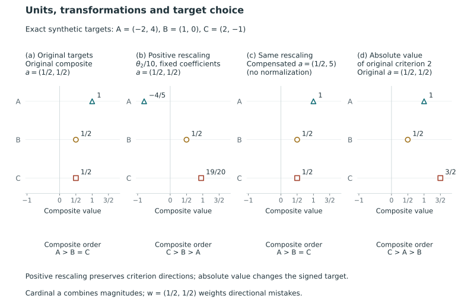

# Measurement, constructs, and plural values {#sec-measurement-values}

Several noisy indicators may measure a common construct or represent distinct concerns that conflict even when measured precisely. These interpretations lead to different problems of measurement, aggregation and reporting. Before defining the mathematical targets, we therefore consider what the attributes mean and why they are to be compared.

## Measurement interpretation and decision purpose {#sec-measurement-constructs}

A posterior distribution describes uncertainty about a parameter, but the parameter's relevance to a policy concern requires substantive justification. It may represent a school effect on a particular test, a hospital outcome rate under a specified adjustment or an employer contact gap in an audit population. In each case, the interpretation depends on the observations, population, design and modeling assumptions. Calling the parameter *quality*, *effectiveness* or *fairness* requires explaining this connection, even if the statistical decision analysis takes the parameterization as given.

Two influential accounts of validity evaluate different objects. In their causal account, @borsboom_validity_2004 [pp. 1061–1063, 1069–1070] relate an existing attribute to variation in measurement outcomes. In his unified account, @messick_validity_report_1994 [pp. 1–4, 9–12, 22–24] evaluates support for score interpretations and their implications for use. The accounts differ both in the object to which validity applies and in the place of values and consequences within its definition. A ranking method may improve a reporting decision while leaving the causal interpretation of the measurements and the appropriateness of their uses unresolved.

### A causal account of measurement

Borsboom, Mellenbergh, and van Heerden argue that a test is valid for an attribute when the attribute exists and variation in it causally produces variation in measurement outcomes. They distinguish the relation that makes measurement valid from the evidence that it holds. Correlations and statistical models can contribute evidence, but they do not constitute the measurement relation. Their discussion of response processes consequently calls for substantive explanations connecting an attribute to the observations, rather than treating a favorable pattern of associations as a sufficient explanation [@borsboom_validity_2004, pp. 1061–1063, 1067–1068].

For a latent parameter, the causal account requires an explanation of the process linking the intended attribute to observations. A stable pattern of common-factor loadings, for example, describes dependence among institutional indicators. To interpret the factor as quality, we must explain how quality generates those indicators and consider competing processes that could produce the same pattern. This illustrates the argument required by the causal account; the source article itself does not establish this interpretation for institutional report cards.

Borsboom and colleagues distinguish reflective measurement from formative construction. An indicator contributing to an index need not reflect the index as an underlying attribute. Their socioeconomic-status example treats an income question as measuring income, even when income contributes to a broader socioeconomic construct. They suggest interpreting some formative models as indexing, summarizing or causal models rather than measurement models in their sense [@borsboom_validity_2004, p. 1069]. Their distinction concerns the relation between an index and its indicators; it leaves open the usefulness of composites and public decisions based on several attributes.

Their definition of validity is separate from reliability, predictive adequacy, absence of bias and overall testing quality [@borsboom_validity_2004, p. 1070]. A valid measure can therefore be less precise or useful than another measure, while a useful predictor need not measure every associated attribute. Predictive performance alone cannot provide the substantive measurement argument.

### Score meaning and justified use

Messick evaluates interpretations and actions based on scores, including qualitative summaries and institutional indicators. His 1994 ETS report relates validity to support for score meaning and its implications in a population and context. Validation is an evolving empirical inquiry into the applicability of interpretations across people, groups, settings and uses [@messick_validity_report_1994, pp. 1–3]. We cite that original research report, rather than the shorter 1995 journal article with the same title.

Two threats discussed by Messick are particularly relevant to multidimensional institutional comparisons. *Construct underrepresentation* occurs when an assessment omits important parts of its intended construct. *Construct-irrelevant variance* occurs when variation arising from other sources contaminates the interpretation. These are relational judgments: a source of variation can be relevant to one intended construct and irrelevant to another. His examples explicitly recognize that a more encompassing construct can include abilities that a narrower interpretation would treat as extraneous [@messick_validity_report_1994, pp. 4–6].

The intended construct consequently determines which criteria are needed. As a constructed example, a report omitting access outcomes could underrepresent performance defined to include equitable access, but need not underrepresent an estimand restricted to achievement among enrolled students. An adjustment designed to isolate an institutional effect could likewise remove information needed for a descriptive purpose. These examples illustrate the dependence of the measurement argument on the intended interpretation; they are not empirical findings about an accountability system.

Messick distinguishes content, substantive, structural, generalizability, external and consequential aspects of a unified validity argument. The structural aspect concerns agreement between the scoring structure and knowledge of the construct domain. The substantive aspect concerns processes producing responses, and generalizability concerns the reach of interpretations across tasks, populations and settings [@messick_validity_report_1994, pp. 11–12, 14–15]. His account therefore includes theoretical explanations as well as associations. The disagreement with the causal account concerns the boundaries and logical object of validity; both accounts require theory.

Messick distinguishes adverse consequences arising from valid descriptions of differences from those traceable to underrepresentation or irrelevant variation. The latter identify measurement problems, whereas the former also require social-policy judgments. His discussion of alternative uses considers how consequences arise and whether other means could serve the purpose [@messick_validity_report_1994, pp. 9, 17–18, 23–24]. An accurate description can thus be used for an inappropriate intervention, and a socially attractive intervention still requires evidence of measurement accuracy.

### Justification of public comparison systems {#an-explicit-chain-of-justification}

The following table gives our synthesis of the justifications required for a public comparison system. It is not a theorem or taxonomy from either source, and the conceptual disagreement between them remains unresolved.

| Question | Object requiring justification | Evidence or argument needed |
|---|---|---|
| What is the substantive concern? | The construct, domain, population, and intended use | Domain knowledge, institutional purpose, and an account of what is included or excluded |
| What do the observations identify? | The estimand and its connection to observations | Design, measurement processes, adjustment assumptions, and statistical model assessment |
| How are criteria valued? | A scalar index, utility, or criterion-specific error weights | An explicit account of tradeoffs, scale choices, and whose judgments are represented |
| What should the report state? | The disclosed comparisons and withheld comparisons | A specified action space, loss, and evaluation law |
| What should follow from the report? | An allocation, investigation, intervention, or public response | A separate argument about consequences, constraints, and institutional authority |

Each question requires its own justification. Posterior ordering probabilities are conditional on a target and model, and Bayes optimality is conditional on a loss and action class. Together these specifications may still address only part of the institution's policy purpose. A measurement argument, in turn, leaves the costs of publishing erroneous directions or withholding useful comparisons unspecified.

Our two evaluation targets assign different roles to weights. For a scalar composite, coefficients and scales determine the trade-offs used to construct the target, and accuracy concerns its ordering. For criterion-direction loss, reported directions are assessed against each criterion-specific truth, and weights value the resulting errors. Empirical covariance alone cannot establish that either valuation is appropriate for public use without further substantive or normative assumptions. This distinction specifies the decision problem and makes no impossibility claim about preference elicitation.

A grade tie in our reporting action withholds a direction between its members. It leaves open whether their attributes are equal, whether the indicators measure a common construct and whether the institutions should receive the same downstream treatment. Uncertainty can motivate withholding, but greater numerical precision alone does not define the action's meaning. A shared category could instead denote a benchmark interval or administrative eligibility status; users need to know which interpretation the report adopts.

We study which comparisons to release for a specified target, belief distribution, action class and reporting loss. The mathematical results are conditional on these choices, whose measurement and value justifications also determine how the report can be interpreted publicly.

## Oriented targets and two meanings of a correct direction {#sec-target-definitions}

Let $i=1,\ldots,n$ index the units and $k=1,\ldots,K$ the criteria. Write $\theta_{ik}$ for the latent quantity on criterion $k$, after its population, scale and orientation have been specified. Collect these quantities in the target matrix $\Theta=(\theta_{ik})$. Larger values denote greater priority for the specified reporting purpose. For example, a larger burden can mean greater priority for investigation, whereas greater attainment can mean greater priority for recognition. Priority therefore has no universal interpretation as better or worse; choosing the target includes choosing its orientation.

For a disclosed direction placing $i$ above $j$, the criterion-specific error indicator is

$$
\ell_{ij,k}(\Theta)=\mathbf1\{\theta_{ik}\le\theta_{jk}\}.
$$

Thus a strict assertion is treated as wrong at latent equality. Introducing a practical-equivalence margin would change the target or loss. With $w_k\ge0$ and $\sum_k w_k=1$, the weighted directional mistake is $\sum_k w_k\ell_{ij,k}$. The weights value errors; they do not combine the magnitudes of the underlying attributes.

A cardinal composite instead defines

$$
c_i(\Theta)=\sum_{k=1}^K a_k\theta_{ik},
\qquad
\ell^{(a)}_{ij}(\Theta)=\mathbf1\{c_i(\Theta)\le c_j(\Theta)\}.
$$

The coefficient vector $a$ and the attribute scales are declared jointly. There is no assumption that $a=w$. Even setting them numerically equal does not make the two error indicators the same. The composite resolves tradeoffs in magnitudes before assessing a direction; weighted directional error assesses each criterion's direction before combining its costs. The substantive choice between these mathematical definitions depends on the preceding arguments.

## Units, transformations and the declared comparison {#sec-target-transformations}

A strictly increasing transformation $h_k$, applied in the same way to every unit on criterion $k$, preserves its pairwise directions and equalities. Consequently it preserves each $\ell_{ij,k}$ at a given latent state. A nondecreasing transformation need not do so: rounding or a flat segment can introduce ties. A decreasing transformation reverses an orientation and requires a corresponding change in interpretation. These order properties concern the latent states; invariance of posterior summaries or refitted models requires separate analysis.

Cardinal composites have stronger scale requirements. If $\widetilde\theta_{ik}=b_k+d_k\theta_{ik}$ with fixed $d_k>0$, choosing $\widetilde a_k=a_k/d_k$ gives

$$
\sum_k\widetilde a_k\widetilde\theta_{ik}
=c_i(\Theta)+\sum_k a_kb_k/d_k.
$$

The added term is common to all units, so composite directions and equalities are preserved. Keeping the numerical coefficients unchanged after different criterion-specific rescalings generally changes the composite. A nonlinear increasing transformation also preserves criterion order without generally preserving a fixed weighted sum. The coefficients therefore acquire their operational meaning together with the scales, in agreement with the normalization and tradeoff discussion in @keeney_raiffa_1993 [pp. 116–123].

A data-dependent scale, such as an estimated standard deviation, requires specifying how the transformation enters the analysis. Conditional on the observed data it may be treated as a fixed transformation for the decision. Across repeated datasets it is part of the rule and may change. A result proved for fixed transformations is therefore not automatically a result about refitting and restandardizing a model. When the target changes, its posterior is the induced distribution of the transformed latent quantity. Transforming its posterior mean alone does not generally give that distribution.

## Signed and absolute disparities {#sec-signed-absolute-targets}

The employer illustration makes the distinction concrete. KRW defines its racial contact-gap target as $\theta_i^{\mathrm R}=\log p_{iw}-\log p_{ib}$, where the probabilities concern contacts for applications with distinctively White and Black names. Its gender target is $\theta_i^{\mathrm G}=\log p_{im}-\log p_{if}$ for male and female names. The log targets require positive probabilities. Larger signed values indicate greater White-over-Black or male-over-female contact differences on this scale [@kline_discrimination_2024, pp. 2495, 2511]. The target concerns initial contact under the audit setting, not every dimension of employment treatment.

Our primary illustration retains the signed racial and signed gender targets. Absolute gender disparity, $|\theta_i^{\mathrm G}|$, is a sensitivity target that gives high standing to large gaps in either direction. This choice changes the question: a large negative gender gap has low standing on the signed axis and high standing on the absolute axis. Neither convention follows automatically from the word *discrimination*. The report therefore needs to state the intended direction of concern: a low signed value need not indicate a small disparity in both directions.

Absolute value is not strictly increasing on the real line. The probability of an absolute ordering therefore cannot generally be recovered from a signed pair-ordering probability alone. Likewise, $\mathbb E(|\theta_i^{\mathrm G}|\mid Y)$ is not generally $|\mathbb E(\theta_i^{\mathrm G}\mid Y)|$. To compare transformed targets, we propagate the transformation through the specified joint uncertainty representation and use the resulting joint law.^[For deterministic pairs $(2,1)$ and $(-1,-2)$, the signed ordering probability is one in both cases; the absolute ordering probabilities are one and zero. For equiprobable $X\in\{-1,1\}$, $\mathbb E|X|=1$ while $|\mathbb E X|=0$.] The empirical assumptions and numerical results are examined in @sec-krw-illustration.

## An exact illustration of units, targets, and ties {#sec-target-transformations-example}

Consider three constructed units with signed criterion values $A=(-2,4)$, $B=(1,0)$, and $C=(2,-1)$. Larger values mean greater priority on each declared criterion. Set composite coefficients $a=(1/2,1/2)$ and directional-loss weights $w=(1/2,1/2)$. Their numerical equality is a choice for this illustration; $a$ combines magnitudes, whereas $w$ values criterion-specific mistakes. The illustration assigns no substantive interpretation or legitimacy to either criterion or weight.

The original composite is $c_i=(\theta_{i1}+\theta_{i2})/2$. Every criterion distinguishes every pair of units, yet $c_B=c_C=1/2$. Criterionwise distinctness therefore does not prevent a composite tie.

| Unit | Original $c_i$ | Second criterion divided by ten, fixed $a$ | Rescaled criterion, compensated $a=(1/2,5)$ | Absolute original second criterion, original $a$ |
|---|---:|---:|---:|---:|
| $A$ | $1$ | $-4/5$ | $1$ | $1$ |
| $B$ | $1/2$ | $1/2$ | $1/2$ | $1/2$ |
| $C$ | $1/2$ | $19/20$ | $1/2$ | $3/2$ |

Dividing the second criterion by ten while retaining the same numerical coefficients reverses the composite comparison of $A$ and $B$ and breaks the $B,C$ tie. Multiplying its coefficient by ten restores every original composite exactly: $5(\theta_{i2}/10)=\theta_{i2}/2$. These cardinal coefficients need not sum to one. Renormalizing $(1/2,5)$ would preserve composite order and ties but multiply the restored values by $2/11$.

Criterion-direction errors behave differently. For the directions $A$ above $B$, $A$ above $C$, and $B$ above $C$, the original error vectors are all $(1,0)$; their reverse directions have $(0,1)$. Each disclosed direction therefore has weighted mistake $1/2$. Positive rescaling preserves all these indicators, since it preserves each criterion's order. Under the composite convention $\mathbf1\{c_i\le c_j\}$, however, both disclosed directions between the originally tied $B$ and $C$ count as errors. This is a convention for evaluating a disclosed direction; a shared reported grade instead withholds that direction.

Taking the absolute value of the original second criterion changes the target. Its $B-C$ difference changes from $1$ to $-1$. The criterion-error vector for reporting $B$ above $C$ becomes $(1,1)$, with weighted mistake $1$; the reverse becomes $(0,0)$, with mistake $0$. Absolute value is not strictly increasing on the signed domain and is not a neutral change of units.

@fig-vis-f04 displays the same exact calculation on a common composite-value scale.

::: {#fig-vis-f04}
<picture>
<source media="(max-width: 720px)" srcset="../assets/figures/f04-units-transformations-and-target-choice-mobile.svg">

</picture>

Composite values under changes of units, coefficients and target definition in an exact deterministic example. With A=(-2,4), B=(1,0), C=(2,-1) and a=(1/2,1/2), the original composite values are 1, 1/2 and 1/2. Dividing only the second criterion by ten while keeping a fixed changes the order. Compensating its coefficient with a=(1/2,5) restores all three original values exactly; these cardinal coefficients are not normalized. Taking the absolute value of the original second criterion changes the target. Directional-error weights w=(1/2,1/2) have a separate role, even though their original numbers match a. No observations, measurement noise or posterior model enter this illustration.
:::

The exact rational calculation shows how units and target construction affect directional valuation without introducing observations, measurement noise or a posterior model. The institution's choice of target still requires substantive justification.

When introducing uncertainty, we retain composite-target accuracy and weighted criterion-direction accuracy as co-primary targets and carry the chosen transformations through the analysis. Greater precision in ordering cannot settle the substantive choice between them. Before defining reports and risk laws in @sec-targets-actions-laws, we review Bayesian ranking, uncertainty statements, aggregation and selective error control, beginning in @sec-bayesian-ranking with decisions based on a posterior distribution.