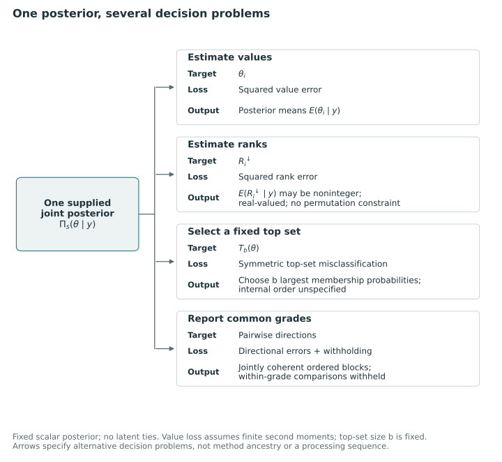

# Bayesian ranking and compound decisions {#sec-bayesian-ranking}

Bayesian ranking provides several ways to construct a comparative report from uncertain evidence, depending on the target and loss. We consider rank estimation, selection of leading units and assignment of coherent grades, followed by the debate about the errors and probability guarantees appropriate to these decisions.

We build on posterior decision analysis and Kline, Rose, and Walters' report-card construction. What each method contributes depends on the decision it solves: a ranking optimal under one loss may be unsuitable for another purpose.

## Targets and losses in Bayesian ranking {#sec-classical-bayesian-ranking}

Laird and Louis examine posterior rank distributions, extending attention beyond posterior means of performance. Lin, Louis, Paddock, and Ridgeway choose rank estimators under application-specific losses, while Henderson and Newton develop a criterion for recovering leading units across list sizes. These methods derive posterior reporting decisions from their losses. We use them to identify the target, action and loss required for a common report [@laird1989ranking, pp. 31–33; @lin2006ranking, pp. 916–920; @henderson2016cut, pp. 783–788].

### Estimating parameters and estimating ranks

For this discussion, suppose that larger values of a scalar target $\theta_i$ mean higher priority and that the posterior assigns probability zero to ties between distinct units. We define the rank from the top as

$$
R_i^{\downarrow}(\theta)=1+\sum_{j\ne i}\mathbf 1\{\theta_j>\theta_i\}.
$$

Laird and Louis use this orientation: the largest parameter has rank one. Lin and colleagues reverse it, assigning the largest parameter rank $n$; their ascending rank is $R_i^{\uparrow}=n+1-R_i^{\downarrow}$. The reversal changes the interpretation of an upper percentile, so we account for it when transferring formulas or comparing a “top” group [@laird1989ranking, p. 32, eq. 2; @lin2006ranking, p. 918, eq. 3].

Under the supplied selection law $\Pi_s(\cdot\mid Y)$, linearity of conditional expectation gives

$$
\bar R_i^{\downarrow}
=\mathbb E_{\Pi_s}[R_i^{\downarrow}\mid Y]
=1+\sum_{j\ne i}\Pi_s(\theta_j>\theta_i\mid Y).
$$

The posterior mean $\mathbb E_{\Pi_s}(\theta_i\mid Y)$ minimizes squared error for the parameter. The expected rank $\bar R_i^{\downarrow}$ minimizes squared error for the rank. These are different targets, so the order of posterior means need not equal the order of expected ranks. Laird and Louis develop this point using independent Gaussian posteriors with potentially unequal variances. The pairwise probabilities depend on uncertainty as well as location; greater uncertainty can move an extreme expected rank toward the middle. Their discussion also recognizes that posterior dependence can matter and that an empirical Bayes analysis must consider uncertainty from estimating the prior [@laird1989ranking, pp. 32–35, 41].

For independent Gaussian posteriors with equal variances, means determine their ordering and expected ranks yield the same order. Laird and Louis discuss this sufficient condition within the broader case of independent, stochastically ordered posteriors. With other posterior distributions, accounting for uncertainty may change the ranking. Evaluating pairwise comparisons also requires dependence information beyond a mean and standard error for each unit [@laird1989ranking, pp. 33, 41–42, Appendix A].

Expected ranks are usually noninteger. If the action must use each integer in $1,\ldots,n$ once, ordering expected ranks minimizes equal-weight squared rank loss. Lin and colleagues decompose posterior loss into variance and squared bias and use an exchange argument: pairing smaller expected ranks with smaller assigned ranks cannot increase total squared deviation. Equal expected ranks allow multiple optimal assignments. The result concerns permutations and equal unit weights rather than arbitrary weighted rank losses. Laird and Louis state it as a conjecture on page 32; Lin and colleagues provide the equal-weight argument in Appendix A [@lin2006ranking, pp. 918, 933–934].

### Selecting a fixed top fraction

Squared rank error values accuracy across the rank scale. An investigator seeking a fixed number of units for follow-up may instead care about membership in a leading group. Lin and colleagues formalize this change through a misclassification loss. Their $\gamma$ is a cut on ascending percentiles, $R_i^{\uparrow}/(n+1)$; when $\gamma n$ is an integer, the upper group contains $b=(1-\gamma)n$ units. In descending notation, let $T_b(\theta)=\{i:R_i^{\downarrow}\le b\}$ be the true top set and let the action $A$ contain exactly $b$ units. Their symmetric classification loss can be written as

$$
L_{\mathrm{class}}(A,\theta)
=\frac{|A\setminus T_b(\theta)|+|T_b(\theta)\setminus A|}{n}.
$$

To express their main-text selection argument in our notation, note that both sets have size $b$, giving $b-|A\cap T_b|$ members in each difference. Hence,

$$
\mathbb E_{\Pi_s}[L_{\mathrm{class}}(A,\theta)\mid Y]
=\frac{2}{n}\left[b-\sum_{i\in A}p_i(b)\right],
\qquad
p_i(b)=\Pi_s\{R_i^{\downarrow}\le b\mid Y\}.
$$

Selecting the $b$ largest membership probabilities minimizes this posterior expected loss, as in their Theorem 1. The specified cardinality and objective determine the rule; other cuts or losses can require other orderings [@lin2006ranking, pp. 919–920, eqs. 8–10; p. 935, Appendix B].

Since classification loss concerns group membership, it leaves the order within groups unspecified. Lin and colleagues also consider losses based on the assigned percentile's distance from the cutoff, the true percentile's distance from the cutoff and the discrepancy between these percentiles. Theorem 2 gives exceedance-probability ordering for the first loss, although no single simple optimizer is supplied for all the losses. Their separate hybrid procedure first forms classification groups and then orders their members by expected ranks. The preferred decision therefore depends on how ranks are used, even under the same posterior model [@lin2006ranking, pp. 919–922].

A finite-collection percentile event compares a unit with the other unknown parameters, whereas benchmark exceedance compares $\theta_i$ with a fixed value. Lin and colleagues relate percentile probabilities to posterior exceedance at a quantile of the average posterior distribution. Their asymptotic equivalence results require continuity, moment and sampling conditions. They provide an approximation rather than a finite-sample identity, and the model-derived quantile may differ from a clinical or policy threshold [@lin2006ranking, pp. 921, 923, eq. 11 and Theorems 5–6].

Lin and colleagues distinguish posterior risk conditional on data, preposterior risk averaged over the model's data distribution, and frequentist risk averaged over sampling at fixed parameters. Minimizing the first gives an optimum under the specified model and loss, without by itself establishing a uniform repeated-sampling guarantee. As the authors emphasize, even this optimum can perform poorly when information is weak. Its achieved accuracy and uncertainty therefore need to be reported [@lin2006ranking, pp. 917, 932–933].

### Recovering leading units across list sizes

Henderson and Newton address a related but different target: agreement between reported leading units and a population's upper tail. In their continuous measurement model, a unit supplies $D_i=(X_i,\sigma_i^2)$, and its latent scalar parameter follows a population distribution $F$. Write $\theta_\alpha=F^{-1}(1-\alpha)$. For each $\alpha$, a threshold rule selects when $X_i\ge t_\alpha(\sigma_i^2)$. The rule is constrained to select with marginal probability $\alpha$, and the objective is to maximize

$$
\Pr_H\{X_i\ge t_\alpha(\sigma_i^2),\ \theta_i\ge\theta_\alpha\},
\qquad
\Pr_H\{X_i\ge t_\alpha(\sigma_i^2)\}=\alpha.
$$

Here $\Pr_H$ denotes their joint model law over the unit's parameter, observation, and variance information. It is not the posterior law conditional on one realized collection. The true upper-tail event is defined by the population quantile, whereas Lin and colleagues' exact membership event uses the ranks in a finite collection [@henderson2016cut, pp. 783–785, eqs. 1–2].

The operative score at a particular cut is the local posterior tail probability $V_\alpha(D_i)=\Pr_H(\theta_i\ge\theta_\alpha\mid D_i)$. Choose $c_\alpha$ so that $\Pr_H\{V_\alpha(D_i)\ge c_\alpha\}=\alpha$; this $c_\alpha$ is the paper's $\lambda_\alpha$, renamed here to avoid collision with the later KRW exchange parameter. Theorem 2 gives optimal threshold selection when such a cutoff exists and the tail probability is right continuous and nondecreasing in the observation at fixed variance. Its proof maximizes a Lagrange-adjusted expected reward conditionally on the observation, then cancels the equal marginal selection probabilities. Theorem 1's smooth-threshold condition is necessary, so it alone does not establish optimality [@henderson2016cut, pp. 785, 787, 798].

The proposed ranking variable is

$$
r(D_i)=\inf\{\alpha:V_\alpha(D_i)\ge c_\alpha\}.
$$

Smaller values mean higher priority. It assembles decisions across cuts rather than ranking a single fixed-cut tail probability. This construction yields one ranking with the desired interpretation when the cut decisions are nested. The paper establishes noncrossing optimal thresholds for the normal–normal model and states conditions for the broader threshold argument. Its constrained Bayes interpretation likewise requires compatible solutions across the continuum of losses; multiple crossings can defeat a single rule that satisfies all cutwise conditions [@henderson2016cut, pp. 787–788, 791–792, eqs. 6–10].

The ideal calculation uses the known joint distribution; empirical calculation estimates the population distribution and the distribution of posterior tail probabilities. Theorem 4 provides asymptotic support under conditions including independent identically distributed units, parameter–variance independence in the stated model, consistent distribution estimation, sampling-density regularity and noncrossing thresholds. This result leaves finite-sample optimality for arbitrary fitted hierarchical models unresolved. The authors also report sensitivity to misspecification and leave maximal-agreement theory for more general examples open [@henderson2016cut, pp. 794–797, Conditions 1–4 and Theorem 4].

### Rank estimation, selection and common grades {#what-this-lineage-establishes-for-common-grades}

The preceding methods estimate positions, select a fixed leading group or construct rankings to recover a population upper tail. Our action is a collection of common ordered grades. A tie within a grade withholds a comparison; the finite top-set loss, by contrast, disregards within-group order because only membership matters. This indifference neither asserts latent equality nor assigns a cost to withholding comparisons in an ordered partition. Since a selected top group depends on its cut, it need not determine an optimal collection of grades.

The classical results already establish posterior postprocessing and application-specific losses. We must therefore assess P1's contribution through its target, feasible grades, directional-error and withholding objective, computation and theoretical properties.

Assigning several ordered groups jointly determines many between-group comparisons. Compound-decision and report-card models address this form of reporting and raise further questions about the error criterion.

@fig-vis-f05 makes the target, loss and native action explicit for four uses of one supplied posterior.

::: {#fig-vis-f05}
<picture>
<source media="(max-width: 720px)" srcset="../assets/figures/f05-one-posterior-several-decision-problems-mobile.svg">

</picture>

Decision targets, losses and actions under one supplied posterior. Squared error for values, squared error for ranks, fixed-size top-set misclassification, and coherent comparison loss lead to different actions. Arrows indicate alternative decision specifications. Expected ranks may be noninteger; a selected subset leaves its internal order unspecified; common grades require a jointly feasible ordered partition. The diagram implies no universally preferred ranking. Sources for the decision rules: [@laird1989ranking, pp. 32–33; @lin2006ranking, pp. 917–920; @kline_discrimination_2024, pp. 2477–2482].
:::

## Compound decisions and coherent report-card grades

Gu and Koenker derive an ensemble selection criterion from a compound-decision loss that accounts for heterogeneous precision. Kline, Rose, and Walters choose ordered grades with ties by combining pairwise rewards and penalties with global consistency constraints. Both supply close precedents for posterior postprocessing and decision-specific loss; the latter also supplies coherent grades. We compare P1's adaptation with these formulations by specifying the target, action and evaluation law [@gu2023invidious; @kline_discrimination_2024].

### Selecting an upper tail under capacity and error constraints

Gu and Koenker's published article studies noisy scalar merit measurements. Its oracle analysis treats the mixing distribution as known; feasible empirical Bayes procedures subsequently estimate that distribution. In the known-variance heterogeneous model, $Y_i\mid\theta_i,\sigma_i\sim N(\theta_i,\sigma_i^2)$, with $\theta_i\sim G$, $\sigma_i\sim H$, and independence between latent merit and precision. The target event is membership in a population upper tail, $h_i=\mathbf 1\{\theta_i\geq\theta_\alpha\}$, where $\theta_\alpha=G^{-1}(1-\alpha)$. This population cutoff differs from the random empirical cutoff defining the largest fixed number of latent values in the observed ensemble [@gu2023invidious, pp. 6–7, 12].

The action is a binary selection vector $\delta$. Writing $V=\sum_i(1-h_i)\delta_i$ for false selections and $R=\sum_i\delta_i$ for the selected count, the constrained problem seeks to minimize missed discoveries, $\mathbb E\sum_i h_i(1-\delta_i)$, subject to

$$
\frac{\mathbb E V}{\mathbb E R}\leq\gamma,
\qquad
\mathbb E R\leq\alpha n,
$$

when the first denominator is positive. The expectation averages over the model for latent effects and observations. The corresponding Lagrangian appears in equation (3.1); its two multipliers price false discoveries and capacity. Neither multiplier is P1's withholding cost, and the capacity fraction $\alpha$ has a different role from the error tolerance $\gamma$. The paper derives the rule by first taking conditional expectations and then averaging over the data distribution. Thus the displayed constraints should not be relabeled as posterior error constraints for every realized dataset [@gu2023invidious, pp. 10–13].

The relevant score is the posterior tail probability $v_\alpha(Y_i,\sigma_i)=\Pr(\theta_i\geq\theta_\alpha\mid Y_i,\sigma_i)$. Propositions 3.3 and 4.1 characterize threshold rules, with the stricter of the capacity and error restrictions determining the cutoff. Boundary randomization is discussed in the relaxed selection problem. A weak signal can make the error restriction bind before capacity is exhausted. Even though the cutoff on $v_\alpha$ is common across units, its implied boundary in the observed measurement depends on precision. Consequently, selecting the largest observed values, or treating any ranking score as interchangeable with the decision score, can produce a different action. The article explicitly distinguishes loss functions that agree in special homogeneous settings from those that yield different selections under heterogeneous uncertainty [@gu2023invidious, pp. 7–8, 11–13].

Gu and Koenker motivate nested selections across capacity levels partly by the wish to assign letter grades. Their Section 4.3 gives sufficient nesting conditions, restricting changes in posterior-tail-probability distributions and selection boundaries with $\alpha$. The required boundary monotonicity need not hold generally. Nested selections and letter grades are thus established antecedents, while the cutwise objective differs from KRW's joint optimization over pairwise grade relations [@gu2023invidious, pp. 15–16].

The population optimization uses marginal FDR, the ratio of expected false and total selections. Section 6 separately establishes asymptotic control of ordinary FDR, $\mathbb E[V/(R\vee1)]$, and expected selection proportion. The oracle result requires Assumption 1; the adaptive result adds Assumption 2 concerning mixing-distribution consistency and marginal-density convergence. For observed variances, the conditions include identically distributed independent units, independence of merit and variance, compact merit support, and variances bounded away from zero and infinity. These asymptotic results are separate from finite-sample posterior optimization and do not by themselves establish calibration for P1. We state them under their source conditions without reproducing the proof [@gu2023invidious, pp. 25–28].

### Coherent grades in KRW {#krw-already-optimizes-coherent-grades}

KRW begins its decision analysis with a belief distribution $B$ over the vector of latent discrimination levels. Larger $\theta_i$ means more discrimination, and larger reported $d_i$ means a more biased firm. The authors assume continuously distributed beliefs, so latent equalities have zero probability. The abstract argument does not require that $B$ arise from their later empirical Bayes model: the paper explicitly allows beliefs supplied by another route. The Gaussian sampling model, independence assumptions, and mixing-distribution estimation appear subsequently as a way to construct the beliefs used in the application [@kline_discrimination_2024, pp. 2477–2478, 2484–2486].

The action $d\in[n]^n$ permits ordered grades with ties and, up to relabeling nonempty grades, represents an ordered partition of the units. The number of grades is unrestricted, as is their placement relative to any prespecified scalar ordering. A tied pair contributes neither concordance nor discordance. Let $C$ and $D$ count concordant and discordant unordered pairs and let $M=\binom n2$. KRW's equation (1) gives the loss

$$
L_{\mathrm{KRW},\lambda}=\frac{D-\lambda C}{M},
\qquad 0\leq\lambda\leq1.
$$

A correct direction earns reward $\lambda$, an incorrect direction costs one, and withholding costs zero. KRW therefore optimize the informativeness–error trade-off directly over grades rather than rounding estimated latent ranks [@kline_discrimination_2024, pp. 2479–2480].

In an ordered partition, members of each grade are tied, every cross-grade pair has a direction, and tie membership is transitive. This form is interpretable but rules out some patterns of pairwise abstention. An unrestricted partial relation permits different reports and consequently changes the action space, even though both are sometimes called partial rankings [@kline_discrimination_2024, pp. 2477, 2480–2482].

The parameter has a behavioral interpretation as well as an optimization role. If a fraction $\phi$ of an audience knows the correct pairwise ordering when the report is silent and the remainder guesses, the paper's decision comparison yields $\lambda=(1-\phi)/(1+\phi)$. Here $\phi$ relabels the source's audience-information parameter to avoid a collision with P1's optional error budgets. Neither $\lambda$ nor $1-\lambda$ is itself a probability guarantee on reported comparisons [@kline_discrimination_2024, p. 2478].

For one isolated pair, write $\pi_{ij}=\Pr_B(\theta_i>\theta_j)$. Reporting $i$ above $j$ in the source orientation has expected net reward $\lambda\pi_{ij}-(1-\pi_{ij})$. It is strictly preferable to silence when $\pi_{ij}>1/(1+\lambda)$. That pairwise calculation does not solve the report-card problem. Strict relations and ties must satisfy the transitivity restrictions in equation (4), and the paper minimizes the joint linear objective in equation (5) subject to those restrictions. Its three-unit normal example shows why individually attractive pairwise decisions can give incompatible ties. Directional error probabilities supply P1's costs, while feasibility and global optimization remain joint properties of the report action [@kline_discrimination_2024, pp. 2480–2482].

By linearity, pairwise probabilities suffice to evaluate additive expected loss even when the events are dependent. Optimization is nevertheless coupled by the feasibility requirements. The probabilities concern uncertain differences and cannot generally be obtained from posterior means alone; KRW estimate them by empirical Bayes before grading. Using estimated beliefs preserves the form of the optimization, although an inaccurately estimated prior can produce finite-sample optimism, as the authors note [@kline_discrimination_2024, pp. 2480, 2485–2486].

KRW's discordance rate also requires its own denominator. Their $DR=\mathbb E_B D/M$ averages over all unordered pairs, including pairs on which the report is silent. Their count-defined informativeness statistic is $(C-D)/M$, with silence contributing zero. By contrast, a disclosed-comparison error proportion uses $D/N$ when $N=C+D>0$. An action that discloses fewer comparisons can lower the first quantity without improving the second. At an all-tie action, the all-pair discordance rate is zero while the disclosed-comparison ratio is undefined. We distinguish these quantities by their numerator, denominator and probability law rather than using FDR as an interchangeable label [@kline_discrimination_2024, pp. 2479–2481].

### Scalar loss correspondence and its limits {#a-precise-scalar-reduction-and-its-limits}

We reconstruct the relation between P1's scalar loss and KRW's objective. Assume one scalar criterion with unit loss weight, matched priority orientation, the same feasible ordered partitions, the same belief law, and zero probability of latent ties. Source grade labels must be reversed when necessary because P1 assigns grade 1 to highest priority. These conventions make $D$ the same wrong-direction count in both problems. Every disclosed comparison is then either correct or wrong, so $C=N-D$. It follows that

$$
L_{\mathrm{KRW},\lambda}
=\frac{(1+\lambda)D-\lambda N}{M}.
$$

P1's scalar directional-error and withholding loss is $L_\tau=[D+\tau(M-N)]/M$. Set

$$
\lambda=\frac{\tau}{1-\tau},
\qquad
\tau=\frac{\lambda}{1+\lambda}.
$$

Direct substitution gives

$$
L_\tau=\tau+(1-\tau)L_{\mathrm{KRW},\lambda}.
$$

The multiplier is positive for $\tau<1$, so posterior expected losses have identical minimizers on the same action space. P1's baseline $0<\tau\leq1/2$ corresponds to $0<\lambda\leq1$; KRW also includes the endpoint $\lambda=0$. This derivation is an author reconstruction from the two loss definitions, not a claim of a new scalar grading principle. If latent equality has positive probability, the identity needs reconsideration because P1 counts the weak wrong-direction event, whereas KRW's basic concordance and discordance definitions use strict inequalities [@kline_discrimination_2024, pp. 2477–2480].

Specifying an exact or maximum grade count, or fixing an order, restricts the optimization domain. The affine identity holds if both objectives use the same restricted domain, but the resulting optimizer need not solve KRW's unrestricted problem. Likewise, criterion-specific wrong-direction events differ from a composite's wrong-direction event. Error weights value mistakes and do not automatically define cardinal target coefficients. A reduction must therefore match the target event, loss and feasible set.

KRW's online Appendix A discusses cardinal-difference weighting of pairwise mistakes and its antecedents. Their general-belief formulation also separates reporting from belief estimation. P1 requires further results for its multicriteria action and loss, grade restrictions, and the relationship between selection beliefs and the evaluation law. Those results do not follow from the scalar algebra or analogy with the original articles. Our source comparison establishes attribution and identifies these questions without independently verifying the full KRW proposition proofs or Gu–Koenker supplementary asymptotic arguments [@kline_discrimination_2024, online Appendix A, p. 2; @gu2023invidious, pp. 3, 25–28].

The published exchange on Gu and Koenker examines how the purpose of selection, available information and desired protection affect loss-based reporting. The disagreements concern choices that must be settled before a ranking statistic can be selected.

## Risk guarantees and the purpose of a ranking

Kline asks whether tail membership adequately represents the consequences of a decision. Mogstad, Romano, Shaikh, and Wilhelm distinguish the event counted as a failure from the probability law under which its frequency is controlled. Gu and Koenker defend the information obtained through compound decisions while allowing alternative losses and stronger protection. The labels Bayesian, frequentist and error controlled do not by themselves resolve these differences in objectives and requirements [@kline2023comment; @mogstad2023comment; @gu2023reply].

### Error diagnostics and the decision objective {#a-useful-error-diagnostic-need-not-define-the-desired-action}

Kline supports uncertainty reporting and empirical Bayes borrowing across units, while questioning how diagnostics determine the objective. The tail fraction and error tolerance should reflect what follows selection. Screening before investigation can have different costs from immediate intervention, and binary selection differs from assigning several letter grades. A binary false-discovery criterion alone leaves the value of mistakes among grade categories unspecified [@kline2023comment, pp. 47–51].

His auditor example makes the role of cardinal consequences explicit. For nonnegative discrimination severity $\theta_i$, investigation cost $c>0$, and preference parameter $r<1$, the proposed loss is

$$
L(\delta,\theta)=-\sum_i\delta_i\{\theta_i^{1-r}-c\}.
$$

Under the risk-neutral case $r=0$, minimizing posterior expected loss selects firms whose posterior mean severity exceeds the cost. The relevant score follows from the benefit of an investigation, rather than from a requirement to discover membership in a relative tail. Kline accordingly argues that absolute standards and the magnitude of gains or harms may matter even when perfect ranks were available. This is a challenge to the adequacy of a proposed objective, not a claim that posterior tail probabilities are incorrectly optimized for the objective they were designed to serve [@kline2023comment, pp. 51–52].

Gu and Koenker acknowledge the difficulty of eliciting loss and linking capacity and error tolerances to mistake costs. They accept that means, tail probabilities and other scores can suit different losses, particularly with heterogeneous precision, while defending the public value of relative comparisons. Their response leaves the appropriate reporting purpose open rather than prescribing one statistic for all decisions [@gu2023reply, pp. 62–63].

For P1, the intended use must justify criterion-specific wrong-direction costs, withholding costs, grade restrictions and any error budgets. Coherent optimization cannot supply this justification. Nor does introducing several criteria resolve Kline's concern about cardinal consequences, since weighted directional errors remain different from losses on outcome magnitudes.

### Error criteria and laws of evaluation {#error-criteria-and-probability-laws-are-separate-choices}

Mogstad and colleagues identify two axes of comparison. One concerns what counts as a failure: at least one false assertion, the expected proportion of false assertions, or a large realized false proportion. The other concerns what varies across repetitions: only the measurements for a fixed parameter configuration, or both measurements and the configuration drawn from a mixing distribution. They also distinguish the large-ensemble asymptotics used to estimate a mixing distribution from an asymptotic framework in which the number of populations remains fixed and their measurements become more informative [@mogstad2023comment, pp. 54–57].

Let $V$ count false declarations under a specified rule and target, and let $R$ count declarations. For this comparison, define $\mathrm{FDP}=V/(R\vee1)$. At fixed $\theta$, familywise control bounds $\Pr_\theta(V\geq1)$, whereas false-discovery-rate control bounds $\mathbb E_\theta[\mathrm{FDP}]$. Neither notation determines whether the target is a finite-ensemble latent rank or membership above a population quantile. These events must also be aligned before rates are compared. In particular, the population-tail target used by Gu and Koenker and membership among the best fixed number in a finite ensemble are not identical targets [@mogstad2023comment, pp. 54–56].

The difference between an expected error proportion and a tail guarantee is material. As the comment notes, if $\mathbb E_\theta[\mathrm{FDP}]\leq\gamma$, Markov's inequality gives

$$
\Pr_\theta(\mathrm{FDP}>c)\leq\frac{\gamma}{c},\qquad c>0.
$$

The bound can be weak when the acceptable realized error fraction is small. Mogstad and colleagues therefore discuss direct FDP-tail control, fixed-parameter FDR and empirical Bayes work on false-discovery exceedance. Their alternatives extend beyond a choice between frequentist familywise control and Bayesian FDR [@mogstad2023comment, pp. 56–57].

Integrating expected FDP over parameter configurations gives a different requirement from bounding it at every fixed configuration. The comment argues that the latter may matter to people facing consequential decisions, providing a reason for stronger protection in some applications. This repeated-measurement guarantee remains conditional on its assumptions and differs from a posterior probability that the observed selection is correct [@mogstad2023comment, pp. 56–59].

Here *conditional* refers to two different probability laws: conditioning on $\theta$ while repeatedly generating measurements, or conditioning on the observed $Y$ while integrating latent uncertainty under a posterior. P1's selection-posterior risk, its true conditional evaluation risk when a joint data-generating model is specified, and a fixed-parameter sampling risk therefore require separate notation. The same numerical tolerance cannot make these quantities interchangeable. Marginal FDR, a ratio of expected false and total selections, must also remain distinct from ordinary FDR, the expected realized proportion, even when an asymptotic argument relates them in a specified setting [@mogstad2023comment, pp. 54–58; @kline2023comment, p. 49, footnote 1].

### Fixed-parameter interpretation of compound decisions {#compound-decisions-also-admit-a-fixed-parameter-interpretation}

Gu and Koenker's reply shows why empirical Bayes need not assume randomly generated parameters. Revisiting a binary normal-means example, they take a fixed sequence $\theta_1,\ldots,\theta_n$, common conditional measurement densities, an additive loss, and a common component rule. The average sampling risk can be expressed as the Bayes risk for one component under the empirical distribution of that fixed sequence [@gu2023reply, pp. 61–62].

In component notation supplied here, let $a(Y_i)$ be the common rule, $\ell$ the component loss, and $G_n(A)=n^{-1}\sum_i\mathbf1\{\theta_i\in A\}$. Then

$$
\frac1n\sum_i\mathbb E_{\theta_i}[\ell(\theta_i,a(Y_i))]
=\iint\ell(t,a(y))f(y\mid t)\,dy\,dG_n(t).
$$

The identity averages component risks of the fixed sequence without randomizing it. Estimating the empirical mixture then allows a feasible rule to depend on other units' observations. The reply supports this step by citing classical asymptotic results for the binary example. We report those antecedents without independently extending their proofs to a new ranking or grading procedure [@gu2023reply, pp. 61–62].

This representation gives compound decisions a fixed-parameter interpretation, but average additive loss differs from expected error ratios and the probability of any wrong declaration. It therefore does not establish familywise or FDR control at every fixed configuration in the full selection problem. Transferring the result to P1 would also require an argument for its globally constrained grade action, which differs from the component rule in the identity.

### Information, assumptions, and the limits of the illustrations

The discussion also concerns information. Kline points to the latent distribution's shape and experimental design as reasons why difficulties under Gaussian heterogeneity need not imply general futility. Gu and Koenker agree that flexible mixtures can reveal information missed by parametric shrinkage. They acknowledge variance-stabilization approximations and limited identification from sparse discrete measurements. Nonparametric estimation consequently retains modeling and information requirements [@kline2023comment, pp. 49–50; @gu2023reply, p. 63].

Mogstad and colleagues disable Gu–Koenker's capacity constraint in the commuting-zone illustration, so selecting more than ten units is consistent with that design. The reply instead examines capacity-constrained selections and changes from precise correlational estimates to noisier mover-design estimates, including counties. Because the information and requirements differ, these counts do not constitute a controlled comparison with common targets, constraints, estimators and evaluation laws [@mogstad2023comment, pp. 58–59; @gu2023reply, pp. 64–65].

The reply allows more stringent protection for consequential teacher evaluation while noting its power cost. We therefore retain each method's own guarantee in comparisons under a common target, action and evaluation law, explaining its usefulness and dependence on beliefs or sampling assumptions. The present account covers the two comments and reply, without exhausting opposing views, replicating the applications or independently verifying the cited classical proofs [@gu2023reply, p. 65].

The remaining chapters examine the ordering statements supported by uncertainty analysis, the aggregation of rankings, attributes and preferences, and error control through selective reporting. We bring these comparisons together in @sec-literature-contribution-synthesis to assess P1's contribution.
