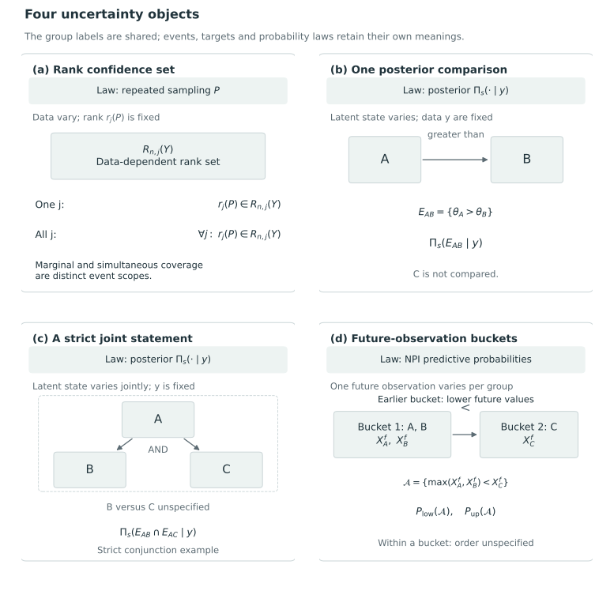

# Uncertainty and ordering statements {#sec-uncertainty-ordering}

A report based on uncertain numerical scores may give possible ranks, assess several comparisons jointly or assign probability to an entire ordering. Even for the same scalar feature, these statements concern different events. Their relation to common grades depends on the target, reported object, probability law and guarantee.

@MogstadEtAl2024 obtain rank confidence sets by simultaneous inference on differences between population features. @BarrientosEtAl2023 construct local and global posterior ordering statements and select a statement through a reward. Predictive bucket ranking concerns future observations. The justification for each uncertainty statement depends on this choice of object.

## Rank confidence sets and their sampling law

For this comparison, retain Mogstad and colleagues' local notation: $p$ is the number of populations and $n$ indexes sample size. These symbols do not replace the book's notation for the number of units. Population $j$ has a scalar feature $\theta_j=\theta(P_j)$, and the target rank is

$$
r_j(P)=1+\sum_{k=1}^{p}\mathbf 1\{\theta_k>\theta_j\}.
$$

Larger features receive smaller numerical ranks. Equal features share the best position available within their tie block. The target is a functional of the data-generating distribution $P$; it is fixed under repeated sampling from that distribution. The confidence set $R_{n,j}(Y)$ is random because the data are random [@MogstadEtAl2024, p. 484, §3.1].

The marginal objective is a coverage statement for one prespecified population:

$$
\liminf_{n\to\infty}\inf_{P\in\mathcal P}
P\{r_j(P)\in R_{n,j}(Y)\}\ge 1-\alpha.
$$

The simultaneous objective covers the entire rank vector through a product of coordinate sets, as in equations (1) and (2) of the paper. *Marginal versus simultaneous* distinguishes coverage of one population from coverage of all populations. *Pointwise versus uniform* distinguishes a result at one distribution from a result uniform over $\mathcal P$. A marginal set can therefore be uniformly asymptotically valid while separate marginal sets need not give simultaneous coverage [@MogstadEtAl2024, pp. 484–485].

The construction exploits differences $\Delta_{j,k}=\theta_j-\theta_k$. Suppose a rectangular confidence region jointly covers the relevant vector of differences. Let $N_j^-$ contain units whose difference interval for $\theta_j-\theta_k$ lies strictly below zero, and let $N_j^+$ contain those whose interval lies strictly above zero. The resulting rank set is

$$
R_{n,j}=\{|N_j^-|+1,\ldots,p-|N_j^+|\}.
$$

The lower endpoint counts units established to be above $j$, and the upper endpoint subtracts units established to be below it. Theorem 3.1 bounds finite-sample rank coverage below by coverage of the input difference region. Uniform asymptotic coverage of that region consequently gives the corresponding rank guarantee. A finite-sample $1-\alpha$ guarantee based on this bound additionally needs the input region's coverage to be justified [@MogstadEtAl2024, pp. 485–487, equations (4)–(5), Theorem 3.1, equation (13)].

For simultaneous inference, Theorem 3.3 applies the counting construction to every unit using all ordered pairs of distinct populations. Coverage of the common difference region then gives a lower bound on joint rank coverage. Although pairwise conclusions determine the endpoints, the reported uncertainty concerns possible rank vectors. The output is a Cartesian product of coordinate rank sets, which need not specify a unique total order or common grading [@MogstadEtAl2024, p. 492, Theorem 3.3 and equation (23)].

## Directional error control and stepdown rank confidence sets {#directional-errors-stepdown-improvement-and-limits}

Mogstad and colleagues also improve the basic construction by testing differences sequentially. For a two-sided comparison, rejecting equality is insufficient to justify a rank direction: the reported sign could be wrong. Their mixed directional familywise error rate includes both rejection of a true equality and an incorrect sign declaration. Theorems 3.2 and 3.4 bound marginal and simultaneous rank coverage, respectively, below by one minus this error probability. Their asymptotic conclusions require uniform control of that probability, as stated in equation (18) [@MogstadEtAl2024, pp. 488–490, 493].

The algorithms convert the directional problem into one-sided tests of $\Delta_{k,l}\le0$ against $\Delta_{k,l}>0$, including both orientations when two-sided rank inference is required. They begin with the relevant full family, form simultaneous lower confidence bounds, reject hypotheses whose bounds exclude zero, remove the rejected hypotheses, and recompute bounds for the remaining family. Iteration stops when no additional rejection occurs. Algorithm 3.1 concerns one focal population; Algorithm 3.2 uses all pairs. The authors condition the validity of this implementation on suitable restrictions on the distribution class and valid simultaneous inference for differences. They also warn that removing both opposite hypotheses merely because one is rejected does not generally preserve directional error control [@MogstadEtAl2024, p. 490, Algorithm 3.1 and following discussion; pp. 493–494, Algorithm 3.2].

The difference region allows dependence among estimators. To obtain valid coverage, the paper discusses limiting Gaussian calculations and resampling of studentized maximum statistics. The main exposition fixes the number of populations; Remark 3.1 refers to high-dimensional results when that number grows. Their use requires calibration assumptions appropriate to the estimator and growth regime [@MogstadEtAl2024, pp. 485–486, equations (6)–(12) and Remark 3.1].

Remark 3.4 extends coverage to the range of positions occupied by tied features. For a set to collapse to the true rank with probability approaching one, Remark 3.3 instead requires distinct features and shrinking difference intervals. Uniform coverage without separation can therefore coexist with substantial uncertainty near ties. Coverage alone also leaves optimality in expected loss or interval length unresolved; Section 3.2.3 gives more specific arguments for particular tests and allows improved constructions [@MogstadEtAl2024, pp. 487–488, 491–492].

## Posterior ordering events from selected comparisons {#posterior-events-built-from-selected-comparisons}

Barrientos and colleagues begin with a different probability object. Their $P$ denotes the posterior distribution of an unknown parameter vector conditional on observations, with the conditioning suppressed. Here write it as $\Pi_s(\cdot\mid Y)$ to avoid confusing it with the sampling law above. An ordering statement is a measurable event in parameter space that specifies order relations among some parameters while leaving other relations unspecified. Section 3.1 assumes no exact ties for the developed construction. Silence about a pair therefore expresses an omitted comparison, not a claim that its two latent parameters are equal [@BarrientosEtAl2023, p. 783, Definition 1].

The construction begins with elementary events $E_{l,l'}=\{\xi_l>\xi_{l'}\}$. For each focal parameter, it selects directions whose individual posterior probabilities exceed $1-\alpha$. A strict local statement conjoins all selected directions involving that parameter. The relaxed local statement $A_{l,\alpha,t}$ requires at least a proportion $1-t$ of those selected directions to hold. It is a union over qualifying subsets of comparisons, each subset contributing an intersection of directional events. Thus $\alpha$ is a threshold used to choose elementary comparisons, while $t$ changes the content of the reported event by allowing some of them to fail [@BarrientosEtAl2023, pp. 783–784, equations (3.1)–(3.2)].

At the next level, $\mathcal G_{\alpha,t,\gamma}$ selects focal parameters whose local events have posterior probability at least $1-\gamma$. A strict global statement conjoins these local events. Its relaxed version $G_{\alpha,t,\gamma,q}$ requires at least a proportion $1-q$ of the selected local events to hold. The two tolerances act on different collections: $t$ concerns elementary comparisons within a local event, and $q$ concerns local events within the global statement. They are not interchangeable with a single bound on the proportion of all pairwise directions that are wrong [@BarrientosEtAl2023, p. 785, equations (3.3)–(3.4)].

This hierarchy addresses the fact that individually probable statements can have a much less probable conjunction. In the usual range $\alpha\le1/2$, which prevents selecting both directions of a pair, the paper's posterior bounds include

$$
\Pi_s(G_{\alpha,t,\gamma,0}\mid Y)
\ge 1-\gamma|\mathcal G_{\alpha,t,\gamma}|,
$$

and

$$
\Pi_s(A_{l,\alpha,0}\mid Y)
\ge 1-\alpha m_l,
$$

where $m_l$ is the size of the union of selected lower- and upper-comparison index sets for $l$. These are posterior union bounds, which may be uninformative when their right sides are negative. The bounds do not establish a posterior probability of $1-\gamma$ for the global statement or repeated-sampling coverage at that level. The relevant probability is the posterior mass of the actual global event after its construction [@BarrientosEtAl2023, p. 786, numbered inequalities 2 and 4].

## Selection and guarantees of posterior ordering statements {#choosing-a-statement-and-understanding-its-guarantee}

To choose among ordering statements, Barrientos and colleagues propose a reward that trades information against uncertainty. For tuning action $a=(\alpha,t,\gamma,q)$, their example is

$$
R(a)=C(G_a)\Pi_s(G_a\mid Y),
$$

with selected local-event index set $\mathcal H=\mathcal G_{\alpha,t,\gamma}$ and

$$
\begin{aligned}
C(G_a)&=\left\lfloor(1-q)|\mathcal H|\right\rfloor\\
&\quad\times\sum_{l\in\mathcal H}\left\lfloor(1-t)m_l\right\rfloor.
\end{aligned}
$$

The factor $C$ rewards included comparisons and local statements while penalizing tolerated errors; the global posterior probability rewards joint credibility. On the constructed candidate class, their product is the posterior expectation of an event-indicator utility. The authors call this an approximate decision-theoretic approach because data and posterior screening determine the candidates rather than exhaustive optimization over all statements. Its optimum is therefore relative to that class, unlike an optimum over a fixed grade-action space [@BarrientosEtAl2023, pp. 786–788, Condition 3.1 and equations (3.5)–(3.6)].

The authors also consider fixing local and global error tolerances or restricting candidates to those above a minimum posterior probability. Numerical optimization over tuning values follows event construction. We describe the construction without independently verifying the supplementary algorithms, Monte Carlo optimum or estimated event probabilities [@BarrientosEtAl2023, p. 788, §3.3].

The large-data argument uses a sampling law to describe posterior concentration. Equation (3.7) assumes concentration in every neighborhood of the true parameter vector in probability under that law. At a strictly ordered truth, Proposition 2 gives convergence of the optimal tuning action to zero tolerances, with the limiting statement representing the true ranking. This consistency result differs from a uniform finite-sample confidence guarantee over ties or near-tie sequences [@BarrientosEtAl2023, pp. 788–789, equation (3.7), Proposition 2].

Consistency is established for the stated reward, action space and optimizer. Alternative rewards, actions or numerical approximations require further analysis, as do positive-probability latent ties and practical-equivalence thresholds, which the discussion presents as extensions beyond the strict-order assumptions [@BarrientosEtAl2023, pp. 788–789, 803].

## Predictive bucket ranking {#sec-predictive-bucket-ranking}

@AlshihryEtAl2026NPI use nonparametric predictive inference (NPI) to select and rank groups by one future observation from each. This target differs from latent population features: a larger mean can coexist with a smaller next observation. Their work is a close predecessor for uncertainty-aware bucket ranking, with a different inferential target from P1's posterior over latent performance [@AlshihryEtAl2026NPI, pp. 5–7, 24–25].

The NPI construction assumes continuous, exchangeable observations and Hill's post-data assumption $A_{(n)}$, assigning probability $1/(n+1)$ to each open interval between ordered observations, including the two unbounded intervals. The developed analysis assumes no observed ties and independent groups. The paper mentions extensions for observed ties, which concern a different issue from placing groups in the same reporting bucket. Its nonparametric formulation thus retains substantive assumptions [@AlshihryEtAl2026NPI, pp. 5–7, equation (6)].

Using the source's local notation, partition $k$ groups into $s$ nonempty, ordered buckets $K_1,\ldots,K_s$. Its event is

$$
A=\bigcap_{i=1}^{s-1}\left\{\max_{t\in K_i}X_t^f<\min_{t\in K_{i+1}}X_t^f\right\},
$$

where $X_t^f$ is the next observation from group $t$. Every observation in an earlier bucket must fall below every observation in the next. Within a bucket, the event leaves the observations' relative order unspecified. It does not assert equality of realized observations, population distributions, or latent parameters. The report thus has a familiar ordered-partition form while its content is a conjunction of predictive inequalities [@AlshihryEtAl2026NPI, pp. 24–25, equation (27)].

For the general bucket event, exact NPI lower and upper probabilities differ from computational lower bounds on the former and upper bounds on the latter. The NPI-bootstrap estimates an event probability under additional choices of uniform sampling inside bounded intervals and Normal-tail sampling. It is consequently not an estimator of both extremal probabilities. In the reported examples, its estimates lie between the reported bounds; a universal guarantee for each finite simulation run is not established [@AlshihryEtAl2026NPI, pp. 25–29, §§5.1–5.4].

Choosing buckets involves allocation and granularity. The paper shows that median ordering need not maximize predictive support. Section 5.4 discusses evaluating feasible allocations through their lower and upper bounds while retaining application-specific choice. The four-group example compares two, three and four buckets, without optimizing over the one-bucket report or specifying a universal scalar trade-off when the bounds favor different configurations [@AlshihryEtAl2026NPI, pp. 25–29, §§5.2–5.4].

NPI bucket ranking evaluates a conjunction of future inequalities, whereas P1 minimizes additive posterior loss for false latent directions and withheld comparisons. Similar bucket counts or uncertainty intervals do not establish a relation between these objectives. The NPI paper proposes losses for future observations as a possible generalization [@AlshihryEtAl2026NPI, p. 30]. To apply its predictive selection or bucket-ranking results to P1, the target, loss and dependence assumptions would need to be aligned.

@fig-vis-f06 separates the events and laws behind four uncertainty objects before considering conversion to grades.

::: {#fig-vis-f06}
<picture>
<source media="(max-width: 720px)" srcset="../assets/figures/f06-four-uncertainty-statements-about-the-same-units-mobile.svg">

</picture>

Four uncertainty objects for the same labelled groups. Rank sets are assessed over repeated sampling; elementary and strict joint posterior statements describe different parameter events. NPI buckets concern future observations under the source predictive assumptions. Symbols show event structure only: no interval, probability or coverage value is calculated. Silence leaves a relation unspecified, and each source guarantee retains its own assumptions. Sources for the uncertainty statements: [@MogstadEtAl2024, §§3.1–3.3; @BarrientosEtAl2023, §§3.1–3.3; @AlshihryEtAl2026NPI, §5.1].
:::

## Conversion of uncertainty statements to common grades {#from-an-uncertainty-object-to-a-common-grade}

Expressing these methods through pairwise comparisons does not make their reported objects identical. Rank confidence sets list possible positions, and predictive buckets concern future observations. A Bayesian global statement with positive error tolerances is a union of intersections in parameter space, allowing different subsets of comparisons to hold in different states. A graph of elementary directions consequently need not assert joint correctness. For strict conjunctions, Barrientos and colleagues display directed ordering graphs together with the joint posterior probability [@BarrientosEtAl2023, p. 802, discussion of Figure 7].

An ordered partition adds a constraint to the reported comparisons. To see this, consider a report asserting only that $A$ exceeds $C$, with $B$ left unordered relative to both. A partial order represents exactly those statements. If both silent relations were grade ties, placing $A$ with $B$ and $B$ with $C$ would also place $A$ with $C$. Common grades must therefore add or withhold a comparison. This is our logical example, rather than a theorem attributed to the source papers. Converting the statements to grades changes the decision problem and requires a feasible action class and loss.

Joint posterior ordering statements and the selection of informative statements by a decision rule are already established. Our proposed contribution concerns the common-grade action and criterion-specific directional losses. Posterior expected wrong-direction counts, posterior probability of joint correctness and frequentist coverage remain different functionals, whose relationship requires a further argument. In particular, repeated-sampling coverage does not itself select a loss-minimizing grade. We therefore retain each method's uncertainty measure alongside a common evaluation target in empirical comparisons; equal numerical thresholds can otherwise conceal differences in the statements supported.

Aggregation and preference models provide another way to study ordered partitions, which we examine in @sec-aggregation-mcda. In each case, conversion to common grades requires justification if the original method's guarantee is to be preserved.