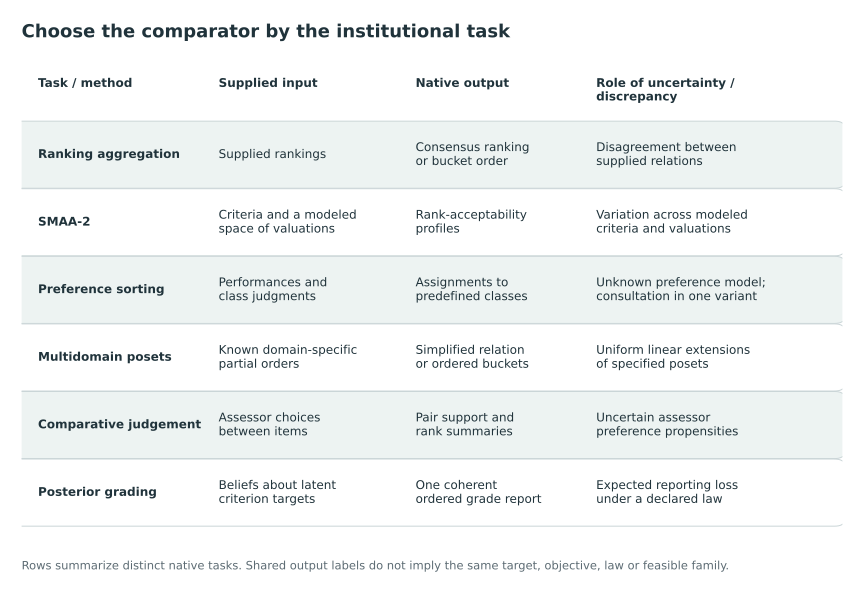

# Weak orders, aggregation, and MCDA {#sec-aggregation-mcda}

Ordered groups can summarize preferences, approximate known partial orders or communicate uncertain performance on several attributes. These uses share the mathematical structure of common grades but need not share their normative interpretation. We examine how the inputs and meaning of a tie determine the problem being solved.

The discussion proceeds from rankings with ties to attributes and weights, multicriteria acceptability and sorting, and then to assessor judgments and ordered classification. The comparisons concern the inputs, objectives and interpretation of each method.

@fig-vis-f07 locates the neighboring methods by the task each is designed to solve.

::: {#fig-vis-f07}
<picture>
<source media="(max-width: 720px)" srcset="../assets/figures/f07-a-task-map-of-neighboring-methods-mobile.svg">

</picture>

Inputs, outputs and roles of uncertainty in the neighboring methods described in this chapter. Shared ranking or class labels do not imply a common target, objective, probability law or feasible action set. This operational comparison makes no genealogy or dominance claim. Sources for the method comparisons: [@fagin2006partial; @lahdelma_salminen2001smaa2; @ru2023sorting; @ulu_shively2024sorting; @arcagni2022multidomain; @gray2026transparency; @kline_discrimination_2024].
:::

## Ordered grades and the aggregation of rankings with ties {#sec-weak-orders-aggregation}

An ordered grade report partitions a common set of objects into ordered groups. Rank aggregation studies this class of reports, including comparison of two reports and construction of a consensus from several rankings. It therefore already includes ties, pairwise disagreement and optimization of an aggregate ranking. Fagin and colleagues provide the mathematical basis for these operations [@fagin2004ties_author; @fagin2006partial]. We use it to distinguish the geometry and computation of rankings from the meaning of their inputs, output ties and objectives.^[This comparison uses selected original definitions, theorem statements, and proof arguments. It does not claim a complete proof audit. Locators for the 2004 work refer to the inspected author copy, whose pagination differs from the proceedings.]

### Ordered partitions and the interpretation of ties {#the-common-action-space-and-different-meanings-of-ties}

Fagin and colleagues define a bucket order by an ordered partition $B_1,\ldots,B_t$ of a fixed domain $D$. An object in $B_a$ precedes an object in $B_b$ exactly when $a<b$. Members of the same bucket are tied. Their associated partial ranking assigns each member of $B_a$ its bucket's midrank,

$$
\sigma(i)=\sum_{b<a}|B_b|+\frac{|B_a|+1}{2},\qquad i\in B_a.
$$

Here, “partial” means that ties are allowed; it does not mean that some objects are absent or that arbitrary pairs are incomparable. A full ranking has singleton buckets. Their top-$k$ list is also a ranking of the entire domain: its first $k$ buckets are singletons and its remaining objects occupy a common bottom bucket [@fagin2006partial, sec. 2, pp. 630–631].

P1 represents grades by the same ordered partition, with smaller grade indices denoting higher standing. Defining $i\precsim_g j$ when $g_i\le g_j$ gives a total preorder, including both directions for a tied pair; the strict relation compares different grades. This structure couples decisions across pairs. Two declared ties can force a third, so an arbitrary pattern of withheld comparisons may have no grade representation.

Ties have different interpretations across applications. A database ranking may have ties because an attribute takes few distinct values. A P1 grade tie withholds a direction and allows latent differences, practical nonequivalence and membership in different substantive clusters. The same bucket-order structure thus represents different decisions. Interpreting a tie as evidence of latent equality would change the target and loss without necessarily changing the displayed labels.

### Pairwise penalties and the metric boundary

The generalized Kendall construction makes its treatment of ties explicit. For two partial rankings on the same domain, $K^{(p)}$ sums a penalty over unordered pairs: zero for agreement in strict direction or a tie in both rankings, one for opposite strict directions, and $p$ when exactly one ranking ties the pair. The paper defines this family for $0\le p\le1$. Thus the penalty measures disagreement between two ranking relations; the meaning of a tie is encoded in both arguments [@fagin2006partial, sec. 3.1, pp. 633–634].

The parameter restriction is consequential. Proposition 3 establishes that $K^{(p)}$ is a metric for $1/2\le p\le1$, a near metric for $0<p<1/2$, and not even a distance measure in the authors' sense at $p=0$. Their near-metric definition requires a relaxed polygonal inequality with a constant independent of domain size. It is stronger than merely allowing an unspecified violation of a triangle inequality. For fixed positive parameters, Proposition 4 establishes equivalence by positive multiplicative bounds, also independent of domain size [@fagin2006partial, secs. 2.1 and 3.1].

Consider $i\prec j$, $i\sim j$ and $j\prec i$. The two strict rankings are distance one apart, whereas the path through the tied ranking costs $2p$. The triangle inequality fails for $p<1/2$, and at zero a strict and a tied ranking can have zero distance. A low withholding penalty can therefore express a coherent preference without defining a metric. Metricity restricts the comparison function; it does not require decision makers to value withholding at least half as much as reversal.

The profile Kendall metric is the special case $K_{\mathrm{prof}}=K^{(1/2)}$. The profile footrule is

$$
F_{\mathrm{prof}}(\sigma,\rho)=\sum_{i\in D}|\sigma(i)-\rho(i)|.
$$

The coordinates are midranks; substituting arbitrary grade labels would change the function. The papers also define Hausdorff distances between sets of full refinements. Their max–min construction compares possible resolutions of ties rather than averaging over a posterior on latent rankings [@fagin2006partial, secs. 3.1–3.2].

Theorem 13 gives the profile comparison

$$
K_{\mathrm{prof}}\le F_{\mathrm{prof}}\le2K_{\mathrm{prof}}.
$$

Theorem 7 places both profile and both Hausdorff metrics in the same multiplicative equivalence class. The equivalence bounds relative distances while allowing different optimizers and interpretations. Constants relating $K^{(p)}$ to other distances may depend on $p$, so a result for each fixed positive penalty need not hold uniformly as the penalty tends to zero [@fagin2006partial, Props. 3–4 and Thms. 7, 13–14].

### Aggregation objectives and approximation guarantees {#what-the-aggregation-guarantees-actually-compare}

For input rankings $\sigma_1,\ldots,\sigma_m$, distance-based aggregation minimizes

$$
A_d(\rho)=\sum_{\ell=1}^m d(\rho,\sigma_\ell)
$$

over a specified output class. The approximation guarantee concerns supplied rankings and requires neither sampling nor posterior probabilities. The 2004 paper relates total Kendall disagreement for full rankings to Kemeny aggregation, whereas its median construction uses footrule loss. These are different constructions from a Borda rule [@fagin2004ties_author, sec. 1, author-copy p. 1; sec. 6, author-copy pp. 9–10].

Three results in the author copy distinguish the output class and the projection operation. First, Theorem 9 takes a coordinatewise median of input midranks and uses its order to form a top-$k$ list, breaking ties as specified in the theorem. Its total footrule distance is at most three times that of any competing top-$k$ list. The comparison is within the same top-$k$ action class. Second, Theorem 10 chooses a valid partial ranking $f^\dagger$ that minimizes $L_1(f^\dagger,f)$, where $f$ is the coordinatewise median function. For partial-ranking inputs, the resulting total footrule objective is at most twice that of any partial ranking. Third, Theorem 11 gives a factor-two result for the median-induced order when the inputs are full rankings, including a full output obtained by breaking its ties [@fagin2004ties_author, Thms. 9–11, author-copy pp. 9–10].

Because coordinatewise medians need not be valid bucket midranks, Theorem 10 projects the median vector onto a nearest valid ranking using a quadratic-time dynamic program. Merely sorting median values and assigning labels does not perform this projection. The resulting ranking approximates the minimum original sum of distances. The appendix combines unrestricted $L_1$ optimality of the median with nearest-point and triangle-inequality arguments; the stronger factor two additionally uses membership of every input in the comparison set [@fagin2004ties_author, Thm. 29 and Cor. 31, author-copy pp. 22–23].

Distance equivalence can transport an approximation only after specifying its constants and preserving the objective and comparison set. For example, if $a d\le d'\le b d$ pointwise, with $a>0$, an $r$-approximation for the sum of $d'$ distances yields a $(br/a)$-approximation for the sum of $d$ distances on the same feasible set. This follows by applying the upper bound to a $d$-optimal comparator and the lower bound to the algorithm's output. Neither the numerical factor $r$ nor the optimizer is generally preserved. Additional grade restrictions, unequal input weights, or posterior expectations require their own matching assumptions or adaptation argument.

### Conditional correspondence with P1's directional loss {#a-conditional-connection-to-p1s-directional-loss}

Comparing pairwise costs gives a conditional connection to our directional loss. Suppose every criterion's realized target values are distinct, and let $\sigma_k(\Theta)$ be the full ranking induced by criterion $k$, with larger target values ranked ahead. Let $\sigma_g$ be the bucket-midrank representation of a grade action. Under P1's stated loss, a pair contributes zero for a correct disclosed direction, one for an incorrect direction, and $\tau$ when direction is withheld. These are exactly the three costs of $K^{(\tau)}(\sigma_g,\sigma_k(\Theta))$ when its second argument is full. Because $\sum_k w_k=1$, the withholding term is counted once after weighting. Hence, at such a target realization,

$$
M L_{w,\tau}(g,\Theta)
=\sum_k w_k K^{(\tau)}\{\sigma_g,\sigma_k(\Theta)\}.
$$

We obtain this conditional identification directly from the source's pair penalties rather than from a P1 theorem in that source. If criterionwise ties have posterior probability zero, taking expectations yields the weighted expected aggregation objective under the selection law. The analogous evaluation-law identity requires tie-freeness under that law. A cardinal composite instead induces its own ranking and requires separate treatment of composite ties.

At latent equality, the costs differ under P1's current convention. Either disclosed direction costs one in P1 and costs $\tau$ under generalized Kendall. If both report and target tie, P1 charges withholding while generalized Kendall charges zero. Extending the identity to latent bucket orders therefore requires changing these cases, rather than substituting bucket orders for full rankings. The equality treatment is a substantive choice whenever target ties have positive probability.

For tie-free targets, P1's range $0<\tau\le1/2$ meets the metric range only at $\tau=1/2$; below it generalized Kendall is a near metric. Expected-loss minimization remains well defined, while a metric-based algorithm needs assumptions appropriate to that range. The equally weighted finite aggregation theorems also leave posterior criterion weights, protected-criterion constraints and grade restrictions to be analysed. Such an extension would specify the input measure, feasible reports, objective scale and approximation constants.

The connection to Kemeny holds at the level of the objective under the stated target and action restrictions. Mean or expected ranks differ from the coordinatewise medians used above, and this two-source comparison gives no Borda equivalence or approximation theorem for P1. Given the established results on ordered ties, disagreement penalties and approximate consensus ranking, the proposed adaptation must be assessed through its inferential target, interpretation of withholding, selection and evaluation laws, constraints and computational results.

The ordered partition specifies which comparisons can be reported together. To interpret those comparisons, we also need the attributes and the meaning of their weights.

## Criteria, tradeoffs and decision authority {#sec-preferences-governance}

Choosing attributes and trade-offs requires specifying the objectives of the institutional report. Neither the available variables nor coefficients summing to one determine these choices. The decision-analytic framework of @keeney_raiffa_1993 distinguishes objectives, attributes, preferences and uncertainty. It provides a way to examine the choices underlying a comparison, without identifying a universally correct set of institutional weights.

### Objectives and attribute selection {#objectives-precede-the-choice-of-attributes}

Keeney and Raiffa distinguish a desired achievement from an attribute used to describe how far that achievement has been realized. Their discussion asks whether the attributes adequately represent consequences, whether their levels can be assessed, and whether preferences over those levels can be elicited. Measurability in this decision-analytic sense includes practical assessment of uncertainty and preferences, and should not be substituted without explanation for a psychometric definition of measurement [@keeney_raiffa_1993, pp. 31–32, 38–40].

Keeney and Raiffa propose completeness, operational usefulness, decomposability, nonredundancy and minimum size for an attribute set. An exhaustive description may be difficult to assess, while a small convenient index may omit an important concern. Their nonredundancy examples concern double counting, including a means and the end valued because of it [@keeney_raiffa_1993, pp. 50–52]. Applying this reasoning to indicators, high correlation alone need not imply redundancy: correlated outcomes may represent distinct concerns, whereas a means and end can overlap in valuation despite imperfect correlation. This application is an interpretive argument rather than a statistical test given by the book.

For each criterion in our reporting problem, we recommend stating its objective, target quantity, population, orientation and reason for inclusion. A measurement model can then quantify target uncertainty, and a reporting rule can select comparisons for disclosure. Specifying several dimensions makes these choices open to examination, but neither the model nor the rule addresses omitted objectives or guarantees completeness.

### Attribute scales and the meaning of weights {#the-numerical-meaning-of-a-weight}

Under certainty, Keeney and Raiffa call a scalar representation of a preference order a value function. Strictly increasing transformations of the entire function preserve that ordering. Their treatment separately asks when a value function can be decomposed into simpler attribute-specific components; the existence of some scalar representation does not by itself establish an additive representation [@keeney_raiffa_1993, pp. 66–69, 80–81, 116–117].

Suppose, conditionally, that an additive representation has been justified and that each component is normalized at specified worst and best levels. In notation local to this section,

$$
v(x)=\sum_{k=1}^{K}\omega_k v_k(x_k),\qquad
v_k(x_k^-)=0,\quad v_k(x_k^+)=1,
$$

with positive coefficients summing to one. The book uses $\lambda_k$ for these coefficients; $\omega_k$ avoids confusing them with the monograph's KRW exchange parameter. With every other component fixed at its worst level, changing criterion $k$ from its worst to its best level changes the total value by $\omega_k$. The coefficient therefore refers to a particular improvement over a stated range. Keeney and Raiffa's elicitation example compares such profiles, first obtaining inequalities among coefficients and then using indifferences to refine their numerical ratios [@keeney_raiffa_1993, pp. 117, 121–123].

For example, eliciting an additive coefficient for access requires comparing a specified improvement on an access scale with improvements on other attributes. Asking how important access is leaves its range and component value function unspecified. A change of scale can therefore change the preferences represented by fixed coefficients; adjusting the coefficients with the scales can preserve the comparison.

A simple algebraic example clarifies the issue for a raw linear composite. If

$$
c_i=\sum_k a_k\theta_{ik}
$$

and criterion $k$ is re-expressed as $\theta'_{ik}=b_k\theta_{ik}$ with $b_k>0$, then choosing $a'_k=a_k/b_k$ preserves the composite exactly. Holding $a_k$ fixed generally does not. This is an author calculation about units, not a claim that all value models are linear. It also differs from the criterion-direction loss in P1: a strictly increasing transformation preserves each criterion's order comparisons, while the weights $w_k$ continue to express the relative costs assigned to errors on those comparisons. Those weights value reporting errors; they are not automatically the swing coefficients of a utility over institutional outcomes.

Equal weighting of normalized values, unstandardized outcomes and criterion-specific directional errors gives three different conventions. Each may suit a stated purpose, but numerical symmetry does not make any of them substantively neutral.

### Preferential, utility and stochastic independence {#preference-independence-is-not-stochastic-independence}

The distinction between certainty and uncertainty becomes particularly important when a scalar index is used under a posterior distribution. A value function that represents preferences among known consequences does not, by that fact alone, specify preferences among lotteries. Keeney and Raiffa distinguish *preferential independence*, concerning conditional orders of certain consequences, from *utility independence*, concerning conditional preferences over lotteries. Utility independence is the stronger restriction in their definitions [@keeney_raiffa_1993, pp. 284–285].

Their additive-utility discussion requires preferences over lotteries to depend on attribute marginals rather than their joint association. Within the expected-utility framework and stated normalization, they attribute the additive-independence representation to Fishburn [@keeney_raiffa_1993, pp. 295–296, Theorem 6.4]. We use that concept and stated result without reproducing its full axiomatic proof or independently verifying Fishburn's original work.

These are restrictions on preferences, not assertions that uncertain attributes are statistically independent. To see the distinction, assume an additive utility has already been adopted. For any joint distribution under which the component expectations exist,

$$
\mathbb E\!\left[\sum_k \omega_k u_k(X_k)\right]
=\sum_k\omega_k\mathbb E[u_k(X_k)].
$$

The identity is linearity of expectation; it does not require independent $X_k$. A decision maker whose preferences depend on the association of harms or benefits across attributes may require a different utility structure. Likewise, a probability that all reported comparisons are correct is generally a joint event even when the expected number of wrong comparisons is additive. The relevant dependence requirement follows from the quantity being computed.

We specify additive directional reporting loss as our objective. This choice values the correctness and informativeness of reports rather than uncertain institutional consequences, so it does not follow from utility independence of attributes. Connecting the objectives would require a model linking reporting errors to consequences and valuing those consequences.

### Aggregation across criteria and persons {#aggregating-criteria-and-aggregating-persons}

A vector of attributes and a collection of people's preferences are not interchangeable inputs. Keeney and Raiffa make this distinction concrete in their chapter on individual-preference aggregation. They take the perspective of a specified decision maker whose evaluation incorporates other people's preferences. Their pure models treat individual value or utility functions as arguments of a higher-level function, with strong assumptions about what those arguments capture and what is known about them [@keeney_raiffa_1993, pp. 515–518].

The specified decision maker retains authority to select actions and make interpersonal comparisons, even while incorporating others' preferences. Represented individuals need not share that authority. Keeney and Raiffa also treat using an individual's utility as a component of the decision maker's utility as an additional assumption [@keeney_raiffa_1993, pp. 518–519]. A policy application consequently needs to identify that decision maker and how others' preferences enter the evaluation.

The interpretation of a P1 criterion weight depends on whether it expresses an analyst's priority, an institutionally approved judgment, elicited preferences or a sensitivity scenario. A weight distribution can likewise describe uncertainty about one person's preferences, variation between people or exploration of admissible values. Uniform weight sampling gives ranking probabilities that can represent a population vote only if a model relates those weights to the population.

Combining attributes within an evaluation and aggregating people's evaluations are different problems. An Arrow or Sen theorem would require the relevant domain of individual preferences, aggregation rules, information assumptions and axioms. We do not transfer such a theorem by analogy, and posterior probabilities and optimization alone cannot specify democratic authority.

### Proposed documentation for comparative reports {#a-governance-implication-for-comparative-reporting}

We propose that a comparative report document the criteria included and excluded, distinguish composite coefficients from directional-error weights, and state the origin and meaning of the weights. It should also explain a shared grade and the report's intended use in subsequent action. The effects of this reporting practice as a governance intervention have not been empirically evaluated.

Sensitivity analysis serves this documentation purpose when it reveals which conclusions depend on contested judgments. Keeney and Raiffa discuss using partially assessed hierarchical weights to focus sensitivity analysis on difficult tradeoffs, especially when more than one decision maker is involved [@keeney_raiffa_1993, pp. 123–125]. In P1, examining alternative $w$ and $\tau$ values can similarly expose how reporting priorities change disclosed comparisons. The exercise shows which comparisons follow from each choice while leaving the underlying disagreement about appropriate choices unresolved.

Once priorities are specified, the method can compare reports under a loss and assess error–disclosure trade-offs. Broader policy use requires the priorities themselves to be examined and the institutional response to the report to be justified.

The following methods use uncertain weights and class judgments for particular institutional purposes. Their relation to directional-error weights depends on those uses.

## Multicriteria acceptability and learning to sort {#sec-mcda-acceptability-sorting}

Multicriteria decision analysis supplies alternatives to ranking a fixed composite or minimizing criterion-specific directional errors. SMAA-2 explores how recommendations change across plausible preferences. Probabilistic and Bayesian sorting methods learn how a decision maker assigns alternatives to ordered classes. These established methods combine criteria, uncertainty and interpretable recommendations. We compare them with P1 by identifying the uncertain object and the decision evaluated [@lahdelma_salminen2001smaa2; @ru2023sorting; @ulu_shively2024sorting].^[The comparison uses selected original model definitions, objective formulas, result descriptions, and qualifications. It does not reproduce the studies' empirical experiments or claim a complete proof audit. Supplementary algorithms and extensions outside these passages are not treated as verified results.]

### Four distinct roles for uncertainty and weights

Outcome uncertainty concerns performance or consequences; preference uncertainty concerns what is unknown about a decision maker's values. Variation between people may reflect substantive disagreement, while a normative choice specifies the institution's priorities for mistakes or trade-offs. These roles can coexist. Nevertheless, a distribution for an unknown person's weights, a population distribution and a measure used to explore feasible weights assign different meanings to the resulting probabilities.

P1's directional weights $w_k$ value criterion-specific mistakes, while its posterior describes uncertainty about targets under an inferential model. In the methods below, weights or value-function parameters may be unknown and often combine magnitudes into a scalar. They therefore resemble composite coefficients more closely than directional-loss weights, although equivalence would require further assumptions. Because one set of coefficients values outcomes and the other values mistakes, numerically equal vectors can define different decisions.

### SMAA-2: rank acceptability across valuations {#smaa-2-which-valuations-support-which-ranks}

Lahdelma and Salminen formulate SMAA for a cooperative group choosing among finitely many alternatives. A utility or value function $u(\xi_i,v)$ combines the criteria for alternative $i$ and a vector of preference weights $v$. We use $v$ here to distinguish these weights from P1's loss weights. The criteria matrix $\xi$ has an assumed or estimated joint distribution, while weights have a density on a feasible set, typically the nonnegative unit simplex. The general criteria distribution can contain dependence; independence of individual criteria values is a simplifying case, rather than a universal requirement [@lahdelma_salminen2001smaa2, sec. 2, pp. 445–446].

SMAA-2 extends attention from being the best alternative to attaining each possible rank. Its rank convention is one plus the number of alternatives with strictly greater utility. Writing $r_i(\xi,v)$ for this rank, its rank acceptability index can be expressed as

$$
B_{ir}=\int\!\int
\mathbf 1\{r_i(\xi,v)=r\}\,f_\xi(\xi)f_v(v)\,dv\,d\xi.
$$

We rewrite the source's integral over favorable rank weights using separate density labels. It averages over outcome uncertainty and the chosen valuation distribution, combined through the displayed product measure. It describes how much of that modeled space gives alternative $i$ rank $r$, rather than selecting common grades or bounding their wrong pairwise statements [@lahdelma_salminen2001smaa2, sec. 4.1, eqs. (12)–(14), p. 448].

A rank profile can identify a compromise that is seldom first but frequently near the top. The paper also defines cumulative acceptability for the best ranks, central supporting weights and confidence factors at fixed weights. A confidence factor integrates criteria uncertainty with a specified weight vector, whereas acceptability integrates weights too. These probabilities provide neither frequentist coverage nor simultaneous correctness for reported comparisons [@lahdelma_salminen2001smaa2, eqs. (7)–(8), pp. 445–446; eqs. (15)–(17), pp. 448–449].

Acceptability represents a proportion of decision makers only when the weight distribution represents their population distribution. Lahdelma and Salminen note that a uniform simplex distribution generally fails this condition. Uniform sampling is an exploration convention rather than evidence of population support. Results also depend on criterion scaling, so unspecified weights still leave choices about values, scales and the weight-space measure [@lahdelma_salminen2001smaa2, secs. 2–3, p. 446].

SMAA-2 uses feasible-weight restrictions or informative densities to incorporate partial preferences. With several decision makers, it allows unions or intersections of feasible sets and averages of individual densities. These choices treat disagreement differently. The optional holistic acceptability index further weights ranks by nonnegative, nonincreasing metaweights, converting a profile to a scalar according to additional priorities [@lahdelma_salminen2001smaa2, secs. 4.2–4.4, pp. 449–450].

SMAA-2 can identify promising choices or compromises under incomplete preferences and could inform deliberation in P1's institutional settings. Such a use would complement the reporting problem. Its utility-weight distribution need not describe P1's normative directional-loss weights, and ordering an acceptability summary need not minimize withholding loss.

### Probabilistic sorting: uncertain judgments about predefined classes

Ru and colleagues address assignment to predefined, ordered classes using a decision maker's examples. Their main formulation treats criterion performances as known and deterministic. An additive value model,

$$
U(a)=\sum_j u_j\{g_j(a)\},
$$

combines performances, and ordered thresholds assign $a$ to class $C_h$ when $b_{h-1}\le U(a)<b_h$. The fitted marginal functions are piecewise linear, monotone, and normalized; the formulation admits compensation across criteria. Its uncertainty concerns the preference model and the supplied judgments, rather than a posterior for unknown criterion outcomes [@ru2023sorting, secs. 2–4.2, pp. 598–604].

The distinction between certain and uncertain assignment examples determines the likelihood. Certain examples impose hard compatibility: a model assigning the reference alternative to the wrong class receives zero likelihood. Uncertain examples carry ordered linguistic confidence labels. In the Boltzmann variant, a model supplies a consistency score $d_h(a)$ for assigning an alternative to class $h$, and the probability attached to that judgment is proportional to $\exp\{\lambda d_h(a)\}$. The positive confidence parameter $\lambda$ is linked to the stated confidence level. The posterior combines these likelihood contributions with priors on value-function increments, threshold gaps, and confidence parameters. Thus several models need not receive the same weight merely because all satisfy the hard constraints [@ru2023sorting, sec. 4.1, eqs. (4)–(6), (12), and (17)–(21); secs. 4.2–4.3].

The paper's class acceptability index summarizes a different posterior quantity. Equation (32) averages the indicator of a model's threshold assignment over retained posterior draws. In population notation, it estimates

$$
\Pr\{b_{h-1}\le U(a)<b_h\mid Q^c,Q^u\},
$$

under the specified preference-model posterior. It is not the same calculation as averaging the soft likelihood for a future uncertain judgment. Equation (33) chooses the class with greatest acceptability. The probabilities quantify uncertainty about the model-implied classification; they do not establish that latent criterion differences within a class are negligible or that cross-class statements meet a directional-error budget [@ru2023sorting, sec. 4.5, p. 605].

The certain judgments must be compatible with the model. If their feasible region is empty, the method identifies conflicting examples and asks the decision maker to remove them or reconsider their certainty. Uncertain judgments do not relax contradictions in the hard information. Results depend on the additive model, prior, likelihood and posterior approximation. The empirical predictive and robustness analyses assess these features without establishing universal calibration, coverage or dominance [@ru2023sorting, sec. 4.4, pp. 604–605; sec. 7, pp. 613–615].

Preference sorting uses possibly uncertain examples to learn how a decision maker assigns alternatives to predefined classes. A shared class denotes a common modeled value interval, whereas a shared P1 grade withholds a direction under a loss for wrong comparisons and silence. The categorized displays therefore have different interpretations.

### Bayesian sorting with a cost for further consultation

Ulu and Shively provide a closer comparison to explicit decision-theoretic optimization. Their main-paper model has two ordered classes and an analyst who can ask a decision maker to classify selected alternatives. The analyst observes attribute vectors $x_i$, while the decision maker's value is modeled as

$$
V_i=x_i^\mathsf{T}\beta+\varepsilon_i,
\qquad \varepsilon_i\stackrel{\mathrm{ind}}{\sim}N(0,1).
$$

A threshold $\gamma$ separates the classes. The analyst is uncertain about the preference parameters and information represented by the residual. The authors interpret that residual through attributes unavailable to the analyst and departures from the modeled value function. This is not simply measurement error in a known substantive outcome [@ulu_shively2024sorting, secs. 1 and 3, pp. 777–779].

The analyst can stop consulting and assign the remaining alternatives, or pay to obtain another classification. With posterior state $\pi$, the minimum stopping cost is the sum, over remaining alternatives, of the cheaper of the two expected misclassification costs:

$$
S(\pi)=\sum_i\min\{c_{21}\Pr_\pi(D_i=1),
c_{12}\Pr_\pi(D_i=2)\}.
$$

Here $c_{21}$ is the cost of assigning class 2 when the decision maker would assign class 1, and $c_{12}$ is the reverse cost. Continuing incurs a consultation cost and the expected optimal future cost after updating the posterior. The finite-horizon dynamic program chooses between these actions and which alternative to query. Its objective is expected total classification and consultation cost under the stated model [@ulu_shively2024sorting, sec. 3.2, eqs. (2)–(6), pp. 780–781].

Sequential Bayesian sorting provides an antecedent for decision support under several criteria. Consultation costs concern acquiring information and changing the posterior; P1's withholding cost concerns the report made from current information. Moreover, the reference classification is the modeled decision maker's choice. Reproducing this choice accurately is a different objective from minimizing errors about criterion-specific latent differences.

Solving the exact dynamic program becomes burdensome with many alternatives. The paper considers querying the alternative with highest expected misplacement cost and bounds based on future perfect parameter information. A different query can yield more useful downstream information, so this heuristic need not be optimal. Its empirical performance supplies no general approximation ratio for sorting or P1 [@ulu_shively2024sorting, sec. 6, p. 786].

### Institutional tasks and comparator selection {#choosing-a-comparator-by-the-institutional-task}

SMAA-2 explores attractive choices over uncertain performance and modeled values. Bayesian ordinal sorting learns predefined classes from examples of different certainty. Sequential sorting values further consultation before classification. P1 instead evaluates coherent grades through directional-error and withholding costs. Each formulation has its own objective and guarantees.

Comparators should be chosen for the institutional task. Classification accuracy evaluates class prediction, directional risk evaluates P1's report, and consultation cost evaluates sequential information acquisition. Reporting these outcomes together can reveal trade-offs without changing their interpretations. To assess P1 against these established alternatives, we must compare the target, meaning of the report, loss, constraints and verified computational adaptations; an existing alternative may be more suitable.

We next consider comparative judgement, multidomain partial-order approximation and bucket fitting. Their outputs are close in appearance to common grades but arise from different inputs, laws and losses.

## Close alternatives in assessment and ordered classification {#sec-close-cross-field-alternatives}

Three close alternatives clarify how much of the proposed reporting problem is already shared with other fields. Bayesian comparative judgement produces uncertainty summaries and combines assessment criteria. Multidomain partial-order approximation condenses several domain-specific relations into a simpler order. Bucket-order discovery groups and orders entities using preference data. Their similar inputs or outputs motivate comparison with P1 through the target, probability law, group interpretation and criterion for choosing a report [@gray2026transparency; @arcagni2022multidomain; @kenkre2011bucket_author].^[This comparison uses selected original definitions, objective formulas, algorithm descriptions, and qualifications. It does not reproduce empirical studies or certify unexamined proofs. The Kenkre discussion follows the held author manuscript, whose textual equivalence to the published proceedings version has not been established.]

### Bayesian comparative judgement: learning from assessors

Gray and colleagues study Bayesian comparative judgement (BCJ) and its multicriteria extension (MBCJ) in educational assessment. Their observational units are assessor decisions between pieces of student work. For a given pair, a Bernoulli parameter $p_{ij}$ represents the propensity to select item $i$ over item $j$. With $w$ selections of $i$ in $n$ comparisons and a Beta prior, the posterior is

$$
p_{ij}\mid x\sim\operatorname{Beta}(\alpha_0+w,\beta_0+n-w).
$$

The article then uses the posterior probability $\Pr(p_{ij}>1/2\mid x)$ to express support for the direction $i\succ j$. This quantity concerns whether the modeled selection propensity exceeds one half. It differs from the posterior predictive probability of the next selection, $\mathbb E(p_{ij}\mid x)$, and interpreting it as a posterior probability about an independently defined achievement difference requires an additional argument [@gray2026transparency, p. 13, eqs. (3)–(4)].

Since the target is the modeled pairwise selection propensity, a precise estimate near one half can reflect persistent disagreement or difficulty distinguishing items. Collecting more comparisons need not produce agreement. A concentrated propensity favoring one item similarly describes the modeled judgments; their substantive validity depends on the assessors, tasks and criteria.

BCJ uses Beta-posterior entropy to select the next pair and expected ranks from item-level rank distributions to order items. The article aggregates pairwise posteriors under independence, referring the rank-distribution derivation to earlier work. We describe that procedure without verifying its summaries as marginals of a joint posterior over total orders. Selecting the most uncertain pair also differs from establishing optimal sequential information value under P1's loss [@gray2026transparency, pp. 11–14].

MBCJ obtains separate judgments for the learning outcomes or rubric components of a comparison. It combines criterion-specific preference CDFs through a weighted mixture,

$$
F_{ij}(t)=\sum_{d=1}^{D}\lambda_d F_{ij,d}(t),
$$

where normalized nonnegative mixture weights express the criteria's contributions. The article's worked assessment uses declared rubric weights. This mixture concerns distributions of pairwise preference propensities; it is not the distribution of a weighted sum of latent criterion performances. Taking one minus the mixture CDF at one half yields a weighted combination of the criterion-specific directional support probabilities. That resembles the averaging of pair coefficients that can occur in a criterion-direction objective, but it does not establish equivalence of targets, losses, or output rules. For selecting the next pair, MBCJ separately sums criterion-level entropies under an independence assumption across learning outcomes [@gray2026transparency, pp. 14–17, eqs. (6)–(8)].

BCJ provides probabilities, multicriteria weights and an elicitation procedure for institutions seeking criterion-specific feedback and an overall order from comparative judgments. Choosing coherent grades under specified costs for criterion-direction mistakes and withholding is a further problem. Neither the expected-rank rule nor the suggested mapping from rank distributions to letter grades resolves that optimization.

The study uses three trained marking assistants and three groups of ten submissions. Previously awarded marks provide a practical benchmark rather than an objective gold standard. The authors acknowledge the small sample and differences in experience between these markers and the original team. Expert interviewees also question whether Bayesian calculations inherently improve transparency; understandable outputs, training and visible criteria matter to perceived gains. These observations concern assessment design rather than demonstrating fairness or trust from posterior probabilities alone [@gray2026transparency, pp. 16–17, 30, 35–36].

### Multidomain partial orders: approximation of known relations

Arcagni, Avellone, and Fattore start from several known partial orders on a common set of entities. Their motivating concern is that different domains of a multidimensional evaluation can yield comparabilities and incomparabilities that a single numerical ranking obscures. Incomparability can express a substantive conflict between dimensions; it need not be a temporary consequence of imprecise estimation. Their task is to synthesize these relational structures while measuring the distortion introduced by simplification [@arcagni2022multidomain, secs. 1–4, pp. 1–5].

The central representation is a matrix of mutual ranking probabilities. For an input poset $\pi$ and its set of linear extensions $\Omega(\pi)$, the source defines

$$
P_{ij}(\pi)=
\frac{|\{\ell\in\Omega(\pi):x_i\le_\ell x_j\}|}{|\Omega(\pi)|}.
$$

For distinct items, $P_{ij}$ is the probability that $x_j$ is above $x_i$ when a linear extension is drawn uniformly. The law is combinatorial and conditional on the specified poset. It is not, without further modeling, a posterior for an uncertain population ordering or a distribution of stakeholder preferences. The probabilities represent how the known partial order permits complete orderings, including asymmetries among otherwise incomparable pairs [@arcagni2022multidomain, sec. 4, eq. (1), p. 5].

The linearization algorithm begins with the intersection of the domain posets and adds comparabilities along a greedy sequence ending in a complete order. This preserves dominances shared by every input. At each stage it evaluates dissimilarity between the candidate's mutual-ranking matrix and the input matrices. The basic loss averages normalized $L_1$ distances; because every input has the same ground set, their matrix norms have the common value $n(n+1)/2$. The normalization therefore rescales this particular objective without changing its minimizers. The paper also considers Jensen–Shannon losses, illustrating that a synthesis depends on the chosen measure of structural discrepancy [@arcagni2022multidomain, secs. 4–5, pp. 5–6; sec. 10, p. 22].

The bucketization algorithm restricts candidate structures to ordered collections of antichains. Within a bucket, distinct entities are incomparable in the represented poset; between buckets, every pair has the same direction. Under the uniform linear-extension law, the matrix entry for two members of one bucket is one half, whereas cross-bucket entries are zero or one. This ordered-partition structure can be represented by the same grade labels used for a total preorder, but its interpretation remains structural: a bucket approximates the domain relations. P1's same-grade relation instead withholds a directional assertion under its declared reporting loss [@arcagni2022multidomain, sec. 8.1, p. 17].

Bucketization restricts splits and joins using dominance scores, preserves intersection dominances and selects the lowest-loss candidate in its generated sequence. This is optimization over that sequence rather than all feasible bucket orders. Initialization is nonunique, and alternative starting orders can be difficult to generate. Exact mutual-ranking calculations may also be expensive, with sampled linear extensions adding approximation. The described procedures establish no approximation ratio for our reporting objective [@arcagni2022multidomain, secs. 8.2–10, pp. 18–22].

When domain relations are accepted and unanimous dominance must be preserved, multidomain approximation addresses the relevant problem. A general partial order can retain substantive incomparabilities that a common grading axis would conceal. Our requirement of ordered grades restricts the report; other scientifically relevant relations may require a more general representation.

### Bucket orders from preference data: fitting and reconstruction

Kenkre, Khan, and Pandit make a useful distinction between recovering an underlying bucket order and finding a descriptive order that fits preferences. In the latter problem, a pairwise matrix $M$ records the fraction of comparisons favoring each direction, with $M_{ij}+M_{ji}=1$. A candidate bucket order is encoded by a matrix $C$: one for the favored direction, zero for its reverse, and one half for entities in the same bucket. The objective is

$$
\min_C\sum_{i,j}|C_{ij}-M_{ij}|,
$$

over matrices arising from bucket orders. A latent true bucket order need not exist in this descriptive formulation. The input may summarize incompatible preferences across a population rather than uncertain observations of one shared ordering [@kenkre2011bucket_author, sec. 3, author PDF pp. 3–4].

The half-valued tie encoding makes a direct comparison with P1 possible, but it also reveals a difference. For one pair, let $p$ be the input support for placing $i$ above $j$. Divide the sum of its two directed matrix discrepancies by two. Placing $i$ above $j$ then costs $1-p$, reversing them costs $p$, and putting them in one bucket costs $|p-1/2|$. This is an elementary consequence of the displayed matrix objective. The same calculation applies to a single input in Arcagni et al.'s $L_1$ bucket approximation after matching orientation and removing the common scale factor. With several input matrices, the tie cost averages their absolute deviations.

Consequently, proximity to one half makes a tied bucket inexpensive in these matrix objectives. At $p=1/2$, its pair contribution is zero. P1's baseline instead charges a specified positive withholding cost $\tau$ for an undisclosed pair. The source of the probabilities also differs: empirical preferences and uniform extensions do not become posterior latent-target probabilities by relabeling them. Matching the three possible pair actions is therefore insufficient to establish equivalence of decision problems.

Kenkre and colleagues group entities with preferences near one half using correlation clustering, then order the groups through a heuristic or pivot procedure. The tolerance determines which entries support grouping, rather than specifying an error budget or withholding price. The conclusion leaves approximation ratios for these heuristics to further work; a guarantee for the clustering subroutine alone does not apply to the full ordered output [@kenkre2011bucket_author, sec. 5, author PDF pp. 6–8; sec. 7, author PDF p. 12].

Reconstruction assumes full expert orders sampled uniformly from a local-displacement model around an underlying bucket order. Displacements occur only between adjacent buckets and are bounded by half the relevant neighboring bucket's size. The paper studies the number of full-order queries needed for recovery. This differs from arbitrary preference heterogeneity, adaptive binary BCJ queries and posterior reporting. We describe the assumptions without adopting the reconstruction bound or independently reviewing its proof [@kenkre2011bucket_author, secs. 3.2–4, author PDF pp. 4–6].

### Assessment, structural approximation and reporting {#what-the-comparison-establishes}

Assessor preference elicitation, simplification of accepted multidomain relations and summary of population preferences all have established methods allowing uncertainty, multiple criteria or ties. Their relationship to P1 depends on the target, probability law and interpretation of the action under each objective.

We assess P1 by comparing its target, loss, feasible reports and computations with the tasks solved by these methods under matching assumptions. Each method retains its own representation of uncertainty and disagreement. If the task is to collect judgments, preserve substantive incomparability or summarize preferences, an existing alternative may be preferable.

The formal development must establish any reduction by matching the target, feasible action and objective, and state the assumptions needed to transfer a result. Before bringing these comparisons together, the next chapter examines selective disclosure and error control.
