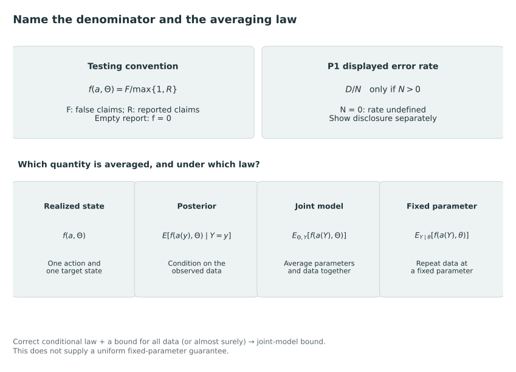

# Selection, abstention, and error control {#sec-selection-abstention}

Making fewer claims can improve a report's reliability. In multiple testing, directional decisions and signal localization, the errors of concern are respectively rejection of a true null, declaration of a wrong sign and reporting of a region without a signal. Error rates also use different denominators, counting discoveries, declarations in one direction or disclosed comparisons. The relation to common grades depends on retaining these definitions.

@MullerParmigianiRice2006 formulate Bayesian multiple comparisons using posterior losses and error constraints. @BansalMiescke2013 distinguish combined from direction-specific false discoveries in a three-action problem, and @SpectorJanson2025 use Bayesian linear programming (BLiP) to select disjoint signal-containing regions with adaptive localization. These are established uses of posterior processing, selective disclosure and optimization under error constraints. Their guarantees apply to the claims and error definitions specified in each problem.

## Realized false discovery proportions and three probability laws {#a-realized-fraction-and-three-probability-laws}

Write $F(a,\Theta)$ for a false-claim count and $R(a)$ for the number of reported claims. A common convention in multiple testing defines the realized false discovery proportion as follows [@benjamini_yekutieli2001, p. 1169]:

$$
\operatorname{FDP}(a,\Theta)=
\frac{F(a,\Theta)}{\max\{1,R(a)\}}.
$$

Under this loss, an action with no discoveries contributes zero. For displayed error among disclosed comparisons, we instead leave the ratio undefined when no comparisons are disclosed and report disclosure separately. Thus the zero FDP contribution of an empty action is a convention of the loss, without implying that the report supplies information.

For a deterministic action selected after observing $Y$, the denominator is fixed conditional on $Y$. Under the supplied selection posterior $\Pi_s$, its expected FDP is therefore the posterior expected false count divided by the fixed positive discovery count, with the specified empty-report convention. Under repeated sampling, however, the action and its size change with the data. Taking an expectation of the resulting ratio generally differs from dividing the expected false count by the expected discovery count.

Posterior error averages conditional on observed data; prior-predictive error averages parameters and data under a joint model; fixed-parameter frequentist error averages data at a fixed parameter. Bansal and Miescke distinguish these as posterior, Bayesian and frequentist directional rates in §2. Integrating their posterior control gives Bayesian control under the model's joint law, rather than control at every fixed parameter [@BansalMiescke2013, p. 207, equations (6)–(8) and following §3.1].

If the supplied posterior is the relevant conditional law and the bound holds for every dataset, iterated expectation gives the corresponding bound averaged under the joint model. This argument requires the correct posterior and does not establish uniform fixed-parameter control. Numerical error and model misspecification must therefore be considered in addition to the algebra of the error criterion.

@fig-vis-f08 separates the count convention from the law under which it is averaged.

::: {#fig-vis-f08}
<picture>
<source media="(max-width: 720px)" srcset="../assets/figures/f08-the-denominator-and-law-determine-the-guarantee-mobile.svg">

</picture>

False-discovery denominators and probability laws. The multiple-testing convention F/max{1,R} assigns zero to an empty report, while this book leaves a displayed rate among disclosed comparisons undefined when N=0. Conditional posterior, joint-model and fixed-parameter averages answer different questions. Integrating a correct conditional bound yields its joint-model average, with no automatic fixed-parameter guarantee; an expectation of a ratio generally differs from a ratio of expectations.
:::

## Bayesian multiple comparisons as decisions

Müller, Parmigiani, and Rice use $r_i\in\{0,1\}$ for the true alternative indicator, $\delta_i$ for rejection, and $v_i=P(r_i=1\mid Y)$. Their working paper calls the realized fraction “FDR” and uses an overbar for its posterior expectation. Here the realized fraction is called FDP to keep it distinct from its expectations. For a nonempty rejection set of size $D$, their equation (2) gives

$$
E_s(\operatorname{FDP}\mid Y)
=\frac{\sum_i(1-v_i)\delta_i}{D}.
$$

Conditioning fixes the data-dependent denominator and simplifies the posterior calculation. The displayed expression leaves the empty-set case unspecified; we use the preceding convention when including empty actions [@MullerParmigianiRice2006, working-paper pp. 2–4, especially equation (2)].

The authors compare count losses, rate losses, and constrained formulations. A count loss penalizes false discoveries and false negatives, while a rate loss scales each type by its own number of selected or unselected hypotheses. Their constrained versions minimize posterior expected false negatives, or a false-negative rate, subject to a corresponding false-discovery bound. Equal treatment of errors yields posterior-probability threshold rules for the stated problems, with the threshold determined by the loss or constraint [@MullerParmigianiRice2006, pp. 5–6, equations (3)–(4)].

The count-loss calculation shows how the threshold arises. If a false rejection costs $c$ and a missed alternative costs one, the two posterior costs for hypothesis $i$ are $c(1-v_i)$ and $v_i$. Direct comparison gives rejection when $v_i>c/(1+c)$, with ties requiring a convention. This specialization of the paper's count loss uses its additive objective and unrestricted binary actions. Changing the objective to an error ratio, a budget, or a coupled action space changes the optimization problem.

Marginal posterior probabilities require an appropriate joint model, and some decisions depend on more than the probability of an alternative. The working paper considers effect-size weights and a penalty for correlation among selected genes, which need not admit individual thresholding. It also relates ranking to pairwise comparisons constrained by transitivity [@MullerParmigianiRice2006, pp. 7, 10–11, 15, equation (9) and Table 2].

The authors give only an approximate justification for their loss resembling a Benjamini–Hochberg procedure and advise against practical use: its discovery reward can encourage adding known false positives before the threshold penalty is triggered. They also discuss model assumptions, meaningful utilities and exploratory problems without a well-defined decision [@MullerParmigianiRice2006, pp. 9–10, 16–17]. Even within a Bayesian analysis, satisfying an error budget and optimizing a decision therefore answer different questions.

## Directional decisions and separate error budgets

Bansal and Miescke's action for each hypothesis is $d_i\in\{-1,0,1\}$: select a negative alternative, the point null, or a positive alternative. Its latent categories are $\theta_i<0$, $\theta_i=0$, and $\theta_i>0$. Their prior can assign unequal mass to the two directional alternatives and positive mass to the null. The zero action consequently means selecting the null in their stated decision problem. It is not automatically an abstention action with a constant withholding cost [@BansalMiescke2013, pp. 205–206, equations (1)–(3)].

A negative declaration is wrong when $\theta_i\ge0$, and a positive declaration is wrong when $\theta_i\le0$. Both false rejection of a null and reversal of a true sign enter the combined numerator. If $R_-$ and $R_+$ count negative and positive declarations, the combined denominator is $\max(1,R_-+R_+)$. Separate left and right rates instead divide each directional false count by $\max(1,R_-)$ and $\max(1,R_+)$, respectively. The paper writes equivalent indicator corrections to prevent zero denominators [@BansalMiescke2013, pp. 206–207, Table 1 and §2].

For example, the posterior expected false-negative-direction count is

$$
E_s(F_-\mid Y)=
\sum_{i:d_i=-1}P(\theta_i\ge0\mid Y).
$$

This is a count of false *negative declarations*, rather than the usual count of missed alternatives. The paper's notation distinguishes the underlying posterior probabilities of the negative, null, and positive states. Combined or separate posterior directional rates follow by dividing the appropriate expected counts by the selected counts [@BansalMiescke2013, p. 207, equations (6)–(8)].

Under total misclassification loss, the unconstrained rule chooses a state of greatest posterior probability. The constrained procedure first generates candidate negative and positive decisions, orders their probabilities of error, and retains a prefix with average error below the budget. Separate budgets apply the construction within each direction. Equations (11)–(17) concern this procedure rather than arbitrary constrained directional losses; their general loss also allows effect-magnitude penalties [@BansalMiescke2013, pp. 207–208, equations (10)–(19)].

The computational specialization assumes independent sufficient statistics and considers plugging in a nuisance-parameter posterior mode; subsequent mixture-weight estimation is empirical Bayes. By contrast, the expected-count identity uses linearity without requiring independent error indicators. Section 3.3 calibrates to a target Bayesian directional FDR by averaging over the marginal data distribution, rather than setting each dataset's posterior rate equal to that target [@BansalMiescke2013, pp. 209–210, equation (21), §4 and §4.1].

## Signal discovery with uncertain location {#discovering-a-signal-while-admitting-uncertain-location}

BLiP changes the content of the claim. Let $\mathcal L$ be possible signal locations and $S\subseteq\mathcal L$ the unknown signal set. A reported region $G$ is correct if $G\cap S\ne\varnothing$. It need not identify which location carries the signal, and it does not claim that every location in the group is a signal. The reported regions are constrained to be disjoint to avoid redundant discoveries. They need not cover all locations and have no inherent ordering [@SpectorJanson2025, pp. 462–463, Requirement 2.1, Definition 2.1, Remarks 1–2].

The objective is posterior expected resolution-adjusted true positives. A weight $w(G)$ rewards a correct discovery at a chosen resolution, with $1/|G|$ proposed as a default. The posterior false-discovery constraint instead uses an unweighted count of false regions divided by the number of discovered regions. Weights in the objective therefore do not redefine the error denominator. Different weights express different values placed on localization, and the paper explicitly allows alternatives [@SpectorJanson2025, pp. 462–463, equations (1)–(4), Remark 4].

For a finite candidate collection $\mathcal G$, let $x_G\in\{0,1\}$ indicate selection and $p_G=P(G\cap S\ne\varnothing\mid Y)$. Proposition 3.1 expresses the problem as

$$
\max_x\sum_{G\in\mathcal G}p_Gw(G)x_G
$$

subject to

$$
\sum_{G\in\mathcal G}(1-p_G-q)x_G\le0,
$$

and at most one selected group containing each location. The latter constraints enforce disjointness. The linear error constraint follows because the number of selected regions is fixed for a given action conditional on the data. The paper explicitly adopts $0/0=0$, so selecting no regions is feasible [@SpectorJanson2025, p. 464, equations (6)–(11), Proposition 3.1].

The formulation assumes correct group inclusion probabilities. These generally require the joint posterior over locations, since summing singleton probabilities need not give the probability of a signal in their union. BLiP accepts different posterior models, but the authors identify misspecified probabilities and incomplete MCMC convergence as limitations. Their robustness proposals and empirical evidence leave guarantees under arbitrary estimated inputs unresolved [@SpectorJanson2025, pp. 463, 466, 470, equation (5), §3.3 and §6].

## Feasibility, optimization, and randomization

BLiP's algorithm first prunes candidate regions, solves a continuous relaxation, then converts the solution into integer decisions. It keeps already integral coordinates fixed while solving an integer problem for the remaining coordinates; when that problem is infeasible, backtracking releases additional fixed selections. The final feasible integer action satisfies the posterior error constraint. The relaxed objective supplies an upper bound with which to assess the achieved objective over the retained candidate collection. The authors do not prove that the relaxation is always nearly integral or that the numerical gap is always small [@SpectorJanson2025, pp. 464–465, Algorithm 1 and accompanying discussion; p. 470, §6].

A feasible action can satisfy the posterior budget without attaining the optimal objective. Conversely, an optimum calculated from inaccurate probabilities may satisfy only the budget implied by those probabilities. Pruning further changes the candidate collection against which the gap is assessed. These distinctions also apply to common grades, although BLiP uses different discoveries and constraints.

A fractional solution does not by itself define a calibrated randomized discovery rule. Consider a constructed example that chooses with equal probability between reporting one known false claim and nine known true claims. The expected FDP is $1/2$, while the ratio of expected counts is $(1/2)/5=1/10$. This example distinguishes the two averages; it neither simulates BLiP nor describes its output. Replacing binary selections by marginal selection probabilities in a linear count budget can therefore constrain the ratio of expectations without constraining expected FDP.

Randomization among complete feasible actions is a different construction. Let the auxiliary randomization be independent of the latent state conditional on the observed data $Y$; its mixing weights may depend on $Y$. If every action in its support satisfies the conditional posterior FDP bound, averaging those conditional bounds over randomization preserves the bound. The mixture argument requires the stated randomization law and feasibility of each action; independent pairwise randomization or arbitrary rounding need not meet these conditions. When the denominator varies, evaluation must distinguish averaging action-specific fractions from pooling expected counts.

## Selective decisions and common grades {#what-common-grades-inherit-and-what-they-add}

Withholding, rejection control and coarsening give different meanings to an omitted claim. Failure to reject a point null differs from withholding a directional comparison. A BLiP group asserts that at least one member is a signal, whereas a within-grade tie leaves a particular direction undisclosed. Common grades also require one ordered partition across all units, a restriction absent from binary discoveries, coordinatewise sign choices and disjoint unordered regions.

For an individual pair, withholding can be preferable if expected directional loss exceeds its cost. This connection to a reject option follows directly by comparing costs. Common grades additionally require joint optimization, since the individually preferred actions need not form an ordered partition.

P1 uses established posterior decision rules and expected-error constraints, with criterion protections defined by their own counts, denominators, laws and feasible actions. A count-form protection can admit the all-tie report with zero expected errors and zero disclosure even though the displayed error fraction is undefined. Substantive fairness requires justification beyond feasibility and direction-specific budgets. The proposed target and coherent action still require proofs and empirical evaluation, whereas posterior error control itself is inherited.

## Foundations for multicriteria reporting {#sec-literature-contribution-synthesis}

Expected ranks, confidence sets, discoveries and ordered categories represent different estimates, probability statements or loss-minimizing actions, despite often appearing in similar tables. We ask whether common grades can communicate useful comparisons among units with uncertain attributes at acceptable cost for specified targets. Existing methods provide both foundations for this problem and alternatives when the institutional purpose differs.

### Targets, actions and guarantees across methods {#a-shared-vocabulary-without-a-shared-objective}

We compare methods on six elements: substantive target, available information, feasible action, loss or constraint, probability law and interpretation of silence. Replacing a selected set with an ordered partition changes the decisions required; replacing population-tail membership with finite-collection ranks changes the error event. Similarly, a conditional posterior guarantee differs from one under repeated sampling at fixed parameters. Coinciding numerical calculations do not remove these differences between problems.

Within Bayesian ranking, squared error for a parameter selects a posterior mean, whereas squared error for its rank selects an expected rank. Selection introduces further objectives. Laird and Louis, Lin and colleagues, and Henderson and Newton develop different decisions from beliefs and loss [@laird1989ranking; @lin2006ranking; @henderson2016cut]. Their work establishes posterior postprocessing, uncertainty-sensitive ranking and purpose-specific objectives. We use these foundations to specify the reporting problem represented by our loss.

| Approach and representative sources | Native decision or inferential object | What must be retained in a P1 comparison |
|---|---|---|
| Bayesian rank estimation [@laird1989ranking; @lin2006ranking] | Estimates of parameters, ranks, or selected rank functions under specified loss | The target and loss that justify the ranking statistic |
| Compound selection and its debate [@gu2023invidious; @kline2023comment; @mogstad2023comment; @gu2023reply] | Tail selections with error and capacity criteria; competing decision interpretations | The tail definition, information environment, error criterion, and evaluation law |
| Report-card grading [@kline_discrimination_2024] | A coherent ordered partition balancing correct and incorrect comparisons | The single-criterion foundation, permissible grades, and loss normalization |
| Rank confidence and posterior ordering statements [@MogstadEtAl2024; @BarrientosEtAl2023] | Sets or joint statements about ranks and directions | The simultaneous event, conditioning, and coverage interpretation |
| Ranking aggregation and bucket approximation [@fagin2006partial; @arcagni2022multidomain; @kenkre2011bucket_author] | A relation that approximates supplied rankings, posets, or preference data | The source of the input relation and the cost assigned to a tie |
| Acceptability and Bayesian sorting [@lahdelma_salminen2001smaa2; @ru2023sorting; @ulu_shively2024sorting] | Rank acceptability across valuations, or assignments to predefined classes | The meaning of weights, class labels, and learning or consultation costs |
| Bayesian comparative judgement [@gray2026transparency] | Comparisons and summaries learned from assessor choices | Preference probabilities, their aggregation, and the intended interpretation of uncertainty |
| Bayesian multiple decisions and localized discoveries [@MullerParmigianiRice2006; @BansalMiescke2013; @SpectorJanson2025] | Rejections, directional decisions, or disjoint groups containing signals | The discovery unit, denominator, and conditional or sampling guarantee |

### KRW's foundation for coherent grading {#the-closest-mathematical-inheritance}

KRW provides the closest foundation for the grade action. It chooses ordered groups from beliefs about a scalar target, trading correct against incorrect comparisons. The application estimates those beliefs by empirical Bayes, while the general decision problem allows other belief distributions. Its appendix also considers cardinal weighting of mistakes. We therefore inherit coherent posterior grades, withholding, supplied beliefs and weighted errors [@kline_discrimination_2024, sec. II, pp. 2477–2483; online Appendix A, p. 2].

Under the orientation, equality and action conventions in @sec-bayesian-ranking, the withholding loss is a positive affine transformation of KRW's objective after mapping the preference parameters. This correspondence clarifies interpretation and extension of an existing scalar decision principle. The mathematical chapters reconstruct its constants, normalization, endpoints and feasible actions. Restrictions on grade counts or order affect the domain separately from the loss identity.

With criterion-specific costs for wrong directions, multicriteria reporting asks which coherent grade minimizes loss. Expressing this objective in terms of pairwise posterior coefficients would characterize the problem; uncertainty, multiple comparisons and weighted loss are already addressed by earlier theory. Generalized Kendall penalties and bucket optimization provide related representations under their own assumptions. In particular, a valid decision preference can assign a positive withholding cost below the range in which the corresponding distance is a metric [@fagin2006partial].

### Composite and criterion-direction targets {#multiple-criteria-do-not-identify-a-unique-target}

A scalar composite and a criterion-direction objective can both be reasonable answers to an institutional question. The composite declares how attribute magnitudes contribute to one target. Its coefficients, denoted by $a$, depend on the chosen scales and the meaning of compensation across attributes. Directional-error weights, denoted by $w$, declare how much different kinds of comparison mistakes matter. They need not define a cardinal composite, even if their numerical entries happen to equal those of $a$. We treat composite accuracy and weighted criterion-direction accuracy as co-primary estimands because choosing only one would otherwise settle a substantive disagreement through an unannounced modeling choice.

Keeney and Raiffa place attributes, normalization, trade-offs and independence assumptions within a preference model and distinguish one decision maker's valuation from aggregation across people [@keeney_raiffa_1993, chs. 2–3, 6, 10]. SMAA-2 explores acceptability over modeled performances and weights; the sorting methods learn classes from uncertain judgments or sequential consultation [@lahdelma_salminen2001smaa2; @ru2023sorting; @ulu_shively2024sorting]. These are alternatives for preference exploration, predefined classification and elicitation, which directional grading alone does not replace.

The interpretation of indicators precedes weighting. They may reflect a common construct or represent distinct valued outcomes, and their fitted dependence cannot choose between those interpretations. Borsboom and colleagues' causal validity account and Messick's account of interpretation and use illuminate different aspects, while leaving the policy objective to be justified [@borsboom_validity_2004; @messick_validity_report_1994]. The measurement chapter separates attribute meaning, measurement evidence and normative importance before the formal construction.

### Interpretations of ties and withheld comparisons {#silence-can-carry-different-information}

In our report, different grades disclose a direction and shared grades withhold it. A shared grade makes no determination about latent equality, practical equivalence or substantive comparability and allocates no resources. Optimization selects comparisons under this convention, while subsequent allocation or intervention requires an institutional rule.

Other methods give silence different meanings. Arcagni and colleagues approximate multidomain partial orders, whose incomparability can be structural, through mutual-ranking probabilities and bucket orders. Kenkre and colleagues fit preference fractions, which may describe population disagreement rather than uncertain performance. Gray and colleagues learn from assessor choices [@arcagni2022multidomain; @kenkre2011bucket_author; @gray2026transparency]. Preserving or summarizing those relations can itself be the institutional task, making these approaches substantive alternatives.

Grade ties form equivalence classes, so withholding two comparisons can force a third to be withheld. Conversely, converting confident directions into grades can add comparisons unsupported by the original uncertainty object. The example in @sec-uncertainty-ordering illustrates why coverage-preserving inference and loss-minimizing grading require different arguments. A conversion rule determines the additional decisions behind visually similar reports.

### Matched disclosure and method-specific guarantees {#compare-at-similar-disclosure-and-retain-native-guarantees}

For the applied study, we propose comparing errors from practical reporting rules and posterior grading at comparable disclosure. Total wrong-comparison counts alone can favor a nearly silent report over an informative ranking. Grade counts also leave disclosure undetermined, since group sizes determine the number of cross-grade pairs. We therefore measure published comparisons and specify the convention for an empty report.

Reports with equal disclosure can compare different pairs whose consequences differ. Matching disclosure therefore controls one aspect of the comparison without ordering reports by institutional welfare. Absolute-threshold rules, limited inspections and budgeted allocation may sacrifice directional accuracy for their own objectives. Their assessment should include outcomes for those tasks alongside P1 loss.

As a secondary analysis, we can compare joint optimization with boundary optimization along a fixed order to show the consequences of the order restriction. The primary comparison remains with documented or specified practical rules. Differences in information, such as posterior draws for one method and only point estimates for another, enter both design and interpretation. An exact restricted optimum remains conditional on that family of grades.

Native statistical guarantees should accompany common performance measures. A simultaneous confidence procedure, a posterior joint statement, and an expected-error-constrained report can all use a number such as $0.05$ while protecting different events. The Gu–Koenker comment exchange shows why the error criterion and the law of evaluation must be stated independently [@mogstad2023comment; @gu2023reply]. The multiple-decision and BLiP examples further show that a denominator is part of the target, and that an empty-report convention affects interpretation [@MullerParmigianiRice2006; @BansalMiescke2013; @SpectorJanson2025]. None of these guarantees should be translated into another by changing its label.

### Conditional mathematical claims and empirical questions

Under the selection law, an exact Bayes action minimizes the specified expected loss over feasible actions. No other action in that family can improve on it under the same criterion. The remaining questions concern the size of this difference, the institutional relevance of the loss, disclosure and the credibility of the uncertainty model. Demonstrating practical improvement therefore requires more than verifying the defining property of the optimum.

A distinct evaluation law can change the conclusion. The selection posterior $\Pi_s$ and the law $P$ used to assess performance must remain separate, as must posterior conditioning and repeated sampling at a fixed parameter configuration. Empirical Bayes estimation, hierarchical Bayes estimation, model misspecification, and numerical approximation each raise additional questions. The fixed-sequence interpretation in the Gu–Koenker reply prevents a categorical claim that empirical Bayes reasoning applies only to randomly generated parameters; it does not supply every possible frequentist error guarantee for a data-dependent report [@gu2023reply]. These issues motivate later evaluation and calibration work and limit any claim of superiority.

Posterior decision analysis, coherent scalar grading, aggregation and selective error control form the basis of the proposed multicriteria reporting problem. We retain composite and criterion-direction accuracy as co-primary targets and evaluate error together with disclosure and institutional objectives. The reductions, feasible-set results, protections, algorithms and decompositions require proofs and careful attribution. Some may be applications or reformulations of established results, while remaining useful for clarifying a consequential decision and identifying when the method serves it. The formal development in @sec-targets-actions-laws defines reports and risk laws for the targets introduced in @sec-target-definitions.