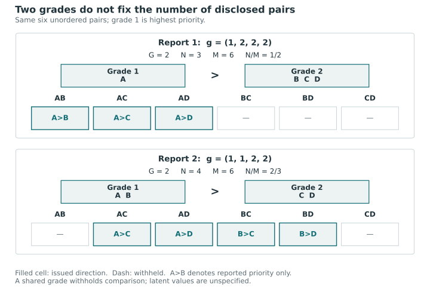
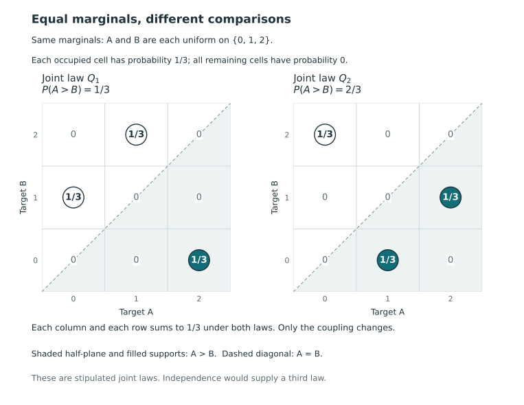
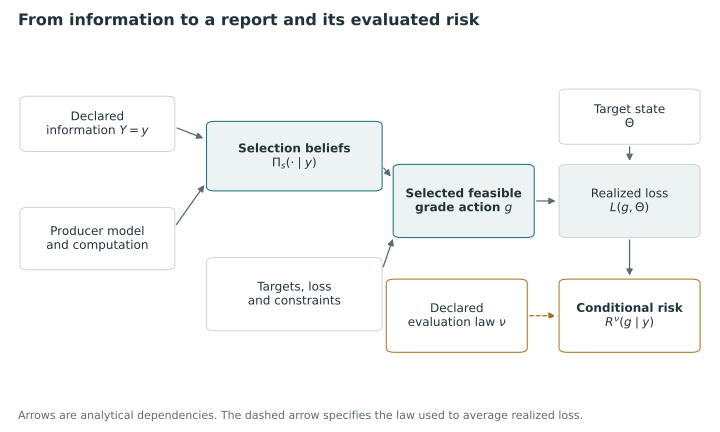

# Targets, actions, and risk laws {#sec-targets-actions-laws}

We define the reports a procedure may issue for the targets in @sec-measurement-values and the probability laws used to assess those reports. Defining a report requires no statistical model; averaging its consequences requires a probability law.

## Grade actions and disclosed comparisons {#sec-grade-actions}

A report assigns every unit to one nonempty grade and orders the grades. Different grades disclose a direction, whereas a common grade withholds one. Report-card grading and ordered-bucket ranking use this action [@kline_discrimination_2024, pp. 2477–2482; @fagin2006partial, pp. 630–631]. We establish its representations and counts before introducing the loss that determines which report is optimal.

::: {#def-canonical-grade-action}
### Canonical grade action

Fix $n\ge2$ labelled units $U=[n]$. An ordered partition is a sequence $(B_1,\ldots,B_G)$ of pairwise disjoint nonempty subsets with union $U$, where $1\le G\le n$. Grade 1 has the highest reported priority. Its canonical vector $g\in[n]^n$ assigns $g_i=h$ when $i\in B_h$; its image is exactly $[G]$. Write $G(g)=G$ and $n_h=|B_h|$.
:::

Canonical labeling removes empty or skipped categories while preserving their order. For example, occupied labels $\{2,5,9\}$ become $\{1,2,3\}$. Arbitrary permutations change the action because the labels carry an order, although distances between them have no cardinal meaning.

::: {#def-grade-total-preorder}
### Weak reporting relation and disclosed comparisons {#weak-relation-and-disclosure}

Define $i\precsim_g j$ by $g_i\le g_j$, meaning that $i$ is reported at least as high as $j$. Its strict part is $g_i<g_j$ and its equivalence part is $g_i=g_j$. For distinct units, let

$$
x_{ij}(g)=\mathbf1\{g_i<g_j\},\qquad
M=\binom n2,\qquad
N(g)=\sum_{i\ne j}x_{ij}(g),\qquad
s(g)=N(g)/M.
$$

Here $N$ is the number of disclosed unordered pairs and $s$ is their fraction of all pairs.
:::

::: {#prp-grade-representation-counts}
### Representations and disclosed-pair counts

Ordered partitions, canonical grade vectors, and total preorders on $[n]$ are in bijection. A total preorder is a reflexive, transitive, complete relation, with completeness meaning that every pair is related in at least one direction. For any corresponding grade action,

$$
N(g)=\sum_{h<l}n_hn_l
=M-\sum_{h=1}^G\binom{n_h}{2}
=\frac{n^2-\sum_{h=1}^G n_h^2}{2}.
$$

Moreover, $s=0$ exactly when $G=1$, and $s=1$ exactly when $G=n$. In general, $G$ alone does not determine $N$.
:::

**Proof.** Taking the nonempty inverse images of grade labels and assigning each block its position are inverse maps between canonical vectors and ordered partitions. Numeric weak order makes $\precsim_g$ reflexive, transitive and complete. Conversely, for a total preorder define $i\sim j$ when both $i\precsim j$ and $j\precsim i$ hold. This is an equivalence relation: transitivity in both directions gives transitivity of $\sim$. The preorder induces a well-defined order on equivalence classes, since replacing either representative by an equivalent one preserves the comparison by transitivity. Completeness compares every two classes, and both directions hold only for the same class. The classes therefore form a finite total order. Numbering them from highest to lowest recovers the unique canonical vector.

For an unordered pair $\{i,j\}$, equal grades give $x_{ij}=x_{ji}=0$; unequal grades make exactly one of them one. Thus the directed sum counts each disclosed unordered pair once. There are $n_hn_l$ pairs between distinct blocks and $\binom{n_h}{2}$ within block $h$, proving the first two formulas. Expanding the latter with $\sum_h n_h=n$ proves the third. Nonempty blocks imply a positive cross-block count whenever $G>1$, while no within-block pair remains exactly when every block is a singleton. Since $M>0$, these give both endpoints. Finally, at $n=4$, vectors $(1,2,2,2)$ and $(1,1,2,2)$ each use two grades but disclose three and four pairs respectively. $\square$

The corresponding disclosure fractions are $1/2$ and $2/3$, illustrating why the number of grades alone does not determine how many directions a report discloses.

@fig-vis-f09a shows these two reports and their disclosed pairs.

::: {#fig-vis-f09a}
<picture>
<source media="(max-width: 720px)" srcset="../assets/figures/f09a-an-ordered-partition-as-disclosed-pairs-mobile.svg">

</picture>

Disclosed comparisons for two reports on the same four units, each using two occupied grades. In A,B,C,D order, (1,2,2,2) discloses three of six unordered pairs, while (1,1,2,2) discloses four. Lower grade numbers indicate higher reported priority. Within-grade comparisons are withheld; the latent values are unspecified.
:::

### Exact grade counts, grade caps and fixed orders {#exact-counts-caps-and-a-fixed-order}

Let $\mathcal A_n$ contain all canonical actions. For integers $1\le G_0,G_{\max}\le n$, define

$$
\mathcal A_{=G_0}=\{g\in\mathcal A_n:G(g)=G_0\},\qquad
\mathcal A_{\le G_{\max}}=\{g\in\mathcal A_n:G(g)\le G_{\max}\}.
$$

The unrestricted domain is $\mathcal A_n=\mathcal A_{\le n}$. The at-most domains are nested as the cap increases, whereas distinct exact-grade domains are disjoint. Each is nonempty in the specified range. For integer parameters outside these ranges, an exact count below one or above $n$ gives an empty domain, a cap below one gives an empty domain, and a cap above $n$ is redundant.

A fixed order introduces another restriction. Let $\rho=(\rho_1,\ldots,\rho_n)$ be a permutation from highest to lowest and define

$$
\mathcal A_\rho=\{g\in\mathcal A_n:
 g_{\rho_1}\le\cdots\le g_{\rho_n}\}.
$$

Intersecting this set with $\mathcal A_{=G_0}$ or $\mathcal A_{\le G_{\max}}$ gives the exact and capped versions. The permutation $\rho$ restricts the reports that can be issued; whether it agrees with the true or optimal order remains to be established.

::: {#prp-contiguous-grade-counts}
### Contiguous grade actions for a fixed order {#fixed-order-actions}

An action lies in $\mathcal A_\rho$ exactly when its blocks are consecutive nonempty segments of $\rho$ in order. For $1\le G\le n$,

$$
|\mathcal A_{\rho,=G}|=\binom{n-1}{G-1},\qquad
|\mathcal A_\rho|=2^{n-1},\qquad
|\mathcal A_{\rho,\le G_{\max}}|
=\sum_{G=1}^{G_{\max}}\binom{n-1}{G-1}.
$$
:::

**Proof.** If two positions in a nondecreasing label sequence share a label, every position between them has that label. Hence blocks are contiguous; the converse follows by labelling consecutive segments in order. Choosing $G-1$ cuts among the $n-1$ adjacent gaps gives a unique exact-$G$ action and vice versa. Allowing every subset of gaps gives the total count, and summing the disjoint exact-grade domains gives the capped count. $\square$

The all-tie action $(1,\ldots,1)$ is feasible under every admissible at-most cap, including when the order is fixed. It is the unique exact-one-grade action, but every exact-$G$ requirement with $G>1$ excludes it. Thus exact and at-most specifications give different feasible sets, irrespective of the loss.

### Different meanings of a tie

| Object | Meaning |
|---|---|
| Latent equality | Two declared target values coincide exactly |
| Practical equivalence | A specified tolerance or substantive rule treats a difference as immaterial |
| Observational tie | Recorded measurements, possibly rounded, coincide |
| Score tie | A ranking statistic or fitted summary gives equal values |
| Structural incomparability | A specified partial order supports neither strict direction |
| Action tie | A shared grade withholds a direction under the reporting convention |

An action tie alone establishes none of the first five meanings. Practical closeness within a margin need not be transitive, and structural incomparabilities need not form grade blocks. By contrast, shared grades impose transitivity: withholding $A$ versus $B$ and $B$ versus $C$ by assigning shared grades places all three units in the same grade and precludes disclosure of $A$ above $C$. A partial order can retain these incomparabilities together with that strict comparison.

Criterionwise tie-freeness and composite tie-freeness are distinct assumptions, as @sec-target-transformations-example demonstrates. Neither is needed for the action-count propositions, which concern reports independently of the latent state. When a later result requires tie-freeness, the assumption refers to its specified target and probability law.

Structural equality can arise in the joint target when, for example, two providers inherit the same area-level contextual target in every state but have different provider-specific targets. The providers are then equal on one criterion while their complete profiles may differ. The equality-neutral loss in @sec-tie-aware-loss accommodates these events. Under the conditions in @prp-tie-aware-guard, equality of the full active profile permits a same-grade restriction without losing an optimum. This assumption is stronger than equality of rounded observations or posterior means. It justifies imposing a guard; the shared grade itself continues to withhold a direction.

Exhaustive deterministic checks for $n=2,3,4$ give respectively $3,13,75$ canonical actions and $2,4,8$ actions per fixed order. At these sizes we checked the representation maps, disclosure identities and exact/capped counts for every action and fixed permutation. These calculations verify the implementation and arithmetic for the enumerated cases; the proofs above establish the results for arbitrary $n\ge2$.

## Information, selection beliefs, and evaluation laws {#sec-posterior-risk-laws}

We distinguish the posterior distribution used to choose a grade from the grade that is issued. The same reporting rule can then be applied with different statistical models, and fitted-model probabilities can be compared with error rates under a data-generating process. Related distinctions occur in Bayesian ranking, rank confidence sets and selective decisions [@laird1989ranking, pp. 32–35, 41; @MogstadEtAl2024, pp. 484–486; @BansalMiescke2013, p. 207]. We introduce notation that will be used throughout.

### Information and supplied selection beliefs {#the-information-supplied-to-a-decision}

Let $\Theta=(\theta_{ik})\in\mathbb R^{n\times K}$ contain the unit-by-criterion targets. Write $Y$ for all information available to the reporting procedure. Besides measured indicators, $Y$ can include precision estimates, covariates, sample sizes, design variables, and information used to estimate a prior. Differences in the information available to competing methods form part of their comparison. Whether a design variable is fixed or random also depends on the experiment, rather than on its inclusion in $Y$.

A posterior producer supplies a probability kernel $\Pi_s(d\vartheta\mid y)$ on the target array, measurable in the observed information $y$. The subscript $s$ indicates that it is used to select the action. It may be a posterior under a fully specified model, a posterior integrating uncertain hyperparameters, or an empirical Bayes belief obtained after estimating them. We call these *selection beliefs* according to their role in the decision; their uncertainty properties can differ. The general-belief formulation of report-card grading similarly distinguishes beliefs from the empirical Bayes procedure used in its application [@kline_discrimination_2024, pp. 2477–2479].

The supplied distribution depends on the target definition, sampling model, prior, treatment of design information, and computation. Substituting an estimated hyperparameter generally differs from averaging over its posterior distribution. An empirical Bayes procedure can include a specified correction for estimation uncertainty; a hierarchical Bayesian analysis propagates the uncertainty represented by its hierarchy and priors. Calibration under a different evaluation law requires further justification in either case. Laird and Louis identify estimation of the prior as a source of ranking uncertainty [@laird1989ranking, p. 41].

Given the measurement evidence and fitted sampling model, we choose a grade from the feasible reports using the supplied beliefs and loss. If the action definition is held fixed while the procedure producing the beliefs changes, differences in grades can be attributed to the beliefs, the decision settings, or both.

The inspected local postrank source, version 0.9.0, accepts posterior draws or comparison inputs and postprocesses them without fitting the underlying statistical model. Its structural input checks do not establish that the inputs represent the intended joint law, that the model is identified, or that the computation has converged; these must be assessed in the analysis producing the inputs. Criterionwise inputs contain no additional information about the joint state across criteria. @sec-package-correspondence gives the detailed correspondence for this version.

### Dependence and pairwise comparison probabilities {#a-joint-distribution-cannot-be-replaced-by-unrelated-marginals}

Comparison probabilities depend on the relevant joint distribution. Unit-level means and standard errors generally do not determine $\Pi_s(\theta_{ik}>\theta_{jk}\mid Y)$; even complete marginal distributions may be insufficient, as the following finite example shows.

Let $A$ and $B$ be two scalar unit targets. Give each of the three listed states probability $1/3$ under each law:

| Law | Three equally probable states $(A,B)$ | Marginal law of either target | Probability that $A>B$ |
|---|---|---|---|
| $Q_1$ | $(0,1),(1,2),(2,0)$ | Uniform on $\{0,1,2\}$ | $1/3$ |
| $Q_2$ | $(0,2),(1,0),(2,1)$ | Uniform on $\{0,1,2\}$ | $2/3$ |

The laws have the same two marginals and no ties, yet the more probable direction is reversed. Only the coupling of the marginals has changed. Assuming independence would specify a third joint law rather than recover the missing dependence information. Continuous marginals also permit latent equality: if $A=B=Z$ with $Z$ uniform on $[0,1]$, each marginal is continuous but $\Pr(A=B)=1$. Thus tie-freeness is an assumption about the joint law of the targets being compared.

The required dependence information also depends on the objective. Comparing a composite such as $c_i=\sum_k a_k\theta_{ik}$ requires the joint law of its components, and the probability that all disclosed directions are correct requires their joint event law. For an additive sum of criterion-specific wrong-direction indicators, linearity of expectation uses only the relevant within-criterion pair laws. Additional cross-criterion dependence information is unnecessary for this first moment. Unit marginals still need not identify the pair probabilities, and the first moment leaves the distribution of the total error count undetermined. We use this property in constructing the directional loss.

Joint posterior draws retain the entire array $\Theta$, with unit and criterion identities aligned in each draw. Independently shuffling columns or drawing units from their marginals generally alters the joint law. Analytic pair probabilities can instead suffice for a particular additive objective if they are calculated from the intended joint model. In either case, the analysis must assess model adequacy, approximation error and Monte Carlo dependence, as well as whether the reduced input contains the information required by the objective. BLiP also distinguishes supplied group probabilities from their accuracy, although it uses a different action space [@SpectorJanson2025, pp. 463–466, 470].

@fig-vis-f09b displays the two couplings on the same target axes and marginal scales.

::: {#fig-vis-f09b}
<picture>
<source media="(max-width: 720px)" srcset="../assets/figures/f09b-equal-marginals-different-comparisons-mobile.svg">

</picture>

Comparison probabilities under two stipulated joint laws with the same uniform marginals on {0,1,2}: P(A>B) is 1/3 under Q1 and 2/3 under Q2. Each occupied cell has probability 1/3; all other cells have probability 0. With A horizontal and B vertical, A>B lies below the diagonal. The change comes from the coupling, not from a change in either marginal.
:::

### Action loss and law-specific risk {#loss-for-an-action-and-risk-under-a-law}

Before observing the data, fix the targets, loss settings, loss function $L(g,\vartheta)$, and a nonempty finite feasible action set $\mathcal A\subseteq\mathcal A_n$. The loss records the consequence of issuing $g$ at target state $\vartheta$, as distinct from the probability of that consequence. We assume that the loss is measurable and integrable under each law considered; finiteness of the action set alone does not supply these properties. A deterministic rule is a measurable map $\delta:Y\mapsto g\in\mathcal A$. Data-dependent restrictions require a correspondingly data-dependent feasible set.

For data-dependent standardization or preferences, retain the underlying scientific state $\Theta$ and write $L_y(g,\Theta)$ when the transformation or loss settings depend on $y$. In the expectations below, replace $L(g,\Theta)$ by $L_Y(g,\Theta)$; conditioning on $Y=y$ then fixes $L_y$. The same measurability and integrability assumptions apply. An estimated scale is fixed in the conditional calculation and re-estimated across datasets; freezing it across repetitions evaluates a different procedure. This formulation includes the standardization choices in @sec-measurement-values and their sampling variation.

The selection risk of a fixed feasible action at observed information $y$ is

$$
R^s(g\mid y)=\int L(g,\vartheta)\,\Pi_s(d\vartheta\mid y).
$$

A Bayes action minimizes this conditional expected loss over the specified feasible set; the minimization is specific to that loss and law [@kline_discrimination_2024, p. 2480, eq. (3)]. The realized loss $L(\delta(y),\vartheta)$ concerns a particular state and dataset and can differ from its posterior expectation. In an empirical application, the latent state may be unavailable for direct evaluation.

To define a true conditional risk, additionally specify a joint evaluation law $P$ for $(\Theta,Y)$, on spaces admitting the required conditional distributions. Then

$$
R^P(g\mid y)
=\int L(g,\vartheta)\,P(d\vartheta\mid y).
$$

The conditional law and risk are defined $P_Y$-almost surely; their values at impossible data have no further guaranteed interpretation. Here *true* refers to the conditional law in the specified data-generating model, whether or not an empirical analyst knows that law. The equality $\Pi_s(\cdot\mid y)=P(\cdot\mid y)$ requires a substantive assumption or an oracle experiment. A fixed-parameter sampling family alone provides neither a random-$\Theta$ evaluation distribution nor its posterior.

::: {#fig-information-beliefs-laws}
<picture>
<source media="(max-width: 720px)" srcset="../assets/figures/information-beliefs-laws-mobile.svg">

</picture>

Analytical dependencies among information, selection beliefs, grade actions and evaluation risk. Information and a producer supply selection beliefs; these beliefs and the targets, loss and constraints enter a feasible grade choice. The action and target state determine realized loss. Averaging under the declared conditional law gives risk, with nu indexing that law. Arrows describe analytical dependencies, not causal effects.
:::

The beliefs used to select a grade do not themselves determine its evaluation law.

### Randomized rules and risk expectations {#randomized-rules-and-the-different-expectations}

For a rule using auxiliary randomization $U$, write $g=\delta(Y,U)$ and let its conditional law be $\mathsf K(du\mid Y)$. Assume that $U$ is independent of $\Theta$ conditional on $Y$ under the law being evaluated. The mixing weights may depend on $Y$, and every action receiving positive weight must be feasible for the supplied information. Randomization is therefore over complete reports, since independent pair choices can fail to form an ordered partition.

For a fixed observed $y$, define the randomized conditional risk by

$$
\overline R^{\nu}(\delta\mid y)
=\int R^{\nu}(\delta(y,u)\mid y)\,\mathsf K(du\mid y),
\qquad \nu\in\{s,P\},
$$

where the $P$ version requires the joint evaluation model. The selection version uses the product of the supplied belief and the auxiliary-randomization kernel conditional on $y$. A deterministic rule is the special case with no effective randomization.

| Quantity | Definition or averaging operation | What is held fixed |
|---|---|---|
| Realized loss | $L(\delta(y,u),\vartheta)$ | State, data, and auxiliary outcome |
| Selection conditional risk | $\overline R^s(\delta\mid y)$ | Observed information; average over supplied beliefs and auxiliary randomization |
| True conditional risk | $\overline R^P(\delta\mid y)$ | Observed information; average under the declared joint model's conditional law and auxiliary randomization |
| Joint-model integrated risk | $\mathcal R_P(\delta)=E_{P,\mathsf K}[L(\delta(Y,U),\Theta)]$ | The joint evaluation model and rule |
| Fixed-parameter sampling risk | $\mathcal R(\vartheta,\delta)=E_{Y\sim P_\vartheta}\!\left[\int L(\delta(Y,u),\vartheta)\mathsf K(du\mid Y)\right]$ | The parameter state; average over data and auxiliary randomization |

Under the joint model and the integrability assumptions, conditional independence and the tower property give

$$
\mathcal R_P(\delta)
=\int\overline R^P(\delta\mid y)\,P_Y(dy).
$$

If that joint model factors as $P(d\vartheta,dy)=\pi(d\vartheta)P_\vartheta(dy)$, the same risk also equals $\int\mathcal R(\vartheta,\delta)\pi(d\vartheta)$. The distribution $\pi$ may be a declared prior or a distribution of states in a simulation design. An integrated bound under it does not by itself establish a bound at every fixed $\vartheta$. Nor can $\overline R^P$ be replaced by $\overline R^s$ in the tower identity without an equality or other justification linking their conditional risks. These distinctions underlie the multiple-decision and compound-decision comparisons [@BansalMiescke2013, p. 207; @mogstad2023comment, pp. 54–57; @gu2023reply, pp. 61–63].

A fixed-parameter frequentist experiment repeats sampling at a fixed state without requiring a prior distribution on $\Theta$. It evaluates the complete data-dependent rule, which may use a selection posterior. The resulting sampling risk and a posterior average generally differ, so a bound for one cannot be applied to the other without justification. With the report, loss and averaging law specified, we can formulate the scalar report-card decision in @sec-krw-foundation and then the criterion-weighted directional risk in @sec-multicriteria-loss.