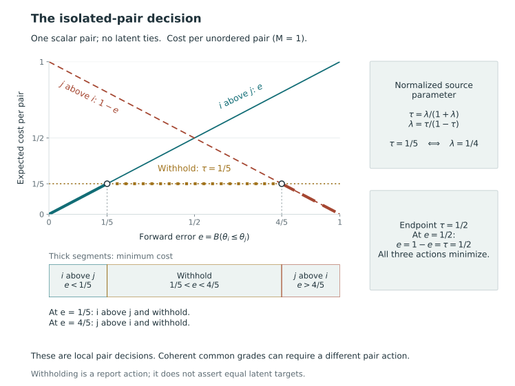

# Single-criterion report-card grading in KRW {#sec-krw-foundation}

## The scalar report-card decision {#sec-krw-scalar-core}

Kline, Rose, and Walters formulate report-card grading as a choice of comparisons to communicate. They assign firms to ordered grades, allowing ties, and evaluate the report through its correct and incorrect pairwise comparisons. We use this construction to define scalar grades and their tradeoff between information and error under general beliefs. We retain the source's probability assumptions while adopting our grade orientation and normalization [@kline_discrimination_2024, pp. 2477–2482].

### Supplied beliefs and reporting actions {#beliefs-and-actions-precede-the-empirical-model}

Consider $n\ge2$ units with scalar target vector $\theta=(\theta_1,\ldots,\theta_n)$. In KRW's application, larger $\theta_i$ means more discrimination, and a larger reported grade $d_i\in[n]$ indicates a more biased firm. We retain this orientation of the target and interpret higher standing as greater reporting priority. A different definition of priority would require changing the target specification, not simply relabeling the grades.

KRW represents beliefs about the target vector by a continuously differentiable joint distribution function $B$. The paper subsequently states the zero-probability latent-tie convention explicitly. Beliefs can be elicited independently of the empirical Bayes construction used later in the paper. The algebra below uses the restriction

$$
B\{\theta_i=\theta_j\}=0\qquad(i\ne j).
$$

The restriction concerns joint pair events, since continuous marginals alone do not exclude equality (@sec-posterior-risk-laws). Write

$$
\pi_{ij}=B\{\theta_i>\theta_j\}.
$$

Then $\pi_{ij}+\pi_{ji}=1$. Dependence among units is allowed in this given-belief formulation; the probabilities must be calculated from the relevant joint law [@kline_discrimination_2024, pp. 2477–2478].

When beliefs are based on observed information $Y=y$, we identify $B$ with the supplied selection law $\Pi_s(\cdot\mid y)$ and choose the action conditional on that information. Taking $B$ as given allows us to study the reporting objective independently of the empirical assumptions used to estimate the beliefs. Their estimation and agreement with an evaluation model remain questions for the statistical analysis that supplies them.

### Equivalent grade labels in the reversed orientation {#reversing-labels-while-preserving-the-report}

We assign grade 1 to highest priority and therefore reverse KRW's numerical grade orientation. If a canonical monograph action $g$ has $G$ occupied grades, set

$$
d_i=G+1-g_i.
$$

Then $d_i>d_j$ exactly when $g_i<g_j$, and $d_i=d_j$ exactly when $g_i=g_j$. Conversely, compress any KRW vector's occupied labels into consecutive ascending positions and reverse those positions. This produces the unique monograph canonical vector representing the same report. The transformation changes neither the target values nor the statements communicated.

| Reported relation | KRW labels | Monograph labels |
|---|---|---|
| $i$ has greater reported priority than $j$ | $d_i>d_j$ | $g_i<g_j$ |
| Direction withheld | $d_i=d_j$ | $g_i=g_j$ |
| $j$ has greater reported priority than $i$ | $d_i<d_j$ | $g_i>g_j$ |

KRW permits $d\in[n]^n$, which, after removing redundant increasing relabelings, gives the unrestricted ordered-partition domain $\mathcal A_n$ in @sec-grade-actions. Its action definition fixes neither the number of grades nor their ordering. A cap, an exact grade count, or a contiguous-order restriction consequently changes the feasible problem even if the loss is unchanged. The canonical correspondence identifies equivalent representations of each report; restricted and unrestricted optima can differ [@kline_discrimination_2024, pp. 2477, 2480].

### Correct, incorrect, and withheld comparisons

Using $x_{ij}(g)=\mathbf1\{g_i<g_j\}$ and $M=\binom n2$, define KRW's concordance and *strict* discordance counts. We denote the latter by $D_{<}$ to distinguish it from the weak-error count $D$:

$$
C(g,\theta)=\sum_{i\ne j}x_{ij}(g)\mathbf1\{\theta_i>\theta_j\},
\qquad
D_{<}(g,\theta)=\sum_{i\ne j}x_{ij}(g)\mathbf1\{\theta_i<\theta_j\}.
$$

Although the sum uses ordered indices, each disclosed unordered pair contributes in only one direction: one to $C$ if the direction is correct and one to $D_{<}$ if it is wrong. A reported tie contributes to neither count. These counts express the strict inequalities in the source's equation (1) under our reversed grade convention [@kline_discrimination_2024, p. 2479].

Let $N(g)=\sum_{i\ne j}x_{ij}(g)$. At every state with distinct scalar values, $N=C+D_{<}$, and hence the identity holds with belief probability one under the stated assumption on $B$. If a disclosed pair has equal latent values, both strict counts are zero for that pair. The weak-error convention instead uses $\theta_i\le\theta_j$ and counts the direction as wrong. The strict and weak counts therefore agree almost surely under the tie-free law, while positive equality mass can make them differ.

KRW assigns reward $\lambda\in[0,1]$ to a concordant pair, penalty one to a discordant pair, and payoff zero to a reported tie. Negating and averaging the pair payoffs gives

$$
L_{\mathrm K,\lambda}(g,\theta)
=\frac{D_{<}(g,\theta)-\lambda C(g,\theta)}{M}.
$$

Division by $M$ gives loss per possible unordered pair. Since the divisor is positive and independent of the action, omitting it rescales loss without changing the minimizers. Rewarding correct disclosure permits negative loss. For $0\le\lambda\le1$, the loss lies between $-\lambda$ and $1$, so its expectation exists under every belief law. The all-tie action has zero loss, the reference payoff for silence; it supplies no comparisons whose accuracy could be assessed.

Increasing $\lambda$ rewards correct disclosure more heavily relative to an incorrect comparison. It therefore expresses a preference between informativeness and mistakes, without setting a bound on the posterior error rate or the probability of any error. Its endpoint behavior and alternative parameterizations follow from the objective [@kline_discrimination_2024, pp. 2477–2479].

### Expected loss from pairwise beliefs

For a pair considered in isolation, reporting $i$ above $j$ has expected payoff $\lambda\pi_{ij}-\pi_{ji}$. The reverse direction has payoff $\lambda\pi_{ji}-\pi_{ij}$, while withholding gives zero. Their expected losses are therefore $\pi_{ji}-\lambda\pi_{ij}$, $\pi_{ij}-\lambda\pi_{ji}$, and zero. These expressions translate the source's single-pair expected utility; combining pair actions into a grade report still requires joint constraints [@kline_discrimination_2024, p. 2478].

::: {#prp-krw-pair-risk}
### KRW risk in the monograph orientation

For fixed $B$, $\lambda\in[0,1]$ and canonical $g$, the expected strict-count loss is

$$
R_{\mathrm K,\lambda}^{B}(g)
=\frac1M\sum_{i\ne j}x_{ij}(g)
\{\pi_{ji}-\lambda\pi_{ij}\}.
$$

If $B\{\theta_i=\theta_j\}=0$ for each distinct pair, this also equals

$$
R_{\mathrm K,\lambda}^{B}(g)
=\frac1M\sum_{i\ne j}x_{ij}(g)
\{1-(1+\lambda)\pi_{ij}\}.
$$
:::

**Proof.** For fixed $g$, the indicators $x_{ij}$ are constants. Taking the expectation of the finite count sums gives $E_B C=\sum_{i\ne j}x_{ij}\pi_{ij}$ and $E_B D_{<}=\sum_{i\ne j}x_{ij}\pi_{ji}$. Substitution into the loss gives the first formula. The second additionally uses $\pi_{ji}=1-\pi_{ij}$. No independence among the error indicators is needed. $\square$

The first expression is the expectation of the source's equation (1), with the change of orientation and normalization giving the coefficients in its equation (5). Pair probabilities suffice because the objective is additive. Assessing simultaneous correctness would require the joint event law, while issuing a grade report requires the pair decisions to satisfy the ordered-partition constraints.

In the source formulation, a joint integer linear optimization imposes transitivity and the other logical restrictions on the pair indicators. Here choosing $g\in\mathcal A_n$ imposes coherence through the action representation. Since the action space is finite and nonempty and every risk is finite, at least one minimizer exists. Finding that minimum and certifying its value remain computational problems for either formulation [@kline_discrimination_2024, p. 2480, eqs. (4)–(5)].

### Discordance, informativeness, and their denominators

KRW's overall discordance rate is

$$
\operatorname{DR}_{B}(g)=\frac{E_BD_{<}(g,\theta)}{M}.
$$

It averages expected wrong comparisons over every possible unordered pair, including the pairs on which the report is silent. Define the count-based informativeness measure here as $I(g,\theta)=(C-D_{<})/M$, using $I$ to avoid confusing the source's Kendall symbol with the monograph's withholding-cost notation. This is signed comparison agreement, not Shannon information or the disclosure fraction $s$ alone. Direct substitution gives

$$
R_{\mathrm K,\lambda}^{B}(g)
=(1-\lambda)\operatorname{DR}_{B}(g)-\lambda E_B I(g,\theta).
$$

These expressions give the count definitions and risk decomposition on pp. 2479–2480 under our orientation. The signs are determined by concordance: a report of the more likely larger target is rewarded when correct [@kline_discrimination_2024, pp. 2479–2480, eqs. (1)–(3)].

Under the tie-free belief assumption, $E_B I=s(g)-2\operatorname{DR}_{B}(g)$, so the same risk is $(1+\lambda)\operatorname{DR}_{B}(g)-\lambda s(g)$. This identity exposes the disclosure tradeoff within KRW's own criterion. It does not impose a disclosed-error budget. For $N(g)>0$, the posterior mean fraction wrong among disclosed comparisons is instead $E_BD_{<}/N(g)$, and

$$
\operatorname{DR}_{B}(g)
=s(g)\frac{E_BD_{<}(g,\theta)}{N(g)}.
$$

Consequently a low overall discordance rate can reflect limited disclosure. At $N=0$, the all-pair rate is zero while the fraction among disclosed pairs is undefined. KRW also discusses rates between grade groups; those use a specified cross-group denominator and should not be interchanged with its overall rate [@kline_discrimination_2024, pp. 2480–2481].

### General beliefs and empirical Bayes implementation

KRW introduces its empirical model in Section III, after specifying the decision problem. The idealized measurement model has normal noise with known variance, with estimation noise independent across firms conditional on their targets and standard errors. Latent effects are independent and identically distributed from a common mixing distribution conditional on the standard errors. The last assumption excludes dependence of the modeled target on precision, and the authors note that a transformation may be needed to make it plausible. These assumptions construct the application beliefs; the finite expectation argument above holds without them [@kline_discrimination_2024, pp. 2483–2484, Assumptions 1–3].

Normal sampling noise does not imply a normal prior. The paper estimates the mixing distribution, uses it in posterior calculations, and substitutes the resulting empirical Bayes pair probabilities into the reporting objective. Appendix C describes calculating contrast probabilities from the modeled pair distribution and then applying the constrained grading optimization. This procedure produces beliefs from the measurements and grades from those beliefs while retaining the same abstract loss [@kline_discrimination_2024, p. 2485; online Appendix C, p. 5].

Exact minimization yields an optimum for the supplied pair probabilities, whose calibration under the data-generating process must be assessed separately. KRW observes that estimating the mixing distribution can lead to optimistic finite-sample assessments after optimizing grades. The simulations reported in the source address particular examples and have not been reproduced here; they do not establish a general finite-sample reliability guarantee [@kline_discrimination_2024, pp. 2485–2486].

KRW thus provides the coherent scalar grades and joint optimization used here, with a loss that trades silence against mistakes under given beliefs. Its appendix also proposes weighting comparisons by cardinal magnitudes [@kline_discrimination_2024, online Appendix A, p. 2], although we do not adopt the full formulas of that extension. We next derive the scalar conversion and audience interpretation in @sec-scalar-reduction, examine dominance for specified action domains in @sec-krw-dominance, and relate expected-rank scores to the grade optimizer in @sec-rank-score-distance-bridge.

## Scalar normalization and withholding cost {#sec-scalar-reduction}

Under the matching conditions given below, the scalar withholding loss is a positive affine transformation of KRW's reporting objective and hence has the same optimal reports. The correspondence also interprets withholding cost through KRW's audience model. Some users can choose correctly when the report withholds a direction, and the loss measures the mistakes that remain.

The ordered-grade action, correctness reward and audience argument are due to KRW [@kline_discrimination_2024, pp. 2477–2480]. We derive the parameter conversion in the present notation, keeping track of the difference between the source's strict discordance count and the weak-error convention. The equivalent objective retains the same scalar decision principle under the stated equality conditions.

### Common-domain assumptions and comparison counts {#assumptions-and-counts}

Fix an integer $n\ge2$, one scalar target per unit ($K=1$) and unit criterion-loss weight. Use the same labelled units, scalar target, priority orientation, information and normalizing constant $M=\binom n2$ on both sides. Monograph grade 1 has highest priority. KRW labels are reversed canonically, so $d_i>d_j$ is equivalent to $g_i<g_j$. Let $\mathcal A\subseteq\mathcal A_n$ be the same nonempty finite domain of coherent canonical reports for both losses. No uniqueness of an optimum is assumed.

For $x_{ij}(g)=\mathbf1\{g_i<g_j\}$, define

$$
\begin{aligned}
N(g)&=\sum_{i\ne j}x_{ij}(g),\\
C(g,\theta)&=\sum_{i\ne j}x_{ij}(g)\mathbf1\{\theta_i>\theta_j\},\\
D_{<}(g,\theta)&=\sum_{i\ne j}x_{ij}(g)\mathbf1\{\theta_i<\theta_j\},\\
T_{=}(g,\theta)&=\sum_{i\ne j}x_{ij}(g)\mathbf1\{\theta_i=\theta_j\},\\
D(g,\theta)&=D_{<}(g,\theta)+T_{=}(g,\theta).
\end{aligned}
$$

Thus $N=C+D$ for every state, whereas $N=C+D_{<}+T_{=}$. The monograph's $D$ counts equality as a wrong disclosed strict direction; KRW's original source loss uses $D_{<}$. A reported tie contributes to none of these disclosed-pair counts.

For the source range $0\le\lambda\le1$ and the algebraic closure $0\le\tau\le1/2$, let

$$
L_{\mathrm K,\lambda}=\frac{D_{<}-\lambda C}{M},
\qquad
L_\tau=\frac{D+\tau(M-N)}{M}.
$$

The book's baseline policy is $0<\tau\le1/2$; the zero endpoint is included below only to state the closed correspondence explicitly. Fix one joint belief law $B$ on the scalar target vector for the risk comparison. The sufficient tie condition is $B\{\theta_i=\theta_j\}=0$ for every $i\ne j$. If $B=\Pi_s(\cdot\mid y)$, these are statements at the same observed information $y$. A separate evaluation law must satisfy its own assumptions if the identity is asserted for its risks.

### Affine identity and the full minimizer set

::: {#prp-scalar-krw-affine}
### Affine correspondence with the scalar KRW objective {#scalar-krw-correspondence}

Set

$$
\lambda=\frac{\tau}{1-\tau},\qquad
\tau=\frac{\lambda}{1+\lambda}.
$$

These maps are inverse bijections between $[0,1/2]$ and $[0,1]$. For every $g\in\mathcal A$ and every state with pairwise distinct scalar targets,

$$
L_\tau(g,\theta)
=\tau+(1-\tau)L_{\mathrm K,\lambda}(g,\theta).
$$

If the stated pairwise no-tie condition holds under $B$, then for every $g\in\mathcal A$,

$$
R_\tau^B(g)=\tau+(1-\tau)R_{\mathrm K,\lambda}^B(g),
$$

and

$$
\operatorname*{argmin}_{g\in\mathcal A}R_\tau^B(g)
=\operatorname*{argmin}_{g\in\mathcal A}R_{\mathrm K,\lambda}^B(g).
$$

The equality concerns the full sets of minimizers, including tied optima. The analogous statement for realized losses holds at each pairwise-distinct state.
:::

**Proof.** At such a state, $T_{=}=0$, so $D=D_{<}$ and $C=N-D$. Hence

$$
\begin{aligned}
\tau+(1-\tau)L_{\mathrm K,\lambda}
&=\frac{\tau M+(1-\tau)D-\tau C}{M}\\
&=\frac{D+\tau(M-N)}{M}=L_\tau.
\end{aligned}
$$

There are finitely many distinct pairs. The union of their equality events has $B$-probability zero, so the pointwise identity holds on one common full-probability set for every action. Both losses are bounded, and taking expectations gives the risk identity. For any two actions, the risk difference on the left is $1-\tau$ times the difference on the right. Since $1-\tau\ge1/2>0$, weak and strict comparisons, and equality of risks, are all preserved. Finiteness and nonemptiness guarantee that each minimum is attained, so the full argmin sets coincide. Solving either parameter equation for the other gives the inverse maps and their endpoints. $\square$

The proof also applies under an at-most cap, exact grade count or fixed order, provided both objectives use the same domain; the resulting optimum may differ from the unrestricted source optimum. The correspondence requires the same belief law, target, unit set, pair normalization and criterion weights. It establishes equivalence of the mathematical objectives, leaving calibration, downstream welfare and empirical performance to separate arguments.

### Parameter endpoints and latent equality {#boundaries-and-latent-equality}

The endpoint $\tau=0$ corresponds to $\lambda=0$ and gives $L_0=D/M$. Under the tie-free belief condition, this is the source strict-discordance objective. If the all-tie action is feasible, it attains risk zero and is an optimum because discordance is nonnegative. It need not be the only optimum: an action whose every disclosed direction is correct with belief probability one also has zero risk. Such certainty is compatible with continuous beliefs having separated supports. Exact-$G$ domains with $G>1$ exclude the all-tie action, but the affine identity still holds on a common domain. The endpoint $\tau=1/2$ corresponds to $\lambda=1$. At $\tau=1$, the displayed formula has no finite $\lambda$ and its affine multiplier would vanish. No extended policy range is introduced here.

We can also retain the discrepancy at latent equality while leaving both losses unchanged. At any state,

$$
L_\tau
=\tau+(1-\tau)L_{\mathrm K,\lambda}
+\frac{(1-\tau)T_{=}}{M}.
$$

**Verification.** Substitute $D=D_{<}+T_{=}$ and $N=C+D_{<}+T_{=}$ into $L_\tau$ and collect terms. The residual is the displayed nonnegative correction. Its expectation is the corresponding correction for risks under any common belief law.

For two equal latent targets, either disclosed direction has $L_\tau=1$ while the source strict loss is zero; a reported tie has $L_\tau=\tau$ and source loss zero. Positive equality mass can therefore change the minimizing sets. Pairwise tie-freeness is sufficient across all coherent actions but need not be necessary on a restricted domain: if every admissible action withholds comparisons at the relevant equality, its $T_{=}$ is zero.

### KRW audience model and withholding cost {#reconstructing-the-audience-model}

KRW's audience chooses the less-discriminatory of two firms and receives payoff 1 for a correct choice and 0 for an incorrect choice. Although grade 1 here denotes highest oversight priority, an accurate ordering identifies the less-discriminatory firm under either grade convention. The source assumes that all audience members follow the indicated choice when the report discloses a direction. When the firms share a grade, a fraction $\phi\in(0,1)$ is informed and chooses correctly, while the remainder chooses correctly with probability $1/2$. Private information is therefore used only for reported ties. We write $\phi$ for the fraction denoted by $q$ in the source, to avoid confusion with our error budgets [@kline_discrimination_2024, p. 2478].

The expected utility in a reported tie is

$$
u_0(\phi)=\phi+\frac{1-\phi}{2}=\frac{1+\phi}{2}.
$$

For the pair $\{i,j\}$, let $C_{ij}$ and $D_{ij,<}$ be its concordant and strictly discordant disclosure indicators; both are zero when the report withholds direction. Write $U_\phi$ for audience utility already averaged over audience information and guessing, and $V_\lambda=\lambda C_{ij}-D_{ij,<}$ for the KRW pair payoff at a tie-free target state. The three possible report outcomes give

| Report outcome | $U_\phi$ | $V_\lambda$ |
|---|---:|---:|
| Correct direction | $1$ | $\lambda$ |
| Incorrect direction | $0$ | $-1$ |
| Withheld direction | $u_0(\phi)$ | $0$ |

The affine representation $U_\phi=u_0(\phi)+u_0(\phi)V_\lambda$ already matches the incorrect and withheld outcomes. Matching the correct outcome requires $u_0(\phi)(1+\lambda)=1$, so

$$
\lambda=\frac{1-\phi}{1+\phi},\qquad
\tau=\frac{\lambda}{1+\lambda}=\frac{1-\phi}{2}.
$$

Consequently the expected audience error $1-U_\phi$ is 0 for a correct direction, 1 for an incorrect direction, and $\tau$ for withholding, recovering the scalar pair costs from the source audience model. This interpretation is conditional on the behavioral assumptions and a specified informed fraction. Whether an audience satisfies them is an empirical question.

To obtain $L_\tau$, assume homogeneous payoffs and the same $\phi$ for every pair, and average equally over the $M$ pairwise choice problems. Equivalently, let the audience choose between a uniformly selected unordered pair. Averaging the three-case identity over pairs gives average audience error $L_\tau$; averaging further under the common belief $B$, if desired, gives risk $R_\tau^B$. Linearity permits dependence among pair errors. This average describes pairwise choices rather than a global choice among all firms or a general resource-allocation welfare function.

The source uses the open interval $0<\phi<1$, yielding $0<\lambda<1$ and $0<\tau<1/2$. Its limiting case $\phi=0$ has chance-only tie decisions, $\lambda=1$ and $\tau=1/2$. Its limiting case $\phi=1$ has fully informed tie decisions, $\lambda=0$ and $\tau=0$. These are explicit boundary extensions of the calculation, not additional empirically established source assumptions. The latter lies outside the book's positive-withholding-cost baseline.

### Objective scales and interpretation {#what-the-equivalence-establishes}

The withholding loss multiplies a risk difference under the source objective by $1-\tau$, since the additive constant cancels. Numerical comparisons must therefore account for the normalization. Equivalence of the objectives neither validates the beliefs nor determines an informed fraction or preference setting, and it supplies no error-control guarantee.

Exact-rational calculations under stipulated beliefs verify the identities and full minimizing sets on common unrestricted, capped, exact-count and fixed-order domains, including the endpoints and latent-tie correction. These are finite calculations rather than analyses of fitted posteriors or empirical data. The general result follows from the proof; its interpretation for an audience additionally requires the behavioral and pair-averaging assumptions.

## Withholding a pair and constructing a common grade {#sec-pair-versus-grade}

Pair actions that are individually preferred need not form a common grade report. In KRW's Example 1, the isolated-pair threshold selects two ties whose transitivity conflicts with a third preferred direction. Their example uses three independent normal beliefs [@kline_discrimination_2024, pp. 2481–2482, equation (6) and Example 1]. We illustrate the same need for joint constraints using a finite belief, for which every cost can be calculated exactly.

### The isolated-pair decision

Fix a scalar, pairwise tie-free belief $B$, identified with the selection posterior at the observed information when appropriate. Let $e_{ij}=B(\theta_i\le\theta_j)$ be the error probability for reporting $i$ above $j$. Tie-freeness implies $e_{ji}=1-e_{ij}$. Under the withholding loss in @sec-scalar-reduction, the three expected costs for this pair are

$$
\begin{array}{c|ccc}
\text{action}&i\text{ above }j&j\text{ above }i&\text{withhold}\\
\hline
\text{expected cost}&e_{ij}&e_{ji}&\tau.
\end{array}
$$

Its minimum is $\min\{e_{ij},e_{ji},\tau\}$. For $0<\tau<1/2$, reporting $i$ above $j$ is uniquely preferred when $e_{ij}<\tau$; the reverse direction has the analogous condition. Withholding is uniquely preferred when both directional errors exceed $\tau$. At $e_{ij}=\tau$, that direction and withholding are equally good. At $\tau=1/2$, a directional error below one half gives a unique preferred direction, while $e_{ij}=e_{ji}=1/2$ makes all three actions optimal. Boundary choices should be recorded rather than treated as unique threshold decisions.

These isolated-pair solutions follow by comparing the three costs. Combining them into a common grade imposes the ordered-partition restrictions in @sec-grade-actions. In particular, action ties are transitive: if $A$ and $B$ share a grade and $B$ and $C$ share a grade, then $A$ and $C$ share it too.

@fig-vis-f10a shows the isolated-pair cost comparison, including its co-optimal boundaries.

::: {#fig-vis-f10a}
<picture>
<source media="(max-width: 720px)" srcset="../assets/figures/f10a-the-isolated-pair-decision-mobile.svg">

</picture>

Expected costs for an isolated scalar pair under one tie-free belief: e for reporting i above j, 1-e for the reverse direction, and tau for withholding. With tau=1/5, the minimizing action changes at e=1/5 and e=4/5; at each crossing the adjacent direction and withholding are both optimal. The scalar source parameter is lambda=tau/(1-tau)=1/4 after the normalization in the text. At tau=e=1/2, all three actions tie. These comparisons solve an isolated-pair problem and do not give a separate error ceiling for every pair in a coherent common-grade report.
:::

### A finite belief with incompatible local ties

Consider three units $(A,B,C)$. Give descending latent orders $ABC$, $ACB$, $BAC$, and $CBA$ probabilities $3/5$, $3/20$, $3/20$, and $1/10$, respectively; the other orders have zero probability. For concreteness, each state assigns the scalar values $3,2,1$ from highest to lowest in its specified order. This defines one joint belief with no latent ties, rather than six unrelated comparison probabilities.

Adding the masses of states supporting each direction gives

$$
B(A>B)=\frac34,\qquad
B(B>C)=\frac34,\qquad
B(A>C)=\frac9{10}.
$$

Set $\tau=1/5$. The forward-direction errors are $1/4$, $1/4$, and $1/10$. Hence the isolated-pair decisions uniquely withhold $A$ versus $B$, withhold $B$ versus $C$, and report $A$ above $C$. Their normalized sum of costs is

$$
\frac{1/5+1/5+1/10}{3}=\frac16.
$$

In a common grade, the two local ties force the third pair to be tied, making these choices jointly infeasible. The incompatibility arises from withholding even though the majority order $A>B>C$ is transitive. Consequently, $1/6$ is the value of the infeasible pairwise relaxation, not the risk of a report that can be issued.

### Exact coherent grade optima and risk {#the-exact-grade-decision-and-its-cost}

There are 13 canonical ordered partitions for three labelled units. Evaluating their scalar withholding loss gives exactly two minimizers: $(1,1,2)$ and $(1,2,2)$, with entries in unit order $(A,B,C)$. Their risks are

$$
R^s_\tau(1,1,2)
=R^s_\tau(1,2,2)
=\frac{1/5+1/4+1/10}{3}
=\frac{11}{60}.
$$

For the first report, $A$ and $B$ share the highest grade while both exceed $C$. For the second, $A$ is highest while $B$ and $C$ share the lower grade. The all-tie action and the full order $ABC$ both have risk $1/5$; every other action has risk at least $11/30$. Optimality in this example follows from these exact finite comparisons, independently of a numerical solver's status.

The complete comparison is shown below; all entries use the same belief and $\tau=1/5$.

| Action $g$ in $(A,B,C)$ order | Exact normalized risk |
|---|---|
| $(1,1,1)$ | $1/5$ |
| $(1,1,2)$ | $11/60$ |
| $(1,2,1)$ | $2/5$ |
| $(2,1,1)$ | $37/60$ |
| $(1,2,2)$ | $11/60$ |
| $(2,1,2)$ | $2/5$ |
| $(2,2,1)$ | $37/60$ |
| $(1,2,3)$ | $1/5$ |
| $(1,3,2)$ | $11/30$ |
| $(2,1,3)$ | $11/30$ |
| $(2,3,1)$ | $19/30$ |
| $(3,1,2)$ | $19/30$ |
| $(3,2,1)$ | $4/5$ |

The coherent optimum exceeds the isolated-pair relaxation by $11/60-1/6=1/60$. Each optimum resolves the incompatibility by disclosing one adjacent comparison that the isolated-pair rule would withhold. In $(1,1,2)$, the disclosed direction $B>C$ has error probability $1/4$; in $(1,2,2)$, $A>B$ has that probability. Both exceed $\tau=1/5$. Thus a withholding cost is not a ceiling on every pair's error in an optimal common-grade report. Both optimizers are also contiguous in the same order $ABC$; this particular example illustrates coherent boundary placement rather than an advantage from changing that order.

An aggregate bound does hold when the all-tie action is feasible. If $g^*$ exactly minimizes the same-belief scalar loss, then

$$
R^s_\tau(g^*)\le\tau
\quad\Longrightarrow\quad
E_B[D(g^*,\theta)]\le\tau N(g^*).
$$

The implication follows by substituting $R^s_\tau(g)=\{E_BD(g,\theta)+\tau[M-N(g)]\}/M$ and cancelling $\tau M$. For positive disclosure, the aggregate posterior expected error fraction is therefore at most $\tau$ under these conditions. In the example, it is $(7/20)/2=7/40$, even though one disclosed pair has error $1/4$. The aggregate statement concerns the same belief and exact optimizer; it neither bounds each pair nor establishes the corresponding error under another law.

@fig-vis-f10b contrasts the infeasible local choices with both coherent optimal reports.

::: {#fig-vis-f10b}
<picture>
<source media="(max-width: 720px)" srcset="../assets/figures/f10b-locally-attractive-comparisons-can-be-incoherent-mobile.svg">

</picture>

Pairwise decisions and coherent optima under an exact four-state belief. At tau=1/5, the local decisions withhold AB and BC but issue A>C; their normalized cost is 1/6. Two report ties would force all three units into one grade, so this local pattern is infeasible. Among all thirteen canonical ordered partitions, both {A,B}>{C} and {A}>{B,C} attain the exact minimum 11/60, a coherence gap of 1/60. Each discloses two pairs, including one adjacent direction with error 1/4>tau. The majority order A>B>C is transitive. This is the monograph’s finite construction illustrating the phenomenon in KRW Example 1, rather than a reproduction of its Gaussian example.
:::

### Interpretation of a shared grade and complete withholding {#what-silence-means}

For the feasible all-tie action, $N=0$, the wrong-direction count is zero, and the withholding loss is $\tau$. Its disclosed-error fraction, and hence accuracy among disclosed comparisons, is undefined because no comparison was issued. An exact requirement of more than one nonempty grade excludes this action, so the aggregate comparison above cannot then be justified by using it as a feasible benchmark.

Although the belief assigns zero probability to latent equality, each optimal report ties two units because of the combined costs of error, silence and coherence. The grade table summarizes these reporting choices. A shared grade establishes neither equality of the targets nor practical equivalence, and it does not specify how resources should be allocated.

## Dominance properties and their feasible domain {#sec-krw-dominance}

KRW's Propositions 1–3 describe how sufficiently strong pairwise evidence constrains an optimal scalar grade report [@kline_discrimination_2024, p. 2483; online Appendix B, pp. 3–4]. We reconstruct these inherited dominance properties in the grade-1-highest convention with a block proof that identifies where the unrestricted action domain is needed. A finite illustration then examines a restricted domain.

Fix one scalar belief $B$ with zero probability of equality for each distinct pair, $0\le\lambda\le1$, and $\pi_{ij}=B(\theta_i>\theta_j)$. From @prp-krw-pair-risk, the unnormalized expected cost of a disclosed direction is

$$
c_{ij}=\pi_{ji}-\lambda\pi_{ij}
=1-(1+\lambda)\pi_{ij},
\qquad
M R^B_{\mathrm K,\lambda}(g)=\sum_{i\ne j}x_{ij}(g)c_{ij}.
$$

Here $c_{ij}$ is a pair-cost coefficient, distinct from a unit's composite target $c_i$. An action tie contributes zero to this source objective.

::: {#prp-scalar-dominance}
## Separation of a dominating set

Let $\mathcal S$ be a nonempty proper subset of the units. Suppose that, for every $i\in\mathcal S$ and $j\notin\mathcal S$,

$$
\pi_{ij}>\frac{1}{1+\lambda}.
$$

Over all canonical ordered partitions, every minimizer of $R^B_{\mathrm K,\lambda}$ places every member of $\mathcal S$ strictly above every outsider. If, in addition, every ordered pair of distinct $i,j\in\mathcal S$ satisfies

$$
\pi_{ij}<\frac{1}{1+\lambda},
$$

then every minimizer has exactly $\mathcal S$ as its top grade.
:::

**Proof.** Under the cross-set assumption, $c_{ij}<0$ and

$$
c_{ji}=(1+\lambda)\pi_{ij}-\lambda>1-\lambda\ge0.
$$

Write any report as ordered blocks $(B_1,\ldots,B_G)$. Form a new report by listing the nonempty blocks $B_h\cap\mathcal S$ in their original order, followed by the nonempty blocks $B_h\cap\mathcal S^c$ in their original order. This is a feasible unrestricted ordered partition. Within each side, every reported direction and tie is preserved. Across the two sides, all pairs now have $\mathcal S$ above its complement. A previously withheld cross-set pair changes from zero cost to a negative cost; a reversed pair changes from a positive to a negative cost. Correct cross-set directions do not change. Any report failing full separation therefore has a strictly improving alternative and cannot be a minimizer.

Under the additional internal condition, either direction disclosed within $\mathcal S$ has positive cost. Once separation holds, merging its blocks into a single top block removes those costs and preserves all other comparisons. A minimizer must therefore tie all members of $\mathcal S$ together, with no outsider in that block. $\square$

The first conclusion is stronger than KRW's Proposition 2 because it specifies every cross-set relation, rather than only top-grade membership. This elementary strengthening carries no claim of priority. For a singleton $\mathcal S=\{i\}$, it gives the unique top-grade member of the source's Proposition 1. If another unit dominates every remaining unit at the same threshold, applying the argument to the remaining blocks places that unit alone in the next grade. Reversing directions gives the corresponding loser statement. The second conclusion supplies the top-block property of Proposition 3.

At equality in the cross-set threshold, withholding can have the same cost as disclosure, and separation by every optimizer no longer follows. The cross-set premise is impossible at $\lambda=0$, since it would require a probability greater than one for a nonempty proper subset. At $\lambda=1$, the internal premise is impossible for a set of two or more units because opposite probabilities sum to one and cannot both be below one half. The singleton case remains meaningful.

### Dominance under restricted grade families {#why-a-grade-constraint-changes-the-conclusion}

The proof can split mixed blocks and increase the grade count, so a cap, an exact grade count or an incompatible fixed order may make the rearrangement infeasible. The same separation proof applies to a restricted family when the rearranged report stays in that family. Full orders with exactly $n$ grades satisfy this condition. A fixed-order family without a grade cap also does so when all members of $\mathcal S$ precede all outsiders in that order. The top-block conclusion additionally requires the merging operation to be feasible.

For an example under a restricted domain, take unit order $(A,B,X,Y)$ and assign probability $3/5$ to scalar values $(4,3,2,1)$ and probability $2/5$ to $(2,1,4,3)$. The descending orders in the two states are $ABXY$ and $XYAB$. With $\lambda=4/5$ and $\mathcal S=\{A,B\}$, each cross-set probability is $3/5>5/9=1/(1+\lambda)$, while $A>B$ and $X>Y$ hold with certainty.

Among the 14 canonical reports with exactly two grades, the unique optimum is

$$
g=(1,2,1,2),\qquad
M R^B_{\mathrm K,4/5}(g)=-\frac75,\qquad M=6.
$$

Thus outsider $X$ shares the highest grade with $A$. The report that puts all of $\mathcal S$ above both outsiders, $(1,1,2,2)$, has unnormalized risk $-8/25$, which is larger. Adding the all-tie report, of cost zero, leaves the optimum unchanged in the at-most-two-grade family. In the unrestricted family of 75 canonical reports, the unique optimum is the full order $(1,2,3,4)$, with normalized risk $-8/25$, and separation is restored.

These values come from exhaustive exact evaluation of the finite action domains. They illustrate a feasibility restriction, rather than an empirical failure of the source model. If a continuous joint belief is desired, adding conditionally independent smooth bounded perturbations of radius less than $1/4$ to each state's coordinates preserves every strict latent order and hence every calculation. The mixture still need not make units independent unconditionally.

## Expected rank, probability scores, and signed-order distance {#sec-rank-score-distance-bridge}

Expected rank, majority-win counts and optimal grades use pair probabilities for different purposes. Expected rank summarizes an uncertain position, a majority-win count records the number of pair probabilities exceeding one half, and the grading objective evaluates a coherent report. Relationships among the scores alone do not establish that they produce the same optimal report.

### Expected rank and probability sums

Fix $n\ge2$ labelled units, scalar targets $\theta_i$, and one supplied joint belief $B$ satisfying $B\{\theta_i=\theta_j\}=0$ for every distinct pair. Larger targets have higher priority, and descending true rank is

$$
r_i(\theta)=1+\sum_{j\ne i}\mathbf1\{\theta_j>\theta_i\}.
$$

This is the largest-value-first orientation used by Laird and Louis. The calculation follows directly from their rank indicator and expected-rank construction, without invoking a historical Borda theorem [@laird1989ranking, p. 32, eq. 2; pp. 32–33]. Define $\pi_{ij}=B\{\theta_i>\theta_j\}$ and the probability-sum score $W_i=\sum_{j\ne i}\pi_{ij}$. Then

$$
\mathbb E_B r_i
=1+\sum_{j\ne i}\pi_{ji}
=n-W_i.
$$

**Proof.** Taking expectations of the finite indicator sum gives the first equality. Pairwise tie-freeness gives $\pi_{ji}=1-\pi_{ij}$, so the sum becomes $1+(n-1)-W_i$. Independence among units is unnecessary. If the diagonal convention $\pi_{ii}=0$ is adopted, the last expression is also $n-\sum_j\pi_{ij}$. $\square$

Ordering $W_i$ from largest to smallest therefore agrees with ordering expected descending ranks from smallest to largest, including ties. The posterior target mean $\mathbb E_B\theta_i$ instead depends on magnitudes, whereas expected rank depends on ordering probabilities. Laird and Louis distinguish inference about parameters from inference about ranks [@laird1989ranking, pp. 31–35]. Whether either ordering solves a common-grade problem must be established from its loss and feasible domain.

The majority-win count $H_i=\sum_{j\ne i}\mathbf1\{\pi_{ij}>1/2\}$ is different: thresholding discards probability magnitudes. An exact constructed belief on three strict descending orders illustrates the distinction. Give $ABC$, $BCA$, and $CBA$ probabilities $0.51$, $0.48$, and $0.01$, respectively. Then $\pi_{AB}=\pi_{AC}=0.51$ and $\pi_{BC}=0.99$. The probability sums are $(W_A,W_B,W_C)=(1.02,1.48,0.50)$, giving expected ranks $(1.98,1.52,2.50)$, whereas majority-win counts are $(2,1,0)$. Expected rank therefore puts $B$ before $A$, while majority-win count puts $A$ before $B$. This constructed belief supplies no fitted evidence; it shows that the two scores need not order units alike.

### The scalar signed-order distance

KRW connects its $\lambda=1$ objective to a sign-based ranking distance [@kline_discrimination_2024, p. 2482]. The following count argument reconstructs that connection in the monograph's grade orientation, retaining its additive constant. Let $g$ be a coherent report with grade 1 highest. Write $M=\binom n2$, $N(g)$ for the number of disclosed unordered pairs, $C(g,\theta)$ for concordant disclosures, and $D_{<}(g,\theta)$ for strictly discordant disclosures. At a scalar state without latent ties, define

$$
\mathcal K(g,\theta)
=\sum_{i<j}\left|
\operatorname{sgn}(\theta_i-\theta_j)
-\operatorname{sgn}(g_j-g_i)
\right|,
$$

where $\operatorname{sgn}(0)=0$. The calligraphic symbol distinguishes this distance from the number of criteria $K$.

**Count proof.** A correct disclosed direction contributes zero because the signs agree. A reported tie contributes one because its grade sign is zero and the target sign is $1$ or $-1$. An incorrect direction contributes two because the signs are opposite. Summing these three cases and using $N=C+D_{<}$ gives

$$
\mathcal K=2D_{<}+M-N=M+D_{<}-C.
$$

The bounded finite sums can be averaged under the same tie-free belief $B$. Hence the source scalar risk at $\lambda=1$ satisfies

$$
R_{\mathrm K,1}^{B}(g)
=\frac{\mathbb E_B\mathcal K(g,\theta)}{M}-1.
$$

Minimizing expected $\mathcal K$ therefore gives the entire minimizing set of the source risk on a common nonempty finite feasible domain. This identity holds pointwise on tie-free states and, for risks, under the pairwise no-tie belief condition; the count argument changes at latent equality. Metric properties, approximation ratios, axiomatic characterizations, and the existence of equally good strict refinements require additional results. In particular, the identity leaves open whether an optimal tied report admits such a refinement. The criterion-weighted construction in @sec-multicriteria-loss builds on this scalar foundation under its equality and common-domain conditions.

## A separate equality-neutral extension of the scalar decision {#sec-krw-tie-aware-bridge}

The scalar correspondence above retains the original equality qualifications. We introduce an alternative in @sec-tie-aware-loss by assigning zero payoff at latent equality and making the withholding cost proportional to the distinct event. We derive its pointwise payoff identity and baseline while retaining the weak-error risk and equality correction developed here. This is an extension of the decision problem reconstructed from the scalar argument, rather than a structural-tie theorem in the original continuous-belief account.