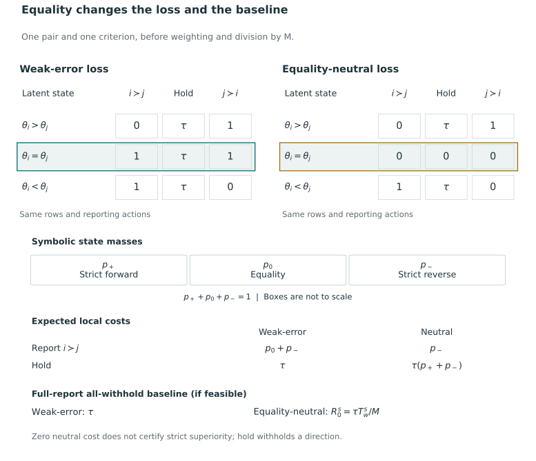
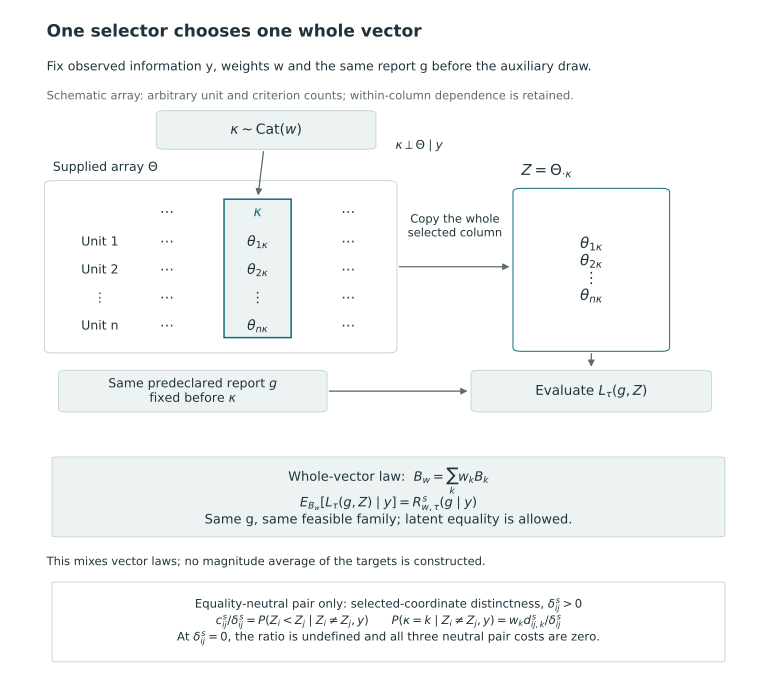
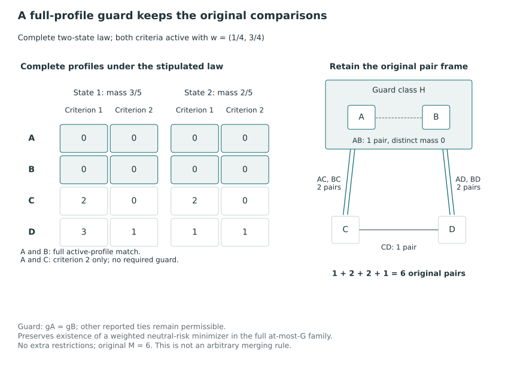

# Multicriteria directional loss {#sec-multicriteria-loss}

We evaluate a common grade report against several criteria by weighting criterion-specific directional errors and assigning a cost to withheld comparisons. This does not require combining target values into a scalar score. Linearity of expectation gives the risk as a sum of pair coefficients, allowing dependence among units and criteria. Assessing simultaneous correctness would require a different calculation.

## Weighted directional risk from a supplied selection law {#sec-weighted-directional-risk}

We first treat latent equality as an error when a strict direction is disclosed. @sec-tie-aware-loss then introduces an equality-neutral alternative. The earlier definitions and results retain the weak-error convention.

The construction extends KRW's scalar report-card decision: ordered grades communicate comparisons, and the loss trades correct and incorrect disclosures against silence under supplied beliefs. Their objective is a sum of pair contributions [@kline_discrimination_2024, pp. 2477–2480, eqs. 1 and 5]. We define the criterion-weighted loss under our orientation and equality convention, and derive its risk by taking expectations.

### Targets, reports, and the loss

Fix integers $n\ge2$ and $K\ge1$, and observed information $Y=y$. Let $\Theta=(\theta_{ik})\in\mathbb R^{n\times K}$ be the target array, oriented so that larger values on each criterion indicate greater reporting priority. Uncertainty is represented by a proper supplied joint selection law $\Pi_s(d\vartheta\mid y)$, allowing dependence across units, criteria, and their components. We take this law as given; its production and agreement with the data-generating law are further statistical questions.

Let $g$ be a canonical ordered-partition action with grade 1 highest. Its feasible domain may be unrestricted or subject to specified restrictions. Define

$$
x_{ij}(g)=\mathbf1\{g_i<g_j\},\qquad
M=\binom n2,\qquad
N(g)=\sum_{i\ne j}x_{ij}(g).
$$

Each disclosed unordered pair contributes once to the ordered-index sum, in its reported direction, while a within-grade pair contributes zero. Thus $N(g)$ counts disclosures and $M-N(g)$ counts withheld pairs. We assess this same grade vector on every criterion.

Choose directional-loss weights $w_k\ge0$ with $\sum_{k=1}^K w_k=1$, and a withholding cost $0<\tau\le1/2$, both fixed in the conditional calculation at $y$. The weights specify relative penalties for criterion-specific errors. Interpreting them as agreement probabilities, estimated criterion importance, or scalar-composite coefficients would require additional assumptions.

For criterion $k$, the realized wrong-direction count is

$$
D_k(g,\Theta)
=\sum_{i\ne j}x_{ij}(g)
\mathbf1\{\theta_{ik}\le\theta_{jk}\}.
$$

The weak inequality treats a strict direction from $i$ to $j$ as wrong on criterion $k$ when their latent values are equal. A reported tie, in contrast, withholds the direction without asserting equality and is assessed through the withholding term.

The realized weighted directional loss is

$$
L_{w,\tau}(g,\Theta)
=\frac{\sum_{k=1}^K w_kD_k(g,\Theta)
+\tau\{M-N(g)\}}{M}.
$$

A disclosed pair has weighted error cost between zero and one, and a withheld pair costs $\tau$ once regardless of the number of criteria. Normalizing $w$ fixes the disclosed-pair scale as $K$ changes, while the substantive choice of weights requires justification. Since $D_k\le N\le M$, the loss lies in $[0,1]$ and its expectation exists under every supplied probability law.

### The expected-risk identity

Define the directional error probabilities and their weighted coefficients by

$$
e^s_{ij,k}(y)
=\Pi_s(\theta_{ik}\le\theta_{jk}\mid y),
\qquad
\bar e^s_{ij}(y)=\sum_{k=1}^K w_k e^s_{ij,k}(y).
$$

All coefficients refer to the same observed information and the same supplied law. Let $E^s_k(g\mid y)=\mathbb E_{\Pi_s}[D_k(g,\Theta)\mid y]$ and let $R^s_{w,\tau}(g\mid y)$ be the expectation of $L_{w,\tau}$ under that law.

::: {#prp-weighted-directional-risk}
### Pair-coefficient representation

Under the preceding assumptions, for every fixed feasible canonical action $g$,

$$
E^s_k(g\mid y)
=\sum_{i\ne j}x_{ij}(g)e^s_{ij,k}(y),
$$

and

$$
\begin{aligned}
R^s_{w,\tau}(g\mid y)
&=\frac{\sum_{i\ne j}x_{ij}(g)\bar e^s_{ij}(y)
+\tau\{M-N(g)\}}{M}\\
&=\tau+\frac1M\sum_{i\ne j}x_{ij}(g)
\{\bar e^s_{ij}(y)-\tau\}.
\end{aligned}
$$

No independence or latent tie-free assumption is required.
:::

**Proof.** At fixed $y$ and $g$, each $x_{ij}(g)$ is constant with respect to the target integration. Taking expectations of the finite indicator sum defining $D_k$ replaces each indicator by $e^s_{ij,k}(y)$, giving the expected-count formula. The weights and withholding term are also fixed, so finite-sum linearity gives

$$
\mathbb E_{\Pi_s}\!\left[\sum_k w_kD_k\mid y\right]
=\sum_{i\ne j}x_{ij}(g)\sum_k w_ke^s_{ij,k}(y)
=\sum_{i\ne j}x_{ij}(g)\bar e^s_{ij}(y).
$$

Substituting into the definition of $L_{w,\tau}$ gives the first expression. Expanding the withholding term and using $N(g)=\sum_{i\ne j}x_{ij}(g)$ gives the second. The finite, bounded sums require no additional moment or interchange condition, and neither a product of error events nor a factorization of the law enters the calculation. $\square$

If feasible, the all-tie report has risk $\tau$. The remaining sum measures the change in risk when the report discloses comparisons. Its minimization must respect the ordered-partition constraints, including any grade cap or fixed order. These restrictions change the reports available for selection, but the identity evaluates each admissible report.

### Probabilities needed for the risk {#exactly-which-probabilities-suffice}

To compute $e^s_{ij,k}$, it suffices to know the bivariate marginal law of $(\theta_{ik},\theta_{jk})$ induced by $\Pi_s$ and evaluate its weak-order event. The full within-criterion vector law is one way to supply all such bivariate marginals. Once the event probabilities are available, the additive risk calculation needs only those numbers, the weights, and the action. For this fixed weighted objective, their aggregates $\bar e^s_{ij}$ are enough; retaining the criterion-specific probabilities also permits the expected counts $E^s_k$ to be evaluated separately.

These probabilities contain the distributional information required to calculate the additive risk; this use differs from statistical sufficiency for estimating a target distribution. Unit marginals alone generally do not identify bivariate comparison probabilities, because different couplings preserve the marginals while changing the ordering probabilities. Means and standard errors contain still less information. The within-criterion pair dependence needed for the calculation is illustrated in @sec-posterior-risk-laws.

If the within-criterion pair probabilities remain fixed, changing cross-criterion dependence leaves the additive risk unchanged. This follows because the expectation of the sum depends only on the expectation of each term. The joint law, however, can change, as can the probability that every disclosed direction is correct. That probability involves intersections of events across pairs and criteria.

A cardinal composite $c_i=\sum_k a_k\theta_{ik}$ depends on target magnitudes and their joint distribution, so the additive-risk coefficients generally do not determine its ordering probabilities. The coefficients $a$ specify cardinal trade-offs, while $w$ weights directional errors; numerical equality of the two sets of coefficients does not make their interpretations equivalent. Comparing these estimands requires assumptions beyond the directional-risk identity.

### Exact comparison of additive, composite, and joint-event information {#an-exact-information-boundary-example}

Consider two units and two criteria, with unit $B$ fixed at $(0,0)$. Under one constructed joint law, unit $A$ is $(2,2)$ or $(-1,-1)$, each with probability $1/2$. Under another, it is $(2,-1)$ or $(-1,2)$, again with equal probabilities. On each criterion, the complete two-unit target vector has the same marginal distribution under both laws: $A$ is either 2 or $-1$, and $B$ is zero. Consequently every within-criterion pair-order probability agrees, although the cross-criterion dependence differs.

For the report $A>B$, each criterion error probability is $1/2$. With $w=(1/2,1/2)$ the weighted error is therefore $1/2$ under either law. The reverse report also has weighted error $1/2$, while withholding costs $\tau$ under either law. Thus all three possible reporting actions have identical additive risks across the two laws.

Now separately declare composite coefficients $a=(1/2,1/2)$. Under the first law, $A$'s composite is 2 or $-1$, so reporting $A>B$ has composite error probability $1/2$. Under the second law, its composite is always $1/2$, so the same report has composite error probability zero. The probability that $A$ is above $B$ on **both** criteria is $1/2$ under the first law and zero under the second. Neither law has a criterion or composite tie.

The example gives identical additive risks under the two laws but different composite comparisons and joint-event probabilities. These are distinct evaluation targets, each requiring the corresponding distributional information; the example does not favor one target over another.

### Latent equality and conditional calculations {#equality-conditioning-and-attribution}

The identity remains valid with atoms or positive-probability latent equalities. In particular,

$$
e^s_{ij,k}(y)+e^s_{ji,k}(y)
=1+\Pi_s(\theta_{ik}=\theta_{jk}\mid y).
$$

Partitioning the pair's states into strict forward order, equality, and strict reverse order gives the identity. Reverse weak-error probabilities are therefore complementary only if equality has zero probability under the selection law. The risk representation permits positive equality mass, which is then included in its coefficients.

Weights, transformations, and loss settings may depend on $Y$. Conditional on $y$, hold their realized definitions fixed and use a supplied law for those same targets. The resulting loss is the conditional version $L_y$ of the data-dependent loss $L_Y$. The identity applies also to a selected report $g=\delta(y)$ because conditioning fixes the action. Evaluation under another law or repeated sampling requires the corresponding expectation. Integrating random preferences would additionally require their probability law and their relationship with the targets; preferences are held fixed here.

KRW's online Appendix A weights scalar concordances and discordances by powers of cardinal target differences [@kline_discrimination_2024, online Appendix A, p. 2; main text p. 2479, footnote 3]. Its magnitude-dependent pair weights provide an antecedent to the present construction, but differ from our fixed criterion-loss weights. We do not adopt its further formulas. The expected-risk representation above follows by elementary linearity for the specified loss and is not a new principle of weighting or posterior postprocessing.

## A criterion mixture and its scalar correspondence {#sec-criterion-mixture}

We can represent the weighted directional objective as a scalar problem by selecting one criterion and evaluating the report against that criterion's entire vector of unit targets. Mixing the criterion-specific vector laws in this way connects the weighted loss to KRW's scalar objective. It does not average target magnitudes into a composite. The representation concerns average loss, without implying stakeholder consensus or simultaneous correctness on all criteria.

KRW evaluates correct comparisons, incorrect comparisons and reported ties under general beliefs [@kline_discrimination_2024, pp. 2477–2480, eqs. 1 and 5]. The following mixture construction relates that scalar objective to criterion-weighted loss. It reconstructs a correspondence between the objectives, without claiming priority for weighted loss or posterior decision-making.

### Selection of one whole criterion vector {#one-criterion-selects-one-whole-vector}

Fix observed information $Y=y$, integers $n\ge2$ and $K\ge1$, and the supplied selection law $\Pi_s(\cdot\mid y)$ on the oriented target array $\Theta$. Retain weights $w_k\ge0$ with $\sum_k w_k=1$. These weights, targets, and loss settings are fixed at the same $y$. For each criterion, let $B_k(\cdot\mid y)$ be the marginal law of its full unit vector $\Theta_{\cdot k}=(\theta_{1k},\ldots,\theta_{nk})$.

On an auxiliary probability space, draw one index $\kappa\sim\operatorname{Cat}(w)$ independently of $\Theta$ conditional on $y$, and set $Z=\Theta_{\cdot\kappa}$. The resulting scalar-vector law is

$$
B_w(A\mid y)=\sum_{k=1}^K w_k B_k(A\mid y),
\qquad A\subseteq\mathbb R^n\text{ Borel}.
$$

Equivalently, choose $k$ with probability $w_k$ and draw one vector from $B_k$. The auxiliary selector is independent of the target array, while dependence among its criteria and among units within a criterion is unrestricted. Each selected vector retains its joint unit dependence.

The same $\kappa$ is used for the entire evaluation. Selecting criteria separately for different units would compare targets measured on different criteria, while selecting anew for every pair would not define this scalar target vector. Nor is $Z$ the componentwise average $\sum_k w_k\Theta_{\cdot k}$: a mixture of vector laws and an average of target values are different constructions.

Use the same labelled units, priority orientation, $M=\binom n2$, and nonempty finite feasible domain $\mathcal A$ on both sides. Every $g\in\mathcal A$ is a canonical ordered partition, with grade 1 highest. Its disclosure indicators are $x_{ij}(g)=\mathbf1\{g_i<g_j\}$ and $N(g)=\sum_{i\ne j}x_{ij}(g)$. The report is selected before observing the auxiliary criterion; the comparison does not allow a different report $g_\kappa$ after the criterion is revealed.

### Mixture equality and the source loss

For a scalar vector $z$, define

$$
\begin{aligned}
D(g,z)&=\sum_{i\ne j}x_{ij}(g)\mathbf1\{z_i\le z_j\},\\
D_{<}(g,z)&=\sum_{i\ne j}x_{ij}(g)\mathbf1\{z_i<z_j\},\\
C(g,z)&=\sum_{i\ne j}x_{ij}(g)\mathbf1\{z_i>z_j\}.
\end{aligned}
$$

The weak-error withholding loss is $L_\tau(g,z)=[D(g,z)+\tau\{M-N(g)\}]/M$. KRW's strict-count scalar loss, in the reversed grade convention, is $L_{\mathrm K,\lambda}(g,z)=[D_{<}(g,z)-\lambda C(g,z)]/M$. Their extensions at latent equality differ, so the source correspondence requires explicit treatment of ties.

Let

$$
T_{=,k}(g,\Theta)=\sum_{i\ne j}x_{ij}(g)
\mathbf1\{\theta_{ik}=\theta_{jk}\},
\qquad
\bar T^s_{w,=}(g\mid y)
=\sum_k w_k\mathbb E_{\Pi_s}[T_{=,k}(g,\Theta)\mid y].
$$

This is an expected weighted count of disclosed latent equalities, not a count of reported ties.

::: {#prp-criterion-mixture}
### Criterion-mixture correspondence

For $0<\tau\le1/2$ and every $g\in\mathcal A$, including laws with latent equalities,

$$
\mathbb E_{B_w}[L_\tau(g,Z)\mid y]
=R^s_{w,\tau}(g\mid y).
$$

Set $\lambda=\tau/(1-\tau)$ and let $R_{\mathrm K,\lambda}^{B_w}(g\mid y)$ denote expected source strict loss under the constructed law. Then

$$
R^s_{w,\tau}(g\mid y)
=\tau+(1-\tau)R_{\mathrm K,\lambda}^{B_w}(g\mid y)
+\frac{1-\tau}{M}\bar T^s_{w,=}(g\mid y).
$$

If $\Pi_s(\theta_{ik}=\theta_{jk}\mid y)=0$ for every $i\ne j$ and every $k$ with $w_k>0$, the correction vanishes, and

$$
R_{\mathrm K,\lambda}^{B_w}(g\mid y)
=(1+\lambda)R^s_{w,\tau}(g\mid y)-\lambda.
$$

Consequently the entire minimizing sets of these two risks coincide on the same domain $\mathcal A$.
:::

**Proof.** At a fixed array $\Theta$, averaging over the independent selector replaces $D(g,\Theta_{\cdot\kappa})$ by $\sum_k w_kD_k(g,\Theta)$. The withholding term is the same for every selected criterion, and its weights sum to one. Thus the selector-averaged scalar loss is exactly $L_{w,\tau}(g,\Theta)$. Taking the supplied target expectation proves the first identity. All quantities are bounded finite sums.

For any scalar state, let $T_=(g,z)$ count its disclosed latent equalities. Then $D=D_<+T_=$ and $N=C+D_<+T_=$. Substitution, with $(1-\tau)\lambda=\tau$, gives the statewise identity

$$
L_\tau(g,z)
=\tau+(1-\tau)L_{\mathrm K,\lambda}(g,z)
+\frac{1-\tau}{M}T_=(g,z).
$$

Under $B_w$, the expectation of $T_=$ is $\bar T^s_{w,=}$. This proves the correction formula. The positive-weight no-tie condition makes every term in that expected count zero. Rearranging then gives the source-risk expression. Its multiplier $1+\lambda>0$ preserves every strict comparison and every equality between action risks. Finiteness and nonemptiness ensure attained minima, so the full argmin sets coincide. $\square$

The first identity uses only the marginal vector laws $B_k$: cross-criterion dependence is unrestricted and does not enter this averaged loss. In particular,

$$
B_w(Z_i\le Z_j\mid y)=\sum_k w_k e^s_{ij,k}(y)=\bar e^s_{ij}(y).
$$

The resulting pair coefficients are those in @prp-weighted-directional-risk. The mixture retains the information needed for this averaged loss but does not reconstruct the original array's full joint law.

### Equality and the feasible domain {#equality-and-feasible-domain-boundaries}

The mixture's equality probability is $\sum_k w_k\Pi_s(\theta_{ik}=\theta_{jk}\mid y)$. Because all terms are nonnegative, its vanishing is equivalent to zero equality probability on each positive-weight criterion. Requiring every criterion to be tie-free is sufficient but stronger than needed when some weights are zero. A zero-weight criterion contributes neither to $B_w$ nor to this loss, whatever its equality probabilities.

The no-tie condition ensures affine equivalence on the common action domain. On a restricted domain, the minimizing sets may still agree without this condition, for instance if every admissible action withholds each equality-bearing pair. In general, however, the correction varies across actions. The weak-error risk identity remains valid with equality mass; identifying it with the strict source risk then requires retaining the correction.

The two objectives must be compared on the same action domain, whether unrestricted or constrained by an at-most cap, exact grade count or fixed order. Restriction can change the optimum relative to the unrestricted KRW problem, as can changing the selection law, target orientation or unit frame. Even when the objectives are equivalent, implementations may choose different members of the same set of tied optima.

The baseline $0<\tau\le1/2$ corresponds to $0<\lambda\le1$. The formulas additionally hold at the explicitly labelled algebraic endpoint $\tau=\lambda=0$. When feasible, all-tie then has zero risk and is optimal, but need not be uniquely optimal under certainty. At $\tau=1/2$ the source parameter is $\lambda=1$. The value $\tau=1$ is outside this mapping: no finite $\lambda$ is supplied. These endpoint statements add no further policy range.

### Interpretation of a random-criterion audience {#what-a-random-criterion-audience-would-mean}

Suppose criterion $k$ governs an audience's assessment with probability $w_k$, and the report is issued before the criterion is selected. The proposition evaluates average directional loss under this criterion lottery. Interpreting the weights as population shares or random human preferences requires additional substantive modeling. The weighted sum trades off criterion-specific errors even though each directional error ignores the magnitude of the target difference.

Under the positive-weight no-tie condition, connecting this construction to KRW's behavioral audience further requires the source assumptions: users follow the disclosed recommendation, informed users resolve reported ties correctly, and uninformed users choose correctly with probability one half. With the same informed fraction $\phi\in(0,1)$, homogeneous correct/incorrect payoffs, and equal averaging over pairwise choice problems, the preceding scalar calculation gives $\tau=(1-\phi)/2$ [@kline_discrimination_2024, p. 2478]. The source's correct choice is the less-discriminatory firm; a priority grade by itself does not specify a corresponding choice or allocation rule in another application.

The audience interpretation averages pairwise outcomes over the criterion lottery. It does not evaluate unanimous stakeholder agreement, agreement of all criteria on every disclosure, or welfare from a global allocation. The correspondence is therefore specific to the average decision loss, rather than a general social-choice or utility result. We compare this loss with the co-primary scalar-composite target in @sec-two-estimands.

## An equality-neutral extension of directional loss {#sec-tie-aware-loss}

Under the weak-error loss in @sec-weighted-directional-risk, a disclosed strict direction is wrong at latent equality and withholding incurs a fixed cost. We now consider an alternative that assigns zero cost to either direction at equality and charges withholding only when the criterion distinguishes the units. This changes the decision loss while retaining the targets, supplied probability law, and common-grade reporting structure. The earlier weak-error definitions continue to describe the original loss.

Shared targets motivate this alternative. Two institutions may have exactly the same community attribute but different institution-specific attributes, making equality a feature of the scientific target. Almost-sure equality cannot be established from agreement of posterior means, rounded values or finitely many draws alone. The decision calculations remain conditional on the supplied targets and beliefs, whose validity requires substantive assessment.

### States, coefficients, and distinct-comparison mass

Fix $Y=y$, $n\ge2$, $K\ge1$, a proper supplied joint law $\Pi_s(\cdot\mid y)$, and the oriented target array $\Theta$. Larger target values indicate higher priority, and smaller grade labels indicate higher reported priority. Retain $M=\binom n2$, $x_{ij}(g)=\mathbf1\{g_i<g_j\}$, and the raw disclosed-pair count $N(g)$ from @sec-grade-actions. Hold $w_k\ge0$, $\sum_kw_k=1$, and $0<\tau\le1/2$ fixed. For an unordered pair, define the criterion loss by

$$
\ell^{\rm TA}_k(i\succ j;\Theta)=\mathbf1\{\theta_{ik}<\theta_{jk}\},\qquad
\ell^{\rm TA}_k(j\succ i;\Theta)=\mathbf1\{\theta_{jk}<\theta_{ik}\},
$$

$$
\ell^{\rm TA}_k(\mathrm{hold};\Theta)
=\tau\mathbf1\{\theta_{ik}\ne\theta_{jk}\}.
$$

The full loss $L^{\rm TA}_{w,\tau}$ sums these costs over unordered pairs and criteria, using weights $w_k$ and normalization $1/M$, and lies in $[0,1]$. All three pair actions cost zero at equality on a criterion, so a zero-cost disclosure can occur without strict superiority. A reported tie continues to withhold a direction, with no assertion of latent equality.

Suppressing $y$ inside coefficients, put

$$
b^s_{ij,k}=\Pi_s(\theta_{ik}<\theta_{jk}\mid y),\qquad
t^s_{ij,k}=\Pi_s(\theta_{ik}=\theta_{jk}\mid y),\qquad
d^s_{ij,k}=1-t^s_{ij,k}.
$$

Strict forward order, equality, and strict reverse order partition the states. Consequently

$$
b^s_{ij,k}+b^s_{ji,k}=d^s_{ij,k}=d^s_{ji,k},\qquad
c^s_{ij}=\sum_kw_kb^s_{ij,k},\qquad
\delta^s_{ij}=\sum_kw_kd^s_{ij,k}=\delta^s_{ji}.
$$

In particular, the reverse strict-error probability is $d^s_{ij,k}-b^s_{ij,k}$. Replacing it by $1-b^s_{ij,k}$ would assign equality mass to a strict reversal.

| Quantity | Definition and interpretation |
|---|---|
| $A^s_{\rm TA}(g)$ | $\sum_{i\ne j}x_{ij}(g)c^s_{ij}$: expected weighted strict-error count. |
| $Q^s_k(g)$ | $\sum_{i\ne j}x_{ij}(g)d^s_{ij,k}$: expected distinct-comparison mass disclosed on criterion $k$. |
| $Q^s_w(g)$ | $\sum_kw_kQ^s_k(g)=\sum_{i\ne j}x_{ij}(g)\delta^s_{ij}$: weighted disclosed distinct mass. |
| $T^s_w$ | $\sum_{i<j}\delta^s_{ij}$: weighted distinct mass over all possible pairs. |
| $N(g)$ | Number of pairs assigned different grades, irrespective of latent equality. |

Thus $0\le A^s_{\rm TA}(g)\le Q^s_w(g)\le N(g)\le M$ and $Q^s_w(g)\le T^s_w\le M$. We retain the superscript on $Q$ because distinct mass depends on the law, and continue to use $D_k(g,\Theta)$ for the realized weak-error count defined earlier. The package API separately names its weighted distinct-mass field `D`; that field corresponds to $Q^s_w$ here and leaves the definition of $D_k$ unchanged.

@fig-vis-f11b places the two loss definitions on the same state and action grid.

::: {#fig-vis-f11b}
<picture>
<source media="(max-width: 720px)" srcset="../assets/figures/f11b-equality-changes-the-loss-and-the-baseline-mobile.svg">

</picture>

Exact pairwise costs under weak-error and equality-neutral loss, distinguishing latent equality from withholding. Weak-error charges equality as an erroneous strict direction and charges tau for withholding; equality-neutral assigns zero cost to every pair action at equality and charges withholding only in distinct states. Symbolic event masses give the corresponding expected costs. If all-withhold is feasible, its full-report baseline is tau under weak-error and tau times total weighted distinct mass divided by M under equality-neutral. Zero neutral cost does not certify strict superiority.
:::

### Risk identity and relation to the weak-error loss

::: {#prp-tie-aware-risk}
### Equality-neutral risk and its weak-error difference

For every fixed canonical action $g$, its expected equality-neutral loss is

$$
R^s_{{\rm TA},w,\tau}(g\mid y)
=\frac{A^s_{\rm TA}(g)+\tau\{T^s_w-Q^s_w(g)\}}M
=R^s_0+\frac1M\sum_{i\ne j}x_{ij}(g)
\{c^s_{ij}-\tau\delta^s_{ij}\},
\qquad R^s_0=\frac{\tau T^s_w}{M}.
$$

Let $\bar t^s_{ij}=\sum_kw_kt^s_{ij,k}$. Evaluating the earlier weak-error loss and this loss on the same action, law, targets, and settings gives

$$
R^s_{w,\tau}(g\mid y)-R^s_{{\rm TA},w,\tau}(g\mid y)
=\frac1M\left[
\sum_{i\ne j}x_{ij}(g)\bar t^s_{ij}
+\tau\sum_{i<j:g_i=g_j}\bar t^s_{ij}
\right].
$$

If every pair has zero equality probability on every positively weighted criterion, the two risks agree for every action. Their entire minimizing sets then agree on any common nonempty finite feasible domain.
:::

**Proof.** For each unordered pair, exactly one direction is disclosed or the pair is withheld. Taking the expectation of its state cost gives $c^s_{ij}$ in the disclosed direction and $\tau\delta^s_{ij}$ when withheld. Summing the latter over withheld pairs gives $\tau(T^s_w-Q^s_w(g))$, proving the first expression. Expanding that expression gives the second. Finite-sum linearity requires no independence across units, pairs, or criteria.

For a disclosed direction, the weak-error indicator exceeds its strict counterpart exactly at equality. For withholding, the weak-error cost $\tau$ exceeds the neutral cost by $\tau\mathbf1\{\theta_{ik}=\theta_{jk}\}$. Weighted summation and expectation prove the difference identity. Under the stated zero-equality condition, all weighted equality terms vanish; also $\delta^s_{ij}=1$, $T^s_w=M$, and $Q^s_w(g)=N(g)$. Actionwise equality of the two objective functions proves the final assertion. $\square$

Since the difference is nonnegative and generally varies with the action, a smaller neutral risk reflects the changed loss and does not establish improved accuracy under weak-error loss. The all-withhold report, when feasible, has risk $R^s_0\in[0,\tau]$. If $T^s_w=0$, every active criterion is almost surely equal within every pair, giving zero neutral risk for all reports. This can describe known equality rather than epistemic uncertainty. A distinct-mass ratio is undefined whenever its denominator is zero.

### A single whole-vector criterion selector and the payoff correspondence {#one-criterion-selector-and-the-payoff-correspondence}

We can apply the whole-column construction in @sec-criterion-mixture to the neutral loss. Conditional on $y$, draw one auxiliary index $\kappa\sim\operatorname{Cat}(w)$ independently of $\Theta$ and set $Z=\Theta_{\cdot\kappa}$. The scalar target is the entire vector on the selected criterion and has law $B_w=\sum_kw_kB_k$, with $B_k$ the supplied marginal law of that vector. Use the same report for every possible selection. Averaging the scalar neutral loss over the selector and target law gives $R^s_{{\rm TA},w,\tau}$ by finite-sum linearity. Selecting criteria independently for separate units or pairs would define a different construction.

For a particular pair with $\delta^s_{ij}>0$, the construction gives

$$
\frac{c^s_{ij}}{\delta^s_{ij}}
=B_w(Z_i<Z_j\mid Z_i\ne Z_j,y).
$$

Thus an isolated direction is strictly cheaper than withholding exactly when this conditional error is below $\tau$. Conditioning on distinctness generally changes the criterion probabilities from $w_k$ to $w_kd^s_{ij,k}/\delta^s_{ij}$. This interpretation concerns the selected criterion's distinct event, rather than the event that some component of the original target vectors differs. If $\delta^s_{ij}=0$, all three pair costs are zero and the conditional ratio is undefined. Local comparisons still need not form a coherent global grade report.

For the scalar neutral problem, define a disclosed pair's payoff as $\lambda$ for a strict correct direction, $-1$ for a strict wrong direction, and zero at equality; withholding also gives zero. Let $u_k$ denote that state payoff for criterion $k$, and set $\lambda=\tau/(1-\tau)$. For each state and each pair action,

$$
\ell^{\rm TA}_k
=\tau\mathbf1\{\theta_{ik}\ne\theta_{jk}\}-(1-\tau)u_k.
$$

For a disclosed direction, write its strict correct and wrong indicators as $C_k$ and $W_k$. They sum to the distinct indicator. Substitution yields $\tau(C_k+W_k)-(1-\tau)(\lambda C_k-W_k)=W_k$. For withholding, $u_k=0$, giving its defined loss. If $U^s_{w,\lambda}(g\mid y)$ is the expected weighted payoff summed over pairs and divided by $M$, then

$$
R^s_{{\rm TA},w,\tau}(g\mid y)
=R^s_0-(1-\tau)U^s_{w,\lambda}(g\mid y).
$$

Since the baseline is independent of the action and the multiplier is positive, minimizing risk and maximizing payoff give the same optimal set on a common domain. KRW provides the scalar correct–incorrect comparison objective under tie-free beliefs [@kline_discrimination_2024, pp. 2477–2480]. We have reconstructed the extension of the state loss and identity to latent equality; the source's results remain subject to its original assumptions in @sec-krw-scalar-core.

@fig-vis-f11a keeps the whole-vector selector and the predeclared report separate, including the qualified distinctness interpretation.

::: {#fig-vis-f11a}
<picture>
<source media="(max-width: 720px)" srcset="../assets/figures/f11a-one-selector-chooses-one-whole-criterion-vector-mobile.svg">

</picture>

Criterion-mixture construction using a single auxiliary index to select one criterion’s entire vector of unit targets. The report is fixed before this draw; the selected column retains its within-criterion dependence. Mixing whole-vector laws reproduces the specified criterion-weighted loss, rather than averaging target magnitudes. For a fixed pair under the equality-neutral loss, conditioning on selected-coordinate distinctness generally reweights the criteria; that conditional interpretation requires positive distinct mass.
:::

### Same-grade guard for identical active profiles {#a-guard-for-identical-active-profiles}

Fix the positive-weight support $I_w=\{k:w_k>0\}$ and define

$$
i\sim j
\quad\Longleftrightarrow\quad
\Pi_s(\theta_{ik}=\theta_{jk}\text{ for every }k\in I_w\mid y)=1.
$$

On the intersection of the finitely many probability-one equality events, equality is reflexive, symmetric and transitive, so this defines an equivalence relation. The full active-profile guard imposes $g_i=g_j$ whenever $i\sim j$. Equality on only one of two positive-weight attributes does not suffice. The relation may follow from a scientific structural specification or a complete stipulated finite law, but coincidence in finite Monte Carlo output alone cannot establish it.

::: {#prp-tie-aware-guard}
### Existence of a guarded weighted minimizer

For the fixed supplied law and loss above, let $1\le G_{\max}\le n$. Over the full at-most-$G_{\max}$ family $\mathcal A_{\le G_{\max}}$, with no additional restrictions, there exists a neutral-risk minimizer satisfying the full active-profile guard. Consequently imposing this guard preserves the minimum risk on this family.
:::

**Proof.** The finite nonempty family has a minimizer. Begin more generally with any report in it and an equivalence class $H$. Every pair within $H$ has $c^s_{ij}=\delta^s_{ij}=0$, so its contribution is zero regardless of the assigned grades. Almost-sure equality on all active criteria also makes every member of $H$ have the same directed coefficients and distinct mass against each fixed unit outside $H$.

Hold all outside grades fixed. For a grade label $h$ currently occupied by a member of $H$, let $F_H(h)$ be one member's unnormalized total pair cost against the outside units when placed at $h$. The cost uses the appropriate forward coefficient, reverse coefficient, or withholding coefficient according to the outside grade. It does not depend on which member is placed there. The current outside contribution is therefore $\sum_{i\in H}F_H(g_i)$. Choose a currently used label $h^*$ minimizing $F_H$ and move all members of $H$ to it. The contribution becomes $|H|F_H(h^*)$, which cannot exceed the former sum. Internal costs remain zero.

This move introduces no grade label. Removing empty labels and canonically relabeling the remaining grades changes no pair relation, so neither risk nor occupied grade count increases. Apply this operation to each equivalence class in turn. Moving a different class never separates members of an already consolidated class; canonical relabeling preserves their equality too. The final report satisfies every guard. Starting with a global minimizer therefore produces a guarded report with no larger risk; its feasibility in the original family forces equality with that global minimum. The guarded family is a subset, proving preservation of the minimum in both directions. $\square$

The argument retains every original unit and pair, with their multiplicities and normalization $M$; replacing a class by one unweighted unit would change the costs. It establishes that a guarded minimizer exists, while other minimizers may split identical profiles at zero neutral cost. The reassignment is chosen by comparing costs against outside units. An arbitrary merge of adjacent grades need not preserve risk.

@fig-vis-f11c illustrates full-profile equality while retaining the original units and pair multiplicities.

::: {#fig-vis-f11c}
<picture>
<source media="(max-width: 720px)" srcset="../assets/figures/f11c-a-full-profile-guard-retains-original-multiplicities-mobile.svg">

</picture>

Full active-profile guard with the original comparison frame and pair multiplicities retained. In the complete stipulated T11 law, A and B have identical values on both positive-weight criteria in both states, while A and C share only criterion 2. The guard requires gA=gB; it does not forbid other reported ties. Grouping A and B for the guard retains their two comparisons with C and two with D, the C–D pair, and the zero-distinct A–B pair: the original normalization is M=6. The existing theorem preserves the minimum and existence of a guarded minimizer over the full weighted at-most-G family without additional restrictions; it does not justify arbitrary merging or every constrained extension.
:::

For exact grade counts, fixed orders, quotas or criterion protections, the reassignment may be infeasible. It may also increase a component risk in a minimax objective, so these extensions require further arguments. Changing which weights are positive can change the guard. Even when the guard preserves minimum reporting risk, the grade count, choice among minimizers and any subsequent funding allocation remain subject to their own domains and rules.