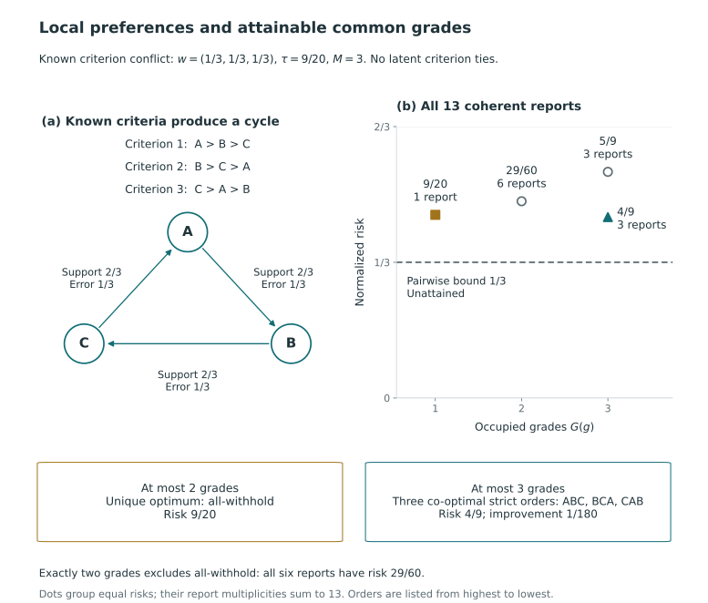
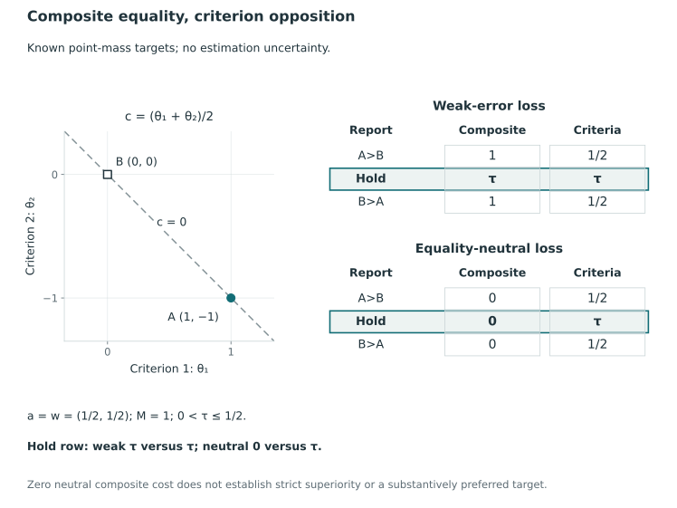

# Conflict, invariance, and estimands {#sec-conflict-estimands}

## Two co-primary targets for a reported direction {#sec-two-estimands}

A scalar composite assesses a comparison using a specified combination of attribute magnitudes, whereas a directional objective assesses its criterion-specific errors. The targets answer different questions about the same units, so neither corrects the other by definition. They can disagree even when the target values are known exactly.

The choice between these targets is discussed in @sec-measurement-values and @sec-aggregation-mcda. Decision analysis interprets coefficients relative to the attribute scales and the tradeoffs they represent; the presence of several attributes does not itself justify an additive representation [@keeney_raiffa_1993, pp. 66–69, 116–123]. For the mathematical comparison we take both constructions as given. Relating them to institutional objectives and justifying their weights require substantive arguments.

### Composite and criterion-specific error counts on a common frame {#a-common-frame-two-error-counts}

Fix the same units, target array $\Theta$, criterion orientations, and canonical grade report $g$ as in @sec-weighted-directional-risk. Let $M=\binom n2$, $x_{ij}(g)=\mathbf1\{g_i<g_j\}$, and $N(g)=\sum_{i\ne j}x_{ij}(g)$. A composite with declared cardinal coefficients $a$ is

$$
c_i(\Theta)=\sum_{k=1}^K a_k\theta_{ik}.
$$

Composite coefficients need not sum to one, and their interpretation depends on target units and transformations. Directional-loss weights satisfy $w_k\ge0$ and $\sum_kw_k=1$. We distinguish the two roles even when a comparison sets $a=w$ numerically.

Define the composite wrong-direction count and the weighted criterion wrong-direction count by

$$
D^{(a)}(g,\Theta)
=\sum_{i\ne j}x_{ij}(g)\mathbf1\{c_i(\Theta)\le c_j(\Theta)\},
\qquad
D_w(g,\Theta)=\sum_kw_kD_k(g,\Theta).
$$

The first count evaluates one target constructed from magnitudes; the second averages the costs of criterion-specific directional mistakes. Both treat latent equality as an error when a strict direction is disclosed. For an otherwise matched comparison, use the same withholding cost and normalization:

$$
L^{(a)}_\tau(g,\Theta)
=\frac{D^{(a)}(g,\Theta)+\tau\{M-N(g)\}}{M},
\qquad
L_{w,\tau}(g,\Theta)
=\frac{D_w(g,\Theta)+\tau\{M-N(g)\}}{M}.
$$

Conditional on observed information $Y=y$, integrate both losses under the same law, such as the selection law $\Pi_s(\cdot\mid y)$. Using different laws would change both the objective and the evaluation distribution. To isolate the objective when comparing optima, also retain a common feasible report family. Data-dependent transformations or preferences are fixed at their realized definitions in this conditional comparison, while repeated-data evaluation retains their dependence on $Y$, as in @sec-posterior-risk-laws.

For a fixed report, both losses assess the same disclosure pattern, so their withholding terms cancel and their difference is $(D^{(a)}-D_w)/M$. When each objective selects its own report, disclosure may also change and both withholding terms must be retained. Evaluating each report under both targets describes the effect of this choice without equating the objectives.

This cancellation belongs to the displayed weak-error losses. The equality-neutral comparison in @sec-tie-aware-estimands retains a generally nonzero difference in withholding costs.

### Sufficient conditions for agreement of the two losses {#when-the-two-losses-agree}

The two losses agree under the following sufficient condition. Write $I_w=\{k:w_k>0\}$ for the criteria that receive positive directional weight.

::: {#prp-estimand-agreement}
### Agreement under strict common directions

Suppose $a_k=0$ outside $I_w$, $a_k\ge0$ on $I_w$, and at least one $a_k$ is positive. At a fixed state $\Theta$, suppose that, for each pair of distinct units, all differences $\theta_{ik}-\theta_{jk}$ with $k\in I_w$ have the same strict sign. Then

$$
D^{(a)}(g,\Theta)=D_w(g,\Theta),
\qquad
L^{(a)}_\tau(g,\Theta)=L_{w,\tau}(g,\Theta)
$$

for every canonical grade report $g$. If these conditions hold almost surely under a specified conditional law, the two conditional risks agree for every action. Their full sets of exact minimizers therefore agree on any common nonempty finite feasible family.
:::

**Proof.** For each pair, the nonnegative composite sum has the common strict sign because at least one contributing coefficient is positive. Reporting that sign has composite error zero and criterion error zero on every positive-weight criterion. Reporting its reverse has composite error one and weighted criterion error $\sum_kw_k=1$. Withholding incurs the same cost under both definitions. Summing over pairs proves the statewise identities; taking expectations proves the risk identity. Identical objective values on the same family give identical minimizer sets. $\square$

The condition allows arbitrary dependence and criterion differences of varying magnitudes. If the composite includes an oppositely directed criterion with zero directional weight, however, agreement can fail. The strict-sign requirement also leaves latent equality to be treated separately under weak-error loss; referring only to “consistent” criteria would not specify that treatment. These conditions are sufficient but need not be necessary.

### An exact conflict family, including a composite tie

Consider two constructed units, $A=(u,-v)$ and $B=(0,0)$, where $u,v>0$. Declare $a=(1/2,1/2)$ and $w=(\omega,1-\omega)$, with $0<\omega<1$. Both criteria distinguish the units, but they favor opposite directions. The composite difference is $(u-v)/2$. Reporting $A>B$ incurs weighted criterion error $1-\omega$; reporting $B>A$ incurs $\omega$. These two costs do not determine the sign of the composite difference.

The following exact instances fix $\omega=3/4$. Every row concerns a known state and a disclosed direction; no sampling or posterior calculation is involved.

| $(u,v)$ | $c_A-c_B$ | Composite error, $A>B$ | Composite error, $B>A$ | Directional error, $A>B$ | Directional error, $B>A$ |
|---|---:|---:|---:|---:|---:|
| $(2,1)$ | $1/2$ | $0$ | $1$ | $1/4$ | $3/4$ |
| $(1,2)$ | $-1/2$ | $1$ | $0$ | $1/4$ | $3/4$ |
| $(1,1)$ | $0$ | $1$ | $1$ | $1/4$ | $3/4$ |

In the first row, following the true composite direction incurs positive criterion-direction error. In the second, the less costly criterion direction opposes the composite order. Thus the objectives may favor different disclosures even at a known state. Selecting an optimal grade additionally requires comparison with withholding at cost $\tau$.

The final row isolates equality. Criterionwise tie-freeness does not imply composite tie-freeness. At a composite tie, both strict disclosed directions are errors under the weak-error convention. A shared reported grade withholds the comparison and incurs $\tau$; it does not assert that the composite or either criterion is equal. The same distinction persists probabilistically:

$$
\Pi_s(c_i\le c_j\mid y)+\Pi_s(c_j\le c_i\mid y)
=1+\Pi_s(c_i=c_j\mid y).
$$

Composite error probabilities are therefore complementary only when composite equality has zero mass under the relevant law. This constructed family illustrates the definitions by exact arithmetic. It supplies no empirical evidence, and the phenomenon is not presented as a new contribution to the decision-analysis literature.

### Directional error and total loss at a known state {#what-conflict-can-force-at-known-truth}

The conflict family suggests lower bounds for directional error and total loss at a known state. For each unordered pair $i<j$, define the positive, negative, and equality weight shares by

$$
p^+_{ij}=\sum_kw_k\mathbf1\{\theta_{ik}>\theta_{jk}\},\quad
p^-_{ij}=\sum_kw_k\mathbf1\{\theta_{ik}<\theta_{jk}\},\quad
p^0_{ij}=\sum_kw_k\mathbf1\{\theta_{ik}=\theta_{jk}\}.
$$

They sum to one. The forward and reverse directional costs are respectively $p^-_{ij}+p^0_{ij}$ and $p^+_{ij}+p^0_{ij}$. Consequently their smaller cost is

$$
\gamma_{ij}(\Theta)=p^0_{ij}+\min\{p^+_{ij},p^-_{ij}\}.
$$

::: {#prp-truth-level-error-bound}
### Truth-level error and total-loss bounds

For every canonical report at the fixed state,

$$
D_w(g,\Theta)\ge
\sum_{i<j}\mathbf1\{g_i\ne g_j\}\,\gamma_{ij}(\Theta),
$$

and

$$
L_{w,\tau}(g,\Theta)\ge
\frac1M\sum_{i<j}\min\{\tau,\gamma_{ij}(\Theta)\}.
$$

If every pair is disclosed, then $N(g)=M$ and

$$
L_{w,\tau}(g,\Theta)=\frac{D_w(g,\Theta)}M
\ge\frac1M\sum_{i<j}\gamma_{ij}(\Theta).
$$
:::

**Proof.** A disclosed pair incurs one of the two directional costs, each at least $\gamma_{ij}$. A withheld pair contributes zero to $D_w$ and $\tau$ to the unnormalized total loss. Thus every pair contributes at least $\min\{\tau,\gamma_{ij}\}$ to the latter. Sum over unordered pairs and apply the stated normalization. When all pairs are disclosed, there are no withholding contributions. $\square$

When equalities have zero total criterion weight at the state, $p^0_{ij}=0$ and $p^-_{ij}=1-p^+_{ij}$. The bounds reduce to the tie-free form using $\min\{p^+_{ij},1-p^+_{ij}\}$. Strict opposition contributes a positive term only when both directions have positive weight; disagreement confined to zero-weight criteria contributes none. Under the weak-error convention, equality enters through $p^0_{ij}$ and belongs to neither strict side.

The bounds are obtained by minimizing costs separately for each pair. This relaxes coherence, so a common grade need not attain all of the pairwise minima at once. Caps, exact grade counts and fixed orders may further restrict the attainable values.

When all-tie is feasible, conflict alone cannot impose a positive directional-error count on every report: all-tie has $D_w=0$ and no disclosed comparisons. Its total loss is $\tau$ because withholding has a cost in this objective. With $\tau>0$ and at least one $\gamma_{ij}>0$, the total-loss lower bound is positive, including for reports that withhold everything. For positive disclosure, dividing the first inequality by $N(g)$ bounds the realized error rate among the pairs actually disclosed. At $N(g)=0$ that rate is undefined, not zero.

Error can therefore persist under a target even after estimation uncertainty has disappeared. Knowing the ordering of a tie-free composite allows zero composite error, but following it may still incur criterion-direction errors where criteria conflict. At composite ties, every disclosed strict direction is wrong under the present convention; withholding avoids that error at a cost. Evaluating both targets together with disclosure describes these choices, without yielding a unique additive decomposition of statistical and definitional error. The oracle for one target need not be the oracle for the other.

## Conflict, withholding, and the limits of pairwise decisions {#sec-conflict-withholding}

Separating a pair in a common grade may require additional disclosures, making the joint decision costly even when the pair's own disclosure cost is low. A three-grade report may also improve on withholding everything when every two-grade report fails to do so. We examine how pairwise costs bound the decision over ordered partitions.

KRW compares directional disclosure with a reported tie in its scalar pair gamble [@kline_discrimination_2024, p. 2478]. We make this comparison for weighted directional loss and then relate it to the common-grade problem. The certain-split results and two constructed examples below follow from the specified loss and action domain; the underlying ideas of local abstention and posterior grading are inherited.

### Pairwise relaxation and its lower bound {#a-lower-bound-that-need-not-be-a-report}

Fix observed information $y$, $n\ge2$, $K\ge1$, the oriented targets and supplied law $\Pi_s(\cdot\mid y)$, nonnegative weights summing to one, and $0<\tau\le1/2$. Write $M=\binom n2$ and suppress $y$ in the previously defined coefficients $\bar e^s_{ij}=\sum_k w_k\Pi_s(\theta_{ik}\le\theta_{jk}\mid y)$. Equality is included in each directional error. The risk of a coherent grade action is

$$
R^s_{w,\tau}(g\mid y)
=\tau+\frac1M\sum_{i\ne j}x_{ij}(g)(\bar e^s_{ij}-\tau).
$$

::: {#prp-conflict-withholding}
### Pairwise bounds and all-tie criteria

For every canonical grade action, under any feasible-domain restriction,

$$
R^s_{w,\tau}(g\mid y)\ge R^s_{\mathrm{pair}}
:=\frac1M\sum_{i<j}\min\{\tau,\bar e^s_{ij},\bar e^s_{ji}\}.
$$

If the all-tie action belongs to the domain and every pair satisfies $\min(\bar e^s_{ij},\bar e^s_{ji})\ge\tau$, all-tie is optimal. If every such inequality is strict, it is the unique canonical optimum.

For each nonempty proper unit subset $T$, define the two-block action $g^T=(T,T^c)$ and

$$
\mathcal B(T)=\sum_{i\in T}\sum_{j\notin T}(\bar e^s_{ij}-\tau).
$$

If all-tie is optimal, then $\mathcal B(T)\ge0$ for every such action that is feasible. Over the unrestricted at-most-two-grade domain, these inequalities for all nonempty proper $T$ are also sufficient for all-tie optimality.
:::

**Proof.** Each unordered pair contributes one of three costs before normalization: $\tau$ if withheld, $\bar e^s_{ij}$ if $i$ is higher, or $\bar e^s_{ji}$ if $j$ is higher. Its cost is at least the minimum of those three numbers. Summing proves the bound without assuming that the pairwise minimizing relations are mutually coherent.

All-tie has risk $\tau$. Under the stated nonstrict inequalities, every disclosed-pair increment $\bar e^s_{ij}-\tau$ is nonnegative, so no report improves on it. Under strict inequalities, every other canonical report discloses at least one pair and has a positive total increment. For a two-block action, direct substitution gives $R^s_{w,\tau}(g^T\mid y)-\tau=\mathcal B(T)/M$. Thus an improving feasible cut rules out all-tie optimality. With at most two grades, the only actions are all-tie and these cuts; comparing all of them is therefore sufficient as well. $\square$

For $n=2$ when all three relations are available, the bound is attained by selecting a least-cost relation. Weak errors satisfy

$$
\bar e^s_{ij}+\bar e^s_{ji}
=1+\sum_k w_k\Pi_s(\theta_{ik}=\theta_{jk}\mid y)\ge1.
$$

Consequently, if the smaller directional cost is strictly below $\tau$, its direction is uniquely best: the opposite cost is at least one minus the smaller cost and is strictly above $\tau$. If both directional costs exceed $\tau$, withholding is uniquely best. If the smaller cost equals $\tau$, withholding and every direction achieving that cost are tied. At $\tau=1/2$, both directions can tie with withholding. An exact-two-grade requirement removes the withholding option; a fixed order can remove a direction. The three-action conclusion assumes those alternatives are actually available.

With more units, a feasible grade need not attain $R^s_{\mathrm{pair}}$. The gap from this lower bound reflects coherence and any restrictions on grade count or order. In this calculation we minimize conditional expected pair costs, whereas the earlier bound minimizes costs at each state. Neither argument interchanges expectation and minimization.

### Known criterion directions and isolated-pair decisions {#when-the-criterion-directions-are-known}

For a pair, use the statewise directional weights introduced in the two-estimand comparison:

$$
p^+_{ij}=\sum_k w_k\mathbf1\{\theta_{ik}>\theta_{jk}\},\quad
p^-_{ij}=\sum_k w_k\mathbf1\{\theta_{ik}<\theta_{jk}\},\quad
p^0_{ij}=\sum_k w_k\mathbf1\{\theta_{ik}=\theta_{jk}\}.
$$

They sum to one. The two realized directional costs are $p^-_{ij}+p^0_{ij}$ and $p^+_{ij}+p^0_{ij}$. Therefore, without a no-tie assumption,

$$
\bar e^s_{ij}=\mathbb E_{\Pi_s}[1-p^+_{ij}\mid y],\qquad
\bar e^s_{ji}=\mathbb E_{\Pi_s}[1-p^-_{ij}\mid y].
$$

If the pair's criterion sign pattern is certain under the supplied law, these weights are constants. A direction is strictly preferable to withholding in the isolated three-action problem exactly when

$$
p^0_{ij}+\min(p^+_{ij},p^-_{ij})<\tau,
$$

or equivalently $\max(p^+_{ij},p^-_{ij})>1-\tau$. The preferred direction has the larger strict-support weight. Equality in the displayed comparison produces a tied optimum with withholding; a greater left side makes withholding uniquely optimal. This calculation follows by comparing the three costs, not by assuming the criteria agree.

If equality has zero weight, let $\mathcal C_{ij}$ denote the criteria favoring $i$ and write $w(\mathcal C_{ij})=\sum_{k\in\mathcal C_{ij}}w_k$. The smaller directional cost is then $\min\{w(\mathcal C_{ij}),1-w(\mathcal C_{ij})\}$. Strict opposition has positive cost only when each side receives positive total weight. Zero-weight disagreements contribute none, whereas positive equality weight raises both directional costs. Thus $1-p^+_{ij}$ is the weight failing to support the strict claim, including equalities as well as strict opposition.

With equal weights $w_k=1/K$ and a certain, tie-free split of $m$ versus $K-m$ criteria, $1\le m\le K-1$, the smaller cost is

$$
\frac{\min(m,K-m)}K\ge\frac1K.
$$

Thus $\tau<1/K$ makes withholding uniquely best for such an isolated conflict. At $\tau=1/K$, disclosure can tie withholding only for a one-versus-rest split; it never strictly improves it. More generally, disclosure strictly improves withholding exactly when $\tau>\min(m,K-m)/K$. In particular, a two-criterion equal-weight conflict makes neither disclosure strictly preferable to withholding in the baseline range, while a certain two-versus-one split with three criteria crosses its local threshold at $\tau=1/3$. These are isolated-pair conclusions, not rules that every jointly optimal grade must obey pair by pair.

### Feasible cut comparisons with the all-tie action {#which-all-tie-comparisons-are-feasible}

For an at-most-$G_{\max}$ domain with $2\le G_{\max}\le n$, every nontrivial subset cut is feasible, so every cut inequality is necessary. When $G_{\max}=2$, they characterize all-tie optimality exactly. When $G_{\max}=1$, all-tie is the only action and requires no coefficient condition. The strict pairwise sufficient condition is not necessary even when more grades are allowed, as the second example shows.

A fixed order permits only cuts whose top block is a prefix. Comparing those cuts is necessary and sufficient for all-tie optimality in the at-most-two-grade family, but only necessary when additional grades are allowed. An exact grade count greater than one excludes all-tie. The lower bound still holds on that domain, and its risks can still be compared numerically with $\tau$. Any additional constraint must be checked before treating a proposed cut as a feasible competitor.

### Two exact counterexamples to local converse statements {#two-different-failures-of-a-local-converse}

**Cyclic criteria: two-block tests can miss an improvement.** Consider one certain target array on three units, with columns giving three criteria:

$$
\Theta_A=(3,1,2),\qquad
\Theta_B=(2,3,1),\qquad
\Theta_C=(1,2,3).
$$

Use equal criterion weights and $\tau=9/20$. The weighted errors for $A>B$, $B>C$, and $C>A$ are $1/3$; their reverse errors are $2/3$. Each two-grade report discloses two pairs, one in each sense, so every cut has $\mathcal B(T)=1-2\tau=1/10>0$. Every two-grade risk is $29/60$, above the all-tie risk $9/20$.

Nevertheless, the full order $A>B>C$ has error sum $1/3+1/3+2/3=4/3$ and risk $4/9<9/20$, an improvement of $1/180$. A strict order cannot follow all three cyclic preferred directions; at least one must be reversed. Thus $4/9$ is the unrestricted optimum, while the pairwise lower bound is $1/3$. All-tie is uniquely optimal with an at-most-two-grade cap and is not optimal when all three grades are allowed. The two-block cut test therefore does not characterize optimality when three grades are permitted.

@fig-vis-f12b separates the local lower bound from risks attained by coherent reports at each occupied grade count.

::: {#fig-vis-f12b}
<picture>
<source media="(max-width: 720px)" srcset="../assets/figures/f12b-local-lower-bounds-and-attainable-common-grades-mobile.svg">

</picture>

Exact risks of coherent grade reports under known criterion conflict. In this point-mass example, each arrow has support from two of three equally weighted criteria and directional error 1/3, but the three preferred directions form a cycle. Exact risks for all thirteen coherent reports are grouped by occupied grade count, with multiplicities shown. All-withhold is uniquely optimal with at most two grades (9/20); allowing three grades gives three co-optimal strict reports at 4/9, an improvement of 1/180. The pairwise lower bound 1/3 is unattained.
:::

**An attractive pair: its separation can require costly disclosures.** Now use one scalar criterion and a supplied law on four strict orders. Assign probabilities $9/20$ each to $CAB$ and $ABC$, and $1/20$ each to $CBA$ and $BAC$, realizing each order by target values $3,2,1$. Then $\bar e^s_{AB}=1/10$, $\bar e^s_{BA}=9/10$, and every directional error involving $C$ equals $1/2$. Set $\tau=1/4$.

The isolated $A>B$ disclosure is attractive, with incremental cost $1/10-1/4=-3/20$. But separating $A$ and $B$ in coherent grades necessarily discloses at least one pair involving $C$: if $C$ were tied with both, transitivity of grade ties would tie $A$ with $B$. Every $C$ comparison adds $1/2-1/4=1/4$. Hence any report separating $A,B$ has total increment at least $-3/20+1/4=1/10>0$. A nontrivial report keeping $A,B$ tied separates $C$ from both and has increment $1/2>0$.

All-tie is therefore uniquely optimal at risk $1/4$, even in the unrestricted domain, while the pairwise bound is $1/5$. The favorable local comparison cannot be disclosed without increasing total risk. Both examples use exact calculations under constructed laws, rather than simulation or empirical results.

These withholding results concern the optimal action for the specified beliefs, weights, costs and feasible reports. They establish neither equality of the units nor a conclusion about the information in the data, and they do not solve other reporting or allocation problems.

## Ordinal invariance and qualified dominance statements {#sec-invariance-dominance}

Directional loss uses only criterion-specific order and equality events, which are preserved by common strictly increasing changes of scale. The invariance result uses the transformed joint law and retains the action domain; cardinal composites, refitted models and domains recomputed from transformed summaries require separate treatment. The realized cost of reversing dominance is distinct from a Pareto property of an optimal report.

### Common target transformations and the pushforward law {#transform-the-targets-and-their-joint-law-together}

Fix observed information $Y=y$, $n\ge2$ units, $K\ge1$ oriented real targets, and a supplied joint law $\Pi_s(\cdot\mid y)$. For each criterion choose a strictly increasing Borel measurable function $f_k:\mathbb R\to\mathbb R$, applied to every unit and every target state on that criterion. Define

$$
F(\Theta)_{ik}=f_k(\theta_{ik}),\qquad
\Pi'_s=F_\#\Pi_s,
\qquad
\Pi'_s(A\mid y)=\Pi_s(F^{-1}(A)\mid y).
$$

Here $F^{-1}(A)$ is a set preimage; none of the functions is required to have the whole real line as its range. The pushforward transforms the joint state while retaining its dependence. Constructing a new coupling from the transformed unit marginals need not give that law.

Retain the same units, larger-first priority convention, nonnegative weights $w$ summing to one, $0<\tau\le1/2$, and base domain $\mathcal A$ of canonical ordered partitions. Grade 1 remains highest, $x_{ij}=\mathbf1\{g_i<g_j\}$, $N=\sum_{i\ne j}x_{ij}$, and $M=\binom n2$. If criterion protections are imposed, retain the protected set $\mathcal P$, budgets $q_k\in[0,1]$, and rows $E^s_k(g\mid y)\le q_kN(g)$ for $k\in\mathcal P$; @sec-criterion-protections develops their interpretation. These definitions are fixed at the same observed $y$.

::: {#prp-directional-invariance}
### Invariance under common strictly increasing transformations {#common-increasing-transformations}

For every state and every action in the common base domain,

$$
D'_k(g,F(\Theta))=D_k(g,\Theta),\qquad
L'_{w,\tau}(g,F(\Theta))=L_{w,\tau}(g,\Theta).
$$

Under the stated pushforward law, each error probability, expected wrong count, and risk is unchanged:

$$
e^{s\prime}_{ij,k}=e^s_{ij,k},\qquad
E^{s\prime}_k(g\mid y)=E^s_k(g\mid y),\qquad
R^{s\prime}_{w,\tau}(g\mid y)=R^s_{w,\tau}(g\mid y).
$$

The protected feasible sets coincide. If their common set is nonempty, their optimal values and entire risk-minimizing sets coincide; if it is empty, both problems remain infeasible. No latent tie-free assumption is needed.
:::

**Proof.** Strict increase gives, for every pair,

$$
\theta_{ik}\le\theta_{jk}
\quad\Longleftrightarrow\quad
f_k(\theta_{ik})\le f_k(\theta_{jk}).
$$

It also preserves equality exactly. The disclosure indicators and $N$ depend only on the unchanged action. Every indicator in the weak-error count is therefore unchanged, proving the count and loss identities. Integrating them against the pushforward law gives the probability, expected-count, and risk identities. Each protected row $E^s_k\le q_kN$ consequently has the same truth value for each action, so the feasible sets coincide. On a nonempty finite common set, equal risk functions have the same attained minimum and full argmin set. $\square$

The result permits an unrestricted, capped, exact-grade or fixed-order domain, provided that domain is retained. A fixed-order procedure must therefore keep the same order and allowed cuts. Recomputing its order from transformed posterior means or composite scores can change the domain, so invariance of the full procedure does not follow. Refitting a statistical model to transformed observations likewise need not produce the specified pushforward law.

Equality of the minimizing sets does not ensure that two procedures return the same member. This also requires compatible tie-breaking and exact objective comparisons. The result uses exact real arithmetic; rounding can create ties or change coefficients. Data-dependent transformations are covered conditionally by fixing their realized functions and corresponding target law at $y$, without integrating over unspecified preferences or permitting latent-state-dependent rescaling.

### Scale transformations of cardinal composites {#cardinal-composites-require-a-different-scale-argument}

For a declared composite $c_i=\sum_k a_k\theta_{ik}$, applying increasing transformations while retaining the same numerical $a$ does not generally preserve composite comparisons. The composite uses magnitudes and cardinal trade-offs; directional-loss weights $w$ have a different role. A strictly increasing transformation of the already constructed scalar $c_i$ preserves its order, but that is different from transforming its separate components before summing. Even positive affine changes require compensation when criteria are rescaled differently. The distinction between an ordinal representation of the completed value function and the scaling of its additive components is discussed by Keeney and Raiffa [@keeney_raiffa_1993, pp. 66–69, 80–81, 116–123]. The compensation identity below is a direct calculation for the declared linear composite.

If $f_k(t)=\alpha_kt+\beta_k$ with $\alpha_k>0$, choose $a'_k=a_k/\alpha_k$. Then

$$
c'_i=\sum_k a'_kf_k(\theta_{ik})
=c_i+\sum_k\frac{a_k\beta_k}{\alpha_k}.
$$

The common added term preserves every composite difference and tie. This calculation compensates for cardinal rescaling, whereas the directional invariance theorem needs no coefficient compensation. Fixed linear coefficients provide no corresponding general guarantee for arbitrary nonlinear increasing transformations.

The three-unit family introduced earlier makes these conditions concrete. Take $A=(-2,4)$, $B=(1,0)$, $C=(2,-1)$ with $a=w=(1/2,1/2)$. The original composites are $(1,1/2,1/2)$. Dividing criterion 2 by ten and retaining $a$ gives $(-4/5,1/2,19/20)$, reversing $A$ versus $B$ and breaking the $B,C$ tie. Compensating with $a'=(1/2,5)$ restores the original composites exactly. All criterion-direction errors remain unchanged under this common positive rescaling.

Two variations within this same family show why the transformation assumptions matter. Applying the nondecreasing function $f_2(t)=\max(t,0)$ to criterion 2 makes its $B,C$ values equal. The weighted error for reporting $B$ above $C$ rises from $1/2$ to $1$, because equality now fails that strict assertion. Applying instead an increasing shift of $+10$ to **only unit $A$** on criterion 1 changes $A<B$ there into $A>B$; the weighted error for reporting $A$ above $B$ falls from $1/2$ to zero. Each individual shift is increasing, but there is no common criterion transformation. These are exact variations of the earlier illustration, not a new empirical or simulation family.

### Statewise costs of dominance reversals and complete equality {#what-a-dominance-reversal-actually-counts}

For a state and an ordered pair, define its weighted weak-error cost

$$
\ell^w_{ij}(\Theta)
=\sum_k w_k\mathbf1\{\theta_{ik}\le\theta_{jk}\}
=1-\sum_k w_k\mathbf1\{\theta_{ik}>\theta_{jk}\}.
$$

Consider a diagnostic that counts a disclosure of $i$ above $j$ when $\theta_{ik}\le\theta_{jk}$ on **every** criterion. Its weighted cost is one for any normalized nonnegative weights. When at least one inequality is strict, $j$ improves weakly on every criterion and strictly on at least one, so the disclosure reverses Pareto dominance. Complete equality also belongs to the event and has cost one because the report asserts a strict direction, although neither unit strictly improves on the other. The diagnostic combines these two cases.

Define this broad count as

$$
\mathrm{PR}_{\le}(g,\Theta)
=\sum_{i\ne j}x_{ij}(g)
\mathbf1\{\theta_{ik}\le\theta_{jk}\text{ for all }k\}.
$$

Since every counted pair contributes one to the weighted wrong count and the remaining contributions are nonnegative, $\sum_k w_kD_k(g,\Theta)\ge\mathrm{PR}_{\le}(g,\Theta)$. To restrict the count to genuine dominance reversals, additionally require a strict improvement by $j$ on at least one criterion.

When some weights are zero, let $I_w=\{k:w_k>0\}$. Then $\ell^w_{ij}$ equals one precisely when no criterion in $I_w$ strictly supports the disclosure. The all-criteria event is therefore sufficient for maximal weighted error, but need not be necessary. A zero-weight supporting criterion affects neither the cost nor this equivalence.

Conversely, suppose $\theta_{ik}\ge\theta_{jk}$ for every criterion. Reporting $i$ above $j$ has weighted cost equal to the total weight of the criteria on which they are equal. It has cost zero exactly when $i$ is strictly larger on every positive-weight criterion. Ordinary dominance with only one strict improvement therefore need not give zero directional error under this book's equality convention. At complete equality both disclosed directions have cost one; withholding remains a different action.

For a nonnegative composite coefficient vector $a$, the same weakly dominant pair satisfies $c_i-c_j=\sum_k a_k(\theta_{ik}-\theta_{jk})\ge0$. The difference is strictly positive exactly when a strict improvement occurs on at least one criterion with $a_k>0$. All positive coefficients preserve every genuine dominance direction strictly; zero coefficients can leave a composite tie. If negative coefficients are allowed, this conclusion has no general justification: a negative coefficient can reverse the effect of an improvement. Complete target equality gives a composite tie for any coefficient vector.

To establish a Pareto property of a posterior-optimal common grade, one must consider its law, objective and feasible domain in addition to these statewise costs. Similarly, the metric properties and approximation guarantees of ranking distances depend on the source assumptions discussed in @sec-weak-orders-aggregation. They cannot be inferred solely from the shared comparison indicators.

## Comparing estimands under equality-neutral loss {#sec-tie-aware-estimands}

The extension in @sec-tie-aware-loss changes the treatment of latent equality as well as allowing a choice of target. A composite and the criterion vector may have different equality events even with numerically identical coefficients, giving different withholding costs under equality-neutral loss. The earlier weak-error comparisons remain valid for their original loss.

Fix the same observed information, supplied joint law, units, orientations, weights and report. Write $c_i=\sum_k a_k\theta_{ik}$ for the composite, and define
$$
b^{s,a}_{ij}=\Pi_s(c_i<c_j\mid y),\qquad
d^{s,a}_{ij}=\Pi_s(c_i\ne c_j\mid y).
$$
For the criterion-weighted objective, retain $c^s_{ij}=\sum_kw_kb^s_{ij,k}$ and $\delta^s_{ij}=\sum_kw_kd^s_{ij,k}$. Here the indexed pair coefficient $c^s_{ij}$ differs from the composite target $c_i$. Define $A^{s,a}_{\rm TA}(g)=\sum_{i\ne j}x_{ij}(g)b^{s,a}_{ij}$ and $A^{s,w}_{\rm TA}(g)=\sum_{i\ne j}x_{ij}(g)c^s_{ij}$.

::: {#prp-tie-aware-estimands}
### Withholding-cost differences for a common report {#a-common-report-need-not-have-common-withholding-cost}

With equality-neutral loss applied to both targets,
$$
\begin{aligned}
R^{s,a}_{\rm TA}(g)-R^{s,w}_{\rm TA}(g)
=\frac1M\bigg\{
&A^{s,a}_{\rm TA}(g)-A^{s,w}_{\rm TA}(g)\\
&+\tau\sum_{i<j:g_i=g_j}
\big(d^{s,a}_{ij}-\delta^s_{ij}\big)\bigg\}.
\end{aligned}
$$
The withholding term vanishes for this action precisely when its displayed sum is zero. Equality of the two distinct probabilities for every withheld pair is sufficient, but is not necessary because differences can cancel in the sum.
:::

**Proof.** Apply the pairwise risk representation in @prp-tie-aware-risk to the composite regarded as one criterion and to the weighted criterion vector. Subtract the two finite sums, retaining the common withheld-pair set. This gives the identity without independence or tie-freeness. $\square$

For an exact two-unit example, let $\theta_A=(1,-1)$ and $\theta_B=(0,0)$ with probability one, and set $a=w=(1/2,1/2)$. The composite targets are equal, while both criterion differences are nonzero. All-withhold has composite equality-neutral risk zero and criterion-weighted risk $\tau$. Neither calculation has disclosed errors; only the cost of withholding differs. Under the earlier weak-error losses the report costs $\tau$ for both targets. The arithmetic leaves the substantive choice of target and equality convention open.

@fig-vis-f12a relates the known target geometry to the four evaluations of the same reports.

::: {#fig-vis-f12a}
<picture>
<source media="(max-width: 720px)" srcset="../assets/figures/f12a-composite-equality-and-criterion-opposition-mobile.svg">

</picture>

Composite and criterion-specific evaluations of the same reports at a known target state. A=(1,-1) and B=(0,0) lie on the same zero-composite line for a=(1/2,1/2), while their criterion directions oppose. The tables evaluate the same three reports using M=1 and w=(1/2,1/2). All-withhold costs tau under both weak-error targets; under equality-neutral loss it costs zero for the composite and tau for the criterion vector. The change comes from the declared target and loss, without estimation uncertainty or a normative preference for either.
:::

The distinction also changes the interpretation of truth-level conflict. At a fixed state, let $p^+_{ij},p^-_{ij},p^0_{ij}$ be the criterion-weight shares favoring the forward direction, favoring the reverse direction, and giving equality. The three equality-neutral pair costs are
$$
p^-_{ij},\qquad p^+_{ij},\qquad
\tau(p^+_{ij}+p^-_{ij}).
$$
Consequently the pairwise lower bound for total loss is
$$
L_{\rm TA}(g,\Theta)\ge
\frac1M\sum_{i<j}
\min\{p^-_{ij},p^+_{ij},\tau(p^+_{ij}+p^-_{ij})\}.
$$
Every coherent action incurs one of the three costs for each pair, which proves the bound; the minimizing pairwise choices need not form a feasible common grade. For disclosed comparisons alone, the corresponding strict-error lower bound sums $\min(p^-_{ij},p^+_{ij})$ over the disclosed pairs. Equality carries no additional error term in these bounds. The earlier expressions containing $p^0_{ij}$ remain expressions for the weak-error convention.

For an isolated pair with $\delta^s_{ij}>0$, forward disclosure improves on withholding exactly when $c^s_{ij}/\delta^s_{ij}<\tau$. If $\delta^s_{ij}=0$, all three pair costs are zero. If all-tie belongs to the common-grade family and every pair satisfies $\min(c^s_{ij},c^s_{ji})\ge\tau\delta^s_{ij}$, all-tie minimizes the total risk: every disclosed pair has a nonnegative increment relative to it. A global optimizer need not apply these isolated-pair preferences separately. Coherence and the allowed family remain essential.

Strictly increasing criterion transformations preserve order, equality, and inequality events. With weights and the family fixed, equality-neutral risk and full active-profile equality classes are consequently unchanged. Arbitrary criterion rescaling can still change a cardinal composite with fixed coefficients. Dominance arguments also require reconsideration under the new loss, since an always-equal criterion contributes zero to both directions and withholding.

Composite equality and full active-profile equality may define different guards. Applying a separate guard to each objective therefore changes the feasible family together with the loss. Evaluation on a common family isolates the loss difference, whereas a policy comparison using different families also reflects their constraint choices.