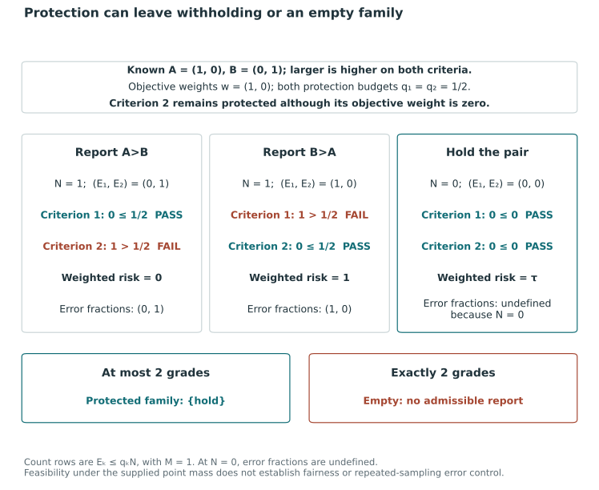
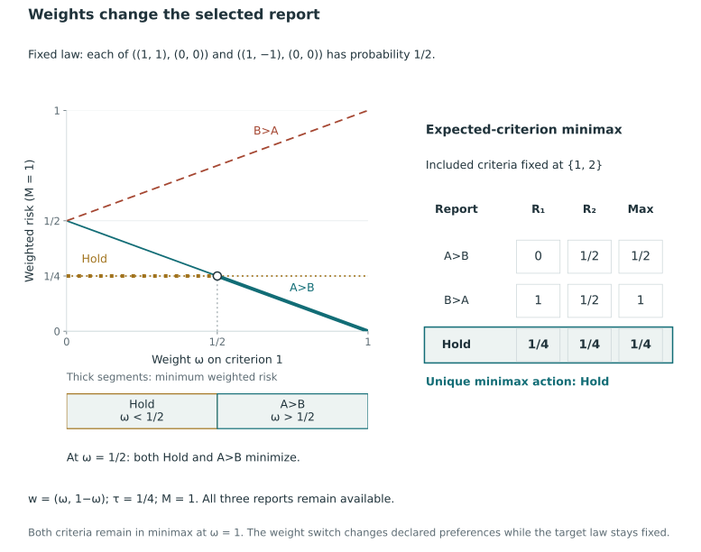

# Protections and preference sensitivity {#sec-protections-preferences}

## Criterion-specific expected-error protections {#sec-criterion-protections}

A weighted objective can accept greater error on one criterion in return for smaller errors on others. An institution can limit this tradeoff by constraining the expected error fraction for a specified criterion. The constraint excludes reports while retaining the objective used to compare those remaining. Increasing a loss weight would instead change their objective values.

Related constraints arise in Bayesian multiple comparisons and selective reporting. Müller, Parmigiani, and Rice express a posterior expected false fraction using a denominator fixed by the observed data, and BLiP constrains expected error homogeneously for disjoint signal-containing regions [@MullerParmigianiRice2006, working-paper p. 4, eq. 2; @SpectorJanson2025, p. 464, Proposition 3.1]. We apply the count calculation to coherent grades. Their action space, algorithms and optimization properties differ from those in these earlier methods.

### The protected feasible set

Fix observed information $Y=y$, $n\ge2$ units, $K\ge1$ oriented criteria, and one supplied joint selection law $\Pi_s(\cdot\mid y)$. Use a nonempty base domain $\mathcal A$ of canonical ordered partitions, with grade 1 highest. This domain incorporates the chosen grade-count and ordering restrictions and is held fixed throughout a comparison of budgets. Define $x_{ij}(g)=\mathbf1\{g_i<g_j\}$, $M=\binom n2$, and $N(g)=\sum_{i\ne j}x_{ij}(g)$ as before.

The criterion-$k$ wrong count and its selection expectation are

$$
D_k(g,\Theta)=\sum_{i\ne j}x_{ij}(g)
\mathbf1\{\theta_{ik}\le\theta_{jk}\},
\qquad
E^s_k(g\mid y)=\sum_{i\ne j}x_{ij}(g)e^s_{ij,k}(y),
$$

where $e^s_{ij,k}(y)=\Pi_s(\theta_{ik}\le\theta_{jk}\mid y)$. Equality remains an error for a disclosed strict direction. The expected-count formula is the result of @prp-weighted-directional-risk and requires no independence or tie-free assumption.

Choose a protected criterion set $\mathcal P\subseteq\{1,\ldots,K\}$ and budgets $q_k\in[0,1]$ for $k\in\mathcal P$. Define

$$
\mathcal A_q(y)=
\left\{g\in\mathcal A:
E^s_k(g\mid y)\le q_kN(g)
\text{ for every }k\in\mathcal P\right\}.
$$

Equivalently, each protected row is

$$
\sum_{i\ne j}x_{ij}(g)\{e^s_{ij,k}(y)-q_k\}\le0.
$$

Intersecting the protection constraints with the base domain retains coherence and any exact-count, cap or fixed-order restrictions. If no criteria are protected, the domain is unchanged. A criterion with $w_k=0$ can still be protected because the constraint rows are not multiplied by objective weights.

We retain $R^s_{w,\tau}(g\mid y)$ as the objective, fixing $w_k\ge0$, $\sum_k w_k=1$ and $0<\tau\le1/2$, and minimize it over $\mathcal A_q(y)$. Thus the procedure continues to minimize risk, rather than maximize disclosure. If the intersection is empty, the joint specification has no feasible report, irrespective of the numerical output.

### Fractions, empty disclosure, and tightening budgets

::: {#prp-criterion-protections}
### Count-form protections and nested feasible families {#count-form-protections}

For a fixed feasible action with $N(g)>0$,

$$
E^s_k(g\mid y)\le q_kN(g)
\quad\Longleftrightarrow\quad
\mathbb E_{\Pi_s}\!\left[
\frac{D_k(g,\Theta)}{N(g)}\mathrel{\Big|}y
\right]\le q_k.
$$

If $N(g)=0$, then $D_k=E^s_k=0$ and every homogeneous protection row holds, while $D_k/N$ and $E^s_k/N$ remain undefined. Thus the all-tie action guarantees nonemptiness of $\mathcal A_q(y)$ only when that action belongs to the base domain.

For the same protected set, base domain, information, probabilities, and objective, let $q'_k\le q_k$ for every protected criterion. Then $\mathcal A_{q'}(y)\subseteq\mathcal A_q(y)$. If the tightened set is nonempty, both minima exist and

$$
\min_{g\in\mathcal A_{q'}(y)}R^s_{w,\tau}(g\mid y)
\ge
\min_{g\in\mathcal A_q(y)}R^s_{w,\tau}(g\mid y).
$$
:::

**Proof.** For fixed $y$ and $g$, the positive denominator $N(g)$ is constant in the target expectation. Hence the expected fraction equals $E^s_k(g\mid y)/N(g)$, and multiplication by $N(g)>0$ gives the equivalence. If $N=0$, its sum of nonnegative disclosure indicators is zero, so every such indicator vanishes and every wrong count is identically zero. Each row becomes $0\le0$ without defining a fraction.

To show nesting, any action feasible under the tighter budgets satisfies $E^s_k\le q'_kN\le q_kN$, since $N\ge0$. It therefore satisfies every original row as well. The domains contain finitely many canonical reports, and risk is finite. If the smaller set is nonempty, both minima are attained; minimizing the same function over a subset cannot give a smaller value. $\square$

Although tighter budgets cannot lower the minimum of the fixed objective, the selected minimizer may change its disclosure count, grade count and unit labels because the objective trades error against withholding. If weights or withholding cost change together with $q$, the objective also changes and the comparison no longer isolates the effect of tightening budgets.

A budget of one is nonbinding because $E^s_k\le N$. At a budget of zero, nonnegativity of every term in $E^s_k$ permits only disclosures with zero error probability on that criterion. Intermediate budgets constrain the average over disclosed pairs, allowing an individual pair's error probability to exceed $q_k$ if the report's average remains within the budget.

### Exact feasibility under conflicting criteria {#one-exact-feasibility-example}

Consider two units and two criteria under a point-mass selection law:

$$
\Theta_A=(1,0),\qquad \Theta_B=(0,1).
$$

Both criteria are oriented larger-first, so their directions conflict without statistical uncertainty. Protect both criteria with $q_1=q_2=1/2$, and choose objective weights $w=(1,0)$. There are exactly three canonical reports, and $M=1$:

| Report | $N$ | $(E^s_1,E^s_2)$ | $(E^s_1/N,E^s_2/N)$ | Weighted risk | Satisfies both protections? |
|---|---:|---:|---:|---:|---|
| $A$ above $B$ | $1$ | $(0,1)$ | $(0,1)$ | $0$ | No |
| $B$ above $A$ | $1$ | $(1,0)$ | $(1,0)$ | $1$ | No |
| Withhold the pair | $0$ | $(0,0)$ | Undefined | $\tau$ | Yes |

Each disclosed direction is certainly wrong on one protected criterion, violating that row. Criterion 2 blocks the first action despite its zero objective weight. In the unrestricted domain, or an at-most-two-grade domain, the all-tie report is permitted and is the only protected feasible action. An exact-two-grade domain excludes it, leaving an empty protected feasible set. The same feasibility conclusion holds whenever both budgets are strictly below one.

The unprotected weighted optimum in this example has zero risk. With both protections imposed, the minimum is $\tau$ when ties are allowed; the requirement of exactly two grades makes the problem infeasible. Relaxing either a budget or the grade requirement would give a different specification, so infeasibility must be reported under the stated settings.

@fig-vis-f13a shows why the same protection rows have different feasibility consequences under different base families.

::: {#fig-vis-f13a}
<picture>
<source media="(max-width: 720px)" srcset="../assets/figures/f13a-protection-can-leave-withholding-or-an-empty-family-mobile.svg">

</picture>

Criterion-protection feasibility under alternative base action families. At known targets A=(1,0) and B=(0,1), both criteria have budget 1/2 although objective weights are (1,0). A>B and B>A each violate one protection. Withholding satisfies both count rows but leaves its disclosed-comparison rate undefined. It is the only protected action under at most two grades; exactly two grades excludes it and leaves the protected family empty. The zero objective weight of criterion 2 does not remove its protection.
:::

### Scope of conditional expected-error protection {#what-the-conditional-protection-guarantees}

For exact coefficients, the constraint bounds the expected fraction under the supplied selection law. The same conclusion holds under another evaluation law only with a suitable link between the laws. Equality to the true conditional target law suffices, but feasibility under $\Pi_s$ alone establishes no corresponding bound under $P$. Posterior, joint-model and fixed-parameter sampling errors refer to different averaging experiments [@BansalMiescke2013, p. 207, eqs. 6–8].

Even under the intended law, the constraint bounds an expectation. A positive budget need not bound the probability that the realized fraction exceeds $q_k$, ensure that every comparison is correct, or ensure agreement across criteria. Assessing social fairness, criterion validity and the choice of budget requires substantive definitions and evidence in addition to the error constraint.

A report satisfying a row based on $\widehat e^s_{ij,k}$ is feasible for those estimates. To establish feasibility for the exact supplied-law probabilities, coefficient error and numerical optimization error must also be controlled. BLiP similarly distinguishes the accuracy of input probabilities from that of optimization [@SpectorJanson2025, pp. 466, 470]. We develop the coefficient-error argument later.

The constraints apply to each action. Randomizing among complete protected-feasible reports, independently of the latent state conditional on $y$, preserves the bound for every positive-disclosure action and for their average conditional on positive disclosure, provided that event has positive probability. Silent outcomes still have undefined fractions. Using average disclosure indicators in a homogeneous row instead constrains a ratio of randomized expected counts. When disclosure varies, this differs from the average action-specific fraction and can offset infeasible actions with others. The distinction follows @sec-selection-abstention and provides no relaxed-variable or rounding guarantee.

## Preference sensitivity and expected-criterion minimax {#sec-expected-criterion-minimax}

Comparing reports across directional-loss weight vectors shows their sensitivity to the chosen tradeoffs among criterion errors. Such a comparison does not estimate stakeholder values. A model for uncertain preferences, a population distribution of preferences and a normative choice of error weights answer different questions [@lahdelma_salminen2001smaa2, pp. 445–446, 449–450].

Alternatively, we can minimize the largest criterion-specific expected loss over a specified set of criteria. This gives priority to the most unfavorable criterion expectation, but still requires choices of targets, comparable loss scales, included criteria and permissible reports.

### A fixed feasible domain and comparable criterion losses {#one-fixed-feasible-domain-and-comparable-losses}

Fix observed information $Y=y$, $n\ge2$ units, $K\ge1$ oriented targets, and a supplied joint selection law $\Pi_s(\cdot\mid y)$. Keep the grade-1-highest convention, $M=\binom n2$, $x_{ij}(g)=\mathbf1\{g_i<g_j\}$ and $N(g)=\sum_{i\ne j}x_{ij}(g)$. Criterion errors retain the weak event $\theta_{ik}\le\theta_{jk}$, including equality.

Let $\mathcal F$ be one nonempty finite domain of feasible canonical reports, held fixed when comparing objectives or weights. It may already include a cap, exact grade requirement, fixed order, or the criterion protections defined above. Use the same $0<\tau\le1/2$ and the same unit cost for a wrong direction on every criterion. Define

$$
L_k(g,\Theta)=\frac{D_k(g,\Theta)+\tau\{M-N(g)\}}M,
\qquad
R^s_k(g\mid y)=\frac{E^s_k(g\mid y)+\tau\{M-N(g)\}}M.
$$

These losses lie on the common $[0,1]$ scale. The preceding risk identity gives

$$
R^s_k(g\mid y)=\tau+\frac1M\sum_{i\ne j}x_{ij}(g)
\{e^s_{ij,k}(y)-\tau\}.
$$

For a fixed normalized nonnegative vector $w$, weighted risk is $R^s_{w,\tau}=\sum_k w_kR^s_k$. To examine sensitivity to $w$ alone, retain the supplied law, target definitions, withholding cost, and feasible domain. Changing these as well would give a combined comparison.

Choose a nonempty included set $\mathcal K_+\subseteq\{1,\ldots,K\}$ and define

$$
R^s_{\max}(g\mid y)=\max_{k\in\mathcal K_+}R^s_k(g\mid y),
\qquad
V^s_{\max}(y)=\min_{g\in\mathcal F}R^s_{\max}(g\mid y).
$$

The included set $\mathcal K_+$ may differ from the positive-weight support of a comparison vector $w$. In particular, a criterion with zero weight in the average can affect minimax if included. The following result also requires a common loss scale and withholding cost.

### Whole-report worst-case weights and the all-tie condition {#whole-report-worst-weights-and-the-all-tie-condition}

Let $\Delta_{\mathcal K_+}$ be the simplex of nonnegative vectors $v$ whose entries sum to one and are zero outside $\mathcal K_+$. For each fixed report,

$$
R^s_{\max}(g\mid y)
=\max_{v\in\Delta_{\mathcal K_+}}\sum_k v_kR^s_k(g\mid y).
$$

**Verification.** A convex combination of the finitely many criterion risks cannot exceed their maximum, which is attained by assigning all weight to a maximizing criterion. The same vector of weights applies to the entire report, rather than being chosen separately for each pair or latent state. This argument verifies the identity for a fixed report without exchanging minimization and maximization.

::: {#prp-minimax-withholding}
### A sufficient all-tie condition for expected-criterion minimax {#a-sufficient-all-tie-condition}

If the all-tie report belongs to $\mathcal F$, then $V^s_{\max}(y)\le\tau$. Under this all-tie feasibility assumption, suppose there is one fixed criterion $k_0\in\mathcal K_+$ such that

$$
e^s_{ij,k_0}(y)\ge\tau\qquad\text{for every }i\ne j.
$$

Then $V^s_{\max}(y)=\tau$, and all-tie is optimal. If all these inequalities are strict, all-tie is the unique canonical minimizer.
:::

**Proof.** All-tie has $D_k=N=0$ and $R^s_k=\tau$ for every criterion, giving the upper bound. Under the displayed assumption, every summand in the expression for $R^s_{k_0}-\tau$ is nonnegative. Hence $R^s_{\max}(g\mid y)\ge R^s_{k_0}(g\mid y)\ge\tau$ for every feasible action. This matches the all-tie upper bound. If the coefficients are all strictly positive, every other canonical report discloses at least one pair, so its $R^s_{k_0}$ and therefore its maximum criterion risk are strictly above $\tau$. $\square$

The same $k_0$ must meet the condition for every ordered pair. Allowing the unfavorable criterion to vary across pairs would require another argument. The condition is sufficient but need not be necessary. A feasible report with $R^s_k<\tau$ for every included criterion instead has maximum risk below $\tau$ and improves on all-tie, so minimax can favor disclosure.

The proof allows latent equality, under which forward and reverse error probabilities can fail to be complementary. Its condition therefore need not be equivalent to a two-sided interval ending at $1-\tau$. All-tie remains feasible under homogeneous protections whenever the base domain permits it, since each row becomes $0\le0$, although its displayed error fractions are undefined.

Requiring an exact grade count greater than one excludes all-tie and removes the upper bound $V^s_{\max}\le\tau$. Under the strict coefficient condition, every feasible report then has maximum risk above $\tau$. Finiteness gives a strictly larger attained minimum when the domain is nonempty. If the protections and base restrictions leave an empty set, no minimax report exists.

### The order of expectation and maximization

This objective is $\max_{k\in\mathcal K_+}\mathbb E_{\Pi_s}[L_k\mid y]$. It is generally different from $\mathbb E_{\Pi_s}[\max_{k\in\mathcal K_+}L_k\mid y]$. For each fixed report,

$$
\max_{k\in\mathcal K_+}\mathbb E_{\Pi_s}[L_k\mid y]
\le\mathbb E_{\Pi_s}[\max_{k\in\mathcal K_+}L_k\mid y],
$$

because each included realized loss $L_k$ is bounded by the realized maximum. The inequality can be strict: the expected realized maximum depends on how criterion losses occur together across states, whereas the maximum of expectations uses their separate risks. Maximizing the error criterion separately for each pair defines a further objective. We retain the whole-report maximum of criterion expectations here.

Here *robust* means worst-case performance over criterion weights for a fixed selection law. Robustness to statistical models, performance under an unknown evaluation law and a distribution of human preferences each require further assumptions.

### Exact comparison of weighted and expected-criterion minimax risk {#one-exact-comparison-as-weights-change}

Take two units and two criteria. Give each of the following target states probability $1/2$:

$$
(\Theta_A,\Theta_B)=((1,1),(0,0))
\quad\text{or}\quad
((1,-1),(0,0)).
$$

Criterion 1 certainly favors $A$; criterion 2 is equally uncertain about its direction. Let $\tau=1/4$, include both criteria in minimax, and use all three canonical reports. For weighted comparison, set $w=(\omega,1-\omega)$ with $0\le\omega\le1$.

| Report | $R^s_1$ | $R^s_2$ | Fixed-weight risk | Maximum criterion risk |
|---|---:|---:|---:|---:|
| $A$ above $B$ | $0$ | $1/2$ | $(1-\omega)/2$ | $1/2$ |
| $B$ above $A$ | $1$ | $1/2$ | $(1+\omega)/2$ | $1$ |
| Withhold | $1/4$ | $1/4$ | $1/4$ | $1/4$ |

Thus weighted risk uniquely selects withholding when $\omega<1/2$, ties withholding with $A>B$ at $\omega=1/2$, and uniquely selects $A>B$ when $\omega>1/2$. The reverse disclosure is never optimal in this three-action domain. Expected-criterion minimax uniquely withholds at every value of $\omega$ used in the weighted comparison: criterion 2 has both directional errors $1/2>\tau$ and remains included even at $\omega=1$.

Requiring exactly two grades removes withholding from this same family. The minimax optimum becomes $A>B$, with value $1/2$. A protection $q_2<1/2$ makes both remaining directions infeasible, and restoring all-tie would change the exact-grade problem. These calculations use a constructed family rather than a fitted application. In this example, taking the maximum before or after expectation gives the same value for each fixed action; the table compares weighted risk with expected-criterion minimax.

When criterion 1 receives sufficient weight, the weighted average accepts the larger expected error on criterion 2. Minimax instead assesses the largest included expectation. Reporting the criterion risks alongside disclosure makes the consequences of this preference choice explicit; solving the optimization does not normatively justify the weights or included set. @sec-computing-grades develops algorithms for the specified objective and feasible reports, with computational conclusions depending on their restrictions.

@fig-vis-f13b holds the law and reporting family fixed while comparing weighted and expected-criterion minimax objectives.

::: {#fig-vis-f13b}
<picture>
<source media="(max-width: 720px)" srcset="../assets/figures/f13b-weights-change-an-optimal-reporting-action-mobile.svg">

</picture>

For the fixed law, three-report family and tau=1/4, weighted risk selects withholding below omega=1/2 and A>B above it; both minimize at the crossing. The reverse direction never minimizes. Expected-criterion minimax compares both criterion risks and uniquely withholds, including at omega=1 when criterion 2 has zero weight in the separate weighted objective. The switch expresses a change in declared preferences, not a change in the data or target law.
:::

## Protections and preference choices under equality-neutral loss {#sec-tie-aware-protections}

The equality-neutral loss in @sec-tie-aware-loss does not determine a unique protection denominator. Let $E^{b,s}_k(g)=\sum_{i\ne j}x_{ij}(g)b^s_{ij,k}$ be expected strict errors and $Q^s_k(g)=\sum_{i\ne j}x_{ij}(g)d^s_{ij,k}$ expected distinct mass. Two possible inequalities are
$$
E^{b,s}_k(g)\le q_k N(g)
\quad\hbox{and}\quad
E^{b,s}_k(g)\le q_k Q^s_k(g).
$$
The first limits neutral error per issued comparison, including comparisons whose targets may be equal. The second limits the ratio of expected strict errors to expected distinct comparisons. Neither is a bound on a realized random fraction or a guarantee that all directions are correct. At a zero denominator the corresponding displayed rate is undefined, although its count inequality is $0\le0$. Neither inequality alone requires positive disclosure. The two denominators coincide on a tie-free law; they need not coincide otherwise.

The denominator is a policy choice, and neither protection is implemented by the current tie-aware API in @sec-package-tie-aware. The consolidation proof in @prp-tie-aware-guard preserves the weighted objective on its specified at-most-grade family. It does not show that moving a class preserves either set of criterion-specific protection inequalities.

A weight crossing zero can change the guard as well as the objective. The active set $\{k:w_k>0\}$ determines full active-profile equality, so removing a criterion may merge equivalence classes. To isolate the effect on the objective, the common family and its equality constraints must be retained. Allowing the guard to change compares both effects.

An extension to expected-criterion minimax must specify its losses and denominators. Under equality neutrality, the baseline $R_{0,k}=\tau T^s_k/M$, where $T^s_k=\sum_{i<j}d^s_{ij,k}$, may differ across criteria. Subtracting these constants before taking the maximum can therefore alter the objective and its minimizers. The earlier minimax and exact-grade results, weighted consolidation proof and available software do not resolve this extension.