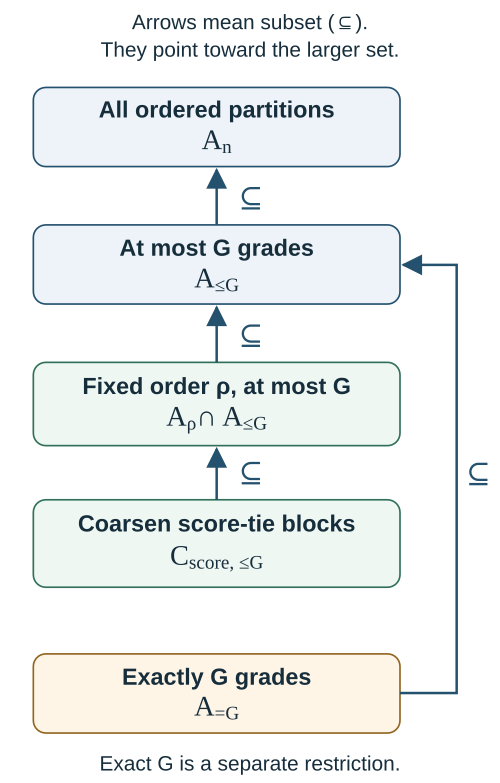

# Computing grades {#sec-computing-grades}

To compute a grade report, we minimize expected loss over the permitted actions using the supplied comparison probabilities. The search must account for coherence: individually preferred pair decisions may be incompatible with a grade system, and fixing a convenient score order may exclude reports with lower risk.

The computational conclusions depend on how actions are represented, which family the algorithm searches and which bounds accompany its solution. An exact representation can be expensive to optimize. A dynamic program may solve a restricted family exactly, while a feasible result from another search may lack a global certificate.

We hold the observed information and comparison coefficients fixed and use the normalized risk in @sec-multicriteria-loss. Neither the representation nor the solver validates the supplied probability law. @sec-numerical-uncertainty considers coefficient approximation and Monte Carlo error, while @sec-package-correspondence documents the input routes and modes supported by the inspected software version.

## Unrestricted optimization over coherent grades {#sec-ordered-partition-formulation}

Directional risk is a sum of pair contributions, but the report imposes joint constraints: shared grades form an equivalence relation, and the grades have one ordering. A computational representation must enforce this structure and preserve the linear objective.

Canonical grade vectors, ordered partitions and total preorders represent the same actions (@sec-grade-actions). We use the established binary precedence-or-tie encoding [@aledo2026weakordersv2, p. 4, eq. (1)] to formulate unrestricted risk minimization and prove the equivalence below. The encoding is independent of the software backend and fixes neither a grade count nor an ordering statistic.

### Binary encoding of a weak reporting relation {#binary-entries-represent-a-weak-reporting-relation}

Fix $n\ge2$ labelled units $U=[n]$. Let $\mathcal A_n$ contain every canonical grade vector, with nonempty grades numbered from 1, the highest, through $G(g)\le n$. Introduce binary entries

$$
z_{ij}=\mathbf1\{g_i\le g_j\},\qquad i,j\in U.
$$

Here $z_{ij}=1$ reports $i$ at least as high as $j$. This is a weak reporting relation, distinct from a strict-disclosure indicator or latent target value. A tie has $z_{ij}=z_{ji}=1$; imposing antisymmetry on distinct units would remove ties from the action space.

Define the feasible binary matrices $\mathcal Z_n$ by

$$
\begin{aligned}
z_{ij}&\in\{0,1\} &&(i,j\in U),\\
z_{ii}&=1 &&(i\in U),\\
z_{ij}+z_{ji}&\ge1 &&(i<j),\\
z_{ij}+z_{j\ell}-z_{i\ell}&\le1
 &&(i,j,\ell\text{ pairwise distinct}).
\end{aligned}
$$

Completeness is imposed once per unordered pair, with $i<j$ avoiding duplicate rows rather than prescribing a direction. Transitivity must be imposed for every ordered triple of pairwise distinct indices; increasing triples alone omit required implications. For binary entries, $z_{ij}=z_{j\ell}=1$ forces $z_{i\ell}$ to be one, and otherwise the corresponding inequality is satisfied automatically.

Repeated indices need no extra transitivity constraints. If $i=j$ or $j=\ell$, the left side equals one. If $i=\ell$, it is $z_{ij}+z_{ji}-1\le1$. The diagonal and binary bounds therefore supply all repeated-index cases. This also explains the $n=2$ boundary: there are no distinct triples, and the pair conditions alone permit exactly the two strict reports and one tie.

Strict disclosure is recovered by the affine expression

$$
x_{ij}(z)=1-z_{ji},\qquad i\ne j.
$$

Completeness leaves exactly three possibilities:

| $(z_{ij},z_{ji})$ | Reported comparison | $(x_{ij},x_{ji})$ |
|---|---|---|
| $(1,0)$ | $i$ above $j$ | $(1,0)$ |
| $(0,1)$ | $j$ above $i$ | $(0,1)$ |
| $(1,1)$ | Common grade | $(0,0)$ |

Completeness prohibits $(0,0)$. A common grade withholds both strict directions without asserting equality of latent targets. Each $x$ is determined by $z$, so the pair decisions have no further freedom.

### Equivalence of feasible encodings and grade actions {#why-feasibility-is-exactly-a-grade-action}

::: {#prp-total-preorder-formulation}
### Exact unrestricted total-preorder representation {#exact-unrestricted-representation}

The map $g\mapsto z(g)$ is a bijection between $\mathcal A_n$ and $\mathcal Z_n$. Under that correspondence, $x_{ij}(z)=\mathbf1\{g_i<g_j\}$, and, with $M=\binom n2$,

$$
\begin{aligned}
N(z)&=\sum_{i\ne j}(1-z_{ji})
=\sum_{i<j}(2-z_{ij}-z_{ji}),\\
M-N(z)&=\sum_{i<j}(z_{ij}+z_{ji}-1).
\end{aligned}
$$

Consequently $N$ counts disclosed unordered pairs and $M-N$ counts within-grade pairs.
:::

**Proof.** A canonical vector gives a reflexive complete relation because numeric weak order has those properties. If $g_i\le g_j\le g_\ell$, then $g_i\le g_\ell$, proving every transitivity implication and hence every displayed row. Thus the forward map takes each action to a feasible matrix.

Conversely, let $z\in\mathcal Z_n$ and write $i\mathcal Rj$ when $z_{ij}=1$. The constraints and repeated-index argument make $\mathcal R$ reflexive, complete and transitive. Define $i\sim j$ when both directions hold. Reflexivity and symmetry are immediate; if $i\sim j$ and $j\sim\ell$, transitivity in both directions gives $i\sim\ell$. Therefore $\sim$ partitions the units into equivalence classes.

The induced relation on these classes is well-defined. Replacing $i$ by an equivalent $i'$ and $j$ by an equivalent $j'$ preserves $i\mathcal Rj$, since $i'\mathcal Ri\mathcal Rj\mathcal Rj'$ implies $i'\mathcal Rj'$. Completeness compares all classes, and comparisons in both directions identify the same class. The quotient is a finite total order. List its classes from highest to lowest and assign their positions as canonical grade numbers. This unique vector reproduces $z$, so the two constructions are inverse.

The three pair patterns above now give the disclosure formula. Their contributions $2-z_{ij}-z_{ji}$ are one for a strict report and zero for a tie; the complementary contributions $z_{ij}+z_{ji}-1$ are zero and one. Summing over unordered pairs proves both count identities. $\square$

Grade numbers give the positions of the ordered classes, whose sizes may differ. They do not count the units preceding a given unit. Numbering the classes consecutively gives the unique canonical action without skipped labels.

### The exact risk objective

Fix observed information $Y=y$, $K\ge1$ oriented criteria, and a proper supplied joint law $\Pi_s(\cdot\mid y)$ for their latent targets. Hold the loss settings fixed at that information: $w_k\ge0$, $\sum_kw_k=1$, and $0<\tau\le1/2$. Define

$$
e^s_{ij,k}(y)=\Pi_s(\theta_{ik}\le\theta_{jk}\mid y),\qquad
\bar e^s_{ij}(y)=\sum_k w_ke^s_{ij,k}(y).
$$

Changing the action representation leaves the weak-error event, including latent equality, unchanged. The calculation permits dependence and zero weights. Data-dependent settings use the same realized targets and loss at $y$.

Substituting the disclosure expressions into @prp-weighted-directional-risk gives the binary problem

$$
\min_{z\in\mathcal Z_n}
\left[\tau+\frac1M\sum_{i\ne j}(1-z_{ji})
\{\bar e^s_{ij}(y)-\tau\}\right].
$$

Its objective is affine in the binary entries. An equivalent expression for its value is

$$
\frac1M\left[
\sum_{i\ne j}(1-z_{ji})\bar e^s_{ij}(y)
+\tau\sum_{i<j}(z_{ij}+z_{ji}-1)
\right].
$$

The first term is the expected weighted wrong count; the second charges withholding once for each within-grade unordered pair. There is no extra factor of two despite the ordered-index notation in the first sum.

For corresponding $g$ and $z$, the objective is $R^s_{w,\tau}(g\mid y)$, so the bijection preserves the minimum and the full minimizing set. The all-ones matrix represents all-tie and ensures that the finite domains are nonempty. A minimum is attained, although a further rule is needed to select among multiple minimizers.

The constant $\tau$ and positive multiplier $1/M$ can be omitted during minimization and restored when reporting expected loss. The unnormalized sum is not itself a probability or error fraction. Arbitrary numerical coefficients define a binary objective, but its interpretation as supplied-law risk requires coefficients derived from the stipulated joint law. Reporting constraints alone cannot establish that interpretation.

### Three-unit illustration of coherence constraints {#a-three-unit-coherence-illustration}

For units $(A,B,C)$, the action $g=(1,1,2)$ has relation matrix

$$
z=\begin{pmatrix}
1&1&1\\
1&1&1\\
0&0&1
\end{pmatrix}.
$$

The first grade contains $A,B$ and the second contains $C$. Only $A>C$ and $B>C$ are disclosed, so $N=2$, $M=3$, and the risk is $(\bar e^s_{AC}+\bar e^s_{BC}+\tau)/3$.

A relation that retains $A>C$ while tying $A$ with $B$ and $B$ with $C$ would instead have matrix

$$
\widetilde z=\begin{pmatrix}
1&1&1\\
1&1&1\\
0&1&1
\end{pmatrix}.
$$

Each pair separately has an allowed pattern, and all diagonal and completeness rows hold. Nevertheless, the ordered triple $(C,B,A)$ violates transitivity:

$$
\widetilde z_{CB}+\widetilde z_{BA}-\widetilde z_{CA}
=1+1-0=2>1.
$$

The two ties place all three units in one grade and thus contradict the strict disclosure. This example demonstrates the coherence restriction directly, without empirical data, fitted probabilities or a numerical solver.

### Scope of the unrestricted formulation {#what-the-formulation-establishes}

The baseline permits all ordered partitions, with grade counts from one to $n$. A cap, an exact count, or a fixed order restricts that domain. Their solutions minimize the same risk over their respective families, which can differ from the unrestricted minimizing set.

Criterion protections can be added as linear rows $\sum_{i\ne j}(1-z_{ji})(e^s_{ij,k}-q_k)\le0$. They restrict the feasible set beyond the unrestricted proposition. At zero disclosure, they retain their homogeneous count interpretation and leave the displayed error fraction undefined.

The proposition identifies the coherent grade reports and their directional risks for the given target, law and normalization. A production solver must still find and certify a solution under its numerical conventions. Termination, tolerances, runtime, metric approximation properties and the adequacy of a single score order each require additional evidence.

## Relation to rank aggregation {#sec-computation-rank-aggregation}

KRW's scalar grading problem already combines posterior pair probabilities, directional and equality indicators, and transitivity restrictions in an integer optimization [@kline_discrimination_2024, p. 2480, equations (2)–(5)]. We reconstruct a relational encoding for the multicriteria risk, retaining coherent joint optimization while specifying the present orientation, equality convention, and action domain. The scalar correspondence in @sec-krw-foundation applies under its law, normalization, and target-tie conditions.

A total preorder represents an ordered partition, or bucket order, of a common unit set. This is the class used by Fagin and colleagues for ranking distances with ties and for aggregation [@fagin2004ties_author; @fagin2006partial, sec. 2]. We encode that established structure for the present objective; the formulation is neither a new weak-order optimization nor a reproduction of a particular software engine.

The objective-level connection requires additional assumptions. If the criterion-induced latent rankings are full almost surely under the supplied law, the identity in @sec-weak-orders-aggregation expresses the report's loss as a weighted generalized-Kendall disagreement, normalized by $M$. Its expectation therefore has the form of an expected aggregation objective. A finite sample of latent full rankings can supply a finite approximation to that expectation, but the sample has the role of representing a specified uncertainty law. It need not be a collection of independent voters, expert judgments or institutional preferences.

With positive-probability latent criterion ties, weak-error loss differs from generalized Kendall's strict-versus-tied penalty. The linear formulation still evaluates the declared error events, but an identification of the losses would require another argument or a change of loss. Similarly, a theorem for unrestricted full outputs must be re-examined before applying it to tied reports, exact grade counts, protections or a contiguous family based on one preselected order.

An aggregation approximation factor is specific to its input class, objective, and comparison set. For example, Fagin and colleagues distinguish coordinatewise median ranks from a valid ranking and the projection problem from the original aggregation problem [@fagin2004ties_author, sec. 6 and Appendix A.6]. Sorting expected ranks and choosing grade cuts performs a different calculation, whose optimality requires its own result. We derive the fixed-order problem below.

We use multiclass rank aggregation as computational context. Li and Milenkovic consider classes of input rankings and choose an aggregate that minimizes the largest weighted distance to a class. Their mean-distance version averages distances to the rankings within each class; a separate version measures distance to its nearest member. For strict permutation inputs, their formulation uses empirical pair frequencies as coefficients, binary orientation variables, and triangle restrictions to enforce a coherent strict output order [@li_milenkovic2017v1, pp. 1–3, Definitions II.1–II.2 and equation (4)].

Both formulations use the established combination of pairwise costs and joint ordering constraints, but their inputs and objectives differ. Their pair frequencies describe ranking profiles; our coefficients describe directional errors under a declared selection belief. Our baseline averages criterion errors with fixed weights and permits withholding in grade reports. These features require more than a change of coefficient names in the strict-permutation formulation. Although the same work discusses partial-ranking extensions, we do not adopt its approximation results for this loss or constrained grade families. Matching its class maximum to our optional expected-criterion minimax objective would likewise require the same distance, probability law and feasible reports. The comparison gives no guarantee about computational complexity or numerical optimality.

### Constrained and multiple-output weak-order methods {#sec-current-weak-order-optimization}

@aledo2026weakordersv2 use binary precedence-or-tie variables with the same completeness and transitivity inequalities as the off-diagonal $z$ entries above. They leave the aggregation objective general, credit earlier formulations, and then specialize the model to the Optimal Bucket Order Problem (OBOP) [@aledo2026weakordersv2, pp. 4–6, equation (1), Proposition 1 and equations (2)–(5)]. The correspondence concerns the mathematical reporting domain: with consistent orientation, their precedence-or-tie variable is this chapter's $z_{ij}$, whereas this chapter's $x_{ij}$ denotes **strict** disclosure. These symbols denote different reporting relations and must be read by their definitions. The explicit representation above reconstructs the established encoding for P1's loss; it is not a new weak-order encoding.

For OBOP, the input is a complementary pair-order matrix $C$, with $C_{ii}=1/2$ and $C_{ij}+C_{ji}=1$. A bucket report has matrix $B$ whose entries are $1$, $1/2$, or $0$, according to strict precedence, a tie, or reverse precedence. Its fit is the full-matrix distance

$$
D(B,C)=\sum_{i,j}|B_{ij}-C_{ij}|.
$$

The affine map from precedence-or-tie variables to $B$ permits absolute-deviation linearization. It recovers the matrix-fitting objective considered for Kenkre and colleagues in @sec-close-cross-field-alternatives. That objective differs from posterior directional-error loss.

The distinction can be seen without importing an algorithmic theorem. Under a matched orientation and a scalar selection law with zero probability of target equality, let $p$ be the probability that $i$ exceeds $j$. Put $C_{ij}=p$. After dividing the two-entry matrix contribution by two, the costs of placing $i$ above $j$, reversing them, or tying them are

$$
1-p,\qquad p,\qquad |p-1/2|.
$$

P1 assigns the corresponding costs $1-p,p,\tau$, as shown in @sec-close-cross-field-alternatives. A matrix entry near $1/2$ makes a tie inexpensive under matrix fitting, whereas P1 uses the specified withholding cost. Positive latent-equality probability also changes the comparison: because P1 counts equality as directional error, its two error probabilities need not be complementary. Matching the action domain therefore leaves the objective, orientation and equality assumptions to be checked. The difference from OBOP does not, however, by itself imply that P1's objective lies outside the source's general optimization framework.

Aledo and colleagues also formulate restrictions on bucket counts and sizes, a top portion with a collapsed final bucket, and group-representation bounds over cumulative bucket prefixes [@aledo2026weakordersv2, pp. 7–15, secs. 4.1–4.3]. Their proportional bounds use explicit integer rounding. Such restrictions have a substantive interpretation: a prescribed category capacity or representation requirement changes the admissible reports. They should not be mistaken for evidence about latent equality or for a posterior error guarantee. For P1, introducing one of them would require a stated reporting purpose and an explicit feasible family. The fixed-order segmentation result below remains conditional on its declared order; it does not solve every constrained weak-order problem merely because both descriptions involve buckets.

A second nearby development changes the output itself. @aledo2025consensussetv1 define the Optimal Set of Bucket Orders Problem (OSBOP). Given $C$ and a chosen number $b$ of component reports, their action consists of distinct bucket matrices $B_1,\ldots,B_b$ and nonnegative weights summing to one. Relabeling those weights $\alpha_\ell$ to distinguish them from P1's criterion weights, their objective is

$$
D\!\left(\sum_{\ell=1}^{b}\alpha_\ell B_\ell,C\right).
$$

The paper also considers equal component weights [@aledo2025consensussetv1, pp. 6–8, equation (1), Definition 3.1 and equations (2)–(3)]. Its stochastic search explores component orders and, when permitted, tunes their weights; the authors explicitly qualify the optimality of the reported search results [@aledo2025consensussetv1, pp. 15–18 and 23].

OSBOP returns a weighted set of reports, while P1 returns one common report. Its objective also differs from the average loss of a randomized report, since the matrices are averaged before absolute deviations are calculated. The fitted component weights serve a different purpose from P1's fixed criterion weights, and the matrix mixture is distinct from the latent-state mixture in @prp-criterion-mixture. Representing diverse preferences through multiple reports may be useful, but requires an evaluation suited to that purpose.

A fitted set of orderings has no confidence-set or posterior-coverage interpretation solely because it contains several outputs (@sec-uncertainty-ordering). Likewise, an exact formulation does not establish model calibration, numerical attainment of an optimum or the error control in @sec-selection-abstention. A comparison with P1 must specify common input information, loss, feasible family and numerical certificates.

## Exact segmentation of a declared order {#sec-fixed-order-dp}

Fixing the unit order leaves the boundaries between consecutive positions to be chosen. Different boundaries give different grade counts, sizes, disclosures, and risks. For the additive weighted objective, a dynamic program solves this segmentation problem using prefix length and number of nonempty blocks as its state.

The permutation is supplied as an input, and the algorithm optimizes over all its contiguous partitions as defined in @prp-contiguous-grade-counts. It does not search other permutations. Whether an expected-rank, composite or other score supplies an optimal order must therefore be established separately.

### Fixed-order inputs and interval block savings {#the-fixed-inputs-and-the-cost-of-a-block}

Fix $n\ge2$ units, $K\ge1$ oriented criteria, observed information $Y=y$, and the supplied joint law $\Pi_s(\cdot\mid y)$. Let the directional-error weights be nonnegative and sum to one, and let $0<\tau\le1/2$. All target definitions, weights and loss settings are held fixed in this conditional calculation. The same supplied weak-error coefficients are used throughout:

$$
e^s_{ij,k}(y)=\Pi_s(\theta_{ik}\le\theta_{jk}\mid y),
\qquad \bar e^s_{ij}(y)=\sum_kw_ke^s_{ij,k}(y).
$$

The inequality includes latent equality. Neither tie-freeness nor independence is needed for the recurrence; its probabilistic input is the previously derived additive-risk representation.

Let $\rho=(\rho_1,\ldots,\rho_n)$ be a permutation from highest to lowest reported priority. The order can have been chosen using $y$, but it remains fixed during segmentation. Every permitted action is described by a strictly increasing sequence of cuts

$$
0=c_0<c_1<\cdots<c_h=n.
$$

Block $r$ contains $\rho_{c_{r-1}+1},\ldots,\rho_{c_r}$ and receives grade $r$. Blocks are nonempty and labels are canonical. Conversely every report in $\mathcal A_\rho$ gives exactly one such cut sequence. At this stage every adjacent gap is an available cut location, including gaps between units whose ordering scores might coincide. A policy forcing score-tied units into one block would impose a further restriction and must be declared separately.

Write, for positional indices $s<t$,

$$
\eta_{st}=\bar e^s_{\rho_s\rho_t}(y)-\tau,
\qquad T_\rho=\sum_{1\le s<t\le n}\eta_{st},
$$

and define the saving from withholding every internal comparison in an interval by

$$
W(a,b)=\sum_{a<s<t\le b}\eta_{st},\qquad 0\le a<b\le n.
$$

Set $W(a,a)=0$; a singleton contains no internal pairs and hence saves zero. A block's saving is relative to disclosing its internal comparisons, so $W$ can be negative.

The all-singleton report discloses all forward pairs of $\rho$ and has risk $\tau+T_\rho/M$, where $M=\binom n2$. Combining adjacent positions into a grade withholds precisely that block's internal comparisons. All remaining forward pairs are still disclosed. Therefore

$$
R^s_{w,\tau}(g\mid y)
=\tau+\frac1M\left[T_\rho-
\sum_{r=1}^hW(c_{r-1},c_r)\right].
$$

This follows by partitioning the forward pairs in @prp-weighted-directional-risk into within-block and cross-block pairs. The constant and normalization continue to refer to all $n$ units. Prefix values in the recursion accumulate block savings, not normalized risks for smaller populations.

### Segmentation recurrence and boundary states {#a-recurrence-with-all-boundary-states-specified}

::: {#prp-fixed-order-dynamic-program}
### Exact weighted-risk segmentation

Let $V_h(c)$ be the maximum total block saving among partitions of positions $1,\ldots,c$ into exactly $h$ nonempty contiguous blocks. For nonnegative integer states with $0\le c\le n$, initialize

$$
\begin{aligned}
V_0(0)&=0,\\
V_0(c)&=-\infty &&(1\le c\le n),\\
V_h(c)&=-\infty &&(h>c\ge0).
\end{aligned}
$$

For $1\le h\le c\le n$, use

$$
V_h(c)=\max_{h-1\le b<c}
\{V_{h-1}(b)+W(b,c)\}.
$$

A $-\infty$ candidate remains infeasible after adding a finite block saving. In particular $V_1(c)=W(0,c)$.

For an exact count $1\le G_0\le n$,

$$
\min_{g\in\mathcal A_{\rho,=G_0}}R^s_{w,\tau}(g\mid y)
=\tau+\frac{T_\rho-V_{G_0}(n)}M.
$$

For an integer cap $G_{\max}\ge1$, put $H=\min(n,G_{\max})$. Then

$$
\min_{g\in\mathcal A_{\rho,\le G_{\max}}}R^s_{w,\tau}(g\mid y)
=\tau+\frac{T_\rho-\max_{1\le h\le H}V_h(n)}M.
$$
:::

**Proof.** The empty prefix admits the empty partition, with no blocks and saving zero. A positive prefix cannot have zero nonempty blocks, and a prefix of length $c$ cannot contain more than $c$ such blocks. These observations justify the initialization; the empty partition is an auxiliary state, not a report on the full population.

Every feasible $h$-block partition of a positive prefix of length $c$ has a unique last block $(b,c]$. Its earlier $h-1$ blocks occupy the first $b$ positions, so $h-1\le b<c$. Their total saving cannot exceed $V_{h-1}(b)$. Adding the last block's saving bounds the partition's value by the corresponding candidate in the recurrence.

Conversely, any finite candidate combines an attaining prefix partition with the nonempty interval $(b,c]$. The concatenation is feasible and has exactly that candidate's saving. Induction on the block count establishes that the maximum equals $V_h(c)$. The risk identity turns maximum saving into minimum risk. For a cap, the feasible family is the union of the disjoint exact-count families for $1\le h\le H$; taking their best value gives the final expression. $\square$

An exact grade count outside the integer range $1,\ldots,n$, or a cap below one, gives an empty family. A cap above $n$ is redundant, and grade counts are integer-valued. At exact count one, $V_1(n)=W(0,n)=T_\rho$ gives all-tie risk $\tau$. At exact count $n$, singleton blocks give $V_n(n)=0$. Either endpoint can fail to minimize the capped objective.

### Quadratic-time calculation of every block saving {#computing-every-block-saving-in-quadratic-time}

The table of $W(a,b)$ can be constructed in $O(n^2)$ arithmetic operations by reusing interval sums. For each right endpoint $b$, form the column-prefix sums

$$
P_b(0)=0,\qquad
P_b(t)=P_b(t-1)+\eta_{tb},\quad 1\le t<b.
$$

The new internal pairs when extending $(a,b-1]$ to $(a,b]$ all end at position $b$. Their sum is $P_b(b-1)-P_b(a)$, giving

$$
W(a,b)=W(a,b-1)+P_b(b-1)-P_b(a),
\qquad 0\le a<b\le n.
$$

Use $W(a,a)=0$ and process endpoints in increasing order. At endpoint $b$, the prefix column takes at most $b-1$ additions, and there are $b$ interval updates, each with a constant number of arithmetic operations. Summing these costs over $b=1,\ldots,n$ gives a quadratic bound. The triangular interval table also has quadratic size. One temporary prefix column suffices, and the all-singleton constant is already available as $T_\rho=W(0,n)$.

After this preprocessing, each candidate in the recurrence uses a table lookup, addition and comparison. With $H$ block-count levels there are at most $Hn$ states and at most $n$ candidate predecessors per state. Computing the values and recovering one optimum therefore require $O(Hn^2)$ arithmetic operations in total, including preprocessing, and $O(n^2+Hn)$ stored numbers and indices when one predecessor is retained per state. For a valid exact count, take $H=G_0$; for a cap use the truncated value defined above.

The operation counts assume that weighted pair coefficients and an order are already available. Aggregating criterion arrays adds $O(Kn^2)$ arithmetic operations if needed; probability calculation and order selection are excluded. The bounds use exact real arithmetic and comparisons. Rational bit complexity depends on operand lengths, and floating-point comparisons require numerical qualifications, so these counts bound neither those costs nor elapsed runtime.

### Report recovery and multiple optima {#recovering-reports-and-handling-multiple-optima}

For an exact count, start at $(G_0,n)$ and follow a maximizing predecessor $b$ to $(G_0-1,b)$. The removed interval is the last block. Continue until $(0,0)$, then number the recovered blocks from highest to lowest. For a cap, first select a maximizing terminal block count. Following one predecessor at each step takes at most $H$ steps; assigning grades to the $n$ units takes linear additional work.

Every minimizing report follows maximizing predecessors. Otherwise one could replace a suboptimal prefix by a better partition of the same prefix with the same number of blocks, leave its last block unchanged, and improve the total saving. Conversely, any sequence of maximizing predecessors from an optimal terminal state constructs an optimum. This characterizes the entire minimizing set, including ties between different terminal counts under a cap.

Keeping one predecessor per state returns one optimum. Choosing the smaller grade count when terminal values tie is a further selection rule. All optimal paths can be recovered by revisiting tied choices, but their number may be exponential in $n$. Their enumeration is outside the time bound, and storing all predecessors may exceed the memory bound. Treating nearly equal numerical values as ties also requires a convention beyond the exact recurrence.

### Exact four-unit segmentation example {#sec-fixed-order-dp-example}

Consider the fixed order $A,B,C,D$, two criteria with weights $(3/5,2/5)$, and $\tau=1/4$. The following two-state joint belief specifies both criterion rankings together. Each string lists units from highest to lowest target value. Assigning values $4,3,2,1$ along each string gives an explicit target array in each state; no criterion has latent ties.

| State probability | Criterion 1 | Criterion 2 |
|---:|:---:|:---:|
| $3/4$ | $ABCD$ | $ACBD$ |
| $1/4$ | $BACD$ | $DCBA$ |

This is an illustrative construction. Under this law, the forward-direction error probabilities and signed pair contributions are:

| Direction | Criterion 1 error | Criterion 2 error | Weighted error $\bar e^s_{ij}$ | $\eta_{ij}=\bar e^s_{ij}-\tau$ |
|---|---:|---:|---:|---:|
| $A>B$ | $1/4$ | $1/4$ | $1/4$ | $0$ |
| $A>C$ | $0$ | $1/4$ | $1/10$ | $-3/20$ |
| $A>D$ | $0$ | $1/4$ | $1/10$ | $-3/20$ |
| $B>C$ | $0$ | $1$ | $2/5$ | $3/20$ |
| $B>D$ | $0$ | $1/4$ | $1/10$ | $-3/20$ |
| $C>D$ | $0$ | $1/4$ | $1/10$ | $-3/20$ |

The full-disclosure report has unnormalized expected error $21/20$ and risk $7/40$. The ten interval savings $W(a,b)=\sum_{a<i<j\le b}\eta_{ij}$ use cut boundaries, so the interval contains positions $a+1,\ldots,b$. Their values are fully specified by

$$
\begin{array}{c|rrrrrrrrrr}
\text{interval}&A&B&C&D&AB&BC&CD&ABC&BCD&ABCD\\
\hline
W&0&0&0&0&0&3/20&-3/20&0&-3/20&-9/20.
\end{array}
$$

A positive saving reduces risk when that interval is made a grade; a negative saving increases risk. These signs are retained in the recurrence. In particular, a negative interval cannot be discarded if an exact grade count requires its use: at $G=1$, the only block is $ABCD$.

There are $2^3=8$ contiguous partitions. The table reports each one, with $E_w=\sum_k w_k\mathbb E_s D_k$, unnormalized withholding cost $C_{\mathrm{hold}}=\tau(M-N)$, and $M=6$. Its risk can be obtained either as $(E_w+C_{\mathrm{hold}})/6$ or as $7/40-\sum W/6$.

| Report | $N$ | $E_w$ | $C_{\mathrm{hold}}$ | $\sum W$ | Risk |
|---|---:|---:|---:|---:|---:|
| $ABCD$ | $0$ | $0$ | $3/2$ | $-9/20$ | $1/4$ |
| $ABC\mid D$ | $3$ | $3/10$ | $3/4$ | $0$ | $7/40$ |
| $AB\mid CD$ | $4$ | $7/10$ | $1/2$ | $-3/20$ | $1/5$ |
| $A\mid BCD$ | $3$ | $9/20$ | $3/4$ | $-3/20$ | $1/5$ |
| $AB\mid C\mid D$ | $5$ | $4/5$ | $1/4$ | $0$ | $7/40$ |
| $A\mid BC\mid D$ | $5$ | $13/20$ | $1/4$ | $3/20$ | $3/20$ |
| $A\mid B\mid CD$ | $5$ | $19/20$ | $1/4$ | $-3/20$ | $1/5$ |
| $A\mid B\mid C\mid D$ | $6$ | $21/20$ | $0$ | $0$ | $7/40$ |

Exact rational evaluation of the recurrence agrees with enumeration, including its optimal cuts, for every prefix and grade count. For all four units, the distinction between exact counts and upper bounds is visible directly:

| $G$ | Best report with exactly $G$ grades | Exact-$G$ risk | Best report with at most $G$ grades | At-most-$G$ risk |
|---:|---|---:|---|---:|
| $1$ | $ABCD$ | $1/4$ | $ABCD$ | $1/4$ |
| $2$ | $ABC\mid D$ | $7/40$ | $ABC\mid D$ | $7/40$ |
| $3$ | $A\mid BC\mid D$ | $3/20$ | $A\mid BC\mid D$ | $3/20$ |
| $4$ | $A\mid B\mid C\mid D$ | $7/40$ | $A\mid BC\mid D$ | $3/20$ |

Each listed constrained optimum is unique. Exactly four grades force disclosure of $B>C$, whose error probability is $2/5$, rather than withholding at cost $1/4$. Increasing an exact grade requirement can therefore increase risk, while increasing a cap can retain the three-grade optimum. The checks verify the fixed-order additive problem; they do not assess unrestricted ordering, criterion protections or solver performance.

@fig-vis-f14b links the signed interval savings to prefix states and backtracking in this fixed order. The final normalization and exact-count comparison use the full four-unit problem; the guard strip is a separate symbolic extension.

::: {#fig-vis-f14b}
<picture>
<source media="(max-width: 720px)" srcset="../assets/figures/fixed-order-segmentation-mobile.svg">

</picture>

Dynamic programming for grade boundaries within the fixed order A,B,C,D. The triangle shows signed, unnormalized interval savings $W(a,b)$ for positions $a+1$ through $b$; prefix values $V_h(c)$ maximize their sum over $h$ nonempty blocks. Infeasible prefix states are marked $-\infty$. The recovered cuts $0,1,3,4$ give $A\mid BC\mid D$ and $g=(1,2,2,3)$. Its saving $3/20$ reduces the singleton risk by $(3/20)/6=1/40$, giving risk $3/20$. Exactly four grades instead force risk $7/40$; a cap of four retains the three-grade optimum. These results concern the declared order and weak-error loss. The separate symbolic guard strip qualifies a different equality-neutral problem: cuts cannot split a full active-profile equality class. The guard is not applied to this tie-free numerical example, and the strip makes no claim of implemented package DP support.
:::

### Limits of the scalar prefix state

For this objective, a scalar block saving contains all the information needed from a completed block. Criterion protections additionally depend on criterion-specific totals. A prefix with a smaller weighted saving may have counts that allow a better feasible completion, so discarding it can remove a protected optimum. An exact algorithm for the protected problem therefore requires more than this scalar recurrence.

Expected-criterion minimax similarly uses a maximum of whole-report criterion risks rather than a sum of separately optimized scalar block costs. Solving it requires additional state, assumptions, or another argument. These limitations leave the development of such algorithms open.

The present family permits a cut at every gap in one permutation. Software may restrict these cuts or select a particular representative, as recorded in its versioned correspondence. The recurrence is exact for the specified contiguous family and coefficients, but does not establish universal score ordering, unrestricted approximation factors, posterior calibration or the deferred question of scalar endpoint refinement.

## Feasible reports, bounds, and computational scope {#sec-solver-qualifications}

Solving one order exactly need not solve the unrestricted problem. Conversely, a search without a certificate may still yield a useful coherent report. To interpret either result, we need the objective, feasible family, its relation to other action spaces and the available bounds.

Throughout this section, fix observed information $Y=y$, the labelled units, targets, supplied law, directional weights and withholding cost. Write $R(g)=R^s_{w,\tau}(g\mid y)$ and $M=\binom n2$. All risk comparisons use the same weak-error coefficients $\bar e^s_{ij}$, which retain equality as error for a strict disclosure. The conclusions concern that specified conditional risk. They do not establish ordering under another loss, posterior producer, or evaluation law.

### Inclusion relations among specified action families {#action-spaces-must-be-compared-on-their-stated-terms}

The unrestricted domain $\mathcal A_n$ contains all canonical ordered partitions. With $1\le G\le n$, an at-most-$G$ domain admits fewer actions, and a fixed permutation $\rho$ further limits them to contiguous partitions. If a declared scoring policy additionally forces equal-score units to share a grade, write its domain as $\mathcal A^{\mathrm{tie}}_{\rho,\le G}$. These definitions give

$$
\mathcal A^{\mathrm{tie}}_{\rho,\le G}
\subseteq\mathcal A_{\rho,\le G}
\subseteq\mathcal A_{\le G}
\subseteq\mathcal A_n.
$$

The score-tie restriction concerns the report produced from a score. It is not an assertion of latent equality. The dynamic program above did not impose it: all adjacent gaps of its declared permutation were available cuts.

An exact-grade domain satisfies $\mathcal A_{=G}\subseteq\mathcal A_{\le G}$, and a fixed-order exact domain is its intersection with $\mathcal A_\rho$. However, exact domains for different grade counts are disjoint, rather than nested. Increasing an upper cap enlarges a family; increasing an exact count replaces it with a different family. The preceding fixed-order example demonstrates why their optimum values need not behave alike.

Intersecting both sides of an inclusion with the same additional restrictions preserves inclusion, although either intersection may be empty. Exact counts combined with score ties or criterion protections therefore require a feasibility check. The all-tie action available in an unrestricted or capped family does not remedy an infeasible exact-count specification.

{#fig-action-space-inclusions width=500 fig-alt="Five action families connected by four arrows pointing from subsets to containing sets. Coarsenings of score-tie blocks with at most G grades are contained in fixed-order contiguous reports with at most G grades, which are contained in all at-most-G reports, which are contained in all ordered partitions. Exactly-G reports also point to all at-most-G reports. No arrow connects exactly-G reports and fixed-order reports."}

Each arrow denotes $\subseteq$ and points toward the containing action set; inclusion need not be strict. Fix $1\le G\le n$, observed information $y$, the target declaration, supplied selection law $\Pi_s(\cdot\mid y)$, weights $w$, withholding cost $\tau$, and normalized objective $R^s_{w,\tau}$. The order $\rho$ refines the declared score order. Under this assumption, $\mathcal C_{\mathrm{score},\le G}$ is the score-tie-restricted family $\mathcal A^{\mathrm{tie}}_{\rho,\le G}$ used in the text. The family $\mathcal C_{\mathrm{score},\le G}$ merges adjacent score-tie blocks into at most $G$ grades without splitting a tied-score block. Under these conditions it is contained in $\mathcal A_\rho\cap\mathcal A_{\le G}$. For every arrow $\mathcal D\to\mathcal E$, $\min_{\mathcal E}R^s_{w,\tau}\le\min_{\mathcal D}R^s_{w,\tau}$. Exact-$G$ reports and fixed-order capped reports are not generally nested; their intersection is the fixed-order exact-$G$ family. The diagram compares the same declared objective throughout and makes no claim about risk under another law.

::: {#prp-action-space-and-bounds}
### Inclusion and a certified risk interval

For a nonempty finite family $\mathcal F$, let

$$
R^*(\mathcal F)=\inf_{g\in\mathcal F}R(g)
=\min_{g\in\mathcal F}R(g).
$$

If $\varnothing\ne\mathcal F_1\subseteq\mathcal F_2$, then $R^*(\mathcal F_2)\le R^*(\mathcal F_1)$.

Suppose $\widehat g\in\mathcal F$, and finite numbers $L,U$ satisfy $L\le R^*(\mathcal F)$ and $R(\widehat g)\le U$. Then

$$
L\le R^*(\mathcal F)\le R(\widehat g)\le U,
\qquad
0\le R(\widehat g)-R^*(\mathcal F)\le U-L.
$$
:::

**Proof.** Every action in $\mathcal F_1$ is available in $\mathcal F_2$, so minimizing over the latter cannot increase the minimum. Feasibility of $\widehat g$ gives $R^*(\mathcal F)\le R(\widehat g)$. Combine this inequality with the two assumed bounds and subtract to obtain the stated conditional risk-regret bound. Finiteness and nonemptiness ensure attainment. $\square$

The included families may have equal optimal values, and inclusion alone determines neither the selected report nor its disclosure count. A report violating a cap or protection is excluded from the corresponding family. A method designed for another objective can nevertheless supply a comparator if its report is feasible and is evaluated using the common risk $R$. Its original objective value does not suffice.

### Feasible incumbents and valid lower bounds {#an-incumbent-and-a-lower-bound-play-different-roles}

An incumbent is a report found and verified to be feasible for the stated domain. Its exact risk, or a conservatively validated upper value, gives $U$. Together with a valid lower bound $L$, it bounds remaining optimization error by $U-L$. Equal bounds certify optimality under these premises, while a positive absolute gap bounds the unresolved error.

A bound applies to a specified domain. Since the unrestricted optimum can be smaller, a lower bound for a fixed-order problem need not bound it from below. An exactly computed restricted optimum instead gives an upper bound for a larger family whenever its optimizing report is feasible there. Feasibility and the report's value transfer to a containing family, but a restricted lower bound requires a separate justification. For example, with order $A,B,C,D$ fixed, the exact-four minimum $7/40$ bounds that exact-count problem from below but exceeds the at-most-four minimum $3/20$. It is therefore invalid as a lower bound for the larger capped family.

A relaxation supplies a lower bound when its feasible set contains every encoded action in the claimed domain and its objective agrees on those actions. Minimizing the extended objective over the relaxation cannot give a larger infimum. Its exact optimal value, or a separately justified lower bound on that value, can then provide $L$. An arbitrary feasible point of a minimization relaxation does not supply that conclusion; its value need not be below the grade optimum.

Fractional entries do not encode a grade in the binary representation. Interpreting them as a randomized report requires a distribution over permitted coherent actions with those marginal relation entries and an appropriate randomization convention. Feasibility in a relaxation alone need not provide this distribution. Rounding or merging produces a new procedure whose output and feasibility must be checked.

### Objective normalization and optimization gaps {#objective-units-determine-the-meaning-of-a-gap}

The unnormalized formulation uses

$$
Z(g)=\sum_{i\ne j}(\bar e^s_{ij}-\tau)x_{ij}(g),
\qquad R(g)=\tau+Z(g)/M.
$$

For the same domain, valid bounds $L_Z,U_Z$ transform to

$$
L_R=\tau+L_Z/M,\qquad U_R=\tau+U_Z/M,
\qquad U_R-L_R=(U_Z-L_Z)/M.
$$

The proof is the positive affine transformation itself: $M>0$ preserves inequalities, and the additive constant cancels when subtracting endpoints. The absolute gap in $Z$ units must therefore be divided by $M$ to express it in normalized risk units. The objective $Z$ may be negative even though the original loss is nonnegative.

Relative gaps require a further definition. For example, if one elects to divide an absolute gap by the magnitude of its upper bound, then, whenever the denominators are nonzero,

$$
\frac{U_Z-L_Z}{|U_Z|}
\quad\text{and}\quad
\frac{U_R-L_R}{|U_R|}
=\frac{U_Z-L_Z}{|M\tau+U_Z|}
$$

are generally different. The risk's constant shift matters. Near a zero denominator such a ratio can be unstable, and at zero it is undefined unless another convention is supplied. This example specifies a mathematical ratio, not the convention of any software package. A percentage gap without its objective units and denominator rule is consequently insufficient to identify a risk-regret guarantee.

### Candidate lists and grade merging {#sparse-candidates-and-merged-reports}

A finite nonempty candidate list, obtained for example from several orders or a limited search, defines a family $\mathcal C$. If every member is feasible for $\mathcal F$, its best risk is an upper bound on $R^*(\mathcal F)$. It supplies no lower bound for unlisted actions. A sparse solution path likewise leaves omitted parameter settings uncertified. Since $\tau$ changes the objective, comparisons across its values need more than same-objective inclusion.

Merging adjacent grades preserves the ordered-partition structure, and it preserves a fixed order if the original report respected that order. It reduces the number of grades and retains an applicable upper cap. It generally violates an exact count that the original action attained. It also need not improve risk or preserve a criterion protection.

Let $\mathcal J$ contain the directed comparisons removed by such a merge from $g$ to $g'$. All remaining disclosures stay unchanged. The risk identity gives

$$
R(g')-R(g)=\frac1M\sum_{(i,j)\in\mathcal J}
(\tau-\bar e^s_{ij}).
$$

The change can have either sign: withholding replaces each removed error cost by $\tau$. For criterion $k$, the corresponding protection slack becomes

$$
E^s_k(g')-q_kN(g')
=E^s_k(g)-q_kN(g)
-\sum_{(i,j)\in\mathcal J}(e^s_{ij,k}-q_k).
$$

Removing particularly reliable comparisons can increase that slack, so a feasible protection need not remain feasible.

A plotted or merged path describes its actual reports, values, and feasible domain. A complete attainable collection would include the chosen summaries for every feasible report under fixed law, weights, and domain; its nondominated frontier would retain the summaries not surpassed under a specified comparison rule. A finite candidate path need have neither property. Even exact optimization over a finite $\tau$ grid certifies only those scalar objectives. Matched-disclosure geometry, randomization, and formal frontier results require the analysis that follows.

### Mathematical validity and numerical reporting

The interval proposition assumes a feasible action and valid mathematical bounds. A floating-point solver may report feasibility within tolerance, rounded objectives and bounds that depend on its implementation and stopping rules. An optimal status or small reported gap must therefore be interpreted using the actual domain, objective scale and numerical conventions. No software-specific status definition is adopted here.

Optimization bounds concern the coefficient array actually used. Approximation of the intended supplied-law probabilities requires additional coefficient-error control, developed in the next chapter together with optimization error. Repeated-sampling performance, realized errors and performance under another evaluation law require further arguments. The bounds here remain conditional on the common objective, feasible domain and validated mathematical premises.

## Optimization under equality-neutral loss and a same-grade guard {#sec-tie-aware-computation}

The reporting variables still encode an ordered partition when the loss is equality-neutral. The objective and the domain must nevertheless be specified anew. At fixed supplied coefficients,
$$
Z_{\rm TA}(g)=\sum_{i\ne j}x_{ij}(g)
\{c^s_{ij}-\tau\delta^s_{ij}\},\qquad
R^s_{\rm TA}(g)=R_0^s+Z_{\rm TA}(g)/M.
$$
An always-equal full active-profile class must remain within one grade when the guard is imposed. Keeping the original unit indices preserves the original $M$ and every external pair's multiplicity. Compressing a class without retaining those multiplicities would define a different objective.

The total-preorder encoding remains valid with the additional same-grade constraints. A valid lower bound $L_Z$ for this entire guarded problem becomes $R_0^s+L_Z/M$; a validated feasible candidate supplies its corresponding upper bound. Their absolute difference is divided by $M$. Relative gaps and reported absolute risk require the correct baseline, and a bound derived for a different family requires justification before it can be applied to the claimed domain. Input error, numerical solver tolerance and a mathematical optimization bound remain separate quantities.

In a fixed order, members of an equality class need not be adjacent. A cut is admissible only if it lies outside the span between the first and last members of every class. Using the new additive coefficients and restricting the recurrence to these cuts gives the fixed-order guarded problem by the block-additivity argument in @prp-fixed-order-dynamic-program. This mathematical characterization does not establish implementation of the recurrence in current software. Interleaved classes may permit very few cuts, and the fixed-order optimum may still differ from the unrestricted optimum.

The inspected tie-aware implementation provides label-MIP for the weighted at-most-grade problem, with independent primal and guard checks. The encoding and proof alone establish no further software support: this mode does not currently provide the legacy staged solver, guarded fixed-order dynamic program, exact-grade optimization, criterion protections or minimax (@sec-package-tie-aware).
