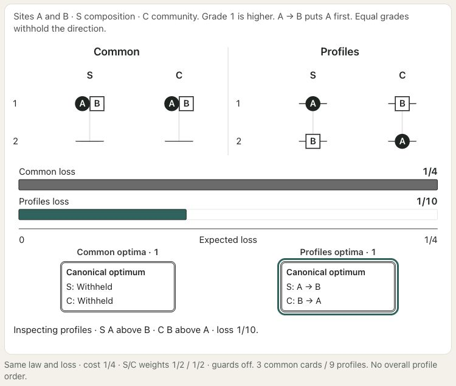
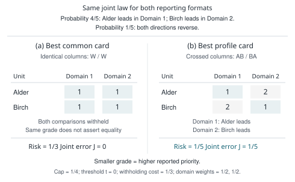
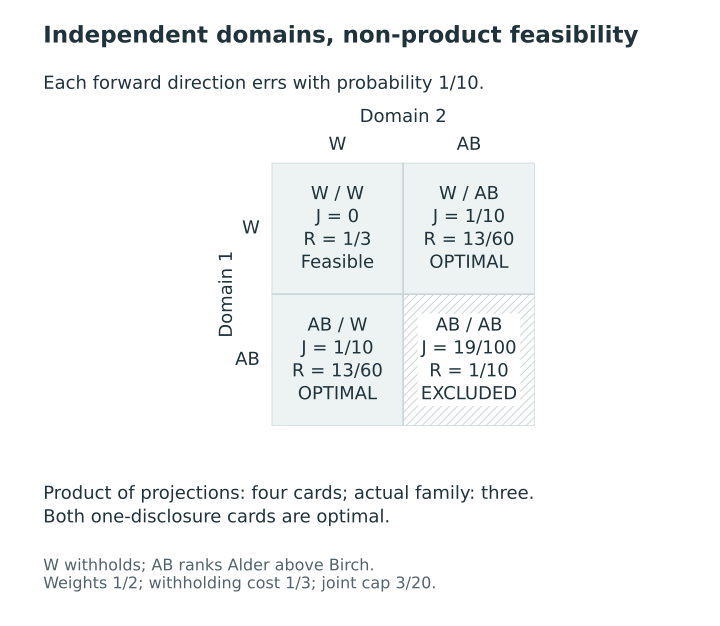
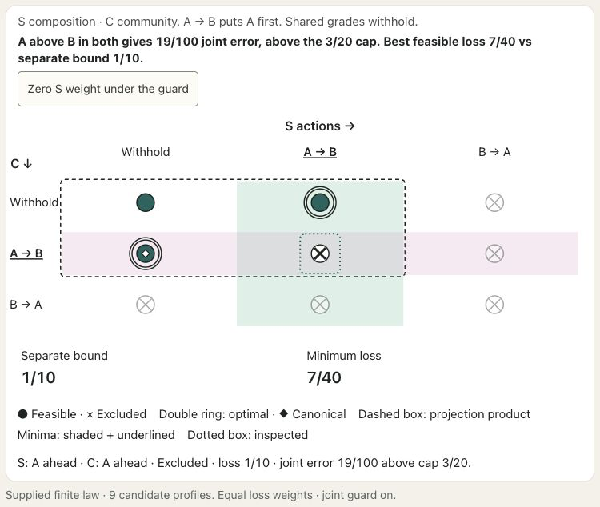

# Profile actions and matched reductions {#sec-profile-actions}

[]{#sec-v4-ch14}
[]{#sec-p2-03-targets-actions}
[]{#sec-p2-05-reductions}

A common grade asks several indicators to support one ordering of the same units. That can be the right form of report when an institution must communicate a single priority list. A different question arises when the report is meant to preserve separate comparisons across domains. A site may have greater learner need but lower community need than another site. An overall grade must reconcile these directions; a profile can display both.

The change concerns the action the report is allowed to take. It need not change the targets, the probability law, or the costs assigned to erroneous and withheld comparisons. Keeping these ingredients fixed lets us identify exactly what is gained by allowing different grade columns. We first place common grades inside the profile action space, then examine when a multidomain decision can be solved one domain at a time.

## From one grade to a profile {#sec-profile-report-action}

[]{#oriented-targets-and-ordered-partitions}

Condition on the observed information $y$. There are $n\ge2$ identified units and $D\ge1$ domains. Let $\Theta=(\theta_{id})$ denote their complete target state. Targets are oriented so that a larger value means higher priority within a domain. A proper supplied law $\Pi_s(\cdot\mid y)$ describes uncertainty about this state for the reporting decision. If that law is a fitted posterior, the results are conditional on its modeling assumptions. Our numerical example will instead stipulate a small finite law, so that every calculation can be inspected.

A grade column $g^{(d)}$ is a canonical ordered partition of the units, with occupied labels $1,\ldots,K_d$. **A smaller grade means higher reported priority.** Two units in different grades receive a strict directional comparison; two in the same grade receive no direction. Equal grades therefore withhold a comparison. They do not assert equal target values or practical equivalence. This interpretation follows the reporting action in @sec-grade-actions and the abstention interpretation of coherent grades in @kline_discrimination_2024.

Write $\mathcal A_n$ for the finite set of such columns. A profile card is

$$
G=(g^{(1)},\ldots,g^{(D)})\in\mathcal A_n^D.
$$ {#eq-profile-card}

Each column remains a coherent ordering with possible ties. A row, such as $(1,2)$, identifies a profile cell. These cells are not assigned an overall ranking. In particular, $(1,2)$ and $(2,1)$ express crossing comparisons. Even a componentwise comparison of grade rows must be interpreted through the assertions actually issued: a tied coordinate carries no claim of latent equality or dominance.

The allowed family $\mathcal G\subseteq\mathcal A_n^D$ specifies which cards may be considered. A candidate bank, an institutional limit on the number of grades, or a scientifically justified identity guard may restrict it. Let $\mathcal F\subseteq\mathcal G$ be the actual feasible family after all protection requirements and other constraints are applied. A column that occurs in an allowed card need not be freely combinable with every other available column; the distinction between the allowed and feasible families keeps this restriction explicit.

For the core problem, the allowed family contains the all-withheld card. Domain targets are real-valued, may have different scales and may coincide with positive probability; the reporting comparison uses their order. A direction between grades several steps apart is the same strict assertion as one between adjacent grades. A scientific or model-declared equivalence relation $E_d$ requires $\theta_{id}=\theta_{jd}$ almost surely whenever $iE_dj$, together with the guard $g_{id}=g_{jd}$. This guard remains active when $w_d=0$. Coincidence across saved draws alone does not establish the identity; its substantive justification and the guard's consequences are developed in @sec-structural-identity-guard.

Treating a report as an action and evaluating its expected loss is an application of Bayesian decision theory [@berger1985decision]. The application still requires a substantive choice of target, loss, and feasible reports. A posterior distribution by itself does not decide whether a single overall ordering or several domain orderings should be communicated.

### Reading a pair and its withheld coordinates {#sec-profile-signatures}

[]{#reading-pairs-and-profile-cells}

For stable unit indexing $i<j$, the partial signature of a reported pair is

$$
\sigma_{ij}^d=\operatorname{sign}(g_{jd}-g_{id}).
$$ {#eq-profile-signature}

A positive sign favors $i$, a negative sign favors $j$, and zero withholds. The signature is correct at a state when $\sigma_{ij}^d(\theta_{id}-\theta_{jd})>0$ for every disclosed coordinate. Withheld coordinates impose no condition on the targets.

| Grade rows for $a,b$ | Target rows in one state | Signature | Interpretation |
|---|---|---|---|
| $(1,2)$ and $(2,1)$ | $(4,1)$ and $(1,4)$ | $(+1,-1)$ | Both issued directions are correct; each unit leads in one domain. |
| $(1,1)$ and $(2,1)$ | $(2,0)$ and $(1,3)$ | $(+1,0)$ | The sole direction is correct, while the withheld domain favors $b$. |

: Reading partial signatures without filling in withheld comparisons. {#tbl-profile-signatures}

In the second row, $a$ grade-dominates $b$, but does not dominate its target vector: $0<3$ in the withheld domain. Even correctness of every issued assertion does not establish latent Pareto dominance. Whole-card truth is the conjunction of its issued atoms; the all-withheld card has an empty conjunction and communicates no comparisons. The number and meaning of occupied profile cells are examined in @sec-report-representations.

### Transformations with a matched reporting problem {#sec-profile-invariance}

[]{#which-transformations-preserve-the-decision}

Apply the same measurable strictly increasing target map within each domain to every unit and push the joint law forward through those maps. Keep the family, masks, reporting costs, any disclosure-utility weights, budgets and identity guards fixed. Every strict comparison and equality then retains its truth value. Each fixed report has the same loss, expected error counts and joint-tail probability; feasible sets and the sets of primary and auxiliary optimizers therefore agree. This is a fixed-problem invariance statement, not a claim about a newly fitted model or regenerated candidate bank. [Theorem T04a](../appendices/A-proofs.qmd#thm-T04a) supplies the full proof.

Increasing relabelings of occupied grades preserve the ordered blocks, and canonicalization restores their labels. Permuting unit or domain identifiers likewise gives corresponding feasible and optimal sets only when the law, actions, restrictions and every indexed setting are transported together. A selected representative also requires transporting the tie-break: an alphabetical rule can choose another tied optimum after renaming. See [Proposition T04b](../appendices/A-proofs.qmd#prp-T04b).

For a common measurable strictly decreasing target map in an affected domain, reverse its grades by $g'_{id}=K_d+1-g_{id}$. Push the law forward and use the image of the allowed family, transporting masks, costs, disclosure-utility weights, guards and budgets. The issued direction reverses with its target order, preserving the error indicator and giving corresponding risks and optimizer sets. The scientific direction of priority has nevertheless changed. See [Proposition T04c](../appendices/A-proofs.qmd#prp-T04c).

A small example shows why the family must remain fixed. Let unit 1 have target 2 with certainty, and unit 2 have target 0 with probability $4/5$ and 4 with probability $1/5$. Their means are 2 and $4/5$; after cubing, the means are 8 and $64/5$. A bank containing only all-withheld and the posterior-mean ordering therefore changes its offered direction. With unit error cost, withholding cost $1/4$, no mean constraints and unrestricted protection ($\alpha=1$), the original bank chooses the forward direction at risk $1/5$. The regenerated bank chooses withholding at risk $1/4$, because its reverse direction has risk $4/5$. Every fixed report retains its risk; the competing reports have changed.


<!-- BEGIN EXPLORER EXPANSION: profile-common-vs-domain -->

::: {#box-explorer-profile-common-vs-domain .explorer-box}

{fig-alt="Screenshot of Common or profile?, illustrating A profile can state crossing priorities." .explorer-screenshot}

Switch between aligned and crossed priorities, then compare the common grade with the separate domain columns. This small finite-law example makes the profile action visible: a site can have higher reported priority in one domain and lower priority in another. The app disables error caps in this comparison, so it complements the protected example later in the chapter rather than reproducing its constraints.

::: {.explorer-link}
[Open Common or profile? in postrank Explorer](https://joonho112.github.io/postrank-explorer/pages/profiles/profile-common-vs-domain.html)
:::

A profile can state crossing priorities

:::
<!-- END EXPLORER EXPANSION: profile-common-vs-domain -->

## Errors and withholding across domains {#sec-profile-loss}

[]{#what-pair-probabilities-determine}

[]{#why-an-optimum-exists}

[]{#scopes-and-joint-information}

Let $M=\binom n2$ count the original unordered pairs. For $i\ne j$, define

$$
x_{ij}^d(G)=\mathbf1\{g_{id}<g_{jd}\},\qquad
N_d(G)=\sum_{i\ne j}x_{ij}^d(G).
$$

At most one direction is issued for each unordered pair. The number of false directions in a complete state is

$$
F_d(G,\Theta)=\sum_{i\ne j}x_{ij}^d(G)
\mathbf1\{\theta_{id}\le\theta_{jd}\}.
$$ {#eq-profile-false-count}

The weak inequality is deliberate. A strict claim that one target is higher is false when the targets are equal. Thus, positive equality mass under the law is different from a reported tie. A model-based structural identity is different again: a declared identity requires the targets to be equal almost surely under the law, and its guard requires the units to share a grade.

Choose domain weights $w_d\ge0$ with $\sum_dw_d=1$ and withholding costs $0<\tau_d\le1/2$. The separable loss and its expected risk are

$$
\begin{aligned}
L_{\mathrm{sep}}(G,\Theta)
&=\frac1M\sum_{d=1}^D w_d\left\{F_d(G,\Theta)+\tau_d[M-N_d(G)]\right\},\\
R_{\mathrm{sep}}(G)&=E_{\Pi_s}\{L_{\mathrm{sep}}(G,\Theta)\mid y\}.
\end{aligned}
$$ {#eq-profile-separable-loss}

A correct issued direction costs zero, a false one costs one, and withholding costs $\tau_d$. Domain weights express the relative contributions of these reporting costs. They need not be coefficients of a scalar composite of the targets. Multiattribute preference values answer a distinct valuation question [@keeney_raiffa_1993].

The denominator is all original pairs. Consequently, $R_{\mathrm{sep}}$ is not an expected fraction of errors among disclosed comparisons. For example, withholding every pair gives risk $\sum_dw_d\tau_d$, although it creates no false issued assertion. When $N_d>0$, the quantity $F_d/N_d$ instead describes errors among assertions made in that domain. At $N_d=0$, this ratio is undefined.

For a fixed card, linearity of expectation gives

$$
R_{\mathrm{sep}}(G)=\frac1M\sum_d w_d
\left\{\sum_{i\ne j}x_{ij}^d(G)e_{ij}^d+
\tau_d[M-N_d(G)]\right\},\quad
e_{ij}^d=\Pi_s(\theta_{id}\le\theta_{jd}\mid y).
$$ {#eq-profile-risk-coefficients}

The pairwise directional probabilities therefore determine this additive risk even when the errors are dependent. Joint ordering statements require information about how the errors occur together, which these probabilities need not supply [@BarrientosEtAl2023].

The weak-error coefficients also satisfy

$$
e_{ij}^d+e_{ji}^d=1+\Pi_s(\theta_{id}=\theta_{jd}\mid y).
$$ {#eq-profile-opposite-errors}

A scope $h$ selects unordered pairs through a fixed symmetric binary mask $a^h_{ij}$ with zero diagonal. Multiplying each summand by this mask gives the expected scoped count $E_{\Pi_s}F_{dh}$; the chosen card fixes its disclosure count $N_{dh}$. Thus the same coefficients evaluate a scoped mean constraint $E_{\Pi_s}F_{dh}\le q_{dh}N_{dh}$. Scopes may overlap, and omitting a pair from a scope does not remove its assertion or loss. Under matched families, masks and decision settings, two proper laws with these same coefficients agree on additive risks and expected scoped counts. This functional sufficiency is not statistical sufficiency or identification of general joint events; see [Proposition T02.2](../appendices/A-proofs.qmd#prp-p2-t02-pair-sufficiency).

Within-domain events use the marginal law of the complete vector of units in that domain. A cross-domain event additionally uses their coupling. Matching row numbers from separate posterior fits supplies no such coupling. Fixed complete states and exact masses define a finite law; retained iid or MCMC draws instead approximate their intended law. These distinctions are developed in @sec-information-dependence and @sec-numerical-uncertainty.

**Finite attainment.** There are at most $n^{nD}$ canonical grade matrices. The assumed all-withheld card satisfies every identity guard and every core mean constraint with both counts zero. In the strict tail event defined below, $0>0$ is false, so it is feasible even at a zero joint budget. Pair costs and normalized risk are bounded despite unbounded target magnitudes. Hence risk attains a minimum on the finite nonempty feasible family; a fixed finitely weighted disclosure utility also attains a maximum.

Attainment alone gives neither uniqueness nor positive disclosure. All-withheld has risk $\sum_d w_d\tau_d$ and disclosure utility zero. Adding a minimum-disclosure condition requires a new feasibility check. See [Theorem T01a](../appendices/A-proofs.qmd#thm-T01a).

## Recovering a matched common-grade decision {#sec-profile-diagonal-reduction}

```{=html}
<span id="what-transfers-from-common-grades" class="legacy-anchor" aria-hidden="true"></span>
```

[]{#matching-scalar-and-common-grades}

A common-grade card has identical columns: $\Delta(g)=(g,\ldots,g)$. Then every domain issues the same number $N(g)$ of comparisons. With $\bar\tau=\sum_dw_d\tau_d$, substitution in @eq-profile-separable-loss gives

$$
L_{\mathrm{sep}}(\Delta(g),\Theta)
=\frac{\sum_dw_dF_d(g,\Theta)+\bar\tau[M-N(g)]}{M}.
$$ {#eq-profile-common-reduction}

This is the common-grade loss of @sec-multicriteria-loss with withholding cost $\bar\tau$. The identity holds state by state, including states with equal target values. For $D=1$, the same definition reduces to the scalar weak-error loss because $w_1=1$.

**Matched reduction.** If the unit population, targets, orientations, law, domain weights, equality convention, original-pair denominator, and withholding costs are matched, the two formulations assign the same risk to corresponding common-grade actions. If, in addition, their feasible actions correspond exactly under $g\mapsto\Delta(g)$, their sets of risk minimizers correspond exactly.

The justification has two parts. The displayed identity proves equality of losses and, under the same law, equality of risks. The diagonal map is then a bijection between the matched feasible actions, so minimizing equal objective values over corresponding actions preserves the entire minimizing set. It does not select a particular representative when there are ties.

The feasible-set condition matters. Adding a joint protection requirement to one formulation can change the optimum even though the loss identity remains true. Likewise, independently regenerating two candidate banks can change which common cards are available. The appropriate common comparator is the diagonal intersection of the same profile family, subject to the same constraints.

The scalar connection to Kline, Rose, and Walters also needs its own equality condition. Their strict concordance–discordance loss is positively affine-equivalent to the scalar error–withholding loss after directions and costs are matched when latent pair ties have probability zero [@kline_discrimination_2024]. With positive equality mass, the present weak-error convention adds a cost for issued strict claims at equality. The common-column identity remains valid state by state at latent equality; the separate scalar conversion just stated is made under the no-tie assumption.

For example, suppose one pair favors the first unit with probability $3/4$ and reverses with probability $1/4$. Withholding costs $1/3$, so its risk exceeds the preferred direction's risk $1/4$. A joint budget of $1/8$ at zero error threshold nevertheless admits only withholding. Equal loss formulas do not remove this difference in feasible actions. [Theorem T01b](../appendices/A-proofs.qmd#thm-T01b) records the matched scalar and common-column reductions.

The equality correction can be written explicitly. Of $N$ issued scalar directions, let $C$ be strictly correct, $F_{<}$ strictly reversed, and $T$ issued at latent equality. Then $N=C+F_{<}+T$ and $F=F_{<}+T$. For $L_{\mathrm K}=(F_{<}-\lambda C)/M$ and $\lambda=\tau/(1-\tau)$,

$$
L_\tau=\tau+(1-\tau)L_{\mathrm K}+(1-\tau)T/M.
$$ {#eq-profile-scalar-equality-correction}

Pairwise zero equality probability makes $T=0$ almost surely, and the positive multiplier preserves every risk ordering and tie on the matched family. With equality mass, the correction depends on the issued action. If the first unit leads with probability $1/2$ and ties otherwise, at $\tau=1/3$ its issued direction has weak-error risk $1/2$. The strict-count expression extended to this law instead has expected value $-1/4$ for issuing and zero for withholding. The two criteria then prefer different reports. This extension is not the original no-tie setting of Kline, Rose, and Walters. See [Theorem T01c](../appendices/A-proofs.qmd#thm-T01c).

## A complete two-domain comparison {#sec-profile-crossing-example}

Consider two fictional units, Alder and Birch, with one pair to compare in each of two domains. The targets below are illustrative oriented values, not observations from an empirical study. The supplied law has two complete states:

| Probability | Alder, domain 1 | Birch, domain 1 | Alder, domain 2 | Birch, domain 2 |
|---:|---:|---:|---:|---:|
| $4/5$ | $1$ | $0$ | $-1$ | $0$ |
| $1/5$ | $-1$ | $0$ | $1$ | $0$ |

: A stipulated joint law. Each row contains both units in both domains. {#tbl-profile-crossing-law}

The likely directions cross: Alder is higher in domain 1 and Birch in domain 2. Set $w_1=w_2=1/2$ and $\tau_1=\tau_2=1/3$. Each domain has exactly three columns: $W=(1,1)$ withholds; $AB=(1,2)$ places Alder higher; and $BA=(2,1)$ places Birch higher. Their Cartesian product contains nine profiles, exhausting the possible two-unit, two-domain grade cards. The three common cards are $(W,W)$, $(AB,AB)$ and $(BA,BA)$.

We also protect a joint error event. In this example each domain has one all-pairs scope. For thresholds $t_d\in[0,1]$, define

$$
J(G)=\Pi_s\!\left(\bigcup_{d=1}^D
\{F_d(G,\Theta)>t_dN_d(G)\}\,\middle|\,y\right),
\qquad J(G)\le\alpha.
$$ {#eq-profile-pilot-protection}

The exceedance inside the event is strict; the probability cap is inclusive. When a domain withholds everything, its event is false because $0>0$ is false. No undefined error ratio is needed to evaluate it. Take $t_1=t_2=0$ and $\alpha=1/4$, with no additional mean-error constraints. The protected event is now that at least one issued direction is false in either domain. Both action families use this same event and cap.

All-withheld has risk $1/3$ and $J=0$. Either strict common card is wrong in one domain in every state, giving risk $1/2$ and $J=1$. It is therefore infeasible. The crossed profile $(AB,BA)$ makes both directions correctly in the state of mass $4/5$ and both incorrectly in the state of mass $1/5$. Its loss is zero in the first state and one in the second. Hence

$$
R_{\mathrm{sep}}(AB,BA)=\frac15,\qquad
J(AB,BA)=\frac15\le\frac14.
$$

The union probability is $1/5$, rather than $2/5$, because the two errors occur in the same state. Issuing only one of the preferred directions gives risk
$\tfrac12(\tfrac15+\tfrac13)=\tfrac4{15}$ and the same $J=1/5$. The complete comparison is small enough to display.

| Domain 1 | Domain 2 | Risk | $J$ | Feasible? | Common card? |
|:---:|:---:|---:|---:|:---:|:---:|
| $W$ | $W$ | $1/3$ | $0$ | Yes | Yes |
| $W$ | $AB$ | $17/30$ | $4/5$ | No | No |
| $W$ | $BA$ | $4/15$ | $1/5$ | Yes | No |
| $AB$ | $W$ | $4/15$ | $1/5$ | Yes | No |
| $AB$ | $AB$ | $1/2$ | $1$ | No | Yes |
| $AB$ | $BA$ | **$1/5$** | **$1/5$** | **Yes** | No |
| $BA$ | $W$ | $17/30$ | $4/5$ | No | No |
| $BA$ | $AB$ | $4/5$ | $4/5$ | No | No |
| $BA$ | $BA$ | $1/2$ | $1$ | No | Yes |

: Exact evaluation of all nine cards under the law in @tbl-profile-crossing-law. The minimum feasible common risk is $1/3$; the unique minimum feasible profile risk is $1/5$. {#tbl-profile-pilot-candidates}

The profile reduces the minimum risk by $2/15$ while changing the content of the report from no directions to two domain-specific directions. Its protection probability is higher than that of the all-withheld common card, but remains within the same budget. The example establishes a gain for this decision problem, rather than a general preference for profile reports. If the two domains instead agree in the state of mass $4/5$ and reverse together in the state of mass $1/5$, the common card $(AB,AB)$ attains the profile optimum $1/5$ as well.

::: {#fig-profile-pilot .reader-figure .reader-has-narrow style="--reader-figure-width:640px;"}
<picture>
<source media="(max-width: 720px)" srcset="../assets/figures/v4-pilot-stacked.svg">

</picture>

The best feasible common card withholds both comparisons, while the best profile gives crossing domain grades. Risk is 1/3 versus 1/5; joint error probability is 0 versus 1/5 under the same cap 1/4.
:::

The figure uses the complete law in @tbl-profile-crossing-law. Smaller grade numbers mean higher reported priority. The settings and exact comparison are given in @tbl-profile-pilot-candidates. A [vector PDF](../assets/figures/v4-pilot.pdf) is available for print.

## When can the domains be solved separately? {#sec-profile-separability}

[]{#when-columns-can-be-chosen-separately}

Additive risk is only one ingredient of a separable decision problem. Write $\Pi_{s,d}$ for the marginal law of the complete vector of units in domain $d$, and define its unweighted column risk

$$
\rho_d(g)=\frac1M E_{\Pi_{s,d}}
\{F_d(g,\Theta)+\tau_d[M-N_d(g)]\mid y\}.
$$

Then $R_{\mathrm{sep}}(G)=\sum_dw_d\rho_d(g^{(d)})$. Suppose now that the actual nonempty feasible family factors as
$\mathcal F=\prod_d\mathcal F_d$. Each combination of feasible columns must itself be feasible, after every guard and protection is applied.

**Product-family result.** Under this condition,

$$
\min_{G\in\mathcal F}R_{\mathrm{sep}}(G)
=\sum_dw_d\min_{g\in\mathcal F_d}\rho_d(g),
$$ {#eq-profile-product-minimum}

and the full minimizing set is

$$
\operatorname*{argmin}_{G\in\mathcal F}R_{\mathrm{sep}}(G)
=\prod_d B_d,\qquad
B_d=\begin{cases}
\operatorname*{argmin}_{g\in\mathcal F_d}\rho_d(g),&w_d>0,\\
\mathcal F_d,&w_d=0.
\end{cases}
$$ {#eq-profile-product-argmin}

To see this, let $m_d$ be the minimum column risk in domain $d$. Every feasible card has risk at least $\sum_dw_dm_d$. Finiteness gives a minimizing column in each domain, and product feasibility permits their combination, attaining the bound. Equality in the bound requires $\rho_d=m_d$ in every positive-weight domain. A zero-weight domain contributes no objective difference, so every column in its feasible factor belongs to the minimizing set. Its guards and protection requirements have already been applied in forming that factor.

A subsequent tie-breaking rule need not factorize. The full result and its conditions appear in [Theorem T02.1](../appendices/A-proofs.qmd#thm-p2-t02-decomposition).

This argument uses linearity of expectation and product feasibility. It does not use posterior independence. Conversely, posterior independence does not ensure product feasibility. A common-column requirement, a shared constraint, or a joint error cap can prevent individually acceptable columns from being combined.

One sufficient construction begins with separate allowed column families, each containing all-withheld, and imposes only domain-specific identity guards, grade restrictions and scope mean constraints. Each mean condition then tests one column through its own error coefficients. If joint protection is disabled or already holds for every combination that survives these local tests, the resulting family is a product. A common-column requirement or a bank containing only selected combinations does not satisfy this construction automatically. See [Corollary T02.3](../appendices/A-proofs.qmd#cor-p2-t02-mean-factorization).

For a concrete counterexample, retain two units, the three columns, equal weights and cost $1/3$. In each domain independently, Alder is higher with probability $9/10$ and Birch with probability $1/10$. The four complete sign states $(+,+),(+,-),(-,+),(-,-)$ have masses $81/100,9/100,9/100,1/100$. Set $t_1=t_2=0$ and $\alpha=3/20$.

Either single-domain card $(AB,W)$ or $(W,AB)$ has $J=1/10$ and is feasible. Combining their issued columns gives $(AB,AB)$, with

$$
J(AB,AB)=1-\left(\frac9{10}\right)^2
=\frac{19}{100}>\frac3{20}.
$$

Thus, the combination is infeasible despite the domains being independent. The feasible family consists of $(W,W),(AB,W),(W,AB)$, not the product of its projections. The two partially disclosed cards are tied optima, each with risk
$\tfrac12(\tfrac1{10}+\tfrac13)=\tfrac{13}{60}$.
Both reports are needed to describe the minimizing set.

::: {#fig-v4-s04 .reader-figure .reader-has-narrow style="--reader-figure-width:600px;"}
<picture>
<source media="(max-width: 720px)" srcset="../assets/figures/S04-mobile.svg">

</picture>

The domains are independent, but the joint cap 3/20 excludes the combined positive card: its error probability is 19/100, while either single-domain disclosure has probability 1/10. The actual feasible family contains three cards, whereas the product of its column projections contains four. Both single-disclosure cards minimize risk at 13/60.
:::

[Vector PDF](../assets/figures/S04.pdf).

Product feasibility is a sufficient condition. Failure to factor does not by itself imply a strict increase above the sum of domain minima: a feasible card may still attain all positive-weight minima together. The relevant question is whether a compatible combination exists, not simply whether a dependence parameter is zero.

<!-- postrank-exhibit:W05:begin -->
<details class="widget-exhibit" data-postrank-widget="W05" data-widget-src="../assets/widgets/W05/index.html" data-widget-title="When can two columns be chosen separately?" data-widget-height="1500">
<summary>Explore: Does additive risk permit separate choices after the joint cap is imposed?</summary>
<div class="widget-fallback"><p>Default: setting = independent-joint, weight = 1/2. Minimum risk 13/60; all minimizing cards: W/AB, AB/W. W withholds; AB ranks Alder higher; BA ranks Birch higher.</p><div class="table-scroll"><table><caption>Default setting: the complete candidate family</caption><thead><tr><th scope="col">Card</th><th scope="col">Risk</th><th scope="col">Criterion risks (1, 2)</th><th scope="col">Joint J</th><th scope="col">Feasible</th><th scope="col">Minimum risk?</th></tr></thead><tbody><tr><th scope="row">W/W</th><td>1/3</td><td>1/3, 1/3</td><td>0</td><td>Yes</td><td>—</td></tr><tr><th scope="row">W/AB</th><td>13/60</td><td>1/3, 1/10</td><td>1/10</td><td>Yes</td><td>Optimal</td></tr><tr><th scope="row">W/BA</th><td>37/60</td><td>1/3, 9/10</td><td>9/10</td><td>No</td><td>—</td></tr><tr><th scope="row">AB/W</th><td>13/60</td><td>1/10, 1/3</td><td>1/10</td><td>Yes</td><td>Optimal</td></tr><tr><th scope="row">AB/AB</th><td>1/10</td><td>1/10, 1/10</td><td>19/100</td><td>No</td><td>—</td></tr><tr><th scope="row">AB/BA</th><td>1/2</td><td>1/10, 9/10</td><td>91/100</td><td>No</td><td>—</td></tr><tr><th scope="row">BA/W</th><td>37/60</td><td>9/10, 1/3</td><td>9/10</td><td>No</td><td>—</td></tr><tr><th scope="row">BA/AB</th><td>1/2</td><td>9/10, 1/10</td><td>91/100</td><td>No</td><td>—</td></tr><tr><th scope="row">BA/BA</th><td>9/10</td><td>9/10, 9/10</td><td>99/100</td><td>No</td><td>—</td></tr></tbody></table></div><div class="table-scroll"><table><caption>Default risk optima: all tied cards, disclosures and grades</caption><thead><tr><th scope="col">Card</th><th scope="col">Disclosures (N1, N2)</th><th scope="col">Grades (K1, K2)</th></tr></thead><tbody><tr><th scope="row">W/AB</th><td>0, 1</td><td>1, 2</td></tr><tr><th scope="row">AB/W</th><td>1, 0</td><td>2, 1</td></tr></tbody></table></div><p>The default actual family has three cards. Its two projection sets each contain W and AB, so their product would contain four cards. The minimum risk is 13/60, above the projected lower bound 1/10.</p></div>
<button type="button" data-widget-load disabled>Open interactive example</button><div data-widget-frame></div>
<noscript><p>The complete default comparison above remains available without JavaScript.</p></noscript>
</details>
<script defer src="../assets/widgets/shared/book-loader.js"></script>
<!-- postrank-exhibit:W05:end -->


<!-- BEGIN EXPLORER EXPANSION: profile-separability -->

::: {#box-explorer-profile-separability .explorer-box}

{fig-alt="Screenshot of Separate or joint?, illustrating Separate choices require compatible combinations." .explorer-screenshot}

Compare dependent domains without a joint cap with independent domains under an active cap, and inspect which column combinations remain feasible. The contrast separates posterior dependence from the product-family condition that guarantees separate optimization. This companion uses its own withholding cost, so its numerical optimum differs from the chapter example even when the same feasibility obstruction appears.

::: {.explorer-link}
[Open Separate or joint? in postrank Explorer](https://joonho112.github.io/postrank-explorer/pages/profiles/profile-separability.html)
:::

Separate choices require compatible combinations

:::
<!-- END EXPLORER EXPANSION: profile-separability -->

## Inspecting the report {#sec-profile-reproduction}

The display below switches between the best common card and the best profile for the fixed crossing example. The law, costs, weights and protection rule remain fixed. The control selects between two stored, exactly verified results; it does not refit a model or search continuously over settings. @tbl-profile-pilot-candidates and the figure provide the same comparison without interaction.

<span id="profile-pilot-widget" class="legacy-widget-anchor" aria-hidden="true"></span><span id="representation" class="legacy-widget-anchor" aria-hidden="true"></span><span id="card-title" class="legacy-widget-anchor" aria-hidden="true"></span><span id="g00" class="legacy-widget-anchor" aria-hidden="true"></span><span id="g01" class="legacy-widget-anchor" aria-hidden="true"></span><span id="g10" class="legacy-widget-anchor" aria-hidden="true"></span><span id="g11" class="legacy-widget-anchor" aria-hidden="true"></span><span id="risk" class="legacy-widget-anchor" aria-hidden="true"></span><span id="joint" class="legacy-widget-anchor" aria-hidden="true"></span><span id="issued" class="legacy-widget-anchor" aria-hidden="true"></span><span id="meaning" class="legacy-widget-anchor" aria-hidden="true"></span><span id="status" class="legacy-widget-anchor" aria-hidden="true"></span><span id="fixed-settings" class="legacy-widget-anchor" aria-hidden="true"></span>

<!-- postrank-exhibit:W04:begin -->

::: {.postrank-widget-host data-postrank-widget="W04" data-widget-src="../assets/widgets/W04/index.html" data-widget-title="Common grades and crossing domain profiles" data-widget-height="1200"}
<details><summary>Explore common grades and domain profiles</summary>
<p>The optional example switches between the two exact results under the fixed crossed law.</p>
<button type="button" data-widget-load disabled>Open interactive example</button>
<div data-widget-frame></div>
<noscript><p>The interactive selector requires JavaScript; the static comparison below remains available.</p></noscript>
</details>

Under the complete crossed law, the best feasible common card withholds both directions (loss $1/3$, joint error probability $0$). The best feasible profile crosses the two domain directions (loss $1/5$, joint error probability $1/5$). Both use the same cap $1/4$ and their declared families of three and nine cards.
:::

<script defer src="../assets/widgets/shared/book-loader.js"></script>
<!-- postrank-exhibit:W04:end -->

[Open the display on its own](../assets/widgets/W04/index.html).

The [reproduction materials](../assets/reproduction/pilot/pilot-reproduction.zip) provide the complete numerical evaluation and independent rational-arithmetic checks.

The stipulated finite laws permit exact calculation over the entire two-unit action space. This exactness does not extend to a posterior merely because it has been fitted or sampled. In a larger application, we must distinguish evaluation of the represented law, optimality within a candidate bank, and accuracy of an approximation to another law. Sample-average optimization theory and MCMC uncertainty analysis address different parts of this problem [@kleywegt_sample_2002; @vats_multivariate_2019]. Neither an iid confidence procedure nor an MCMC diagnostic is needed to establish the arithmetic of the finite examples here.
