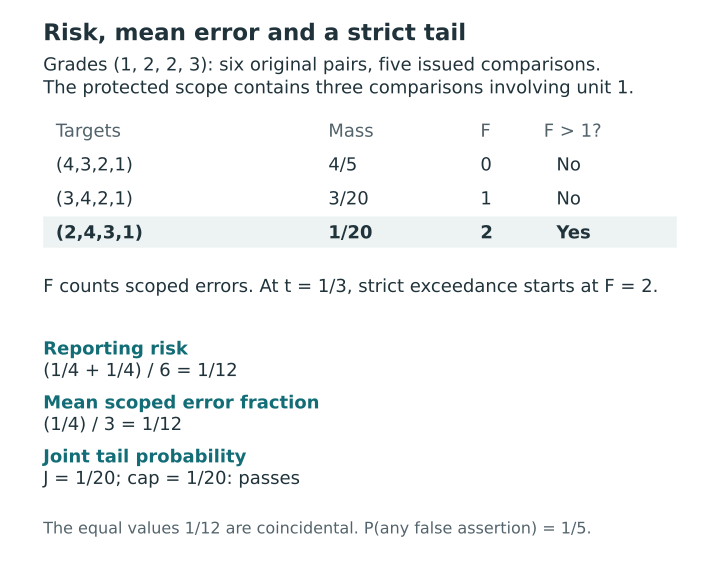

# Joint posterior protection {#sec-joint-protection}

[]{#sec-v4-ch15}
[]{#sec-p2-04-loss-protection}

A four-unit card can issue five of the six possible comparisons in one domain. Three of these may involve the first unit. Assessing errors for that unit therefore uses a different denominator from assessing the whole report. The loss charges for errors and withholding across all possible pairs; a protection measures errors among the directions actually issued within its specified scope.

## Loss across all pairs {#sec-profile-scoped-loss}

[]{#what-it-costs-to-issue-or-withhold-a-direction}

Fix a report $G$ from the guarded family in @sec-profile-actions. Write $P$ and $E$ for probability and expectation under the supplied law $\Pi_s(\cdot\mid y)$. There are $M=\binom n2$ unordered pairs per domain. The indicator $x_{ij}^d=\mathbf1\{g_{id}<g_{jd}\}$ records a strict assertion that $i$ has higher priority than $j$. Let
$$
N_d=\sum_{i\ne j}x_{ij}^d,\qquad
F_d=\sum_{i\ne j}x_{ij}^d\mathbf1\{\theta_{id}\le\theta_{jd}\}.
$$
At most one direction contributes for each unordered pair. $N_d$ is fixed by the card. $F_d$ counts false assertions in the current state, including assertions made at latent equality. Equal grades withhold both directions.

A false direction costs one, a correct direction costs zero, and withholding costs $0<\tau_d\le1/2$. Choose $w_d\ge0$ with $\sum_dw_d=1$ to weight the consequences in each domain. These weights apply to losses across domains with potentially different target scales. Writing $e_{ij}^d=P(\theta_{id}\le\theta_{jd})$, the primary risk is
$$
\begin{aligned}
R_{\rm sep}(G)
 &= E\!\left[\frac1M\sum_d w_d\{F_d+\tau_d(M-N_d)\}\right]\\
 &=\frac1M\sum_d w_d\left[\sum_{i\ne j}x_{ij}^d e_{ij}^d+\tau_d(M-N_d)\right].
\end{aligned}
$$
Finite linearity gives the second line under arbitrary dependence. Positive probability of equality contributes to the error probabilities in both directions. Even pairs forced to withhold by an equality guard incur the withholding cost. A zero-weight domain contributes zero to the objective while retaining its guards and declared protections.

## Mean and joint protection on declared scopes {#sec-profile-scope-protection}

```{=html}
<span id="what-joint-protection-means-here" class="legacy-anchor" aria-hidden="true"></span>
<span id="which-errors-matter-on-the-published-card" class="legacy-anchor" aria-hidden="true"></span>
```

[]{#which-disclosures-receive-protection}

Choose a finite catalog of symmetric binary masks $a_{ij}^h$ with zero diagonals. The corresponding counts are
$$
N_{dh}(G)=\sum_{i\ne j}a_{ij}^h x_{ij}^d,\qquad
F_{dh}(G,\Theta)=\sum_{i\ne j}a_{ij}^h x_{ij}^d
\mathbf1\{\theta_{id}\le\theta_{jd}\}.
$$

Fix the masks and settings during posterior integration. Distinct masks can overlap. Omitting a pair from a mask leaves its contribution to the loss intact.

Two lists of domain–scope pairs serve different readers' questions. For each $(d,h)\in\mathcal P$, an optional mean constraint requires $E F_{dh}\le q_{dh}N_{dh}$, where $q_{dh}\in[0,1]$. For each $(d,h)\in\mathcal H$, a threshold $t_{dh}\in[0,1]$ sets the realized fraction of errors the reader will tolerate. Protect these scopes jointly by requiring
$$
J(G)=P\!\left(\bigcup_{(d,h)\in\mathcal H}\{F_{dh}>t_{dh}N_{dh}\}\right)\le\alpha,
\qquad 0\le\alpha\le1 .
$$
The baseline $\mathcal H$ includes a full-domain scope for each domain. Record any other choice explicitly. Evaluate the union by checking all its scopes in the *same* state, counting that state once if any exceeds its threshold. With complete coverage and all thresholds zero, the union detects every false issued assertion. Positive thresholds can permit errors, and scopes protect only the assertions they cover.

For $N_{dh}=0$, both counts vanish. The mean constraint holds and the exceedance is impossible. The mathematical fraction is undefined; a computational zero extension must be identified as such. A displayed rate should read **NA / no disclosure**. An empty $\mathcal P$ switches off the mean constraints. With empty $\mathcal H$, set $J=0$ and display **joint protection disabled**.

When simulation estimates $J$, a separate $0<\beta<1$ bounds numerical failure under a specified assurance method and its sampling assumptions. A frequency below $\alpha$ after searching the same draws needs this numerical justification. The resulting failure probability concerns the simulation experiment, separately from the posterior probability budget and any repeated-sampling guarantee for the fitted model.

The Opportunity Atlas application in @sec-opportunity-atlas shows why the required joint information must be stated. Its separate criterion inputs support the corresponding marginal reporting calculations, but do not identify the cross-criterion coupling needed for this union probability. Pairing rows from those inputs would add a dependence assumption. A common-grade summary built from those marginals does not supply a joint-error guarantee.

The constructed need example in @sec-synthetic-need retains aligned states for all domains, allowing each retained state to be checked against the whole union event before its frequency is summarized. That alignment supplies the information needed for the diagnostic. Dependence between successive MCMC states remains a separate numerical issue: the reported diagnostics do not turn the saved frequency into an independent-sampling certificate or establish calibration for an empirical population.

## A four-unit calculation {#sec-profile-four-unit-protection}

[]{#a-four-unit-calculation}

Consider grades $(1,2,2,3)$ in one domain with $w=1$ and $\tau=1/4$. Units 2 and 3 share a grade, so $M=6$ and $N_d=5$. For this example, put only the scope of comparisons involving unit 1 in each protection list. The card asserts that unit 1 leads each of the other three, giving $N_{dh}=3$. Take the following exact finite law for the oriented targets.

| Target values in unit order | Probability | Errors involving unit 1 | All issued errors |
|---|---:|---:|---:|
| $(4,3,2,1)$ | $0.80$ | 0 | 0 |
| $(3,4,2,1)$ | $0.15$ | 1 | 1 |
| $(2,4,3,1)$ | $0.05$ | 2 | 2 |

The expected number of errors is $0.15+2(0.05)=0.25$. Including one withheld pair gives $R_{\rm sep}=(0.25+0.25)/6=1/12$. The protected mean fraction uses the three issued comparisons involving unit 1. Its value $0.25/3$ happens to equal the risk in this example. For $t=1/3$, the strict cutoff is $\lfloor tN_{dh}\rfloor+1=2$. The one-error state sits exactly on the tolerated threshold. Only the last state exceeds it, so $J=0.05$. This card passes $q=0.10$ and $\alpha=0.05$, although the probability of at least one false assertion on the card is $0.20$.

The coincidence between risk and the scoped mean fraction is numerical, not definitional. The first divides an error-plus-withholding cost by six possible pairs; the second divides expected errors by three issued statements. The joint probability asks a third question. Its cap is inclusive, whereas the event inside it is strict: the state with one error does not exceed one third, and the card with joint probability 0.05 is feasible at a cap of 0.05.

::: {#fig-v4-s06 .reader-figure .reader-has-narrow style="--reader-figure-width:600px;"}
<picture>
<source media="(max-width: 720px)" srcset="../assets/figures/S06-mobile.svg">

</picture>

For grades (1,2,2,3), the original pair count is six and the protected scope issues three comparisons. The scoped count exceeds tN=1 only in the two-error state, so J=1/20 and the inclusive cap 1/20 is met. Risk and the scoped mean error fraction both equal 1/12 here by numerical coincidence; they use different numerators and denominators. The chance of any false assertion is 1/5.
:::

[Vector PDF](../assets/figures/S06.pdf).

## Choosing among feasible reports {#sec-profile-protected-choice}

[]{#choosing-among-feasible-reports}

Let $\mathcal F$ consist of reports satisfying the family restrictions, guards and both declared protections. The primary decision selects all minimizers of $R_{\rm sep}$ over $\mathcal F$. In the core family, all-withheld is admitted and satisfies both homogeneous protections, giving risk $\sum_dw_d\tau_d$. An exact grade requirement or another action restriction can exclude it; nonemptiness must then be checked for that restricted problem. An alternative decision instead maximizes a declared disclosure utility over $\mathcal F$,
$$
I_v(G)=\sum_d\sum_{i<j}v^d_{ij}\mathbf1\{g_{id}\ne g_{jd}\},\qquad v^d_{ij}\ge0.
$$
Fix finite utility weights before selection. Unit weights count issued pair-domain statements. Maximizing this utility can favor a feasible disclosure even when its error probability makes withholding cheaper under the primary loss. Report any added risk cap and any rule used to select among tied optima.

A pair-bundle loss answers a different reporting question. Count a pair once if any domain issues a direction ($N_{\rm bun}$ such pairs), and once as erroneous if any *issued* direction for it fails ($F_{\rm bun}$). The optional loss $[F_{\rm bun}+\tau_{\rm bun}(M-N_{\rm bun})]/M$ with $0<\tau_{\rm bun}\le1/2$ prices withholding the entire pair. A bundle error fraction divides by $N_{\rm bun}$ and displays no disclosure when that count is zero. Bundle protections need their own thresholds and budgets.

## Translating between mean and joint guarantees {#sec-profile-mean-tail-bounds}

[]{#translating-between-mean-and-joint-guarantees}

For a fixed report and a scope with positive disclosure count, abbreviate $Z=F/N$, $\mu=E Z$, and $p=P(F>tN)$. When $t<1$, let $a=\lfloor tN\rfloor/N$ and $k=\lfloor tN\rfloor+1$. On nonexceedance $Z\le a$, and elsewhere $Z\le1$. Thus $\mu\le a+(1-a)p\le t+(1-t)p$. For a scope in a protected union, substitute $\alpha$ for $p$ as an upper bound. At $t=1$ the tail is empty and the mean can still be one. The grid bound is sharp over unrestricted grid distributions. A given report and law can restrict which counts occur. [The full tail-to-mean argument](../appendices/A-proofs.qmd#prp-t05-tail-mean) records the equality and endpoint conditions.

Conversely, every exceedance contributes at least $k$ errors, so $p\le\min(1,N\mu/k)$. A mean cap on this scope allows substitution of $q$ for $\mu$. The integer formula also works at $t=0$, where $k=1$. Generic Markov gives $p\le\min(1,\mu/t)$ only for $t>0$, with strict slack before clipping whenever $p>0$. Neither calculation needs independence. [The mean-to-tail argument](../appendices/A-proofs.qmd#prp-t05-mean-tail) distinguishes the integer cutoff from the generic Markov bound.

For $m=|\mathcal H|>0$ matched scopes with exact event probabilities $p_\ell$, equal Bonferroni requires each $p_\ell\le\alpha/m$. Optimized Bonferroni permits any nonnegative allocation totaling at most $\alpha$ for that candidate, equivalently $\sum_\ell p_\ell\le\alpha$. Direct evaluation uses the union probability. With all other settings matched, the union bound gives
$$
\mathcal F_{\rm equal}\subseteq\mathcal F_{\rm alloc}\subseteq\mathcal F_{\rm joint}.
$$
Consequently the exact minimum of the same primary risk can only decrease or stay equal across these families. The inclusions can be equalities and give no ordering of selected disclosure counts. Restricted allocation grids or allocation across groups define other comparators. For $m=0$, all three families coincide without division by $m$. [The feasible-family comparison](../appendices/A-proofs.qmd#prp-t05-bonferroni-inclusion) gives the precise matched conditions.

These bounds let us derive a generally weaker guarantee of one kind from a guarantee of the other; mean and tail constraints remain distinct. The union bound requires no independence, while direct evaluation of the union also depends on how the events overlap. Equal marginal event probabilities can therefore give different union probabilities, as we examine in @sec-information-dependence.
