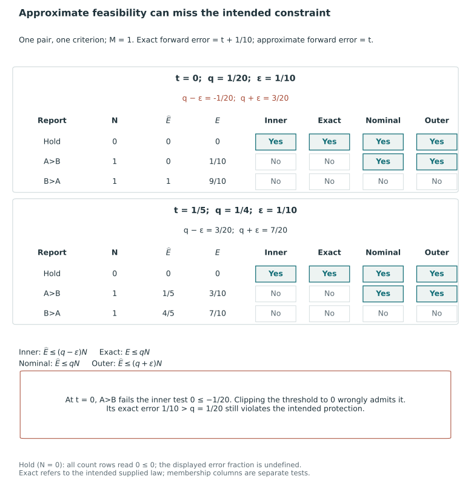
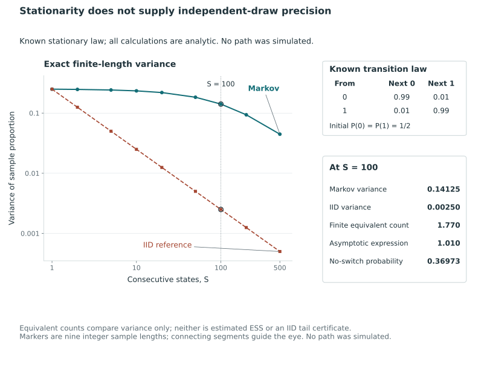

# Numerical and posterior uncertainty {#sec-numerical-uncertainty}

Posterior grading combines uncertainty about latent targets with numerical approximation of probabilities and optimization using those approximations. Model adequacy poses a further question: whether the supplied law describes the evaluation process. Improving one part of this calculation need not resolve uncertainty in the others.

With the supplied law fixed, we derive deterministic bounds for report risk, decision regret and criterion protection from bounded coefficient errors. We then assign a probability to these bounds under specified sampling assumptions. The resulting certificates depend on the objective, feasible family and numerical inputs as well as the optimizer.

The first results give coefficient and protection bounds for weak-error loss, whose withholding cost is fixed. @sec-tie-aware-error gives the corresponding equality-neutral calculations, including uncertainty in the withholding baseline.

## Objective approximation and expected constraints

We use the sample-average literature to motivate uniform error bounds for a report chosen by optimization. Kleywegt, Shapiro, and Homem-de-Mello study sample-average objectives on a finite decision set. Their consistency argument first controls the largest objective error across that set, then relates this error to optimal values and the inclusion of approximate optimizing sets. Eventual optimizer inclusion uses the separation between excluded actions and the declared optimality tolerance, with iid sampling and integrable losses supplying the finite-set uniform convergence argument [@kleywegt_sample_2002, pp. 479–481, Proposition 2.1]. This argument does not assert a known sufficient draw count for the posterior-ranking problem.

Expected constraints also raise a feasibility problem when approximated. Wang and Ahmed compare original expected-value constraints with their sample-average counterparts using relaxed and tightened feasible regions. A solution satisfying a sample constraint may violate the intended expectation constraint, which motivates tightening and separate validation [@wang_sample_2008, pp. 515–518, §2.1 and §3]. We therefore treat objective error and changes in the feasible set separately when imposing criterion protections.

The bounds below specialize deterministic perturbation arguments to posterior pair coefficients and grade reports, retaining the unordered-pair normalization and disclosure-dependent constraint errors. They are derived here; the sample-average literature provides context. A probability statement for their coefficient envelope requires assumptions on the draws and their dependence. Accurate calculation under the selection law still leaves its calibration to the data-generating law to be assessed.

## Effects of coefficient error on risk and feasibility {#sec-coefficient-error}

Coefficient approximation can alter the risk assigned to a report, the risk of the report selected and its feasibility under criterion protections. We bound these changes deterministically using simultaneous coefficient-error bounds. Probabilities for those bounds, sufficient draw counts and assessment of the fitted posterior require additional arguments. Both coefficient accuracy and optimization accuracy are needed to relate a numerical solution to the intended supplied-law problem.

### Approximate coefficients on a common decision domain {#the-same-decision-problem-with-approximate-coefficients}

Fix observed information $Y=y$, $n\ge2$ units, $K\ge1$ oriented criteria, and one proper supplied joint law $\Pi_s(\cdot\mid y)$. Hold the targets, weights $w_k\ge0$ with $\sum_kw_k=1$, withholding cost $0<\tau\le1/2$, and nonempty finite base domain $\mathcal A$ fixed. The domain can encode a cap, an exact grade count or a prescribed order, but it must be the same domain in each comparison where that is assumed.

Write $e_{ij,k}$ for the exact supplied-law probability $\Pi_s(\theta_{ik}\le\theta_{jk}\mid y)$. We suppress the selection superscript and conditioning argument in this section. Here *exact* refers to the stated selection law; it does not identify that law with an unknown evaluation distribution. Equality remains part of the wrong-direction event.

Let $\widehat e_{ij,k}$ be finite approximate coefficients. Suppose finite radii $\varepsilon_k\ge0$ satisfy

$$
\max_{i\ne j}|\widehat e_{ij,k}-e_{ij,k}|\le\varepsilon_k,
\qquad k=1,\ldots,K,
\qquad \delta_w=\sum_kw_k\varepsilon_k.
$$

The maximum includes every ordered distinct pair, allowing reverse errors to be noncomplementary when equality has positive probability. The algebra permits approximate arrays that need not arise from a coherent joint law. For arbitrary finite real entries, $\widehat R$ is an affine proxy rather than necessarily an expected loss. The deterministic conclusions follow from the discrepancy bounds and require no probabilistic interpretation of that proxy.

For a canonical action $g$, retain $x_{ij}(g)=\mathbf1\{g_i<g_j\}$, $N(g)=\sum_{i\ne j}x_{ij}(g)$ and $M=\binom n2$. Define

$$
E_k(g)=\sum_{i\ne j}x_{ij}(g)e_{ij,k},\qquad
\widehat E_k(g)=\sum_{i\ne j}x_{ij}(g)\widehat e_{ij,k}.
$$

Let $R(g)$ denote the exact weighted selection risk and let $\widehat R(g)$ substitute the approximate coefficients into the same formula:

$$
\widehat R(g)=
\frac{\sum_kw_k\widehat E_k(g)+\tau\{M-N(g)\}}M.
$$

Only the comparison coefficients change. The targets, error convention, weights, withholding cost and denominator do not.

A coefficient-error radius measures the numerical accuracy of a probability calculation, not posterior spread. An exactly computed probability may still describe a highly uncertain comparison, and improved integration leaves the uncertainty in the fixed supplied law unchanged. Thus a smaller numerical radius alone does not provide stronger scientific separation of the units.

### Uniform risk bounds for selected reports {#uniform-risk-control-and-a-selected-report}

::: {#prp-coefficient-risk-regret}
### Coefficient perturbation and regret on a common domain {#coefficient-perturbation-and-common-domain-regret}

Under the simultaneous coefficient bound, every $g\in\mathcal A$ satisfies

$$
|\widehat E_k(g)-E_k(g)|\le\varepsilon_kN(g),\qquad
|\widehat R(g)-R(g)|\le\frac{N(g)}M\delta_w\le\delta_w.
$$

Let $g^*$ minimize $R$ over $\mathcal A$. If $\widehat g\in\mathcal A$ satisfies

$$
\widehat R(\widehat g)
\le\min_{g\in\mathcal A}\widehat R(g)+\eta,
\qquad \eta\ge0,
$$

for a finite absolute risk tolerance $\eta$, then

$$
0\le R(\widehat g)-R(g^*)
\le\frac{N(\widehat g)+N(g^*)}M\delta_w+\eta
\le2\delta_w+\eta.
$$
:::

**Proof.** For each criterion, the difference of counts is a sum of $N(g)$ disclosed-pair coefficient errors. The triangle inequality gives its bound. The withholding terms cancel between the two risks, so

$$
\begin{aligned}
|\widehat R(g)-R(g)|
&\le\frac1M\sum_{i\ne j}x_{ij}(g)
\sum_kw_k|\widehat e_{ij,k}-e_{ij,k}|\\
&\le\frac{N(g)}M\sum_kw_k\varepsilon_k.
\end{aligned}
$$

The final uniform inequality follows from $N(g)\le M$. To compare the selected report with the exact optimum, write

$$
\begin{aligned}
R(\widehat g)-R(g^*)
={}&R(\widehat g)-\widehat R(\widehat g)\\
&+\widehat R(\widehat g)-\widehat R(g^*)\\
&+\widehat R(g^*)-R(g^*).
\end{aligned}
$$

The first and last terms obey the respective pointwise bounds. The middle term is at most $\eta$ because the approximate optimization includes $g^*$ in the same domain. Optimality of $g^*$ gives the nonnegative lower bound. $\square$

A report making fewer disclosures accumulates fewer coefficient errors, which gives the sharper bound. For all-tie, both risks equal $\tau$ and there is no perturbation. Since that report makes no comparison, its displayed wrong fraction remains undefined.

On the coefficient envelope, the bounds hold simultaneously for all actions and hence for one selected using the approximate coefficients. Independence between selection and coefficient estimation is unnecessary for this deterministic implication. The probability that the envelope holds must still be established from the sampling experiment.

The tolerance $\eta$ must bound error for the whole approximate problem on the same domain. A valid lower bound and verified feasible incumbent give such an absolute tolerance in the risk units defined in @sec-solver-qualifications. A relative gap, unnormalized gap or gap for a smaller candidate set requires conversion or a further argument before it can be used as $\eta$. Changing the fixed order or admissible reports also invalidates the common-domain premise.

Although the sharper expression contains the possibly unknown disclosure count of an exact optimum, $2\delta_w+\eta$ is available without that count or the exact optimizer. This bounds objective regret, not agreement of the reports. Distinct reports can have equal or arbitrarily close risks, so without a separation condition even small perturbations may change the selected grade vector or the rule for choosing a representative.

### Feasibility under estimated protection coefficients {#estimated-protections-alter-feasibility}

Now declare protected criteria $\mathcal P\subseteq\{1,\ldots,K\}$ and budgets $q_k\in[0,1]$. The intended protected family is

$$
\mathcal A_q=\{g\in\mathcal A:E_k(g)\le q_kN(g),\ k\in\mathcal P\}.
$$

Replacing $E_k$ by $\widehat E_k$ can admit reports that violate the exact constraints and exclude reports that satisfy them. Exact optimization of the estimated problem does not remove this change of feasible family. Its optimum therefore need not be covered by the common-domain regret comparison with the optimum over $\mathcal A_q$.

The criterionwise count bound supplies a more precise construction. Define two families within the **same base domain**:

$$
\mathcal A_{\rm in}=\left\{g\in\mathcal A:
\widehat E_k(g)\le(q_k-\varepsilon_k)N(g),\ k\in\mathcal P\right\},
$$

$$
\mathcal A_{\rm out}=\left\{g\in\mathcal A:
\widehat E_k(g)\le(q_k+\varepsilon_k)N(g),\ k\in\mathcal P\right\}.
$$

::: {#prp-protection-coefficient-envelopes}
### Inner and outer protection families under coefficient error {#inner-and-outer-protection-families}

Under the same simultaneous coefficient-error assumption,

$$
\mathcal A_{\rm in}\subseteq\mathcal A_q
\subseteq\mathcal A_{\rm out}.
$$
:::

**Proof.** For an inner-feasible action,

$$
E_k(g)\le\widehat E_k(g)+\varepsilon_kN(g)
\le q_kN(g).
$$

For an exactly protected action,

$$
\widehat E_k(g)\le E_k(g)+\varepsilon_kN(g)
\le(q_k+\varepsilon_k)N(g).
$$

Apply these implications to every protected criterion. Neither argument divides by $N(g)$. $\square$

The adjusted thresholds enter the count inequalities as signed coefficients. Clipping a negative $q_k-\varepsilon_k$ to zero enlarges the inner family and invalidates the inclusion proof. For example, when $\varepsilon_k>q_k$, a zero approximate count gives only $E_k\le\varepsilon_kN$, which does not ensure $E_k\le q_kN$. With nonnegative approximate probabilities, retaining the negative threshold excludes every positive-disclosure action on that row.

At $N=0$, exact and approximate counts vanish, making inner, exact, and outer rows all $0\le0$ without defining an error fraction. All-tie therefore ensures inner nonemptiness when the base domain permits it. An exact grade count above one excludes all-tie and can leave the inner family empty. Inner feasibility is sufficient rather than necessary for exact protection, so failure to find an inner action leaves exact feasibility unresolved.

A criterion with zero objective weight may still be protected. Its coefficient errors contribute nothing to $\delta_w$, but its own radius remains in the protection rows. Consequently, accurate weighted risk does not alone ensure criterion protection.

### Risk certificate for a protected report relative to the intended optimum {#certifying-a-protected-report-against-the-intended-optimum}

Under the coefficient envelope, every inner action satisfies the intended protection. The outer family contains all exactly protected actions and can therefore supply a lower bound for their optimum. A favorable value for an inner action, on its own, supplies no lower bound.

::: {#prp-inner-outer-risk-certificate}
### Risk certificate from an inner action and outer lower bound {#inner-action-and-outer-lower-bound}

Suppose $g_{\rm in}\in\mathcal A_{\rm in}$ has been verified and a finite number $L_{\rm out}$ satisfies

$$
L_{\rm out}\le
\min_{g\in\mathcal A_{\rm out}}\widehat R(g).
$$

Under the coefficient bound, $g_{\rm in}\in\mathcal A_q$, the exact protected minimum exists, and

$$
0\le R(g_{\rm in})-\min_{g\in\mathcal A_q}R(g)
\le\widehat R(g_{\rm in})-L_{\rm out}+2\delta_w.
$$
:::

**Proof.** The inner action belongs to both larger families, making them nonempty. Its risk satisfies $R(g_{\rm in})\le\widehat R(g_{\rm in})+\delta_w$. Every exactly protected action belongs to the outer family and satisfies

$$
R(g)\ge\widehat R(g)-\delta_w
\ge\min_{\mathcal A_{\rm out}}\widehat R-\delta_w
\ge L_{\rm out}-\delta_w.
$$

Minimizing this inequality over $\mathcal A_q$ and subtracting it from the inner action's upper bound gives the result. Its nonnegative lower bound follows from exact feasibility of $g_{\rm in}$. $\square$

The protection conclusion requires verified inner feasibility, not inner optimality. The action's approximate value and the outer lower bound determine its regret certificate. An outer optimizer may instead violate the intended protection. Neither a lower bound for the smaller inner problem nor one from a restricted outer search can be used as $L_{\rm out}$ without establishing its validity for the full outer problem.

### Two-unit perturbation example with signed inner thresholds {#sec-coefficient-error-example}

One small family illustrates both decision regret and changed constraint feasibility. Take two units, one criterion, weight one, $M=1$, and $\tau=1/4$. Under the intended supplied law, let $\theta_B=0$, with $\theta_A=-1$ having probability $t+1/10$ and $\theta_A=1$ having probability $9/10-t$. Use the approximate forward-error coefficient $\widehat e_{AB}=t$, with the reverse coefficient $1-t$. The exact forward error is $e^s_{AB}=t+1/10$, so the simultaneous coefficient-error bound is $\varepsilon=\delta_w=1/10$. Consider $t\in\{0,1/5\}$ and set $q=t+1/20$. The word *exact* refers to the stipulated selection law, not a verified data-generating posterior.

At $t=1/5$, the three reports have the following risks:

| Report | $N$ | Approximate risk $\widehat R$ | Exact supplied-law risk $R^s$ |
|---|---:|---:|---:|
| Withhold | $0$ | $1/4$ | $1/4$ |
| $A>B$ | $1$ | $1/5$ | $3/10$ |
| $B>A$ | $1$ | $4/5$ | $7/10$ |

The approximate optimum reports $A>B$, whereas the exact supplied-law optimum withholds. The resulting risk regret is $3/10-1/4=1/20$. The disclosure-sensitive bound is $\{1+0\}(1/10)=1/10$ with optimization error zero; the uniform $2\delta_w$ bound is $1/5$. Withholding has no coefficient error because its risk is the common constant $\tau$.

Now impose the criterion protection. At this parameter value, $q=1/4$: the forward report satisfies the nominal approximate row because $1/5\le1/4$, but violates the exact row because $3/10>1/4$. An exact solution of the nominal approximate constrained problem would therefore still be infeasible for the intended constraint.

For both parameter points, the unmodified inner set contains only withholding, the exact protected set also contains only withholding, and the outer set contains withholding and $A>B$. The exact minimum of the approximate objective over that outer set is $L_{\mathrm{out}}=t$. Using the inner action that withholds gives the bound

$$
R^s(g_{\mathrm{in}})-\min_{\mathcal A_q}R^s
\le \frac14-t+\frac15.
$$

The bound is $1/4$ at $t=1/5$ and $9/20$ at $t=0$, while actual constrained regret is zero at both points. The deliberately loose values illustrate the inner-action/outer-bound construction rather than sharpness. Requiring exactly two grades leaves the inner family empty, so this certificate has no action to evaluate.

The $t=0$ case also shows why the inner threshold must remain unmodified. Here $q=1/20$ and $q-\varepsilon=-1/20$. The forward approximate error is zero, so it fails the negative inner threshold. Replacing that threshold by zero would admit $A>B$, although its exact error $1/10$ exceeds $q$. Clipping changes the set and destroys the claimed inclusion in this example. The zero-disclosure count inequality still reads $0\le0$ with the negative threshold; its error fraction remains undefined.

Enumerating the three actions at both parameter values in exact rational arithmetic verifies the perturbations, regret bounds and feasible sets. The deterministic example illustrates the general bounds proved above; it provides neither a sampling probability nor a numerical solver certificate.

@fig-vis-f15a makes the four count tests explicit for both parameter values. The signed inner threshold is part of the safety argument.

::: {#fig-vis-f15a}
<picture>
<source media="(max-width: 720px)" srcset="../assets/figures/f15a-approximate-and-intended-protection-feasibility-mobile.svg">

</picture>

Nominal and intended criterion-protection feasibility under the supplied law. Here the approximate forward error is t, the exact forward error is t+1/10, q=t+1/20, and epsilon=1/10. Both parameter panels use the same three reports and M=1. Withholding belongs to all four displayed families; A>B belongs to the nominal and outer families but fails the exact and inner tests. At t=0, the signed inner threshold is -1/20. Clipping it to zero would admit A>B despite its exact error 1/10 exceeding q=1/20. The homogeneous count rows admit withholding when it belongs to the base family, while its displayed error fraction remains undefined.
:::

### Assumptions and scope of the risk certificate {#what-the-certificate-does-not-supply}

The certificates require simultaneous coefficient accuracy and the specified feasibility and optimization conditions. No probability has yet been assigned to these premises. If certificates are issued only on some runs, a failure bound over all runs need not hold conditional on issuance; that claim needs a separate sampling argument.

If the inner family is empty or no outer lower bound is available, this sufficient construction has not certified a report. A satisfactory solution of the intended problem may nevertheless exist. The derivation does not provide a general numerical certification implementation.

Application of the inequalities requires validated error radii and optimization bounds, including arithmetic error and coefficient generation. Favorable rounding cannot establish either premise. Given these premises, the results account for coefficient and optimization errors; model validation, normative weights, realized tail events and other evaluation laws must be examined separately.

## Monte Carlo error under a declared sampling law {#sec-monte-carlo-coefficients}

We first assign a probability to the coefficient envelope for independent whole-state posterior draws, then examine which assumptions change for Markov-chain draws.

Fix the observed information $y$, the joint selection law, the oriented targets, and the unit and criterion frame. Suppose $S$ whole latent states are independently drawn from $\Pi_s(\cdot\mid y)$, with $S$ fixed before drawing them. For draw $b$, calculate

$$
X^{(b)}_{ij,k}=\mathbf1\{\theta^{(b)}_{ik}\le\theta^{(b)}_{jk}\},
\qquad \widehat e_{ij,k}=\frac1S\sum_{b=1}^S X^{(b)}_{ij,k}.
$$

Each indicator has expectation equal to the exact coefficient $e_{ij,k}$ under this numerical experiment. Whole draws retain dependence among units and criteria; resampling marginal coordinates independently generally changes the target law. Independence is assumed across successive whole draws, while pair events within a draw may be highly dependent.

Write $\Pr_{\rm MC}(\cdot\mid y)$ for the randomness of these draws. This differs from latent-state uncertainty under $\Pi_s$ and performance across datasets under an evaluation law. With $y$ and $\Pi_s$ fixed, increasing $S$ improves approximation to the law while retaining its posterior uncertainty.

### Simultaneous coefficient bounds at a fixed sample size {#a-fixed-sample-simultaneous-bound}

::: {#prp-iid-coefficient-envelope}
### Coefficient envelope for independent whole-state draws {#independent-draw-coefficient-envelope}

Let $n\ge2$, $K\ge1$, $M=\binom n2$ and $0<\alpha<1$. Under the fixed-sample iid construction,

$$
\Pr_{\rm MC}\left(
\max_{i\ne j,k}|\widehat e_{ij,k}-e_{ij,k}|\le
\sqrt{\frac{\log(4MK/\alpha)}{2S}}
\,\middle|\,y\right)\ge1-\alpha.
$$

All ordered directions are included, and latent equality is allowed. No independence across pair coordinates or across criteria is required.
:::

**Proof.** For a Bernoulli indicator $X$ with mean $p$, the centered log moment-generating function $h(t)=\log\mathbb E\exp\{t(X-p)\}$ has $h(0)=h'(0)=0$. Its second derivative is the variance of a Bernoulli variable under exponential tilting, at most $1/4$. Taylor's formula gives $h(t)\le t^2/8$ for every real $t$; degenerate Bernoulli variables satisfy the same bound. Independence across draws and exponential Markov inequality therefore imply, for any $u>0$ and $t>0$,

$$
\Pr_{\rm MC}(\widehat e_{ij,k}-e_{ij,k}\ge u\mid y)
\le\exp(-Stu+St^2/8).
$$

Setting $t=4u$ bounds this tail by $\exp(-2Su^2)$. The lower tail has the same bound, so the two-sided probability is at most $2\exp(-2Su^2)$. There are $Kn(n-1)=2MK$ ordered pair-criterion coordinates. Taking their union bounds the probability of any violation by $4MK\exp(-2Su^2)$. Substituting the displayed radius proves the result. $\square$

This specializes the classical bounded-variable exponential-moment argument to the comparison indicators [@hoeffding1963bounded, pp. 14–15, Theorem 1, eq. (2.3)]. The calculation specifies the sampling experiment and counts its coordinates; it does not derive a new concentration inequality. Retaining both directions accommodates equality, which contributes to the weak-error event for either strict direction. A radius greater than one is uninformative because empirical and exact probabilities already lie between zero and one.

Different criteria can receive different error allocations. If positive numbers $\alpha_k$ are fixed before drawing, with $\sum_k\alpha_k\le\alpha$, then

$$
\varepsilon_k=
\sqrt{\frac{\log(4M/\alpha_k)}{2S}}
$$

gives simultaneous criterionwise envelopes with joint probability at least $1-\alpha$. The union bound again requires no independence between criteria. These radii can be used in the previous section's weighted radius and protection margins. The allocation describes numerical failure probabilities, while the objective weights and protection budgets express different features of the decision problem.

### Uniform bounds for optimization using the same draws {#why-optimization-using-the-same-draws-is-covered}

On the simultaneous event, the deterministic risk and protection bounds hold for every report, including one optimized using the same coefficients. Every report risk depends on the same finite coefficient array, so no additional factor for the number of grade vectors is needed. The coefficient envelope thus covers selection using the same draws.

The envelope establishes coefficient accuracy. To bound regret, one also needs an absolute suboptimality bound for the entire approximate problem; to certify a protected report, one needs a verified inner action and a valid lower bound for the entire outer problem. These computational premises must be verified separately.

Suppose the procedure issues a certificate only when the mathematical optimization and feasibility premises hold. A false issued certificate can then occur only if the coefficient envelope fails, giving probability at most $\alpha$ over **all** runs at the fixed sample size. Failure probability conditional on issuance concerns a different experiment, and non-issuance leaves the existence of an acceptable report unresolved.

### Fixed sampling assumptions and limits of the bound {#fixed-sampling-assumptions-are-part-of-the-result}

The law, targets, coordinate universe and sample size are fixed before sampling. Repeated inspection followed by stopping when an interval is satisfactory requires a sequential argument, and selecting error allocations after observing deviations requires an appropriate multiplicity construction. Uniformity over actions covers selection by optimization but does not justify arbitrary stopping times.

The proof factors exponential moments across independent draws and hence does not justify replacing $S$ with an estimated effective sample size. Dependence, initialization error, weighted sampling and approximate kernels require separate analyses. Even small integration error leaves external calibration of the supplied model unresolved.

## A finite-sample coefficient bound for dependent draws {#sec-dependent-monte-carlo}

Dependent draws require assumptions about the simulation process in addition to the supplied law. Paulin's spectral concentration inequality provides one precise route. The version matters: the 2015 publication is followed by a corrected 2018 arXiv revision whose Theorem 3.9 adds an even-sample-size condition for the selected inequality on general state spaces [@paulin_concentration_2015; @paulin_concentration_2018v5, pp. 3, 16–17]. The following application uses that revised statement.

Condition on observed $Y=y$. Suppose $\Theta^{(1)},\ldots,\Theta^{(S)}$ is a stationary, reversible, time-homogeneous, $\varphi$-irreducible, aperiodic Markov chain on a Polish space, with unique stationary law $\Pi_s(\cdot\mid y)$. Assume its ordinary $L^2$ spectral gap has a justified lower bound $\gamma_0>0$, and take a fixed even number $S$ of draws. Finite state spaces also permit odd $S$ under the cited theorem. This is a statement about the full joint chain; its separate pair indicators need not form Markov chains.

For every ordered pair and criterion, evaluate $f_{ij,k}(\Theta)=\mathbf1\{\theta_{ik}\le\theta_{jk}\}$. Its stationary mean is the required coefficient $e^s_{ij,k}$, and its empirical mean is $\widehat e^s_{ij,k}$. The indicator has centered magnitude at most one and variance at most $1/4$. Substitution in Theorem 3.9, equation (3.21), followed by a union bound over $Kn(n-1)$ coordinates gives, for $0<\varepsilon\le1$,

$$
\Pr_{\mathrm{MC}}\left(\max_{i\ne j,k}|\widehat e^s_{ij,k}-e^s_{ij,k}|\ge\varepsilon\mid y\right)
\le\min\left\{1,2Kn(n-1)\exp\left(-\frac{S\gamma_0\varepsilon^2}{1+10\varepsilon}\right)\right\}.
$$

The union bound allows dependence among pairs and criteria. Both directions are included because equality is an error for either strict disclosure. On the resulting coefficient event, the deterministic risk and constraint bounds also hold for a report selected using these coefficients. The probability bound concerns approximation to the supplied law, without assessing its agreement with the data-generating process.

A long run does not by itself establish stationarity or the spectral-gap bound. Paulin's Proposition 3.15 accommodates nonstationary starts with a bound on the appropriate initialization discrepancy; an arbitrary burn-in does not provide that bound [@paulin_concentration_2018v5, pp. 14, 18]. Estimated effective sample size also gives no certified gap. Without justified constants the theorem states requirements for a finite-sample guarantee rather than certifying a computation. Adaptive stopping requires an additional argument.

### Finite-sample coefficient error in a stationary two-state chain {#sec-markov-dependence-example}

Consider a two-unit, one-criterion posterior with two equally probable latent states: $(\theta_A,\theta_B)=(-1,0)$ and $(1,0)$. The exact coefficient $e_{AB}$ is $1/2$. Let $X_b=\mathbf1\{\theta_A^{(b)}\le\theta_B^{(b)}\}$ be generated by a stationary two-state Markov chain. At each transition it stays in its current state with probability $99/100$ and switches with probability $1/100$. Its invariant distribution is the intended equal-probability posterior, and its initial state is drawn from that invariant distribution. There is no initialization error in this construction.

Use $S=100$ consecutive states to estimate the coefficient. The probability that the chain never switches is

$$
\Pr_{\rm MC}(X_1=\cdots=X_{100})
=\left(\frac{99}{100}\right)^{99}
\approx0.36973.
$$

On this event, the sample proportion is either zero or one, and its error from $1/2$ is exactly $1/2$. If the independent-draw proposition were incorrectly used with $M=K=1$ and $\alpha=0.05$, its nominal simultaneous radius would be

$$
\sqrt{\frac{\log(80)}{200}}\approx0.14802.
$$

The no-switch event alone makes this proposed envelope fail with probability at least $0.36973$, well above $0.05$. This is a lower bound on the actual failure probability, not a calculation of its complete distribution. Stationary marginal draws do not satisfy the independence premise of the iid bound.

The same chain gives an exact variance comparison. Its lag-one correlation is $\rho=1-2/100=0.98$. Writing $Z_b=2X_b-1$, the transition rule gives $\mathbb E(Z_{b+h}\mid Z_b)=\rho^h Z_b$, so stationarity implies

$$
\operatorname{Cov}(X_b,X_{b+h})=\frac14\rho^h.
$$

Consequently,

$$
\operatorname{Var}\!\left(\frac1S\sum_{b=1}^S X_b\right)
=\frac{1}{4S^2}\left\{S+2\sum_{h=1}^{S-1}(S-h)\rho^h\right\}.
$$

At $S=100$ this variance is approximately $0.14125$, compared with $0.0025$ for one hundred independent Bernoulli draws of mean $1/2$. The number of independent Bernoulli draws with the same sample-mean variance would be approximately $1.770$. The long-run variance formula gives the different asymptotic equivalent count $S(1-\rho)/(1+\rho)=100/99\approx1.010$. These quantities are calculated from the known transition law; neither is an ESS estimated from a realized chain, and the asymptotic expression is not the exact finite-length variance equivalence.

The variance-equivalent counts describe numerical precision but cannot replace $S$ in an iid tail inequality. Finite-sample coverage requires an analysis of dependence. For this chain, exact rational arithmetic verifies the covariance sum against separate first- and second-moment propagation through the transition matrix. The calculation uses neither a simulated path nor an empirical convergence diagnostic.

@fig-vis-f15b displays the exact finite-sample variance in this stationary example beside the independent-draw reference. Its separate count summaries describe variance; they do not supply an IID probability guarantee.

::: {#fig-vis-f15b}
<picture>
<source media="(max-width: 720px)" srcset="../assets/figures/f15b-stationarity-does-not-supply-iid-precision-mobile.svg">

</picture>

Finite-length sample-mean variance under a stationary two-state chain and an independent-draw reference. Stationarity does not supply independent-draw precision. The chain starts in its invariant distribution, stays with probability 0.99 and switches with probability 0.01. Curves compare exact finite-length sample-mean variance with an independent Bernoulli reference. At S=100 the variances are about 0.14125 and 0.0025; the finite variance-equivalent count is about 1.770, while the asymptotic expression is about 1.010. Neither is estimated ESS or an IID tail certificate. The exact no-switch probability is about 0.36973. All values come from the stipulated transition law; no path was simulated.
:::

## Multivariate output analysis and effective sample size {#sec-mcmc-output-analysis}

Posterior draws from a Markov chain require output analysis for the quantities actually estimated. At fixed observed information $y$, suppose the chain has the declared supplied law $\Pi_s(\cdot\mid y)$ as its invariant distribution. Let $\psi(\Theta)\in\mathbb R^p$ collect a declared vector of comparison indicators, let $\mu=\mathbb E_s\psi(\Theta)$, and let $\widehat\mu_S$ average $S$ chain iterations. Under appropriate Markov-chain conditions, the Monte Carlo central limit theorem has the form

$$
\sqrt S(\widehat\mu_S-\mu)
\ \xrightarrow{d}\ \mathcal N_p(0,\Sigma_{\rm MC}).
$$

Here $\Sigma_{\rm MC}$ describes the asymptotic covariance of the Monte Carlo error. It is generally different from the target-distribution covariance $\Lambda=\operatorname{var}_s\{\psi(\Theta)\}$. Vats, Flegal, and Jones develop multivariate output analysis using this distinction and define, when both matrices have full rank,

$$
\operatorname{ESS}_{\rm multi}
=S\left\{\frac{\det(\Lambda)}{\det(\Sigma_{\rm MC})}\right\}^{1/p}.
$$

This measure compares generalized variances and acknowledges cross-component dependence. Its estimation requires appropriate estimates of the two covariance matrices; ordinary sample covariance does not by itself account for serial dependence [@vats_multivariate_2019, pp. 322–323, 327–329].

Their stopping rule compares joint confidence-region volume with a relative scale determined by target variability. Under the moment, ergodicity, and strong-consistency conditions, the stopped region has limiting coverage as the requested tolerance tends to zero; the ESS threshold uses an asymptotic approximation [@vats_multivariate_2019, pp. 326–328, Theorem 1 and equation (10)]. These are multivariate asymptotic results rather than exact finite-sample coordinate bounds or anytime-valid confidence sequences. They also give no substitution of estimated ESS into an iid inequality. Projection of an ellipsoid inherits its applicable coverage, but a volume criterion alone specifies no maximum-coordinate tolerance.

The comparison vector may be structurally rank deficient. Under almost-sure pairwise tie-freeness, reverse indicators sum to one and are affinely redundant; indicators with probability zero or one are constant. The full-rank determinant formula therefore need not apply to the complete vector. A reduced representation must retain enough information to recover the required coefficients and justify the associated error statement.

Batch-means assessment depends on batch size, batch count and chain convergence. Vats, Flegal, and Jones discuss how mixing affects suitable sizes and why positive-definite estimates are difficult to obtain in high dimensions in their 2019 paper [@vats_multivariate_2019, pp. 328–329, 335]. Neither a favorable ESS estimate nor a customary batching rule establishes the simultaneous coefficient envelope.

### Assumptions for multivariate Monte Carlo output analysis {#diagnostic-assumptions}

The following questions organize the conditions in Vats, Flegal, and Jones's framework [@vats_multivariate_2019, pp. 322–329]. Their answers concern the indicator expectations used by the decision problem.

| Diagnostic question | Requirement or object | Permitted interpretation and boundary |
|---|---|---|
| What is being estimated? | A declared fixed-dimensional vector of expectations under the chain's invariant law; pp. 322–323. | For P1, choose the directional indicators actually needed. An ESS for different scalar summaries does not automatically describe them. |
| Does a CLT apply? | Source moment, ergodicity, and nondegeneracy conditions; p. 322 and Theorem 1. | Bounded indicators satisfy moment requirements, but do not establish the chain's convergence rate or correct invariant target. |
| Which covariance matters? | $\Sigma_{\rm MC}$ governs the mean's CLT; $\Lambda$ measures one-draw variation. | Ordinary posterior sample covariance alone does not estimate serially dependent Monte Carlo error. |
| Is covariance estimation justified? | Increasing batches and batch lengths, plus the stated consistency/rate conditions; pp. 328–329. | A computed matrix or a customary batch-size choice is not itself proof of consistency or finite-sample accuracy. |
| Are determinants and inverses defined? | Full-rank population and estimated covariances; pp. 323, 326–328. | More than $p$ batches is a necessary rank condition for the batch-means matrix, not a remedy for structural redundancy. |
| What does stopping certify? | Theorem 1's relative-volume rule and limiting coverage as tolerance shrinks. | Joint asymptotic coverage differs from a finite-sample maximum-coordinate error bound or an anytime-valid confidence sequence. |

## Interpretation of numerical risk and error guarantees {#sec-interpreting-numerical-claims}

Posterior comparison probabilities concern the supplied law. Monte Carlo error measures how closely they have been approximated under a sampling mechanism, while an optimization bound concerns the specified objective and action family. Evaluation of external performance introduces another law. The preceding results relate these quantities under their stated assumptions.

For a report satisfying criterion protection, $q_k$ bounds its expected wrong fraction under the supplied law at positive disclosure. A numerical allocation $\alpha$ bounds envelope failure across the specified sampling runs. They have different roles, as do a solver tolerance and a Monte Carlo standard error. Giving each quantity separately identifies which premises support a combined result. In @sec-evaluation-frontiers, we study performance under evaluation laws and at matched disclosure; @sec-misspecification-calibration examines discrepancies between selection and evaluation laws.

## Perturbation and sampling error for equality-neutral risk {#sec-tie-aware-error}

The weak-error bounds use fixed withholding cost. Equality-neutral risk instead depends on both strict-error and distinctness probabilities. Estimating the baseline $R_0^s$ can therefore perturb even all-withhold risk. We derive the corresponding bound with the supplied law, targets, weights, and action family held fixed.

Suppose finite nonnegative simultaneous radii satisfy, for every ordered pair and criterion,
$$
|\widehat b_{ij,k}-b_{ij,k}|\le\varepsilon^b_k,
\qquad
|\widehat d_{ij,k}-d_{ij,k}|\le\varepsilon^d_k.
$$
Distinct coefficients are symmetric in their two unit indices. Define $\Delta_b=\sum_kw_k\varepsilon^b_k$ and $\Delta_d=\sum_kw_k\varepsilon^d_k$. The estimated risk uses $\widehat b$ for disclosed directions and $\widehat d$ for withheld pairs, with the same weights and normalization as its exact target. The action is held fixed while evaluating the following difference.

::: {#prp-tie-aware-perturbation}
### Equality-neutral risk and regret with two coefficient components {#risk-and-regret-with-two-coefficient-components}

For every action $g$,
$$
|\widehat R_{\rm TA}(g)-R_{\rm TA}(g)|
\le \frac{N(g)\Delta_b+\tau\{M-N(g)\}\Delta_d}{M}
\le \zeta,
\qquad \zeta=\max\{\Delta_b,\tau\Delta_d\}.
$$
On a common nonempty finite family $\mathcal F$, let $\widehat g\in\mathcal F$ and let $\eta\ge0$ be finite. If
$\widehat R_{\rm TA}(\widehat g)\le\min_{g\in\mathcal F}\widehat R_{\rm TA}(g)+\eta$,
then
$$
R_{\rm TA}(\widehat g)-\min_{g\in\mathcal F}R_{\rm TA}(g)
\le2\zeta+\eta.
$$
If $\widehat d_{ij,k}=\widehat b_{ij,k}+\widehat b_{ji,k}$ and the same identity holds for the exact coefficients, one may take $\varepsilon^d_k=2\varepsilon^b_k$. For $0<\tau\le1/2$, this yields the simpler uniform bound $\zeta=\Delta_b$ and regret bound $2\Delta_b+\eta$.
:::

**Proof.** Each of the $N(g)$ disclosed pairs contributes at most $\Delta_b$ to the absolute difference in the unnormalized risk. Each of the $M-N(g)$ withheld pairs contributes at most $\tau\Delta_d$. The triangle inequality gives the first bound; it is a convex combination of the two component radii. Let $g^*$ minimize the exact risk in $\mathcal F$. Insert and subtract the two estimated risks:
$$
R_{\rm TA}(\widehat g)-R_{\rm TA}(g^*)
\le\zeta+
\{\widehat R_{\rm TA}(\widehat g)-\widehat R_{\rm TA}(g^*)\}
+\zeta\le2\zeta+\eta.
$$
For coherently constructed distinct coefficients, the reverse-pair identity and triangle inequality give $|\widehat d-d|\le2\varepsilon^b_k$. Since $2\tau\le1$, the uniform radius is at most $\Delta_b$. $\square$

@fig-vis-f15c separates the two contributions to a fixed-action error bound from the common-family regret argument. The horizontal axis is the raw disclosure fraction, rather than distinct-comparison coverage.

::: {#fig-vis-f15c}
<picture>
<source media="(max-width: 720px)" srcset="../assets/figures/f15c-two-coefficient-uncertainties-contribute-to-risk-mobile.svg">

</picture>

Equality-neutral risk-error bounds from strict-error and distinctness coefficients. With illustrative simultaneous radii $\Delta_b=0.10$ and $\Delta_d=0.20$ and withholding price $\tau=0.25$, the disclosed contribution $\rho\Delta_b$ and withheld contribution $(1-\rho)\tau\Delta_d$ sum to $B(\rho)=0.05+0.05\rho$, where $\rho=N(g)/M$. Thus the bound remains $0.05$ at zero disclosure because the distinctness-dependent withholding baseline can have coefficient error. The dashed uniform radius is $\zeta=0.10$. The separate proof bridge gives exact-risk regret at most $2\zeta+\eta=0.20$ for $\eta=0$, conditional on a common nonempty finite family and the simultaneous coefficient bounds. The curve is an algebraic envelope, not an attained report path, observed error curve or confidence band.
:::

The same coarse uniform bound can hold even when the action-specific bound changes. Consider two units and one criterion: one law always makes their targets equal, while another assigns probability $1/10$ to each strict order and $4/5$ to equality. The largest directional $b$ discrepancy is $1/10$, but all-withhold risks differ by $\tau/5>0$. A bound proportional only to $N(g)$ would incorrectly give zero, whereas the two-component bound is exactly $\tau/5$ for this action. These are stipulated laws rather than fitted-model errors.

### Whole-state simulation and baseline-error dependence {#whole-state-simulation-and-a-shared-baseline}

With fixed-size IID whole-state draws, strict comparison indicators are Bernoulli variables. The argument in @prp-iid-coefficient-envelope gives a simultaneous bound over $J=n(n-1)K$ ordered coordinates: a common radius $\varepsilon$ has failure probability at most $2J\exp(-2S\varepsilon^2)$. Constructing $\widehat d=\widehat b_{ij}+\widehat b_{ji}$ from the same draws then gives the coherent bound. The probability is over numerical draws at the prespecified sample size and coordinate set, conditional on the observed information and supplied law. Model equality declarations, dependence in MCMC, and optional stopping require additional justification.

The errors in $\widehat b$, $\widehat d$ and $\widehat R_0$ are generally dependent. A fixed-action loss trace must therefore retain strict-error and distinct-opportunity indicators from the same whole draw; treating the baseline and disclosure errors as independent would omit their covariance. Independent selection and evaluation batches can separate those operations, but evaluation still uses the frozen loss and action. A bound for the selection optimization does not certify an optimum for the evaluation batch.

The uniform argument requires a fixed family, possibly defined by a structural equality partition supported by the model. Observing no differences in a finite batch does not establish almost-sure equality or permit transfer of the result to a newly inferred random family. The derivations do not establish implementation of the corresponding helpers: the current tie-aware interface does not provide the legacy uniform IID, regret, protection-envelope or MC-diagnostic guarantees in the new mode.

### A prospective protection margin with a distinct-opportunity denominator {#a-prospective-distinct-denominator-protection-margin}

For a declared $q_k\ge0$, the distinct-opportunity protection is $E^b_k\le q_kQ_k$, rather than the earlier $E_k\le q_kN$. Both sides can now have coefficient error. At a fixed action,
$$
\left| (\widehat E^b_k-q_k\widehat Q_k)
-(E^b_k-q_kQ_k)\right|
\le N(g)(\varepsilon^b_k+q_k\varepsilon^d_k).
$$
Bounding the two disclosed-pair sums gives the inequality. An estimated residual no greater than the negative radius suffices for exact protection; exact protection implies an estimated residual no greater than the positive radius. This uses the specified denominator, radii, and common family, rather than the earlier $(q_k\pm\varepsilon_k)N$ construction. Positive exposure, software support, and guard consolidation under protections require further results.
