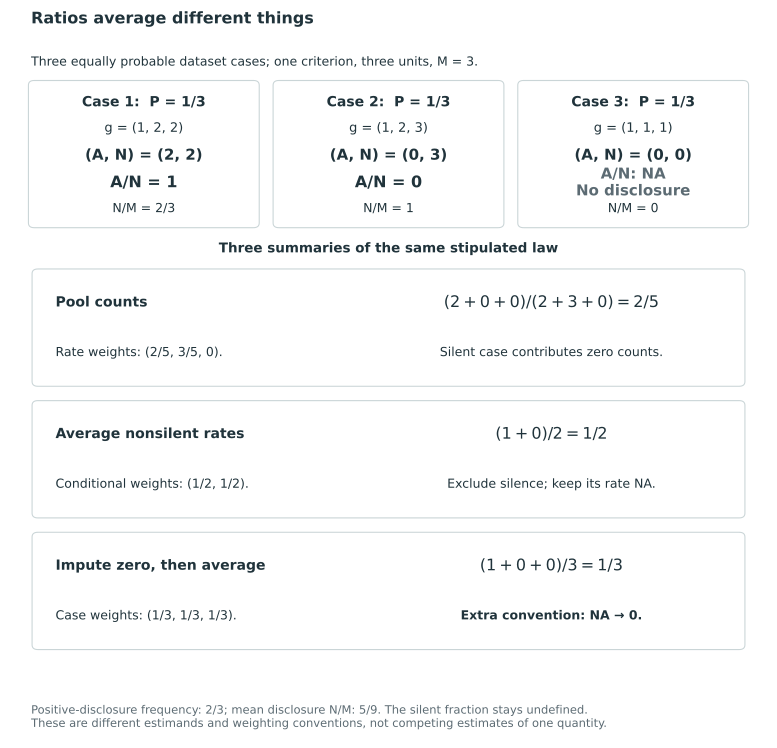
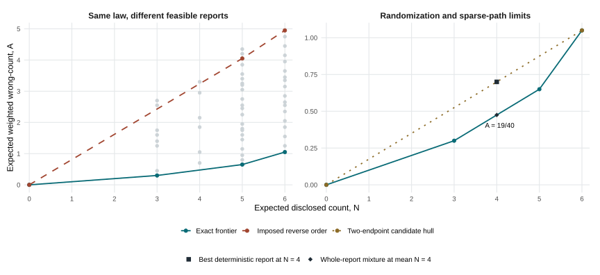
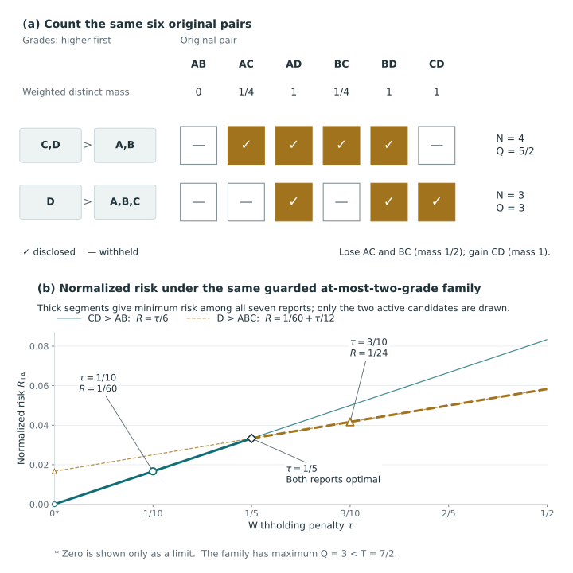

# Evaluation laws and disclosure frontiers {#sec-evaluation-frontiers}

A lower expected loss can result from choosing better within the same family, changing the target, enlarging the family or altering the cost of withholding. Interpreting a comparison requires identifying which of these changes occurred. This also determines whether its direction follows mathematically or requires empirical evidence.

With the true conditional posterior, an exact optimizer has no greater expected loss than another feasible report under the same expected-loss objective and action family. The size and practical importance of the advantage remain to be assessed. Restricting the search, changing the estimand or evaluating under another law can leave even the sign undetermined. We first establish the finite-action Bayes comparison, followed by error denominators, matched-disclosure randomization and conditional evaluation.

We evaluate weak-error loss in terms of raw disclosure counts, then extend the analysis to the distinct-mass frontier and denominators for equality-neutral loss in @sec-tie-aware-frontier.

## Conditional Bayes dominance and its limits {#sec-conditional-bayes-dominance}

Minimizing posterior expected loss gives the standard conditional optimality result. KRW uses this principle to choose grades under its supplied reporting beliefs [@kline_discrimination_2024, p. 2480, equation (3) and following paragraph]. We apply the same argument to the loss and feasible reports defined here.

The comparison requires common targets, loss, law and action family. Optimizing boundaries within a fixed order need not improve on a report outside that family, and optimizing scalar-composite loss need not minimize criterion-specific loss. To transfer the comparison to another evaluation model, equality of the relevant conditional risks suffices; equality of the conditional laws is one sufficient condition. Averaging the conditional inequality then compares integrated risks under that model. It establishes no superiority at every realized dataset or fixed latent state, consistent with the posterior, preposterior and fixed-parameter risk distinctions in Bayesian ranking [@lin2006ranking, p. 917, §2.1].

### A conditional comparison over complete reports

Fix observed information $Y=y$. Let $\mathcal F(y)$ be a nonempty subset of the finite canonical grade-action space $\mathcal A_n$. The family may depend on the data: a score order, score-tie restriction, grade cap, exact grade count, or posterior criterion protection can all help define it. Once $y$ is fixed, the entire family is fixed for this comparison. Write $L_y(g,\Theta)$ for the declared loss, allowing the data-dependent target transformations and preference settings described in @sec-posterior-risk-laws. Assume its absolute expectation under $\Pi_s(\cdot\mid y)$ is finite for every eligible action. Define

$$
R^s(g\mid y)=\int L_y(g,\vartheta)\,\Pi_s(d\vartheta\mid y).
$$

We use this function to evaluate all reports in the comparison. A report originally chosen for another objective or belief is still evaluated under the common law and loss.

::: {#prp-conditional-bayes-dominance}
### Conditional and integrated Bayes comparison

Let $g^*(y)\in\operatorname{argmin}_{g\in\mathcal F(y)}R^s(g\mid y)$. For every $h\in\mathcal F(y)$,

$$
R^s(g^*(y)\mid y)\le R^s(h\mid y).
$$

More generally, let $h=\delta(y,U)\in\mathcal F(y)$ almost surely under an auxiliary kernel $\mathsf K(du\mid y)$. Selection risk averages the supplied belief and this kernel independently at fixed $y$. Then

$$
R^s(g^*(y)\mid y)
\le\int R^s(\delta(y,u)\mid y)\,\mathsf K(du\mid y)
=\overline R^s(\delta\mid y).
$$

Additionally, suppose $P$ is a joint law for $(\Theta,Y)$ with a conditional target law, and $\Pi_s(\cdot\mid y)=P(\cdot\mid y)$ for $P_Y$-almost every $y$. Suppose the feasible-family membership indicators, loss, and decision rules are measurable, and the losses of the selected reports are integrable. Under $U\perp\!\!\!\perp\Theta\mid Y$, with conditional kernel $\mathsf K$, the preceding comparison implies

$$
E_P[L_Y(g^*(Y),\Theta)\mid Y]
\le E_{P,\mathsf K}[L_Y(\delta(Y,U),\Theta)\mid Y]
\quad P_Y\text{-almost surely},
$$

and hence

$$
\mathcal R_P(g^*)\le\mathcal R_P(\delta).
$$
:::

**Proof.** Finiteness and nonemptiness give an attained minimum. Subtract it from the risk of each feasible action; every difference is nonnegative. Averaging these differences under the auxiliary kernel proves the randomized inequality. Under equality of the conditional laws and conditional independence, each averaged risk equals the corresponding conditional expectation of realized loss. The tower property then gives the integrated inequality. A fixed enumeration of $\mathcal A_n$ supplies measurable tie-breaking among minimizers when membership and risks are measurable. $\square$

Randomization here selects whole coherent reports. Independent randomization of pair directions may not produce a grade action. A selector informed by the latent state also falls outside the auxiliary-randomization assumption, since its randomness need not be independent of $\Theta$ given $Y$. When a rule uses additional observed information, that information and the corresponding conditional law must be included in the analysis. Thus the information supplied to the competing rules is part of the interpretation of the risk comparison.

### Feasible families and the scope of comparison {#the-family-determines-which-comparisons-are-covered}

F1, the fixed-order method in the comparator crosswalk, optimizes contiguous partitions of a score order $\rho(y)$, with the score-tie, cap, exact-count and protection restrictions actually imposed. An order estimated from $Y$ is fixed once we condition on $y$. A comparator based on another order is covered only if its final report belongs to this same family. Exact boundaries and a correct posterior do not extend the guarantee to reports outside it. The construction in @sec-bayes-domain-example illustrates this restriction using an imposed order; it does not show that an expected-rank rule selects that order.

F2 permits both the order and boundaries to vary. Exact optimization over $\mathcal A_{\le G_{\max}}$ covers every comparator with no more than that number of grades. If the family instead requires exactly $G_0$ grades, the comparator must belong to $\mathcal A_{=G_0}$, excluding reports with fewer grades. Similarly, criterion protection conditions $E^s_k(g)\le q_kN(g)$ must hold for the comparator under the same coefficients. A protected optimum need not improve on reports that violate these conditions.

As in @prp-action-space-and-bounds, verified membership in the optimization family determines eligibility for comparison. A common cap, exact-count requirement and protections are one way to ensure that membership. The family must be nonempty, and numerical feasibility tolerances alone do not establish exact membership. A candidate list or fixed-order solution can support unrestricted dominance only with a valid comparison over the whole required family.

### Order restrictions under a correct law {#sec-bayes-domain-example}

A two-unit construction isolates the role of the action family. Fix the observed information and let the supplied and evaluation laws both put probability one on $(\theta_A,\theta_B)=(1,0)$. There is one criterion, with weight one, and $\tau=1/4$. The unrestricted at-most-two-grade family has the three reports shown below. Now impose the fixed order $\rho=(B,A)$, allowing only its contiguous partitions.

| Report | Canonical vector $(g_A,g_B)$ | Disclosed count $N$ | Wrong count under the stipulated state | Risk | In the fixed-order family? |
|---|---|---:|---:|---:|---|
| Withhold | $(1,1)$ | $0$ | $0$ | $1/4$ | Yes |
| Report $A>B$ | $(1,2)$ | $1$ | $0$ | $0$ | No |
| Report $B>A$ | $(2,1)$ | $1$ | $1$ | $1$ | Yes |

There is one unordered pair, so each risk follows directly from $D+\tau(1-N)$. Withholding uniquely minimizes risk in the restricted family, while the excluded report $A>B$ uniquely minimizes it in the unrestricted family. The restricted optimum is worse than that feasible unrestricted comparator by $1/4$, even though the supplied law is exactly correct. It still improves on the only other action in its restricted family. The broader inequality fails to apply because the better comparator was excluded.

The arbitrarily imposed order isolates the family-membership condition in finite-set minimization. Under the point-mass law, an expected-rank algorithm would put $A$ first, so this example gives no failure of that algorithm; a conclusion about a particular order-selection method requires a separate argument. The comparison concerns exact methods for the stated objective and feasible reports and requires neither a numerical solver nor statistical estimation.

### Distinct objectives for the co-primary targets {#both-co-primary-targets-retain-their-own-objective}

For estimand (b), take $L_y=L_{w,\tau}$ with the declared criterion weights and withholding cost. The proposition concerns weighted directional risk. For co-primary estimand (a), use the separately declared composite $c_i=\sum_k a_k\theta_{ik}$ and its composite-direction loss $L^{(a)}_\tau$. The same proof applies to an exact minimizer of that loss, including the unrestricted composite benchmark called KC. No tie-free assumption is needed for this minimization argument: any latent-equality convention must simply be retained consistently in the chosen loss.

The two targets remain distinct even under correct beliefs. Criterion-weighted optimization may incur greater composite risk, and composite optimization may incur greater criterion-weighted risk. Each comparison uses one objective for its optimum and feasible competitors; it does not rank the objectives themselves.

Because weighted risk includes withholding, a decrease in $R^s_{w,\tau}$ need not reduce the wrong fraction among disclosed pairs, either conditionally or over repeated datasets. The reports may disclose different numbers of pairs. Matched-disclosure comparisons therefore require the denominator and frontier conditions below; the proposition alone cannot justify interpolation or a sparse path. At zero disclosure, the fraction is undefined although the loss remains defined.

### Scope of known-posterior experiments {#what-a-known-posterior-experiment-can-establish}

In an experiment that selects an exact minimizer of expected loss under the true conditional posterior and evaluates the same loss, that optimum has no greater conditional or integrated expected loss than any eligible rule. The experiment can measure the advantage's magnitude, variation, disclosure and computational cost. Even the sign remains open when a comparator is outside the restricted-order family, when another loss is evaluated or when the evaluation law differs. Sampling variation may also reverse finite averages of realized losses. None of these conditional results asserts pointwise superiority at every latent state or fixed-parameter frequentist dominance.

Approximate optimization permits an additive tolerance. If $\widehat g\in\mathcal F(y)$ has actual supplied-law risk within $\eta\ge0$ of the family minimum, then its risk exceeds that of any eligible comparator by at most that tolerance: it is at most $R^s(h\mid y)+\eta$ for each $h$. The gap must cover the entire claimed family and use normalized risk units. Coefficient approximation adds the common-domain terms in @prp-coefficient-risk-regret, while estimated protections require the feasibility conditions of @prp-inner-outer-risk-certificate. These numerical guarantees apply under the supplied law without establishing agreement with an unknown evaluation law.

## Averaging conventions for disclosed-error fractions {#sec-disclosed-error-estimands}

A realized error fraction, its posterior expectation and a ratio pooled across repeated datasets generally average different quantities. The differences become consequential when disclosure varies or a report withholds everything. The expectation identities follow from the error counts and risk laws without a further optimality claim.

### A fixed report and a specified target law

For a canonical grade report $g$, retain $N(g)=\sum_{i\ne j}x_{ij}(g)$ and $M=\binom n2$. Under co-primary estimand (b), define the realized weighted wrong-count

$$
A(g,\Theta)=\sum_{k=1}^K w_kD_k(g,\Theta),
\qquad
D_k(g,\Theta)=\sum_{i\ne j}x_{ij}(g)
\mathbf1\{\theta_{ik}\le\theta_{jk}\}.
$$

Since the weights are nonnegative and sum to one, $0\le A\le N\le M$. The weighted wrong count may be fractional because it averages criterion-specific errors rather than counting pairs wrong on every criterion. For $N(g)>0$, the realized fraction $A(g,\Theta)/N(g)$ depends on the latent state and may be unobserved in an application.

At fixed $Y=y$ and fixed $g$, let

$$
A^\nu(g\mid y)=\sum_k w_kE^\nu_k(g\mid y),
\qquad \nu\in\{s,P\}.
$$

Here $s$ uses the supplied selection law $\Pi_s$, while $P$ uses the declared joint evaluation model's conditional target law. For either law, when $N(g)>0$,

$$
E_\nu\!\left[\frac{A(g,\Theta)}{N(g)}\,\middle|\,y\right]
=\frac{A^\nu(g\mid y)}{N(g)}.
$$

This is the fixed-denominator identity used for criterion protections in @prp-criterion-protections. If $g=\delta(y)$ is selected from observed information, conditioning on that information fixes its denominator for the target expectation. A supplied-law fraction is a posterior self-report and need not equal the true conditional fraction. Equality requires agreement of the relevant expectations; identical conditional laws are sufficient.

When $N(g)=0$, all disclosure indicators and all realized and expected wrong counts are zero. Their fractions remain undefined. We therefore display **NA: no disclosure** with $N/M=0$. The pair $(A,N)=(0,0)$ can still enter pooled sums, but displaying a zero fraction would attribute comparative accuracy to a report making no comparisons.

### Denominators under whole-report randomization {#randomizing-the-whole-report-changes-the-denominator}

Let $g_U=\delta(y,U)$ be a distribution over complete feasible reports, with kernel $\mathsf K(du\mid y)$ independent of $\Theta$ conditional on $Y$ under the evaluated law. Write $p_+(y)=\Pr_{\mathsf K}\{N(g_U)>0\mid y\}$. At this fixed dataset, two distinct summaries are

$$
\frac{\int A^\nu(g_u\mid y)\,\mathsf K(du\mid y)}
     {\int N(g_u)\,\mathsf K(du\mid y)}
\quad\text{and}\quad
\frac{1}{p_+(y)}
\int_{\{u:N(g_u)>0\}}
\frac{A^\nu(g_u\mid y)}{N(g_u)}\,\mathsf K(du\mid y).
$$

The first is a ratio of randomized expected counts, defined when expected disclosure is positive. The second is the expected fraction conditional on the randomized report disclosing, defined when $p_+(y)>0$. For finite $n$ these positivity conditions are equivalent, but the values generally differ. The first weights action-specific fractions in proportion to their disclosure counts; the second gives each nonsilent randomization outcome its conditional probability weight. Constant positive disclosure among nonsilent outcomes is one sufficient condition for equality. Silent outcomes contribute zero counts to the first summary and are excluded by the conditioning in the second. In both constructions the individual fraction for a silent outcome remains undefined.

### Comparison and dataset weighting in repeated sampling {#repeated-datasets-comparisons-and-datasets-receive-different-weights}

Now evaluate the complete rule $g=\delta(Y,U)$ under the declared joint law and randomization scheme. Suppress those arguments in $A$ and $N$. With finite expected counts and $E_P[N]>0$, define

$$
\mathrm{ERR}(\delta)=\frac{E_P[A]}{E_P[N]}.
$$

Expectations here also average the declared auxiliary randomization. Another legitimate target is $E_P[A/N\mid N>0]$, the mean fraction among datasets and randomization outcomes that disclose. The identity

$$
\mathrm{ERR}(\delta)
=\frac{E_P[N(A/N)\mid N>0]}{E_P[N\mid N>0]}
$$

shows the difference. The ratio of expected counts weights nonsilent outcomes by their disclosed comparisons; the mean fraction weights those outcomes equally under their conditional distribution. The two agree when their conditional disclosure count and error fraction have zero covariance, including constant positive disclosure. The appropriate summary depends on the evaluation question.

Either error summary should be accompanied by the positive-disclosure frequency $\Pr_P(N>0)$ and mean disclosure fraction $E_P[N/M]$. Otherwise identical fractions may conceal different amounts of reporting. The complementary probability $\Pr_P(N=0)$ records complete withholding. These are measures of reporting coverage, rather than coverage of uncertainty intervals.

### Exact three-case construction {#sec-disclosed-error-example}

Take three labelled units and one criterion with weight one. Let $Y$ take the values 1, 2 and 3 with probability $1/3$ each; conditional on each value, stipulate the target state and deterministic report in the table. This fully specifies the joint evaluation law and the rule. A withholding cost is unnecessary for comparing these fractions.

| Dataset case | Target vector $\Theta$ | Report $g$ | Disclosed directions | $N$ | $A$ | $A/N$ |
|---|---|---|---|---:|---:|---:|
| 1 | $(0,2,1)$ | $(1,2,2)$ | $1>2$, $1>3$ | 2 | 2 | 1 |
| 2 | $(3,2,1)$ | $(1,2,3)$ | $1>2$, $1>3$, $2>3$ | 3 | 0 | 0 |
| 3 | $(3,2,1)$ | $(1,1,1)$ | None | 0 | 0 | NA |

The first report wrongly places unit 1 above both others and withholds the comparison between units 2 and 3. The second report gets all three directions correct. The third withholds every comparison. Every row is a coherent ordered partition, so the distinction does not arise from incompatible pair decisions. Direct averaging gives

$$
\mathrm{ERR}=\frac{2/3}{5/3}=\frac25,
\qquad
E_P[A/N\mid N>0]=\frac{1+0}{2}=\frac12.
$$

Replacing the undefined third fraction by zero instead gives $(1+0+0)/3=1/3$. This is a mathematically defined but different statistic: the positive-disclosure probability times the conditional mean fraction. It is unsuitable as a claim of average accuracy among disclosed comparisons. Here positive-disclosure frequency is $2/3$, and mean disclosure fraction is $5/9$. These disclosure summaries show how often and how much the procedure withholds.

@fig-vis-f16b separates the three weighting operations while retaining the silent case as an undefined displayed rate. The different summaries answer different population questions under this joint law.

::: {#fig-vis-f16b}
<picture>
<source media="(max-width: 720px)" srcset="../assets/figures/f16b-ratios-average-different-things-mobile.svg">

</picture>

Three equally probable dataset cases produce count pairs (A,N)=(2,2),(0,3),(0,0). Their individual disclosed-error fractions are 1, 0 and NA: no disclosure. Pooling expected wrong and disclosed counts gives 2/5, while averaging the two nonsilent case fractions gives 1/2. Replacing the undefined silent fraction by zero instead gives 1/3, a separate convention-specific statistic. The three values use different weighting schemes and answer different evaluation questions. Positive-disclosure frequency is 2/3 and mean disclosure fraction is 5/9 under this stipulated joint law.
:::

### Estimation and the unit of replication

For $B$ independent identically distributed dataset replications, record $(A_b,N_b)$ and estimate

$$
\widehat{\mathrm{ERR}}_B=
\frac{\sum_{b=1}^B A_b}{\sum_{b=1}^B N_b},
\qquad \sum_bN_b>0.
$$

Under finite first moments and $E_P[N]>0$, the law of large numbers gives convergence to $\mathrm{ERR}$; the total denominator is eventually positive almost surely. The finite-sample ratio can nevertheless be biased. When all replications can be silent, its expectation needs a convention or conditioning on positive total disclosure. In the same example, for $B=1$, its conditional expectation given $N_1>0$ is $1/2$, not $2/5$. For an all-silent sample, the estimate remains undefined and the observed silence frequency should be reported.

The sample mean restricted to positive-disclosure replications instead estimates $E_P[A/N\mid N>0]$. Its denominator is the number of such replications, not the pooled disclosed count. For uncertainty in the pooled ratio, an asymptotic delta-method calculation uses dataset contributions $A_b-\widehat{\mathrm{ERR}}_BN_b$ and scale $\bar N$; it needs finite second moments and a sufficiently informative denominator. Sparse disclosure can make a small-sample approximation unreliable. Pairs sharing units, one posterior, and one selected grade are not independent replications. Comparisons of methods on the same datasets should retain that pairing in their uncertainty calculation [@morris2019simulation, §4.3, pp. 2084–2085; @robert_casella2004montecarlo, §4.4.1, pp. 140–141].

For co-primary estimand (a), replace $A$ by the composite wrong-count,

$$
A^{(a)}(g,\Theta)=\sum_{i\ne j}x_{ij}(g)
\mathbf1\{c_i(\Theta)\le c_j(\Theta)\},
\qquad c_i=\sum_k a_k\theta_{ik}.
$$

Its conditional expectations and pooled fractions use the composite comparison law, not weighted criterion probabilities. The formulas otherwise retain the same denominator conventions. Each summary refers to its specified units, criteria, weights, transformations and evaluation law. If unit counts vary, the pooled ratio gives greater weight to outcomes with more disclosures, while $E[N/M]$ and $E[N]/E[M]$ describe different disclosure summaries, with finite expectations required for the latter ratio. Data-dependent weights must be recomputed as part of the declared rule across datasets. Pooling populations or settings evaluates their mixture, rather than a common fixed setting.

## Comparing reports at matched disclosure {#sec-matched-disclosure-frontier}

To separate fewer errors from simply fewer comparisons, we ask for the smallest expected wrong count at a fixed expected disclosure. For a finite action family, this is an application of elementary convex geometry under the specified law and target, rather than a new general frontier theorem.

### Attainable counts under complete-report randomization {#the-attainable-set-includes-randomized-complete-reports}

Fix $Y=y$, a supplied law $\Pi_s$, the target and weights, and a nonempty finite family $\mathcal F$. Write $A(g)=A^s(g\mid y)$ for its expected weighted wrong-count and retain $N(g)$ and $M=\binom n2$. For each report plot $(N(g),A(g))$. Both coordinates refer to the same report under the same conditional decision problem. A different law, objective, unit set or restriction defines a different collection.

A randomized rule selects one feasible grade action independently of the latent state conditional on $y$. If it selects $g$ with probability $\psi_g$, the expected point is $\sum_g\psi_g(N(g),A(g))$. These points form the convex hull of the finite collection, and each realization is a coherent report. Independent pair decisions or fractional relation entries generally cannot be interpreted as a deterministic grade report in this way.

Let $n_- =\min_{g\in\mathcal F}N(g)$ and $n_+=\max_{g\in\mathcal F}N(g)$. Every real expected disclosure $m\in[n_-,n_+]$ is attainable by randomization, even if no deterministic report has $N(g)=m$. Define the lower frontier

$$
H(m)=\min_{\psi}
\left\{\sum_g\psi_gA(g):
\psi_g\ge0,\ \sum_g\psi_g=1,\ \sum_g\psi_gN(g)=m\right\}.
$$

::: {#prp-matched-disclosure-frontier}
### Finite-action disclosure frontier

For this fixed family and objective, $H$ is attained and is convex and piecewise affine. Each point on its graph is attained by a mixture of at most two adjacent lower-hull vertices, or by one endpoint action. Every $h\in\mathcal F$ satisfies

$$
H(N(h))\le A(h).
$$

An exact minimizer $g_\tau$ of $A(g)-\tau N(g)$ lies on a supporting line of slope $\tau$ to this graph. For $\tau_1<\tau_2$, any exact minimizers from the same family obey $N(g_{\tau_1})\le N(g_{\tau_2})$.
:::

**Proof.** The probabilities with the stated mean disclosure form a nonempty compact set, so the linear objective attains its minimum. They generate exactly the convex hull of the action points; its lower polygonal boundary gives the first claim. The point mass on $h$ gives the inequality. Minimizing $A-\tau N$ is equivalent to placing the lowest supporting line with slope $\tau$. Adding the two optimality inequalities at distinct costs gives $(\tau_2-\tau_1)\{N(g_{\tau_2})-N(g_{\tau_1})\}\ge0$. $\square$

For adjacent frontier points $(N_-,A_-)$ and $(N_+,A_+)$ with $N_-<N_+$, choose the upper-disclosure report with probability

$$
\psi=\frac{m-N_-}{N_+-N_-}.
$$

The resulting expected wrong-count is $(1-\psi)A_-+\psi A_+=H(m)$. At $m=N(h)>0$, division by the common expected count gives $H(m)/m\le A(h)/N(h)$. The resulting comparison concerns ratios of expected counts. As @sec-disclosed-error-estimands explains, it need not compare means of the realized action-specific fractions. A silent component is allowed when feasible, but its individual fraction remains undefined. The interpolated point is therefore a randomized reporting benchmark, rather than a single grade vector already chosen for publication.

### Feasible frontier endpoints and cost paths {#which-endpoints-and-paths-actually-exist}

The cost-path monotonicity result requires a fixed family. Changing a criterion budget, cap, target or weight with $\tau$ changes the problem. Moreover, a supporting line can touch several reports; a solver returning one optimum need not identify both endpoints of the edge. Recovering the frontier requires the relevant vertices or equivalent exact information about the supported faces, which a sequence of optimal reports may omit.

The origin $(0,0)$ is available exactly when all-tie is permitted. It is excluded by an exact requirement of $G>1$ grades, and an empty family has no frontier at all. A grade cap may give $n_+<M$, while fixed orders or protections can remove boundary reports. No mixture attains a matched count outside $[n_-,n_+]$; adding all-tie or extrapolating a segment would alter the problem. If every feasible report has the same disclosure count, the frontier consists of a single point.

The number of grades does not determine disclosure. The identity

$$
N(g)=M-\sum_{h=1}^{G(g)}\binom{n_h}{2}
$$

depends on block sizes as well as their number. Two reports with the same grade count therefore need not have the same denominator. A comparison constrained to an exact grade count is meaningful, but answers its own restricted-family question.

For an unrestricted cap of $t$ grades, $1\le t\le n$, write $n=qt+r$ with $0\le r<t$. The maximum disclosed count is

$$
N_{\max}(t)=M-r\binom{q+1}{2}-(t-r)\binom q2,
$$

attained exactly by reports with $t$ blocks whose sizes differ by at most one: $r$ blocks of size $q+1$ and $t-r$ of size $q$. To prove this, moving one unit from a block of size $a$ to one of size $b$, where $a\ge b+2$, reduces the withheld-pair count by $a-b-1>0$. Repeating the move balances the sizes. A report with fewer than $t$ blocks can split a nonsingleton block and increase disclosure, so a maximum uses all $t$ blocks. This count identity holds independently of the error objective.

Position-based balanced tiers attain this endpoint if their declared tie handling permits those block sizes. Value-based quantiles need not do so; additional protection or other restrictions can make the balanced endpoint infeasible. Within the unrestricted capped family, a mixture with expected disclosure $N_{\max}(t)$ must put all its weight on maximum-disclosure reports. Thus matching a balanced $t$-tier rule at this endpoint compares only balanced reports, including their possible randomizations. Comparisons at the same number of grades can more generally involve other block sizes.

### The unrestricted half-cost endpoint

For the weighted directional objective, suppose $\bar e^s_{ij}+\bar e^s_{ji}=1$ for every pair. It suffices that each positively weighted criterion has no latent pair ties under the supplied law. Also require the full action family $\mathcal A_n$, permitting every strict refinement of every grade block. Under these assumptions, all lower-frontier edge slopes lie in $[0,1/2]$, and there is a strict optimal report at $\tau=1/2$.

To see why, order the members of any tied block and consider the reversed order. Each unordered pair is disclosed once in either direction across these two refinements, so their added error costs sum to the number of pairs in the block. Choosing the cheaper order in each block adds at most half the withheld comparisons as expected errors. For the resulting strict refinement $r$,

$$
A(r)-A(g)\le\frac{M-N(g)}2.
$$

Thus refinement cannot increase the half-cost objective $A-N/2$. A strict report has $N=M$, so the right endpoint admits a supporting slope of $1/2$. Convexity bounds every earlier edge slope above by $1/2$; the feasible origin and nonnegative error counts bound them below by zero. The full frontier can therefore be recovered from supporting slopes in $[0,1/2]$ when the endpoint actions and relevant faces are retained. The origin may need to be included explicitly when a positive-cost solver selects a zero-error report with greater disclosure.

Exact half-cost optimality yields a stronger statement than existence of one favorable refinement. Average over all strict within-block permutations of an exact optimizer $g_{1/2}$. Each withheld pair is equally likely to appear in either direction, so the average added error is exactly half its count. Every refinement's objective is at least the global minimum, while their average equals that minimum. Hence **every strict refinement has the same optimal risk**. Swapping any adjacent pair within such a block then shows $\bar e^s_{ij}=\bar e^s_{ji}=1/2$ for each within-block pair. Global optimality and symmetric averaging give this conclusion; a directional cycle alone is insufficient.

Consequently, if the exact optimizer is not already strict, any strict refinement supplies the endpoint and the frontier between them is the line

$$
H(m)=A(g_{1/2})+\frac{m-N(g_{1/2})}{2},
\qquad N(g_{1/2})\le m\le M.
$$

Caps, fixed orders or protections need not allow the refinements used in this proof, so their frontiers have no inherited half-slope endpoint guarantee. Their full path can require slopes above $1/2$, beyond the declared policy range. Without a feasible origin, general restricted families can also require negative slopes. With the weak-error convention and latent equality, $\bar e^s_{ij}+\bar e^s_{ji}$ is one plus the weighted equality probability. The averaging identity then changes, and the half-slope conclusion need not hold. Applying this argument to co-primary composite loss requires composite tie-freeness separately.

### Relation to the report-card endpoint

KRW connects $\lambda=1$ with minimization of expected Kemeny distance and notes that nontransitive pairwise beliefs can coexist with common grades [@kline_discrimination_2024, p. 2482]. Its continuity assumption gives complementary pair probabilities, and its grade domain permits every ordered partition [@kline_discrimination_2024, pp. 2478, 2480]. The matched scalar-loss correspondence maps this endpoint to $\tau=1/2$; the weighted refinement and frontier results here are explicit reconstructions under their stated assumptions.

An optimal report can contain ties while a strict report attains the same optimum. For an exact optimum over unrestricted grades with complementary weighted errors, our refinement result gives equal risk for every strict within-block refinement and requires weighted error one half for every pair inside an optimal tied block. Thus cycles alone do not justify tying pairs with nonzero internal margins at this endpoint. Cycles and indifferent pairs can still coexist. The argument requires further conditions for restricted families, positive latent-tie probabilities or approximate optimization.

### Exact frontiers, candidate envelopes and numerical error

A nonempty candidate set $\mathcal C\subseteq\mathcal F$ defines its own frontier. Wherever both are defined,

$$
H_{\mathcal C}(m)\ge H_{\mathcal F}(m).
$$

Every candidate mixture is feasible for the full family, which gives the inequality. Likewise, a chord between feasible points is on or above the full frontier. Sparse cost grids can miss vertices, and combining candidate paths can improve the envelope without making it exact. Under the same supplied law and objective, this envelope is a conservative bound on the minimum, but it may exceed the expected wrong count of an omitted comparator at the same disclosure. Changing the evaluation law, composite target or realized state removes any inherited direction of comparison. Merging grades after optimization also requires new feasibility checks and evaluation.

Approximate optimization still permits an endpoint certificate under the following conditions. Suppose a feasible $g$ has actual normalized risk at most $\eta\ge0$ above the full optimum at $\tau=1/2$, under the preceding tie-free unrestricted assumptions. Refine each tied block using the cheaper of an order and its reverse. When $N(g)<M$, its endpoint chord has slope at most $1/2$. Throughout its interval the chord's height above the exact frontier is at most $M\eta$; for an already strict report this is a single-point bound. Both endpoints are within $M\eta$ of the exact half-slope supporting line. The specified construction therefore controls the chord slope even with a positive gap. An arbitrary strict refinement of an approximate optimizer lacks that certificate. Estimated coefficients require the separate numerical error bounds before an actual supplied-risk gap can be asserted.

### Exact frontier for the four-unit construction {#sec-matched-frontier-example}

We use the two-state law in @sec-fixed-order-dp-example: four labelled units, two criteria, weights $(3/5,2/5)$, and state probabilities $3/4$ and $1/4$. The criterion orders are $(ABCD,ACBD)$ in the first state and $(BACD,DCBA)$ in the second, with values $4,3,2,1$ in descending order. Enumerating all 75 canonical reports and evaluating their counts by exact rational arithmetic gives the unrestricted frontier vertices

$$
(N,A)=(0,0),\ (3,3/10),\ (5,13/20),\ (6,21/20).
$$

The successive slopes are $1/10$, $7/40$ and $2/5$. In this example the eight partitions preserving $ABCD$ yield the same frontier, although that agreement does not hold generally. Imposing $DCBA$ gives vertices $(0,0),(5,81/20),(6,99/20)$ and slopes $81/100$ and $9/10$. At $\tau=1/2$ its optimum withholds every comparison. As before, this illustrates an imposed family restriction, not the behavior of expected-rank ordering.

At mean disclosure four, randomize equally between $g=(1,1,1,2)$ and $g=(1,2,2,3)$. These reports have $(N,A)=(3,3/10)$ and $(5,13/20)$, giving mean wrong-count $19/40$. The resulting ratio of expected counts is $19/160$. Its expected action-specific fraction is instead $23/200$. The best deterministic report with exactly four disclosures has wrong-count $7/10$, so the randomization cannot be described as a deterministic four-disclosure report.

::: {#fig-matched-disclosure-frontier}
<picture>
<source media="(max-width: 720px)" srcset="../assets/figures/matched-disclosure-frontier-mobile.svg">

</picture>

Exact disclosure and expected-error counts under one four-unit law. Grey points represent distinct coordinates among the 75 canonical reports; overlapping reports share a point. The panels use different vertical scales. The second panel enlarges the lower frontier and contrasts complete-report mixing with a sparse candidate hull.
:::

If only the origin and full $ABCD$ ranking are retained, the candidate chord has wrong count $7/8$ at disclosure five, exceeding the exact $13/20$ by $9/40$. Thus a candidate envelope based on correct probabilities can still be worse than a feasible five-disclosure report. Two-grade reports in this example also disclose either three or four pairs, illustrating why equal grade counts do not ensure equal disclosure.

### Matched disclosure under a different evaluation law

The discrepancy argument in @sec-model-error-bound also applies at matched counts. Suppose $\delta\ge0$ and $|A^s(g)-A^P(g)|\le\delta N(g)$ for every report used and for a comparator $h$. For weighted directional errors, the criterionwise coefficient bounds there give $\delta=\delta_w$. Let a whole-report mixture have expected disclosure $m=N(h)>0$, and write $\bar A^\nu_\psi=\sum_g\psi_gA^\nu(g)$ and $\Delta_s=\bar A^s_\psi-A^s(h)$. Adding the two changes of law gives

$$
\frac{\bar A^P_\psi-A^P(h)}m
\le\frac{[\Delta_s]_+}{m}+2\delta,
\qquad [z]_+=\max(z,0).
$$

An exact supplied-law hull mixture in the same family as $h$ has $\Delta_s\le0$, eliminating the positive-part term. A report outside the family or a sparse envelope need not satisfy that inequality. The resulting $2\delta$ bound concerns the difference of evaluation-law ratios of expected counts; it does not force either realized fraction to improve. A composite evaluation requires its own discrepancy bound and supplied composite frontier. Model accuracy and evaluation-law protection constraints require evidence beyond this premise.

The count inequality also holds when $m=0$: nonnegative disclosure counts with mean zero force the mixture and comparator to disclose nothing, so both wrong-counts vanish. For measurable rules under a declared joint evaluation law, let $0<E_P[m]<\infty$ and $E_P[m\delta]<\infty$. Averaging the count inequality and using the shared population denominator gives

$$
\mathrm{ERR}_P(\psi)-\mathrm{ERR}_P(h)
\le \frac{E_P\{[\Delta_s]_+\}}{E_P[m]}
+2\frac{E_P[m\delta]}{E_P[m]}.
$$

Here each ERR is its repeated-dataset ratio of expected counts, including the declared whole-report randomization. The discrepancy is weighted by disclosure; replacing this weighted average by $E_P[\delta]$ is generally unjustified. Finite-sample ratio bias and undefined fractions for silent reports remain as described above.

## Conditional evaluation and oracle information {#sec-rao-blackwell-evaluation}

If the simulation model supplies the conditional target distribution, we can integrate the loss of a selected report over that distribution. This conditional evaluation preserves expected performance and can reduce evaluation variance [@robert_casella2004montecarlo, §4.2, pp. 130–131]. It evaluates the same selected report, including any suboptimality in its construction.

The conditioning information must identify the selected action. Observations alone are insufficient when selection also uses posterior draws, randomized tie-breaking or randomization over complete reports. We therefore retain the algorithmic outcome and apply the tower and conditional-variance identities under the conventions in @sec-posterior-risk-laws. This changes how the selected report is evaluated, without optimizing it again.

### Selected reports and conditional target expectations {#keep-the-selected-report-fixed-inside-the-target-expectation}

Specify the joint evaluation law of $(\Theta,Y)$, denoted $P$, and the algorithmic randomness $U$. Expectations also average that declared randomness. Let

$$
\mathcal H=\sigma(Y,U),\qquad
g=\delta(Y,U),\qquad Z=L_Y(g,\Theta).
$$

The notation $\sigma(Y,U)$ means the information retained from the observed data and the algorithmic outcome. Assume the rule and loss are measurable, the conditional laws exist, and the report belongs to its declared family. Data-dependent scales or loss settings remain fixed inside this conditional calculation and are recomputed across datasets.

The exact conditional evaluator is

$$
\overline Z=E_P[Z\mid\mathcal H]
=\int L_Y(g,\vartheta)\,P(d\vartheta\mid Y,U).
$$

If $U$ is independent of the true latent targets conditional on $Y$, this reduces to $R^P(g\mid Y)$. Posterior draws generated solely from $Y$ and independent auxiliary randomness satisfy that condition even if the draws are mutually dependent or the supplied posterior is misspecified. They remain random inputs to the selector; the evaluator still needs the correct $P$ law. Using the simulation's realized $\Theta$ as a selection input does not in general meet this independence premise. The evaluator must then retain that additional information and use its corresponding conditional law.

::: {#prp-rao-blackwell-evaluation}
### Preserved expectation and reduced evaluation variance

If $E_P|Z|<\infty$, then

$$
E_P[\overline Z]=E_P[Z].
$$

If also $E_P[Z^2]<\infty$, then

$$
\operatorname{Var}_P(Z)
=\operatorname{Var}_P(\overline Z)
+E_P[\operatorname{Var}_P(Z\mid\mathcal H)]
\ge\operatorname{Var}_P(\overline Z).
$$
:::

**Proof.** Iterated expectation gives the first identity. The residual $Z-\overline Z$ has conditional mean zero given $\mathcal H$ and is uncorrelated with $\overline Z$. Expanding the variance of their sum gives the second. $\square$

The variance removed is the residual variation in latent loss after conditioning on the retained information; it may be zero. No independence among pairs, units or criteria is needed. With a fixed number of iid complete replications, including independently generated algorithmic randomness, the average conditional loss is unbiased for integrated expected loss and has variance no greater than the average realized loss. The dataset remains the replication unit.

Further integration over $U$ gives $E_P[Z\mid Y]$ and another variance reduction. It averages over the algorithm's reports for the observed dataset. Replacing these reports with an exact optimizer would instead change the procedure being evaluated.

### Conditional evaluation of paired comparisons {#apply-the-argument-directly-to-paired-comparisons}

When two methods use the same dataset and latent state, retain $\mathcal H=\sigma(Y,U_a,U_b)$ and their declared coupling. Let $\Delta=L_Y(g_a,\Theta)-L_Y(g_b,\Theta)$. Its conditional evaluation is

$$
\overline\Delta=E_P[\Delta\mid\mathcal H].
$$

With integrable component losses and $(U_a,U_b)$ jointly independent of $\Theta$ given $Y$, this equals $R^P(g_a\mid Y)-R^P(g_b\mid Y)$. Integrability of $\Delta$ preserves its mean; square integrability gives

$$
\operatorname{Var}_P(\Delta)
=\operatorname{Var}_P(\overline\Delta)
+E_P[\operatorname{Var}_P(\Delta\mid\mathcal H)].
$$

The identity gives a variance reduction for the paired difference itself. Separate variance reductions for two method summaries do not establish the same result for an arbitrary difference. An uncertainty calculation should preserve dataset pairing and its covariance. The ordering of expected losses still depends on the objective, information and feasible families.

### Conditional expected counts and fixed denominators {#conditionalize-counts-without-changing-the-denominator}

For the weighted wrong-count $A(g,\Theta)$, set $\overline A=E_P[A(g,\Theta)\mid\mathcal H]$. Retaining the actual report fixes $N(g)$ within the target expectation. Let $P_+=P(\cdot\mid N>0)$ when positive disclosure has positive probability. Then

$$
E_{P_+}[A/N\mid\mathcal H]=\overline A/N.
$$

This equation concerns the conditional population $N>0$. It preserves the mean fraction among nonsilent outcomes and supplies the corresponding variance decomposition there. At $N=0$, both counts are zero but the fraction remains **NA: no disclosure**. The same construction applies to each criterion or to the composite wrong-count using its own comparison events.

Taking the conditional expectation of the numerator also preserves $E_P[A]/E_P[N]$ when $0<E_P[N]<\infty$; since $0\le A\le N$, the numerator is integrable too. That target remains different from $E_P[A/N\mid N>0]$. If algorithmic randomness is integrated out as well, the denominator may vary across reports; averaging report-specific fractions does not permit replacing them by a ratio of expected counts. These are the distinct estimands in @sec-disclosed-error-estimands.

Unbiased estimation of the expected numerator and denominator does not make their finite ratio unbiased. Ratios of summed conditional wrong counts retain the denominator qualifications in that section: all-silent samples yield an undefined ratio, shared pairs remain dependent, and sparse disclosure contributes uncertainty.

### Oracle roles and information sets {#different-oracles-answer-different-questions}

The information supplied to a selector and the information available only to an evaluator should be recorded separately. If additional observed information is given to a rule, include it in its declared information set and conditional law.

| Role | Information used | Interpretation and family boundary |
|---|---|---|
| Known-model conditional evaluator | Declared evaluation law, observed information, algorithmic outcome and selected report | Integrates loss for that actual report; adds no candidate actions and does not select a new report. |
| True-hyperparameter producer | Observed data plus stipulated generating hyperparameters | Removes their estimation uncertainty; correctness still requires the relevant model and conditioning. Its selected reports retain their declared family. |
| Posterior-draw selector | Observed information and generated draws from supplied beliefs | Selects an actual report within its computational family; draws are neither observed latent truth nor proof of exact optimization. |
| Latent-state selection oracle | Realized targets as additional selection information | Solves a different information problem. Even with the same feasible family it is not an ordinary observed-data rule. |

Generating moments alone need not specify the correct conditional distribution. Supplying a learned selector with known-model information used by the evaluator would change the selector's information set. An oracle comparison can measure a gap under the specified experiment only with these information and action restrictions retained in its interpretation.

### Limits of conditional evaluation {#what-conditional-evaluation-does-not-certify}

Exact evaluation does not remove suboptimality from a draw-selected report. Approximate evaluation adds a separate integration or Monte Carlo error. Using $\Pi_s$ in place of $P$ instead gives a self-report, which need not be unbiased or variance-reducing under $P$ unless the relevant conditional integrals agree. We distinguish this issue from conditional self-consistency in @sec-self-reported-calibration. Similarly, Bayesian selection beliefs do not endow a fixed-parameter sampling experiment with a random-state posterior.

The identities apply to the specified procedure and averaging scheme. Adaptive numbers of replications and data-dependent stopping need further unbiasedness arguments. Historical bias diagnostics also apply only to their examined planning rule and setting; they are not universal bounds. The identities themselves require neither a historical simulation calculation nor a new campaign. In @sec-rules-objectives we use these evaluation conventions to compare reporting rules and their objectives.

## Distinct-comparison frontiers under equality-neutral loss {#sec-tie-aware-frontier}

Raw disclosure $N(g)$ records whether the report issues a direction for each pair. Equality-neutral loss additionally depends on the target distinction represented by those directions. At fixed $y$, law and weights, use the notation from @sec-tie-aware-loss:
$$
A(g)=A^s_{\rm TA}(g),\qquad
Q(g)=Q_w^s(g)=\sum_{i\ne j}x_{ij}(g)\delta^s_{ij},\qquad
T=T_w^s=\sum_{i<j}\delta^s_{ij}.
$$
Here $Q$ denotes expected weighted distinct mass disclosed and $T$ its total available mass, neither of which counts institutions. The package field `D` denotes $Q$ and therefore differs from the realized weak-error counts $D_k$ used in this book. The loss is
$$
R^s_{\rm TA,\tau}(g)=\frac{A(g)+\tau\{T-Q(g)\}}M.
$$
Thus its cost path minimizes $A-\tau Q$. The earlier $(N,A)$ geometry can still be used to compare raw disclosure, but a tie-aware cost path does not generally trace its supporting lines.

::: {#prp-tie-aware-frontier}
### A finite-family frontier for distinct mass

Fix a nonempty finite action family $\mathcal F$ independent of $\tau$, together with the supplied law, targets and weights. The attainable expected $(Q,A)$ points under randomization over whole actions, independent of the latent state conditional on $y$, form their finite convex hull. Its lower boundary on $[\min_g Q(g),\max_g Q(g)]$ is attained, convex and piecewise affine. A boundary point can be achieved by at most two adjacent lower-hull vertices, or by one vertex. For $\tau_1<\tau_2$, any exact minimizers $g_1,g_2$ of the two equality-neutral risks satisfy
$$
Q(g_1)\le Q(g_2).
$$
If the two actions are instead feasible and have valid finite normalized-risk suboptimality bounds $\epsilon_1,\epsilon_2\ge0$ over that same family and coefficient problem, then
$$
Q(g_2)-Q(g_1)\ge
-\frac{M(\epsilon_1+\epsilon_2)}{\tau_2-\tau_1}.
$$
:::

**Proof.** Whole-action mixing gives convex combinations of $(Q,A)$ exactly, and a finite planar convex hull has the asserted lower boundary. To prove the last inequality, write the two approximate optimality comparisons against the other action:
$$
\begin{aligned}
A(g_1)-\tau_1Q(g_1)&\le A(g_2)-\tau_1Q(g_2)+M\epsilon_1,\\
A(g_2)-\tau_2Q(g_2)&\le A(g_1)-\tau_2Q(g_1)+M\epsilon_2.
\end{aligned}
$$
The action-independent baselines cancel separately within each comparison. Adding and rearranging proves the bound; zero gaps give monotonicity. $\square$

When feasible, all-withhold gives $(0,0)$. In an unguarded family, reports disclosing only pairs with zero distinct mass give the same point, so the origin need not identify all-withhold. Changing the law, weights, guard or other constraints along the cost path changes the action points and invalidates the fixed-family monotonicity argument. The approximate version also needs valid suboptimality bounds; solver tolerances alone are insufficient.

### An exact decrease in raw disclosure

Consider four units $A,B,C,D$, two criteria, weights $(1/4,3/4)$ and an at-most-two-grade family. The first criterion is $(0,0,2,3)$ with probability $3/5$ and $(0,0,2,1)$ with probability $2/5$. The second is always $(0,0,0,1)$. Units $A,B$ have identical full active profiles. There are $M=6$ original pairs and $T=7/2$ units of weighted distinct mass. With the same-grade guard for $A,B$, all possible actions are the following six oriented cuts and all-withhold:

| Report | $M R_{\rm TA,\tau}$ | $N$ | $Q$ |
|---|---:|---:|---:|
| $CD>AB$ | $\tau$ | 4 | $5/2$ |
| $D>ABC$ | $1/10+\tau/2$ | 3 | 3 |
| $C>ABD$ | $9/10+2\tau$ | 3 | $3/2$ |
| $ABD>C$ | $3/5+2\tau$ | 3 | $3/2$ |
| $AB>CD$ | $5/2+\tau$ | 4 | $5/2$ |
| $ABC>D$ | $29/10+\tau/2$ | 3 | 3 |
| All-withhold | $7\tau/2$ | 0 | 0 |

The first action is uniquely optimal in this guarded family at $\tau=1/10$, with risk $1/60$. The second is uniquely optimal at $\tau=3/10$, with risk $1/24$. Raw disclosure decreases from four to three pairs while distinct mass increases from $5/2$ to three. @prp-tie-aware-guard also establishes equality of the guarded and unguarded at-most-two-grade optimal values; uniqueness is asserted here only in the guarded family. The calculation uses a stipulated exact law and gives no empirical posterior or scalability result.

@fig-tie-aware-distinct-disclosure shows how comparison opportunity changes within a fixed reporting family.

::: {#fig-tie-aware-distinct-disclosure}
<picture>
<source media="(max-width: 720px)" srcset="../assets/figures/tie-aware-distinct-disclosure-mobile.svg">

</picture>

Raw disclosure and expected distinct mass in an exact equality-neutral example under one fixed law, weights (1/4,3/4), and the guarded at-most-two-grade family. Pair tiles show expected weighted distinct mass while grade ribbons show which original pairs are disclosed. At tau=1/10 the unique guarded optimum is CD>AB (N=4,Q=5/2,R=1/60); at tau=3/10 it is D>ABC (N=3,Q=3,R=1/24). Both are optimal at tau=1/5. Thus raw disclosure decreases while distinct mass increases. Curves are normalized equality-neutral risks of complete reports. The family has Qmax=3<T=7/2 and does not satisfy the class-strict half-cost endpoint assumptions. Values are stipulated exact expectations, not fitted empirical results.
:::

### Half-cost refinement with equality classes

A corresponding half-cost argument applies to equality-neutral loss under the following conditions. Suppose the family consists of all canonical reports respecting the full active-profile equality classes, with enough available grades to rank every class separately, and permits every ordering of classes within a tied block. There are no additional constraints. A class-strict report gives separate ordered grades to distinct classes while retaining all original units within their classes.

::: {#prp-tie-aware-half-cost}
### A class-strict half-cost endpoint

Under these assumptions, an exact optimizer at $\tau=1/2$ has a class-strict refinement with the same risk and $Q=T$. Indeed, every such refinement of an exact optimizer has the same risk. If $T>0$, every edge slope of the complete lower $(Q,A)$ frontier lies in $[0,1/2]$.
:::

**Proof.** In a report block, average uniformly over orders of its constituent equality classes. Pairs within one class have $\delta^s_{ij}=0$ and contribute zero. Each pair from different classes appears in either direction with probability $1/2$, and $c^s_{ij}+c^s_{ji}=\delta^s_{ij}$. The average additional error over all blocks is therefore $(T-Q(g))/2$, while the added distinct mass is $T-Q(g)$. Average half-cost risk is unchanged. Every refinement is feasible and has risk at least the minimum when $g$ is optimal, so each has exactly that risk. All-withhold supplies the origin, costs are nonnegative, and the class-strict optimum at $Q=T$ supplies a supporting slope of $1/2$. Convexity yields the slope bounds. If $T=0$, the guarded family has only all-withhold and the frontier is a point. $\square$

At the endpoint $Q=T$, a multi-unit equality class still shares one grade, so $N=M$ need not hold. A cap below the number of classes, a fixed order, protections or other constraints may exclude the refinements used in the proof. Those families need a separate endpoint argument.

### Denominators for raw and distinct-mass disclosure {#which-denominator-answers-the-reporting-question}

For a fixed action, report $N/M$ separately from $Q/T$, with the latter undefined when $T=0$. Criterion-specific strict error per disclosed pair is $E^{b,s}_k/N$; strict error conditional on distinct comparison opportunity is $E^{b,s}_k/Q^s_k$. The latter is a ratio of expected counts. A realized distinct count varies with the latent state, so its ratio need not have that expectation. Zero denominators remain undefined. Randomization and repeated datasets introduce the additional distinctions already developed in @sec-disclosed-error-estimands.

The distinction from $N(g)$ is that $Q^s(g)$ depends on the supplied law. Matching distinct mass under selection beliefs need not match it under evaluation law $P$. Both the numerator and distinct-mass denominator must therefore be associated with an identified law. Conditional evaluation and Rao–Blackwellization apply to the specified random quantity; replacing its random denominator with a conditional mean generally changes that quantity.
