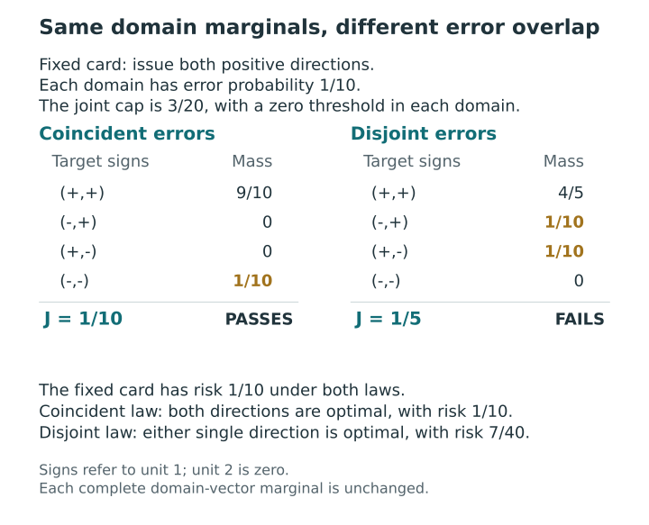
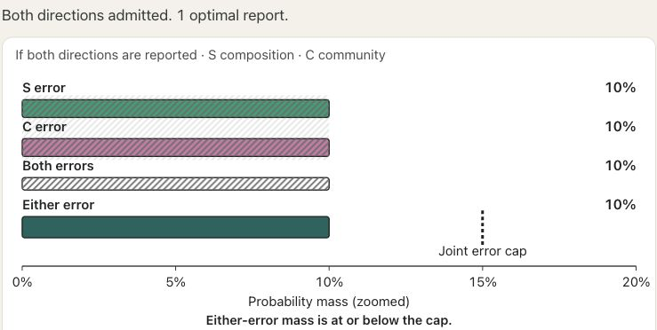
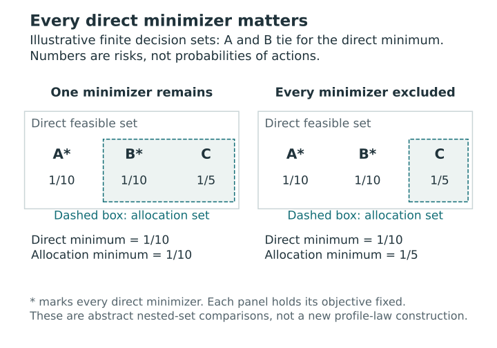
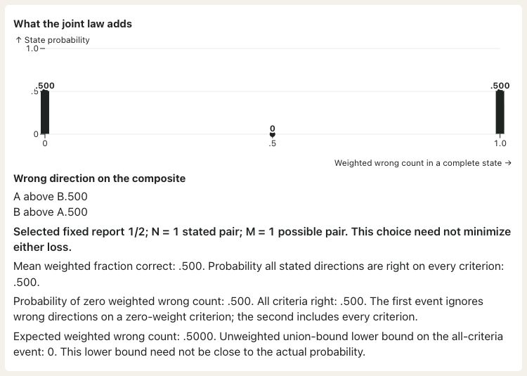

# Information and posterior dependence {#sec-information-dependence}

[]{#sec-v4-ch16}
[]{#sec-p2-06-information-dependence}

Suppose a card ranks unit 1 above unit 2 in two domains. Each direction has posterior error probability $1/10$. If failures always coincide, the chance that the card contains an error is $1/10$. If the failures occur in disjoint states, that chance is $1/5$. A reader with an error budget between those values needs to know which states the two assertions share. The difference can change the optimal card even when the full distribution of all targets within each domain is known.

The additive loss in @sec-profile-loss and the joint protection in @sec-joint-protection require different information. All probability statements condition on the same observed information and use the declared selection law.

## Two laws with the same domain marginals {#sec-same-domain-marginals}

[]{#two-laws-with-the-same-domain-marginals}

Take two units and two domains. Unit 2 has target zero in both domains. Unit 1 has target row $(a,b)$, with $a,b$ each equal to $+1$ or $-1$. The table specifies two complete finite laws on these target matrices.

| Unit 1 targets $(a,b)$ | Coincident failures | Disjoint failures |
|:---|---:|---:|
| $(+1,+1)$ | $9/10$ | $4/5$ |
| $(-1,+1)$ | $0$ | $1/10$ |
| $(+1,-1)$ | $0$ | $1/10$ |
| $(-1,-1)$ | $1/10$ | $0$ |

: Two joint laws with the same complete target-vector marginal in each domain. {#tbl-coincident-disjoint-laws}

Under either law, in either domain, the **complete two-unit target vector** is $(1,0)$ with probability $9/10$ and $(-1,0)$ with probability $1/10$. This agreement concerns the vector of units within a domain, rather than separate unit marginals alone.

Consider all nine possible cards. In unit order $(1,2)$, each domain can use the column $+=(1,2)$ to report unit 1 higher, $-=(2,1)$ to report unit 2 higher, or $W=(1,1)$ to withhold. Use equal domain weights, withholding cost $1/4$, no structural equalities between units, and no mean safeguards. Protect both full-domain scopes with threshold zero and joint budget $\alpha=3/20$. The primary problem minimizes expected error–withholding loss among the feasible cards.

The card $(+,+)$ has expected loss $1/10$ under either law. For joint protection, inspect each row of @tbl-coincident-disjoint-laws and count its mass once if either issued assertion fails. Under coincident failures, only the last row contributes. Under disjoint failures, the two middle rows contribute. The joint probabilities $1/10$ and $1/5$ straddle the budget.

Under either law, issuing a single $+$ gives joint violation probability $J=1/10$, within the budget $3/20$. Its expected loss is $R=(1/10+1/4)/2=7/40$. Withholding twice costs $1/4$ and makes both exceedance events false. Any card issuing a reverse direction fails the joint budget because that direction alone has error probability $9/10$. Thus $(+,+)$ uniquely minimizes loss under coincident failures. The **complete minimizer set** under disjoint failures is $\{(+,W),(W,+)\}$.

::: {#fig-v4-s05 .reader-figure .reader-has-narrow style="--reader-figure-width:620px;"}
<picture>
<source media="(max-width: 720px)" srcset="../assets/figures/S05-mobile.svg">

</picture>

Both laws give each domain the same complete two-unit target-vector marginal. For the fixed card issuing both positive directions, additive risk remains 1/10, but the union error probability is 1/10 with coincident failures and 1/5 with disjoint failures. At the shared cap 3/20, the coincident law selects both directions; the disjoint law has two tied single-disclosure optima.
:::

[Vector PDF](../assets/figures/S05.pdf).

A procedure supplied only with the domain marginals and decision settings receives identical inputs in the two cases. The same report cannot be optimal under both laws, so these inputs are insufficient for the specified decision problem. This conclusion does not make one dependence pattern universally preferable. The [finite-law counterexample proof](../appendices/A-proofs.qmd#prp-p2-t03-finite-counterexample) gives the result with its full action family.

The same conclusion holds for two laws with densities on four-dimensional target space. Add independent $\mathrm{Uniform}(-\varepsilon,\varepsilon)$ noise to each of the four coordinates, independently of the state, using the same noise law in both constructions and $0<\varepsilon<1/2$. Each perturbed law is a mixture of uniform densities on boxes. Each difference starts at $+1$ or $-1$ and moves by less than $2\varepsilon$, so its sign stays fixed throughout its box. All nine cards retain their risks and feasibility. The two smoothed laws also share their complete domain marginals, since each smooths the same domain mixture in the same way. These are full-dimensional densities; positivity everywhere is not required. The [continuous companion proof](../appendices/A-proofs.qmd#prp-p2-t03-continuous-counterexample) establishes this sign-preserving extension.

<!-- BEGIN EXPLORER BOX: overlap -->
::: {#box-explorer-overlap .explorer-box}

{fig-alt="Coincident failures: each domain has ten percent error, both errors overlap completely, and the ten percent probability of either error is below the fifteen percent joint cap." .explorer-screenshot}

In the displayed finite-law example, each domain’s stated direction has error probability $1/10$, and coincident failures also give probability $1/10$ of at least one error. Select **Disjoint failures** to raise the latter probability to $1/5$ while preserving both domain laws; stating both directions then exceeds the fixed joint cap $3/20$. The app compares all nine cards in its declared candidate bank.

::: {.explorer-link}
[Open in postrank Explorer: Error overlap](https://joonho112.github.io/postrank-explorer/pages/profiles/profile-dependence.html)
:::

Same marginal errors, different joint protection

:::
<!-- END EXPLORER BOX: overlap -->

<!-- postrank-exhibit:W06:begin -->

Explore: How can overlap change protection while leaving additive risk unchanged?

Default: coupling = coincident, alpha = 3/20. Minimum risk 1/10; all minimizing cards: AB/AB. W withholds; AB ranks Alder higher; BA ranks Birch higher.

<table><caption>Default setting: the complete candidate family</caption><thead><tr><th scope="col">Card</th><th scope="col">Risk</th><th scope="col">Criterion risks (1, 2)</th><th scope="col">Joint J</th><th scope="col">Feasible</th><th scope="col">Minimum risk?</th></tr></thead><tbody><tr><th scope="row">W/W</th><td>1/4</td><td>1/4, 1/4</td><td>0</td><td>Yes</td><td>—</td></tr><tr><th scope="row">W/AB</th><td>7/40</td><td>1/4, 1/10</td><td>1/10</td><td>Yes</td><td>—</td></tr><tr><th scope="row">W/BA</th><td>23/40</td><td>1/4, 9/10</td><td>9/10</td><td>No</td><td>—</td></tr><tr><th scope="row">AB/W</th><td>7/40</td><td>1/10, 1/4</td><td>1/10</td><td>Yes</td><td>—</td></tr><tr><th scope="row">AB/AB</th><td>1/10</td><td>1/10, 1/10</td><td>1/10</td><td>Yes</td><td>Optimal</td></tr><tr><th scope="row">AB/BA</th><td>1/2</td><td>1/10, 9/10</td><td>1</td><td>No</td><td>—</td></tr><tr><th scope="row">BA/W</th><td>23/40</td><td>9/10, 1/4</td><td>9/10</td><td>No</td><td>—</td></tr><tr><th scope="row">BA/AB</th><td>1/2</td><td>9/10, 1/10</td><td>1</td><td>No</td><td>—</td></tr><tr><th scope="row">BA/BA</th><td>9/10</td><td>9/10, 9/10</td><td>9/10</td><td>No</td><td>—</td></tr></tbody></table>

<table><caption>Default risk optima: all tied cards, disclosures and grades</caption><thead><tr><th scope="col">Card</th><th scope="col">Disclosures (N1, N2)</th><th scope="col">Grades (K1, K2)</th></tr></thead><tbody><tr><th scope="row">AB/AB</th><td>1, 1</td><td>2, 2</td></tr></tbody></table>

<button type="button" data-widget-load disabled>Open interactive example</button>

<noscript>
The complete default comparison above remains available without JavaScript.
</noscript>

<!-- postrank-exhibit:W06:end -->

## When overlap lowers the minimum risk {#sec-overlap-and-optimal-risk}

[]{#when-overlap-lowers-the-minimum-risk}

Now hold the **joint law** fixed and compare two ways to test a candidate against its tail budget. Use the same finite allowed family, structural guards, mean safeguards, scope masks, thresholds, total budget and primary objective. For each protected domain–scope index $\ell$, write $E_\ell(G)$ for its threshold-exceedance event and $p_\ell(G)=\Pi_s\{E_\ell(G)\}$. The optimized Bonferroni comparator allows each card any nonnegative allocation of the total budget among these events. An allocation exists exactly when $\sum_\ell p_\ell(G)\le\alpha$. Direct joint evaluation requires

$$
J(G)=\Pi_s\!\left\{\bigcup_\ell E_\ell(G)\right\}\le\alpha.
$$

These comparisons concern the same event catalog. Restricted allocation grids or grouped events would define other comparators.

Let $V_G=\sum_\ell\mathbf 1_{E_\ell(G)}$ count how many scopes exceed their thresholds in a state. The allocation sum is the expectation of this count, while the union probability is the expectation of $\mathbf 1\{V_G\ge1\}$. Their difference is therefore

$$
\Delta(G)=\sum_\ell p_\ell(G)-J(G)
=\mathbb E_{\Pi_s}[(V_G-1)_+].
$$ {#eq-overlap-excess}

A joint-feasible card fails the allocation test exactly when $\Delta(G)>\alpha-J(G)$, the unused part of its joint budget. Under the coincident law in @tbl-coincident-disjoint-laws, the full positive card has overlap $1/10$. At budget $3/20$, only $1/20$ is unused, so allocation excludes it. At budget $1/5$, both tests accept it, including equality at the allocation cap. Positive overlap alone consequently does not establish a difference in feasibility. The [overlap identity and exclusion condition](../appendices/A-proofs.qmd#prp-t08-overlap) give the exact comparison.

Let $\mathcal F_{\rm alloc}\subseteq\mathcal F_{\rm joint}$ be the two feasible families after all shared restrictions, and assume both are nonempty. Write $r_{\rm alloc}$ and $r_{\rm joint}$ for their minimum primary risks under the same objective. Finiteness ensures that both minima are attained. Then

$$
r_{\rm joint}<r_{\rm alloc}
\quad\Longleftrightarrow\quad
\left(\operatorname*{argmin}_{G\in\mathcal F_{\rm joint}}R_{\rm sep}(G)\right)
\cap\mathcal F_{\rm alloc}=\varnothing.
$$ {#eq-all-joint-minimizers-excluded}

Thus direct evaluation strictly lowers the minimum risk exactly when allocation excludes **every** direct minimizer. A direct minimizer that passes allocation attains the same minimum in both problems. Conversely, if the minima agree, any allocation minimizer is also a direct minimizer. This argument retains all tied optima; excluding one selected representative is insufficient. The [strict-improvement result](../appendices/A-proofs.qmd#thm-t08-optimality) states the comparison on its finite, nonempty families.

::: {#fig-v4-s07 .reader-figure .reader-has-narrow style="--reader-figure-width:560px;"}
<picture>
<source media="(max-width: 720px)" srcset="../assets/figures/S07-mobile.svg">

</picture>

In these illustrative finite decision sets, A and B tie for the direct minimum. Excluding A alone leaves B and preserves the minimum risk. A strict improvement over the allocation family occurs only when that family excludes both direct minimizers. Each comparison holds the objective fixed and compares nonempty nested families; the figure is not a new profile-law construction.
:::

[Vector PDF](../assets/figures/S07.pdf).

An exact family shows the size of the gain. Extend the coincident law to $D\ge2$ domains. In every domain, unit 1 leads in the same state of mass $1-p$ and trails in the other state of mass $p$. Use the full $3^D$ family, equal weights, $0<p<\tau\le1/2$, and full-scope, zero-threshold protections without mean safeguards. Withholding in place of a reverse direction lowers risk and deletes its error event. Among cards issuing only positive directions, each extra disclosure saves $(\tau-p)/D$ in expected loss.

For $\alpha\ge p$, direct evaluation permits the optimum with all $D$ positive directions disclosed. Allocation permits at most $k=\min\{D,\lfloor\alpha/p\rfloor\}$, since it counts $p$ for each disclosure. Different selections of these $k$ domains can tie. The minimum-risk difference is

$$
r_{\rm alloc}-r_{\rm joint}
=\left(1-\frac{k}{D}\right)(\tau-p).
$$ {#eq-coincident-minimum-risk-gap}

For $\alpha<p$, both choose all-withheld. Within the allowed budget range $0\le\alpha\le1$, the gain is strictly positive exactly for $p\le\alpha<Dp$. Even perfect coincidence of failures can yield zero gain. As a separate example outside the preceding $p<\tau$ condition, take $p=2/5$, $\tau=1/4$, $D=3$ and $\alpha=p$. The full positive card passes only direct evaluation, yet withholding costs less than either direction and minimizes both risks. These exact examples show why the loss and budget matter in addition to overlap. The [exact-gain result](../appendices/A-proofs.qmd#thm-t08-exact-gain) gives the family and its conditions.

The minimum risk and the number of grades or comparisons describe different features of a selected card; an ordering of minimum risks gives no ordering of these counts. Coarsening a report also changes its threshold events, so its effect on joint protection requires a separate argument. The comparisons above hold the event definitions and decision settings fixed.

## The information needed for a pair and for the whole card {#sec-pair-and-card-information}

[]{#the-information-needed-for-a-pair-and-for-the-whole-card}

Under the optional bundle loss, a pair contributes one error whenever **any** of its issued directions fails. This differs from the primary loss, which adds domain-specific errors. For a fixed pair $i<j$, define the latent sign vector by $S_{ij,d}=\operatorname{sign}(\theta_{id}-\theta_{jd})$, including zeros at equality, and let $\nu_{ij}$ be its law induced by the complete target law. The reported signature is $\sigma_{ij,d}=\operatorname{sign}(g_{jd}-g_{id})$: a zero coordinate withholds that domain's direction.

The truth probability $\pi_{ij}(G)$ is the mass that $\nu_{ij}$ assigns to signs agreeing with every issued coordinate of $\sigma_{ij}$. For example, signature $(+,0)$ admits latent signs $(+,-)$, $(+,0)$ and $(+,+)$. It places no restriction on the second coordinate. A zero latent sign in the first coordinate fails the issued strict direction.

For a fixed card, finite-sum linearity gives the expected bundle error count as

$$
\mathbb E_{\Pi_s}F_{\rm B}(G,\Theta)
=\sum_{i<j:\,\sigma_{ij}\ne0}\{1-\pi_{ij}(G)\}.
$$ {#eq-pair-sign-bundle-expectation}

The number of pairs with at least one issued direction and the cost assigned to withheld pairs are fixed by the card. The same sign laws therefore identify its expected bundle loss and, when at least one pair is issued, its expected error fraction. With no issued pair, the displayed fraction remains undefined. Here the pair-sign laws must be compatible marginals of the declared target distribution. Unrelated pair tables do not supply that joint law.

The two-unit example shows why dependence **within** each pair matters. Under the two laws in @tbl-coincident-disjoint-laws, its double-positive bundle has error probability $1/10$ and $1/5$, respectively. The [pair-sign sufficiency result](../appendices/A-proofs.qmd#prp-t11-bundle-sufficiency) identifies the expected bundle functionals determined by these marginals.

To see what the sign laws discard **between** pairs, take three units and duplicate the target column across two domains. Report grades $(1,2,3)$ in both. Under one law, the target column is equally likely to be $(3,2,1)$ or $(1,2,3)$. Under another, it is equally likely to be $(3,1,2)$ or $(1,3,2)$. For each of the three pairs, its two-domain sign vector has mass $1/2$ each on $(+,+)$ and $(-,-)$ under either law.

The first law gives zero or three failed bundles. The second gives one or two. Both expected counts are $3/2$, yet the chance that every issued direction on the card is correct is $1/2$ under the first law and zero under the second. Each state is a coherent ranking. Separate pair-sign tables therefore do not determine whole-card probabilities in general: their coupling is also needed. This is a counterexample for the stated report and event, rather than a claim that every threshold distinguishes the two laws. The [cross-pair information boundary](../appendices/A-proofs.qmd#prp-t11-cross-pair-boundary) gives the complete construction.

The three comparisons concern different information requirements. Complete domain marginals identify the domain-specific loss contributions but can leave joint protection unresolved. A joint sign law for one pair additionally identifies its bundle truth probability. Whole-card probabilities can still depend on how outcomes for different pairs occur together. The reporting question determines which of these joint objects must be supplied.

<!-- BEGIN EXPLORER EXPANSION: pairs-leave-open -->

::: {#box-explorer-pairs-leave-open .explorer-box}

{fig-alt="Screenshot of Quantities not identified by pairwise probabilities, illustrating What pair probabilities leave open." .explorer-screenshot}

Keep each criterion’s distribution fixed while changing how its states align with those of another criterion. The additive risk of a fixed report stays unchanged, but composite comparisons and the chance that every statement is correct can move. Pairwise probabilities therefore answer some reporting questions completely while leaving others unresolved; a zero-weight criterion can still belong to the joint correctness event.

::: {.explorer-link}
[Open Quantities not identified by pairwise probabilities in postrank Explorer](https://joonho112.github.io/postrank-explorer/pages/criteria/pairs-leave-open.html)
:::

What pair probabilities leave open

:::
<!-- END EXPLORER EXPANSION: pairs-leave-open -->

