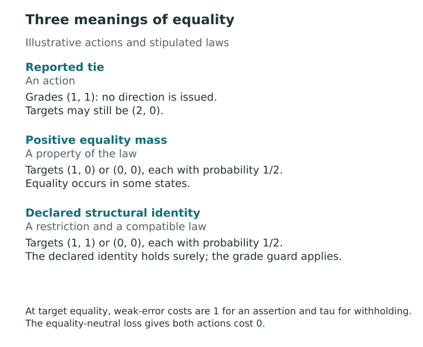

# Equality, scopes, and denominators {#sec-equality-scopes}

[]{#sec-v4-ch17}
[]{#sec-p2-07-equality-scopes}

Suppose four sites receive grades for a community target. Two sites share a community, so they inherit the same target value in every possible state. A report can assign their grade once and copy it to both sites. When a reader asks how many site comparisons the report issues, however, each site still counts. Comparing their community with a third site issues two directions. Whether both enter a local error fraction depends on the pairs that the reader's scope covers.

A smaller representation can retain the original population as its comparison frame. To establish this correspondence, we distinguish structural identity from an ordinary reported tie and keep track of the original pair counts. The weak-error loss and the equality-neutral alternative in @sec-tie-aware-loss treat these pairs differently.

## When two sites must share a grade {#sec-structural-identity-guard}

[]{#when-two-sites-must-share-a-grade}

A domain-specific equivalence relation $E_d$ records which units share a target by scientific definition or model construction. Require the supplied joint law to give probability one to all declared identities simultaneously. A candidate must satisfy $g_{id}=g_{jd}$ whenever $iE_dj$, even for a domain with zero objective weight. Its declared protections still apply. If the law and identity declaration disagree, resolve the discrepancy before evaluating candidates: changing either declaration defines a different decision problem.

A reported tie withholds direction and requires no identity between the targets. Conversely, two targets can coincide in some states even when the units belong to different identity classes. The core rule counts an issued strict assertion as false in those states. Equality throughout saved Monte Carlo draws or after rounding supplies insufficient evidence to declare a structural identity.

::: {#fig-v4-s03 .reader-figure .reader-has-narrow style="--reader-figure-width:560px;"}
<picture>
<source media="(max-width: 720px)" srcset="../assets/figures/S03-mobile.svg">

</picture>

Reported ties are action choices, equality mass is a property of the supplied target law, and structural identity is a declared restriction supported almost surely by that law. A declared identity requires its grade guard even at zero objective weight. Weak-error and equality-neutral losses remain distinct.
:::

[Vector PDF](../assets/figures/S03.pdf).

The representation theorem starts with a family that already enforces the guard and compares it with its exact image. It does not establish that adding a guard to an unguarded problem preserves its optimum.

The common-grade result in @prp-tie-aware-guard does address the existence of a guarded minimizer, under equality-neutral loss, full active-profile equality and the unrestricted at-most-grade family. These conditions do not establish the corresponding weak-error profile result under arbitrary additional constraints. Moreover, identity in one domain need not imply identity of the units' targets in other domains.

## Counting original pairs on the equality classes {#sec-equality-pair-quotient}

[]{#counting-original-pairs-on-the-equality-classes}

Fix a domain and suppress $d$. Let $B_c$ be its identity classes, with sizes $m_c$, representative targets $\zeta_c$ and grades $\gamma_c$. Restricting a guarded column to the representatives and expanding it back are inverse operations. Keep the exact image of the permitted action family under this correspondence. Write $V=\sum_c\binom{m_c}{2}$ for the number of within-class pairs and $b_{ce}=m_cm_e$ for the number between two different classes. The population still contains $n$ original units, with $M=\binom n2=V+\sum_{c<e}b_{ce}$ pairs.

Set $u_{ce}=\mathbf1\{\gamma_c<\gamma_e\}$. Grouping the original comparisons by class gives
$$
N=\sum_{c\ne e} b_{ce}u_{ce},\qquad
F=\sum_{c\ne e} b_{ce}u_{ce}\mathbf1\{\zeta_c\le\zeta_e\}.
$$
The domain loss equals
$$
\frac{F+\tau_d\bigl[V+\sum_{c<e}b_{ce}\mathbf1\{\gamma_c=\gamma_e\}\bigr]}{M}.
$$
The first withholding term charges for every within-class pair. The second charges for cross-class pairs given equal grades. A domain with one identity class has $V=M$, zero disclosures and loss $\tau_d$ before weighting. The equivalence applies to the family that already enforces the guard. The [weighted quotient theorem and proof](../appendices/A-proofs.qmd#thm-t10-quotient) make these correspondence conditions explicit.

This is an exact change of representation of the original loss. It does not replace the denominator by the number of class pairs or delete within-class withholding constants. In particular, the weak-error cost of withholding an equal pair is still positive, even though no strict direction is issued. That feature differs from the equality-neutral loss considered below.

Return to four sites. Let sites 1 and 2 form one class, with sites 3 and 4 each in its own class. Take the target state $(3,3,1,2)$ and grades $(1,1,2,3)$. Only the assertion that site 3 leads site 4 fails. The class comparisons represent $2,2,1$ site pairs, giving $F/N=1/5$. At $t=1/4$ this passes. Ordinary unweighted collapse to three communities gives $1/3$ and fails. For $\tau_d=1/4$, the site-level loss is $(1+1/4)/6=5/24$. Giving each community pair one vote changes the population and its loss.

For a scope $h$, replace each $b_{ce}$ in the **two count formulas** by $A_{ce}^{dh}=\sum_{i\in B_c}\sum_{j\in B_e}a^h_{ij}$. The original masks are symmetric and binary, with a zero diagonal; their class-block sums are integer multiplicities and need not be binary. For example, an incident-to-site-3 mask includes both comparisons from the shared community to site 3, the comparison between sites 3 and 4, and neither comparison from the community to site 4. Its fraction is $1/3$. Binarizing the three multiplicities $2,0,1$ would give $1/2$.

Keep the original unit-to-class map for each domain to reconstruct grade rows, and push the entire joint target law through the class maps together. The counts then agree in each state of the compatible law up to a null set, so the means and joint union probability agree. The scope catalog, thresholds and probability budget must be transported with the counts. Different domains can have different class maps; an independent alignment of reduced domain samples would not preserve the joint law.

Transporting the exact family and objective preserves the complete risk-minimizing set under the restriction/expansion correspondence. If a separate disclosure utility is also transported, its constrained maximizing set is preserved for that separate objective. Selecting corresponding representatives from a tied set additionally requires the same tie-breaking rule. The [scope-multiplicity proposition and proof](../appendices/A-proofs.qmd#prp-t10-scopes) establish this correspondence.

## The equality-neutral alternative {#sec-profile-equality-neutral}

[]{#the-equality-neutral-alternative}

The primary profile loss in @sec-profile-loss uses weak error and charges for every withheld pair. The equality-neutral alternative is a separate loss, developed for common grades in @sec-tie-aware-loss. It gives zero cost to either direction and to withholding when the targets coincide. Writing $F^{\rm rev}$ for the number of strict reversals and $W^{\ne}$ for withheld pairs with distinct targets, its domain loss is $(F^{\rm rev}+\tau_d W^{\ne})/M$. A neutral guarantee about reversals can therefore hold even when a displayed strict inequality is false at equality.

For example, within-class pairs under a declared identity have zero neutral cost, while their withholding costs remain in the weak-error quotient formula above. The original population denominator remains fixed in both cases. Changing the convention changes the loss, not the meaning of a reported tie. The weak-error quotient formula cannot simply be relabeled as a neutral formula.

Suppose $N^{\ne}$ counts issued pairs whose targets differ in the current state. A reversal rate among *all* disclosures uses $E[F^{\rm rev}]/N$. Restricting to distinct targets admits both a ratio of expectations, $E[F^{\rm rev}]/E[N^{\ne}]$, and a mean of statewise ratios, $E[F^{\rm rev}/N^{\ne}]$ with a declared zero extension in empty states. These generally differ because $N^{\ne}$ varies across states. Display an empty denominator as unavailable. A neutral tail guarantee likewise needs an explicit denominator, masks and thresholds.

Each ratio with a nonrandom denominator requires that denominator to be positive; the mean of statewise ratios additionally needs the stated convention in every empty state. A computational zero extension does not turn an empty set of comparisons into an observed rate of zero. The rates answer different questions. Choosing among them is a further specification, determined by neither the common-grade neutral guard theorem nor a weak-error profile protection.

## Which scope changes preserve protection? {#sec-scope-aggregation-resolution}

[]{#which-scope-changes-preserve-protection}

Fix an action and write $E_h=\{F_h>t_hN_h\}$ in one domain, using the binary masks and strict exceedance convention of @sec-profile-scope-protection. Adding a scope while keeping every existing event enlarges the protected union by set inclusion. Its probability can only increase or stay equal, and at the same budget $\alpha$ the feasible family can only shrink or stay equal. The law, thresholds and existing events must be retained for this comparison.

Replacing a mask with a larger mask changes both counts. In the four-site example, enlarging the site-3 mask to all sites removes its exceedance at $t=1/4$. Conversely, enlarging the error-free mask containing only pair $\{1,3\}$ to the site-3 mask introduces an exceedance. At threshold zero, enlarging a mask preserves every existing any-error event as a subset. The [catalog-monotonicity proposition and proof](../appendices/A-proofs.qmd#prp-t09-catalog) distinguish addition of an event from replacement of its mask.

There is a sufficient rule for combining local scopes. If an aggregate mask satisfies $a^0=\sum_h\lambda_h a^h$ pairwise for fixed $\lambda_h\ge0$, its counts satisfy the same weighted sums. If $\sum_h\lambda_h t_h N_h\le t_0N_0$ for the evaluated action, simultaneous nonexceedance in the contributing scopes implies $F_0\le t_0N_0$. Indeed, substituting the count identities into the local inequalities and then the threshold inequality proves that implication state by state. The aggregate exceedance event is consequently contained in the contributing event union.

For all incident-site masks each pair appears twice, so $\lambda_h=1/2$ reconstructs the full domain. At a common threshold, bounding the local **union** probability therefore protects the full-domain event at the same budget. Separate local probability caps alone give no such union guarantee. The mask identity and the action-specific threshold condition are both needed; overlapping scopes are not automatically additive without their multiplicities. See the [scope-aggregation proposition and proof](../appendices/A-proofs.qmd#prp-t09-aggregation).

Integer counts make the strict cutoff $k_h=\lfloor t_hN_h\rfloor+1$. An exceedance requires at least $k_h$ errors. Zero disclosures or $t_h=1$ make exceedance impossible. When $t_hN_h<1$, a single error suffices. If scopes with cutoff one cover every issued pair-domain assertion, the union equals the event that at least one assertion on the card is false. This sufficient coverage condition can hold at positive thresholds and must be checked for the particular card, since its grades determine each $N_h$. It is not a necessary characterization of every law-specific equality of events. The [integer-resolution proposition and proof](../appendices/A-proofs.qmd#prp-t09-resolution) gives the result under these conditions.

Coarsening a grade column is a further change. Removing issued comparisons can reduce both the error count and its denominator, so a positive-threshold fraction need not improve. In the same known four-site state, merge the first two grades of $(1,1,2,3)$ to obtain $(1,1,1,2)$. The two correct comparisons of sites 1 and 2 with site 3 disappear, while the erroneous claim that site 3 leads site 4 remains. The full-scope fraction rises from $1/5$ to $1/3$ and crosses the threshold $1/4$. The declared identity between sites 1 and 2 still holds. This exact example shows why preserving that identity, or reducing the number of grades, does not alone preserve joint feasibility. @sec-representation-resolution develops the separate representation and resolution questions.
