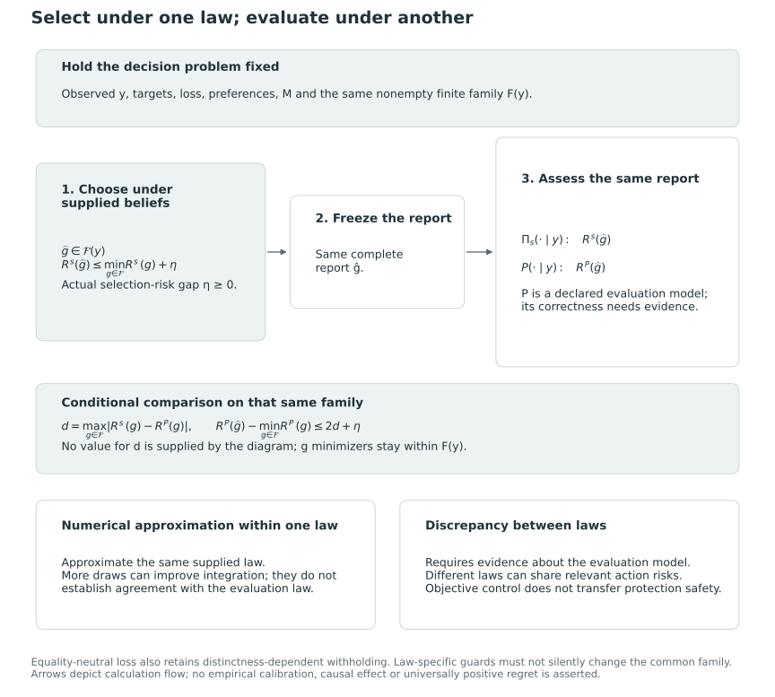

# Misspecification and calibration {#sec-misspecification-calibration}

## Selection beliefs and the evaluation law {#sec-model-error}

We minimize posterior risk under the supplied beliefs. Performance under an evaluation process also depends on how well those beliefs represent the targets and their uncertainty. We use the selection and evaluation laws defined in @sec-posterior-risk-laws to examine this dependence and interpret self-reported errors.

Write $\Pi_s(\cdot\mid y)$ for the selection beliefs and $P(\cdot\mid y)$ for the conditional state law under a declared joint model for $(\Theta,Y)$. We use *true* relative to that evaluation model, whose conditional law may remain unobserved in an application. To transfer the comparison in @prp-conditional-bayes-dominance, equality of the relevant action risks suffices; equality of the complete laws is a stronger sufficient condition. Different laws may have the same directional probabilities or simply the same optimal report. Some decisions can therefore be unaffected by misspecification.

## Risk discrepancy bounds on a common action family {#sec-model-error-bound}

Fix $Y=y$ and a nonempty finite family $\mathcal F(y)$ of canonical reports. Use the same loss $L_y$, targets, preferences and restrictions in both risks. Assume finite absolute loss expectations under both conditional laws and define

$$
d(y)=\max_{g\in\mathcal F(y)}|R^s(g\mid y)-R^P(g\mid y)|.
$$

This discrepancy concerns features of the distributions that affect action risks. It need not describe differences in their other features.

::: {#prp-model-error-regret}
### Regret under a different conditional law

Suppose $\widehat g(y)\in\mathcal F(y)$ actually satisfies

$$
R^s(\widehat g(y)\mid y)
\le\min_{g\in\mathcal F(y)}R^s(g\mid y)+\eta(y),
\qquad 0\le\eta(y)<\infty.
$$

For an evaluation-risk minimizer $g_P^*(y)$ over the same family,

$$
0\le R^P(\widehat g(y)\mid y)-R^P(g_P^*(y)\mid y)
\le2d(y)+\eta(y).
$$
:::

**Proof.** Insert the selection risks between the two evaluation risks. Each change of law contributes at most $d(y)$; the supplied-risk difference is at most $\eta(y)$ because $g_P^*(y)$ belongs to the optimization family. Evaluation-risk optimality supplies the lower bound. $\square$

The excess risk can be zero. Applying the upper bound requires information about the evaluation law that justifies $d(y)$; a small fitted-model risk, an optimization certificate or additional posterior draws alone cannot supply it.

The tolerance $\eta$ is measured in actual selection risk over the whole declared family. If the optimizer uses approximate coefficients, @prp-coefficient-risk-regret is first needed to relate its numerical gap to that risk. For the fixed-order search F1, the comparison covers only reports in the searched family. It excludes comparators outside that family and retains any cap, exact grade-count requirement or protection restriction.

@fig-vis-f18 holds the report and decision problem fixed while separating the two risk laws. The bound requires evidence about their relevant discrepancy; numerical precision alone does not provide that evidence.

::: {#fig-vis-f18}
<picture>
<source media="(max-width: 720px)" srcset="../assets/figures/f18-select-under-one-law-and-evaluate-under-another-mobile.svg">

</picture>

Selection and risk evaluation under different conditional laws, with the decision problem and realized report held fixed. Supplied beliefs choose a report; both laws then evaluate that same report. If the selected report has actual selection-risk gap eta and the maximum risk discrepancy d is bounded on one common nonempty finite family, evaluation regret is at most 2d+eta. The diagram supplies no value for d. Numerical approximation of one law and disagreement between laws require different evidence. Equality-neutral evaluation also retains distinctness-dependent withholding and an explicitly common guard family.
:::

### Directional-probability discrepancies {#directional-probabilities-locate-the-relevant-discrepancy}

For the directional loss, retain the same $w$, $\tau$, $M$ and target-equality convention. Here $e^s_{ij,k}$ and $e^P_{ij,k}$ are the probabilities of $\theta_{ik}\le\theta_{jk}$ under the selection and evaluation conditional laws, respectively. Suppose, simultaneously over ordered distinct pairs,

$$
\max_{i\ne j}|e^s_{ij,k}-e^P_{ij,k}|\le\varepsilon_k(y),\qquad
\delta_w(y)=\sum_kw_k\varepsilon_k(y).
$$

The common withholding term cancels, so

$$
|R^s_{w,\tau}(g\mid y)-R^P_{w,\tau}(g\mid y)|
\le\frac{N(g)}M\delta_w(y)\le\delta_w(y).
$$

Consequently $d(y)\le\delta_w(y)$. The regret bound can retain the sharper factor $\{N(\widehat g)+N(g_P^*)\}/M$ multiplying $\delta_w$, exactly as in @prp-coefficient-risk-regret. Neither independence nor tie-freeness is needed. Composite-direction risk requires discrepancies for its composite comparison events; criterionwise bounds alone do not provide them.

The algebra compares risk arrays, as does numerical coefficient control. The sources of discrepancy nevertheless differ. Numerical control concerns approximating one fixed supplied law, whereas the present argument concerns disagreement between selection and evaluation laws. Improving integration can eliminate the former while leaving the latter unchanged.

Objective discrepancy bounds do not in themselves preserve feasibility. In particular, $E^s_k(g)\le q_kN(g)$ need not imply $E^P_k(g)\le q_kN(g)$, and a protected criterion may have zero weight in the objective. Protection under the evaluation law requires criterion-specific control, as in @prp-protection-coefficient-envelopes when its premises apply. If the proposition holds a supplied-law protected family fixed, its evaluation optimum is taken over that family; it need not be the optimum over the family protected under $P$.

## Self-reported error and calibration {#sec-self-reported-calibration}

For a selected report with $N(g)>0$, the self-reported conditional wrong fraction is $E^s_k(g)/N(g)$. Under the evaluation law it is $E^P_k(g)/N(g)$, and the realized fraction is $D_k(g,\Theta)/N(g)$. Thus the same realized error has two conditional expectations, one under each law. At zero disclosure the fractions are undefined, although the error counts are zero and directional loss remains defined.

Conditioning on $Y=y$ fixes a deterministic report $g=\delta(Y)$ and its denominator. Under the correct conditional law, the self-reported fraction therefore equals the conditional expectation of the realized fraction. For a realized randomized report, we also condition on auxiliary $U$, assumed independent of $\Theta$ given $Y$. No optimization is required: even a suboptimal report satisfies this conditional calibration identity when evaluated under the exact law. An optimization gap affects decision quality without invalidating the identity. Empirical calibration of a fitted model still requires separate assessment [@little2012calibrated, §3.1, pp. 312–314]. Under a different law, the supplied fraction may be optimistic or pessimistic, with no sign guaranteed by minimizing the supplied risk.

Under the criterionwise discrepancy premise above and $N(g)>0$, direct summation also gives

$$
\left|\frac{E^s_k(g)}{N(g)}-\frac{E^P_k(g)}{N(g)}\right|
\le\varepsilon_k(y),
\qquad
\left|\frac{\sum_k w_kE^s_k(g)}{N(g)}-
\frac{\sum_k w_kE^P_k(g)}{N(g)}\right|
\le\delta_w(y).
$$

These bounds compare conditional expected fractions for a fixed realized report and denominator. They do not bound every realized fraction or justify the discrepancy assumption. At zero disclosure, the fractions remain undefined.

Assessing empirical calibration requires a repeated-data law, an error quantity, a convention for no disclosure, an aggregation rule and an uncertainty calculation. Posterior predictive checks can examine consequences of the fitted model, but agreement in a model-generated experiment does not establish agreement with an external population. Direct checking may also be limited by unobserved latent truth. The estimands in @sec-evaluation-frontiers specify the quantities averaged in such a comparison.

Under a random-$\Theta$ evaluation model, we can average the conditional regret bound over $Y$ if the decisions and families are measurable, selected losses are integrable and $E_P[2d(Y)+\eta(Y)]$ is finite. This gives an integrated-risk comparison under the joint model. A fixed-parameter experiment instead repeats observations $Y$ at $\Theta=\vartheta$. It supplies no latent-state distribution by itself and does not automatically inherit that integrated comparison. Under either evaluation, realized losses may occur in the opposite order.

## Hyperparameters, precision and represented uncertainty {#sec-producer-model-error}

Within a working model with hyperparameters $h$, write the conditional target law as $B(d\vartheta\mid y,h)$. A plug-in empirical Bayes producer substitutes estimates to obtain $B(d\vartheta\mid y,\widehat h(y))$. It retains uncertainty about the targets conditional on those estimates, rather than reducing the targets to posterior means. A hierarchical Bayesian producer instead integrates $B(d\vartheta\mid y,h)$ over a hyperparameter posterior [@laird1989ranking, pp. 33–35]. This propagates uncertainty within the chosen hierarchy and priors, whose adequacy still requires justification. Empirical Bayes may also include a separately specified uncertainty adjustment. The method label alone therefore determines neither calibration nor decision risk.

Integrating over shared hyperparameters can induce dependence among units that are conditionally independent given $h$. Pair calculations integrated over the same hyperparameter state retain this dependence; independently mixing unit marginals generally does not. Calculating probabilities after averaging hyperparameters also generally differs from averaging conditional probabilities. These producer choices determine the joint target law supplied to the grading problem.

Conditional on the observed information, estimated hyperparameters are fixed. A repeated-data evaluation must nevertheless rerun their estimation on each dataset, together with estimated standardization and any specified data-dependent decision settings. Holding them fixed across repetitions would evaluate a different procedure.

To describe the role of precision information, write $Y=(Z,V,X)$ for measurements $Z$, precision information $V$ and covariates $X$. If $V$ is informative about $\Theta$ under the joint model, inference requires the conditional law $P(\Theta\mid Z,V,X)$. Including observed variances in the measurement likelihood alone need not represent this association; the target distribution conditional on the information must also be specified appropriately. A fixed design is a different formulation, and heterogeneity in precision alone does not make it misspecified.

### Evidence from ranking and report-card studies

Precision information can affect both the likelihood and the distribution of the target conditional on the available information. Gu and Koenker make this distinction explicit when moving from observed heterogeneous variances to repeated measurements with unknown variances. Their latter model uses a joint distribution of latent merit and variance, and conditions posterior tail probabilities on both the sample mean and sample variance. It no longer imposes the earlier independence restriction between merit and variance [@gu2023invidious, pp. 19–21, §5]. This model allows merit–variance dependence without asserting its presence in every application. Treating an estimated standard error as known or imposing independence requires its own justification.

Prior estimation is itself a source of ranking uncertainty, as Laird and Louis observe [@laird1989ranking, p. 41]. Substitution of an estimated prior into posterior calculations differs from integration over uncertain hyperparameters. Hierarchical Bayesian inference propagates the uncertainty represented by its hierarchy, but this alone establishes no calibration result under a different evaluation law.

KRW illustrates how a fitted procedure can be evaluated under a generating law. Its online Appendix E reports a Monte Carlo exercise conditioning on the standard errors and industries of 97 firms. The procedure draws new latent effects and estimates, compares grades using the known mixing distribution with grades using a re-estimated distribution, and separately evaluates estimated performance under the generating and estimated laws. In that exercise, the estimated informativeness and all-pair discordance of the data-selected empirical grades were optimistic on average [@kline_discrimination_2024, online Appendix E, pp. 9–11]. These reported averages follow the appendix's fitting and retention rules, including exclusions in its industry-model experiment. The finding applies to that experiment, rather than providing a universal bias correction, finite-sample calibration bound or hierarchical Bayes advantage over empirical Bayes. A deterministic robustness analysis still requires a justified discrepancy premise and a common feasible family.

Calibration is assessed relative to specified targets and losses. Even successful calibration cannot establish that an indicator represents the intended institutional construct or that directional weights $w$ and composite tradeoffs $a$ are defensible. A grade report requires separate assessments of measurement validity, policy preferences, model adequacy and numerical accuracy.

## Evaluation theory and the prospective P1 questions {#sec-p1-evaluation-bridge}

P1 will assess the reliability of distinctions communicated by common posterior grades, their dependence on the setting and their costs under competing objectives. The preceding results define the comparisons, but their practical magnitude and the relative performance of rule classes remain empirical questions. The proposed experiment has not yet tested them.

With the correct conditional law, an exact optimum has expected loss no larger than that of a feasible comparator under the same objective. The exact lower frontier gives the corresponding expected-error comparison at matched positive expected disclosure, with a common denominator (@sec-conditional-bayes-dominance; @sec-matched-disclosure-frontier). These weak signs are known before an experiment; their magnitude and variation remain to be measured. Restricting the order, omitting frontier points, changing the target or evaluating under another law can remove the guarantee. In those cases even a favorable sign requires evidence. The guarantees also allow reversals of realized losses.

| P1 question and hypothesis | Expectation retained for future study | What the theory establishes |
|---|---|---|
| Total improvement and conditions: Q1/Q3, H1 | Gains over observed-score tiers may be larger where estimation substantially changes the ordering. | Exact own-objective comparisons have a guaranteed sign only within their family. The size and pattern of gains remain empirical, including whether a changed order helps. |
| Operating choices: Q1/Q3, H2 | Improvements over posterior-mean fixed tiers may be small at their disclosure level, while other disclosure levels remain useful. | An exact eligible frontier weakly improves the matched objective. Neither small gaps nor institutional value follows from this fact. |
| Components and conflict: Q2/Q3, H3 | Common grades may reveal criterion conflict through withholding and criterion-specific errors. | Both co-primary targets remain visible. Conflict alone does not establish a universal error reduction or benefit from a common grade. |
| Competing objectives: Q4, H4 | Reliable public distinctions may carry a cost for allocation, classification, or stability. | Under the stated law and exact budget, posterior means maximize additive utility; membership probabilities maximize expected overlap. Their respective directions are guaranteed, but cost magnitudes and other objectives are not. |
| Self-reported error: Q5, H5 | Misspecified beliefs may report errors too optimistically. | Correct conditional evaluation calibrates the declared report. Under misspecification, optimism, pessimism, or agreement is possible; increasing misspecification need not increase optimism. |

: Prospective P1 questions and hypotheses in relation to theoretical guarantees. The hypotheses retain empirical content after the guaranteed comparisons are separated. {#tbl-p1-evaluation-bridge}

The first three hypotheses use the rule-by-estimand comparisons in @sec-fair-comparator-framework, retaining the distinct meanings of composite coefficients $a$ and directional weights $w$. Matching disclosure, matching grade counts and using a common withholding cost impose different comparisons. Candidate and approximate frontiers additionally require identification of their covered family and certificate. For Q2, @sec-descriptive-decomposition allocates a specified contrast among constructed factor changes; it supplies no causal effects of estimation, boundaries or criterion preferences.

For Q4, a grade with an added boundary lottery defines an allocation procedure for comparison with the exact-budget benchmarks in @sec-selection-benchmarks. The posterior-mean benchmark's additive-utility advantage requires its correct-belief conditions and does not extend to all targeting objectives. For Q5, we distinguish conditional self-consistency under supplied beliefs from evaluation-law calibration (@sec-self-reported-calibration). Historical pilot and plug-in findings motivate all five hypotheses, which remain prospective for the new procedure and design. The finite examples in @sec-worked-examples illustrate the theory without testing these hypotheses in an institution.

## Equality-neutral comparisons across probability laws {#sec-tie-aware-model-error}

The risk comparison in @prp-model-error-regret also applies to an equality-neutral loss when its common-family premises hold. For fixed targets, weights, observed information and the same report $g$, two laws can disagree in both strict-error probabilities and distinct probabilities. With law-specific coefficients,
$$
R^s_{\rm TA}(g)-R^P_{\rm TA}(g)
=\frac1M\left\{
\sum_{i\ne j}x_{ij}(g)(c^s_{ij}-c^P_{ij})
+\tau\sum_{i<j:g_i=g_j}(\delta^s_{ij}-\delta^P_{ij})
\right\}.
$$
In particular, the all-withhold baselines can differ. Issuing no directions therefore does not eliminate this component of model discrepancy.

Uniform strict-probability and distinct-probability discrepancy radii give exactly the risk bound in @prp-tie-aware-perturbation, now interpreted as discrepancies between laws rather than numerical estimation errors within one law. Since both laws satisfy $d=b_{ij}+b_{ji}$, an ordered-coordinate strict-probability radius can also give the coherent uniform bound there. Once $\sup_{g\in\mathcal F}|R^s_{\rm TA}(g)-R^P_{\rm TA}(g)|\le\zeta$ is justified, a selection-risk optimizer with valid gap $\eta$ has evaluation regret at most $2\zeta+\eta$ against the evaluation optimum in that same $\mathcal F$. This implication requires a justified $\zeta$; it neither estimates that discrepancy nor establishes calibration of a fitted producer.

Equality guards may also vary between laws, since almost-sure equality under selection beliefs need not hold under the evaluation law. If the selection family is retained, the common-family bound compares with the evaluation optimum in that family. It does not cover an oracle using another equality partition. Comparing differently guarded procedures therefore requires accounting for their different domains. Changing weights can cause the same difficulty by changing the active profile.

Distinct-mass disclosure and conditional error ratios depend on the law as well. A small reported risk may arise from greater equality mass and a smaller all-withhold baseline, without indicating a more accurate producer. Reports should give raw disclosure, available and disclosed distinct mass, absolute risk and the law used for evaluation. Certainty of equality can reduce the baseline to zero; this is not evidence of ignorance, and relative improvement against that baseline is undefined. Model, target and policy-use checks remain necessary in addition to these summaries.
