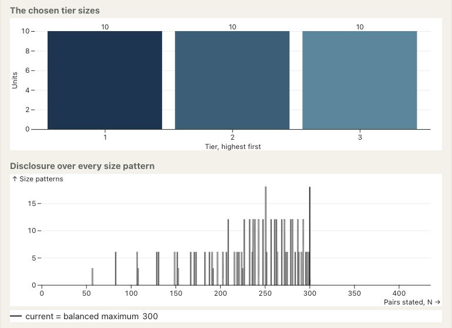
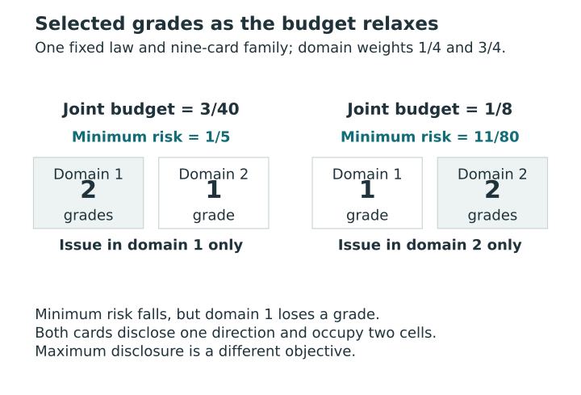
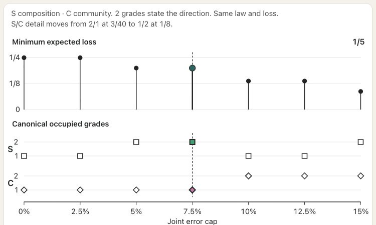

# Representation and adaptive resolution {#sec-representation-resolution}

[]{#sec-v4-ch18}
[]{#sec-p2-08-representation-resolution}

Suppose the evidence supports ranking site 1 ahead of site 3, while the reader's protection requires withholding the direction for both 1 versus 2 and 2 versus 3. A list of pairwise statements can report the one supported comparison. A grade column would have to put sites 1 and 2 in the same grade and sites 2 and 3 in the same grade. That puts all three together and withholds the comparison between 1 and 3 as well. We can measure the cost of representing the decisions as grades by pricing both reports under the same loss and protections.

## Four ways to represent the same comparisons {#sec-report-representations}

[]{#four-ways-to-represent-the-same-comparisons}

A **common grade** (C) assigns the same grade column in every domain. A **product grade** (P), or domain-profile card, permits a separate column in each domain. Within a column, every member of an earlier grade ranks ahead of every member of a later grade. A **strict partial order** (O) permits some pairs to remain incomparable, but includes all transitive implications of its issued directions. For example, issuing $i>j$ and $j>k$ requires issuing $i>k$. The single comparison in the opening example already forms a strict partial order. A **free report** (F) chooses either direction or withholding for each pair in each domain, even if the resulting directions form a cycle.

Here *product* describes the report's domain-specific columns. It does not assert that the protected feasible family factors across domains; @sec-profile-separability gives the separate condition needed for domainwise optimization.

A profile cell consists of units with identical grade rows. If domain $d$ has $K_d$ occupied grades, the number $C(G)$ of occupied cells satisfies

$$
C(G)\le\min\!\left(n,\prod_{d=1}^D K_d\right).
$$ {#eq-profile-cell-count}

The crossed rows $(1,2)$ and $(2,1)$ use two of four possible cells when each of two domains has two grades. Cell labels are nominal: they identify neither latent classes nor an overall ranking. Different target vectors can occupy the same cell, and withheld coordinates remain unrestricted.

Match the units, oriented targets, joint law, domain weights, withholding costs, weak-error convention and all-pair loss denominator $M=\binom n2$. Use identical scope masks, protected families, thresholds, budgets and optional mean constraints. Carry each structural equality guard into the relaxed families by requiring the guarded units to withhold their mutual direction and make identical incoming and outgoing assertions involving every other unit. Withholding still costs $\tau_d$ on guarded pairs. These conditions give nested families $\mathcal X_{\rm C}\subseteq\mathcal X_{\rm P}\subseteq\mathcal X_{\rm O}\subseteq\mathcal X_{\rm F}$, and applying the same protections preserves inclusion.

Let $r_{\rm C},r_{\rm P},r_{\rm O},r_{\rm F}$ denote the exact feasible minima of the expected error–withholding risk. Each finite family contains all-withheld, which incurs $r_0=\sum_d w_d\tau_d$ and satisfies the protections. Nonnegative losses and nesting give
$$
0\le r_{\rm F}\le r_{\rm O}\le r_{\rm P}\le r_{\rm C}\le r_0 .
$$
Each adjacent gap is bounded by $r_0$, as is their sum $r_{\rm C}-r_{\rm F}$. The quantity $r_{\rm P}-r_{\rm O}$ isolates the extra cost of requiring ordered grade blocks once transitivity is already required. These bounds compare matched families; separately generated candidate banks would mix the effects of representation with search restrictions. The full argument appears in [Theorem T07a and proof](../appendices/A-proofs.qmd#thm-T07a).

<!-- BEGIN EXPLORER EXPANSION: tier-sizes -->

::: {#box-explorer-tier-sizes .explorer-box}

{fig-alt="Screenshot of Disclosure determined by tier sizes, illustrating The same number of grades can disclose different amounts." .explorer-screenshot}

Keep the number of units and grades fixed, then move units between the grade blocks. The single-column example shows that grade sizes, rather than the grade count alone, determine how many pairs are compared. Its distribution weights size patterns equally; it is not a posterior distribution over assignments and does not assess the accuracy or protection of a profile report.

::: {.explorer-link}
[Open Disclosure determined by tier sizes in postrank Explorer](https://joonho112.github.io/postrank-explorer/pages/rules/tier-sizes.html)
:::

The same number of grades can disclose different amounts

:::
<!-- END EXPLORER EXPANSION: tier-sizes -->

## Sharp representation bounds {#sec-sharp-representation-bounds}

[]{#when-the-bounds-are-sharp}

For a common grade, the entire upper bound can be attained with two units. Let their target rows be $(1,-1)$ and $(0,0)$ with probability one. Use equal domain weights and a common $0<\tau\le1/2$. Allow the full families with identity-only guards, protect each full domain at threshold zero with $\alpha=0$, and omit mean constraints. Either strict common ranking commits a certain error in one domain. A common grade therefore withholds in both at risk $\tau$. Product columns can rank unit 1 higher in the first domain and unit 2 higher in the second, giving zero risk with the same protection. Here $r_{\rm C}-r_{\rm P}=\tau=r_0$. [Proposition T07b and proof](../appendices/A-proofs.qmd#prp-T07b)

For the cost of grade blocks within one domain, start with $n\ge3$ units in the order $(n,n-1,\ldots,1)$ of target values. Give this vector and each of its $n-1$ single adjacent swaps probability $1/n$. Keep the full families, identity-only guards, a fixed $0<\tau\le1/2$, full-pair protection at threshold zero, and no mean constraint. For $0\le\alpha<1/n$ even one error state exceeds the budget. Either direction between adjacent units errs in at least one state, so grades must tie each adjacent pair. That chain forces a single grade and risk $\tau$.

By contrast, every pair separated by at least two positions retains its base direction throughout. Issuing all those directions gives a transitive relation and leaves exactly $n-1$ pairs withheld. Each issued direction saves $\tau/M$ at zero error, so this report attains both $r_{\rm O}$ and $r_{\rm F}$ at $2\tau/n$. The product-to-free gap is $\tau(1-2/n)$.

At **fixed $\alpha=0$** it approaches the sharp supremum $\tau$ from below. Each finite member has a smaller gap. At fixed positive $\alpha$, eventually $1/n\le\alpha$. A two-grade cut in the base order then passes protection because only the swap across that cut produces an error. The single-grade argument applies precisely while $\alpha<1/n$ in this construction. [Theorem T07c and proof](../appendices/A-proofs.qmd#thm-T07c)

## What moves along a budget frontier? {#sec-resolution-frontiers}

[]{#what-moves-along-a-budget-frontier}

Now fix the reporting family as well as the law, guards, masks, protected indices and objective. Increasing $\alpha$, increasing any joint-event threshold $t_{dh}$, or increasing any mean cap $q_{dh}$ while keeping the others fixed preserves every previously feasible action. For a fixed report, raising $t_{dh}$ shrinks its exceedance event, and raising $q_{dh}$ increases the allowed expected count $q_{dh}N_{dh}$. The minimum reporting risk can therefore only fall or stay equal.

For comparison, the auxiliary maximum of a fixed disclosure utility $I_v$ at the same budgets can only rise or stay equal. This second frontier describes disclosure-utility maximizers. The number of distinctions issued by a risk-minimizing card must be examined separately. [Proposition T06.1 and proof](../appendices/A-proofs.qmd#prp-t06-budget-nesting) gives both monotonicity results.

Consider two units and two domains with unit 2 fixed at $(0,0)$. Unit 1 takes values $(1,1),(-1,1),(1,-1)$ with respective masses $17/20,1/20,1/10$. Allow all nine product cards, with identity-only guards, full-domain scopes at zero thresholds, no mean caps, weights $(1/4,3/4)$ and $\tau=1/4$. Ranking unit 1 higher costs $1/20$ in the first domain or $1/10$ in the second, before weighting. The errors are disjoint, so issuing both gives joint error probability $1/20+1/10=3/20$. Either reverse direction alone exceeds both budgets in the table.

| Joint budget $\alpha$ | Unique minimum-risk card | Minimum risk | Grades $(K_1,K_2)$ |
|---:|:---|---:|:---:|
| $3/40$ | Rank unit 1 higher in domain 1 only | $1/5$ | $(2,1)$ |
| $1/8$ | Rank unit 1 higher in domain 2 only | $11/80$ | $(1,2)$ |

The larger budget admits the single disclosure in the more heavily weighted domain. Issuing both still exceeds the budget and withholding both costs $1/4$. The first domain loses a grade even though minimum risk falls. Both optima disclose one pair-domain direction and occupy two profile cells. [Example T06.4 and verification](../appendices/A-proofs.qmd#exm-t06-selected-grades)

::: {#fig-v4-s08 .reader-figure .reader-has-narrow style="--reader-figure-width:560px;"}
<picture>
<source media="(max-width: 720px)" srcset="../assets/figures/S08-mobile.svg">

</picture>

Relaxing the joint budget from 3/40 to 1/8 lowers minimum risk from 1/5 to 11/80 but shifts the one disclosed direction from domain 1 to domain 2. Domain 1 loses a grade while domain 2 gains one. Both unique optima still disclose one pair-domain direction and occupy two cells. The auxiliary maximum-disclosure frontier is a different optimization problem.
:::

[Vector PDF](../assets/figures/S08.pdf).

<!-- postrank-exhibit:W07:begin -->

Explore: What changes when the joint budget grows along a fixed-law frontier?

Default: alpha = 3/40. Minimum risk 1/5; all minimizing cards: AB/W. W withholds; AB ranks Alder higher; BA ranks Birch higher.

<table><caption>Default setting: the complete candidate family</caption><thead><tr><th scope="col">Card</th><th scope="col">Risk</th><th scope="col">Criterion risks (1, 2)</th><th scope="col">Joint J</th><th scope="col">Feasible</th><th scope="col">Minimum risk?</th></tr></thead><tbody><tr><th scope="row">W/W</th><td>1/4</td><td>1/4, 1/4</td><td>0</td><td>Yes</td><td>—</td></tr><tr><th scope="row">W/AB</th><td>11/80</td><td>1/4, 1/10</td><td>1/10</td><td>No</td><td>—</td></tr><tr><th scope="row">W/BA</th><td>59/80</td><td>1/4, 9/10</td><td>9/10</td><td>No</td><td>—</td></tr><tr><th scope="row">AB/W</th><td>1/5</td><td>1/20, 1/4</td><td>1/20</td><td>Yes</td><td>Optimal</td></tr><tr><th scope="row">AB/AB</th><td>7/80</td><td>1/20, 1/10</td><td>3/20</td><td>No</td><td>—</td></tr><tr><th scope="row">AB/BA</th><td>11/16</td><td>1/20, 9/10</td><td>9/10</td><td>No</td><td>—</td></tr><tr><th scope="row">BA/W</th><td>17/40</td><td>19/20, 1/4</td><td>19/20</td><td>No</td><td>—</td></tr><tr><th scope="row">BA/AB</th><td>5/16</td><td>19/20, 1/10</td><td>19/20</td><td>No</td><td>—</td></tr><tr><th scope="row">BA/BA</th><td>73/80</td><td>19/20, 9/10</td><td>1</td><td>No</td><td>—</td></tr></tbody></table>

<table><caption>Default risk optima: all tied cards, disclosures and grades</caption><thead><tr><th scope="col">Card</th><th scope="col">Disclosures (N1, N2)</th><th scope="col">Grades (K1, K2)</th></tr></thead><tbody><tr><th scope="row">AB/W</th><td>1, 0</td><td>2, 1</td></tr></tbody></table>

<button type="button" data-widget-load disabled>Open interactive example</button>

<noscript>
The complete default comparison above remains available without JavaScript.
</noscript>

<!-- postrank-exhibit:W07:end -->

<!-- BEGIN EXPLORER EXPANSION: profile-resolution -->

::: {#box-explorer-profile-resolution .explorer-box}

{fig-alt="Screenshot of Budget and grades, illustrating A larger budget can move detail between domains." .explorer-screenshot}

Keep the fictional law fixed and move from the tighter to the larger joint budget, watching the occupied grades in each domain. Lower minimum risk can accompany fewer grades in one domain and more in the other. Change the law only afterward, so that a budget comparison is kept distinct from a comparison between posterior distributions.

::: {.explorer-link}
[Open Budget and grades in postrank Explorer](https://joonho112.github.io/postrank-explorer/pages/profiles/profile-resolution.html)
:::

A larger budget can move detail between domains

:::
<!-- END EXPLORER EXPANSION: profile-resolution -->

## What happens when a reader merges grades? {#sec-coarsening-and-protection}

[]{#what-happens-when-a-reader-merges-grades}

A pure coarsening merges adjacent occupied grades within each column and preserves the order of the remaining blocks. Every retained direction was present before the merge. With fixed masks, the disclosed count $N_{dh}$ and the statewise false count $F_{dh}$ each fall or stay equal. When **all protected thresholds are zero**, any false direction after the merge was also false before it, so the joint error probability cannot increase. The coarsened card is fully feasible only if it also belongs to the allowed family and satisfies each optional mean cap. With mixed thresholds, the deletion argument controls only the zero-threshold scopes; see [Proposition T06.2 and proof](../appendices/A-proofs.qmd#prp-t06-zero-tail-deletion).

With one domain, take the certain target vector $(3,1,2)$ and grades $(1,2,3)$. Exactly one direction, unit 2 above unit 3, is false. Merging the first two grades gives $(1,1,2)$ and deletes a correct direction. The full-scope error fraction rises from $1/3$ to $1/2$. At $t=q=2/5$, the joint exceedance probability rises from zero to one and the mean constraint switches from satisfied to violated. With $\tau=1/4$, risk also increases from $1/3$ to $5/12$ because the deleted correct assertion now costs $\tau$ to withhold. For a reader deciding whether to publish the coarser card, the relevant fraction uses its two remaining disclosures. [Example T06.3 and verification](../appendices/A-proofs.qmd#exm-t06-positive-tail)
