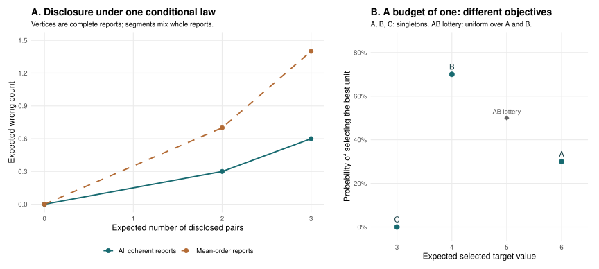

# Worked exact examples {#sec-worked-examples}

## Common grades under an exact joint target law {#sec-exact-common-grade}

We examine target construction, uncertainty and reporting using four synthetic units on two criteria, with larger values denoting higher reporting priority. A specified two-state conditional law lets us calculate all relevant probabilities and evaluate every feasible report exactly. The example involves neither estimation of an institutional posterior nor assessment of calibration.

The joint law is the one used in the computational and frontier examples. Here we derive pair probabilities from the target values and compare the reports selected under the two co-primary estimands. The scalar target and withholding cost are specified below independently of the earlier optimization result.

### Targets and feasible reports {#state-the-targets-and-the-decision}

The target arrays in @tbl-exact-common-states have one row per unit and one column per criterion. Each probability belongs to an entire array: $3/4$ to the first state and $1/4$ to the second. Drawing columns or unit rows independently would therefore change the model.

| Unit | State 1: criterion 1 | State 1: criterion 2 | State 2: criterion 1 | State 2: criterion 2 |
|---|---:|---:|---:|---:|
| A | 4 | 4 | 3 | 1 |
| B | 3 | 2 | 4 | 2 |
| C | 2 | 3 | 2 | 3 |
| D | 1 | 1 | 1 | 4 |

: Synthetic target arrays for the two states of the supplied conditional law. State probabilities are $3/4$ and $1/4$, respectively. Both criteria use the higher-priority orientation. {#tbl-exact-common-states}

For criterion-direction errors, choose $w=(3/5,2/5)$. For the scalar-composite target, choose

$$
c_i=\frac34\theta_{i1}+\frac14\theta_{i2}.
$$

Here $a=(3/4,1/4)$ specifies tradeoffs between target magnitudes and $w$ values errors in criterion directions. The coefficients differ in this illustration, and the assumed target scales permit the composite. These choices illustrate the two objectives without recommending institutional settings. As shown in @sec-two-estimands, equal numerical coefficients need not make the estimands agree.

The composite values are $(4,11/4,9/4,1)$ in state 1 and $(5/2,7/2,9/4,7/4)$ in state 2. Consequently its strict order is ABCD in the first state and BACD in the second. There are no latent ties on either criterion or on the composite in this particular example. Under the weak-error convention used here, a disclosed strict direction would count as wrong at latent equality, although neither state contains such an equality.

The feasible reports are all canonical ordered partitions of the four units. Grade 1 is highest; a shared grade withholds a comparison. There is no imposed order, grade cap, criterion protection, or allocation budget. Write a report as its four grade labels in unit order ABCD. For example, 1223 reports A above B and C, with B and C tied, and both above D. It makes five of the six possible pair comparisons. Fix the withholding cost at $\tau=1/5$ for both objectives.

### Pair probabilities {#compute-the-pair-probabilities-before-choosing-a-report}

Let $e_{ij,k}$ be the supplied probability that a disclosed $i>j$ would be wrong on criterion $k$, and let $e^{(a)}_{ij}$ be its composite error probability. The criterion-weighted coefficient is $\bar e_{ij}=(3/5)e_{ij,1}+(2/5)e_{ij,2}$. The supplied-law superscript is suppressed throughout this example because only one conditional law is used.

| Disclosed direction | $\Pr(\theta_{i1}>\theta_{j1})$ | $\Pr(\theta_{i2}>\theta_{j2})$ | $\bar e_{ij}$ | $e^{(a)}_{ij}$ |
|---|---:|---:|---:|---:|
| A $>$ B | $3/4$ | $3/4$ | $1/4$ | $1/4$ |
| A $>$ C | $1$ | $3/4$ | $1/10$ | $0$ |
| A $>$ D | $1$ | $3/4$ | $1/10$ | $0$ |
| B $>$ C | $1$ | $0$ | $2/5$ | $0$ |
| B $>$ D | $1$ | $3/4$ | $1/10$ | $0$ |
| C $>$ D | $1$ | $3/4$ | $1/10$ | $0$ |

: Exact conditional probabilities and error coefficients for the six forward directions. Reverse errors equal one minus the displayed error in this tie-free example. {#tbl-exact-common-pairs}

For A versus C, criterion 1 always favors A, while criterion 2 favors C only in state 2. The weighted error coefficient is consequently $(3/5)0+(2/5)(1/4)=1/10$. The composite places A above C in both states and has zero error probability for that direction. For B versus C, criterion 1 always favors B and criterion 2 always favors C. The directional error cost is therefore $2/5$ despite certainty about the criterion orderings, whereas the composite places B above C in both states. In this comparison, disagreement between objectives persists without uncertainty about either criterion.

If the pairs were considered separately under weighted loss, A–B would be withheld because $1/5<1/4$, B–C would be withheld because $1/5<2/5$, and A–C would be disclosed because $1/10<1/5$. These decisions are incompatible with an ordered partition: tying A with B and B with C also ties A with C. At least one individually preferred pair decision must therefore change to obtain a coherent report.

### Report risks under the two estimands {#evaluate-complete-reports-under-both-estimands}

For a fixed report, denote the conditional expected weighted criterion count by $A_w(g)$ and the composite wrong count by $A_a(g)$. Both are expected counts; neither is an observed number of mistakes. With $M=6$,

$$
R_{w,1/5}(g)=\frac{A_w(g)+(6-N(g))/5}{6},
\qquad
R^{(a)}_{1/5}(g)=\frac{A_a(g)+(6-N(g))/5}{6}.
$$

The risks assign the same cost to withholding but count errors against different targets. We therefore evaluate each report under both objectives; the relative risk magnitudes cannot determine which target is substantively appropriate.

| Report | $N$ | $A_w$ | $R_{w,1/5}$ | $A_a$ | $R^{(a)}_{1/5}$ |
|---|---:|---:|---:|---:|---:|
| 1111 | 0 | $0$ | $1/5$ | $0$ | $1/5$ |
| 1234 | 6 | $21/20$ | $7/40$ | $1/4$ | $1/24$ |
| 1123 | 5 | $4/5$ | $1/6$ | $0$ | $1/30$ |
| 1223 | 5 | $13/20$ | $17/120$ | $1/4$ | $3/40$ |
| 1112 | 3 | $3/10$ | $3/20$ | $0$ | $1/10$ |

: Exact risks and expected error counts for selected reports from the complete enumeration of 75 canonical ordered partitions. Every entry is an exact rational expectation under the same two-state law, with the same feasible family and withholding cost. {#tbl-exact-common-risks}

Enumerating the entire family gives the unique weighted-risk optimum 1223 with risk $17/120$, and the unique composite-risk optimum 1123 with risk $1/30$. This search includes reversed and noncontiguous orders as well as the displayed reports, so it is not restricted to partitions along ABCD. The resulting optima are exact for this finite example; the preceding chapters establish the general results under their stated assumptions.

The weighted optimum keeps the uncertain A–B comparison and withholds the more costly criterion conflict B–C. Its expected wrong count is

$$
A_w(1223)=\frac14+4\left(\frac1{10}\right)=\frac{13}{20},
\qquad
R_{w,1/5}(1223)=\frac{13/20+1/5}{6}=\frac{17}{120}.
$$

Report 1123 instead withholds A–B and retains B–C, giving a larger weighted expected count of $4/5$. Tying A, B and C avoids both directions but withholds three comparisons, with risk $3/20$. Thus an optimal partition can disclose a pair with error probability above the withholding cost: altering that pair also changes other comparisons.

For the composite, A–B is the only forward comparison with positive error probability. Withholding it while retaining the other forward directions yields the coherent report 1123. Both optima have three grades and disclose five comparisons, so their difference concerns which direction is disclosed and which event is counted as wrong, at the same disclosure level.

@fig-vis-f19a traces the same joint target arrays into error coefficients and the two selected reports. Matching their disclosure isolates the objective distinction while retaining both target definitions.

::: {#fig-vis-f19a}
<picture>
<source media="(max-width: 720px)" srcset="../assets/figures/f19a-from-target-states-to-matrices-to-common-grades-mobile.svg">

</picture>

Error coefficients and optimal reports for two declared targets under a single exact joint law. Criterion weights w=(3/5,2/5) average directional mistakes, while a=(3/4,1/4) defines the scalar composite. At tau=1/5, the weighted-direction optimum 1223 withholds BC, whereas the composite optimum 1123 withholds AB. Both reports have three grades and disclose five of six pairs. Their weighted risks are 17/120 and 1/6, respectively; their composite risks are 3/40 and 1/30. The reports therefore differ even at matched disclosure, but their loss magnitudes concern different targets and cannot determine which target is substantively appropriate. All values are exact expectations under the same stipulated law; no fitted data or simulation is used.
:::

### Error fractions and joint uncertainty {#read-the-denominators-and-the-uncertainty-correctly}

For positive disclosure, the conditional error fractions of the two selected reports are

| Report | Criterion 1 fraction | Criterion 2 fraction | Weighted fraction $A_w/N$ | Composite fraction $A_a/N$ |
|---|---:|---:|---:|---:|
| 1123 | $0$ | $2/5$ | $4/25$ | $0$ |
| 1223 | $1/20$ | $1/4$ | $13/100$ | $1/20$ |

: Conditional expected error fractions among the five disclosed comparisons. The criterion fractions retain the same report and denominator; neither row imposes a criterion protection. {#tbl-exact-common-fractions}

For 1223, the weighted fraction $13/100$ averages criterion fractions $1/20$ and $1/4$. It is neither a probability $87\%$ that every comparison is correct nor a bound of $13\%$ on each criterion's error. In state 1 all disclosed directions are correct on both criteria. In state 2, one is wrong on criterion 1 and all five are wrong on criterion 2. The probability of any criterion error is consequently $1/4$, while the expected weighted fraction is $13/100$. These summaries answer different questions because they retain different aspects of the joint dependence.

All-tie has zero expected wrong count because no comparisons are disclosed. Its disclosed-error fraction is undefined and its total risk is $1/5$, so zero wrong count supplies no statement about disclosed accuracy. Similarly, the zero composite fraction for 1123 refers only to this composite under the specified finite law. Criterion directions and performance under another law require separate evaluation.

We enumerate all 75 canonical reports with exact rational arithmetic and check each expected count by both statewise integration and pair coefficients. The calculation requires no posterior simulation, model fit, optimization backend or package. It establishes the consequences of target conflict and coherence under the specified law, while empirical performance and the institutional suitability of the coefficients and cost remain unassessed.

## Target uncertainty, directional reporting, and allocation with one place {#sec-objective-precision-contrast}

We next consider a law without criterion conflict to show why the largest expected target value need not belong to the unit most likely to be best. An order appropriate for maximizing expected selected value can then restrict directional reporting at a cost. We obtain the example by adding a fixed unit to the two-unit construction in @sec-selection-objective-example; no parameter grid is searched.

Retain the higher-priority orientation and coefficients $a=(3/4,1/4)$ and $w=(3/5,2/5)$. There are now three units. With probability $3/10$, their two-criterion target rows are $(20,20)$, $(4,4)$ and $(3,3)$. With probability $7/10$, the rows are $(0,0)$, $(4,4)$ and $(3,3)$. The criteria coincide within each state and are perfectly dependent. Every pair has the same strict direction on both criteria and on the composite. Thus the two co-primary error counts agree for every report in this example, as predicted by @prp-estimand-agreement.

The units differ in their conditional target uncertainty. Unit A has composite mean 6 and variance 84, while B and C have means 4 and 3 and zero variances. This distribution is specified directly, without manipulating standard errors or fitting an empirical Bayes prior at different sample sizes. Holding B and C fixed isolates the role of target uncertainty. Inferences about producers that depend on precision require the additional model assumptions discussed in @sec-misspecification-calibration and @sec-krw-precision-target.

### Posterior mean order and directional reporting order {#a-mean-ordering-and-a-reporting-ordering-need-not-agree}

The posterior-mean order is ABC. Yet A exceeds either B or C only in the less probable state. The forward wrong-direction coefficients are

$$
e_{AB}=e_{AC}=\frac7{10},\qquad e_{BC}=0.
$$

Their reverse coefficients are complementary because the states have no latent ties. The strict order BCA makes two errors in the high-A state and none in the other state, producing expected count $3/5$. The strict mean order ABC makes two errors in the low-A state and none in the other, producing count $7/5$. A's occasional large magnitude drives its mean without making its top position probable.

Set $\tau=1/4$ and $M=3$. We enumerate the thirteen canonical ordered partitions, then evaluate the four whose blocks are contiguous in the fixed mean order ABC. The latter restriction is imposed for comparison; it is not the output of an expected-rank algorithm. The construction consequently establishes no general inadequacy of posterior-mean orders.

| Report, in ABC unit order | Family role | $N$ | Expected wrong count | Risk at $\tau=1/4$ | Disclosed-error fraction |
|---|---|---:|---:|---:|---:|
| 111 | Withhold all; fixed-mean-order optimum | 0 | $0$ | $1/4$ | Undefined |
| 112 | Best mean-order report at $N=2$ | 2 | $7/10$ | $19/60$ | $7/20$ |
| 212 | Unrestricted optimum; best at $N=2$ | 2 | $3/10$ | $11/60$ | $3/20$ |
| 312 | Strict BCA order | 3 | $3/5$ | $1/5$ | $1/5$ |
| 123 | Strict mean order ABC | 3 | $7/5$ | $7/15$ | $7/15$ |

: Report risks and error fractions under one exact synthetic conditional law. Both co-primary losses coincide; each family uses the same law and cost. Report 112 is a matched-disclosure comparator, not the fixed family's optimum at the displayed cost. {#tbl-objective-contrast-reports}

The unrestricted optimum 212 places B above A and C and withholds A–C. Its expected wrong count is $3/10$: B–C is certain, while B–A is wrong with probability $3/10$. The resulting risk is $(3/10+1/4)/3=11/60$. Within the mean-order family, all-tie minimizes risk at this cost because even the best nontrivial report incurs too much reporting loss. This finding leaves the suitability of posterior means for other objectives open.

### Comparison at matched disclosure {#match-disclosure-before-comparing-reported-errors}

The two cost-optimal reports disclose different amounts. To compare errors at matched disclosure, fix $N=2$. The unrestricted report B $>$ (A,C), or 212, and the mean-order report (A,B) $>$ C, or 112, both disclose two pairs. The former has expected wrong count $3/10$, the latter $7/10$. Their disclosed fractions are therefore $3/20$ and $7/20$, respectively.

The complete-action hulls give the same comparison at every feasible expected disclosure. Their lower vertices are

$$
\begin{aligned}
H_{\mathrm{all}} &: (0,0),\ (2,3/10),\ (3,3/5),\\
H_{\mathrm{mean}} &: (0,0),\ (2,7/10),\ (3,7/5).
\end{aligned}
$$

The coordinates give mean disclosure and expected wrong count, with intermediate points obtained by mixing whole reports. A deterministic three-unit ordered partition cannot disclose just one pair, since withholding the other two ties all three units. Mean disclosure one is nevertheless obtained by mixing all-tie with a report disclosing two pairs. Randomization thus permits matched expected disclosure where deterministic matching is unavailable.

The mean-order hull has final slope $7/10$, outside the primary withholding-cost interval $(0,1/2]$. The geometric frontier still describes attainable matched disclosure, although its endpoint transition cannot be induced by a cost in that interval. Thus the full frontier need not be traced by the specified policy range.

::: {#fig-objective-contrast}
<picture>
<source media="(max-width: 720px)" srcset="../assets/figures/objective-contrast-mobile.svg">

</picture>

Exact reporting frontiers and selection contrasts under the three-unit synthetic law. The first panel shows lower hulls of conditional expected wrong counts over complete reports; connecting segments represent randomized reports and do not assert deterministic attainability at every horizontal coordinate. The second panel evaluates selection with a budget of one by expected selected target value and probability of selecting the highest target. The gray point adds an explicit uniform A–B lottery to report 112. No outcome is a causal intervention effect.
:::

### Allocation objectives {#return-to-the-native-allocation-objective}

Suppose a separate decision must select exactly one unit, and its utility is the selected composite target value. The exact-budget result in @sec-selection-benchmarks selects A, with expected value 6, rather than B with value 4 or C with value 3. If instead the goal is to select the true highest target, the membership probabilities are $3/10$, $7/10$ and zero. That objective selects B. The statewise criterion agreement ensures that the highest unit is the same under either criterion and the composite, so there is no hidden target conflict in this allocation comparison.

Under report 212, B alone occupies the highest grade. Selecting from that grade maximizes the probability of choosing the best unit but forgoes two units of expected selected value relative to A. Which allocation is preferable depends on the objective. Directional reporting and top-membership selection coincide here, without implying that they coincide generally.

Report 112 places A and B together in its highest grade. If an institution adds a uniform lottery over that grade, its expected selected value is 5 and its probability of selecting the best unit is $1/2$. The lottery is independent of the latent state conditional on the available information and adds a selection rule that the shared grade itself does not specify. Although the report respects the mean order, this rule differs from selecting A to maximize expected value.

The example connects uncertain magnitudes and probable directions to coherent reporting and subsequent allocation. All numerical differences follow exactly from the specified law and actions, without Monte Carlo error, optimization gaps or fitted-model discrepancy. Their practical importance depends on the targets, information and institution. The historical illustration in @sec-krw-illustration evaluates reconstructed reporting actions and leaves these broader empirical questions for further study.

## Structural ties under equality-neutral loss {#sec-worked-tie-aware-bridge}

The equality-neutral four-unit construction in @sec-tie-aware-frontier provides a further example under a different loss convention. Its complete guarded at-most-two-grade table shows that increasing the withholding penalty can reduce raw disclosure while increasing disclosed distinct mass. The source and exact finite checks in @sec-tie-aware-reproduction concern stipulated target states rather than empirical data.
