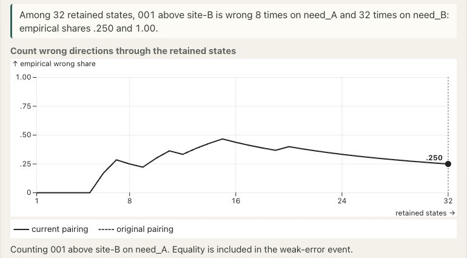
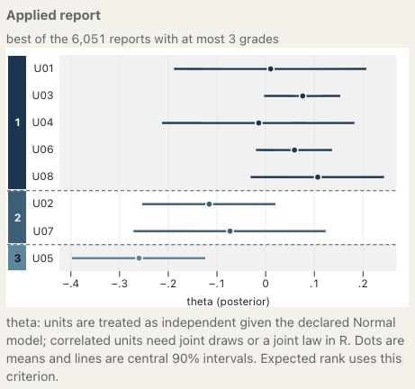

# Computing profile report cards {#sec-computing-profiles}

[]{#sec-v4-ch20}
[]{#sec-p2-09-computation}

Computing a profile report card requires two specifications: the probability law used to evaluate a report and the family of reports allowed to compete. A table of directional error probabilities can price additive loss, but it cannot generally identify whether two scoped failures occurred in the same state. Likewise, searching every combination of seven columns in each of two domains settles a 49-action problem. An ordered partition absent from either bank remains outside that comparison.

In postrank 1.2.0, the public multidomain interface constructs and enumerates a declared product of domain banks. The input measure, loss, protection rule and candidate construction determine what its optimum means. A mathematical formulation of the same problem also permits optimization approaches beyond this implementation.

## Declare the candidate family {#sec-profile-bank-family}

Let $\mathcal B_d$ be the finite bank of permitted columns for domain $d$. The represented family is
$$
\mathcal B=\prod_{d=1}^{D}\mathcal B_d,
\qquad |\mathcal B|=\prod_{d=1}^{D}|\mathcal B_d|.
$$
Each column assigns a grade to every identified unit. Its equality blocks withhold directions, and smaller grades indicate higher reported priority. Structural identity guards must hold separately in each domain, including a domain with zero loss weight. The all-withheld column belongs to every bank.

`postrank_mdomain_family()` accepts supplied columns in a list named in the input's exact domain order. Each grade vector is named in the input's exact unit order. It canonicalizes labels while preserving their order and ties, removes duplicate canonical columns, and includes all-withheld. Thus labels $(10,10,30)$ and $(1,1,2)$ describe the same column; a reversed ordering describes a different one. Supplied columns that split a structural identity class are rejected.

An ordered bank is a separate, explicit construction. Supply a permutation of the unit IDs through `order` and permitted positions between consecutive units through `cuts`; the constructor does not infer either. It generates partitions using eligible cuts subject to `max_grades`. Cuts that split an identity class are excluded. With no order, no ordered partitions beyond all-withheld are generated, although valid supplied columns remain available. The union of generated and supplied columns is deduplicated before its product size is determined.

With the explicit choice `order = "posterior_mean"`, the ordering follows decreasing weighted target means calculated from the supplied states, with unit IDs resolving equal means. The constructor records this use of the states. When they are a Monte Carlo sample, the resulting bank is sample-adaptive. External columns, cuts and other settings may also depend on data; the construction record establishes neither how they were chosen nor their independence from later evaluation data.

Resource limits constrain what the program will construct. The public interface checks the exact product size against `max_actions` before materializing the banks; the default limit is 100,000 actions. Each domain also has a hard limit of 1,000 raw supplied columns and 1,000 final bank entries. The raw-column limit applies before deduplication. Exceeding a limit produces a refusal without truncating the bank or silently searching an initial segment. A smaller bank is a newly declared comparison whose exclusions must be reported.

## From states to a fixed decision {#sec-profile-state-evaluation}

[]{#from-states-to-a-fixed-decision}

Begin with stable unit IDs, target orientations and scientifically supported identity classes. Record the producer of the supplied law, the conditioning data, the representation of that law and the support-state or chain identifiers. Each state must contain all unit values needed by the event being evaluated. Joint protection across domains requires their actual coupling, or an exact summary sufficient for that event. Marginal payloads do not acquire a joint interpretation merely because they have the same number of rows.

For bank entry $b$ in domain $d$, materialize the disclosed directions and their fixed count once. Write $F_{sdhb}$ for the number of false directions in scope $h$ at state $s$, and $N_{dhb}$ for its disclosed count. A disclosed latent equality is a false strict direction under the weak-error loss. Full-domain counts price additive loss; the selected scoped counts price optional mean constraints. With nonnegative state masses $a_s$ summing to one, the expected scoped count is $\sum_s a_sF_{sdhb}$.

The strict threshold event has the integer representation
$$
e_{sdhb}=\mathbf 1\left\{F_{sdhb}\ge
\lfloor t_{dh}N_{dhb}\rfloor+1\right\}.
$$
For a selected bank index $b_d$ in each domain, evaluate the union **within each state** and then average:
$$
J(G)=\sum_s a_s\,
\mathbf 1\left\{\exists(d,h)\in\mathcal H:
e_{sdh b_d}=1\right\}.
$$
This counts a state with several failures once. Summing the separate scope probabilities instead gives a Bonferroni quantity and generally changes the feasible family. When $N_{dhb}=0$, its error count is zero and its strict exceedance is false; a displayed error fraction still has no denominator. Neither this convention nor the separability of mean constraints supplies a missing joint law.

For a fixed named grade matrix, `postrank_mdomain_evaluate()` supplies these calculations. Its `mode = "joint"` evaluates expected quantities and the joint union, while `mode = "expected"` evaluates expected quantities alone and leaves joint and overall feasibility unknown. Analytically inactive unions and unions with at most one active domain can be evaluated without constructing an unsupported cross-domain coupling.


<!-- BEGIN EXPLORER EXPANSION: draws-to-errors -->

::: {#box-explorer-draws-to-errors .explorer-box}

{fig-alt="Screenshot of Pairwise errors from joint posterior draws, illustrating A draw row is one joint state." .explorer-screenshot}

Shift one unit’s retained values and compare the resulting pair-error counts with a shift applied to every unit together. The first operation changes the pairing between units despite preserving their marginal samples; the second only reorders complete states when all rows are used. These synthetic draws illustrate input alignment, and a zero observed event count does not establish zero posterior probability.

::: {.explorer-link}
[Open Pairwise errors from joint posterior draws in postrank Explorer](https://joonho112.github.io/postrank-explorer/pages/criteria/draws-to-errors.html)
:::

A draw row is one joint state

:::
<!-- END EXPLORER EXPANSION: draws-to-errors -->

## Enumerate the represented product {#sec-profile-product-search}

`postrank_mdomain_solve()` in version 1.2.0 exposes primary additive expected-loss minimization with direct joint-union protection and any configured mean constraints. It revalidates the input, the bound decision and the candidate family. It also checks its own `max_actions` limit before enumerating the product. A refusal returns no incumbent and establishes neither infeasibility nor optimality.

The enumerator precomputes each domain column's loss, mean constraints and protected event traces. It then examines every combination in the declared product, combining compatible failure traces by their statewise union. Active traces must refer to the same original payload, state identities, history and masses. Missing information produces an error; it does not cause the candidate to be dropped or labeled infeasible. For nontrivial joint events in several domains, the implementation requires an actual joint payload.

For a fully evaluated family, let
$$
\mathcal F_{\mathcal B}
=\left\{G\in\mathcal B:
E[F_{dh}]\le q_{dh}N_{dh}\ \text{for all }(d,h)\in\mathcal P,
\quad J(G)\le\alpha\right\}.
$$
With exact represented-law evaluations, exhaustive search establishes
$$
\mathcal M_{\mathcal B}
=\operatorname*{arg\,min}_{G\in\mathcal F_{\mathcal B}}
R_{\mathrm{sep}}(G).
$$
Its scope is the declared family. Enumerating every bank combination does not establish optimality over all ordered partitions that could have been supplied. Conversely, if a complete allowed family has explicitly been supplied and verified, exhausting it settles that specified finite problem.

The size distinction matters even for small examples. Four units have 75 unrestricted canonical ordered partitions, giving 5,625 two-domain combinations before guards or caps. The small full ordered-partition oracle used for the source examples covered two to four units. The [exact examples](25-worked-examples.qmd) identify the cases where that full comparison was available; a larger bank search must state its own coverage.

## Read the optimizer set and its representative {#sec-profile-search-result}

The fit retains the complete candidate table and every optimizer ID. In exact arithmetic, every candidate attaining the minimum risk belongs to the optimizer set. It selects the first such candidate in lexicographic canonical grade order: domain-major, then the declared unit order. This convention chooses a reproducible representative and introduces no secondary disclosure objective. It differs from the unit-ID rule used to break equal posterior means during bank construction.

The result includes the selected grades, `optimizer_ids`, `optimizer_count`, `selected_id` and `candidate_table`. The table records risk, joint probability, represented-measure feasibility, optimality and selection. Its `risk_exact` and `J_exact` columns retain exact values when the input representation and arithmetic support them. The fit also retains the native search record and a separately checked fixed-card evaluation of the selected report.

For a validated `input`, a named list of candidate `columns`, and a declared `decision`, the public sequence is short:

```r
family <- postrank_mdomain_family(input, columns = columns, max_actions = 1000L)
fit <- postrank_mdomain_solve(input, family, decision, max_actions = 1000L)
fit$optimizer_ids
fit$candidate_table
```

The [complete example script](../assets/reproduction/software/mdomain-solve.R) supplies the named data and settings. Its action cap should be chosen for that example's intended family; the number in this schematic call is a resource limit, not a statistical tuning parameter.

The optimizer set also depends on the arithmetic used. Exact rational comparisons retain mathematical ties for the represented values. When a risk or protection quantity is computed approximately, the reported optimum concerns those computed values, and approximate score equality uses no tie tolerance. We therefore use the recorded values, rather than a rounded display, to identify the optimizer set or decide whether a budget boundary is satisfied. Even exact evaluation of a supplied Monte Carlo sample concerns its empirical measure; feasibility under the intended posterior requires further assurance.

## An optimization encoding and its limits {#sec-profile-scenario-formulation}

[]{#an-optimization-encoding-and-its-limits}

The scenario calculation also admits a mixed-integer formulation. This is an optimization representation of the fixed bank problem; the public profile solver in postrank 1.2.0 uses the exhaustive enumeration described above. Let binary $y_{db}$ select one prevalidated ordered-partition column in each domain, so $\sum_b y_{db}=1$. Retain every family restriction, identity guard and optional mean constraint. Introduce one shared binary $z_s$ for each complete state and require
$$
z_s\ge\sum_b e_{sdhb}y_{db}
\quad\bigl(s=1,\ldots,S;\ (d,h)\in\mathcal H\bigr),
\qquad \sum_s a_sz_s\le\alpha.
$$
For a fixed product, the smallest possible $z_s$ is the union indicator of its selected scope events. A feasible binary $z$ therefore exists exactly when that report satisfies the represented joint-probability constraint. Larger values of $z_s$ may consume slack, but cannot admit an otherwise infeasible report because state masses are nonnegative. Zero-mass states are harmless, and an empty protected catalog permits $z_s=0$ throughout. The shared variable counts overlapping failures once. The [existential encoding result](../appendices/A-proofs.qmd#prp-c01-exact-encoding) formalizes this equivalence; the performance of an external integer solver is a separate question.

Counts give another encoding. Define $F_{sdh}(y)=\sum_bF_{sdhb}y_{db}$ and $N_{dh}(y)=\sum_bN_{dhb}y_{db}$. Then require
$$
F_{sdh}(y)-t_{dh}N_{dh}(y)\le B_{dh}z_s,
\qquad
B_{dh}\ge\max_{s,b}\bigl(F_{sdhb}-t_{dh}N_{dhb}\bigr)_+.
$$
The original pair count $M$ is safe, as is the potentially smaller bound $(1-t_{dh})\max_bN_{dhb}$. A further alternative uses the integer coefficients $F_{sdhb}-\lfloor t_{dh}N_{dhb}\rfloor$, with safe constant $\max_b\{N_{dhb}-\lfloor t_{dh}N_{dhb}\rfloor\}$. The floor is computed for each column before one-hot selection. These formulations agree on binary feasible points, including $N=0$ and $t=1$; their continuous relaxations can differ. An undersized constant can exclude a valid report, and floating-point solver tolerances require separate checks at exact boundaries. No arbitrary numerical offset replaces the strict event. The [count-formulation proof](../appendices/A-proofs.qmd#prp-c01-count-encoding) states these conditions explicitly.

Precomputed column losses make the primary objective linear in $y$. The optional mean inequality is also linear:
$$
\sum_b\left\{\sum_s a_sF_{sdhb}-q_{dh}N_{dhb}\right\}y_{db}\le0.
$$
Its terms vanish at zero disclosure. A separately declared disclosure objective could instead maximize precomputed disclosure utility under the same constraints. That auxiliary formulation is a different decision problem; grade counts and occupied-cell counts do not substitute for either objective. With exact coefficients the reformulation retains the complete optimizer set of the represented problem, without selecting a new secondary objective.

To aggregate scenarios without changing the specified problem, combine states only when they agree on every feature needed by **every** candidate, and assign each block the sum of its original masses. Loss, configured expected-count features and the joint-union indicator suffice for a fixed problem. Feasibility, objective values, complete optimizer sets and a matched deterministic selector are then preserved by [fixed-family aggregation](../appendices/A-proofs.qmd#thm-t12-preservation). Retaining full and scoped counts **jointly**, for a fixed candidate family and mask catalog, also permits the specified changes in weights, costs, thresholds and budgets covered by the [count-signature result](../appendices/A-proofs.qmd#prp-t12-count-signature).

A compression built only for all-withheld discards every ordering and cannot evaluate a subsequently added directional column. New scopes, candidates or bundle functionals require the features that determine them. Aggregation of stored draws preserves their empirical weighted calculation; it creates neither new independent observations nor an intended-posterior guarantee. The original sample size and any chain order needed for diagnostics must remain available.

## State the computational guarantee {#sec-profile-computation-guarantee}

To interpret an optimum, we first identify the supplied measure, objective, protection rule, candidate family, search coverage and arithmetic status. In exact arithmetic, the risk of a feasible candidate gives an upper bound on the optimum over a larger matched feasible family, while a valid relaxation can provide a lower bound. Their difference bounds possible improvement; it equals the corresponding optimization gap only when the relevant optima are established. For disclosure maximization the bound directions reverse. All these comparisons hold the law, objectives and constraints fixed, and a resource refusal supplies no optimization bound. The bank optimum in the [40-site illustration](31-synthetic-need.qmd) has this limited coverage.

The information supporting a computed value determines what further assurance is available:

| Input and assessment route | What the calculation establishes | Conditions that remain separate |
|:---|:---|:---|
| Complete finite support | Exact finite-law values and a family optimum when the arithmetic is exact; otherwise results for the computed approximate values. | Whether that finite law is the scientific law of interest, and whether the family is scientifically adequate. |
| iid validation states | A conditional count-based certificate for the frozen joint event when the rule accepts. | Whole-state iid sampling, independence from exploration, prior freezing, fixed sample size and no validation reuse or optional stopping. |
| MCMC history | Empirical evaluation and descriptive diagnostics using the supplied chain order and batches. | Sampling dependence, convergence and representation of the intended posterior; no iid count certificate follows automatically. |

`postrank_mdomain_assess()` makes these routes explicit through `method = "exact"`, `"iid"` or `"mcmc"`. The finite-law route named `"exact"` evaluates the supplied complete support; the method name does not turn floating masses into rational arithmetic. For iid validation, freeze the report, decision, target law, sample size and numerical budget before collecting or inspecting validation states. The numerical error budget $\beta$ differs from the scientific cap $\alpha$. Hashes and disjoint state IDs check consistency, but do not prove independence or the timing of that freeze. A successful conditional certificate concerns the specified joint event; it does not certify mean guards, report optimality or model calibration. Failure to certify is inconclusive rather than proof of infeasibility.

MCMC assessment retains chain order, hit counts, zero runs and fixed batches, including a final partial batch. An observed run with no failures differs from an analytically zero event. A fixed empirical calculation, even when its counts and rational arithmetic are exact, leaves a separate question about the intended posterior. These sampling and selection issues are developed in [numerical and posterior uncertainty](21-numerical-uncertainty.qmd).


<!-- BEGIN EXPLORER EXPANSION: your-data -->

::: {#box-explorer-your-data .explorer-box}

{fig-alt="Applied grade report for the app’s eight-unit public example, displaying posterior means, central 90 percent intervals, three grade blocks, and the stated Normal-independence assumption." .explorer-screenshot style="--explorer-image-width:560px;"}

Use a public teaching example to see how supplied posterior summaries or pair-probability matrices become a common-grade report with a declared search family. Normal-summary inputs assume conditional independence across units, and larger examples switch to cuts of a specified order. This browser tool illustrates computation scope; joint profile protection and posterior calibration require their own information and checks.

::: {.explorer-link}
[Open Reports from supplied posterior summaries in postrank Explorer](https://joonho112.github.io/postrank-explorer/pages/tools/your-data.html)
:::

Inspect assumptions in a browser-built common report

:::
<!-- END EXPLORER EXPANSION: your-data -->

