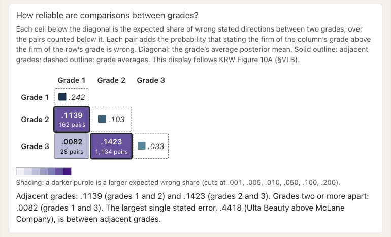
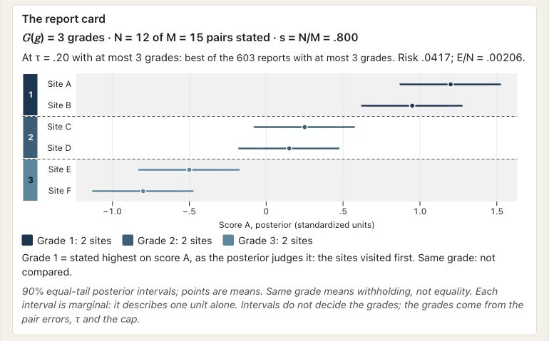
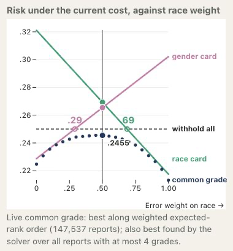
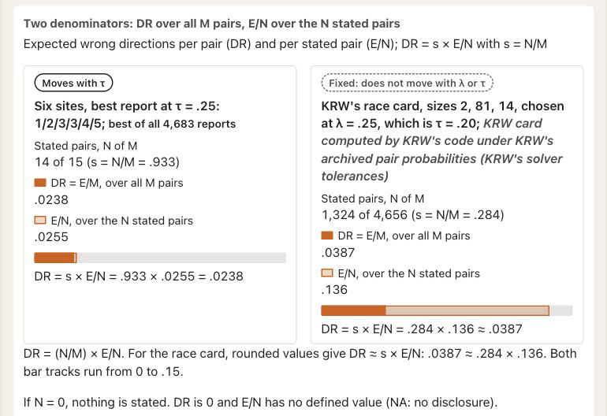
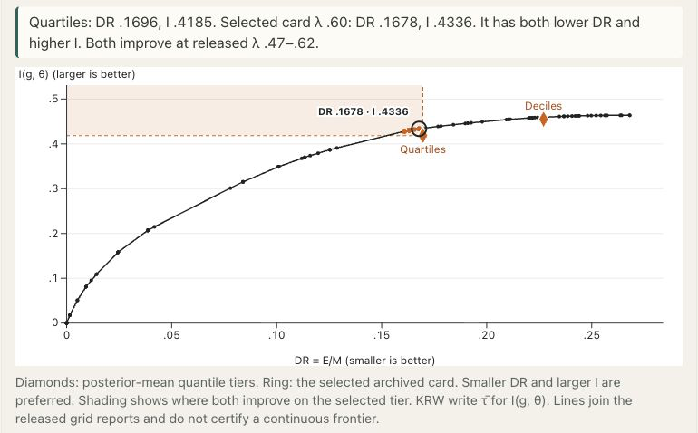
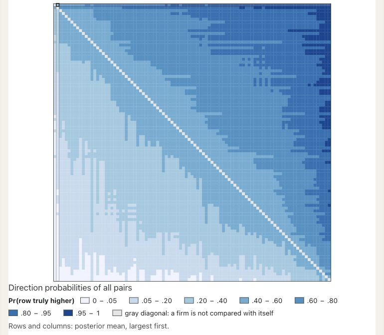

# Interpreting the KRW illustration {#sec-krw-illustration}

## Correspondence experiment and retained reporting frame {#sec-krw-study-frame}

Kline, Rose, and Walters estimate firm-specific contact gaps from responses to fictitious applications, then use posterior beliefs to assign named firms to ordered categories. Their report cards thus connect experimental estimates with public reporting. The published race and gender cards treat the two targets separately. For the present illustration we construct a common race–gender grade, which was not produced in the original study [@kline_discrimination_2024].

The experiment began with the 2018 Fortune 500 list and selected 108 firms whose entry-level vacancies and hiring platforms could be audited. Applications were sent in five waves between October 2019 and April 2021. Vacancies were sampled across US counties, and the design attempted four pairs of applications per vacancy. Within each pair, one application received a distinctively White name and the other a distinctively Black name; gender and additional applicant characteristics were also randomized. The outcome was an attempted employer contact within thirty days. The measured responses concern experimentally assigned name signals in this recruitment setting, rather than every stage of employment [@kline_discrimination_2024].

Applications supply the contact outcomes, vacancies define the clusters for sampling uncertainty, and firms receive grades. The reporting frame includes fewer firms than the full experiment, which comprised roughly 84,000 applications to 11,000 jobs at 108 firms. The report-card analysis excludes eleven firms with contact rates below three percent or fewer than forty sampled jobs, leaving 97 firms, 10,453 jobs and 78,910 applications [@kline_discrimination_2024].

The comparisons refer to these retained firms, the study period and the stated targets. They are neither a representative ranking of all employers nor a current assessment. A firm excluded for insufficient information is outside the comparison frame, rather than assigned low priority. Publishing the cards also provides no evidence that a grade-based intervention was implemented or had an effect.

## Signed race and gender targets {#sec-krw-signed-targets}

Let $p_{iW}$ and $p_{iB}$ denote the contact probabilities for applications with White and Black names at firm $i$, and let $p_{iM}$ and $p_{iF}$ denote the corresponding male- and female-name probabilities. KRW's targets are

$$
\theta_{iR}=\log p_{iW}-\log p_{iB},
\qquad
\theta_{iG}=\log p_{iM}-\log p_{iF}.
$$

The race target measures a proportional contact advantage for White names; the gender target measures a proportional contact advantage for male names. The source motivates the log ratio by noting that a level difference can be small simply because a firm contacts few applicants overall. The estimates substitute sample contact rates, with sampling uncertainty calculated through a delta-method approximation using job-clustered covariance information [@kline_discrimination_2024]. The gender definition follows the same log-ratio construction [@kline_discrimination_2024].

We retain signed race and signed gender targets for the primary common-grade illustration. Larger values have higher reporting priority, with grade 1 highest. A higher gender target therefore indicates a greater male-name contact advantage; a large female-name advantage lies at the other end of the axis. Its low signed value is not evidence of equal treatment.

The common report compares White-name and male-name advantages. It does not combine all directions of discrimination into a direction-neutral index. KRW describes gender preferences as bidirectional and interprets the two ends of the gender ordering accordingly [@kline_discrimination_2024]. Retaining this axis permits comparison with the original scalar cards. Other targets could be adopted, but their direction of priority must be specified before optimization.

For sensitivity analysis, replacing $\theta_{iG}$ by $|\theta_{iG}|$ defines the magnitude of the gender contact disparity irrespective of direction. This changes the estimand and its ordering. The required pair event is

$$
\Pi_s\{|\theta_{iG}|>|\theta_{jG}|\mid Y\},
$$

rather than $\Pi_s\{\theta_{iG}>\theta_{jG}\mid Y\}$. A matrix of signed comparison probabilities does not generally determine the transformed probabilities. Likewise, $E_s[|\theta_{iG}|\mid Y]$ is generally different from $|E_s[\theta_{iG}\mid Y]|$. The sensitivity analysis therefore requires transforming the latent target within the supplied law and recalculating its probabilities and moments. Taking absolute values of a signed ranking or posterior means would give a different calculation.

<!-- BEGIN EXPLORER EXPANSION: krw-card -->

::: {#box-explorer-krw-card .explorer-box}

{fig-alt="Screenshot of KRW’s race and gender report cards, illustrating Read directions in a historical firm card." .explorer-screenshot}

Explore the separate race and gender report cards for the 97 firms retained in KRW’s historical correspondence experiment. The display separates marginal uncertainty, grade membership and the directions stated between grades, with different denominators for errors per possible pair and per disclosed pair. These archived actions are evaluated with released probabilities and do not describe present conduct.

::: {.explorer-link}
[Open KRW’s race and gender report cards in postrank Explorer](https://joonho112.github.io/postrank-explorer/pages/cases/krw-card.html)
:::

Read directions in a historical firm card

:::
<!-- END EXPLORER EXPANSION: krw-card -->

## Empirical Bayes specification {#sec-krw-posterior-producer}

KRW formulates grading conditional on supplied beliefs and estimates these beliefs by empirical Bayes methods in the application. In the idealized measurement model, an estimate is normally distributed around the latent contact gap, with variance equal to its squared standard error. Sampling errors are independent across firms conditional on effects and standard errors. Although the standard errors are estimated from the experiment, the approximation treats them as known and does not propagate their uncertainty [@kline_discrimination_2024].

The mixing distribution is estimated and substituted into Bayes' rule. A normal measurement distribution therefore does not require a normal prior. The resulting posterior comparison probabilities enter the grading objective as estimated inputs; optimizing grades exactly for those inputs does not validate either the mixing distribution or the fitted probabilities [@kline_discrimination_2024].

The empirical specification also departs from a common prior independent of precision. Write $\mathrm{se}_{ik}$ for a standard error, avoiding confusion with disclosure fractions. The baseline models have the forms

$$
\theta_{iR}=\mathrm{se}_{iR}^{\beta_R}v_{iR},
\quad v_{iR}>0,
\qquad
\theta_{iG}=\mu_G+\mathrm{se}_{iG}^{\beta_G}v_{iG},
\quad E[v_{iG}\mid\mathrm{se}_{iG}]=0.
$$

The residual distribution in each scalar model is invariant to the standard error. Race has positive support, whereas gender allows either sign. The two occurrences of $v$ denote different residual distributions. In particular, the race residual mean differs from the gender location parameter, despite the mean symbol reused in the source [@kline_discrimination_2024].

Scale and moment parameters are estimated by generalized method of moments, after which transformed estimates are deconvolved using a log-spline density. For race, the source describes a penalized likelihood fit on positive support; the gender fit permits unrestricted support. The posterior calculations plug in these estimated parameters and distributions rather than integrate over a hyperparameter posterior [@kline_discrimination_2024]. Positive support excludes an underlying White-name disadvantage within the race model. It imposes no such restriction on other data-generating processes.

The article also incorporates industry information, using multiplicative industry and firm components for the race residual and additive components for the gender residual. These industry-conditioned models differ from the baseline specifications, even when they use the same contact estimates [@kline_discrimination_2024]. A grading calculation must therefore identify the specification that generated its probabilities. The description “KRW posterior” alone does not distinguish these models.

The profile formulation in @sec-profile-actions allows separate race and gender grade columns while retaining the two signed targets. This changes the action family. By contrast, replacing a signed target by its absolute magnitude changes the scientific question before a report is chosen. Neither change supplies a joint target law for simultaneous error statements. Here we use outputs from the two scalar models for a common-grade calculation; we specify its coefficients and scope below.

## Precision dependence and target magnitude {#sec-krw-precision-target}

Under the positive race model, increasing the standard error changes both the prior location and spread when $\beta_R>0$. For gender, the conditional mean remains $\mu_G$, while the spread changes with $\mathrm{se}_{iG}^{\beta_G}$. The paper estimates positive precision-dependence parameters and interprets the gender specification as associating greater precision with smaller absolute gender gaps [@kline_discrimination_2024]. This association is specific to the fitted model and its empirical evidence; it need not hold in other models of discriminatory behavior.

For the gender model, we can derive the relation between scale and magnitude directly. If the residual has a finite first absolute moment, then

$$
E[|\theta_{iG}-\mu_G|\mid\mathrm{se}_{iG}]
=\mathrm{se}_{iG}^{\beta_G}E[|v_{iG}|].
$$

The identity describes conditional prior magnitude around the modeled center. In contrast, $|\theta_{iG}|$ measures magnitude from zero; these coincide only if $\mu_G=0$. Posterior moments further condition on the observed firm estimate. Neither the scale identity nor a positive fitted exponent establishes a larger posterior absolute gap for every less precise firm, or a posterior ranking determined solely by standard errors.

Signed posterior ranks can also depend on precision despite the common conditional prior mean, because the likelihood, prior spread and realized estimates all enter the posterior. KRW's reported gender card describes greater shrinkage of less precise estimates toward zero and notes that imprecise observations can receive middle grades [@kline_discrimination_2024]. This behavior describes the source application, rather than a general property of signed grading.

An association of precision with absolute-gap grades can therefore arise from the target transformation, the dependence model, measurement uncertainty or their interaction. Removing precision dependence changes the model; adopting signed gaps changes the target. Either choice changes the interpretation of the grades rather than correcting a numerical calculation. We retain the historical specification to examine its implications, without selecting a model to obtain more appealing grades.

## Specification of a common report {#sec-krw-common-report-scope}

To construct a common report from the two posterior inputs, we must also specify preference weights, a withholding cost and a feasible grade family. Criterion weights value wrong directional statements, whereas composite coefficients combine target magnitudes. The comparison framework in @sec-fair-comparator-framework distinguishes both co-primary targets. Even on the common log-ratio scale, equal numerical coefficients do not make these objectives identical.

Within-criterion pair probabilities suffice to evaluate the additive criterion-weighted loss, since expected error counts can be added without specifying cross-criterion coupling. A composite posterior, joint conflict probability or simultaneous accuracy statement requires further joint information. Independence of sampling noise across firms in the original scalar model does not imply independence of race and gender effects. Thus the stored scalar matrices support the directional-error calculation below but cannot evaluate the scalar-composite target retained as co-primary in the monograph.

Exact boundaries along a fixed order minimize risk within the corresponding restricted family. Combining separately optimized scalar cards defines another construction. Neither procedure alone establishes unrestricted joint optimality or criterion protections. The scalar correspondence retains the tie assumptions in @sec-scalar-reduction, and any reused numerical action requires an identified construction and evaluation record.

Since latent firm targets and actual mistakes are unobserved, posterior expected errors average over the supplied model. Error per possible pair and error among disclosed pairs have different denominators; for all-tie, the latter fraction is undefined. A summary should therefore identify the target, procedure supplying the probabilities, firm ordering, restrictions and denominator. It should also distinguish an archived action from a newly certified optimum.

In profile notation, a common action $g$ becomes the constant profile $G=(g,g)$. Its additive criterion-error calculation remains available from the same marginal coefficients. A comparison with profiles that use different columns would additionally need matched targets, loss coefficients and candidate restrictions (@sec-profile-diagonal-reduction). If joint protection were required, the evaluation would need a joint law and the declared comparison scopes; the two matrices alone cannot establish that protection. The archived actions below therefore supply neither a joint-error estimate nor evidence of a profile advantage.

<!-- BEGIN EXPLORER EXPANSION: report-card -->

::: {#box-explorer-report-card .explorer-box}

{fig-alt="Screenshot of Posterior summaries in a grade report, illustrating Read the intervals and the grade comparisons." .explorer-screenshot}

Reveal one grade at a time and connect the marginal intervals to the comparisons actually stated between grades. The table averages pairwise error probabilities within each grade-pair block; it does not give the probability that every unit in one block exceeds every unit in another. These synthetic cards complement the empirical illustration without reproducing its fitted data or archived action.

::: {.explorer-link}
[Open Posterior summaries in a grade report in postrank Explorer](https://joonho112.github.io/postrank-explorer/pages/grades/report-card.html)
:::

Read the intervals and the grade comparisons

:::
<!-- END EXPLORER EXPANSION: report-card -->

<!-- BEGIN EXPLORER EXPANSION: krw-two -->

::: {#box-explorer-krw-two .explorer-box}

{fig-alt="Risk curves for the historical race and gender report cards and the common-grade report as the error weight on race changes, with the all-withheld reference and candidate-family note." .explorer-screenshot style="--explorer-image-width:460px;"}

A single common grade can be evaluated for both race and gender contact gaps by changing their directional-error weights. The app compares that report with two fixed KRW cards under the same displayed loss, while its live search remains within a weighted expected-rank order. Separate marginal fits support these additive comparisons but do not identify joint posterior accuracy.

::: {.explorer-link}
[Open A common report for race and gender gaps in postrank Explorer](https://joonho112.github.io/postrank-explorer/pages/cases/krw-two.html)
:::

Evaluate common and separate historical cards

:::
<!-- END EXPLORER EXPANSION: krw-two -->

## Reassessment of archived common-grade actions {#sec-krw-reuse-interpretation}

The archived common-grade actions were reassessed by reconstructing the reports and checking their coefficients. This evaluates fixed actions; it does not certify them as optimizers.

The historical illustration combines baseline race and gender probabilities using equal directional-error weights, one common order and contiguous grade boundaries. The targets are the signed White-name and male-name advantages defined above. This analyst extension illustrates the reporting tradeoff for the retained firms. It does not estimate the effect of publication or establish appropriate priorities for an intervention.

We use stored pair-probability arrays from the baseline models without industry effects. The baseline program approximates posterior calculations on finite support grids. In this branch it sums products of firm-specific grid weights to obtain pair probabilities, rather than using the large simulation setting employed elsewhere. Reusing the arrays avoids refitting but preserves their estimation and approximation choices. The assessment is therefore conditional on these coefficients; validation of the fitted distribution and uncertainty about its parameters remain unresolved.

### Fixed order and reconstruction of archived actions {#a-fixed-order-and-a-recoverable-reporting-action}

The historical procedure orders firms by the equally weighted sum of their race and gender comparison-probability row sums. Under its complementary-probability convention, this is an expected-rank order. It is generally different from ordering a weighted sum of posterior target means. The row-sum calculation uses ordinal comparisons within each criterion; a composite of the two target magnitudes would define another estimand and could produce another order.

The procedure searches partitions into consecutive blocks of this order, permitting at most the specified number of nonempty grades. It need not use every label and imposes neither separate criterion error limits nor a search across all firm orderings. The historical program obtains boundaries by dynamic programming. Here we inspect the calculation and evaluate reconstructed outputs, without independently certifying either a restricted or an unrestricted optimum.

The archive contains integer block sizes and rounded summaries but no complete firm-by-grade assignment. A separate read-only check reconstructed the two actions below by deriving the fixed order from the identified arrays and assigning the archived sizes along it. Equal row sums would preserve the declared firm-index order; comparisons of the order calculations found no ambiguous cut boundary under the stated arithmetic diagnostic. This construction selected no new boundaries and ran no dynamic program, producing reconstructed assignments from archived sizes rather than retrieved full assignments or newly certified optima.

### Historical coefficient completion convention {#the-numerical-convention-is-part-of-the-input}

The baseline exporter calculates strict events of the form $P(\theta_i>\theta_j\mid Y)$ in both directions on its grid. The common-grade consumer keeps each upper-triangle entry and replaces the corresponding reverse entry by its complement. It then treats the reverse completed entry as the error cost of asserting that $i$ precedes $j$. This convention produces complementary directional coefficients and matches the historical calculation being interpreted.

Relating the completed coefficients to weak-error risk requires allowing for equality. A finite grid can assign positive mass to ties, in which case the two strict ordering events do not exhaust the possibilities. Rounding and numerical integration may also affect opposite-direction sums. Complementing the reverse entry therefore specifies the historical numerical calculation; it neither establishes tie-freeness on the grid nor demonstrates an error in the source's intended continuous model.

The book counts equality as an error when a report asserts a strict direction. An algebraic calculation using $1-P^{\mathrm{raw}}_{ij}$ can therefore help expose the consequences of the historical completion convention. Interpreting it as exact weak-event posterior risk would additionally require validating the raw array as probabilities under the relevant law and accounting for numerical approximation; array consistency alone is insufficient. The observed maximum absolute opposite-direction sum defects were $1.1\times10^{-4}$ for race and $5\times10^{-6}$ for gender. Both positive and negative defects occurred, so they cannot be read as exact latent-tie masses. At the two fixed reconstructed actions, the alternative $1-P^{\mathrm{raw}}_{ij}$ coefficients increased normalized risk by approximately $1.974\times10^{-7}$ and $5.675\times10^{-7}$, respectively. These differences quantify the effect of the coefficient convention for the two fixed actions; neither a posterior calibration assessment nor a global numerical-error bound follows from them.

### Error summaries and their denominators {#read-the-denominators-and-provenance-together}

For the 97 retained firms, $M=4{,}656$ is the number of possible unordered pairs; $N$ counts those disclosed across grades. Write $D_R$ and $D_G$ for the sums of the respective error coefficients over disclosed directions. The historical criterion-weighted evaluation is

$$
\frac{\tfrac12D_R+\tfrac12D_G+\tau(M-N)}{M}.
$$

Disclosure is $N/M$, whereas the criterion-specific wrong fractions among disclosed pairs are $D_R/N$ and $D_G/N$, when $N>0$. These fractions differ from error per possible pair. The withholding cost $\tau$ in this expression is also distinct from KRW's exchange parameter $\lambda$; their scalar correspondence requires the conditions stated in @sec-scalar-reduction. Matching numerical values of the two parameters need not identify the same operating point.

The earlier reassessment verified the firm-index and estimate/standard-error alignment, evaluated the reconstructed actions by directly summing their disclosed-pair coefficients, and recovered both archived rows at their printed precision using a separate evaluator with 60-digit decimal arithmetic. All recorded input-file identities remained unchanged; the historical consumer was not executed and its original software environment was not reproduced.

| $\tau$ | Grade sizes, highest priority first | Disclosed pairs $N$ | Disclosure $N/M$ | Wrong fractions, race / gender | Normalized risk |
|---|---|---:|---:|---:|---:|
| .25 | 6 / 90 / 1 | 636 | .137 | .196 / .237 | .2455 |
| .45 | 16 / 37 / 30 / 14 | 3,344 | .718 | .312 / .336 | .3598 |

: Two reconstructed archived common-grade actions under the baseline signed-target inputs, equal directional weights and historical complementary-coefficient convention. Both have an at-most-four-grade cap. Wrong fractions are among disclosed pairs; risk is evaluated at the row's own $\tau$. {#tbl-krw-reused-common-actions}

At the smaller withholding cost, ninety firms share a middle grade and only three of the four permitted labels are used. The second action discloses more pairs, with larger criterion-specific wrong fractions among them. These actions illustrate the error–disclosure tradeoff, but their risks use different withholding costs and cannot measure improvement under one common loss. Evaluating the two actions also does not determine the frontier or its best report.

@fig-vis-f20 relates the sizes of the two reconstructed actions to their disclosure denominators and row-specific costs on a common firm-count scale. The historical coefficient convention and the reconstruction described above determine the interpretation of these metrics.

::: {#fig-vis-f20 .reader-figure .reader-has-narrow style="--reader-figure-width:640px;"}
<picture>
<source media="(max-width: 720px)" srcset="../assets/figures/f20-two-reconstructed-krw-grade-actions-mobile.svg">

</picture>

Two archived common race–gender actions are reconstructed for the same 97-firm reporting frame from baseline signed-target coefficient arrays and equal directional-error weights. Grade widths show firm counts, highest priority first: 6/90/1 at tau=1/4 and 16/37/30/14 at tau=9/20. The actions disclose 636 and 3344 of 4656 possible pairs. Their criterion wrong fractions use the disclosed-pair denominator, while normalized risks 0.2455 and 0.3598 use each row’s own withholding cost. These common reports are an analyst extension of KRW’s separate scalar cards. The two rows describe fixed actions at different costs. They establish neither an improvement under a common loss nor a frontier, and provide no optimality certificate.
:::

A later reproduction record reports regeneration of the consumer output, and the retained script and output copies agree. However, the inspected records lack a complete account of the original software environment and file hashes recorded at execution for all four direct inputs. The reassessment identifies the files it used and evaluates actions against their coefficients. Recovering the archived rounded summaries supports consistency for those inputs and actions, but does not verify the original execution details or the validity of the procedure used to obtain the probabilities.

The two marginal pair arrays suffice for additive criterion-error evaluation of these identified common reports under the specified directional priorities and numerical inputs. Evaluating cardinal race–gender composite orderings, joint latent criterion conflict or simultaneous accuracy would require additional joint information. Choosing the targets, validating the model and probability calculations, and relating grades to allocation or intervention require further work, including the institutional choices considered in @sec-governance-communication.

<!-- BEGIN EXPLORER EXPANSION: two-denominators -->

::: {#box-explorer-two-denominators .explorer-box}

{fig-alt="Screenshot of Error rates under two denominators, illustrating One error count, two denominators." .explorer-screenshot}

Compare expected errors per possible pair with expected errors per stated pair, keeping their shared numerator visible. The app’s archived scalar race card differs from the common race–gender actions in this chapter, while its synthetic controls show how disclosure changes the relationship. The archived assignments stay fixed, and the released probability inputs differ slightly from the original archived probabilities.

::: {.explorer-link}
[Open Error rates under two denominators in postrank Explorer](https://joonho112.github.io/postrank-explorer/pages/grades/two-denominators.html)
:::

One error count, two denominators

:::
<!-- END EXPLORER EXPANSION: two-denominators -->

<!-- BEGIN EXPLORER EXPANSION: deciles-quartiles -->

::: {#box-explorer-deciles-quartiles .explorer-box}

{fig-alt="Screenshot of Deciles and quartiles of posterior means, illustrating Archived cards and fixed posterior tiers." .explorer-screenshot}

Compare posterior-mean quartiles or deciles with the selected archived card on the original discordance and informativeness axes. Change the archive setting to see why a displayed improvement is tied to the particular card and target. These are historical, separate scalar comparisons under released probabilities, distinct from this chapter's reconstructed common race–gender actions; they neither refit the model nor describe current employer conduct.

::: {.explorer-link}
[Open Deciles and quartiles of posterior means in postrank Explorer](https://joonho112.github.io/postrank-explorer/pages/rules/deciles-quartiles.html)
:::

Archived cards and fixed posterior tiers

:::
<!-- END EXPLORER EXPANSION: deciles-quartiles -->

<!-- BEGIN EXPLORER EXPANSION: krw-heatmap -->

::: {#box-explorer-krw-heatmap .explorer-box}

{fig-alt="Screenshot of Firm-pair probabilities and report-card blocks, illustrating Compare pair probabilities with a coherent card." .explorer-screenshot}

Overlay an archived firm card on the matrix of posterior direction probabilities to see how coherent reporting differs from isolated pair decisions. The highlighted cells distinguish confident comparisons withheld within a grade from stated comparisons below the isolated-pair threshold. The calculation evaluates historical race or gender cards under the released probabilities, with their source and solver qualifications retained.

::: {.explorer-link}
[Open Firm-pair probabilities and report-card blocks in postrank Explorer](https://joonho112.github.io/postrank-explorer/pages/cases/krw-heatmap.html)
:::

Compare pair probabilities with a coherent card

:::
<!-- END EXPLORER EXPANSION: krw-heatmap -->

