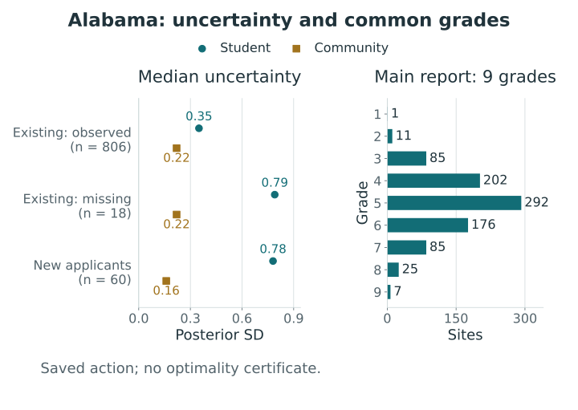
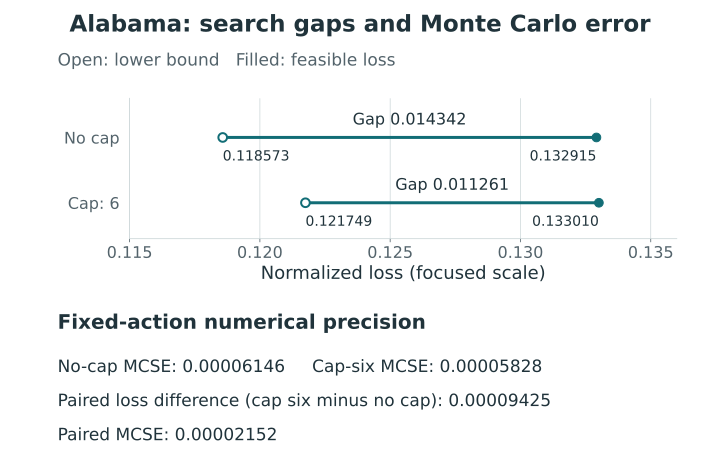

# Economic need in Alabama Pre-K {#sec-alabama-need}

[]{#sec-v4-ch27}

Alabama's prekindergarten application frame provides a concrete setting in which a precise ordering can communicate more certainty than the measurements support. The analysis considered here uses information about the children served by a site and the surrounding community to form ordered priority groups. It separates the measurement of need from the decision about which comparisons to publish. The results are those of the November 2026 preprint and its completed analysis, rather than a newly fitted application [@lee_hooper_walker_alabama_need_2026].

The joint posterior represents dependence between the two dimensions, while **one common grade per site** asks the same ordering to serve both. We use this common-grade analysis as a comparison point for domain profiles; it supplies no empirical result for the profile joint-protection problem in @sec-profile-actions.

## A policy population with unequal information {#sec-alabama-population}

The population contains 884 physical sites in the agency's 2025–26 application frame: 824 existing sites and 60 applicants classified as proposing new sites. A site may house several classrooms. Grades are assigned at the site level because that is the level at which the study combines student and community information. The eligible population is consequently neither a list of classrooms nor a set of distinct neighborhoods. Its original comparison denominator is $M=\binom{884}{2}=390{,}286$ unordered site pairs.

Student-composition information comes from 2024–25 enrollment records. Of the existing sites, 806 have responses on the retained student indicators; 18 lack usable matched student records. The 60 new applicants also have no student indicators. Those 78 sites remain in the analysis. Excluding them would change the policy population, while assigning their missing student dimension a known community value would conceal uncertainty that the measurement model is designed to retain.

Three enrollment items are used: free or reduced-price lunch eligibility, household SNAP participation, and household WIC participation. Their site shares describe enrolled children. The family-reported poverty item is excluded because the application does not specify an income threshold, making its interpretation unreliable. The exclusion applies only to that student item: **ACS community poverty remains in the analysis**, alongside community SNAP, Supplemental Security Income, and unemployment. The model therefore still includes a poverty measure [@lee_hooper_walker_alabama_need_2026].

The student shares are often based on small records: the median number of children is 18, with an interquartile range of 17 to 35. A binomial standard error treats these children as information about the population a site of that kind serves. Across sites, the median standard error of a reported share is about nine percentage points. Thus two nearby raw shares can be weak evidence of a difference even before they are combined with other indicators. The standard error concerns the measurement's precision, not the policy importance of the indicator.

Community information refers to a different population and period. With no residential addresses for the children, the study uses a 15-minute drive-time catchment around each site. It aggregates 2019–2023 five-year ACS estimates from intersecting tracts using area-overlap weights and propagates their reported margins of error. The 884 sites correspond to 871 catchments. Thirteen pairs share locations and therefore have identical community indicators. The catchment is a defined geographic proxy; it is not an observed enrollment boundary. Area weighting and the absence of residential addresses remain part of the measurement interpretation.

Student and community SNAP shares concern different populations and periods: the ACS share describes households across several years, whereas the enrollment item describes children at a site in one program year. Their precision also differs, with reported median standard errors of about 1.5 percentage points for catchments and 8.8 for student shares. We therefore retain both distinctions when interpreting the seven indicators; replacing student composition by neighborhood conditions would require further justification.

## Two linked needs and a joint posterior {#sec-alabama-measurement}

The measurement model defines standardized latent student-composition need $S_i$ and community need $C_{h(i)}$, where $h(i)$ identifies the catchment. Each construct has population mean zero and variance one. Their relationship is represented by
$$
C_h\sim N(0,1),\qquad
S_i=\rho C_{h(i)}+\sqrt{1-\rho^2}\,\eta_i,
\qquad \eta_i\sim N(0,1).
$$
Positive indicator loadings orient both constructs so that larger values mean greater need. Indicator-specific residual variation permits, for example, participation in a program to differ for reasons not captured by the common need factor. Each observed share enters with its own standard error. More precise observations consequently contribute more information about a site's latent need; this weighting is a property of the measurement model, separate from the decision weights assigned to the two constructs.

For an existing site without student records, the student likelihood terms are absent and its latent student need is inferred jointly. New applicants' student needs are drawn after fitting from the same conditional distribution at each posterior draw. This procedure retains variation around the community-based prediction and uncertainty about the estimated correlation. It does not fill in three artificial student shares. Its substantive assumption is that, conditional on community need, sites without records follow the same student-composition distribution as sites with records. That assumption requires judgment about record availability and the intended population.

The stored analysis retains 1,000 iterations from each of four chains, giving 4,000 joint states of the two needs for all 884 sites. Sites sharing a catchment have the same community target in a state, while their student needs can differ. The posterior mean of $\rho$ is 0.64, with a 90% interval from 0.60 to 0.68. This positive but imperfect relationship permits community information to help with missing student data without making the dimensions equivalent [@lee_hooper_walker_alabama_need_2026].

| Site information | Sites | Median student-need SD | Median composite SD | Median composite 90% rank width |
|---|---:|---:|---:|---:|
| Existing, student indicators observed | 806 | 0.35 | 0.21 | 207 |
| Existing, student indicators missing | 18 | 0.79 | 0.43 | 486 |
| New applicant | 60 | 0.78 | 0.41 | 425 |

: Stored posterior uncertainty summaries. SDs use the latent population scale; rank widths count positions among 884 sites. The composite gives equal weight to the two needs. Values are the rounded source-table summaries [@lee_hooper_walker_alabama_need_2026]. {#tbl-alabama-uncertainty}

The wider distributions for sites without student records are part of the result, rather than a defect to remove by assigning a precise substitute score. Across all sites, the median composite rank interval spans 213 positions. Although the interval width does not determine the best number of grades, it gives a reason to consider uncertainty in comparisons alongside the order of posterior means. The retained chains describe uncertainty under the fitted model; their existence does not establish iid sampling, external calibration, or stable grade assignments after repeated fitting.

## One common grouping and a six-group alternative {#sec-alabama-grouping}

The reported action assigns one integer grade to each site, with smaller grades indicating higher priority. A common grade withholds a direction between two sites. Different grades issue the same ordering for both need dimensions, even when those dimensions favor different directions. The weights are $w_S=w_C=0.5$, and the withholding cost is $\tau=0.25$. These settings price reporting errors and withheld comparisons; they do not estimate a monetary return to funding a site.

This application uses equality-neutral loss. An issued direction is wrong when the target is strictly lower in that dimension. Withholding incurs a cost only when the two latent needs differ. In the notation of @sec-tie-aware-loss, the risk is the expected weighted sum of these pair losses divided by the original $M=390{,}286$. The distinction matters for sites sharing a catchment: their community targets are identical by construction, so either ordering or withholding that community comparison has zero equality-neutral loss. Their student targets can still differ. A shared community target therefore does not by itself make the sites equivalent on both dimensions or determine their common grade.

The main stored action is the search without a policy cap on the number of grades. It has nine occupied groups, with sizes 1, 11, 85, 202, 292, 176, 85, 25, and 7. The three large middle groups contain about 76% of sites. The action discloses 304,583 pairs, or 78.04% of the original pairs, while withholding the remainder. Its reported expected reversal rate among disclosed distinct-need comparisons is approximately 10.0%, averaged over dimensions. That rate differs from total expected loss, which also prices withholding, and from the probability of a joint exceedance event.

::: {#fig-s11-alabama-uncertainty .reader-figure .reader-has-narrow style="--reader-figure-width:560px;"}
<picture>
<source media="(max-width: 720px)" srcset="../assets/figures/S11-mobile.svg">

</picture>

Posterior uncertainty and the main Alabama common-grade report. Dots give the median posterior standard deviation of student and community need within each information group; bars give the sizes of the nine selected grades. These are separate summaries of the same 884 sites, not a cross-tabulation of information groups and grades. The saved action is feasible without an optimality certificate [@lee_hooper_walker_alabama_need_2026].
:::

[Full-size SVG](../assets/figures/S11.svg) · [PDF](../assets/figures/S11.pdf)

| Stored scenario | Occupied groups | Expected loss | Disclosed pairs (%) | Reported risk lower bound | Absolute risk gap |
|---|---:|---:|---:|---:|---:|
| Main, uncapped search | 9 | 0.13291548 | 78.04098 | 0.11857338 | 0.01434210 |
| Supplement, at most six | 6 | 0.13300973 | 76.54131 | 0.12174858 | 0.01126115 |

: Stored equal-weight actions under the same posterior and withholding cost. Both have status `feasible_not_certified`. The lower bounds and gaps are solver records in normalized risk units; they are not posterior intervals or Monte Carlo standard errors [@lee_hooper_walker_alabama_need_2026]. {#tbl-alabama-scenarios}

The six-group alternative has expected loss only 0.00009425 above the main action. Its sizes are 81, 155, 316, 213, 83, and 36. This is a separate constrained search, not an instruction to merge the nine groups mechanically. The stored cross-tabulation contains no pairs ordered in opposite directions, but its boundaries redistribute sites. In particular, the first three groups contain 97 sites in the main action and 552 under the cap. Giving both collections the same “top three” funding interpretation would compare very different populations.

Both searches stopped under the specified recent-improvement rule after approximately two hours, leaving feasible incumbents without certificates of global optimality. The recorded absolute gaps of 0.01434210 and 0.01126115 remain unresolved. We can therefore compare the losses of these particular feasible reports under the stored coefficients, but the small difference between them does not establish the difference between the unknown global optimum values.

The fixed-action exploratory MCMC standard errors are approximately 0.00006146 and 0.00005828. The paired standard error for the capped-minus-uncapped difference is approximately 0.00002152, computed using the shared retained states. These quantities concern numerical estimation for the frozen actions. They neither close the solver gaps nor measure how grades would change after refitting or reoptimizing. The small sampling errors and unresolved optimization gaps illustrate the separate uncertainties discussed in @sec-numerical-uncertainty.

::: {#fig-s12-alabama-gaps .reader-figure .reader-has-narrow style="--reader-figure-width:600px;"}
<picture>
<source media="(max-width: 720px)" srcset="../assets/figures/S12-mobile.svg">

</picture>

Stored Alabama actions under the same equality-neutral loss. Each segment runs from the solver lower bound to the saved feasible loss; its length is the unresolved optimization gap, not a posterior interval. The numerical summaries below describe fixed-action Monte Carlo error and the paired cap-six-minus-no-cap loss difference. A small MCSE does not certify an optimizer, and neither action is certified optimal [@lee_hooper_walker_alabama_need_2026].
:::

[Full-size SVG](../assets/figures/S12.svg) · [PDF](../assets/figures/S12.pdf)

<!-- postrank-exhibit:alabama:begin -->

Explore stored results: Alabama: two saved common-grade reports

How do the saved uncapped and six-grade reports differ under the same loss? Only stored reports are read.

<table><caption>Stored scenario summaries</caption><thead><tr><th scope="col">Saved report</th><th scope="col">Readout</th></tr></thead><tbody><tr><th scope="row">Main common-grade report: no cap</th><td>Sites / original pairs: 884 / 390286; Occupied grades: 9; Stored normalized loss: 0.13291548; Solver lower bound: 0.11857338; Unresolved solver gap: 0.01434210; Fixed-action MCSE: 0.00006146; Issued comparisons: 304583 / 390286; Grade sizes: 1, 11, 85, 202, 292, 176, 85, 25, 7</td></tr><tr><th scope="row">Supplement: at most six grades</th><td>Sites / original pairs: 884 / 390286; Occupied grades: 6; Stored normalized loss: 0.13300973; Solver lower bound: 0.12174858; Unresolved solver gap: 0.01126115; Fixed-action MCSE: 0.00005828; Issued comparisons: 298730 / 390286; Grade sizes: 81, 155, 316, 213, 83, 36</td></tr></tbody></table>

<button type="button" data-widget-load disabled>Open stored-result viewer</button>

<a href="../assets/widgets/case-results/alabama/index.html">Open the standalone view</a>. The chapter and the viewer's static summary remain available without JavaScript.

<!-- postrank-exhibit:alabama:end -->

## Comparing rules and interpreting changed priority {#sec-alabama-interpretation}

The comparison holds the 884-site frame, posterior states, domain weights, and withholding cost fixed. Raw-composite deciles have stored expected loss 0.15704, compared with 0.14354 for posterior-mean deciles and 0.13911 for posterior-mean sextiles. A restricted rule retaining the posterior-mean order and choosing ten group boundaries by loss has expected loss 0.13326. The main nine-group action has loss 0.13292. The comparison therefore separates changes in measurement, boundary placement, and the additional freedom to rearrange sites. The last comparison also changes the occupied grade count; it cannot isolate reordering alone.

The source reports a 15.4% reduction in expected loss relative to raw-composite deciles. This is a comparison under the fitted posterior and the specified loss, not a frequentist performance guarantee or an estimate of a funding effect. The plotted paths of conventional tier rules likewise describe the rules actually evaluated. Their proximity to the selected action does not make them a complete attainable frontier. A matched-disclosure claim requires the common-family and denominator conditions of @sec-matched-disclosure-frontier.

Changed priority also has a substantive geography. The main action's first three groups contain 97 sites, compared with 88 in the top raw-composite decile; 73 belong to both sets. Twenty-four sites enter the former set and 15 leave it. The manuscript reports that 23 of the 24 gaining sites are in Montgomery, Mobile, and Jefferson counties. Their indicators combine high SNAP participation with lower FRPL and WIC shares. The fitted measurement model's stronger association between SNAP and student-composition need helps explain why an equal average of the raw indicators can assign these sites a different position [@lee_hooper_walker_alabama_need_2026].

The classification changes depend on the stated procedures: the two high-priority sets have different sizes, and membership is sensitive to which boundary is chosen. The source's descriptive decomposition attributes changes to modeling, cutpoints, and final regrouping, while acknowledging that the sequence of changes affects the allocation. It does not identify causal contributions. A funding schedule, budget, and allocation rule would add decisions beyond the grade vector, as discussed in @sec-rules-objectives.

The existing analysis shows how measurement precision affects comparisons, how withholding changes the distinctions reported and how a grade cap changes the action family. These findings concern a common report selected from coherent S/C states under an additive equality-neutral objective. To assess the benefit of domain profiles or optimize a profile union-risk cap would require a new decision problem and additional analysis: the joint posterior alone neither supplies joint protection nor certifies simultaneous acceptability of all local comparison events. Any improvement must be assessed under the stated targets, law, loss and numerical evidence.