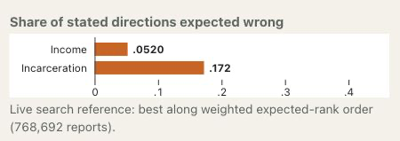
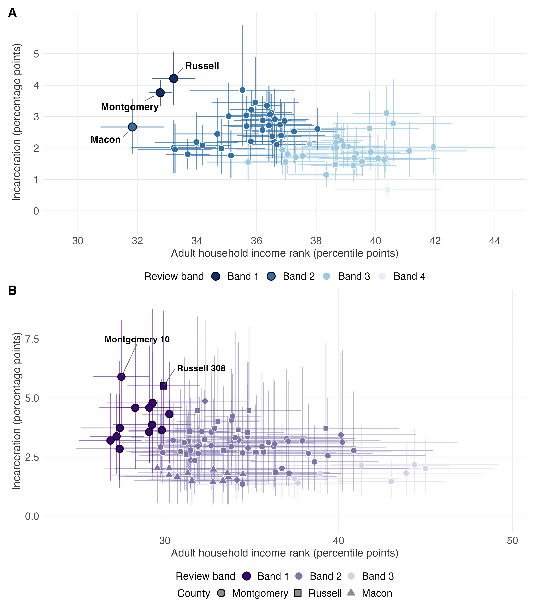
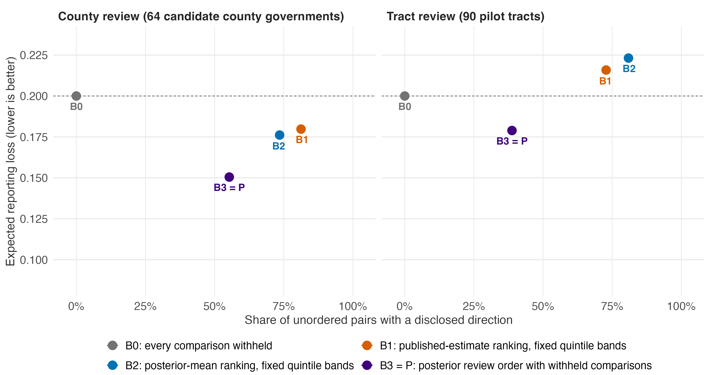
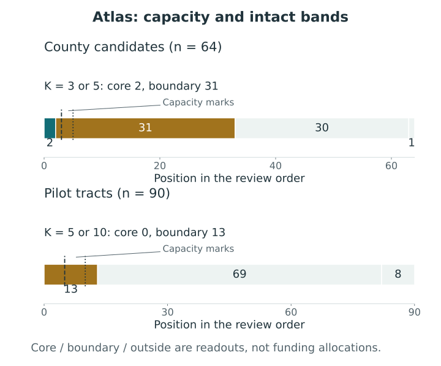

# Prioritizing places with Opportunity Atlas data {#sec-opportunity-atlas}

[]{#sec-v4-ch28}

## Historical need and the places under review {#sec-atlas-targets}

A review order can help an agency decide where to investigate local needs when it cannot examine every place at once. The Alabama Opportunity Atlas case asks this preliminary question. It uses historical outcomes and their uncertainty to identify groups of places for further review, leaving comparisons unresolved when the reporting loss favors withholding them. The bands do not allocate grants, determine eligibility, or estimate intervention effects. They organize the evidence available before those decisions [@lee_prioritizing_places_2026].

The Opportunity Atlas reports adult outcomes by childhood location and parental income [@chetty_opportunity_2026]. Here the population comprises the 1978–1983 birth cohorts, pooling race and gender, evaluated at the 25th percentile of the national parent income distribution. The two indicators are household income rank in 2014–2015 and incarceration on April 1, 2010. Income is measured in percentile points; incarceration is a historical cohort proportion, displayed in percentage points. Neither variable is a current neighborhood condition. In particular, incarceration does not describe current crime or the character of present residents.

The reporting targets orient both criteria toward greater historical need: negative income rank and positive incarceration. Grade 1 therefore means earlier review for greater need. Choosing these directions is part of defining the estimand, as discussed in @sec-conflict-estimands. Combining criterion-specific errors does not turn the indicators into a new measured index of deprivation.

The fitted county models cover all 67 Alabama counties. The county reporting problem uses 64 potential county-government candidates after excluding Jefferson, Mobile, and Shelby under the archived program-year 2026 route definition. This is a candidate restriction for the retrospective case, not a finding that 64 projects are eligible. A separate model covers 1,173 tracts with usable estimates and standard errors. The full geographic ledger retains 1,181 tract keys, including eight without modeled outcomes. Missingness remains visible rather than becoming a zero-need category.

The tract reporting universe is smaller still: 90 tracts in Macon, Montgomery, and Russell counties, selected purposively after examining the county results. These comprise 12, 65, and 13 tracts, respectively. The remaining 1,083 modeled tracts have criterion-specific posterior summaries but no statewide all-pair report in this case. Model coverage therefore extends beyond the candidates actually compared at both geographic levels [@lee_prioritizing_places_2026].

<!-- BEGIN EXPLORER EXPANSION: alabama-map -->

::: {#box-explorer-alabama-map .explorer-box}

{fig-alt="Criterion-specific expected wrong shares for the equal-weight Alabama county common report, with its declared weighted expected-rank candidate family." .explorer-screenshot style="--explorer-image-width:560px;"}

Explore a common report for all 67 Alabama counties using historical Opportunity Atlas income and incarceration outcomes. Here grade 1 means more favorable outcomes, whereas this chapter prioritizes greater need among 64 county candidates and 90 selected tracts. The app’s order-restricted searches illustrate weight sensitivity; they are distinct from the 884-site Alabama Pre-K analysis and from present eligibility decisions.

::: {.explorer-link}
[Open A common report for Alabama county outcomes in postrank Explorer](https://joonho112.github.io/postrank-explorer/pages/cases/alabama-map.html)
:::

Declare the population and direction before mapping grades

:::
<!-- END EXPLORER EXPANSION: alabama-map -->

## From noisy indicators to criterion-specific evidence {#sec-atlas-marginal-laws}

The case treats each published estimate as a noisy measurement of an underlying historical quantity. Its measurement model uses the published standard error and a hierarchical distribution across places to adjust imprecise estimates more strongly toward the broader pattern. The tract model includes county and within-county layers. County and tract models are fitted separately, so their reports do not constitute one nested ranking. A tract in a first-band county need not belong to the first tract band.

The measurement assumptions also determine the interpretation of apparently implausible observations. Some published incarceration estimates are negative because the released estimate contains uncertainty; the underlying probability remains nonnegative. The analysis retains these observations and their standard errors instead of truncating them before fitting. Published uncertainty includes sampling and confidentiality-related noise, whose separate contributions are not identified by the public files. Treating the standard errors as known is itself a modeling assumption, examined only partly by the recorded sensitivity analyses [@lee_prioritizing_places_2026].

Income and incarceration are fitted separately. Each fit supplies a joint vector of values across places for its own criterion, preserving the information needed for within-criterion pair comparisons. The case does not supply a scientifically identified joint posterior across the two criteria. Matching rows from the separate simulation streams would not create that missing law. Consequently, the chapter reports additive common-grade risk, not a cross-criterion probability that at least one protected event occurs. The joint-protection analysis of @sec-joint-protection would require an additional coupling specification and a corresponding justification.

@fig-atlas-intervals displays the two marginal summaries side by side. Greater need lies leftward and upward. The horizontal and vertical intervals describe uncertainty for the respective criteria; they are not a joint credible region. Nor does interval overlap by itself determine the reported comparison. Pair probabilities come from each criterion's full-vector posterior, while the final bands depend on the report-wide optimization. These pair probabilities enter the criterion-specific risks defined in @sec-multicriteria-loss.

<!-- Replace existing fig-atlas-intervals in place; retain its anchor and linked original. -->
::: {#fig-atlas-intervals .reader-figure .reader-has-narrow style="--reader-figure-width:600px;"}
<picture>
<source media="(max-width: 720px)" srcset="../assets/figures/S13-mobile.svg">

</picture>

The Atlas comparison frames: 64 county candidates from 67 modeled counties, and 90 purposefully selected pilot tracts from 1,173 modeled tracts. Points and 95% marginal intervals describe historical income rank and incarceration; greater historical need is leftward and upward. Colors identify common-grade bands. The narrow rendering retains every candidate, posterior mean and interval; place-name annotations are available in the linked original. The criteria and geographic levels have separate models; these panels do not define a nested statewide ranking or a joint credible region [@lee_prioritizing_places_2026].
:::

[Original figure](../assets/cases/atlas/figures/fig3_two_criteria_uncertain.png) · [Narrow SVG](../assets/figures/S13-mobile.svg) · [Narrow PDF](../assets/figures/S13-mobile.pdf)

## A common report and its declared loss {#sec-atlas-action-loss}

One ordered partition is chosen for each candidate universe. Different bands disclose a direction of greater need; equal bands withhold that direction. A reported tie does not assert equality of the historical quantities. The central specification gives each criterion weight one half, assigns withholding cost $\tau=0.20$, and permits at most five bands. These analytical preferences were not elicited from the agency.

Let $D(g)$ contain the disclosed pairs, oriented toward the place reported as having greater need, and let $p_d(i,j)$ be the posterior probability that this direction is wrong for criterion $d$. With $M=\binom{n}{2}$ and $N(g)=|D(g)|$, the case evaluates

$$
R_\tau(g)=\frac{1}{M}\left\{
\sum_{(i,j)\in D(g)}\left[\tfrac12p_{\mathrm{income}}(i,j)
+\tfrac12p_{\mathrm{incarceration}}(i,j)\right]
+\tau\{M-N(g)\}\right\}.
$$

Withholding every comparison therefore costs 0.20. The weights combine expected error costs, so calculating this risk does not require a cross-criterion joint posterior. It also does not certify every disclosed pair separately. Transitivity and the common band assignment link the decisions: changing one pair's relation can change many others, as @sec-conflict-withholding explains.

The stored analysis selects the report using finite simulation coefficients from pool A and evaluates that fixed report using pool B from the same fitted posterior. Pool B supplies a numerical check, not new observations or validation of the historical indicators. The recorded solver bounds concern the finite-A objective and the allowed band family. Exact posterior optimality remains unestablished, and the results must be interpreted with model uncertainty, simulation error, and optimization error kept separate (@sec-numerical-uncertainty).

## What the stored reports disclose {#sec-atlas-results}

Under the central settings, the county report contains bands of 2, 31, 30, and 1 counties. Montgomery and Russell share the first band; their relative order is withheld. Macon belongs to the second band, despite having especially low income, because the two indicators do not support the same comparisons. The pilot tract report has bands of 13, 69, and 8. Its first band contains twelve Montgomery tracts and one Russell tract. All twelve Macon tracts are in its second band [@lee_prioritizing_places_2026].

@tbl-atlas-comparators gives the principal numerical summaries. Each disclosure fraction uses the full unordered-pair denominator for its own candidate universe. The expected reporting loss includes both wrong-direction costs and withholding costs; it is not an error proportion among disclosed comparisons. The pool-B MCSE measures numerical uncertainty in evaluating the fixed report, rather than uncertainty in the true historical outcomes or the stability of the selected bands.

| Stored central report | Candidates | Unordered pairs $M$ | Disclosed pairs $N$ | Occupied bands | Pool-B loss | Pool-B loss MCSE |
|:--|--:|--:|--:|--:|--:|--:|
| County-government candidates | 64 | 2,016 | 1,115 | 4 | 0.150484 | 0.000102 |
| Purposeful tract pilot | 90 | 4,005 | 1,553 | 3 | 0.178901 | 0.000089 |

: Stored common-grade results at equal criterion weights, $\tau=0.20$, and at most five bands. Values are rounded from the archived comparison tables; no model or solver was rerun for this chapter. Pool-B evaluation uses the same fitted posterior, with no scientific cross-criterion joint law [@lee_prioritizing_places_2026]. {#tbl-atlas-comparators}

The county report discloses about 55% of pairs, while the tract report discloses about 39%. Both improve on the all-withheld loss of 0.20. The smaller tract disclosure fraction is consistent with noisier tract estimates, but different models and candidate universes prevent treating the difference as a controlled comparison of geographic scale.

@fig-atlas-loss shows why shrinkage alone is insufficient. Fixed-quintile rules based on published estimates or posterior means disclose more comparisons. For tracts, their stored losses are approximately 0.216 and 0.223, exceeding the all-withheld benchmark. That finding evaluates the complete reporting rules under the declared loss; it does not mean that the posterior estimates contain less information than no data. The posterior-mean rule and the optimized report use the same posterior evidence but disclose different relations.

The best cuts along the posterior expected-rank order, labeled B3, reproduce the selected report P at the central settings for both universes. This stored agreement is not a general rank-then-cut equivalence. The free-partition solver's bounds apply to its finite-A coefficients; the county gap is recorded as zero and the tract gap is at floating-point roundoff scale. Neither the agreement nor these solver records supplies a certificate for exact posterior risk.

::: {#fig-atlas-loss .reader-figure .reader-no-narrow style="--reader-figure-width:700px;"}

<picture>

</picture>

Disclosure and expected reporting loss for the stored comparison rules. B0 withholds everything; B1 and B2 use fixed quintile bands of published-estimate and posterior-mean rankings; B3 optimizes cuts of a fixed expected-rank order. B3 and P coincide here. Error bars are twice the fixed-report Monte Carlo standard error, not posterior credible intervals. Existing manuscript figure [@lee_prioritizing_places_2026].
:::

[Complete original figure](../assets/cases/atlas/figures/fig6_disclosure_loss.png).

<!-- postrank-exhibit:atlas:begin -->

Explore stored results: Atlas: county and pilot-tract reports

Which historical need band and marginal uncertainty belong to a saved candidate? Only stored reports are read.

<table><caption>Stored scenario summaries</caption><thead><tr><th scope="col">Saved report</th><th scope="col">Readout</th></tr></thead><tbody><tr><th scope="row">64 county candidates</th><td>Candidates / original pairs: 64 / 2016; Occupied common bands: 4; Issued comparisons: 1115 / 2016; Selection-state loss A: 0.15048411; Fixed-report loss B: 0.15048372; Fixed-report B MCSE: 0.00010193; Finite-A solver gap: 0</td></tr><tr><th scope="row">90 purposefully selected pilot tracts</th><td>Candidates / original pairs: 90 / 4005; Occupied common bands: 3; Issued comparisons: 1553 / 4005; Selection-state loss A: 0.17882800; Fixed-report loss B: 0.17890073; Fixed-report B MCSE: 0.00008945; Finite-A solver gap: 5.551115123125783e-17</td></tr></tbody></table>

<button type="button" data-widget-load disabled>Open stored-result viewer</button>

<a href="../assets/widgets/case-results/atlas/index.html">Open the standalone view</a>. The chapter and the viewer's static summary remain available without JavaScript.

<!-- postrank-exhibit:atlas:end -->

## Reading capacity without splitting an unresolved band {#sec-atlas-capacity}

Suppose staff can investigate $K$ places. A band is *core* when all of its positions fall within the first $K$ places. A band that crosses the capacity boundary is *boundary*: some, but not all, of its members would fit, while the report supplies no order among them. Keeping that band intact exposes the unresolved choice. This readout follows the report; capacity was not a budget or cardinality constraint in the optimization.

At county capacities three or five, Montgomery and Russell are core. The next band contains 31 counties and crosses either capacity boundary. A third county cannot be chosen from the report alone, and a capacity of five does not justify selecting three names by an undisclosed secondary ranking. Additional local evidence or an explicitly declared selection rule is needed. The report separates historical comparison from subsequent administrative choice.

For the pilot tracts, the first band already contains thirteen places. It crosses both illustrative capacities, five and ten, so all thirteen remain boundary and none is core. Having no core does not mean that none of the tracts deserves review: the current report cannot isolate a smaller first group at those capacities without splitting a band whose internal comparisons are withheld. @fig-atlas-capacity displays this distinction directly.

<!-- Reflow existing fig-atlas-capacity; keep original full-size link. -->
::: {#fig-atlas-capacity .reader-figure .reader-has-narrow style="--reader-figure-width:560px;"}
<picture>
<source media="(max-width: 720px)" srcset="../assets/figures/S14-mobile.svg">

</picture>

Illustrative review capacities applied to intact Atlas bands. County capacities of three and five both leave two counties in the core and the next 31 in the boundary band. Tract capacities of five and ten both fall inside the first 13-tract band, with no core. The markers interpret existing common-grade reports without choosing within-band units or optimizing a funding allocation. Band counts and capacities are those of the source figure [@lee_prioritizing_places_2026].
:::

[Original full-size figure](../assets/cases/atlas/figures/fig5_capacity_readout.png) · [SVG](../assets/figures/S14.svg) · [PDF](../assets/figures/S14.pdf)

## Sensitivity, numerical limits, and historical scope {#sec-atlas-limits}

Changing the central weights or withholding cost can alter band membership. In the archived county sensitivity analysis, Montgomery and Russell remain core at capacities three and five across the five examined policy settings. Macon joins the first band when income receives weight 0.75 or withholding costs 0.30. Increasing the income weight changes the relative importance of an error; increasing the withholding cost instead favors resolving more comparisons. The same membership change can therefore have different decision-theoretic explanations.

Tract sensitivity includes the central specification, four policy alternatives, and three model stresses. These vary the income weight, withholding cost, county layer, reported standard errors, and within-county measurement-error dependence. Frequencies across these prespecified cases describe sensitivity, not posterior probabilities. Several settings also reach the five-band cap; the case does not establish that changing that cap would preserve the report. Such choices belong alongside the preference analysis in @sec-protections-preferences.

The candidate set is another substantive choice. Montgomery contributes 65 of the 90 pilot tracts and appears in about 93% of the pilot's pairs. Changing the counties included, or the relative weights of pairs, would change the objective. The pilot is neither a statewide representative sample nor a set of verified applicants. Statewide posterior summaries permit a future reporting analysis, but their availability does not constitute an already computed statewide ranking.

The archived fixed-report risk estimates met their specified MCSE targets, although MCSEs were unavailable for some individual pair probabilities. An observed event stream can be constant even when its posterior probability is not known exactly. Moreover, the separate evaluation streams use the same data and model, so they provide neither iid validation certificates nor new-data validation or evidence that the bands are causally correct.

Version and direction matter when comparing this case with software illustrations. The archived postrank 1.1.0 Explorer map uses 67 counties and a favorable-outcome direction: higher income and lower incarceration. Its grades cannot be substituted for this 64-candidate historical-needs report. The present case's stored analysis used its preserved postrank 0.9.0 implementation; the book's current software examples do not retroactively change that provenance.

The historical outcomes may reflect family sorting, place effects and institutions that have since changed. We therefore interpret the bands as a conditional review order that makes withheld comparisons explicit. They do not identify current place quality, current crime, the effects of outreach or which project should receive funding [@lee_prioritizing_places_2026].