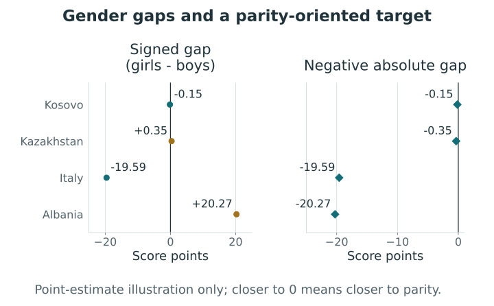
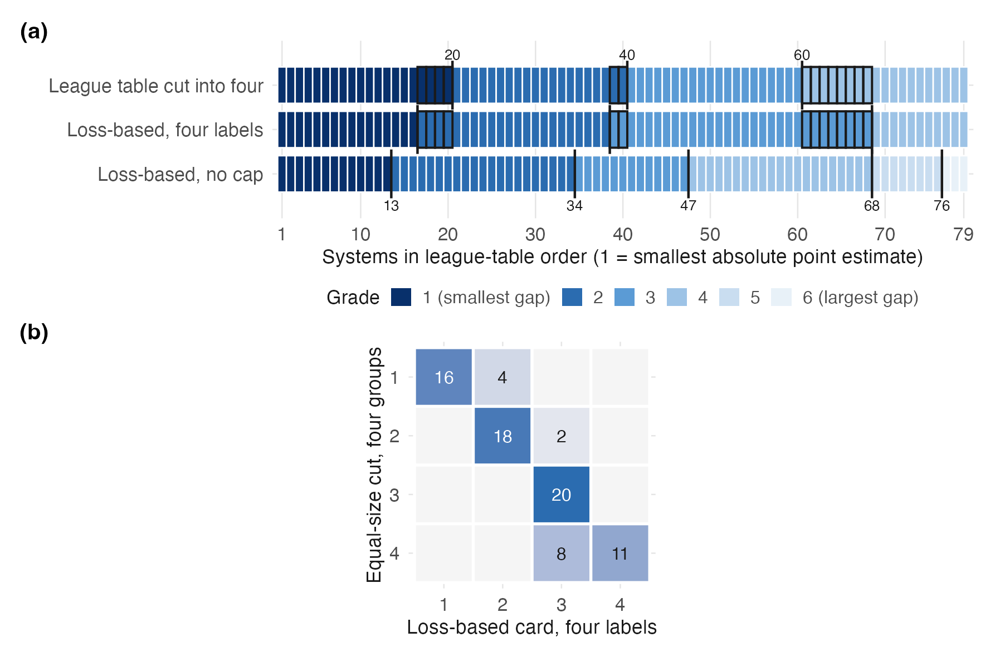
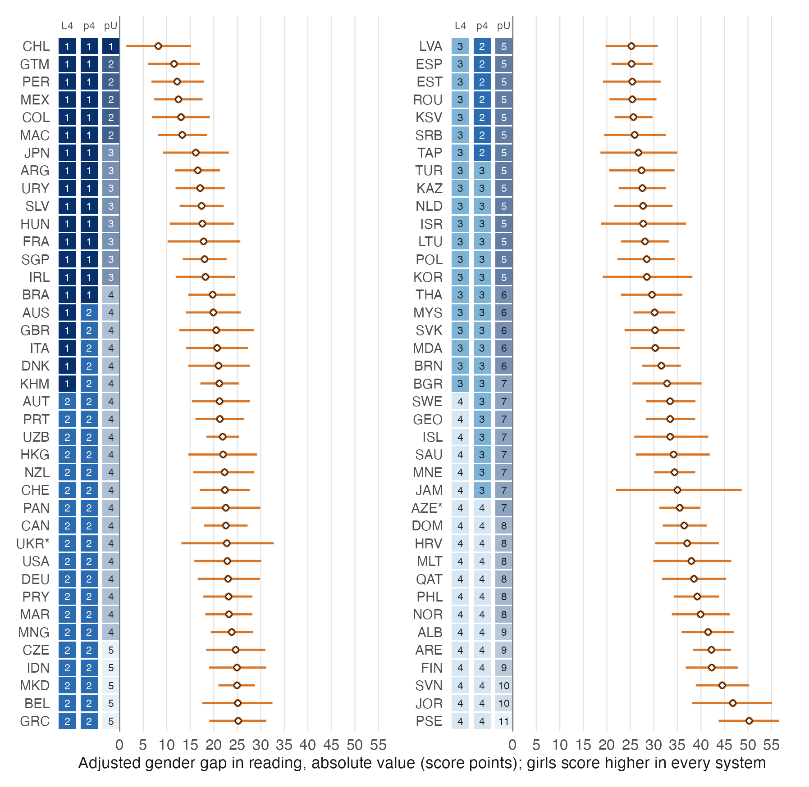
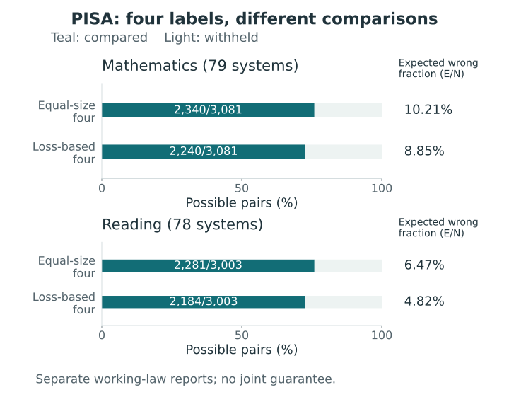

# International educational comparisons {#sec-pisa-comparisons}

[]{#sec-v4-ch29}

International comparisons can be directed toward parity as well as achievement. A system with a small gender gap may have high or low average achievement, and a favorable position on one criterion need not imply a favorable position on the other. Here we ask which education systems can be distinguished by the magnitude of their adjusted gender achievement gaps. The PISA application of @lee_pisa_gender_report_cards_2026 answers this question with grades that disclose some directions and withhold others. Its mathematics and reading analyses are two separate one-criterion applications. They do not supply a joint posterior report across the two subjects.

## Systems, samples, and the comparison question {#sec-pisa-systems}

The analysis uses PISA 2022 student records, including ten plausible values for achievement in each subject, the final student weight, 80 replicate weights, gender, and the index of economic, social and cultural status (ESCS). Reporting units are called *systems* because they include countries, economies, and subnational samples. For example, Baku represents a subnational sample, and the Ukrainian sample covers 18 of 27 regions. Describing every row as a country would obscure the population to which its comparison applies.

The primary roster contains 79 systems in mathematics and 78 in reading. Cyprus is absent from the released student file. Costa Rica is excluded because ESCS is missing throughout its sample; Viet Nam is additionally excluded from reading under the study's prespecified comparability rule. These exclusions precede the comparison of estimated gaps. They leave 3,081 unordered pairs in mathematics and 3,003 in reading. A grade has meaning relative to the relevant roster, so adding or removing systems can change the reporting problem.

Within each system, the analytic sample requires valid gender, finite ESCS and all ten plausible values, and positive finite final and replicate weights. It contains 588,204 students in mathematics and 582,141 in reading, about 96.8% of the corresponding candidate records. These overall retention rates conceal variation: retained records represent 78.6% of the weighted candidate population in the United Kingdom and 86.5% in Germany. The analysis does not model the missing ESCS values or quantify how complete-case selection changes the gaps. The comparison therefore concerns the defined analytic populations, with this limitation attached to the results.

## A gap target and a calibrated working law {#sec-pisa-target-law}

For system $c$ and plausible value $m$, the survey-weighted regression is
$$
Y_{ic}^{(m)}
 =\beta_{0,c}+\beta_{F,c}F_{ic}+\beta_{E,c}E_{ic}
  +\varepsilon_{ic}^{(m)},
$$
where $F_{ic}=1$ for girls and $0$ for boys, and $E_{ic}$ denotes ESCS. The coefficient $\beta_{F,c}$ is a girls-minus-boys difference in score points at the same value of the linear ESCS term. It is a weighted linear-projection association, not a causal effect of gender. Comparability remains conditional on the released achievement and ESCS scales.

The primary target is
$$
\theta_c=-|\beta_{F,c}|.
$$
Larger values identify smaller absolute gaps, so grade 1 denotes the systems closest to parity. Taking the absolute value deliberately removes direction; signed gaps must accompany the card when the reader needs to know which gender scores higher. The transformation also makes uncertainty near zero consequential. An absolute point estimate is generally different from the mean absolute gap under an uncertainty law. Equal-size cuts use the former to order systems; the loss-based rule uses pairwise probabilities from the full law.

::: {#fig-s15-pisa-target .reader-figure .reader-has-narrow style="--reader-figure-width:600px;"}
<picture>
<source media="(max-width: 720px)" srcset="../assets/figures/S15-mobile.svg">

</picture>

Signed gaps and the parity-oriented transformation for four stored mathematics point estimates. The examples are the closest-to-zero and largest-magnitude estimates of each sign. The report itself transforms every calibrated coefficient state before computing comparison probabilities: the displayed points are neither posterior expected absolute targets nor grades. Small absolute gaps concern parity, not overall achievement or a causal gender effect [@lee_pisa_gender_report_cards_2026].
:::

[SVG](../assets/figures/S15.svg) · [PDF](../assets/figures/S15.pdf)

Design-based estimation combines the ten plausible-value regressions and their replicate-weight covariance estimates. Fay balanced repeated replication uses 80 replicates and perturbation factor $0.5$, giving covariance multiplier $1/\{80(1-0.5)^2\}=0.05$. Combining within- and between-plausible-value variation gives the coefficient estimate $\bar b_c$ and covariance target $T_c=\bar U_c+1.1B_c$. A separately fitted Bayesian regression on stacked plausible values supplies 4,000 retained coefficient vectors per system, from four chains. An affine Cholesky adjustment matches their mean to $\bar b_c$ and their **sample** covariance to $T_c$.

The working law $C$ places equal mass on these 4,000 calibrated vectors. Its covariance is consequently $(3999/4000)T_c=0.99975T_c$, because a finite equal-mass law and sample covariance use different divisors. Even with this distinction accounted for, matching moments neither establishes that the remaining distributional shape is correct nor validates repeated-sampling probabilities. The law pools no information across systems.

## From pair probabilities to a report card {#sec-pisa-decision}

Within either subject, comparisons use the product of the separate system laws. If $\theta_c^{(s)}$ is the transformed value at stored draw $s$, then
$$
q_{cd}
 =\Pr_C(\theta_c>\theta_d)
 =\frac{1}{4000^2}
   \sum_{s=1}^{4000}\sum_{t=1}^{4000}
   \mathbf 1\{\theta_c^{(s)}>\theta_d^{(t)}\}.
$$
Every pair of draw indices enters this calculation; corresponding indices are not treated as jointly sampled cross-system states. Independence across systems is an assumption of this product law. In particular, it omits uncertainty shared through international linking and scaling. It supplies the pairwise information required for the one-criterion loss in @sec-posterior-risk-laws, without establishing a cross-subject joint law.

Let $M$ be the number of system pairs, $N(g)$ the number disclosed by grade action $g$, and $E_C(g)$ the expected number of disclosed directions reversed under $C$. The normalized risk is
$$
R_C(g)=\frac{E_C(g)+\tau\{M-N(g)\}}{M},
\qquad \tau=0.25.
$$
A shared grade withholds a direction; it does not assert that the underlying gaps are equal. All pairs receive equal weight, a reversed direction costs one, and withholding costs $\tau$. The all-withheld card therefore has risk $0.25$. For an isolated pair, disclosure is preferable when its reversal probability is below $0.25$. A complete ordered card must reconcile many comparisons, so this pairwise threshold is not an individual guarantee for every disclosed pair.

The primary comparison permits at most four occupied grades. Equal-size quartiles and a loss-based card are evaluated under the same law and loss; the latter chooses the grades jointly. The stored mixed-integer solutions reached the solver's optimality tolerance, a numerical optimization result that does not exactly certify every optimal action. Likewise, finite-product evaluation of a fixed card is distinct from Monte Carlo approximation to a broader uncertainty law. The uncapped results below retain the same distinction.

## Mathematics: where grade boundaries differ {#sec-pisa-math-results}

In mathematics, adjusted point estimates favor boys in 57 systems and girls in 22. Absolute point estimates range from about 0.2 to 20.3 score points. Their uncertainty is large relative to the separation among many systems. A league table discloses all 3,081 pairwise directions, but under the working law about 487.6 are expected to be reversed [@lee_pisa_gender_report_cards_2026].

@tbl-pisa-cards compares stored reports under the same finite law. The four-label loss-based card discloses 2,240 pairs, or 72.7%, against 2,340, or 75.9%, for the equal-size cut. Its expected reversal count is 198.3 rather than 238.8. The expected fraction reversed among disclosed comparisons falls from 10.2% to 8.9%, while normalized expected loss falls from 0.1376 to 0.1326, about 3.7%. These are different summaries: $E/N$ describes the disclosed set, whereas $R$ also charges for withheld pairs.

| Subject | Report | Grades | $N$ | $E_C$ | $R_C$ |
|:--|:--|--:|--:|--:|--:|
| Mathematics | League table | 79 | 3,081 | 487.6 | 0.1583 |
| Mathematics | Equal-size cut, four groups | 4 | 2,340 | 238.8 | 0.1376 |
| Mathematics | Loss-based, at most four labels | 4 | 2,240 | 198.3 | 0.1326 |
| Mathematics | Loss-based, no cap | 6 | 2,474 | 251.2 | 0.1308 |
| Mathematics | All withheld | 1 | 0 | 0.0 | 0.2500 |
| Reading | League table | 78 | 3,003 | 339.1 | 0.1129 |
| Reading | Equal-size cut, four groups | 4 | 2,281 | 147.5 | 0.1092 |
| Reading | Loss-based, at most four labels | 4 | 2,184 | 105.4 | 0.1033 |
| Reading | Loss-based, no cap | 11 | 2,547 | 164.9 | 0.0929 |
| Reading | All withheld | 1 | 0 | 0.0 | 0.2500 |

: Selected rows from the PISA report-card comparison. Each subject has its own roster and law; $M=3{,}081$ for mathematics and $M=3{,}003$ for reading. All rows use $\tau=0.25$ and the calibrated finite law $C$. Expected counts and risks are rounded. $E_C/N$ is undefined for the all-withheld card. Source: @lee_pisa_gender_report_cards_2026. {#tbl-pisa-cards}

Both mathematics cards preserve the point-estimate order, although the loss-based optimization did not impose it. Equal-size cuts occur after positions 20, 40, and 60; loss-based cuts occur after 16, 38, and 68. Their grade sizes are $(20,20,20,19)$ and $(16,22,30,11)$. Fourteen systems change by one grade. The larger third loss-based grade withholds comparisons within a dense middle range of gaps.

::: {#fig-pisa-math-cards .reader-figure .reader-no-narrow style="--reader-figure-width:700px;"}

<picture>

</picture>

Mathematics report cards in league-table order. Panel (a) shows equal-size quartiles, the four-label loss-based card, and the uncapped card; outlined cells identify differences between the four-grade cards. Panel (b) cross-tabulates the two four-grade cards. Source: @lee_pisa_gender_report_cards_2026.
:::

[Complete original figure](../assets/cases/pisa/fig3_report_cards_math.png).

Both four-grade cards disclose 2,052 pairs in the same direction and withhold 553. The equal-size card alone discloses 288; the loss-based card alone discloses 188. No pair receives opposite directions. Fewer total disclosures therefore coexist with some newly disclosed comparisons. The uncapped card uses six grades and has lower risk, but its extra labels answer a different reporting constraint.

## Reading and the meaning of the target {#sec-pisa-reading-results}

Under the same decision structure, reading presents a different pattern of uncertainty: girls score higher in every system's point estimate, and every signed interval excludes zero. Absolute point estimates range from 8.2 to 50.3 points and are better separated relative to uncertainty than in mathematics. The four-label loss-based card has grade sizes $(15,31,19,13)$ and discloses 2,184 of 3,003 pairs. Its risk is 0.1033, compared with 0.1092 for quartiles. Eighteen systems change grade, each by one, without reversing a disclosed direction.

View all 78 reading systems and report cards

::: {#fig-pisa-reading-cards .reader-figure .reader-no-narrow style="--reader-figure-width:1200px;"}

<picture>

</picture>

Reading gaps and report cards for 78 systems. Filled points and intervals describe the absolute gap under the working law; open diamonds mark absolute point estimates. Strips identify quartiles (L4), the four-label loss-based card (p4), and the uncapped card (pU). All point estimates favor girls. AZE* denotes Baku; UKR* denotes Ukraine's 18-region sample. Source: @lee_pisa_gender_report_cards_2026.
:::

[Complete original figure](../assets/cases/pisa/fig6_reading.png).

The uncapped reading card occupies eleven grades and discloses 2,547 pairs, with risk 0.0929. The number of occupied grades is a result for these data, the working law and the specified cost, rather than a general recommendation about the number of categories to publish.

::: {#fig-s16-pisa-pairs .reader-figure .reader-has-narrow style="--reader-figure-width:560px;"}
<picture>
<source media="(max-width: 720px)" srcset="../assets/figures/S16-mobile.svg">

</picture>

Four-label PISA cards under the same working law and withholding cost. Bar length gives the share of possible system pairs that are compared; the displayed expected wrong fraction uses only disclosed pairs. Mathematics and reading have different rosters and denominators and remain separate reports. These are saved finite-law evaluations, not a new optimization or a joint-domain protection result [@lee_pisa_gender_report_cards_2026].
:::

[SVG](../assets/figures/S16.svg) · [PDF](../assets/figures/S16.pdf)

A separate mathematics report grades the signed coefficient $\beta_{F,c}$ and therefore asks which systems have the largest female advantage, identified by grade 1. Its four-label card discloses 2,301 pairs and has risk 0.0962, compared with 0.0980 for signed-gap quartiles. These losses concern different directional assertions and cannot measure improvement in parity reporting. A signed reading card was not computed. Placing subject cards together does not supply the joint-error protection in @sec-joint-protection.

<!-- postrank-exhibit:pisa:begin -->

Explore stored results: PISA: read the stored four-label cards

How does a saved system grade change between the equal-size and loss-based cards? Only stored reports are read.

<table><caption>Stored scenario summaries</caption><thead><tr><th scope="col">Saved report</th><th scope="col">Readout</th></tr></thead><tbody><tr><th scope="row">Mathematics: loss-based four labels</th><td>Participating systems: 79; Issued / original pairs: 2240 / 3081; Expected wrong fraction E/N: 8.8529%; Stored normalized risk: 0.13260465; Withholding cost: 0.25; Grade sizes: 16, 22, 30, 11</td></tr><tr><th scope="row">Mathematics: equal-size four labels</th><td>Participating systems: 79; Issued / original pairs: 2340 / 3081; Expected wrong fraction E/N: 10.2061%; Stored normalized risk: 0.13764163; Withholding cost: 0.25; Grade sizes: 20, 20, 20, 19</td></tr><tr><th scope="row">Reading: loss-based four labels</th><td>Participating systems: 78; Issued / original pairs: 2184 / 3003; Expected wrong fraction E/N: 4.8243%; Stored normalized risk: 0.10326764; Withholding cost: 0.25; Grade sizes: 15, 31, 19, 13</td></tr><tr><th scope="row">Reading: equal-size four labels</th><td>Participating systems: 78; Issued / original pairs: 2281 / 3003; Expected wrong fraction E/N: 6.4660%; Stored normalized risk: 0.10922061; Withholding cost: 0.25; Grade sizes: 20, 19, 20, 19</td></tr></tbody></table>

<button type="button" data-widget-load disabled>Open stored-result viewer</button>

<a href="../assets/widgets/case-results/pisa/index.html">Open the standalone view</a>. The chapter and the viewer's static summary remain available without JavaScript.

<!-- postrank-exhibit:pisa:end -->

## Sensitivity and the scope of the conclusions {#sec-pisa-scope}

Stored sensitivity results separate changes in beliefs from reporting preferences. A normal law using the design-based coefficient mean and covariance as its moments selects the same four-label cards as $C$. A covariance-matched $t_5$ law changes one mathematics grade and 21 reading grades. An empirical Bayes law introduces pooling: it changes 12 mathematics grades and reverses four reported pairwise directions relative to the primary four-label card, while leaving the reading card unchanged. Agreement with one approximation does not imply robustness to all laws.

The uncapped mathematics card differs between the normal and calibrated-draw laws, despite their four-label agreement. A cap changes which small probability differences affect selection. A restricted 48-system roster and alternative withholding costs provide further sensitivity comparisons. In a split-chain diagnostic, pair probabilities differ by as much as 0.022 in mathematics and 0.013 in reading; risks of fixed cards change by less than $5\times10^{-5}$. The mathematics discrepancy exceeds the study's review threshold of 0.02. These are historical diagnostics, not new fits or an independent validation run.

Lower risk under the selecting law partly follows from the criterion being optimized (@sec-conditional-bayes-dominance). Evaluation under other laws examines sensitivity, but repeated-sampling error control would require a different assessment: the study has not checked these probabilities against repeated PISA samples or known-truth simulations of actual reversal rates. Their interpretation also depends on shared linking uncertainty, regression specification, ESCS comparability and complete-case selection. Thus the expected errors are conditional on the working law, and grade ties withhold directions. Whether readers understand these cards better than estimates and significance flags requires an empirical study of their use.