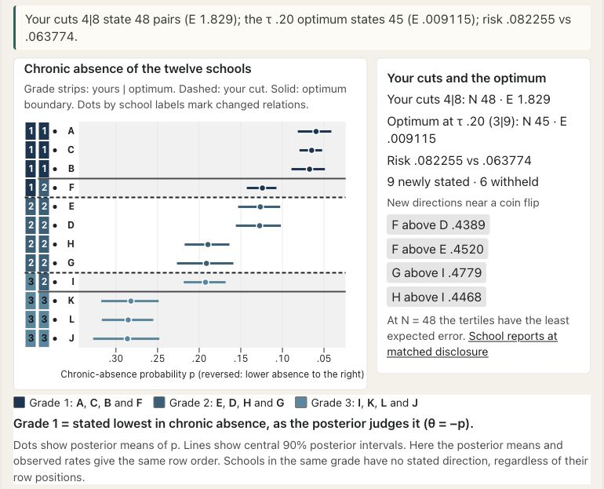
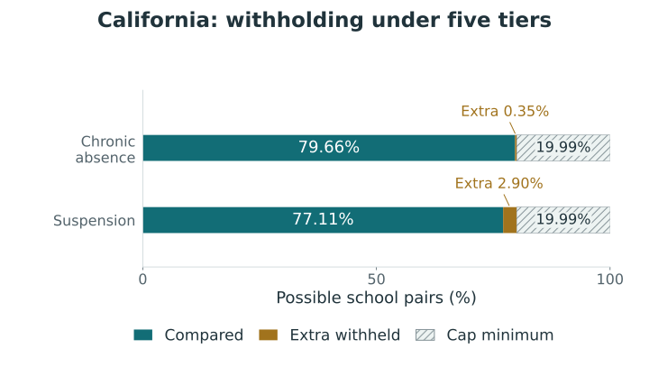
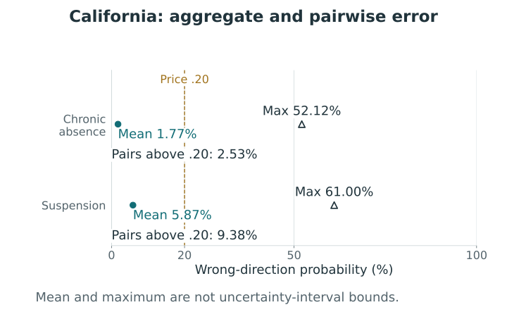
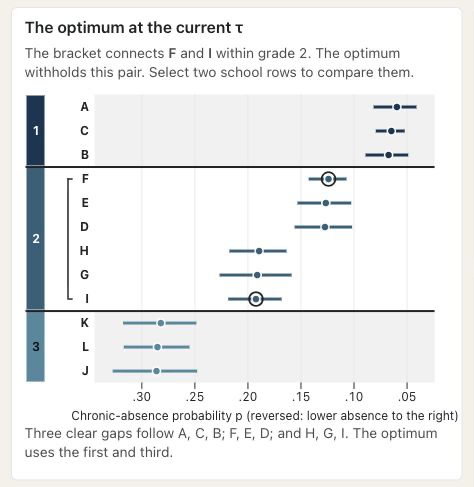

# California school accountability {#sec-cde-accountability}

[]{#sec-v4-ch30}

A school report can distinguish broad differences while offering little support for ordering neighboring schools. California's chronic absenteeism and suspension indicators make this distinction concrete. Thousands of schools yield millions of possible comparisons, but the number of students behind each rate varies, the events have different frequencies, and a public category can communicate many directions at once. The reporting question is how to turn the available evidence into a coherent set of comparisons whose meaning remains visible.

This chapter uses the completed five-tier version of the statewide study, with its archived model fits and reporting results [@lee_cde_uncertainty_reporting_2026]. It presents two separate one-criterion applications. Their juxtaposition illustrates how the same reporting loss behaves under different uncertainty distributions; it does not construct a joint chronic-absence and suspension profile.

## Two indicators and two comparison frames {#sec-cde-frames}

The study's principal data are school-level counts from the 2026 California School Dashboard publication, covering the 2025–26 school year. Earlier publications support its replication and forecasting exercises. The analysis retains elementary-type schools outside the alternative-school program, including charter schools, with published all-students records, valid counts, acceptable certification and error flags, and at least 30 students in the current indicator denominator. These are study frames, not a count of every school in California.

The chronic absenteeism frame contains 5,834 schools and the suspension frame 5,841; 5,834 schools appear in both. The overlap does not make the denominators interchangeable. Chronic absenteeism concerns eligible transitional-kindergarten through eighth-grade students and repeated absence relative to expected attendance. Suspension concerns cumulative enrollment and whether a student experienced at least a full day of suspension. Even at the same school, the indicators refer to different student populations and events. The scientific identification of a target therefore precedes any comparison of its numerical values with another indicator (@sec-targets-actions-laws).

Event frequencies differ considerably despite similar school denominators. The median denominators are 474 for chronic absenteeism and 484 for suspension, but median recorded rates are approximately 16% and 1%. Only 28 schools record no chronically absent students, whereas 1,078 record no suspensions. A zero count remains compatible with a positive underlying propensity, especially in a small denominator; it establishes neither a structural zero nor the absence of future events.

The official Dashboard colors combine current Status with Change from the preceding year under the archived rules. The tiers studied here concern current propensity alone. Although both displays have five categories, their estimands, thresholds and interpretations differ, so disagreement between a tier and a color need not indicate an erroneous calculation.

## A law for current propensities {#sec-cde-law}

Write $p_i$ for school $i$'s current event propensity under the working count model. Lower values are favorable for either indicator, so the book's higher-priority convention can be obtained through $\theta_i=-p_i$. This orientation concerns the direction reported, not the causal effect of the school. Current propensity reflects student composition, reporting practices and other conditions that generated the counts as well as any institutional contribution.

The study estimates a smooth distribution of propensities by penalized likelihood under a binomial observation model. School-level cross-validation selects the strength of smoothing. Combining each count with that estimated distribution yields a posterior mean, an equal-tailed 95% interval and directional comparison probabilities. These are model-based uncertainty summaries. Their interpretation requires the observation model and population distribution, rather than following from the reported rates alone.

The main empirical Bayes calculation holds the estimated mixing distribution fixed. It therefore represents uncertainty about individual propensities conditional on that estimate while omitting integration over its estimation uncertainty. A separate fully Bayesian analysis in the source study integrates uncertainty in the mixing distribution and re-evaluates fixed empirical Bayes reports. We reuse this comparison of producer choices without fitting a new model; it does not establish calibration under every possible generating law (@sec-producer-model-error).

Precision affects which comparisons the law can support. The source contrasts a school with 9 chronically absent students among 60 with another having 152 among 995. Their recorded rates are similar, 15.0% and 15.3%, but their posterior intervals are approximately 8.3–24.2% and 13.2–17.6%. The reference report puts both in the middle tier and withholds their comparison. Equal reported grades express that action; they do not assert equal propensities or identical uncertainty.

The fitted distribution is continuous. It can concentrate near zero but has no atom at exactly zero. This assumption is especially consequential for suspension and is examined in the source's validation exercises. Observing identical counts can give schools identical posterior distributions without making their latent propensities the same random variable. A shared posterior summary, a withheld comparison and a scientifically justified almost-sure identity remain different concepts (@sec-equality-scopes).

## A declared order and a five-tier decision {#sec-cde-decision}

For each indicator separately, the reference report uses withholding price $\tau=.20$ and at most five occupied grades. The study orders schools by posterior mean propensity and selects the best contiguous partition of that order under the directional loss. Every unordered school pair receives equal weight. The original denominator is therefore $M=\binom n2$: 17,014,861 pairs for chronic absenteeism and 17,055,720 for suspension.

Dynamic programming makes this fixed-order calculation feasible at the statewide scale. Its exact optimization scope is the set of allowed contiguous cuts in the declared order and grade cap. Even a complete solution to this problem establishes no optimum over all coherent ordered partitions, because the declared order restricts the family (@sec-fixed-order-dp).

The grade cap constrains communication before uncertainty is considered. With five nearly equal groups, about four fifths of all pairs can lie in different grades. Pairs within a grade are withheld. The loss then determines whether further withholding is worthwhile within the fixed order. The price .20 is a weight assigned to silence relative to a wrong direction; it is neither a required average-error target nor a ceiling on each disclosed pair's error probability.

The source also evaluates prices from .05 to .40 and caps of three and eight. For order comparisons it constructs recorded-rate and expected-rank reports with the same disclosed-pair count as the reference action. Matching disclosure makes a particular expected-error comparison interpretable; matching only the number of grades would not do so (@sec-matched-disclosure-frontier). These comparisons retain one fitted posterior and concern the declared statewide frames. They do not imply that the same ordering choices would perform similarly for a district's own peer set.

<!-- BEGIN EXPLORER EXPANSION: cde-cuts -->

::: {#box-explorer-cde-cuts .explorer-box}

{fig-alt="Screenshot of School tertiles and minimum-risk grades, illustrating Try school cut points in a teaching subset." .explorer-screenshot}

Move two cuts through a twelve-school chronic-absence teaching subset and compare the resulting report with the best report using at most three grades. Both use the same supplied posterior and withholding cost, so their whole-report risks are comparable. This small unrestricted search supplements the chapter’s statewide five-tier analysis, whose declared order, comparison frames and optimization scope differ.

::: {.explorer-link}
[Open School tertiles and minimum-risk grades in postrank Explorer](https://joonho112.github.io/postrank-explorer/pages/cases/cde-cuts.html)
:::

Try school cut points in a teaching subset

:::
<!-- END EXPLORER EXPANSION: cde-cuts -->

## What the reference reports disclose {#sec-cde-results}

The five-tier reports disclose most pairs while leaving comparisons within each tier unreported. Table @tbl-cde-reference reproduces the reference summaries from the saved v5 results. Every quantity is conditional on the fitted model and the stated action. The expected wrong fraction is $E/N$, a ratio with the fixed number of disclosed pairs in its denominator; it is not an observed error rate against known statewide truth.

| Quantity | Chronic absenteeism | Suspension |
|---|---:|---:|
| Schools | 5,834 | 5,841 |
| Possible pairs, $M$ | 17,014,861 | 17,055,720 |
| Disclosed pairs, $N$ | 13,554,569 | 13,152,239 |
| Disclosed share, $N/M$ | 79.66% | 77.11% |
| Expected wrong fraction, $E/N$ | 1.77% | 5.87% |
| Share of disclosed pairs with error probability above .20 | 2.53% | 9.38% |
| Largest disclosed-pair error probability | .521 | .610 |

: Two separate reference reports at $\tau=.20$ and at most five grades. Each is optimal within its declared posterior-mean order. The average error and maximum pair error describe different summaries of the same report. Source: saved five-tier aggregate results [@lee_cde_uncertainty_reporting_2026]. {#tbl-cde-reference}

From lowest to highest propensity, chronic absenteeism tier sizes are 1,093, 1,290, 1,337, 1,208 and 906. Suspension tier sizes are 1,429, 1,699, 1,381, 878 and 454. Both reference actions occupy all five tiers, but the cap means at most five; other settings and simulated datasets can select fewer. More unequal suspension groups leave a larger fraction of pairs in the same tier.

The finite-frame five-tier disclosure maximum is about 80.01% for each indicator. Relative to that maximum, the reference reports withhold an additional 0.35 percentage points of all chronic absenteeism pairs and 2.90 points of suspension pairs. Most withholding at this setting is therefore forced by the communication cap. The remainder reflects uncertainty, price, coherence and the chosen order together. Assigning all of it to posterior uncertainty would disregard the geometry of the reporting action.

::: {#fig-s17-cde-cap .reader-figure .reader-has-narrow style="--reader-figure-width:560px;"}
<picture>
<source media="(max-width: 720px)" srcset="../assets/figures/S17-mobile.svg">

</picture>

Withholding in the two five-tier statewide reports at withholding price .20. Even balanced five-tier groups withhold about one fifth of possible pairs. The remaining withholding reflects the fitted law, price, coherence and fixed order together; it cannot be attributed to uncertainty alone. Segments use each indicator's own original school-pair denominator. These are separate reports for different school and student populations [@lee_cde_uncertainty_reporting_2026].
:::

[SVG](../assets/figures/S17.svg) · [PDF](../assets/figures/S17.pdf)

Broad separation and fine ordering are also distinct. In the source's pointwise calculations, 76.0% of all chronic absenteeism pairs and 52.2% of all suspension pairs have a better-supported direction with error at most .05. Among neighbors in posterior-mean order, only one chronic absenteeism pair and no suspension pair meet that cutoff. These use the same posterior information. A long sorted list emphasizes distinctions for which the evidence is weakest, while broad groups can communicate many distant comparisons. Pointwise support alone still need not yield a coherent report.

<!-- postrank-exhibit:cde:begin -->

Explore stored results: California: look up a saved five-tier report

What tier does an exact school code receive in the selected saved indicator report? Only stored reports are read.

<table><caption>Stored scenario summaries</caption><thead><tr><th scope="col">Saved report</th><th scope="col">Readout</th></tr></thead><tbody><tr><th scope="row">Chronic absence: five tiers</th><td>Schools / original pairs: 5834 / 17014861; Issued comparisons: 13554569; Mean disclosed-pair error: 1.7694%; Maximum disclosed-pair error: 52.1200%; Share of issued pairs above .20: 2.5259%; Tier sizes: 1093, 1290, 1337, 1208, 906</td></tr><tr><th scope="row">Suspension: five tiers</th><td>Schools / original pairs: 5841 / 17055720; Issued comparisons: 13152239; Mean disclosed-pair error: 5.8676%; Maximum disclosed-pair error: 60.9950%; Share of issued pairs above .20: 9.3826%; Tier sizes: 1429, 1699, 1381, 878, 454</td></tr></tbody></table>

<button type="button" data-widget-load disabled>Open stored-result viewer</button>

<a href="../assets/widgets/case-results/cde/index.html">Open the standalone view</a>. The chapter and the viewer's static summary remain available without JavaScript.

<!-- postrank-exhibit:cde:end -->

## Average error and the comparisons near a boundary {#sec-cde-local-errors}

Some disclosed comparisons have error probabilities above one half even though the reports have low average error. For these chronic absenteeism and suspension pairs, the model favors the opposite direction. The boundary still belongs to a coherent report whose remaining comparisons contribute to overall loss. An aggregate error criterion therefore does not protect each disclosed direction; pairwise constraints would impose an additional requirement (@sec-criterion-protections).

::: {#fig-s18-cde-local .reader-figure .reader-has-narrow style="--reader-figure-width:560px;"}
<picture>
<source media="(max-width: 720px)" srcset="../assets/figures/S18-mobile.svg">

</picture>

Average and individual comparison error in the two five-tier reports. Mean and maximum markers summarize different features of the disclosed-pair probabilities; they are not endpoints of an uncertainty interval. The percentages beneath the markers give the share of disclosed comparisons above the withholding price .20. This price is a loss weight, not a pairwise error limit. All quantities are conditional on the fitted empirical Bayes model and the fixed-order report [@lee_cde_uncertainty_reporting_2026].
:::

[SVG](../assets/figures/S18.svg) · [PDF](../assets/figures/S18.pdf)

A school immediately on one side of a boundary can have almost the same posterior distribution as a school immediately on the other. The source's local report-card display shows substantial interval overlap around the first boundary. Membership reflects the entire fixed-order partition, the grade cap and the price of withholding. It should not be read as a sharp scientific discontinuity between the two schools. The source checks found no boundary separating schools with identical count records, but that finding does not make every pair on opposite sides well resolved.

Changing the price makes the tradeoff visible. Under the five-tier cap, raising $\tau$ from .05 to .40 increases chronic absenteeism disclosure from about 76.0% to 79.9%, while its expected wrong fraction rises from 1.45% to 1.86%. Suspension is more responsive: disclosure rises from 44.9% to 79.5% and expected error from 2.88% to 6.46%. These are stored optimizations within the same kind of fixed-order family. They illustrate policy sensitivity without implying that .20 or five tiers is the preferred institutional choice.

At matched disclosure, different orders can have similar aggregate error and still assign different tiers to particular schools. With five tiers, replacing posterior means by recorded rates changes membership for 88 chronic absenteeism schools and 378 suspension schools; expected-rank ordering changes it for 12 and 126. A small aggregate risk difference consequently does not establish equivalence of the reports for individual schools. Nor does a change in membership identify a causal benefit of estimation or boundary placement (@sec-descriptive-decomposition).

<!-- BEGIN EXPLORER EXPANSION: cde-pair -->

::: {#box-explorer-cde-pair .explorer-box}

{fig-alt="The twelve-school report at tau .20, with a bracket joining schools F and I inside grade 2 to show their comparison is withheld." .explorer-screenshot style="--explorer-image-width:520px;"}

The twelve-school example withholds a comparison that has very high posterior support because requiring it changes the complete grade report. Compare the minimum-risk report with the best report that must state the selected direction within the same three-grade family. The risk difference describes that reporting constraint; it neither measures school quality nor establishes statewide performance.

::: {.explorer-link}
[Open A high-probability school comparison withheld in postrank Explorer](https://joonho112.github.io/postrank-explorer/pages/cases/cde-pair.html)
:::

A highly supported direction can remain withheld

:::
<!-- END EXPLORER EXPANSION: cde-pair -->

## Model checks and the use of the report {#sec-cde-validation}

The source study evaluates the reports in several ways. Refit simulations use generated truth for 200 schools, retrospective forecasts assess next-year counts under persistence assumptions, and fully Bayesian rescoring integrates mixing-distribution uncertainty for fixed actions. Specification variants examine the sensitivity of risks and memberships. These checks concern the particular procedures and scenarios examined; they do not directly observe the statewide latent propensities needed to establish the current reports' true error fractions.

The continuous mixing distribution has a clear limitation in simulations with an atom at zero. When one quarter of schools have exactly zero propensity, overall 95% interval coverage falls to approximately 70.7% for chronic absenteeism and 71.4% for suspension. Coverage among the remaining schools is near 95%. This is a mismatch between the support of the fitted law and the generating process. A large number of recorded zeros alone does not establish that such an atom exists, but numerical accuracy within a continuous model cannot repair an omitted atom.

The five-tier extension reuses admitted simulations from the source campaign. It evaluates 294 empirical Bayes and 77 fully Bayesian reports without generating new datasets. The original campaign's stopping criterion concerned three-tier error, so its stopping design should not be described retrospectively as a prespecified five-tier experiment. Likewise, next-year predictive undercoverage may reflect temporal change or other model assumptions and does not directly establish miscalibration of current-year propensity intervals. Numerical uncertainty, posterior-model uncertainty and evaluation-law error therefore require separate assessments, as discussed in @sec-misspecification-calibration.

The report makes its communicated directions and their model-based uncertainty explicit. Its descriptive scope is the stated all-students elementary-school frames, with equal weights over statewide school pairs; district-specific and overlapping-group comparisons remain unassessed. Extending it to a joint two-indicator profile would require aligned targets, an actual joint law and a declared joint protection problem. These components cannot be supplied merely by placing the present tier columns together. The book's exact and synthetic profile examples examine that additional decision, which was not part of the completed statewide analysis.