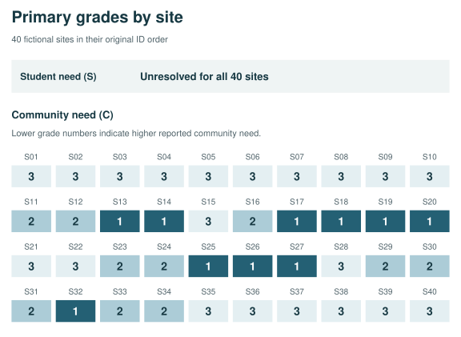
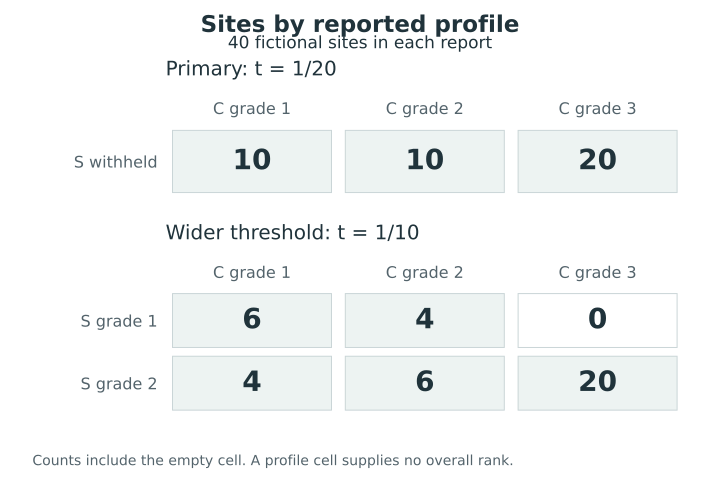
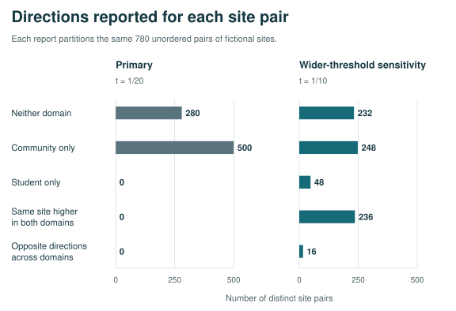
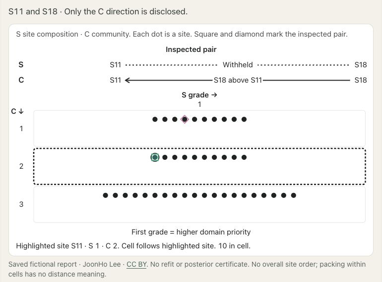

# A synthetic multidomain economic-need application {#sec-synthetic-need}

[]{#sec-v4-ch31}
[]{#sec-p2-12-synthetic-need}

Which distinctions could a prekindergarten agency publish about economic need at 40 fictional sites? The primary report distinguishes three grades of **community economic need (C)** and leaves **student economic need (S)** unresolved at every site. For example, it places S18 higher than S11 on community need but leaves open which site serves students with greater economic need. Their different profiles communicate precisely this combination of a disclosed community comparison and a withheld student comparison.

## Reading the primary report {#sec-synthetic40-primary}

[]{#reading-the-primary-report}

The saved public simulations give each site a student target and a community target on the same posterior state. Larger target values indicate greater need. The model uses distinct student targets for all 40 sites. Four existing sites have missing student observations, and four new sites receive conditional student predictions. Community targets refer to fitted community profiles. S05 and S06 share one such target, and S21 and S22 share another. Candidate grades keep those shared targets together while retaining all 40 original sites and all 780 unordered pairs in each domain. [Site targets and primary grades](../assets/cases/synthetic40/data/report-matrix.csv)

Read the community grades across sites in @fig-p2-synthetic40-site-grades. A site in grade 1 has higher reported C need than any site in grades 2 or 3. The three grades contain 10, 10 and 20 sites, yielding 500 between-grade directions. The other 280 pairs share a C grade, so the report withholds their C comparison. The single S grade withholds every student comparison. A claim of target equality requires separate information, such as the shared community target for S05 and S06.

::: {#fig-p2-synthetic40-site-grades .reader-figure .reader-no-narrow style="--reader-figure-width:640px;"}
<div class="reader-image-viewport" tabindex="0" role="region" aria-label="Complete figure; horizontal scrolling is available on a narrow screen">
<picture>

</picture>
</div>

The primary report assigns three community grades and withholds the student direction throughout.
:::

[Complete original figure](../assets/cases/synthetic40/figures/site-grades.svg).

[Grades plotted for each site](../assets/cases/synthetic40/data/report-matrix.csv)

## Why the two domains have different resolution {#sec-synthetic40-resolution}

[]{#why-the-two-domains-have-different-resolution}

Chains 1 and 2 supplied 8,000 aligned states. In each domain, sites were ordered by mean target value on these states. A candidate column could use up to two cuts at positions 10, 20 or 30. This gave seven columns per domain, including complete withholding. The search evaluated all 49 combinations. It weighted the domains equally and priced withholding at one tenth of a directional error. Each domain had a 5% limit on its mean false discovery proportion (FDP), the fraction of issued directions that are wrong. A second safeguard allowed at most a 5% chance that either domain's FDP would *strictly exceed* 5% in the same state.

One S column issued 300 directions and passed the mean safeguard with a mean FDP of 4.42%. Across its seven mean-feasible combinations with C, the joint event occurred in 34.55% of selection states. The tail safeguard ruled out all seven. The primary report uniquely minimized expected error-withholding loss among the seven feasible combinations. Its loss was about 0.068125, compared with 0.1 for complete withholding. Exact optimality applies to the 49 specified reports under the empirical distribution of the selection states. Other cuts and site orders remain outside that comparison. [Primary optimization](../assets/cases/synthetic40/data/main-summary.csv) · [Candidate-level comparisons](../assets/cases/synthetic40/data/case-main-alpha-1_20-candidates.csv)

The protection compares both domain errors on the same aligned state. This retains the dependence required by @sec-joint-protection; separate marginal simulations would not determine the union probability. When a domain discloses no directions, its guard value is zero, while the displayed error fraction with denominator zero remains undefined. Withholding every S direction therefore makes its exceedance event inactive without asserting equality among the student targets.

## What changes when the threshold changes? {#sec-synthetic40-thresholds}

[]{#what-changes-when-the-threshold-changes}

For the primary report, exceeding 5% requires at least 26 errors among 500 C directions. At least one direction was wrong in 1,871 of the 8,000 selection states, but at most seven were wrong together. Thus there were **zero observed exceedances** of the primary threshold. With zero S disclosures, an S exceedance was structurally impossible. The C count of zero records what happened in these simulations. [Primary grades evaluated at the any-error threshold](../assets/cases/synthetic40/data/case-sensitivity-t-zero-events.csv)

| FDP exceedance threshold | S directions | C directions | Selection hits (8,000 states) | Diagnostic hits (8,000 states) |
|---|---:|---:|---:|---:|
| 0% (any error) | 0 | 400 | 314 | 305 |
| 5% (primary) | 0 | 500 | 0 | 0 |
| 10% (wider) | 300 | 500 | 266 | 229 |

Each row evaluates the report selected for that prespecified threshold, with the joint probability budget held at 5%. [Primary selection](../assets/cases/synthetic40/data/main-summary.csv) · [Sensitivity selections](../assets/cases/synthetic40/data/sensitivity.csv) · [Frozen-report diagnostics](../assets/cases/synthetic40/data/diagnostic-summary.csv)

At the wider threshold, S11 has grades $(1,2)$ and S18 has $(2,1)$, written in $(S,C)$ order. The report places S11 higher on student need and S18 higher on community need. An overall funding priority would require a separate allocation rule. Five of the six possible grade combinations occur. The empty cell simply records that none of these sites received $(1,3)$. [Worked site pairs](../assets/cases/synthetic40/data/report-examples.csv)

::: {#fig-p2-synthetic40-cell-occupancy .reader-figure .reader-has-narrow style="--reader-figure-width:540px;"}
<picture>
<source media="(max-width: 720px)" srcset="../assets/figures/S19-mobile.svg">

</picture>

Numbers of sites sharing each reported profile under the primary and wider thresholds. The same 40 fictional sites appear in both reports; the empty cell is shown explicitly. C denotes the community grade and S the student grade. A profile cell supplies no overall site rank.
:::

[Full-size SVG](../assets/figures/S19.svg) · [PDF](../assets/figures/S19.pdf)

[Original full-size figure](../assets/cases/synthetic40/figures/cell-occupancy.svg)

[Cell counts and memberships](../assets/cases/synthetic40/data/report-cells.csv)

S11 and S18 are one of 16 pairs with crossing directions at the wider threshold. Another 236 pairs have directions in both domains favoring the same site. Counting each domain separately gives 800 directions across 548 distinct pairs. [Report totals](../assets/cases/synthetic40/data/report-summary.csv)

::: {#fig-p2-synthetic40-pair-directions .reader-figure .reader-no-narrow style="--reader-figure-width:640px;"}
<div class="reader-image-viewport" tabindex="0" role="region" aria-label="Complete figure; horizontal scrolling is available on a narrow screen">
<picture>

</picture>
</div>

Directions for all 780 pairs under each report.
:::

[Complete original figure](../assets/cases/synthetic40/figures/pair-directions.svg).

[Counts by pair category](../assets/cases/synthetic40/data/report-categories.csv)

```{=html}
<span id="reading-a-card-in-the-explorer" class="legacy-anchor" aria-hidden="true"></span>
```

<!-- postrank-exhibit:W08:begin -->
<details class="optional-widget"><summary>Explore stored results: Reading the Synthetic40 profile cards</summary>
<div data-postrank-widget="W08" data-widget-src="../assets/widgets/W08/index.html" data-widget-title="Reading the Synthetic40 profile cards" data-widget-height="1200">
<p>What does each saved domain grade say about the same 40 fictional sites? Only stored reports are read.</p>
<div class="widget-fallback"><table><caption>Stored scenario summaries</caption><thead><tr><th scope="col">Saved report</th><th scope="col">Readout</th></tr></thead><tbody><tr><th scope="row">Primary card: threshold 1/20</th><td>Student / community directions: 0 / 500; Pairs with any direction: 500; Selection-state risk: 170039/2496000; Diagnostic-state risk: 425077/6240000; Selection union hits: 0 / 8000; Diagnostic union hits: 0 / 8000</td></tr><tr><th scope="row">Wider threshold: 1/10</th><td>Student / community directions: 300 / 500; Pairs with any direction: 548; Selection-state risk: 716341/12480000; Diagnostic-state risk: 717433/12480000; Selection union hits: 266 / 8000; Diagnostic union hits: 229 / 8000</td></tr></tbody></table></div>
<button type="button" data-widget-load disabled>Open stored-result viewer</button>
<div data-widget-frame></div>
<p><a href="../assets/widgets/W08/index.html">Open the standalone view</a>. The chapter and the viewer's static summary remain available without JavaScript.</p>
</div></details>
<script defer src="../assets/widgets/shared/book-loader.js"></script>
<!-- postrank-exhibit:W08:end -->


<!-- BEGIN EXPLORER EXPANSION: fictional-site-profiles -->

::: {#box-explorer-fictional-site-profiles .explorer-box}

{fig-alt="Screenshot of Site profiles, illustrating Read the same sites through two domain priorities." .explorer-screenshot}

Compare the primary and wider-threshold saved cards for S11 and S18: the primary card withholds the S comparison, while the wider-threshold card shows crossing domain priorities. The profile grid connects each pairwise statement to occupied and empty grade cells for the same forty fictional sites. The app reads saved reports and summaries; moving its controls does not refit the model or rerun posterior selection and diagnostics.

::: {.explorer-link}
[Open Site profiles in postrank Explorer](https://joonho112.github.io/postrank-explorer/pages/profiles/fictional-site-profiles.html)
:::

Read the same sites through two domain priorities

:::
<!-- END EXPLORER EXPANSION: fictional-site-profiles -->

## Checking the frozen decisions {#sec-synthetic40-diagnostics}

[]{#checking-the-frozen-decisions}

All ten decisions, covering three main probability budgets and seven sensitivities, were frozen before chains 3 and 4 were opened for diagnostics. Each met its own mean and joint budgets on this second block. The primary event had zero hits on each chain. The wider-threshold event had 98 and 131 hits on the two diagnostic chains, each with 4,000 states. These dependent MCMC and conditional predictive states describe variation under the same fitted model and data. They cannot supply the [iid validation guarantee](21-numerical-uncertainty.qmd) or establish performance at actual sites. The original fitting bundle was unavailable. The audit therefore covered the saved joint simulations and their target mapping, with the fitting procedure beyond its reach. [Chain diagnostics](../assets/cases/synthetic40/data/event-diagnostics.csv)

## Reproducing the stored decisions {#sec-synthetic40-replay}

A subsequent replay with the public postrank 1.2.0 package reproduced the 49 candidate evaluations for each of the ten specifications, giving 490 candidate rows and the same selected reports. Eleven fixed-report assessments covered the ten diagnostic specifications and an additional assessment of the primary report on its selection states. All 63 compared CSV tables agreed byte for byte with the earlier software outputs. These were new calculations on the same stored inputs; the model was not refitted and no additional posterior or predictive states were generated.

For the primary report, exact finite-law risk on the selection states is $170039/2496000$, approximately $0.0681246$. Holding its grades fixed on the diagnostic states gives $425077/6240000$, approximately $0.0681213$. The corresponding strict 5% union event has zero hits in both blocks. At the wider threshold, its selected report has union frequencies $266/8000$ and $229/8000$ in selection and diagnostics. The calculations are exact for the represented finite measures; uncertainty about the intended model law remains (@sec-numerical-uncertainty).

The exhaustive public interface in @sec-computing-profiles evaluates the product of the declared column banks and retains all tied minimizers; the primary specification happens to have one. Its optimization claim is confined to these banks, excluding unlisted site orders and cuts. The saved simulations and target mapping support this reporting calculation, while assessment of the original fitting procedure and performance at real sites would require evidence not available here.