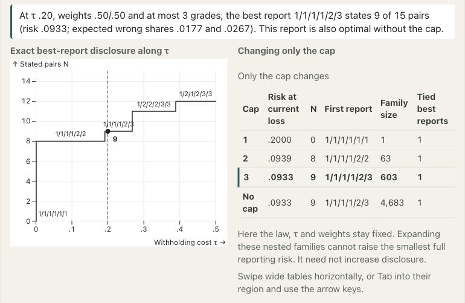
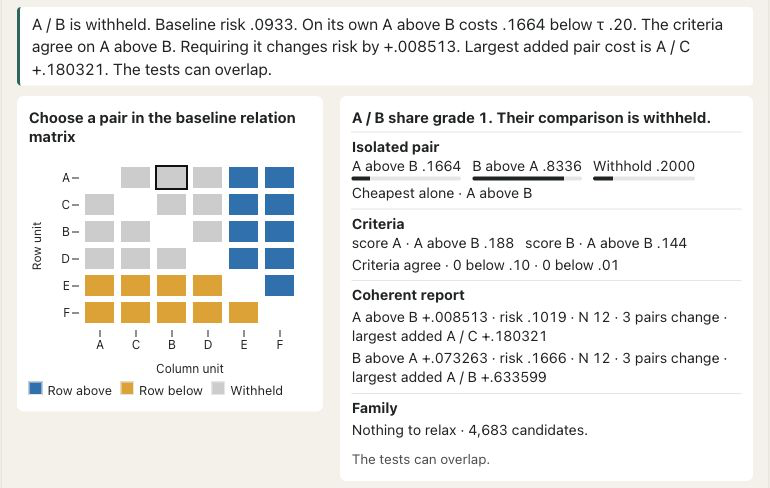

# Governance and communication {#sec-governance-communication}

## Institutional judgment and statistical optimization {#sec-governance-responsibility}

Adopting a common grade or a domain profile requires decisions about what the criteria represent, whose interests they serve, which errors matter and what consequences may follow. Targets, weights, withholding costs and feasible actions express some of these judgments, but minimizing the resulting loss cannot authorize their adoption. We use the preceding analysis and institutional cases to propose governance practices. These recommendations have not been tested as interventions and do not constitute a new theory of fairness.

Interpreting a grade first requires evidence about indicator validity. In the causal conception of Borsboom et al., validity requires that the attribute exist and that variation in it cause variation in measurement outcomes; reliability or predictive adequacy does not establish either condition [@borsboom_validity_2004]. Messick's 1994 ETS report considers the support for score meanings and their implications for use, including construct underrepresentation and irrelevant variation [@messick_validity_report_1994]. Although these conceptions differ, both require more than statistical fit to justify an interpretation.

Under either conception, the interpretation depends on the population and period represented, dimensions omitted from the reporting purpose and assumptions linking adjusted outcomes to institutional effects. Model fit alone cannot resolve these questions. Messick further distinguishes adverse consequences of valid descriptions from consequences attributable to measurement problems, so an undesirable outcome need not establish invalidity [@messick_validity_report_1994]. Conversely, a precise description does not justify every action taken in response.

## Preference elicitation and decision authority {#sec-governance-preferences}

Preference elicitation requires specification of the objectives and consequences to be valued. Allocating points among criterion names gives weights no definite meaning without that specification. In the 1993 Cambridge edition, Keeney and Raiffa distinguish objectives from attributes and assess attribute sets for completeness, operational usefulness, nonredundancy and other desiderata [@keeney_raiffa_1993]. Their normalized additive-value examples interpret a coefficient through a specified worst-to-best improvement relative to improvements on other attributes. Calling a criterion important leaves the relevant ranges and tradeoffs unspecified [@keeney_raiffa_1993].

For the reporting problem, composite coefficients $a$ combine target magnitudes, whereas directional weights $w$ value errors in criterion-specific comparisons. Interpreting either set as preference weights over intervention consequences would require a further decision model. The withholding cost separately values communicating a direction relative to leaving it unasserted. Equal numerical weights are a convention; they neither equate these meanings nor establish neutrality. A profile adds a choice about which directions may differ across domains. Its domain-specific withholding costs and error thresholds can express different reporting tolerances. A crossing between two columns is interpretable only against their separate target definitions; it is not an unresolved instruction to average the labels.

The account of each setting should identify whether it is an authorized policy judgment, an elicited preference, an analyst assumption or a sensitivity scenario. Consultation informs these choices, but adoption still requires a specified authority. In Keeney and Raiffa's interpersonal formulation, a decision maker incorporates others' evaluations and makes the final comparisons [@keeney_raiffa_1993]. Incorporating those evaluations does not transfer decision authority or establish a uniquely legitimate institutional arrangement.

The clinical illustration shows why the source of preference weights must be identified. Li and colleagues' 2019 demonstration used clinician-supplied weights for two selected patients and simulated preferences for the population display, rather than eliciting preferences from all trial participants [@li_bayesian_2019]. Similarly, SMAA-2 cautions that a uniform distribution over the weight simplex generally does not describe the distribution of decision makers' preferences [@lahdelma_salminen2001smaa2]. These analyses can reveal which conclusions depend on contested settings, while leaving legitimate priorities to be resolved through an appropriate decision process. An analyst's weight distribution cannot be interpreted as a vote without further justification.

<!-- BEGIN EXPLORER EXPANSION: choosing-settings -->

::: {#box-explorer-choosing-settings .explorer-box}

{fig-alt="Screenshot of Sensitivity to costs, weights and grade restrictions, illustrating Document which setting changed." .explorer-screenshot}

Vary a withholding cost, criterion weight or grade cap and inspect how disclosure and criterion error shares respond. These controls change different parts of the decision problem, so the comparison should identify which settings remain fixed and reevaluate reference reports under the current loss. The display explores consequences of judgments; it does not elicit legitimate preferences or turn archived solver points into a continuous frontier.

::: {.explorer-link}
[Open Sensitivity to costs, weights and grade restrictions in postrank Explorer](https://joonho112.github.io/postrank-explorer/pages/criteria/choosing-settings.html)
:::

Document which setting changed

:::
<!-- END EXPLORER EXPANSION: choosing-settings -->

## Compensation across criteria {#sec-governance-compensation}

In a composite, an improvement on one dimension may offset a deterioration on another. In a weighted directional objective, the report may incur more errors on a lightly weighted criterion to reduce errors elsewhere. Each form of compensation requires institutional justification, including the circumstances in which a label may be awarded despite an adverse finding on a particular dimension.

The April 2026 CMS hospital methodology, version 5.1, combines standardized measure groups and separately restricts the highest rating through a Safety of Care condition. A hospital with at least three safety measures and a score in the specified lowest safety quartile can receive at most four stars [@CMSHospitalStars2026]. This label restriction uses its own information condition and reference population. A posterior expected-error constraint concerns a different quantity.

The criterion-specific $q$ constraints in @sec-criterion-protections bound expected wrong fractions under a declared law when disclosure is positive. These are averages over disclosed comparisons, so they impose no ceiling on every pair's error probability. Their statistical interpretation depends on the target, law and numerical feasibility certificate. They do not establish equal treatment, equitable access, absence of discrimination or acceptable consequences. Protecting a disadvantaged population may require different targets, constraints or actions; calling an error constraint a protection does not provide that policy specification.

For a profile, joint protection limits the probability that at least one declared domain–scope count exceeds its threshold. The event, scopes, thresholds and probability budget must be stated together. A small joint probability can coexist with errors below a positive threshold, and a scope leaves unlisted comparisons unprotected by that scope. Neither this probability statement nor an expected-error limit establishes fairness or a resource-allocation guarantee.

Documentation should therefore identify substantive restrictions and error tolerances separately, together with the body adopting each. An exact grade-count requirement can make a restriction infeasible. Resolving that incompatibility requires an explicit reconsideration of the requirements, since an undocumented relaxation would conceal a policy change. Extensive withholding can alternatively satisfy an error constraint at the expense of usefulness. Even where the mathematical consequences are known, choosing this tradeoff remains an institutional responsibility.

## Precision, need and intervention benefit {#sec-governance-precision-need}

Precision concerns how well the evidence resolves a target; need concerns the target or policy problem; benefit concerns the consequences of an action. An association among them does not make them interchangeable. A small institution may have less informative data without having less need, and the institution with the greatest estimated need may not benefit most from the available intervention. Thus selecting by expected need differs from selecting by expected treatment benefit, just as reliable comparative reporting differs from filling a fixed budget (@sec-selection-benchmarks).

England's IMD25 treats precision and normative weights separately at the measurement stage. The 2025 technical report describes empirical Bayesian shrinkage for many unstable component indicators, while retaining substantive domain weights and transformations [@mclennan2025imdtechnical]. Greater measurement precision does not itself determine a domain's normative weight. The report's downstream use also matters: the March 2026 Pride in Place expansion methodology combines deprivation with community need and applies geographic eligibility and distribution constraints. Its selection rule documents an announced allocation, not realized programme effects [@mhclg2026prideexpansion].

Precision information may enter both the likelihood and the target distribution, especially when it is associated with substantive characteristics [@gu2023invidious]. The model specification should describe this choice. Strong shrinkage and narrow intervals are properties of the analysis and do not measure deservingness. Nor does uncertainty require identical grades: the chosen report depends jointly on targets, pairwise relations, preferences and feasible actions, rather than on a unit's standard error alone.

The Head Start regulatory snapshot, current through 22 October 2026, separates eligibility, locally established selection criteria and enrollment; it prescribes no national posterior grade [@hhsHeadStartEligibilitySelection2026]. A report of uncertain need would leave those requirements in force and would not establish expected developmental gains for a child. Likewise, the audit-population contact gap in @sec-employer-reporting supports a descriptive employer comparison, without by itself constituting a legal finding or estimating the effect of publication.

## Interpretation of withheld comparisons {#sec-governance-withholding}

A shared grade withholds an internal direction. It establishes neither equality nor equivalence, negligible differences or absence of need. The reason for withholding may be uncertainty, criterion conflict, error costs or structural restrictions on a coherent common report. Interpretation therefore requires the reporting rule; the units cannot generally be described as indistinguishable. Similarly, an earlier grade does not assert superiority on every criterion. In a profile, an earlier grade asserts a direction only in that column. Two units can exchange order across domains while both columns remain coherent. A tie in one column does not erase an assertion made in another.

The institutional rule must also specify the response to a withheld comparison, such as retaining the current action, seeking more information, reviewing the case or applying a separate allocation procedure. The statistical model alone cannot justify that choice. Inaction may have consequences when services or investigations are time-sensitive, while additional evidence can be costly and may leave substantive criterion conflict unresolved. Valuing these consequences requires a decision model beyond the reporting loss.

Under the equality-neutral extension, a guard can require the same grade for units whose entire active target profiles are justifiably equal. The published grade cannot establish that equality. Sharing one contextual value is insufficient when another positively weighted criterion differs, and units outside a common equality class may still receive the same grade. Reports should therefore state the loss convention, active criteria and evidence for any structural equality restriction. For domain profiles, the declared identity guard instead applies separately within each domain and remains in force at zero objective weight. These domain identities should not be inferred from the equality-neutral common-report guard or from coincident saved draws. The preservation result in @prp-tie-aware-guard establishes a reporting optimum under its stated conditions, without establishing equal treatment, causal benefit or an invariant funding schedule.

Selecting a fixed number of units requires a further rule, whether a boundary lottery, an additional priority criterion or a constrained selection procedure. Each defines a new action and needs its own justification. The exact-budget results in @sec-selection-benchmarks show why an optimal report need not yield an optimal allocation. Randomized mixtures used to compare frontiers at matched expected disclosure likewise serve an analytical purpose; they are not recommendations to alternate published grades.

A withheld comparison must also be distinguished from missing or ineligible data. Placing an excluded unit in the lowest grade asserts adverse comparisons against it. Suppression should instead use an explicit status outside the grade scale, so that an unfavorable assessed position is distinguishable from an inability or lack of authorization to assess the unit.

<!-- BEGIN EXPLORER EXPANSION: why-withheld -->

::: {#box-explorer-why-withheld .explorer-box}

{fig-alt="Screenshot of Reasons for a withheld comparison, illustrating Ask what forcing a direction changes." .explorer-screenshot}

Select a withheld pair and compare the cost of stating it alone with the best complete report required to state that direction. The changed-pair display reveals consequences elsewhere in the common grade assignment, while the posterior remains fixed. Several explanations can apply at once, so this constrained comparison does not identify a unique cause of withholding or justify an intervention.

::: {.explorer-link}
[Open Reasons for a withheld comparison in postrank Explorer](https://joonho112.github.io/postrank-explorer/pages/criteria/why-withheld.html)
:::

Ask what forcing a direction changes

:::
<!-- END EXPLORER EXPANSION: why-withheld -->

## Documentation and correction {#sec-governance-transparency-appeal}

A readable explanation should identify the target, population, period and meaning of the grades. A technical supplement can record data versions, transformations, producer assumptions, origins of weights, action restrictions, numerical certificates and error denominators. Together these accounts allow readers to understand an earlier grade and examine how it was constructed. For a joint-protected profile, the technical record also identifies the common-state construction, every configured scope and threshold, and whether protection is disabled, analytically inactive, exactly evaluated, numerically certified or unresolved. The report-selection states and any fresh validation states have separate roles. A saved MCMC diagnostic should retain that name; a finite candidate-bank optimum should identify its bank. Providing them need not disclose protected individual information.

An appeal may concern an incorrect input, a measurement interpretation, a computational error or an authorized priority. These require different responses. Correcting an enrollment count may warrant reproducible recalculation, whereas changing a criterion's weight requires a decision by the body responsible for the policy. Because grades are selected jointly, correcting one institution's input may alter other institutions' grades. A revision should therefore retain the cohort and model version and explain those wider consequences.

An appeal process should specify who receives challenges, what evidence is admissible, who decides each type of challenge and how corrections and unresolved disagreements are recorded. It should also distinguish correction of an existing release from a policy for future releases. We recommend these arrangements to make decisions traceable and accountable, without claiming that the cited statistical methods implement appeals or that a particular process improves outcomes.

Sensitivity analysis can assist review by identifying conclusions that depend on disputed assumptions. Keeney and Raiffa discuss concentrating assessment on difficult tradeoffs [@keeney_raiffa_1993]. Preference-learning methods also depend on assumptions: in Ru and colleagues' sorting formulation, incompatibility between supposedly certain examples and the model calls for reconsideration [@ru2023sorting]. Treating the disputed preference as noise may otherwise conceal disagreement about the model or the authority adopting it.

## Illustrative report explanation and uncertainty statement {#sec-model-report-explanation}

The following explanation concerns criterion-weighted grades in a hypothetical service-need report. It is neither a fitted application nor a new numerical example. For an institutional release, the unspecified criteria, population, period, settings and review arrangements would be replaced by those actually adopted.

“We compare service units on the stated dimensions of unmet need. An earlier grade reports higher priority under the adopted criterion-weighted reporting rule. We use the published weights to value comparison errors on each dimension and balance those errors against withholding comparisons. An earlier grade does not mean greater need on every dimension. For units in the same grade, we leave the direction of comparison unspecified; we do not conclude that the units are equal. The criterion profiles remain available to show where the dimensions agree or conflict.

“These grades inform review and planning. They do not determine eligibility, funding, or a legal conclusion. Any allocation follows the separately published selection rule, including its budget and eligibility conditions. A unit without sufficient or eligible reporting information receives an explanatory status, not the lowest need grade. Questions about recorded data can be submitted through the stated correction process; questions about criterion definitions or priorities go to the body that adopted them.”

An accompanying statement can explain the uncertainty:

“We calculate the expected error summaries under the stated statistical model using the information available for this release. They summarize possible errors in the comparisons that this report actually discloses. They are not observed counts of mistakes, a promise that each comparison meets the average error level, or a probability that every published comparison is correct. When no comparisons are disclosed, the disclosed-error fraction is undefined; silence is not reported as perfect accuracy.

“The results may change with corrected data, another defensible model, or different authorized priorities. The technical account separates uncertainty represented by the model, sensitivity to preferences, and numerical approximation. A certificate that the calculation meets its stated optimization tolerance does not establish that the model or the criteria are substantively correct. The report does not estimate the benefit of an intervention unless a separate, explicitly justified analysis supplies that target.”

For a profile release, the first explanation would instead identify each column: “Each column compares units on its named domain. An earlier grade reports higher priority within that domain; units sharing a grade have no published direction within that column. Orders can cross between columns. The profile supplies no overall rank or allocation by itself.”

If joint protection is enabled and has the stated assurance, its explanation can add: “Under the declared joint model, the probability that any listed scope exceeds its published error-fraction threshold is bounded by the stated budget. Thresholds and scopes appear with the report. This does not mean that every direction is correct. The technical record identifies the numerical procedure supporting the bound and its assumptions.” An unresolved calculation should report that status instead of using the bounded-probability sentence.

@fig-vis-f21 organizes an illustrative release and its proposed correction channels. The specimen includes a separate unassessed status and a versioned technical record.

::: {#fig-vis-f21 .reader-figure .reader-has-narrow style="--reader-figure-width:700px;"}
<picture>
<source media="(max-width: 720px)" srcset="../assets/figures/reader-f21-narrow.svg">

</picture>

An illustrative communication design for a hypothetical service-need report. The schematic grade pattern explains what an earlier grade and a shared grade communicate; it is not calculated from data. A separate unassessed status avoids turning missing or ineligible information into an adverse grade. The public explanation is linked to a versioned technical record and an uncertainty statement. Proposed challenge routes distinguish correcting inputs or computations from reconsidering criterion meanings or authorized priorities. Eligibility, allocation and intervention benefit require separate decisions. No actual provider, institutional procedure, funding outcome or tested policy benefit is represented.
:::

[Reading-size PDF](../assets/figures/reader-f21-normal.pdf).

The explanation identifies what the report claims and which assumptions readers may challenge. The adopting body must then decide whether to publish the grades, seek more evidence or pursue a different objective. As in @sec-public-decisions, institutional action requires an interpretation of what has been communicated and withheld. The final chapter, @sec-synthesis-agenda, considers the results and the research questions that remain.